**Volume 24. Robot Cybersecurity**

# Chapter 01. Robot Cybersecurity Fundamentals

## 01.01. Robot Cybersecurity Threat Landscape 2020s

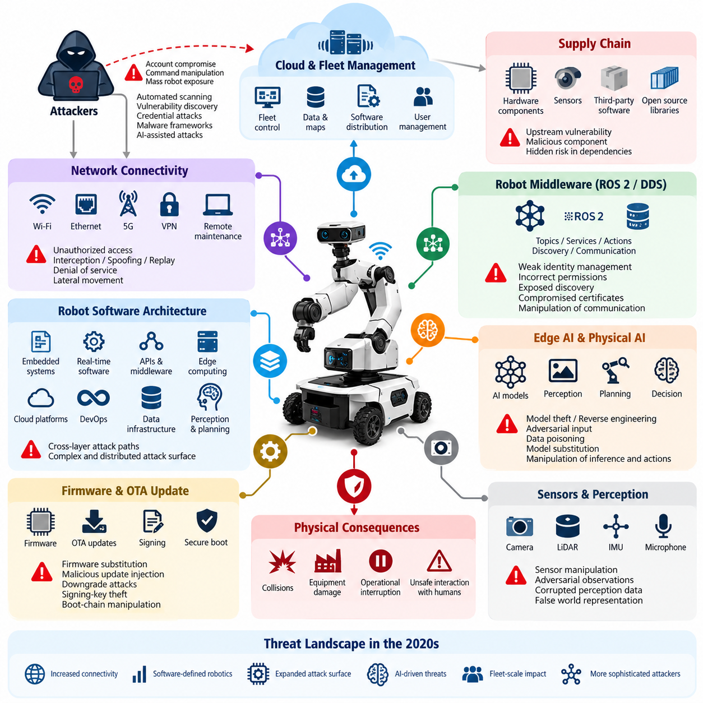{width="7.268055555555556in" height="7.268055555555556in"}

The cybersecurity threat landscape for robots in the 2020s has expanded rapidly as robotic systems evolve from isolated machines into connected cyber-physical platforms. Modern robots combine embedded controllers, real-time operating systems, AI accelerators, sensors, wireless communication, cloud services, and fleet-management software. This connectivity improves capability but also creates attack paths extending from physical hardware to remote infrastructure. Volume_24_Robot_Cybersecurity

Unlike conventional information systems, a successful cyberattack against a robot can produce direct physical consequences. Manipulation of navigation commands, actuator setpoints, safety parameters, perception data, or mission instructions may cause collisions, equipment damage, operational interruption, or unsafe interaction with humans. Robot cybersecurity must therefore protect information assets while simultaneously preserving physical safety, deterministic control, and operational availability.

The transition toward software-defined robotics has further increased exposure. Robot functionality is increasingly distributed across embedded software, middleware, APIs, edge computers, cloud platforms, and continuously updated AI components. The broader robotics software architecture includes embedded systems, real-time software, ROS 2 middleware, communication APIs, data infrastructure, cloud-edge computing, DevOps, perception, planning, fleet intelligence, and Physical AI, making cybersecurity inherently cross-layer rather than a single subsystem problem. 08_Robotics_Software_Tree 08_Robotics_Software_Tree

Network connectivity represents one of the most visible attack surfaces. Ethernet, Wi-Fi, private 5G, VPN connections, remote maintenance interfaces, telemetry channels, and fleet communication links can expose robots to unauthorized access, interception, spoofing, replay, denial-of-service, and lateral movement. Once an attacker enters a poorly segmented robot network, compromise can potentially propagate from enterprise infrastructure toward operational technology and safety-critical robot components.

Robot middleware introduces another important security boundary. ROS 2 and DDS enable distributed nodes to exchange topics, services, actions, discovery information, and control data across networks. Weak identity management, incorrectly configured permissions, exposed discovery mechanisms, compromised certificates, or vulnerable nodes may allow unauthorized participants to observe or manipulate robot communication. Security must consequently address authentication, authorization, encryption, key management, logging, and middleware configuration together. Volume_24_Robot_Cybersecurity

Edge AI creates threats that differ from traditional software attacks. Valuable perception, navigation, manipulation, and decision models may be stored directly on robot computers, making model theft and reverse engineering important intellectual-property risks. Adversaries may also manipulate sensor inputs, poison training data, substitute model files, exploit inference pipelines, or construct adversarial observations intended to influence AI decisions while leaving conventional software components apparently functional. Volume_24_Robot_Cybersecurity

Physical AI intensifies this challenge because learned models increasingly influence actions in the physical environment. An adversarial image, corrupted observation, malicious language instruction, or manipulated world representation can potentially alter what a robot perceives, reasons about, or executes. Security boundaries must therefore extend beyond operating systems and networks into model registries, training datasets, multimodal inputs, inference pipelines, safety monitors, and the mechanisms translating AI decisions into physical actions. Volume_24_Robot_Cybersecurity

Cloud-connected fleets create a different scale of systemic risk. Centralized fleet managers can distribute missions, software, maps, credentials, policies, and configuration to many robots. Compromise of a privileged cloud account, management API, signing service, or fleet command channel can therefore transform an attack on one digital service into simultaneous exposure across numerous physical machines. Strong identity and access management, PKI, tenant isolation, command authentication, encryption, monitoring, and incident controls become fundamental fleet-security requirements. Volume_24_Robot_Cybersecurity

Firmware and over-the-air update mechanisms are especially sensitive because they modify software below normal application-level defenses. Attackers may attempt firmware substitution, malicious update injection, downgrade attacks, signing-key theft, boot-chain manipulation, or supply-chain compromise. Secure boot, measured boot, cryptographic package verification, anti-rollback mechanisms, protected key storage, software bills of materials, and controlled update pipelines establish a chain of trust from device startup through operational software deployment. Volume_24_Robot_Cybersecurity

Supply-chain risk has become equally significant as robots incorporate processors, sensors, operating systems, middleware, containers, open-source libraries, AI frameworks, pretrained models, and third-party services. A vulnerability introduced upstream can remain hidden until deployed across an entire product family. Cybersecurity programs must consequently understand component provenance, software dependencies, known vulnerabilities, update responsibilities, signing relationships, and the trust assumptions associated with external suppliers.

Attackers in the 2020s also benefit from automation. Internet-scale scanning, automated vulnerability discovery, credential attacks, malware frameworks, and AI-assisted reconnaissance can reduce the effort required to identify exposed robotic infrastructure. At the same time, heterogeneous robot fleets often contain devices with different operating systems, firmware versions, compute architectures, network interfaces, and maintenance schedules, making consistent hardening and vulnerability remediation substantially more difficult.

The threat landscape also includes insiders and legitimate credentials used outside their intended scope. Engineers, operators, suppliers, maintenance personnel, cloud administrators, and automated services may possess powerful access to robot systems. Stolen credentials or excessive privileges can bypass perimeter defenses without exploiting a technical vulnerability. Modern robot security therefore increasingly depends on explicit identities, least privilege, segmented trust boundaries, auditable actions, credential rotation, and continuous verification.

Availability deserves special emphasis because robots perform time-dependent physical operations. Conventional defensive responses such as abruptly shutting down a server may be inappropriate for a mobile robot, manipulator, humanoid, or UAV executing a safety-critical maneuver. Security mechanisms must coordinate with functional safety so that detection, isolation, degradation, emergency stopping, recovery, and return-to-service procedures maintain the machine in a controlled physical state.

The convergence of cybersecurity and safety changes how risk must be evaluated. A vulnerability should not be ranked only by technical exploitability or information loss; analysts must also consider reachable physical states, operational context, robot authority, environmental hazards, fleet-scale propagation, and the effectiveness of independent safety controls. Cyber-physical risk assessment therefore connects digital attack chains with potential physical consequences rather than treating them as separate engineering domains.

Effective defense requires continuous lifecycle management rather than a one-time security configuration. Threat modeling begins during architecture design, followed by secure implementation, code and dependency analysis, penetration testing, firmware and middleware validation, deployment hardening, monitoring, vulnerability management, incident response, secure updates, and eventual decommissioning. The broader volume structure accordingly treats cybersecurity from fundamentals and threat modeling through network, ROS 2, AI, cloud, OTA, testing, incident response, Physical AI, and compliance. Volume_24_Robot_Cybersecurity

The defining characteristic of the 2020s robot cybersecurity landscape is therefore convergence. IT security, operational technology security, embedded security, network security, cloud security, AI security, functional safety, and physical protection increasingly intersect inside the same machine. Protecting robots requires understanding not merely whether an attacker can enter a system, but whether that intrusion can propagate through perception, reasoning, communication, control, and actuation until digital manipulation becomes physical behavior.

## 01.02. CIA Triad for Robot Systems Confidentiality Integrity

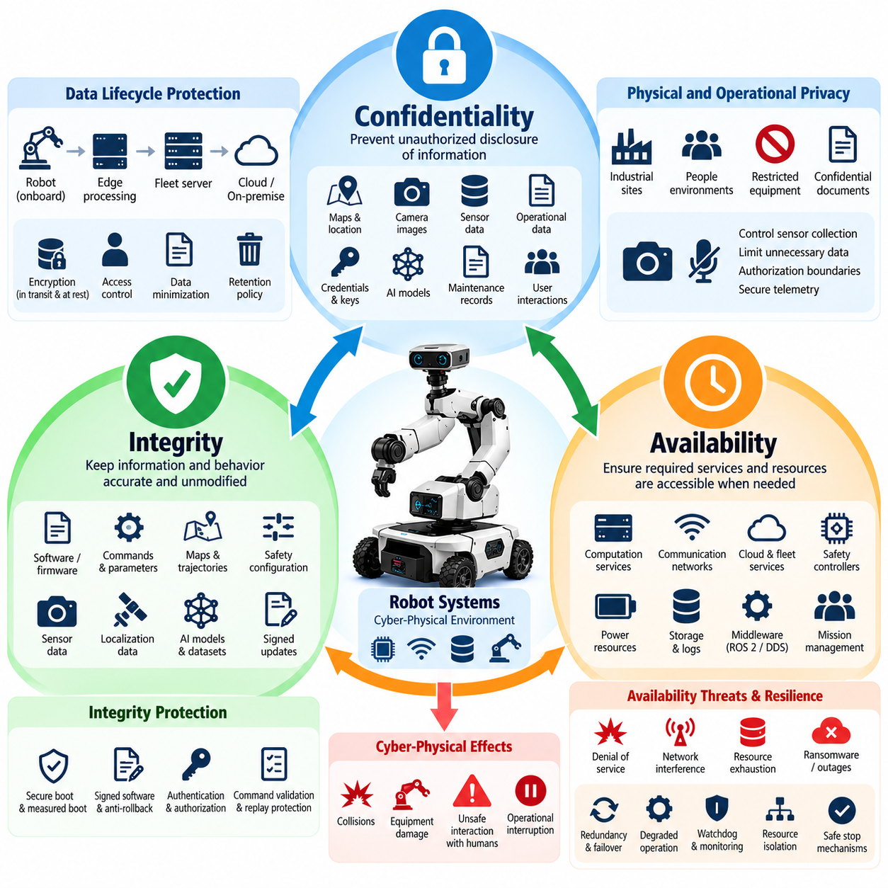{width="7.268055555555556in" height="7.268055555555556in"}

Confidentiality, integrity, and availability form the CIA triad, a foundational model for cybersecurity that remains highly relevant to robotic systems. In robotics, however, these properties must be interpreted within a cyber-physical environment where software, networks, sensors, actuators, AI models, and physical processes interact continuously. A security failure can therefore affect both digital information and the physical behavior of the machine.

Confidentiality protects information from disclosure to unauthorized entities. Robots routinely process operational maps, camera streams, LiDAR point clouds, localization data, production information, user interactions, maintenance records, credentials, cryptographic keys, and proprietary AI models. Exposure of these assets may reveal sensitive environments, intellectual property, operational procedures, or information that an attacker could later use to prepare more targeted attacks.

Robot confidentiality must be maintained across the complete data lifecycle. Sensor information may originate on a device, move through middleware such as ROS 2 or DDS, be processed by an edge computer, transmitted to a fleet server, and eventually stored in cloud or on-premise infrastructure. Protection therefore requires appropriate access control and encryption for data at rest and in transit, while credentials and cryptographic material require particularly strong storage and lifecycle controls.

Confidentiality also has an important physical dimension. Mobile robots, humanoids, UAVs, and service robots may operate in spaces containing people, industrial processes, restricted equipment, or confidential documents. Cameras and microphones can unintentionally collect information beyond what is necessary for the robot\'s mission. Security architecture should consequently combine cybersecurity controls with data minimization, retention policies, authorization boundaries, and controlled telemetry collection.

Integrity ensures that information, software, commands, and system states remain accurate and are modified only through authorized mechanisms. For robotic systems, integrity is frequently more safety-critical than confidentiality because corrupted information can directly alter physical behavior. Manipulated velocity commands, navigation goals, calibration parameters, actuator limits, maps, trajectories, or safety configurations may cause a robot to behave incorrectly even when all components remain operational.

Sensor integrity is particularly important because autonomous robots construct their understanding of the environment from observations. Spoofed GNSS signals, altered camera images, falsified LiDAR measurements, corrupted IMU data, or modified localization information can influence perception and planning. Multi-sensor fusion does not automatically solve this problem because compromised inputs may propagate through estimation algorithms and produce a plausible but incorrect representation of the physical world.

Command integrity protects the transition from computation to physical action. Commands generated by operators, fleet managers, planners, AI agents, or cloud services should be attributable to trusted identities and protected against unauthorized modification. Authentication, authorization, cryptographic signing, message integrity verification, replay protection, sequence validation, and carefully defined command interfaces help ensure that robots execute instructions originating from legitimate and authorized sources.

Software and firmware integrity extend this principle throughout the execution stack. Bootloaders, operating systems, device drivers, ROS 2 nodes, containers, control applications, AI models, configuration files, and firmware must correspond to approved versions. Secure boot, measured boot, signed software packages, protected update mechanisms, hashes, trusted repositories, and anti-rollback controls can establish a chain of trust from initial startup to application execution.

AI introduces additional integrity requirements. A robot may execute a technically authentic model whose behavior has nevertheless been compromised through poisoned training data, unauthorized fine-tuning, model substitution, manipulated prompts, or adversarial inputs. Model provenance, dataset governance, signed model artifacts, secure loading, inference monitoring, and independent safety boundaries are therefore necessary extensions of conventional integrity controls for Physical AI systems.

Availability ensures that authorized users and system components can obtain required services and resources when needed. Robot availability differs from ordinary IT availability because delayed computation or communication can be equivalent to failure. A navigation service responding several seconds late, a stalled perception pipeline, an unavailable safety controller, or a congested command channel may create unsafe conditions even though the affected component eventually recovers.

Threats to availability include denial-of-service attacks, wireless interference, network congestion, resource exhaustion, software crashes, ransomware, cloud outages, certificate failures, storage exhaustion, and malicious workload generation. Edge AI systems may also experience GPU or memory exhaustion caused by abnormal workloads. Fleet architectures can amplify these problems when many robots depend on the same authentication service, message broker, map server, or centralized mission-management platform.

Availability must therefore be designed together with resilience. Robots may require redundant communication paths, local fallback behaviors, watchdogs, health monitoring, degraded operating modes, resource isolation, failover services, and safe-stop mechanisms. Critical functions should not depend unnecessarily on remote infrastructure. When cloud connectivity disappears, the robot should transition according to predefined operational and safety policies rather than entering an unpredictable state.

The three CIA properties are closely connected and sometimes compete with one another. Strong encryption can protect confidentiality and integrity but may increase computational latency. Aggressive network isolation can reduce attack exposure but interfere with diagnostics or fleet coordination. Highly available remote maintenance interfaces may increase unauthorized-access risk. Robot security engineering must therefore balance the CIA objectives according to mission criticality, physical consequences, timing requirements, and system architecture.

Different robot assets also require different CIA priorities. Confidentiality may dominate for proprietary AI models or sensitive sensor recordings, while integrity may dominate for actuator commands, safety parameters, maps, and firmware. Availability may be the highest priority for emergency-stop communication, real-time control, localization, and essential perception services. A useful security architecture identifies each critical asset and explicitly determines the consequences of losing each CIA property.

These consequences should be evaluated through cyber-physical scenarios rather than purely digital metrics. Loss of confidentiality may expose a warehouse map; loss of map integrity may redirect an autonomous mobile robot into a restricted area; loss of localization availability may force the same robot to stop. The asset is similar, but each security property produces a fundamentally different operational consequence and therefore requires different preventive and recovery controls.

The CIA triad also provides a foundation for defense-in-depth and later robot cybersecurity analysis. Network segmentation, identity management, secure ROS 2 communication, firmware signing, cloud security, AI model protection, monitoring, incident response, and security testing can all be related to confidentiality, integrity, and availability objectives. This relationship provides a common language for connecting cybersecurity requirements across hardware, software, network, cloud, and Physical AI layers.

For modern robots, the CIA triad should ultimately be interpreted as a cyber-physical assurance model rather than only an information-security model. Confidentiality protects sensitive knowledge, integrity preserves trustworthy perception and action, and availability maintains required functions at the required time. Together they establish the basic security properties needed for robots to perceive, reason, communicate, and act without unauthorized digital influence producing unacceptable physical consequences.

## 01.03. Attack Surface Analysis HW SW Network Physical

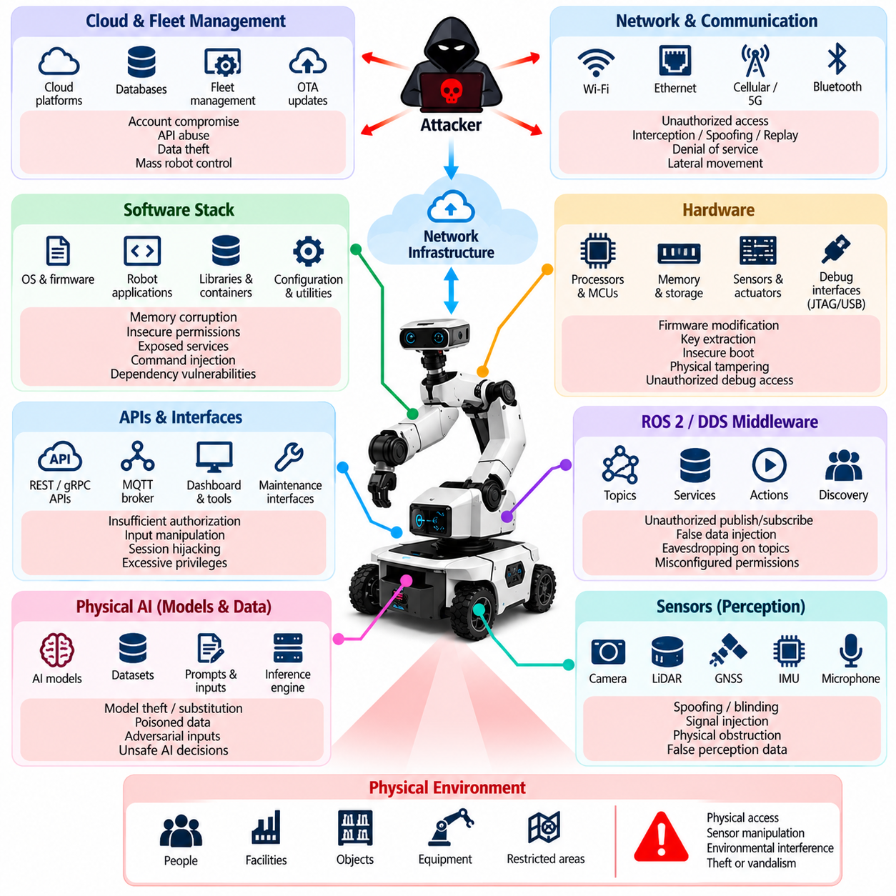{width="7.268055555555556in" height="7.268055555555556in"}

Attack surface analysis for a robot system identifies every location where an adversary could interact with, influence, extract information from, or disrupt the platform. Unlike conventional computers, robots expose attack surfaces across hardware, software, communication networks, cloud services, sensors, actuators, and the surrounding physical environment. Security analysis must therefore examine the robot as an integrated cyber-physical system rather than as a collection of isolated computers.

The hardware attack surface begins with processors, microcontrollers, AI accelerators, memory devices, storage media, communication modules, sensors, motor controllers, and power-management components. Debug interfaces such as JTAG, UART, USB, and maintenance ports can provide privileged access when they remain enabled in production. Removable storage, exposed connectors, and poorly protected internal buses may similarly allow extraction or modification of sensitive data and firmware.

Hardware security analysis must also consider the boot process and the device root of trust. If an attacker can replace a bootloader, modify firmware stored in flash memory, bypass signature verification, or obtain cryptographic keys from an insecure storage device, higher software layers may no longer be trustworthy. Secure boot, hardware-backed key storage, protected debug interfaces, measured boot, and tamper-resistant design reduce opportunities for persistent compromise.

Sensors form a distinctive hardware and physical attack surface because robots depend on them to observe the world. Cameras, LiDAR, radar, GNSS receivers, IMUs, microphones, force sensors, encoders, and proximity sensors accept information from the environment rather than exclusively from trusted digital channels. Attackers may attempt spoofing, blinding, interference, signal injection, obstruction, or physical repositioning to cause incorrect observations without directly compromising robot software.

The software attack surface spans bootloaders, firmware, operating systems, device drivers, middleware, robot applications, libraries, containers, AI runtimes, configuration files, and management utilities. Vulnerabilities such as memory corruption, insecure permissions, weak authentication, exposed services, unsafe deserialization, command injection, dependency flaws, and configuration errors may provide entry points. Every additional executable component or privileged service expands the software that must be trusted and maintained.

ROS 2 and DDS introduce distributed communication interfaces that must also be included in software attack surface analysis. Nodes expose topics, services, actions, discovery functions, parameters, and other communication mechanisms. An improperly protected participant may publish false data, subscribe to sensitive information, invoke services, or interfere with discovery. Security configuration must therefore reflect which identities are permitted to communicate and which resources each participant may access.

Robot APIs create another boundary between internal functionality and external systems. REST interfaces, gRPC services, WebSocket connections, MQTT brokers, fleet APIs, diagnostic endpoints, dashboards, and maintenance tools can expose powerful robot capabilities. Authentication alone is insufficient if authorization is too broad. API analysis should examine identity, privilege, input validation, rate limits, session handling, command scope, auditability, and the consequences of a compromised client.

The network attack surface includes wired Ethernet, Wi-Fi, Bluetooth, cellular links, private 5G, VPN connections, industrial networks, remote access channels, and robot-to-robot communication. Attackers may exploit exposed ports, weak protocols, insecure routing, misconfigured firewalls, credential theft, spoofing, replay attacks, interception, or denial-of-service conditions. Flat networks are especially dangerous because compromise of one reachable component may enable lateral movement toward more critical systems.

Network architecture should therefore be analyzed in terms of zones, conduits, trust boundaries, and data flows rather than only individual devices. Safety control, robot management, AI data processing, enterprise IT, development environments, cloud connectivity, and guest or maintenance access should not automatically share equivalent trust. Segmentation, access-control lists, firewalls, encrypted tunnels, network access control, and monitoring can restrict how far an intrusion can propagate.

Wireless communication enlarges the attack surface beyond physically connected infrastructure. Radio signals may extend outside the controlled operational area, allowing adversaries to interact with systems without entering the facility. Authentication, modern encryption, certificate-based device identity, secure pairing, interference monitoring, and carefully controlled fallback behavior are important because loss or manipulation of wireless connectivity can affect both cybersecurity and robot availability.

Cloud and fleet-management infrastructure extends the robot attack surface far beyond the physical machine. Device registries, identity services, databases, message brokers, object storage, telemetry pipelines, dashboards, remote-control services, and OTA platforms may communicate with hundreds or thousands of robots. A compromised centralized service can therefore become a high-leverage attack point capable of influencing many distributed physical systems simultaneously.

The Physical AI attack surface adds models, datasets, prompts, multimodal inputs, inference engines, model registries, and AI-agent interfaces to the traditional security boundary. An attacker may not need to compromise an operating system if manipulated input can cause the AI system to generate unsafe decisions. Adversarial observations, model substitution, data poisoning, prompt injection, and unauthorized model modification demonstrate why AI behavior itself must be considered part of the robot security surface.

The physical attack surface includes enclosures, emergency controls, charging stations, docking interfaces, maintenance panels, exposed cables, sensors, actuators, and accessible computing equipment. An attacker with physical access may disconnect sensors, attach unauthorized peripherals, replace components, copy storage media, manipulate switches, or interfere with mechanical systems. Physical security controls must therefore complement digital protections rather than being treated as a separate concern.

Actuators represent the final cyber-physical boundary because digital commands become physical forces and motion at this layer. Motors, steering systems, manipulators, grippers, flight-control surfaces, brakes, and other actuated mechanisms require strict control over command authority. Even when upstream software is compromised, independent limits, safety controllers, emergency-stop mechanisms, watchdogs, and hardware interlocks can reduce the physical consequences of malicious commands.

Attack surface analysis should also include supply-chain and lifecycle interfaces. Manufacturing tools, development laptops, software repositories, third-party libraries, firmware signing systems, factory provisioning, maintenance equipment, OTA infrastructure, and decommissioning procedures can introduce vulnerabilities before deployment or after normal operation begins. A robot that is secure during runtime may still be compromised through an inadequately protected development, update, or service process.

A practical analysis maps assets, interfaces, trust boundaries, privileges, communication paths, physical access points, and dependencies, then evaluates how compromise could propagate between them. An exposed maintenance port may lead to firmware access; compromised firmware may expose credentials; stolen credentials may enable network access; network access may reach fleet services; and fleet compromise may affect many robots. Attack surfaces must therefore be analyzed as connected attack paths rather than independent vulnerabilities.

The objective is not to eliminate every interface, because connectivity, sensors, APIs, remote maintenance, and AI capabilities are essential to modern robotics. Instead, unnecessary interfaces should be removed, necessary interfaces minimized, privileges constrained, communications authenticated, software maintained, physical access controlled, and critical boundaries independently monitored. This approach establishes the foundation for defense-in-depth, Zero Trust, threat modeling, security testing, and cyber-physical risk management throughout the robot lifecycle.

## 01.04. Cybersecurity Standards IEC 62443 ISO 21434 Overview

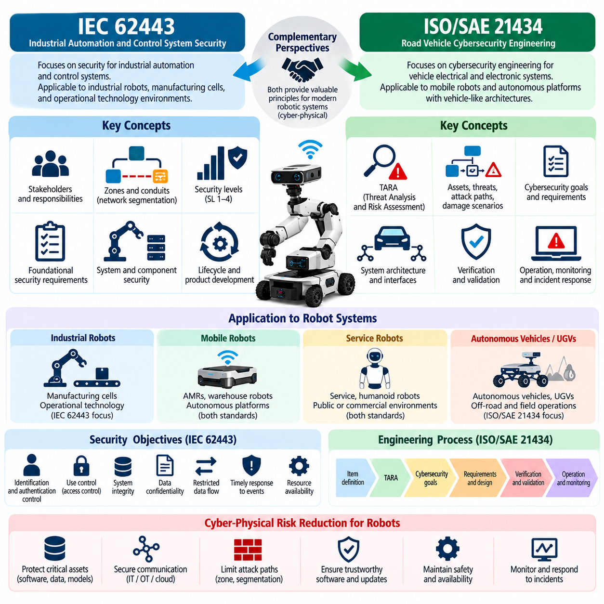{width="7.268055555555556in" height="7.268055555555556in"}

IEC 62443 and ISO/SAE 21434 provide two important cybersecurity perspectives for modern robotic systems. IEC 62443 originates from industrial automation and control system security, while ISO/SAE 21434 addresses cybersecurity engineering for road vehicles. Robots frequently combine characteristics of industrial equipment, autonomous vehicles, embedded computers, connected devices, and cloud-managed platforms, making concepts from both standards valuable when establishing a structured cybersecurity engineering program.

IEC 62443 treats cybersecurity as a system-level responsibility spanning asset owners, system integrators, product suppliers, and service providers. This perspective is highly applicable to industrial robots, autonomous mobile robots, warehouse fleets, manufacturing cells, and other systems operating within operational technology environments. Security is not reduced to individual device protection; instead, organizational processes, system architecture, component capabilities, lifecycle activities, and operational controls must work together.

A central IEC 62443 concept is the separation of an industrial system into zones and conduits. A zone groups assets that share similar security requirements, while a conduit represents controlled communication between zones. Applied to robotics, safety controllers, motion controllers, perception computers, fleet servers, engineering workstations, enterprise systems, cloud services, and maintenance networks can be separated according to their functions, criticality, and trust assumptions rather than being placed on one unrestricted network.

This zone-and-conduit model supports defense-in-depth by limiting unnecessary connectivity and reducing lateral movement after compromise. For example, a perception computer processing high-bandwidth sensor data does not necessarily require unrestricted access to a safety controller. Similarly, a maintenance laptop should not automatically inherit the same privileges as an authenticated robot controller. Firewalls, network segmentation, authenticated communication, access policies, and monitored gateways can enforce the intended boundaries.

IEC 62443 also introduces security levels that express increasing resistance to different classes of attackers and attack sophistication. The appropriate level depends on risk rather than on a universal requirement that every component receive maximum protection. For robot engineering, this encourages teams to evaluate the consequences of compromise, attacker capability, exposure, operational environment, and existing safeguards before determining security requirements for each zone, system, or component.

The foundational requirements associated with IEC 62443 address major security objectives such as identification and authentication control, use control, system integrity, data confidentiality, restricted data flow, timely response to events, and resource availability. These objectives map naturally to robotic systems. They affect device identity, operator privileges, command integrity, network segmentation, security monitoring, protected telemetry, software integrity, and resilience against denial-of-service conditions.

IEC 62443 further emphasizes secure product development and lifecycle processes. Cybersecurity must begin with requirements and architecture rather than being added immediately before deployment. Threat analysis, secure design, implementation practices, vulnerability management, verification, security documentation, patch processes, and maintenance responsibilities must continue throughout the product lifecycle. This is particularly important for robots expected to remain operational for many years while their software dependencies and threat environments continue to change.

ISO/SAE 21434 approaches cybersecurity from the perspective of vehicle electrical and electronic systems and their engineering lifecycle. Its concepts are especially relevant to mobile robots and autonomous platforms that share architectural characteristics with modern vehicles, including distributed electronic control units, sensors, communication networks, connectivity modules, software-intensive functions, remote services, and safety-related control behavior.

A major concept in ISO/SAE 21434 is threat analysis and risk assessment, commonly referred to as TARA. Engineers identify assets, damage scenarios, threat scenarios, and attack paths, then assess relevant factors to determine cybersecurity risk and appropriate treatment. For robots, assets may include control commands, localization information, sensor data, firmware, cryptographic credentials, AI models, mission information, or communication channels whose compromise could produce operational or physical consequences.

Damage scenarios connect cybersecurity events with consequences that matter to stakeholders. A compromised robot is therefore not evaluated only by whether data was altered or a network service was accessed. Engineers consider what could happen if steering, braking, motion control, navigation, perception, or remote commands were manipulated. This cyber-physical interpretation is particularly valuable because cybersecurity failures in robots can propagate from digital compromise to unsafe physical behavior.

Attack-path analysis examines how an adversary could move from an accessible interface toward a protected asset. A wireless interface might provide access to a communication service, which exposes a software vulnerability, which enables privilege escalation, which then reaches a control function. Modeling this sequence helps engineers understand that security depends on multiple connected barriers rather than on a single firewall, password, cryptographic mechanism, or software component.

ISO/SAE 21434 also emphasizes cybersecurity goals, cybersecurity requirements, verification, validation, and traceability across development. High-level risk treatment must be translated into technical requirements that can be implemented and tested. For a robotic platform, a requirement to prevent unauthorized motion commands may lead to authenticated device identities, authorization policies, message-integrity protection, replay prevention, command validation, monitoring, and independent safety constraints.

Both IEC 62443 and ISO/SAE 21434 emphasize lifecycle cybersecurity because vulnerabilities and threats evolve after products enter service. Software updates, newly discovered vulnerabilities, changed configurations, replacement components, third-party dependencies, remote services, and operational modifications can alter the original risk assumptions. Robot manufacturers and operators therefore need vulnerability monitoring, incident handling, secure update mechanisms, configuration management, and processes for maintaining cybersecurity throughout operational life.

The two frameworks are complementary rather than interchangeable. IEC 62443 is particularly useful for industrial automation environments, segmented operational networks, industrial components, and relationships among asset owners, integrators, and suppliers. ISO/SAE 21434 contributes a strong vehicle-oriented cybersecurity engineering lifecycle and structured threat-and-risk perspective. A mobile industrial robot may therefore benefit from IEC 62443 principles at the factory and infrastructure level while using ISO/SAE 21434 concepts to strengthen platform-level risk engineering.

Neither framework should be applied as a mechanical checklist without understanding the robot architecture. A stationary manipulator, warehouse AMR, outdoor inspection robot, humanoid, and cargo UAV expose different interfaces, physical consequences, communication dependencies, and attacker opportunities. Standards provide structured processes and security concepts, but engineering teams must translate them into architecture-specific controls based on actual assets, trust boundaries, attack paths, safety functions, and operational environments.

For Physical AI systems, established cybersecurity standards also need to be connected with emerging AI-specific risks. Traditional controls remain necessary for identities, networks, software, firmware, updates, and communication, but AI models introduce additional concerns involving model provenance, training data, adversarial inputs, model substitution, inference integrity, and AI-agent authority. These risks should be incorporated into the same lifecycle discipline rather than managed as an isolated AI security activity.

For robot cybersecurity engineering, the primary value of IEC 62443 and ISO/SAE 21434 is the transition from ad hoc protection toward systematic assurance. Security becomes a traceable process connecting risk assessment, architecture, requirements, implementation, verification, deployment, monitoring, vulnerability management, and maintenance. This foundation supports later work involving Zero Trust, secure ROS 2 communication, fleet security, OTA protection, cybersecurity testing, incident response, and compliance assessment across the complete robot lifecycle.

## 01.05. Defense in Depth for Robot Architecture [w/Code]

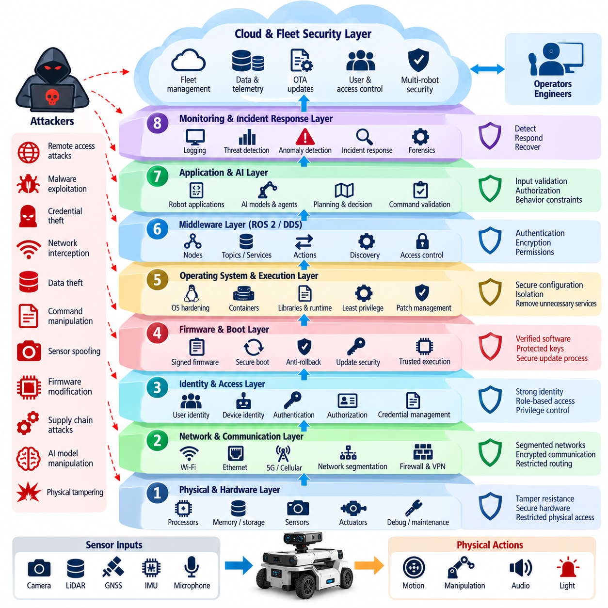{width="7.268055555555556in" height="7.268055555555556in"}

Defense in depth is a cybersecurity architecture principle in which multiple independent and complementary security controls protect a robot instead of relying on a single defensive mechanism. A modern robot contains hardware, firmware, operating systems, middleware, networks, AI models, cloud services, and physical actuators. Each layer can fail or be compromised, so security must remain effective even when one protective boundary is bypassed.

The central assumption of defense in depth is that no security control is perfect. Authentication credentials may be stolen, software may contain unknown vulnerabilities, certificates may be misconfigured, and trusted devices may become compromised. Robot architecture should therefore place additional barriers behind each exposed interface. An attacker who crosses one boundary should still encounter restricted privileges, segmented networks, integrity checks, monitoring, and independent safety controls.

The first defensive layer begins with physical hardware and the device root of trust. Production robots should restrict debug ports, protect removable storage, control physical maintenance interfaces, and secure cryptographic material using appropriate hardware-backed mechanisms. Secure boot and measured boot can establish confidence that firmware and system software have not been replaced before execution, creating a trusted foundation for higher software layers.

Firmware and operating-system protection form the next layer. Signed firmware, anti-rollback mechanisms, protected update procedures, least-privilege services, hardened operating-system configurations, application isolation, and timely vulnerability remediation reduce opportunities for persistent compromise. Unnecessary services, default accounts, development utilities, and unused network listeners should be removed because every additional privileged component increases the attack surface.

Identity provides another essential defensive boundary. Robots, operators, services, engineering tools, cloud applications, and automated agents should have identifiable security principals rather than relying only on network location. Strong authentication, device certificates, protected credentials, role-based or attribute-based authorization, short-lived credentials where practical, and controlled privilege elevation help prevent one compromised identity from automatically gaining unrestricted system authority.

Network segmentation prevents compromise of one component from becoming compromise of the complete robot environment. Safety control, motion control, perception, AI computing, fleet management, enterprise IT, cloud access, development systems, and maintenance networks can be separated according to trust and criticality. Firewalls, access-control lists, authenticated gateways, encrypted tunnels, and restricted routing enforce communication paths between these security zones.

ROS 2 and DDS require defense at the middleware layer because network isolation alone cannot determine which nodes should exchange specific information. Authentication can establish participant identity, encryption can protect communication, and access-control policies can restrict topics, services, and actions. A compromised perception node, for example, should not automatically receive permission to issue safety-critical motion commands simply because it resides on the robot network.

Application-level controls provide another barrier after operating-system and middleware defenses. Robot applications should validate commands, parameters, sensor messages, file formats, API requests, and state transitions before using them. Authorization must be checked close to the protected operation rather than assumed from an upstream gateway. Rate limiting, bounds checking, secure error handling, and explicit command validation reduce the impact of malicious or malformed inputs.

The control architecture should independently constrain physical behavior. Even if a planning application or AI agent generates an unsafe command, lower-level controllers can enforce velocity, acceleration, torque, workspace, geofence, and actuator limits. Safety controllers, watchdogs, emergency-stop circuits, hardware interlocks, and independent monitoring functions create barriers between compromised digital decision making and dangerous physical motion.

Physical AI introduces additional layers that conventional network security cannot provide. Model files should be authenticated before loading, model registries should enforce controlled publication, and training or adaptation pipelines should preserve data provenance. Runtime monitoring can identify abnormal inputs or outputs, while deterministic safety constraints can limit actions proposed by learned policies, vision-language-action models, or autonomous AI agents.

Cloud and fleet systems require their own defensive layers because centralized infrastructure can influence many robots simultaneously. Device identity, mutual authentication, API authorization, tenant isolation, command signing, protected databases, secrets management, security logging, and administrative privilege separation should protect fleet services. High-impact commands may require stronger verification because compromise at the fleet level can propagate to many physical platforms.

OTA update architecture is another critical defense boundary. Update packages should originate from trusted repositories, carry verifiable digital signatures, and be checked before installation. Secure boot can verify installed software during subsequent startup, while anti-rollback mechanisms prevent attackers from restoring vulnerable versions. Separating signing infrastructure from distribution infrastructure further reduces the consequences of compromise in the update delivery system.

Monitoring provides the detection layer of defense in depth. Authentication failures, unexpected network connections, unusual ROS 2 communication, unauthorized configuration changes, abnormal resource consumption, firmware verification failures, AI inference anomalies, and suspicious fleet commands should generate observable security events. Centralized logging and correlation can reveal attack sequences that appear harmless when each robot or subsystem is examined independently.

Effective monitoring must be connected to controlled response mechanisms. A suspicious robot may need network quarantine, credential revocation, workload termination, transition to a degraded mode, or controlled stopping. Response actions must consider physical safety because abruptly disconnecting communication or terminating software can itself create hazards. Cybersecurity containment and functional safety behavior should therefore be coordinated during architecture design.

Resilience and recovery constitute additional defensive layers after prevention and detection have failed. Robots should maintain trusted recovery images, protected configuration backups, known-good firmware, credential replacement procedures, and controlled return-to-service processes. Critical fleet infrastructure may require redundancy and failover. Recovery should restore not merely system availability but also confidence that identities, software, configurations, and data are trustworthy.

Defense in depth also extends into development and supply-chain processes. Source repositories, CI/CD systems, dependency management, build servers, artifact registries, signing keys, third-party components, and engineering workstations can become paths into deployed robots. Code review, software composition analysis, SBOM management, protected build pipelines, signed artifacts, vulnerability tracking, and controlled release approval reduce the possibility that compromise enters before deployment.

The effectiveness of layered security depends on independence between controls. Multiple mechanisms provide limited value if they all depend on the same credential, administrator, network service, or compromised computer. Critical robot functions should therefore avoid unnecessary common failure points. Independent safety controllers, separate signing authorities, segmented management paths, and distinct monitoring channels can preserve protection when another security domain fails.

Defense in depth ultimately transforms robot cybersecurity from perimeter protection into continuous containment. The objective is not to assume that every attack can be prevented, but to ensure that compromise of one interface does not automatically provide control over perception, planning, communication, firmware, fleet services, or actuation. By combining hardware trust, identity, segmentation, middleware security, application validation, AI protection, monitoring, safety constraints, and recovery, robot architecture can limit both cyber intrusion and its physical consequences.

## 01.06. Zero Trust Architecture for Robot Systems [w/Code]

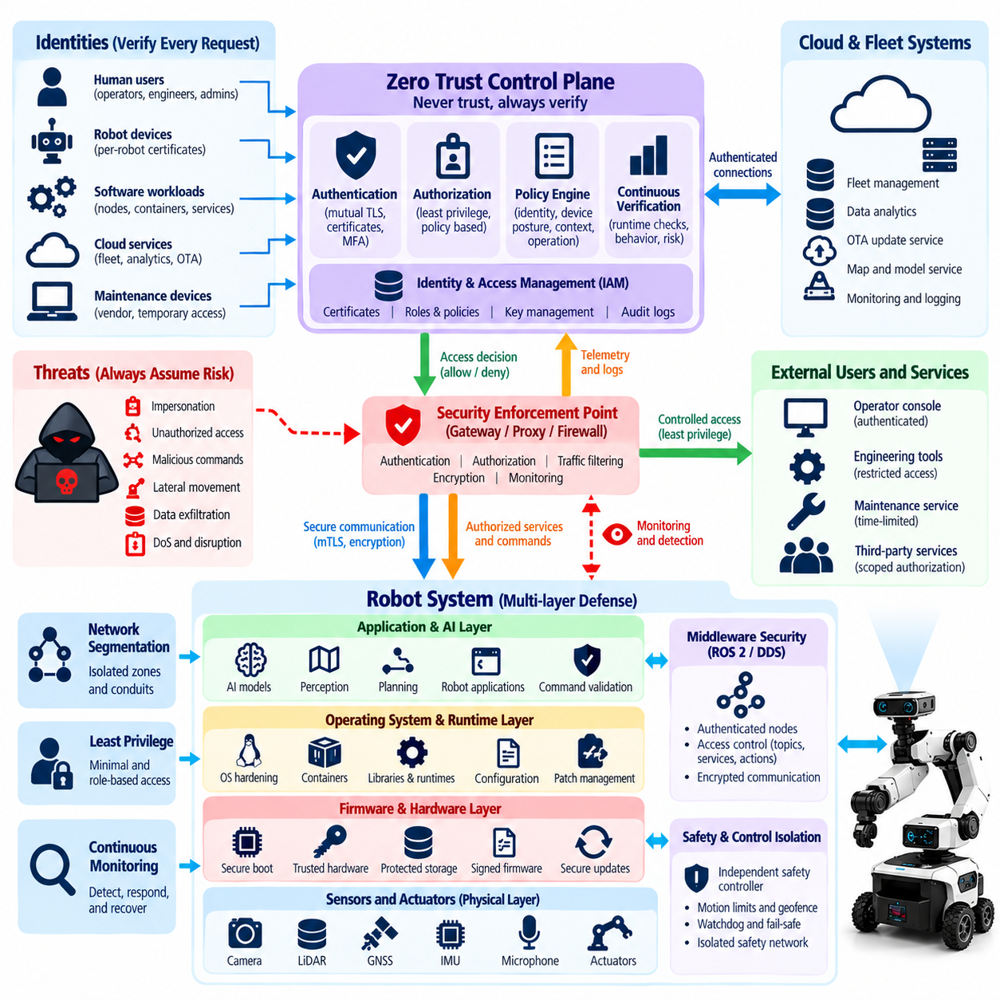{width="7.268055555555556in" height="7.268055555555556in"}

Zero Trust Architecture applies the principle of "never trust, always verify" to every identity, device, service, communication path, and workload participating in a robot system. Traditional architectures often assume that components inside a robot or protected network are trustworthy. Zero Trust removes this assumption and requires explicit verification before access is granted, even when communication occurs between components located within the same robot or operational network.

Robotic systems particularly benefit from Zero Trust because they combine heterogeneous computing environments. Microcontrollers, edge computers, ROS 2 nodes, AI accelerators, operator consoles, fleet servers, engineering workstations, cloud services, and mobile maintenance devices may all participate in one operational system. Compromise of any component should not automatically establish trust in other components or provide unrestricted access to critical robot functions.

Identity becomes the primary security boundary in a Zero Trust robot architecture. Each robot, device, software service, operator, administrator, and automated agent should possess a verifiable identity. Device certificates, cryptographic credentials, workload identities, and user authentication mechanisms allow access decisions to be based on who or what is requesting a resource rather than merely on the requester's IP address or physical network location.

Authentication establishes identity, but Zero Trust also requires fine-grained authorization. A valid identity should receive only the permissions necessary for its assigned function. A perception node may publish detected objects but should not automatically modify motor-control parameters. A maintenance engineer may access diagnostics without receiving authority to issue fleet-wide commands. Least privilege limits the consequences when legitimate identities or trusted components become compromised.

Mutual authentication strengthens communication between robot components because both endpoints verify each other before exchanging protected information. This is particularly important for robot-to-cloud, robot-to-fleet, service-to-service, and administrative connections. Certificate-based authentication and mutually authenticated encrypted channels can reduce impersonation and man-in-the-middle risks while providing a stronger foundation for authorization decisions.

Zero Trust requires continuous verification rather than a one-time decision made when a session begins. Device posture, software version, certificate status, configuration integrity, network context, user privilege, and observed behavior may change during operation. Access policies can therefore consider current security state and revoke or restrict permissions when a robot, service, account, or endpoint no longer satisfies established trust requirements.

Microsegmentation applies Zero Trust principles to network architecture. Safety control, motion control, perception, AI inference, fleet management, maintenance, enterprise IT, and cloud connectivity should communicate only through explicitly permitted paths. Network location alone should not imply trust. Firewalls, access-control policies, authenticated gateways, service identities, and restricted routing can limit lateral movement after one component has been compromised.

ROS 2 and DDS can participate in this model by applying identity and authorization at the middleware level. A node should not gain access to every topic, service, or action simply because it joins the DDS domain. Security policies can define which authenticated participants may publish, subscribe, invoke services, or perform actions. This provides application-aware access control beyond conventional IP-level network segmentation.

Robot APIs also require resource-specific authorization. REST, gRPC, WebSocket, MQTT, fleet-management, and maintenance interfaces may expose commands with very different physical consequences. Reading telemetry, changing configuration, initiating software updates, commanding motion, and performing emergency operations should not share identical privileges. API gateways and application services should evaluate identity, permission, context, and requested operation before execution.

Zero Trust becomes especially important for remote maintenance and engineering access. Vendor laptops, service tools, VPN users, and temporary maintenance accounts should not receive broad network access merely because they have passed perimeter authentication. Access should be limited to approved robots, services, ports, operations, and time periods. Privileged sessions should be strongly authenticated, logged, monitored, and terminated when their operational purpose has ended.

Cloud and fleet architectures extend Zero Trust across large numbers of distributed robots. Each robot should authenticate independently to fleet services, and fleet services should authenticate commands sent toward robots. Compromise of one robot should not provide credentials usable by another robot. Per-device identities, isolated secrets, scoped authorization, command signing, tenant separation, and certificate lifecycle management reduce the possibility of fleet-wide propagation.

Software workloads should also be treated as identities rather than assuming that all processes executing on a trusted computer deserve equivalent privileges. Containers, ROS 2 nodes, AI inference services, telemetry agents, update clients, and safety-related applications can receive separate credentials and permissions. Workload isolation reduces the ability of a compromised application to impersonate another service or access unrelated data and control interfaces.

Physical AI introduces a new Zero Trust question: whether outputs generated by an authenticated AI component should automatically be trusted. The answer should generally be no for safety-critical actions. AI models may produce incorrect or manipulated outputs because of adversarial inputs, poisoned data, prompt injection, model compromise, or unexpected conditions. AI-generated actions should therefore pass through authorization, policy, plausibility, and safety validation before reaching actuators.

Data itself also requires explicit trust evaluation. Sensor messages, maps, localization results, AI models, configuration files, firmware packages, and mission instructions may originate from authenticated sources yet still be stale, corrupted, replayed, or maliciously modified. Integrity protection, timestamps, sequence checks, provenance information, signatures, schema validation, and consistency checks help determine whether authenticated data is also suitable for operational use.

Zero Trust should be integrated with secure boot, firmware signing, OTA protection, and device health assessment. A device identity alone is insufficient if the device is running unauthorized software. Access decisions can incorporate evidence that the robot booted from trusted firmware, maintains an approved configuration, uses supported software versions, and has not triggered significant security alerts. Identity and platform integrity therefore reinforce each other.

Monitoring and telemetry provide the feedback required for continuous trust evaluation. Unexpected communication paths, repeated authentication failures, unusual privilege requests, abnormal ROS 2 traffic, configuration changes, suspicious API calls, or anomalous AI behavior may indicate that previously trusted components are no longer reliable. Security monitoring can trigger reauthentication, privilege reduction, credential revocation, network quarantine, or controlled operational degradation.

Zero Trust must nevertheless respect real-time control and functional safety requirements. Repeated remote authorization checks cannot be inserted blindly into microsecond- or millisecond-scale control loops. Critical local control functions may use pre-established identities, bounded permissions, deterministic policy enforcement, and locally available credentials. Architecture should preserve real-time behavior while ensuring that higher-level commands and trust transitions remain explicitly controlled.

For robot systems, Zero Trust is therefore not a single product, firewall configuration, or authentication technology. It is an architectural discipline that replaces implicit trust with identity-based, least-privilege, continuously evaluated access. When combined with segmentation, middleware security, secure software, platform integrity, monitoring, AI safety boundaries, and controlled recovery, Zero Trust limits the ability of a single compromised component to gain authority over an entire cyber-physical robot system.

## 01.07. Cybersecurity Lifecycle Concept to EOL

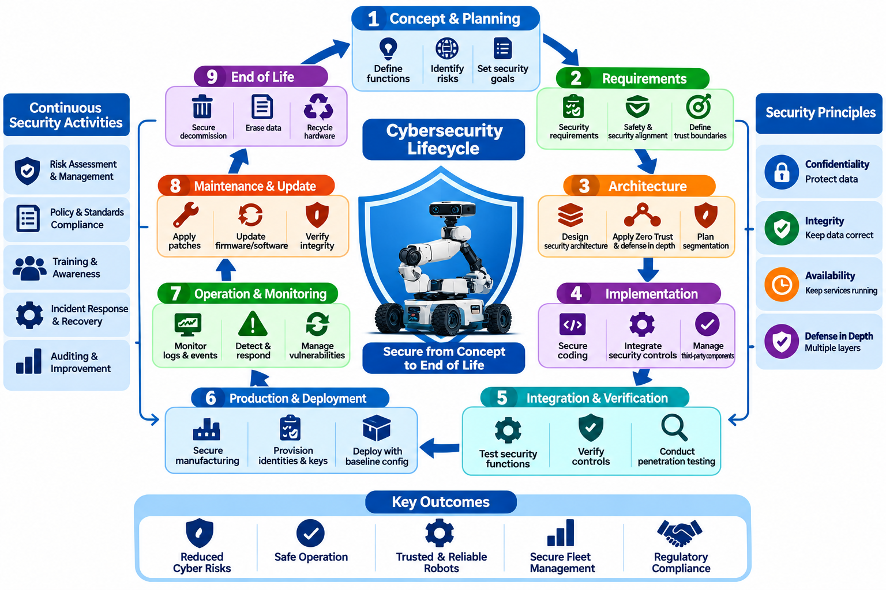{width="7.268055555555556in" height="4.845138888888889in"}

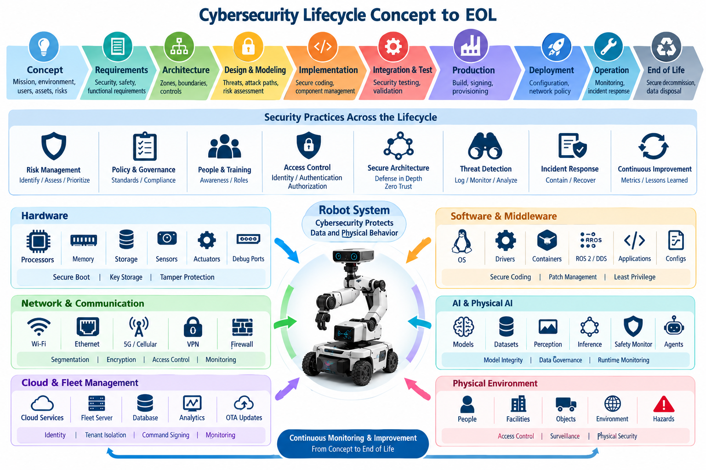{width="7.268055555555556in" height="4.845138888888889in"}

Cybersecurity must be managed throughout the complete robot lifecycle rather than treated as a feature added near the end of development. A robot evolves from concept and requirements through architecture, implementation, integration, production, deployment, operation, maintenance, and eventual end of life. Security assumptions can change at every stage, so cybersecurity activities must remain connected to engineering decisions from initial concept to final decommissioning.

During the concept phase, teams define the robot's intended functions, operating environment, connectivity, autonomy, users, external services, and potential physical consequences of misuse. These characteristics establish the initial cybersecurity context. A warehouse AMR, industrial manipulator, humanoid, or UAV may face different attackers and exposure conditions. Early security planning identifies critical assets and determines which failures could affect safety, operations, privacy, intellectual property, or fleet availability.

Cybersecurity requirements should develop alongside functional and safety requirements. Confidentiality, integrity, availability, authentication, authorization, secure communication, software integrity, logging, updateability, and recovery expectations need explicit engineering definitions. Requirements should also specify important trust boundaries and acceptable behavior following failures or attacks. Security objectives that remain vague during requirements engineering are difficult to implement consistently or verify later.

Architecture development translates these requirements into security boundaries and technical controls. Engineers identify hardware roots of trust, device identities, network zones, communication conduits, privileged services, ROS 2 and DDS permissions, cloud interfaces, update paths, AI components, and safety-control boundaries. Defense in depth and Zero Trust principles can be incorporated at this stage so that compromise of one component does not automatically provide access to critical control functions.

Threat modeling and cyber-physical risk assessment should accompany architecture development. Assets, interfaces, trust boundaries, threat scenarios, attack paths, and potential damage are analyzed before implementation choices become difficult to change. The analysis should include hardware, software, networks, physical access, supply-chain dependencies, cloud services, AI models, and maintenance interfaces. Results are translated into security requirements and prioritized engineering controls.

During implementation, secure development practices reduce the probability that vulnerabilities are introduced into robot software and firmware. Code review, static analysis, dependency management, compiler protections, secure coding rules, secrets management, input validation, and least-privilege execution should become part of normal engineering workflows. Security-critical functions such as authentication, cryptography, update verification, and command authorization require particularly careful implementation and review.

Third-party and open-source components require lifecycle management of their own. Modern robots depend on operating systems, ROS 2 packages, device drivers, AI frameworks, libraries, containers, firmware, and vendor software. Component versions and dependencies should be traceable through inventories and software bills of materials. Known vulnerabilities, licensing constraints, supplier advisories, and upstream maintenance status must remain visible throughout development and operation.

Integration and verification determine whether individual security mechanisms function correctly when combined into the complete robot. Authentication, authorization, encrypted communication, secure boot, network segmentation, middleware policies, API protection, firmware verification, and logging should be tested under realistic configurations. Negative testing is equally important because systems must demonstrate that unauthorized commands, malformed inputs, invalid certificates, and prohibited communication are rejected.

Security validation extends testing toward realistic attack scenarios. Vulnerability scanning, penetration testing, protocol fuzzing, firmware analysis, ROS 2 and DDS security testing, API testing, adversarial AI evaluation, and red-team exercises can reveal weaknesses that normal functional tests miss. Cybersecurity validation should examine not only whether an attack succeeds but also whether monitoring, containment, safety mechanisms, and recovery procedures limit the resulting physical consequences.

Production introduces additional trust relationships. Build servers, CI/CD pipelines, artifact repositories, signing services, factory provisioning systems, manufacturing equipment, and engineering workstations can influence software installed on production robots. Release artifacts should be traceable to approved source and build processes. Firmware signing, protected keys, controlled provisioning, configuration baselines, and manufacturing records help preserve trust between development and delivered hardware.

Deployment establishes the operational security baseline. Default credentials should be removed, unique device identities provisioned, certificates installed securely, unnecessary services disabled, network policies activated, and approved software versions recorded. Robots should enter service with known configurations rather than relying on manual hardening after installation. Fleet registration and cloud enrollment should also establish clear ownership, authorization, and credential relationships.

Operational cybersecurity depends on continuous visibility because deployment does not freeze the threat environment. Logs, authentication events, network activity, software versions, configuration changes, ROS 2 communication, resource consumption, AI behavior, and fleet commands can provide evidence of emerging problems. Monitoring should support detection of anomalies while maintaining sufficient context to distinguish cyber incidents from ordinary software, hardware, or operational faults.

Vulnerability management becomes a continuous lifecycle process after release. Newly discovered vulnerabilities may affect operating systems, middleware, libraries, firmware, AI frameworks, cloud services, or third-party components long after the robot has entered service. Organizations need processes for vulnerability intake, impact analysis, prioritization, remediation, disclosure, and deployment. Risk assessment should consider both exploitability and possible cyber-physical consequences.

Secure OTA and maintenance processes provide the mechanism for sustaining protection during long operational lifetimes. Updates should be authenticated, integrity-protected, version-controlled, tested, and recoverable if installation fails. Anti-rollback controls can prevent restoration of known-vulnerable software. Maintenance access should be strongly authenticated and limited in scope because service interfaces that are convenient for legitimate technicians can also become valuable attack paths.

Incident response and recovery must also be designed before incidents occur. Organizations should know how to isolate affected robots, revoke credentials, preserve forensic evidence, distribute emergency patches, restore trusted configurations, and determine whether equipment is safe to return to service. Fleet environments require particular attention because a vulnerability discovered on one robot may indicate exposure across many devices sharing software, credentials, or infrastructure.

Lifecycle cybersecurity includes managing architectural change. New sensors, AI models, cloud services, wireless technologies, customer integrations, or autonomy functions can invalidate assumptions made during initial threat modeling. Significant changes should trigger security review, updated risk assessment, regression testing, and documentation updates. Cybersecurity assurance therefore evolves with the robot rather than remaining tied permanently to the configuration that existed at product release.

End of life requires controlled decommissioning rather than simply switching the robot off. Cryptographic keys, device certificates, user credentials, stored maps, telemetry, proprietary models, logs, and customer information may remain on retired equipment. Credentials should be revoked, sensitive storage securely erased where appropriate, cloud and fleet registrations removed, and ownership records updated so that retired devices cannot continue authenticating to operational infrastructure.

Support termination must also be communicated because unsupported robots can become persistent security liabilities. Organizations should define the final software and firmware support period, vulnerability-handling policy, migration options, and conditions under which continued operation becomes unacceptable. Where systems cannot be upgraded, compensating controls such as network isolation or restricted functionality may be required until replacement or retirement can occur.

A mature cybersecurity lifecycle therefore creates continuous traceability from initial risk assumptions to requirements, architecture, implementation, verification, deployment, monitoring, maintenance, incident response, and end-of-life decisions. Security evidence is accumulated rather than recreated at each stage. By treating cybersecurity as an engineering lifecycle, robot organizations can preserve trust as software changes, threats evolve, fleets expand, and cyber-physical systems remain in service for many years.

## 01.08. Security by Design Principles for Robot SW

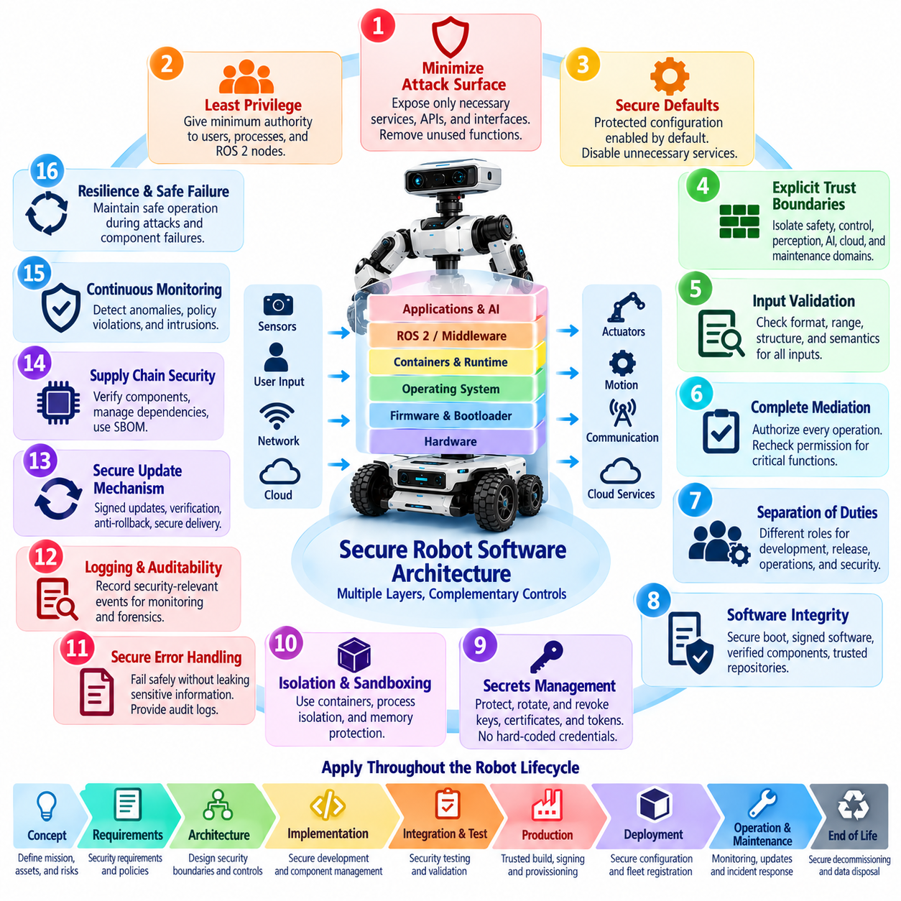{width="7.268055555555556in" height="7.268055555555556in"}

Security by Design means that cybersecurity is treated as a fundamental property of robot software architecture rather than as a collection of protections added after implementation. Security requirements are considered while defining components, interfaces, data flows, privileges, communication paths, and failure behavior. This approach reduces structural weaknesses that are difficult to correct after a robot platform has entered integration, production, or field operation.

A primary Security by Design principle is minimizing the attack surface. Robot software should expose only the services, ports, APIs, ROS 2 interfaces, administrative functions, and remote-access mechanisms required for intended operation. Development tools, debug services, default accounts, unnecessary network listeners, and obsolete interfaces should be disabled or removed from production systems. Reducing exposed functionality decreases both vulnerability opportunities and long-term maintenance burden.

Least privilege limits every software component to the minimum authority required for its function. Perception processes should not require unrestricted access to motor controllers, telemetry services should not modify safety parameters, and ordinary operators should not inherit engineering privileges. Permissions should be separated across users, processes, containers, ROS 2 nodes, services, and cloud workloads so that compromise of one component does not automatically provide broader system control.

Secure defaults ensure that a newly installed or reset robot begins from a protected state without depending on operators to enable essential controls manually. Authentication, encrypted communication, restrictive permissions, logging, certificate validation, and update verification should normally be enabled by default. Unused interfaces should remain disabled, and security-sensitive configuration should fail toward a known controlled state when parameters are missing, invalid, or inconsistent.

Explicit trust boundaries should be established between software domains with different responsibilities and criticality. Motion control, safety functions, perception, AI inference, fleet management, maintenance, cloud connectivity, and enterprise integration should not implicitly trust one another. Interfaces crossing these boundaries should authenticate participants, validate data, enforce authorization, and expose only the operations required for legitimate interaction.

Input validation is especially important in robot software because malformed data can eventually influence physical behavior. Network packets, ROS 2 messages, API requests, sensor measurements, configuration files, mission commands, model inputs, and update packages should be checked for expected type, size, range, structure, freshness, and semantic validity. Validation should occur near the component consuming the data instead of relying entirely on upstream systems.

Robot software should also apply the principle of complete mediation. Authorization should be checked whenever a protected operation is requested rather than assumed from a previous network connection or login event. Changing safety parameters, commanding motion, loading firmware, modifying maps, deploying AI models, and accessing sensitive diagnostics may require different permissions. Rechecking authority at the protected operation reduces the impact of compromised intermediate services.

Separation of duties prevents one account, process, or subsystem from controlling every security-sensitive stage of an operation. Software development, release approval, artifact signing, OTA distribution, fleet administration, and security monitoring can use distinct privileges and responsibilities. For high-impact operations, independent approval or verification can reduce the risk that a single compromised credential or administrator becomes sufficient to alter an entire robot fleet.

Software integrity should be designed into the execution chain. Bootloaders, firmware, operating-system components, containers, robot applications, configuration packages, and AI models should be identifiable and verifiable before use. Cryptographic hashes, digital signatures, secure boot, trusted repositories, signed artifacts, and controlled deployment pipelines help establish confidence that executed software corresponds to approved versions rather than attacker-modified substitutes.

Secrets should never be treated as ordinary configuration data. Passwords, API tokens, private keys, certificates, signing credentials, and cloud secrets require protected generation, storage, distribution, rotation, revocation, and destruction. Hard-coded credentials create long-lived vulnerabilities because identical secrets may spread across many robots. Device-specific identities and appropriately protected key storage reduce the consequences of individual device compromise.

Memory and process isolation limit propagation when software defects are exploited. Operating-system permissions, container isolation, sandboxing, memory-protection mechanisms, restricted system calls, and separation between privileged and unprivileged processes can prevent one compromised application from controlling unrelated services. Safety-critical and security-critical functions should avoid unnecessary dependencies on large software components with broad privileges or complex external interfaces.

Secure error handling is another architectural requirement. Software should reject invalid states without exposing credentials, internal paths, cryptographic material, or excessive diagnostic information to unauthorized users. At the same time, security failures must remain observable to authorized monitoring systems. Authentication errors, integrity failures, policy violations, and unexpected state transitions should produce useful audit evidence without revealing information that assists an attacker.

Security logging and observability should be designed before deployment rather than added after incidents occur. Robot software should record security-relevant authentication events, privilege changes, configuration modifications, software updates, policy violations, and significant command activity. Logs require timestamps, integrity protection, controlled access, and sufficient context to support fleet monitoring, incident investigation, forensic analysis, and correlation across distributed components.

Fail-safe behavior must account for the physical nature of robots. A software security failure should not automatically translate into uncontrolled motion or an abrupt shutdown that creates another hazard. Components should define safe responses for lost authentication, corrupted messages, unavailable cloud services, invalid sensor data, or failed integrity checks. Depending on operational context, responses may include rejecting commands, degrading functionality, isolating subsystems, or entering a controlled safe state.

Physical AI software extends Security by Design into models and intelligent agents. Model provenance, signed model artifacts, controlled model loading, training-data governance, prompt and multimodal input validation, inference monitoring, and constrained action interfaces should be incorporated into architecture. AI output should not bypass deterministic safety controls merely because the model or agent is authenticated; generated actions must remain subject to policy and physical safety limits.

Secure updateability is itself a design requirement because no complex robot can be assumed to remain vulnerability-free throughout its lifetime. Software architecture should support authenticated OTA packages, integrity verification, controlled installation, version management, rollback recovery, and anti-rollback protection where required. Components that cannot be safely updated may transform manageable vulnerabilities into permanent security liabilities during long field deployments.

Security by Design also requires verifiability. Security requirements should be expressed so that engineering teams can test whether authentication, authorization, isolation, integrity protection, error handling, update mechanisms, and failure responses operate as intended. Automated security regression testing can preserve these properties as software changes. Architecture decisions should therefore consider not only whether a control can be implemented, but whether its behavior can be repeatedly demonstrated.

Ultimately, Security by Design makes cybersecurity part of normal robot software engineering. Attack-surface reduction, least privilege, secure defaults, explicit trust boundaries, validation, isolation, integrity protection, observability, safe failure, and secure updateability reinforce one another throughout the architecture. When these principles are established before implementation, later mechanisms such as defense in depth, Zero Trust, penetration testing, incident response, and compliance can build upon a stronger and more maintainable foundation.

## 01.09. Cyber Physical Risk Assessment Framework

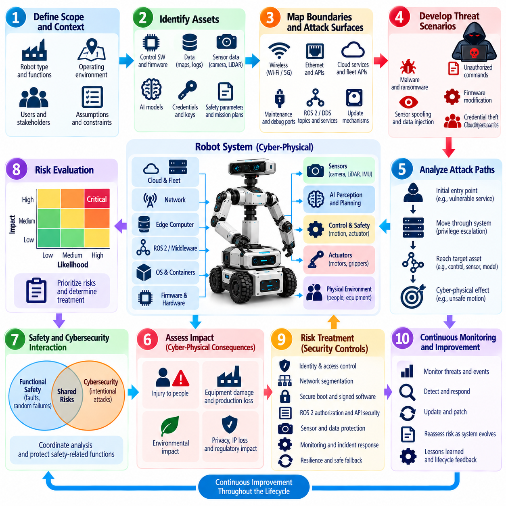{width="7.268055555555556in" height="7.268055555555556in"}

Cyber-physical risk assessment evaluates cybersecurity risk by connecting digital compromise to consequences in the physical world. For robot systems, conventional information-security analysis is insufficient because attacks against software, networks, sensors, or AI components can alter motion, force, navigation, perception, or interaction with people. A useful framework therefore evaluates cyber threats together with operational exposure, physical behavior, safety impact, and mission consequences.

The assessment begins by defining the system boundary and operational context. Engineers identify the robot platform, onboard computers, sensors, actuators, communication links, ROS 2 or DDS middleware, fleet infrastructure, cloud services, maintenance systems, operators, and external dependencies. Operating environments must also be considered because a vulnerability in an isolated laboratory robot may create a very different risk when the same platform operates near workers, vehicles, machinery, or public infrastructure.

Asset identification establishes what must be protected and why it matters. Robot assets include firmware, control software, cryptographic credentials, sensor streams, maps, localization estimates, mission plans, AI models, safety parameters, actuator commands, fleet services, and operational data. Assets should not be valued only by confidentiality. Their integrity and availability may be more important when manipulation or loss can directly influence autonomous behavior or prevent critical functions from operating.

Trust boundaries and attack surfaces are then mapped around these assets. Wireless interfaces, Ethernet ports, cloud APIs, ROS 2 topics, DDS services, maintenance ports, removable storage, debug interfaces, update mechanisms, sensors, charging stations, and physical access points may provide entry paths. Each interface should be evaluated according to who can reach it, what privileges it exposes, what protections exist, and which additional components become reachable if the boundary is crossed.

Threat scenarios describe how an adversary could exploit these interfaces to affect protected assets. Examples include stealing credentials, injecting unauthorized commands, modifying firmware, spoofing sensor information, disrupting wireless communication, compromising fleet services, replacing AI models, or abusing maintenance access. Scenarios should represent plausible sequences of attacker actions rather than isolated vulnerabilities because serious robot incidents often require movement through several connected system boundaries.

Attack-path analysis connects an initial entry point to the final cyber-physical effect. An attacker might enter through a vulnerable remote service, escalate privileges on an edge computer, obtain ROS 2 communication authority, manipulate navigation data, and eventually influence motion. Mapping these steps reveals intermediate controls that can interrupt the attack and prevents risk analysis from assuming that every discovered vulnerability automatically provides direct control over the robot.

Damage scenarios translate technical compromise into consequences meaningful to stakeholders. Manipulated localization may cause route deviation, false perception may create unsafe obstacle avoidance, corrupted safety parameters may increase allowable speed, and denial of service may stop a production fleet. Consequences may involve injury, equipment damage, production loss, environmental impact, privacy exposure, intellectual-property loss, regulatory violations, or degradation of mission capability.

Likelihood assessment should consider both attacker capability and system exposure. Internet-accessible cloud services, widely deployed wireless interfaces, reusable credentials, known vulnerabilities, and easily accessible maintenance ports may increase attack feasibility. Required expertise, specialized equipment, physical proximity, cryptographic protections, segmentation, monitoring, and independent safety controls may reduce it. The analysis should distinguish theoretical possibility from realistically achievable attack paths.

Impact assessment must account for the physical state of the robot when compromise occurs. The same malicious command can produce different consequences depending on robot speed, payload, proximity to people, operating altitude, manipulator force, environmental conditions, or surrounding equipment. Cyber-physical risk therefore cannot always be represented by a static severity value; operational context and the potential energy or authority available to the system must be considered.

Safety and cybersecurity analyses should interact without becoming identical disciplines. Functional safety traditionally addresses hazards arising from faults and foreseeable failures, while cybersecurity considers intentional manipulation by adversaries. A cyberattack can intentionally create conditions that resemble safety failures or deliberately bypass assumptions used by safety mechanisms. Shared hazard information and coordinated analysis help identify where cybersecurity controls must protect safety-related functions.

Risk evaluation combines likelihood and impact to determine which scenarios require treatment and how urgently controls should be implemented. Organizations may use qualitative categories, numerical scoring, risk matrices, or scenario-based methods, but the scoring model should remain understandable and traceable. A precise numerical score has limited value if the assumptions behind attacker capability, exposure, physical consequence, or existing safeguards cannot be explained.

Risk treatment should prioritize controls that break attack paths before harmful physical effects occur. Strong identity, least privilege, network segmentation, secure boot, signed firmware, ROS 2 access control, sensor plausibility checks, protected APIs, command validation, monitoring, and independent safety limits can provide barriers at different stages. Defense in depth is valuable because risk remains controlled even when one preventive mechanism fails or is bypassed.

Residual risk must be evaluated after proposed controls are applied. A signed command may prevent unauthorized modification but cannot guarantee that an authorized yet compromised service generates a safe command. Network segmentation may limit lateral movement but cannot eliminate malicious behavior inside an authorized zone. Residual-risk analysis therefore asks what harmful scenarios remain possible and whether additional detection, containment, safety, or recovery measures are required.

Physical AI expands the assessment framework because learned models introduce failure and attack modes that do not fit traditional software vulnerability analysis. Adversarial observations, poisoned datasets, model substitution, prompt injection, unsafe agent planning, and unexpected generalization may alter robot decisions without exploiting conventional code. Model provenance, inference monitoring, constrained action spaces, policy enforcement, and deterministic safety boundaries should therefore appear in cyber-physical risk treatment.

Fleet-scale systems require analysis of correlated and systemic risk. A vulnerability affecting one robot may appear manageable, while the same weakness shared by thousands of robots can produce widespread operational disruption. Common credentials, centralized fleet services, shared OTA infrastructure, identical software images, and common AI models can create concentration risk. Assessment should therefore examine both individual robot consequences and simultaneous multi-robot compromise.

Risk assessment should produce traceable engineering outputs rather than only a final score. Threat scenarios should connect to affected assets, damage scenarios, security requirements, implemented controls, verification evidence, responsible owners, and accepted residual risk. This traceability allows teams to understand why a control exists and what assumptions supported the original decision when software, hardware, operating environments, or regulatory expectations later change.

The framework must remain active throughout the robot lifecycle. New vulnerabilities, software updates, additional sensors, changed network architecture, new AI models, cloud migrations, operational incidents, and deployment into different environments can invalidate earlier assumptions. Significant changes should trigger reassessment of attack paths, likelihood, impact, controls, and residual risk rather than relying permanently on an assessment completed during initial development.

A mature cyber-physical risk assessment framework ultimately connects cybersecurity engineering with the physical mission of the robot. It asks not only whether a system can be hacked, but how compromise can propagate through perception, reasoning, communication, and control until it affects physical action. By linking assets, threats, attack paths, operational context, consequences, controls, and residual risk, organizations can prioritize cybersecurity measures according to their actual ability to prevent unacceptable real-world outcomes.

## 01.10. Robot Cybersecurity Organization and Roles

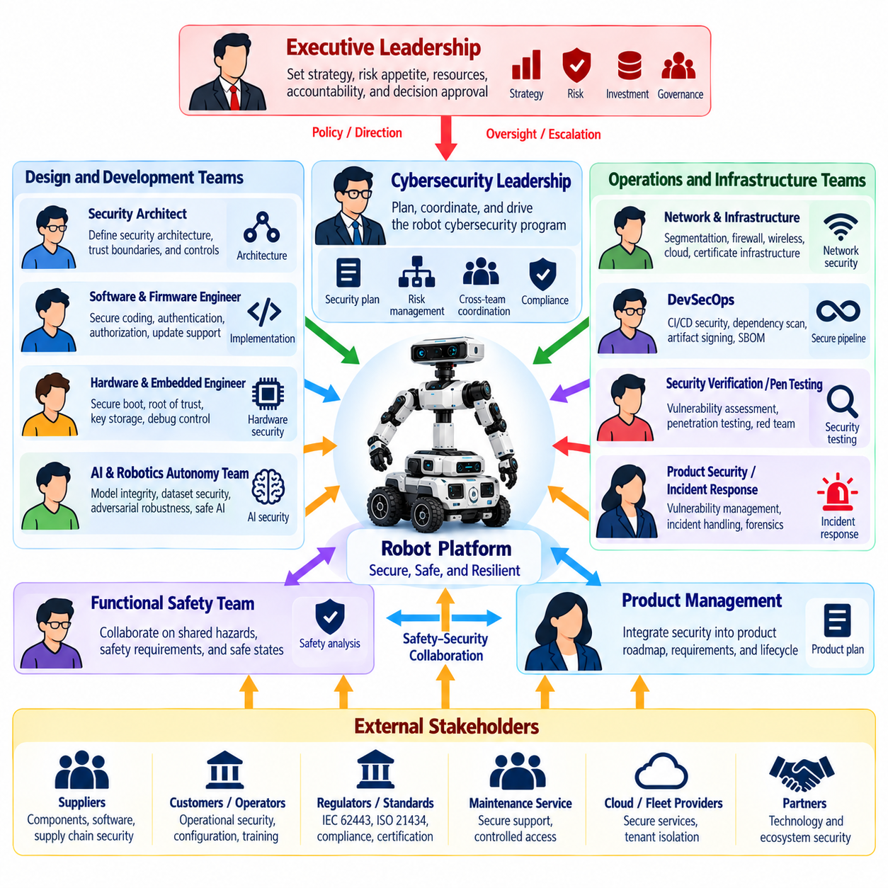{width="7.268055555555556in" height="7.268055555555556in"}

Robot cybersecurity requires an organizational structure that connects security engineering with software, hardware, safety, operations, manufacturing, and product management. Cybersecurity cannot remain the responsibility of a single specialist because vulnerabilities may originate in embedded firmware, ROS 2 communication, cloud infrastructure, AI models, maintenance processes, or supplier components. Clear ownership ensures that security decisions remain coordinated throughout the robot lifecycle.

Executive leadership establishes cybersecurity governance by defining risk appetite, organizational accountability, investment priorities, and escalation authority. Leadership does not need to make individual technical decisions, but it must ensure that cybersecurity has sufficient resources and independence to challenge unsafe product decisions. Significant residual risks, unresolved critical vulnerabilities, and fleet-wide security exposures should have defined paths for management review and formal acceptance.

A robot cybersecurity leader or product security manager coordinates the overall security program. This role translates organizational policy into engineering activities, maintains cybersecurity plans, coordinates threat modeling and risk assessment, tracks security requirements, and monitors unresolved risks. The role also connects development teams with operations, incident response, compliance, suppliers, and management so that cybersecurity decisions are not fragmented across organizational boundaries.

Security architects define the technical security structure of the robot and supporting infrastructure. They identify trust boundaries, security zones, communication conduits, identity models, privileged interfaces, cryptographic mechanisms, and monitoring requirements. Their work should cover onboard computing, ROS 2 and DDS, wireless networks, fleet systems, cloud services, OTA infrastructure, maintenance interfaces, and Physical AI components while remaining aligned with safety and real-time constraints.

Software and firmware engineers implement many of the controls defined by security architecture. Their responsibilities include secure coding, input validation, authentication integration, authorization enforcement, secrets handling, software integrity, secure communication, error handling, and update support. Security responsibilities should be integrated into normal development practices rather than delegated entirely to a separate security team after implementation has already been completed.

Hardware and embedded-system engineers are responsible for security properties that software alone cannot provide. Secure boot, hardware roots of trust, protected key storage, debug-interface control, firmware verification, device identity, tamper considerations, and secure provisioning depend on hardware architecture. These engineers must coordinate with software teams because weaknesses at the hardware boundary can undermine security mechanisms implemented at higher layers.

Network and infrastructure teams protect communication between robots, fleet services, enterprise systems, and cloud environments. Their responsibilities include segmentation, firewall policy, secure remote access, certificate infrastructure, network monitoring, wireless security, and resilient connectivity. They must understand robot-specific traffic and timing requirements because conventional enterprise controls can disrupt real-time communication if applied without awareness of operational constraints.

Functional safety and cybersecurity teams require a particularly close relationship. Safety engineers analyze hazards arising from faults and failures, while cybersecurity engineers analyze intentional manipulation and hostile behavior. A cyberattack may create the same physical hazard as a random failure or deliberately defeat assumptions used by safety mechanisms. Shared hazard reviews and coordinated requirements help ensure that security controls protect safety-critical functions without introducing new hazards.

AI and robotics autonomy teams become security stakeholders when robots use learned perception, foundation models, vision-language-action models, or autonomous agents. Their responsibilities extend beyond model accuracy to model provenance, dataset integrity, controlled deployment, adversarial robustness, inference monitoring, and action constraints. AI-generated decisions that can influence physical behavior should remain subject to authorization, policy enforcement, and independent safety boundaries.

DevSecOps teams integrate security into development and release pipelines. Source repositories, CI/CD systems, dependency scanners, build environments, artifact registries, container images, software bills of materials, and signing infrastructure must be protected and monitored. Automated security testing can identify vulnerable dependencies, insecure configurations, leaked secrets, and policy violations before software reaches production robots, reducing reliance on late manual review.

Security verification and penetration-testing teams provide independent evidence that implemented controls resist realistic attacks. They evaluate exposed services, APIs, ROS 2 and DDS configurations, wireless interfaces, firmware, update mechanisms, cloud services, and physical maintenance interfaces. Independence is important because development teams may unintentionally test according to expected system behavior rather than explore unexpected combinations and attacker-controlled conditions.

Product security incident response teams manage vulnerabilities and active cybersecurity incidents after deployment. They receive vulnerability reports, assess severity, coordinate containment, support forensic investigation, prepare remediation, and communicate with affected stakeholders. Robot incidents require coordination with operational and safety teams because isolating a compromised robot, disabling connectivity, or applying an emergency update may itself affect physical operations.

Security operations teams provide continuous monitoring across deployed robots and infrastructure. Authentication failures, anomalous network activity, unexpected ROS 2 communication, configuration changes, software integrity failures, suspicious fleet commands, and abnormal resource consumption can indicate compromise. Monitoring responsibilities should include clear escalation criteria so that detected events move efficiently from automated alerting to technical investigation and operational response.

Manufacturing and provisioning teams also hold important cybersecurity responsibilities. They may install firmware, provision device identities, inject cryptographic keys, configure certificates, and establish initial software baselines. Factory systems therefore become part of the security chain of trust. Access to provisioning equipment and signing material should be restricted, auditable, and separated from ordinary manufacturing operations where appropriate.

Supply-chain and procurement functions help manage security risks introduced by external components and vendors. Contracts can define vulnerability disclosure expectations, update support periods, component inventories, security documentation, and incident-notification responsibilities. Supplier risk must remain visible after procurement because third-party firmware, libraries, sensors, communication modules, and cloud services can acquire new vulnerabilities throughout the robot's operational lifetime.

Robot operators and maintenance personnel represent the operational layer of the security organization. They require clearly defined privileges, secure maintenance procedures, credential-handling practices, and methods for reporting unusual behavior. Operators should not be expected to diagnose sophisticated cyberattacks, but they can provide critical observations when robots behave unexpectedly, repeatedly lose connectivity, reject commands, or show unexplained configuration changes.

Governance requires explicit responsibility assignment across these roles. Security requirements should have owners, verification activities should have accountable reviewers, vulnerabilities should have remediation owners, and residual risks should have designated acceptance authorities. Responsibility matrices can help clarify who develops, approves, verifies, operates, monitors, and responds, but accountability must remain connected to actual engineering authority rather than becoming only documentation.

Cross-functional security reviews provide the mechanism for maintaining alignment. Architecture changes, new connectivity, AI model updates, supplier substitutions, major software releases, newly discovered vulnerabilities, and deployment into different environments may require participation from security, safety, software, hardware, operations, and product teams. Regular review prevents cybersecurity assumptions from becoming obsolete as the robot and its operational context evolve.

A mature robot cybersecurity organization therefore distributes security responsibility while maintaining centralized governance and traceability. Engineers secure the components they design, specialized teams provide architecture, verification, monitoring, and incident-response expertise, and leadership owns organizational risk decisions. When roles are connected through clear requirements, escalation paths, evidence, and lifecycle processes, cybersecurity becomes an enduring engineering capability rather than an isolated compliance activity.
