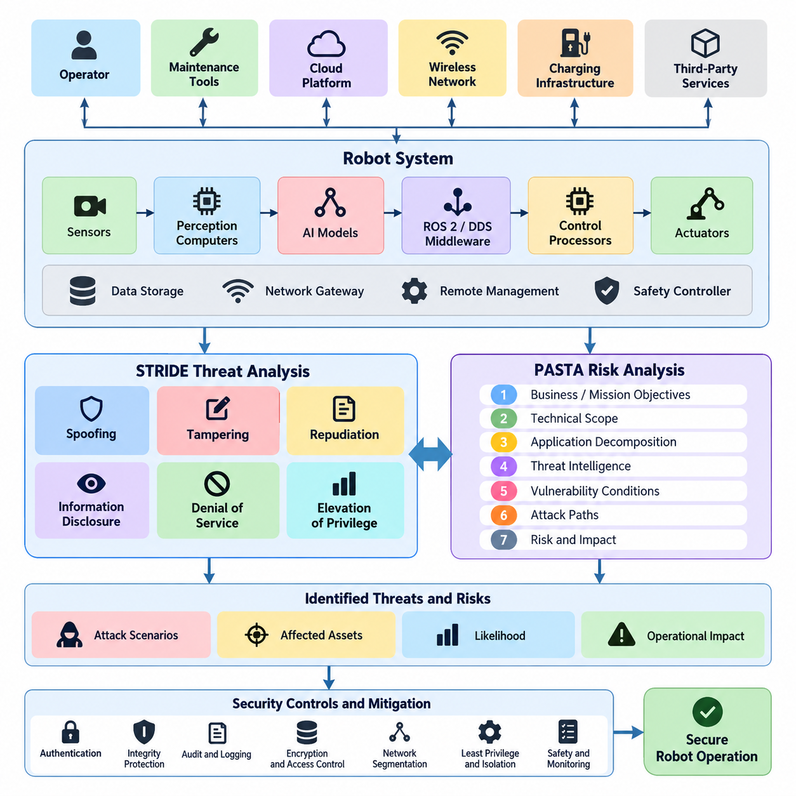
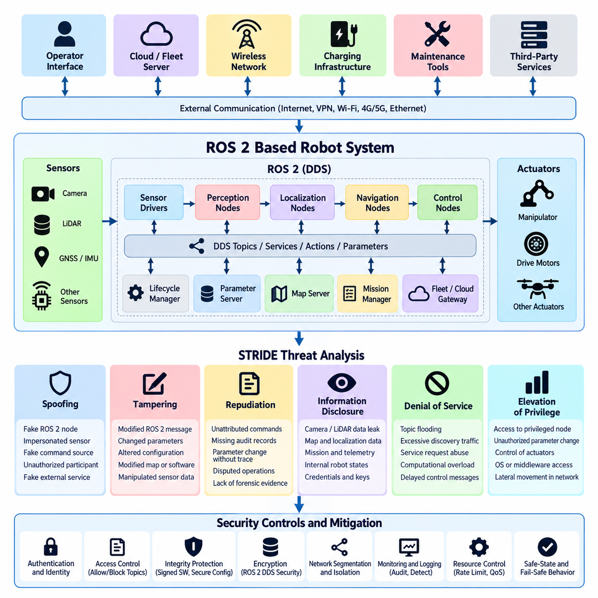
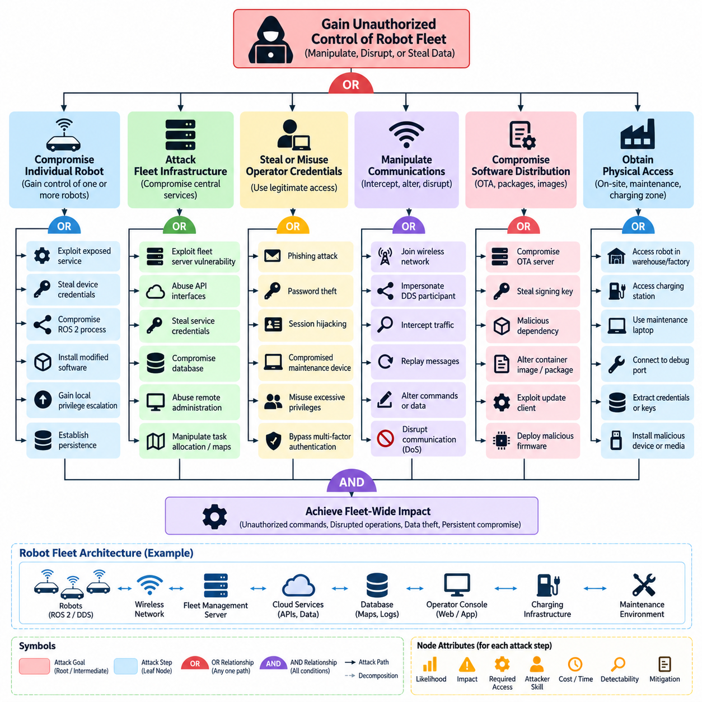
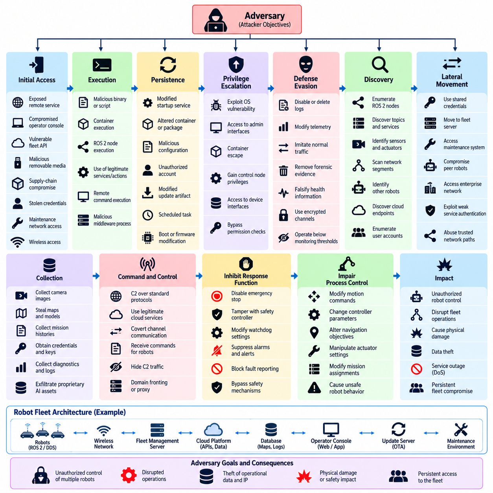
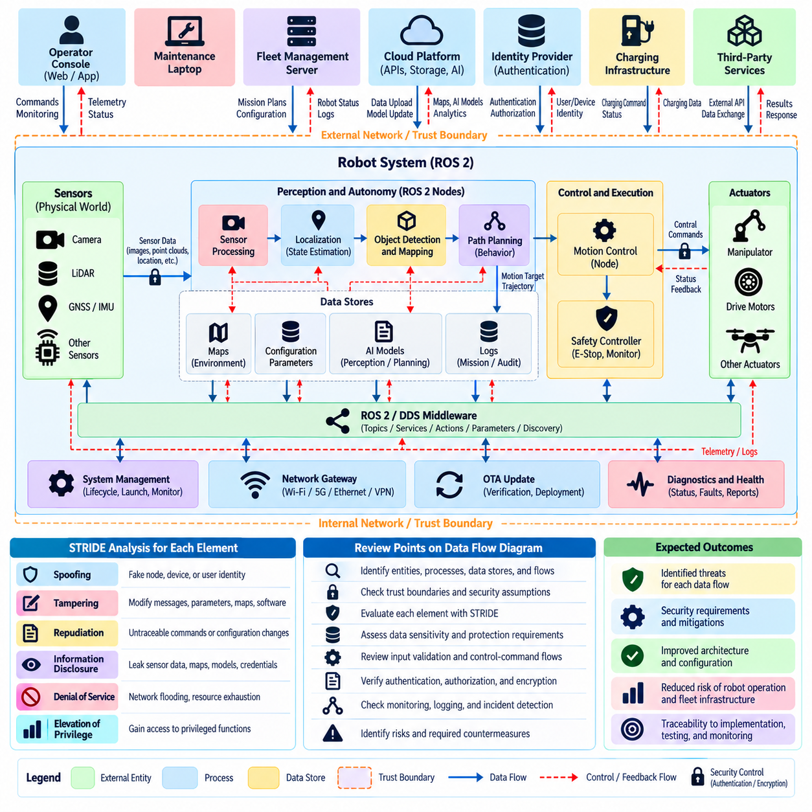
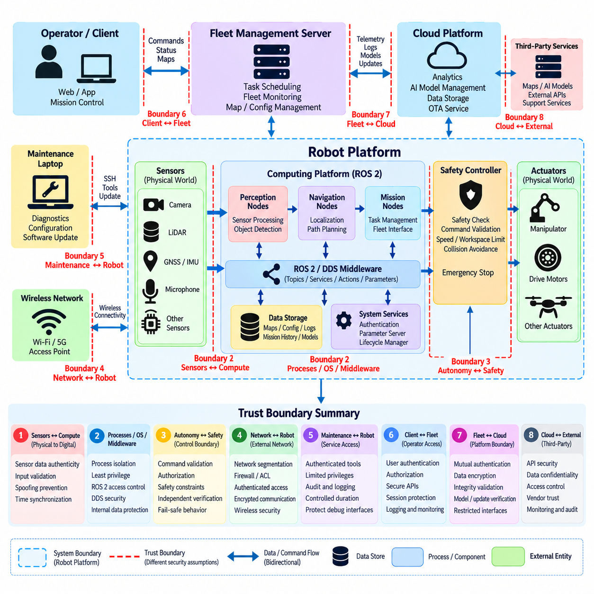
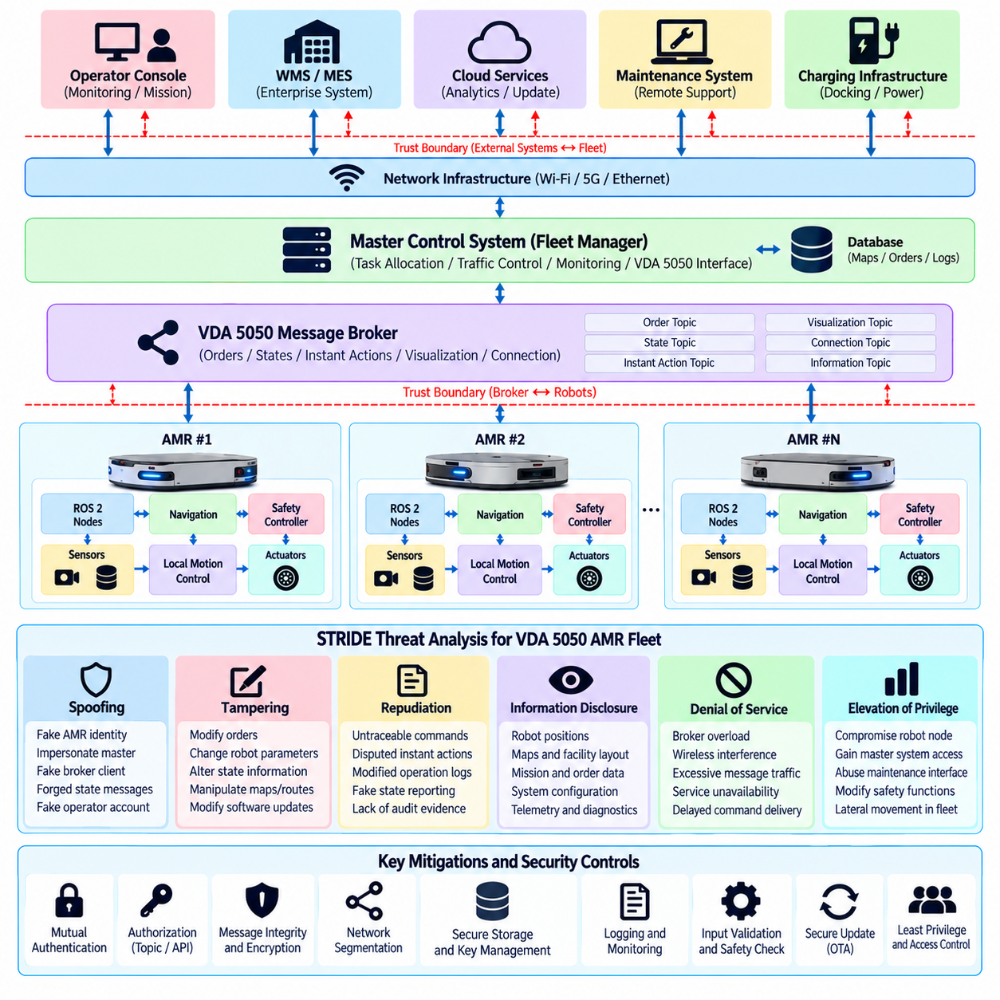
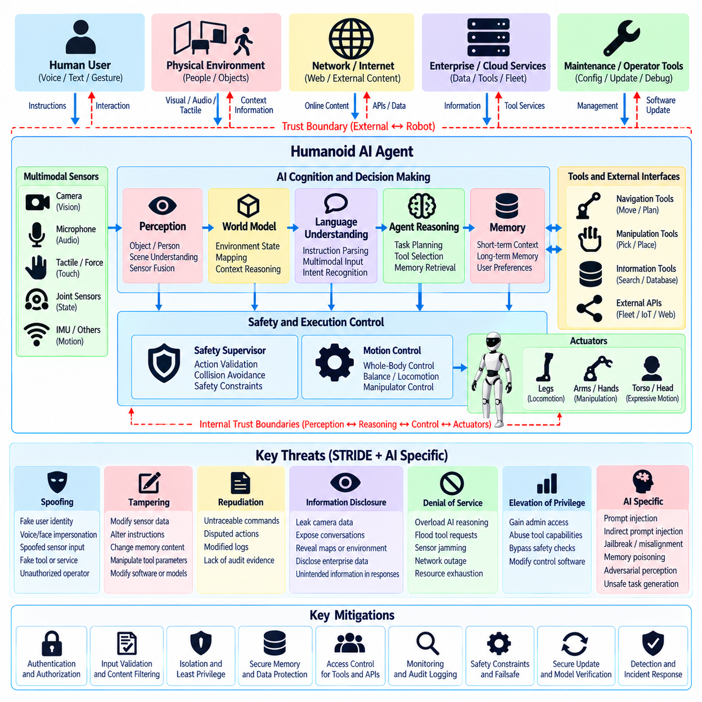
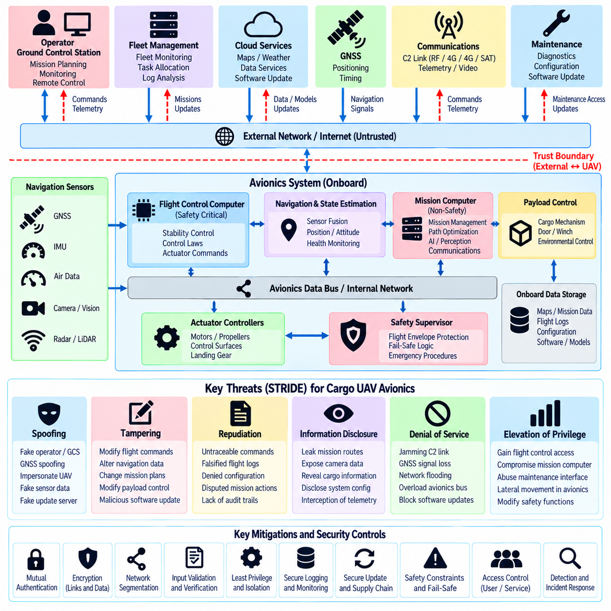
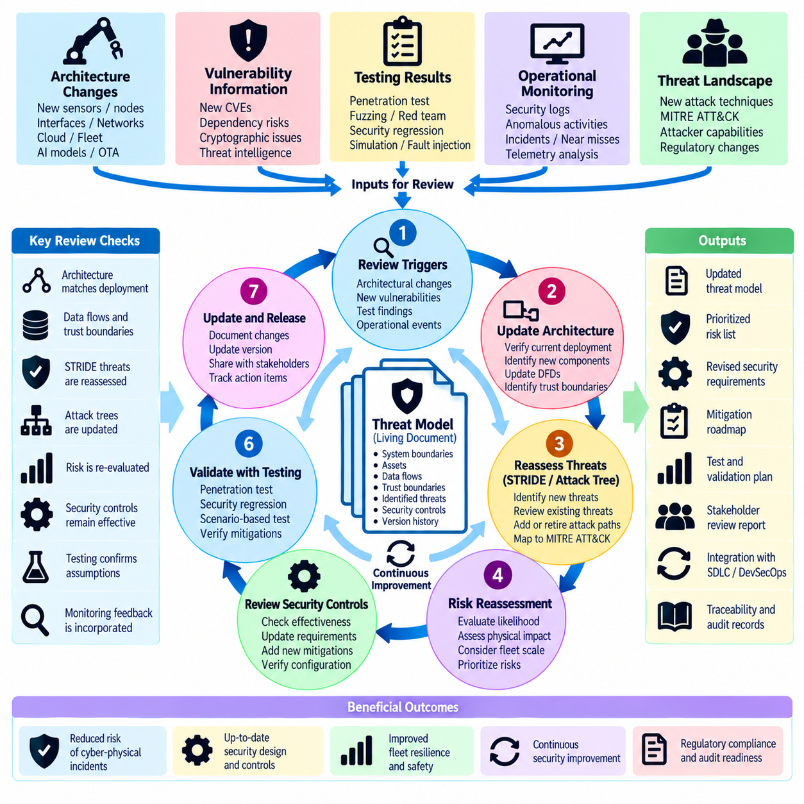

**Volume 24. Robot Cybersecurity**

# Chapter 02. Threat Modeling for Robots

## 02.01. Threat Modeling Methodology STRIDE PASTA [w/Code]

{width="7.268055555555556in" height="7.268055555555556in"}

Threat modeling provides a systematic method for identifying how a robot system can be attacked, what assets may be affected, and which security controls should be prioritized before deployment. In robotics, this process must extend beyond conventional information systems because cyber events can influence actuators, navigation, manipulation, sensing, and physical safety. A useful methodology therefore examines software, hardware, networks, cloud services, operators, and the physical environment as one interconnected attack surface.

The process begins by defining the system scope and identifying assets that require protection. Typical robot assets include control commands, localization data, maps, sensor streams, AI models, cryptographic credentials, firmware, mission plans, safety parameters, telemetry, and fleet-management information. Engineers also identify external entities such as operators, maintenance tools, cloud platforms, charging infrastructure, wireless networks, and third-party services that exchange information with the robot.

System decomposition transforms the architecture into components, interfaces, data flows, and trust boundaries that can be analyzed individually. A robot may contain safety controllers, embedded processors, perception computers, ROS 2 nodes, DDS middleware, AI accelerators, network gateways, and remote management interfaces. Trust boundaries appear whenever information moves between components with different security assumptions, privileges, ownership, or exposure, making these transitions especially important locations for threat analysis.

STRIDE provides a practical classification framework for examining threats associated with each component and data flow. The acronym represents Spoofing, Tampering, Repudiation, Information Disclosure, Denial of Service, and Elevation of Privilege. Rather than attempting to imagine every possible attack independently, engineers apply these categories systematically to architecture elements, helping reveal threats that might otherwise be overlooked during informal security reviews.

Spoofing concerns an attacker impersonating a legitimate robot, operator, service, sensor, or software component. A forged device identity could allow unauthorized systems to participate in fleet communications, while falsified localization or navigation sources could influence robot behavior. Authentication mechanisms such as device certificates, mutual authentication, protected credentials, and hardware-backed identities reduce this risk by establishing verifiable relationships between communicating entities.

Tampering addresses unauthorized modification of software, commands, configuration, telemetry, sensor data, or stored information. Manipulated velocity commands could directly alter physical motion, while modified AI models or calibration parameters might produce less obvious but persistent behavioral changes. Integrity protection therefore extends from signed firmware and secure boot to authenticated communication, configuration validation, protected storage, and verification of software artifacts throughout the deployment lifecycle.

Repudiation occurs when an entity can perform an action without sufficient evidence allowing that action to be reliably attributed later. This is important in robot fleets where operators, automated services, maintenance systems, and AI agents may independently issue commands. Secure audit records, synchronized timestamps, authenticated identities, command histories, and tamper-resistant logging support accountability and allow investigators to reconstruct security-relevant events after abnormal behavior or incidents.

Information Disclosure concerns unauthorized exposure of data processed or stored by the robotic system. Camera streams, facility maps, production information, mission routes, credentials, AI models, and operational telemetry may reveal sensitive information about both the robot and its environment. Encryption, access control, data minimization, secure key management, network segmentation, and appropriate retention policies reduce exposure across edge devices, fleet infrastructure, and cloud services.

Denial of Service targets availability by exhausting or disrupting resources required for operation. Robots can be particularly sensitive to communication flooding, middleware overload, wireless interference, computational exhaustion, or repeated requests that consume control and perception resources. Threat modeling must therefore consider not only whether a service becomes unavailable, but whether loss of that service causes degraded navigation, unsafe stopping, mission interruption, or failure of coordinated fleet operations.

Elevation of Privilege occurs when an attacker gains permissions beyond those originally authorized. Compromise of an ordinary application process may become significantly more dangerous if vulnerabilities permit access to privileged middleware, operating-system functions, motor interfaces, or safety-critical configuration. Least privilege, process isolation, container boundaries, mandatory access controls, restricted APIs, and separation between safety and non-safety domains limit the ability of a local compromise to propagate through the robot.

PASTA, the Process for Attack Simulation and Threat Analysis, complements STRIDE by emphasizing risk, attacker objectives, and realistic attack scenarios. Instead of focusing primarily on categorical threat identification, PASTA connects technical weaknesses to operational consequences. The methodology progressively examines business or mission objectives, technical scope, application decomposition, threat intelligence, vulnerability conditions, attack paths, and resulting risk so that mitigation decisions reflect plausible adversarial behavior.

For robotic systems, PASTA is valuable because the severity of an attack cannot be measured only by confidentiality or system downtime. A compromised command channel may create collision risk, an altered perception pipeline may cause incorrect obstacle interpretation, and manipulated fleet coordination may disrupt an entire facility. Attack simulation therefore links entry points and vulnerabilities to intermediate compromises and ultimately to cyber-physical consequences affecting people, equipment, missions, and operations.

STRIDE and PASTA can be combined rather than treated as competing methodologies. STRIDE provides a repeatable mechanism for discovering threats across components and data flows, while PASTA helps determine which discovered threats correspond to credible attack paths and significant operational risk. A team may first classify threats using STRIDE, then select important cases for deeper PASTA analysis involving adversary capabilities, exploit prerequisites, attack progression, safety consequences, and existing defensive controls.

Risk evaluation should consider likelihood and impact together with the robot\'s operational context. The same vulnerability can have different significance depending on whether the affected platform is a laboratory robot, warehouse AMR, industrial manipulator, humanoid system, or cargo UAV. Exposure, attacker accessibility, required expertise, existing safeguards, detectability, recoverability, and potential physical consequences should therefore influence prioritization instead of relying exclusively on generic vulnerability severity scores.

Threat modeling is most effective when integrated into the engineering lifecycle rather than performed once before release. Architectural changes, new sensors, ROS 2 nodes, AI models, cloud interfaces, OTA mechanisms, or fleet APIs can introduce new trust relationships and attack paths. Models should consequently be version controlled and reviewed alongside system architecture, cybersecurity requirements, software changes, vulnerability findings, penetration-test results, and operational incident information.

The resulting threat model becomes a bridge between architecture analysis and concrete security engineering. Identified threats can be mapped to authentication, authorization, encryption, network segmentation, secure boot, monitoring, logging, fail-safe behavior, anomaly detection, and recovery requirements. Within the broader robot cybersecurity structure, this methodology establishes the foundation for later analysis of ROS 2 systems, attack trees, trust boundaries, AMR fleets, humanoid AI agents, cargo UAV avionics, and recurring threat-model reviews.

## 02.02. STRIDE Analysis for ROS2 Based Robot System [w/Code]

{width="7.268055555555556in" height="7.268055555555556in"}

A STRIDE analysis of a ROS 2-based robot system begins by decomposing the software architecture into security-relevant entities and communication paths. Typical elements include ROS 2 nodes, DDS participants, topics, services, actions, parameter interfaces, lifecycle managers, sensor drivers, control nodes, navigation components, and external fleet or cloud gateways. This decomposition allows security engineers to examine threats at individual interfaces rather than treating the robot as a single trusted computing environment.

ROS 2 relies heavily on distributed communication, making identity and trust fundamental security concerns. Nodes may discover peers dynamically through DDS and exchange data without a centralized message broker. The threat model must therefore consider who can join the communication domain, which nodes are permitted to publish or subscribe to specific topics, and whether an unauthorized participant could imitate a legitimate sensor, controller, localization component, or supervisory application.

Spoofing threats arise when an attacker impersonates a legitimate ROS 2 node, DDS participant, robot, operator interface, or external service. A malicious process pretending to be a localization node could distribute false poses, while an unauthorized publisher could imitate a velocity-command source. Strong participant authentication, certificate-based identities, protected private keys, controlled DDS domains, and explicit communication policies help establish trustworthy identities before data is accepted.

Spoofing analysis should also consider sensor and infrastructure identities outside the ROS 2 graph. GNSS receivers, cameras, LiDAR systems, industrial gateways, charging stations, and fleet servers may provide information that ultimately becomes ROS 2 messages. Authenticating only the middleware endpoint does not prove that upstream information is genuine. Security analysis therefore traces identity and provenance from physical or external data sources through drivers and middleware to the consuming control functions.

Tampering threats involve unauthorized modification of ROS 2 messages, parameters, configuration files, software packages, maps, or control data. Modification of a velocity command can immediately affect robot motion, while changes to navigation parameters may create subtle behavioral deviations. Integrity protection must consequently cover both data in transit and persistent artifacts, using authenticated communication, protected configuration storage, signed software, secure deployment procedures, and controlled administrative interfaces.

ROS 2 parameters require particular attention because they can modify runtime behavior without replacing executable software. Changes to speed limits, controller gains, obstacle thresholds, localization settings, or safety-related parameters may significantly alter physical behavior. Threat modeling should identify which parameters are security or safety critical, determine who may modify them, record changes, and ensure that values remain within validated operational ranges when appropriate.

Repudiation becomes important when multiple ROS 2 nodes, operators, autonomous agents, and remote services can initiate actions. Without trustworthy records, it may be difficult to determine which entity issued a command or changed a configuration after an incident. Security-relevant operations should therefore be associated with authenticated identities, reliable timestamps, event records, configuration histories, and protected audit logs capable of supporting later reconstruction and forensic analysis.

Information Disclosure threats arise because ROS 2 topics can carry extensive information about both the robot and its environment. Camera images, LiDAR point clouds, maps, transforms, localization states, diagnostics, mission information, and internal control states may reveal sensitive operational details. Unauthorized subscribers could passively collect this information without affecting normal behavior, making confidentiality controls essential even when the attacker does not attempt to manipulate the robot.

Confidentiality requirements should be assigned according to the sensitivity of each data flow rather than assuming that every topic requires identical protection. Safety commands may prioritize integrity and availability, while camera streams or facility maps may require stronger confidentiality. DDS Security mechanisms, network segmentation, access-control policies, encrypted communication, and restricted interfaces can be combined to protect sensitive data while preserving the real-time characteristics required by robotic applications.

Denial of Service is especially significant in ROS 2 because robotic behavior depends on timely distributed communication. An attacker may flood topics, generate excessive discovery traffic, repeatedly invoke services, consume middleware resources, or overload computation with high-rate messages. Even when no data is modified, delayed sensor updates or control commands can degrade localization, planning, perception, and motion control enough to produce operational or physical consequences.

Availability analysis should therefore consider timing as well as complete service loss. A navigation node receiving delayed obstacle information may technically remain operational while becoming unsafe for its intended environment. Threat models should identify critical message rates, deadlines, queue limits, resource budgets, and fallback behavior. Rate limiting, traffic prioritization, resource isolation, network segmentation, watchdogs, and deterministic safe-state transitions can reduce the impact of resource-exhaustion attacks.

Elevation of Privilege occurs when compromise of a low-privilege ROS 2 component enables access to more powerful functions. A vulnerable perception node, for example, should not automatically provide unrestricted authority to modify system files, control actuators, install software, or change security policies. Process isolation, operating-system permissions, container restrictions, least-privilege execution, restricted device access, and carefully designed ROS 2 authorization rules limit lateral movement after an initial compromise.

Trust boundaries are central to applying STRIDE effectively. Important boundaries may exist between sensors and compute platforms, ROS 2 domains, safety and autonomy controllers, containers, edge computers, robot and fleet networks, or on-premise and cloud infrastructure. Each boundary should be analyzed for spoofing, tampering, repudiation, information disclosure, denial of service, and privilege escalation according to the functions and information crossing that boundary.

The analysis becomes more useful when threats are connected to concrete cyber-physical consequences. Spoofed localization may redirect navigation, tampered control messages may produce unintended motion, disclosed maps may expose facility layouts, and denial of service against perception may trigger emergency stopping. Privilege escalation may allow persistent modification of robot software. Mapping technical threats to operational consequences enables teams to prioritize controls according to safety, mission, and fleet-level impact.

STRIDE findings should ultimately become traceable cybersecurity requirements rather than remaining descriptive threat statements. Each significant threat can be linked to authentication, authorization, encryption, integrity verification, logging, segmentation, resource protection, secure configuration, or fail-safe requirements. Because the broader robot cybersecurity structure separately addresses ROS 2 and DDS security, network protection, testing, fleet security, and incident response, this analysis provides an architectural foundation for those deeper controls.

## 02.03. Attack Tree Construction for Robot Fleet [w/Code]

{width="7.268055555555556in" height="7.268055555555556in"}

Attack trees provide a structured method for representing how an adversary could achieve a security objective against a robot fleet. Instead of examining isolated vulnerabilities, the method begins with an undesirable outcome and decomposes it into progressively smaller attack goals and actions. For a fleet, the root objective might be unauthorized fleet control, disruption of coordinated operations, theft of operational data, or persistent compromise of multiple robots.

The root node should describe a meaningful adversarial objective rather than a specific exploit. For example, "gain unauthorized control of the robot fleet" is more useful than "exploit a network service" because several different attack paths may lead to fleet control. The root objective is then decomposed into major branches such as compromising individual robots, attacking fleet infrastructure, stealing operator credentials, manipulating communications, or compromising software distribution mechanisms.

Attack trees commonly use OR and AND relationships to express how subordinate actions contribute to a parent objective. An OR relationship means that any one child path may be sufficient to achieve the parent goal. An AND relationship means that several conditions or actions must be completed together. These relationships allow security engineers to distinguish independent attack alternatives from multi-stage attacks requiring coordinated access, credentials, persistence, or technical capabilities.

A robot-fleet attack tree should reflect the actual architecture of the deployed system. Relevant components may include mobile robots, ROS 2 and DDS communication, fleet-management servers, operator consoles, wireless infrastructure, cloud APIs, databases, charging stations, maintenance laptops, identity services, and OTA update systems. Trust boundaries between robots, fleet networks, enterprise networks, cloud platforms, and external maintenance environments provide natural locations for defining attack branches.

A branch representing compromise of an individual robot may include exploitation of an exposed service, theft of device credentials, compromise of a ROS 2 process, malicious physical access, or installation of modified software. The attacker may then attempt privilege escalation, persistence, or access to control interfaces. If compromised robots possess credentials or network connectivity trusted by the fleet, a single-device intrusion can become an intermediate step toward broader fleet compromise.

Fleet-management infrastructure represents another important branch because centralized services may control task allocation, mission dispatch, robot status, maps, and operational policies. An attacker who compromises a fleet server could potentially manipulate assignments, issue unauthorized commands, suppress alarms, or falsify telemetry. Attack-tree decomposition should therefore examine administrative interfaces, APIs, service credentials, databases, remote-access mechanisms, and dependencies on external identity or cloud services.

Operator identity provides a separate attack path. Credential phishing, password theft, session hijacking, compromised maintenance devices, or misuse of excessive privileges may allow an attacker to operate through legitimate interfaces. This path is important because malicious actions performed with valid credentials can resemble normal administrative activity. Multi-factor authentication, least privilege, session protection, privileged-access controls, and behavioral monitoring can reduce the feasibility of this branch.

Communication manipulation forms another major branch for connected robot fleets. An attacker may attempt to join the wireless network, impersonate a trusted endpoint, intercept traffic, replay previously valid messages, alter commands, or disrupt communication availability. Where ROS 2 and DDS are used, the analysis should consider participant identity, topic authorization, discovery behavior, cryptographic protection, and whether compromised nodes can publish information trusted by other fleet members.

Attack trees should also model attacks against software and firmware distribution. A compromised OTA server, stolen signing key, malicious dependency, altered container image, or vulnerable update client could provide a scalable route to many robots simultaneously. Because this branch may bypass conventional network attacks against individual robots, the tree should include software provenance, artifact signing, secure boot, key protection, update authorization, rollback protection, and verification before installation.

Physical access must not be excluded from a robot-fleet threat model. Robots operate in warehouses, factories, outdoor areas, charging zones, and maintenance facilities where attackers may gain temporary access to ports, storage devices, sensors, or internal networks. Physical compromise can expose credentials or debugging interfaces that later enable remote attacks. Attack trees therefore connect physical entry points with subsequent cyber actions instead of treating physical and digital threats independently.

Each leaf node should represent an attack step specific enough to evaluate. Useful leaf nodes might describe obtaining an operator credential, accessing an exposed maintenance port, publishing an unauthorized command, stealing a device certificate, modifying an update package, or exhausting a communication service. Excessively broad leaves make the tree difficult to assess, while unnecessarily detailed implementation steps can make it fragile and difficult to maintain as the fleet architecture evolves.

Attack-tree nodes become more useful when annotated with security attributes. A team can estimate attacker skill, required access, cost, time, detectability, exploit availability, probability of success, and operational impact for important paths. These values do not need to be perfectly quantitative. Their primary purpose is to support consistent comparison so that a relatively simple attack capable of affecting hundreds of robots receives greater attention than a highly complex path with limited consequences.

Defensive controls can then be mapped directly to branches and leaf nodes. Device certificates may reduce spoofing paths, network segmentation may restrict lateral movement, signed updates may block software-tampering branches, and multi-factor authentication may increase the difficulty of operator-account compromise. Monitoring, rate limiting, secure logging, anomaly detection, key protection, and fail-safe behavior can similarly interrupt attack paths or reduce their operational consequences.

Attack trees are particularly valuable for identifying chained attacks that would be missed by vulnerability lists. An adversary might first compromise a maintenance laptop, obtain fleet credentials, access a management service, distribute malicious software, and finally control multiple robots. None of these steps alone describes the complete fleet risk. The tree reveals how individually moderate weaknesses can combine into a high-impact path crossing several architectural and organizational trust boundaries.

The attack tree should remain a living security artifact rather than a one-time diagram. New robot models, cloud services, APIs, ROS 2 components, wireless technologies, charging infrastructure, or OTA mechanisms can create new branches and invalidate previous assumptions. Updating the tree after architecture changes, penetration tests, vulnerability discoveries, and incidents allows it to support continuous threat-model review and prepares the foundation for subsequent fleet, trust-boundary, and platform-specific analyses.

## 02.04. MITRE ATT&CK for ICS Applied to Robots [w/Code]

{width="7.268055555555556in" height="7.268055555555556in"}

MITRE ATT&CK for ICS provides a knowledge framework for describing adversary behavior against industrial control environments, and many of its concepts can be adapted to connected robot systems. Robots combine computing, networking, sensing, control, and physical actuation, creating security characteristics similar to industrial cyber-physical systems. Applying ATT&CK concepts helps teams describe threats in terms of attacker objectives and observable behaviors rather than isolated software vulnerabilities.

The framework organizes adversary behavior into tactics representing objectives and techniques representing methods used to achieve those objectives. When applied to robotics, this structure allows security teams to trace how an attacker may progress from initial access to execution, persistence, privilege expansion, lateral movement, command manipulation, or physical impact. The resulting model complements STRIDE and attack trees by adding a behavior-oriented view of realistic intrusion sequences.

Initial Access analysis identifies how an adversary could first enter the robot or supporting infrastructure. Possible paths include exposed remote services, compromised operator workstations, vulnerable fleet APIs, malicious removable media, supply-chain compromise, stolen credentials, or access through maintenance networks. For mobile fleets, wireless connectivity and remote support interfaces may expand exposure beyond the boundaries normally associated with fixed industrial equipment.

Execution describes the methods through which adversary-controlled code or commands operate inside the environment. A compromised robot may execute malicious binaries, scripts, containers, middleware processes, or commands delivered through legitimate management interfaces. In ROS 2-based environments, attackers may also attempt to introduce unauthorized nodes or misuse existing services and actions. Execution analysis should distinguish ordinary application compromise from access capable of influencing motion or safety functions.

Persistence allows an attacker to retain access after reboot, software restart, credential changes, or temporary network disconnection. Within robots, persistence could involve modified startup services, altered containers, compromised software packages, malicious configuration, unauthorized accounts, or manipulated update artifacts. Because robots may operate unattended for long periods, persistent compromise can remain hidden while continuously affecting telemetry, perception, navigation, or fleet coordination.

Privilege Escalation becomes important when initial access provides only limited authority. An attacker may attempt to move from an application account to operating-system privileges or from a noncritical ROS 2 component toward control and administrative functions. Secure operating-system permissions, process isolation, container restrictions, least privilege, protected device interfaces, and separation between autonomy and safety domains reduce opportunities for an initial compromise to gain greater authority.

Defense Evasion describes behavior intended to avoid security controls or detection. An adversary may disable logging, suppress alerts, modify telemetry, imitate normal communication patterns, remove forensic evidence, or operate below monitoring thresholds. In robot fleets, falsified health information can be especially problematic because centralized systems may continue assigning missions to a compromised robot. Independent monitoring and protected logs therefore provide important defensive visibility.

Discovery techniques allow attackers to understand the environment before performing more disruptive actions. After compromising a robot or fleet service, an adversary may enumerate network interfaces, ROS 2 nodes, DDS participants, topics, services, connected sensors, neighboring robots, cloud endpoints, user accounts, or available control interfaces. Information gathered during discovery can reveal trust relationships and identify higher-value components for subsequent lateral movement or manipulation.

Lateral Movement represents expansion from one compromised component to others. A robot with trusted fleet connectivity may become a stepping stone toward fleet servers, maintenance systems, peer robots, or enterprise infrastructure. Shared credentials, broadly accessible network segments, weak service authentication, and excessive trust between robots increase this risk. Device-specific identities, segmentation, mutual authentication, and restrictive authorization policies can constrain propagation across the fleet.

Collection and Command and Control concepts are also relevant to robotics. A compromised platform may collect camera images, maps, mission histories, credentials, diagnostics, or proprietary AI assets and transmit them through legitimate or covert channels. Conversely, command-and-control infrastructure may deliver instructions to compromised robots. Monitoring unusual outbound traffic, unexpected endpoints, communication timing, and abnormal data volumes can reveal activity not explained by normal robotic operations.

Inhibit Response Function is particularly significant for cyber-physical robots because attackers may attempt to interfere with protective mechanisms. Relevant targets can include emergency-stop logic, watchdogs, safety controllers, alarms, fault reporting, collision avoidance, or supervisory shutdown mechanisms. Threat analysis should determine whether compromise of general-purpose computing components can disable safety functions and whether independent hardware or safety-rated controls remain effective under cyberattack.

Impair Process Control maps naturally to robotic control functions. An adversary may alter motion commands, controller parameters, navigation objectives, actuator settings, mission assignments, or synchronization between subsystems. Manipulation may be abrupt and obvious or gradual enough to resemble calibration drift or component failure. Monitoring commanded behavior against physical observations and validated operational envelopes can help detect inconsistencies between intended and actual robot behavior.

Impact represents the point at which cyber compromise produces meaningful operational or physical consequences. For robots, this may include mission interruption, fleet-wide unavailability, unsafe motion, collision, manipulation failure, damaged equipment, corrupted maps, loss of production capacity, or denial of charging and maintenance services. The importance of ATT&CK for ICS is therefore not limited to identifying intrusion activity; it helps connect adversary behavior to consequences in the physical environment.

ATT&CK techniques should be mapped to observable telemetry and detection opportunities. Useful evidence may originate from operating-system logs, authentication events, network flows, ROS 2 and DDS activity, process execution records, configuration changes, API logs, OTA events, fleet-management systems, and safety-controller diagnostics. Correlating these sources enables defenders to recognize multi-stage behavior that may appear harmless when individual events are examined independently.

The framework can also support security testing by converting relevant adversary techniques into controlled validation scenarios. Red teams and penetration testers can emulate selected behaviors to determine whether authentication, segmentation, monitoring, logging, recovery, and safety controls operate as expected. Such exercises should remain within explicitly authorized boundaries, especially because robotic systems can translate digital actions into physical movement and equipment interaction.

MITRE ATT&CK for ICS is most effective when integrated with the broader robot threat-modeling process rather than used as a standalone checklist. STRIDE identifies categories of threats, attack trees reveal alternative and chained paths toward adversarial goals, and ATT&CK provides a common vocabulary for describing attacker behavior along those paths. Together, these approaches establish a stronger foundation for trust-boundary analysis, fleet threat modeling, cybersecurity testing, monitoring, and incident response.

## 02.05. Data Flow Diagram Security Review [w/Code]

{width="7.268055555555556in" height="7.268055555555556in"}

A Data Flow Diagram security review examines how information moves through a robot system and identifies security risks at every transition between processes, data stores, external entities, and trust boundaries. For connected robots, this method is particularly valuable because sensor data, control commands, AI outputs, telemetry, and fleet instructions continuously cross software, hardware, network, and cloud domains. The review turns architectural data movement into a structured basis for threat analysis.

The review begins by defining the system boundary and identifying the major entities that generate, process, store, or consume information. A typical robot may interact with sensors, embedded controllers, ROS 2 nodes, perception and navigation modules, safety controllers, operator interfaces, fleet servers, cloud services, OTA infrastructure, and maintenance systems. Each entity is analyzed according to what information it receives, what it produces, and which privileges or assumptions are associated with it.

Processes represent functions that transform or act upon information. Examples include sensor processing, localization, object detection, path planning, motion control, mission management, authentication, and software-update verification. Security analysis should determine whether a process accepts untrusted input, executes privileged operations, influences physical actuators, or provides data to safety-critical functions. Processes with multiple responsibilities often require deeper review because compromise can affect several downstream functions.

Data stores include configuration files, maps, credentials, AI models, mission histories, logs, calibration parameters, databases, and cached sensor information. The security review evaluates who can read or modify each store, whether sensitive information is encrypted, and how integrity is verified. Persistent data deserves special attention because malicious modifications can survive reboot or software restart and may continue influencing robot behavior long after the original intrusion has ended.

External entities represent actors or systems outside the immediate processing boundary. Operators, maintenance laptops, fleet managers, charging infrastructure, cloud platforms, identity providers, third-party APIs, and neighboring robots can all exchange data with the robot. Their external status does not automatically mean they are untrusted, but their communications should be evaluated according to authentication strength, authorization, ownership, exposure, and the consequences of compromise.

Data flows describe information transferred between entities and processes. In a ROS 2 environment, these flows may correspond to topics, services, actions, parameter changes, DDS discovery traffic, or interfaces to non-ROS protocols. Other flows may include REST APIs, telemetry streams, wireless links, database queries, OTA packages, and diagnostic connections. Each flow should identify its source, destination, data type, direction, sensitivity, expected frequency, and security requirements.

Trust boundaries appear where a data flow crosses between environments with different security assumptions. Examples include transitions from sensors to edge computers, ROS 2 networks to fleet infrastructure, safety controllers to general-purpose computers, robot networks to enterprise systems, or on-premise platforms to cloud services. A boundary crossing should trigger explicit questions about identity, integrity, confidentiality, authorization, availability, validation, and monitoring.

STRIDE can be applied directly to DFD elements to make the review systematic. External entities and processes can be evaluated for spoofing, data flows and stores for tampering or information disclosure, and processes for repudiation or elevation of privilege. Denial-of-service threats can affect processes, flows, and storage resources. This mapping helps teams avoid focusing exclusively on network attacks while overlooking compromised identities, stored data, or privileged processing components.

Input validation is a major concern because robotic software frequently consumes data originating from physical sensors or external systems. A message may be correctly authenticated yet still contain unsafe, malformed, stale, or logically inconsistent values. Security review should therefore examine range checking, schema validation, timestamps, sequence information, freshness, semantic plausibility, and operational limits before data is allowed to influence navigation, planning, control, or safety decisions.

Control-command flows require particularly strict review because they can directly influence physical behavior. Velocity commands, actuator targets, flight-control inputs, mission assignments, and emergency functions should have clearly identified authoritative sources. The architecture should prevent diagnostic, perception, or ordinary application components from obtaining control authority merely because they share a communication network or middleware environment with privileged control functions.

Sensor flows also require protection against manipulation and substitution. Camera images, LiDAR measurements, GNSS positions, IMU data, wheel odometry, force measurements, and other observations may influence perception and state estimation. The DFD review should trace data from the physical sensor through drivers and preprocessing components to consuming algorithms, identifying locations where authenticity, freshness, synchronization, or provenance could be lost or manipulated.

Information confidentiality is evaluated by identifying flows that expose sensitive operational data. Facility maps, camera streams, mission histories, robot locations, diagnostics, credentials, proprietary models, and production information may require different protection levels. Encryption should be considered together with access control and data minimization because encrypting a channel does not prevent an authenticated but overprivileged component from accessing information it does not require.

Availability analysis focuses on whether critical flows can continue operating within required timing constraints. A communication path may technically remain available while excessive latency, packet loss, queue exhaustion, or computational overload makes the robot unsafe or unusable. The review should therefore associate important flows with expected rates, deadlines, resource limits, failure behavior, and fallback states rather than treating availability as a simple connected-or-disconnected condition.

Logging and observability flows should be included in the DFD instead of treated as secondary implementation details. Authentication events, command histories, configuration changes, ROS 2 activity, software updates, safety events, and security alerts provide evidence needed for detection and incident investigation. Logs themselves require integrity and access protection because attackers may attempt to suppress, modify, or delete evidence after compromising a robot or fleet service.

The completed DFD security review should convert discovered weaknesses into traceable security requirements and test cases. Findings may require stronger authentication, message integrity, encryption, authorization, network segmentation, secure storage, validation, rate limiting, monitoring, or fail-safe behavior. As the architecture changes, the DFD should be updated so that new interfaces and trust relationships are reviewed before they silently introduce new attack paths into the robot system.

## 02.06. Trust Boundary Identification in Robot Architecture

{width="7.268055555555556in" height="7.268055555555556in"}

Trust boundary identification determines where data, commands, identities, or execution authority move between parts of a robot architecture that operate under different security assumptions. These boundaries are fundamental to threat modeling because communication that appears internal may still cross components with different privileges, owners, exposure levels, or assurance requirements. A boundary therefore represents a point where trust must be explicitly established rather than implicitly assumed.

Robot architectures contain more trust boundaries than conventional application architectures because physical devices, embedded controllers, middleware, AI computers, networks, fleet systems, and cloud services operate together. A sensor connected to an edge computer, a ROS 2 node communicating with a safety controller, or a robot exchanging missions with a fleet server may each cross a different boundary. Identifying these transitions provides a foundation for systematic security analysis.

The process begins by decomposing the architecture into components and assigning security characteristics to each component. Relevant characteristics include identity, privilege level, execution environment, network exposure, ownership, criticality, and ability to influence physical behavior. Components with substantially different characteristics should not automatically share the same trust domain even when they run on the same computer or communicate through the same middleware.

Hardware boundaries frequently exist between sensors, actuators, embedded controllers, and general-purpose computing platforms. Sensor inputs originate in the physical environment and should not automatically be considered trustworthy merely because they enter through a hardware interface. Similarly, actuator commands leaving a computing platform cross from digital decision logic into physical execution. These transitions require validation, authorization, timing checks, and appropriate fail-safe behavior.

Operating-system and process boundaries are also important. Perception, navigation, AI inference, diagnostics, and control software may execute on a shared Linux computer while possessing very different security responsibilities. If every process runs with equivalent privileges, compromise of a noncritical application can become a path toward critical control functions. User separation, process isolation, containers, device permissions, and mandatory access controls can create enforceable internal boundaries.

ROS 2 and DDS introduce middleware-level trust boundaries between nodes, participants, domains, topics, services, and actions. Dynamic discovery and distributed communication make it unsafe to assume that every discovered participant is authorized. Security analysis should determine which identities may join a domain, which communication objects they may access, and whether messages crossing between nodes require authentication, integrity, confidentiality, or additional application-level validation.

A particularly important boundary exists between autonomy functions and safety-critical control. Perception, planning, navigation, or AI agents may generate desired actions, but they should not necessarily possess unrestricted authority over actuators. A safety controller or independent supervisory function can validate commands against speed, workspace, collision, stability, or mission constraints before physical execution. This separation limits the consequences of compromised autonomy software.

Network boundaries appear between internal robot networks, wireless access networks, fleet infrastructure, enterprise networks, maintenance environments, and external services. Network connectivity should not be interpreted as equivalent trust. Segmentation, firewalls, access-control lists, authenticated gateways, and restricted routing can ensure that compromise in a less trusted network does not automatically provide direct access to control, safety, or administrative interfaces.

The robot-to-fleet boundary is especially significant because it connects an individual physical platform to centralized coordination infrastructure. Mission assignments, maps, configuration, telemetry, software status, and operational commands may cross this interface. Mutual authentication and authorization should establish both robot and server identity, while message integrity, replay protection, secure logging, and appropriate command validation reduce the risk that a compromised endpoint can manipulate fleet operations.

Fleet-to-cloud communication introduces another boundary with different ownership, availability, and exposure assumptions. Cloud services may support analytics, AI model management, remote monitoring, storage, identity, or software distribution, but a robot should not blindly trust information merely because it originates from an authenticated cloud endpoint. Commands, models, configuration, and updates should still be validated according to their authority, provenance, version, and intended operational scope.

Maintenance interfaces create high-risk trust boundaries because they often provide capabilities unavailable during normal operation. Service laptops, SSH access, diagnostic ports, debugging interfaces, removable media, and engineering tools may modify configuration or software at a privileged level. Temporary maintenance access should therefore have explicit authentication, limited authorization, auditability, controlled duration, and mechanisms preventing maintenance credentials from becoming permanent unrestricted access paths.

OTA infrastructure creates a boundary between software development and operational robots. Update servers, artifact repositories, signing systems, deployment services, and robot update clients form a chain of trust extending beyond the running robot. Authenticating a download server alone is insufficient if an attacker can modify an artifact earlier in the pipeline. Signed artifacts, protected signing keys, secure boot, version controls, and installation verification preserve trust across this boundary.

AI components introduce additional boundaries involving models, prompts, sensor context, external foundation services, and generated actions. An AI model may produce semantically plausible outputs that are still unsafe or unauthorized. The transition from AI reasoning to robot action should therefore be treated as a security boundary where policy constraints, command validation, safety monitors, confidence checks, or deterministic control limits can restrict inappropriate physical behavior.

Trust boundaries should also be identified around persistent data stores. Credentials, maps, configuration, logs, AI models, calibration data, and mission histories may be accessed by multiple processes with different privileges. Read and write permissions should be considered separately because a component that legitimately consumes a map does not necessarily require authority to modify it. Integrity protection is particularly important where stored data influences future physical behavior.

Each identified boundary should be reviewed by asking what crosses it, which identity originates the transfer, what destination accepts it, and what assumptions are made before use. The review should consider spoofing, tampering, information disclosure, denial of service, repudiation, and privilege escalation as appropriate. It should also determine whether compromise on one side of the boundary can propagate across it or whether technical controls contain the failure.

Trust boundaries are not static architectural lines. New ROS 2 nodes, cloud APIs, fleet functions, AI models, sensors, maintenance mechanisms, or OTA services can alter trust relationships even when the physical hardware remains unchanged. Boundary definitions should therefore be maintained with architecture documentation and revisited during threat-model reviews. Within the robot cybersecurity structure, this analysis prepares the foundation for AMR fleet, humanoid AI agent, cargo UAV, and recurring threat-model assessments.

## 02.07. Threat Modeling for AMR Fleet VDA 5050 [w/Code]

{width="7.268055555555556in" height="7.268055555555556in"}

Threat modeling for an Autonomous Mobile Robot fleet using VDA 5050 begins by treating the fleet as a distributed cyber-physical system rather than a collection of independent vehicles. The architecture includes AMRs, master control systems, message brokers, wireless networks, navigation and safety functions, charging infrastructure, maintenance interfaces, and enterprise services. Security analysis must determine how compromise of any shared component can influence multiple robots and coordinated operations.

VDA 5050 provides an interoperable communication interface between mobile robots and a master control system, making the interface an important trust boundary. Orders, states, instant actions, visualization information, connection information, and other operational messages may cross this boundary through messaging infrastructure. Threat modeling should therefore examine the identities of message producers and consumers, authorization relationships, message integrity, confidentiality requirements, availability, and the consequences of accepting manipulated information.

The master control system represents a high-value security asset because it coordinates tasks and may influence the behavior of many AMRs. Compromise of this component could enable unauthorized order generation, modification of destinations, disruption of traffic coordination, or falsification of robot status. The threat model should examine administrative access, service accounts, APIs, deployment environments, software dependencies, logging, and connections to warehouse or manufacturing management systems.

Message-broker infrastructure forms another critical boundary between AMRs and centralized fleet functions. Unauthorized access to the broker may allow an attacker to subscribe to operational information, publish forged messages, interfere with routing, or consume resources until legitimate communication is delayed. Authentication, topic-level authorization, encrypted transport, broker hardening, connection limits, monitoring, and separation of management interfaces reduce the exposure of this shared communication component.

Spoofing analysis considers whether an attacker could impersonate an AMR, master control system, broker client, operator, or maintenance service. A forged robot identity could inject false state information, while impersonation of the master control system could deliver malicious orders or instant actions. Device-specific credentials, mutual authentication, certificate lifecycle management, protected keys, and explicit authorization policies help prevent one compromised identity from becoming trusted across the entire fleet.

Tampering analysis focuses on unauthorized modification of orders, states, actions, configuration, maps, or software. Manipulating route-related information can redirect a robot, while altered state messages can mislead fleet coordination and create conflicts between physical reality and centralized planning. Integrity protection should therefore extend beyond transport security to include secure endpoints, protected configuration, controlled software deployment, and validation of operationally significant message contents.

Replay and freshness deserve special consideration because a message may be authentic yet no longer valid for the current operational state. Replaying a previously accepted order, action, or state transition can produce behavior inconsistent with the present mission. Sequence information, timestamps, order identifiers, update identifiers, state-machine validation, and context checks can help determine whether an authenticated message is appropriate for the robot's current operating condition.

Information disclosure can expose operational details about the facility and fleet. Robot positions, routes, order histories, state information, errors, battery conditions, and visualization data may reveal production activity, warehouse topology, traffic patterns, or system capabilities. Threat modeling should classify these data flows according to sensitivity and determine whether access control, encryption, retention limits, network isolation, or monitoring is required to prevent unnecessary exposure.

Denial-of-service threats are particularly important because coordinated AMR operation depends on timely communication and shared infrastructure. Broker overload, wireless interference, connection exhaustion, excessive message publication, or attacks against master control services may delay orders and state updates. The analysis should evaluate whether robots can enter controlled degraded modes, finish safe local actions, stop safely, or recover synchronization after communication is restored.

Wireless connectivity creates a boundary between mobile platforms and fixed infrastructure that changes continuously as robots move through a facility. Threats include unauthorized network access, rogue infrastructure, interference, credential compromise, and loss of connectivity during roaming. Network authentication, segmentation, protected credentials, access-point monitoring, redundancy, and defined behavior during communication loss are therefore part of the fleet threat model rather than merely network engineering concerns.

The interface between VDA 5050 coordination and local robot autonomy requires explicit trust separation. A master control system may assign orders and routes, but local motion control, obstacle avoidance, localization, and safety functions remain responsible for physical execution. External commands should not bypass local safety constraints. The robot should validate received instructions against supported capabilities, current state, operational limits, and independent safety mechanisms before translating them into movement.

Instant actions require particular scrutiny because they can request behavior outside the normal progression of an order. Depending on implementation and robot capability, such actions may influence operating state or trigger immediate functions. Threat modeling should identify which actions are permitted, which identities may request them, and what local validation is required. High-impact functions should remain constrained by authorization, robot state, safety logic, and auditable execution records.

Fleet-level lateral movement must be considered because robots often share communication infrastructure and management services. Compromise of one AMR should not automatically expose credentials or privileges capable of controlling peer robots. Unique device identities, restricted broker permissions, network segmentation, isolated maintenance access, least privilege, and centralized detection can prevent a single endpoint compromise from becoming a fleet-wide security incident.

Connections to warehouse management, manufacturing execution, enterprise, or cloud systems create additional trust boundaries. Business-level task information may eventually become physical robot missions, while robot telemetry may flow back into operational applications. The threat model should trace this transformation end to end so that compromised enterprise data cannot silently become unsafe movement and compromised robot data cannot propagate unchecked into higher-level decision systems.

Monitoring should correlate VDA 5050 communication with physical and operational context. Unexpected publishers, unusual topic activity, abnormal order frequency, inconsistent robot states, repeated connection changes, authorization failures, or deviations between reported and observed behavior can indicate compromise. Broker logs, fleet-management events, robot diagnostics, network telemetry, and safety events provide complementary evidence for detecting attacks that cannot be recognized from a single data source.

The completed threat model should connect identified attack paths to concrete requirements for authentication, authorization, message integrity, confidentiality, segmentation, availability, validation, logging, recovery, and fail-safe behavior. It should also be revised whenever AMR models, VDA 5050 interfaces, master control software, brokers, wireless infrastructure, or enterprise integrations change. This lifecycle approach prepares the fleet architecture for subsequent security testing, incident response, and continuous threat-model review.

## 02.08. Threat Modeling for Humanoid AI Agent [w/Code]

{width="7.268055555555556in" height="7.268055555555556in"}

Threat modeling for a humanoid AI agent must address a broader attack surface than conventional robot software because perception, language understanding, reasoning, memory, planning, and physical action are connected within a single embodied system. A successful attack may therefore move from information manipulation to physical behavior without directly compromising a motor controller. The threat model must connect AI-specific risks with traditional software, network, hardware, and cyber-physical security concerns.

The architecture should first be decomposed into sensing, perception, world modeling, language processing, agent reasoning, memory, task planning, policy execution, motion control, safety supervision, and external service interfaces. Cameras, microphones, tactile sensors, joint sensors, and operator inputs provide information that may ultimately influence physical action. Each transition creates a potential trust boundary where identity, provenance, integrity, authorization, and semantic validity should be examined.

A humanoid agent differs from a deterministic control application because it may interpret open-ended instructions and generate intermediate plans dynamically. The same instruction can produce different actions depending on environmental context, memory, model state, and available tools. Threat modeling must therefore analyze not only whether input data has been technically authenticated but also whether apparently legitimate information can manipulate the agent into producing unsafe or unauthorized behavior.

Prompt injection represents an important threat when language or multimodal models participate in robot decision making. Malicious instructions may arrive through direct user interaction, documents, visual text, network content, tool responses, or information retrieved from external services. An agent that treats all contextual information as equally authoritative may confuse untrusted environmental content with privileged instructions. Trust levels and instruction authority should therefore remain explicit throughout the reasoning pipeline.

Indirect prompt injection is particularly relevant to embodied agents because adversarial content can be embedded in the physical environment. Text visible to a camera, spoken instructions captured by microphones, labels on objects, or data returned by connected systems may influence multimodal reasoning. The threat model should identify which sources are permitted to issue commands and distinguish observations about the environment from instructions that are authorized to modify robot goals or actions.

Agent memory creates another attack surface. Short-term context, persistent user preferences, task histories, environmental knowledge, and learned information may affect future decisions long after the original input was received. Malicious or incorrect information inserted into memory can therefore become a persistence mechanism. Memory writes should be governed by provenance, authorization, validation, retention policies, and mechanisms for identifying information that should not influence privileged future actions.

Tool use expands the impact of an AI compromise because an agent may call navigation functions, manipulation services, databases, APIs, fleet systems, or administrative utilities. A language model should not inherit unrestricted authority simply because it can reason about a task. Tool interfaces should expose narrowly scoped capabilities, validate parameters, enforce least privilege, and independently authorize high-impact operations so that compromised reasoning cannot automatically become unrestricted system control.

The boundary between AI planning and physical execution is one of the most important security boundaries in a humanoid architecture. High-level reasoning may propose reaching, walking, grasping, carrying, or interacting with equipment, but these proposals should pass through deterministic validation and safety mechanisms. Motion limits, collision constraints, force limits, stability requirements, workspace restrictions, and emergency functions should remain enforceable independently of the AI agent.

Perception manipulation can influence the agent without attacking its software directly. Adversarial visual patterns, misleading objects, spoofed sensor information, altered depth data, or manipulated environmental cues may cause incorrect scene understanding. Because humanoid behavior depends on interpreting people, objects, spaces, and intentions, threat analysis should trace how uncertain perception propagates into reasoning and determine where cross-sensor consistency checks or confidence thresholds are required.

Identity and authorization become complex when humanoids interact naturally with multiple people. Voice, face, gestures, text, remote commands, and application interfaces may all appear to represent user intent, but they should not automatically possess equivalent authority. The system should distinguish identification from authorization and determine which users or services may request movement, manipulation, configuration changes, access to information, or other privileged actions.

Information disclosure can occur through both conventional interfaces and AI behavior. A humanoid may possess camera observations, conversations, facility information, task histories, maps, credentials, or retrieved enterprise data. Even when storage and communication are encrypted, an agent may disclose sensitive information through generated responses or tool calls. Threat modeling must therefore consider semantic information release in addition to conventional unauthorized access to files or network traffic.

Denial-of-service attacks may target reasoning resources as well as networks and processors. Excessive prompts, complex tasks, repeated tool requests, adversarial sensor inputs, or resource-intensive inference can consume compute capacity and delay control-related functions. Architectures should separate time-critical control from expensive AI workloads, establish resource budgets and timeouts, and define degraded modes so that AI overload does not prevent stable posture, safe stopping, or essential safety monitoring.

Privilege escalation may occur when compromise of an AI-facing component provides access to lower-level robot functions. A conversational interface, perception service, or external plugin should not automatically obtain authority over actuators, operating-system administration, safety configuration, or software updates. Isolation between reasoning, tools, middleware, control, and safety domains limits lateral movement and ensures that compromise of an exposed interface does not immediately compromise the complete humanoid platform.

External foundation models and cloud AI services introduce additional trust boundaries. Sensor context, prompts, images, or task information may leave the robot, while generated responses return from infrastructure with different ownership and security assumptions. The robot should authenticate services, minimize transmitted data, validate returned information, tolerate service loss, and avoid allowing remote model outputs to bypass local authorization, policy enforcement, or safety controls.

Monitoring must combine AI-level and robot-level evidence. Relevant indicators include unusual prompts, unexpected tool calls, repeated authorization failures, abnormal memory changes, inconsistent perception, unusual action sequences, policy violations, and divergence between planned and executed behavior. These signals should be correlated with operating-system logs, ROS 2 activity, network telemetry, safety events, and physical state so that attacks spanning semantic reasoning and conventional infrastructure can be reconstructed.

The completed humanoid AI agent threat model should convert these attack paths into enforceable security and safety requirements. Controls should address input provenance, prompt isolation, memory integrity, tool authorization, least privilege, model and software integrity, monitoring, privacy, resource isolation, deterministic action validation, and independent safety supervision. Within the broader robot cybersecurity structure, this analysis complements AMR fleet modeling and prepares the foundation for platform-specific cargo UAV and recurring threat-model assessments.

## 02.09. Threat Modeling for Cargo UAV Avionics [w/Code]

{width="7.268055555555556in" height="7.268055555555556in"}

Threat modeling for cargo UAV avionics must consider that cybersecurity failures can propagate directly into flight-safety consequences. The avionics architecture combines flight-control computers, navigation sensors, communication links, mission computers, payload interfaces, propulsion controllers, ground stations, and maintenance systems. Security analysis must therefore connect digital compromise with effects on aircraft stability, navigation, mission execution, cargo operations, and safe recovery.

The analysis begins by decomposing the UAV into security-relevant domains and identifying the trust boundaries between them. Typical domains include flight control, navigation, mission management, payload control, communications, health monitoring, maintenance, and ground infrastructure. Components may share buses, processors, networks, or power resources while requiring different assurance levels. Threat modeling should determine where compromise can cross these boundaries and reach safety-critical functions.

The flight-control system represents one of the highest-value assets because it converts navigation and guidance objectives into commands that maintain aircraft stability and trajectory. Unauthorized modification of control parameters, actuator commands, mode transitions, or flight-control software could produce immediate physical consequences. Flight-critical functions should therefore be isolated from less trusted mission applications and protected by strict interfaces, integrity controls, and independent safety mechanisms.

Navigation systems create another critical attack surface. GNSS receivers, inertial measurement units, air-data sensors, radar or lidar altimeters, vision systems, and other navigation sources contribute to state estimation. Spoofed or manipulated measurements can produce incorrect position, velocity, altitude, or attitude estimates without directly compromising the flight computer. Threat analysis should examine sensor provenance, plausibility checking, redundancy, cross-sensor consistency, and behavior when navigation sources disagree.

GNSS spoofing and jamming deserve particular attention because cargo UAV operations may depend on satellite navigation over large geographic areas. Jamming can reduce or eliminate signal availability, while spoofing can provide plausible but incorrect navigation information. The avionics architecture should detect abnormal signal behavior, compare GNSS results with independent navigation sources where available, and define degraded navigation or recovery behavior rather than assuming continuous trustworthy satellite positioning.

Command-and-control links form a trust boundary between the airborne platform and remote operators or supervisory systems. Threats include unauthorized command injection, endpoint impersonation, replay, interception, link disruption, and compromise of cryptographic credentials. Authentication, message integrity, confidentiality where required, freshness protection, key management, and clearly defined behavior during communication loss are necessary because connectivity failures should not automatically create unsafe aircraft behavior.

Ground control stations represent high-value targets because legitimate interfaces may provide extensive authority over mission planning, aircraft configuration, monitoring, and operational control. Compromise of an operator workstation or ground service can allow malicious commands to appear legitimate. Threat modeling should examine user authentication, privileged access, software integrity, removable media, remote administration, network exposure, logging, and separation between operational and general-purpose computing environments.

Mission computers require careful separation from flight-critical avionics. Cargo routing, perception, communications, optimization, or AI-based mission functions may require extensive connectivity and complex software, increasing their exposure to attack. A compromised mission computer should not automatically obtain unrestricted access to flight-control parameters or actuator interfaces. Controlled gateways, restricted protocols, least privilege, and validated command interfaces can limit propagation into critical flight functions.

Payload and cargo-handling interfaces introduce security concerns beyond conventional flight control. Cargo doors, release mechanisms, loading systems, winches, environmental controls, or payload sensors may interact with mission software and ground operations. Unauthorized activation could damage cargo, affect aircraft balance, or create hazards on the ground. Commands affecting payload mechanisms should therefore be authenticated, authorized, state-aware, and constrained by flight phase and operational safety conditions.

Avionics data buses and internal networks must be analyzed as potential lateral-movement paths. A compromised component connected to a shared communication medium may attempt to impersonate another subsystem, inject malformed data, consume bandwidth, or exploit excessive trust. Network and bus architectures should identify which components are permitted to transmit particular data, how abnormal traffic is detected, and whether safety-critical communication remains available when noncritical components malfunction or are compromised.

Software and firmware updates create a supply-chain trust boundary extending from development infrastructure to deployed aircraft. Modified flight software, malicious dependencies, compromised update servers, or stolen signing keys could introduce persistent compromise across multiple UAVs. Signed artifacts, protected signing infrastructure, verified boot, controlled version management, rollback protection, configuration management, and installation verification are essential for maintaining software provenance throughout the operational lifecycle.

Maintenance interfaces can bypass protections that apply during normal flight operations and therefore require explicit threat analysis. Diagnostic ports, engineering laptops, debug interfaces, removable media, and maintenance networks may provide privileged access to avionics configuration or software. Maintenance access should be authenticated, time-limited where appropriate, logged, and separated from operational credentials so that temporary servicing capability does not become a persistent unauthorized access path.

Availability threats must be evaluated according to real-time flight requirements rather than simple service uptime. Processor exhaustion, bus flooding, network congestion, sensor denial, or repeated malformed messages can delay control or navigation functions even when systems remain technically operational. Resource partitioning, communication priorities, watchdogs, deterministic scheduling, redundancy, and defined degraded modes can prevent noncritical workloads or attacks from starving essential flight functions.

AI-based autonomy introduces additional trust boundaries between perception, reasoning, mission planning, and deterministic flight control. An AI component may propose routes, landing locations, obstacle-avoidance maneuvers, or mission adaptations, but generated decisions should remain constrained by validated flight envelopes and safety policies. Uncertain or manipulated AI outputs should not directly override stabilization, structural, propulsion, geofencing, or emergency constraints enforced by independent functions.

Threat scenarios should be connected to operational consequences such as route deviation, controlled-flight-into-terrain risk, loss of separation, unstable flight, unauthorized landing, cargo release, mission interruption, or fleet-wide grounding. This mapping allows teams to prioritize attack paths according to both cyber likelihood and physical severity. A technically simple attack affecting navigation or command authority may require stronger mitigation than a complex compromise limited to noncritical telemetry.

Monitoring and incident evidence should combine airborne and ground information. Authentication events, communication anomalies, navigation inconsistencies, software changes, command histories, avionics faults, safety events, and ground-station logs can reveal multi-stage attacks. The completed threat model should translate these scenarios into requirements for isolation, authentication, integrity, availability, secure updates, monitoring, recovery, and fail-safe behavior, and it should be reviewed whenever the avionics or operational architecture changes.

## 02.10. Threat Model Review and Update Cycle

{width="7.268055555555556in" height="7.268055555555556in"}

A robot threat model should be maintained as a living engineering artifact rather than treated as documentation completed once during system design. Robot architectures evolve through software releases, new sensors, AI models, communication interfaces, fleet services, and operational changes. Each modification can create new assets, trust boundaries, data flows, or attack paths. A defined review and update cycle keeps security assumptions aligned with the system that is actually deployed.

The review cycle begins with an established threat-model baseline describing system boundaries, critical assets, architectural components, external entities, data flows, trust boundaries, attacker assumptions, and identified threats. Previous STRIDE analyses, attack trees, Data Flow Diagrams, and platform-specific assessments should remain traceable to this baseline. Version control allows teams to determine what changed, why a threat was added or retired, and which security decisions remain applicable.

Threat-model reviews should be triggered by meaningful architectural changes rather than performed only according to a calendar. New ROS 2 nodes, DDS interfaces, sensors, actuators, wireless technologies, cloud APIs, fleet-management services, AI agents, OTA mechanisms, or maintenance interfaces may alter existing trust relationships. Even a small interface change can create an unexpected path between a less trusted component and a safety- or mission-critical function.

Periodic reviews remain necessary because the threat environment changes even when the robot architecture does not. Newly disclosed vulnerabilities, attack techniques, compromised dependencies, cryptographic weaknesses, and changes in attacker capabilities can invalidate previous assumptions. Information from vulnerability management, penetration testing, security monitoring, incident response, and frameworks such as MITRE ATT&CK can therefore provide inputs for reassessing previously accepted risks.

The first activity in an update is to compare the current deployed architecture with the documented model. Security teams should verify components, software versions, communication paths, external services, network segments, identities, privileges, and persistent data stores. Differences between documentation and deployment are themselves important findings because undocumented interfaces or temporary engineering connections can create attack surfaces that were never evaluated during the original design review.

Data Flow Diagrams and trust boundaries should then be revisited to determine whether information now crosses the architecture differently. A new cloud service may move sensitive sensor data outside an on-premise environment, while a new fleet interface may introduce centralized command authority. Changes in data direction, privilege, ownership, protocol, or destination can modify confidentiality, integrity, authentication, availability, and authorization requirements even when the underlying application function remains similar.

Existing STRIDE findings should be reassessed against the updated architecture. New identities may create spoofing threats, new writable interfaces may introduce tampering paths, and additional telemetry may increase information-disclosure exposure. Changes in shared computing or network resources can create denial-of-service risks, while new administrative capabilities may enable privilege escalation. Previously mitigated threats should also be reopened when the control on which their treatment depended has changed.

Attack trees should be updated to reflect newly available attacker paths and combinations of weaknesses. A cloud integration, maintenance tool, shared credential, or software-distribution service may create a route that did not exist in the previous model. Reviewing chained attacks is particularly important for robot fleets because compromise of one endpoint can become a stepping stone toward management infrastructure, peer robots, or software deployment mechanisms affecting many platforms simultaneously.

Risk reassessment should consider both cyber likelihood and physical or operational consequence. A threat that appears technically unchanged may become more serious when robot speed, payload capacity, autonomy, fleet size, or operating environment changes. Security prioritization should therefore account for safety impact, mission disruption, data exposure, recovery difficulty, affected fleet scale, and the possibility that a cyber compromise can propagate into hazardous physical behavior.

Security controls must be reviewed together with the threats they mitigate. Authentication, authorization, encryption, segmentation, secure boot, signed updates, input validation, monitoring, resource isolation, and fail-safe behavior may no longer provide the expected protection after architectural changes. The review should verify not merely that a control exists, but that it remains correctly positioned, configured, enforced, observable, and capable of interrupting the attack path for which it was introduced.

Testing results provide evidence for updating threat assumptions. Penetration tests, security regression tests, fuzzing, red-team exercises, fault injection, and simulation may demonstrate that an assumed attack path is infeasible or reveal a path that was previously overlooked. Findings should feed back into the threat model rather than remain isolated in test reports. This feedback loop connects architectural reasoning with observed system behavior and measurable security performance.

Operational monitoring provides another continuous source of threat-model information. Authentication failures, unexpected ROS 2 participants, abnormal network flows, unusual API activity, repeated configuration changes, anomalous AI tool calls, navigation inconsistencies, or unexplained safety events may reveal behaviors not anticipated during design. Recurrent anomalies should be evaluated to determine whether they represent a new threat scenario, a missing control, or an incorrect assumption about normal operation.

Security incidents require an immediate review of relevant portions of the threat model. Incident reconstruction can reveal overlooked trust relationships, inadequate logging, unexpected lateral movement, or controls that failed under realistic attacker behavior. The updated model should capture both the observed attack path and plausible variants so that remediation addresses the underlying architectural weakness rather than only the specific indicator or exploit encountered during the incident.

Ownership and approval are essential for maintaining the model over the system lifecycle. Security engineers, robotics software developers, system architects, safety engineers, operations teams, and platform owners should contribute according to their responsibilities. Significant changes to risk acceptance or safety-critical trust assumptions should be explicitly reviewed. Clear ownership prevents the threat model from becoming outdated documentation with no connection to engineering or release decisions.

Each review should produce traceable outputs, including updated architecture assumptions, revised threats, changed risk ratings, new or modified security requirements, verification activities, and accepted residual risks. These outputs should link to implementation and testing so that a threat identified during analysis can be followed through mitigation and validation. Historical versions should remain available to explain why controls were introduced and how the security posture evolved.

The review and update cycle closes by establishing the next baseline, but the process remains continuous. Design changes, releases, vulnerabilities, incidents, new operational environments, and emerging attacker techniques repeatedly feed the next assessment. For AMR fleets, humanoid AI agents, cargo UAVs, and other Physical AI platforms, continuous threat-model maintenance ensures that cybersecurity evolves together with autonomy, connectivity, software complexity, and physical capability.
