**Volume 24. Robot Cybersecurity**

# Chapter 03. Robot Network Security

## 03.01. Robot Network Architecture Segmentation DMZ [w/Code]

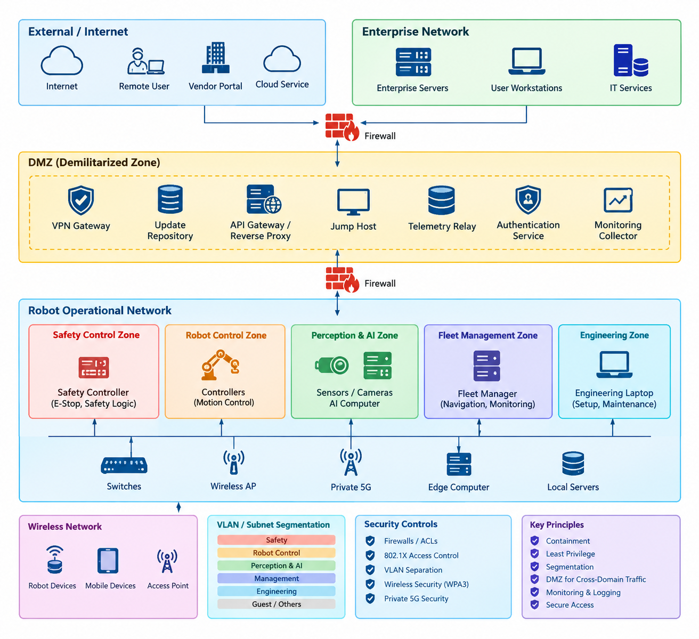{width="7.268055555555556in" height="6.642361111111111in"}

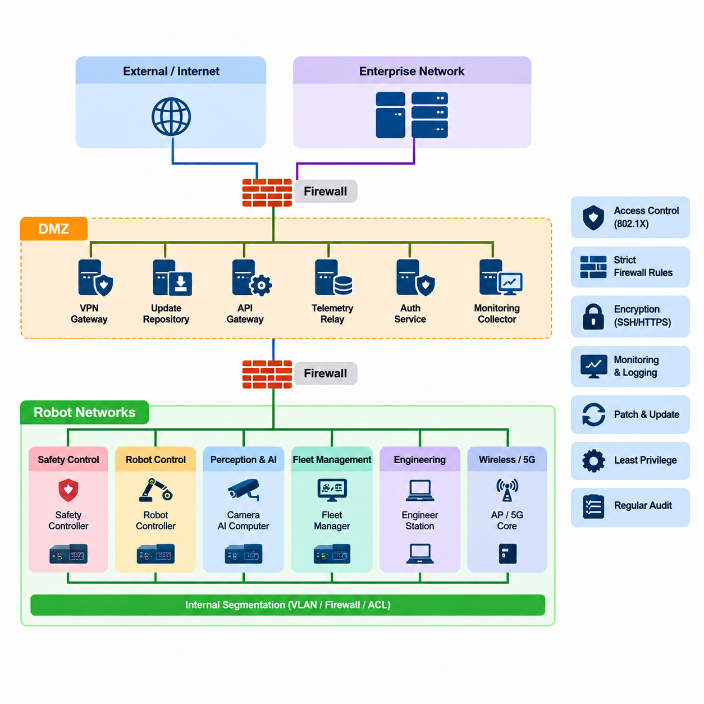{width="7.268055555555556in" height="7.268055555555556in"}

로봇 네트워크(Robot Network)는 제어기(Controller), 센서(Sensor), 액추에이터(Actuator), 엣지 컴퓨터(Edge Computer), 운영자 스테이션(Operator Station), 플릿 관리자(Fleet Manager), 외부 서비스(External Service)를 연결하는 통신 기반을 형성한다. 이 볼륨의 사이버보안(Cybersecurity) 구조에서 네트워크 보안(Network Security)은 위협 모델링(Threat Modeling)과 ROS2/DDS 보안(Security) 사이의 독립적인 계층으로 다루어지며, 통신 인프라는 애플리케이션 수준의 보안 메커니즘과 별개로 보호되어야 한다.

따라서 안전한 로봇 네트워크(Robot Network)는 하나의 거대한 신뢰 서브넷(Trusted Subnet)으로 설계해서는 안 된다. 네트워크 분할(Network Segmentation)은 운영 기능, 중요도, 신뢰 수준, 통신 요구사항에 따라 시스템을 보안 영역(Security Zone)으로 구분한다. 일반적인 영역에는 안전 제어(Safety Control), 로봇 제어(Robot Control), 인지 및 AI 처리(Perception and AI Processing), 플릿 관리(Fleet Management), 엔지니어링(Engineering), 기업 IT(Enterprise IT), 무선 인프라(Wireless Infrastructure), 외부 접근 서비스(Externally Accessible Service)가 포함될 수 있다.

핵심 보안 원칙은 침해 확산 억제(Containment)이다. 공격자가 유지보수 노트북(Maintenance Laptop), 무선 액세스 포인트(Wireless Access Point), 카메라(Camera), AI 컴퓨터(AI Computer)를 침해하더라도, 네트워크 분할은 해당 침해가 모터 제어기(Motor Controller)나 안전 필수 제어 시스템(Safety-Critical Control System)에 대한 접근으로 자동 확장되지 않도록 해야 한다. 각 경계는 정책에 따라 트래픽을 인증, 필터링, 모니터링, 속도 제한하거나 완전히 차단할 수 있는 통제 지점(Enforcement Point)이 된다.

네트워크 분할(Network Segmentation)은 단순한 물리적 위치가 아니라 통신 의존관계(Communication Dependency)를 기준으로 구성해야 한다. 동일한 로봇 내부에 설치된 장치라도 침해 시 발생하는 결과가 크게 다르기 때문에 서로 다른 신뢰 영역(Trust Zone)에 속할 수 있다. 비상 정지(Emergency Stop)를 처리하는 안전 제어기(Safety Controller)는 인포테인먼트 인터페이스(Infotainment Interface)보다 강력한 격리가 필요하며, 카메라 스트림(Camera Stream)을 처리하는 엣지 AI 컴퓨터(Edge AI Computer)는 높은 대역폭이 필요하지만 액추에이터 네트워크(Actuator Network)에 대한 무제한 접근은 필요하지 않을 수 있다.

실용적인 아키텍처에서는 일반적으로 안전 필수 및 결정론적 제어 트래픽(Safety-Critical and Deterministic Control Traffic)을 대용량 인지 및 AI 트래픽(High-Volume Perception and AI Traffic)과 분리한다. 보다 광범위한 로보틱스 소프트웨어(Robotics Software) 구조에서도 실시간 네트워킹(Real-Time Networking), 로봇 통신 API(Robot Communication API), 텔레메트리(Telemetry), 엣지 컴퓨팅(Edge Computing), 플릿 통신(Fleet Communication), 클라우드 통합(Cloud Integration)을 서로 다른 아키텍처 영역으로 구분한다. 이러한 구분은 사이버보안 네트워크 분할이 강화할 수 있는 자연스러운 경계를 제공한다.

가장 낮은 신뢰 수준(Lowest Trust Level)에서는 외부에서 접근할 수 있는 네트워크가 중요 로봇 제어기(Critical Robot Controller)와 직접 통신해서는 안 된다. 인터넷 서비스(Internet Service), 공급업체 포털(Vendor Portal), 원격 유지보수 시스템(Remote Maintenance System), 클라우드 게이트웨이(Cloud Gateway), 기업 애플리케이션(Enterprise Application)은 통제된 중간 시스템에서 연결을 종료해야 한다. 이후 운영 로봇 네트워크로 넘어가는 연결은 출발지 신원, 목적지, 프로토콜, 포트, 서비스, 운영 목적에 따라 명시적으로 승인할 수 있다.

비무장지대(Demilitarized Zone, DMZ)는 이러한 중간 보안 계층(Intermediary Security Layer)을 제공한다. 로봇 네트워크를 기업 네트워크나 외부 네트워크에 직접 노출하는 대신, 서로 다른 신뢰 도메인(Trust Domain) 사이에서 통신이 필요한 서비스를 DMZ 내부에 배치한다. 대표적인 구성요소로 VPN 게이트웨이(VPN Gateway), 업데이트 저장소(Update Repository), API 게이트웨이(API Gateway), 리버스 프록시(Reverse Proxy), 점프 호스트(Jump Host), 텔레메트리 릴레이(Telemetry Relay), 인증 서비스(Authentication Service), 보안 모니터링 수집기(Security Monitoring Collector)가 있다.

DMZ는 어느 한쪽의 신뢰 네트워크를 확장한 영역이 아니라 통제된 교환 영역(Controlled Exchange Zone)으로 취급해야 한다. 일반적으로 방화벽(Firewall)은 외부 또는 기업 네트워크와 DMZ를 분리하고, 별도의 방화벽 또는 보안 경계를 통해 DMZ와 로봇 운영 네트워크도 격리한다. 따라서 DMZ 서비스가 침해되더라도 로봇 제어기로 직접 연결되는 것은 아니며, 독립적으로 적용되는 또 하나의 보안 경계(Security Boundary)를 통과해야 한다.

통신 정책(Communication Policy)은 최소 권한(Least Privilege)을 구현해야 한다. 텔레메트리 게이트웨이(Telemetry Gateway)는 선택된 로봇 상태 메시지를 수신할 수 있지만, 자동으로 동작 명령(Motion Command)을 전송할 권한까지 부여받아서는 안 된다. OTA 저장소(OTA Repository)는 승인된 장치에 서명된 소프트웨어 패키지(Signed Software Package)를 제공할 수 있지만, 제어 노드(Control Node)를 대상으로 임의의 세션을 시작하는 것은 금지해야 한다. 관리 접근(Administrative Access) 역시 일반 운영 트래픽이 아닌 전용 관리 경로(Dedicated Management Path)를 사용해야 한다.

VLAN과 서브넷 분리(Subnet Separation)는 유용한 논리적 분할(Logical Segmentation)을 제공하지만, 경계가 실제로 강제될 때 비로소 보안 통제(Security Control)가 된다. 계층 3 방화벽(Layer-3 Firewall), 접근 제어 목록(Access-Control List, ACL), 보안 게이트웨이(Secure Gateway), 네트워크 접근 제어(Network Access Control), 호스트 방화벽(Host Firewall), 애플리케이션 인식 프록시(Application-Aware Proxy)를 사용하여 영역 간 통신을 제한할 수 있다. 따라서 방화벽 규칙, 802.1X 접근 제어, VLAN 분리, 무선 보안(Wireless Security), 사설 5G 보안(Private 5G Security)은 상호 보완적인 네트워크 방어 수단으로 작동한다.

로봇 아키텍처(Robot Architecture)는 남북 트래픽(North-South Traffic)과 동서 트래픽(East-West Traffic)의 차이도 고려해야 한다. 남북 트래픽은 로봇 또는 플릿 인프라와 기업 시스템, 클라우드, 원격 시스템을 연결한다. 동서 트래픽은 운영 환경 내부의 로봇, 제어기, 엣지 컴퓨터, 서버, 서비스 사이에서 이동한다. 초기 침투 지점을 확보한 공격자는 과도하게 허용된 동서 연결성을 악용하여 측면 이동(Lateral Movement)을 수행할 수 있다.

마이크로세그멘테이션(Microsegmentation)은 기존 네트워크 영역보다 더 세밀한 수준에서 통신 권한을 정의하여 이러한 위험을 줄일 수 있다. 하나의 로봇 VLAN 내부에 있는 모든 장치의 자유로운 통신을 허용하는 대신, 필요한 서비스 관계(Service Relationship)에만 통신을 제한할 수 있다. 예를 들어 위치추정 컴퓨터(Localization Computer)는 지정된 센서와 내비게이션 서비스(Navigation Service)에만 연결하고, 액추에이터 인터페이스(Actuator Interface)는 인증된 제어 구성요소에서 전달되는 명령만 수신하도록 제한할 수 있다.

플릿 환경(Fleet Environment)은 수백 또는 수천 대의 로봇이 공통 인프라를 공유할 수 있기 때문에 추가적인 격리가 필요하다. 한 대의 로봇이 침해되더라도 인접 로봇이나 플릿 관리 시스템(Fleet Management System)을 공격하기 위한 경유지가 되어서는 안 된다. 로봇별 신원(Per-Robot Identity), 제한된 피어 통신(Restricted Peer Communication), 격리된 관리 채널(Isolated Management Channel), 인증된 게이트웨이(Authenticated Gateway), 세밀하게 설계된 플릿 서비스 영역(Fleet Service Zone)을 통해 개별 장치 침해의 영향 범위(Blast Radius)를 제한할 수 있다.

무선 로봇(Wireless Robot)은 이러한 아키텍처에 동적인 네트워크 구성원(Dynamic Network Membership)이라는 특성을 추가한다. AMR, 휴머노이드(Humanoid), 검사 로봇(Inspection Robot), UAV 지원 시스템은 운영 세션을 유지하면서 여러 액세스 포인트나 네트워크 도메인 사이를 이동할 수 있다. 따라서 네트워크 접속 허용 전에 장치 신원(Device Identity)을 검증해야 하며, 무선 연결 자체를 신뢰의 근거로 간주하지 않고 인증 이후 접근 가능한 영역과 서비스를 권한 부여(Authorization)를 통해 결정해야 한다.

원격 유지보수(Remote Maintenance)는 운영 환경 외부에서 민감한 자산으로 연결되는 경로를 의도적으로 생성하므로 특히 엄격하게 관리해야 한다. 안전한 설계에서는 원격 연결을 DMZ의 VPN 게이트웨이나 통제된 접근 서비스(Controlled Access Service)에서 종료하고, 사용자와 장치를 인증한 후 강화된 점프 시스템(Hardened Jump System)을 통해 접근하도록 한다. 로봇 제어기에 대한 직접적인 원격 데스크톱(Remote Desktop), SSH 또는 엔지니어링 접근은 일반적으로 금지해야 한다.

네트워크 분할은 기밀성(Confidentiality)뿐 아니라 로봇 안전(Robot Safety)과 실시간 동작(Real-Time Behavior)도 보존해야 한다. 결정론적 제어 경로(Deterministic Control Path)에 삽입된 보안 장비는 지연시간(Latency), 지터(Jitter), 패킷 손실(Packet Loss), 새로운 장애 모드(Failure Mode)를 발생시킬 수 있다. 따라서 아키텍트는 통신 흐름을 시간 요구사항에 따라 분류하고, 제어 루프(Control Loop)의 마감시간을 위반하거나 비상 및 페일세이프 통신(Emergency and Fail-Safe Communication)을 방해하지 않으면서 의미 있는 격리를 제공할 수 있는 위치에 보안 메커니즘을 배치해야 한다.

가용성(Availability) 역시 영역 설계에 영향을 미친다. 모든 내부 트래픽을 하나의 중앙 방화벽(Central Firewall)에서 처리하면 성능 병목(Performance Bottleneck)과 공통 장애 지점(Common Failure Point)이 동시에 발생할 수 있다. 산업용 로봇 배포(Industrial Robot Deployment)에서는 계층적 네트워크 분할(Hierarchical Segmentation), 이중화 게이트웨이(Redundant Gateway), 로컬 정책 적용(Local Enforcement), 결정론적 네트워크 경로(Deterministic Network Path), 페일세이프 정책(Fail-Safe Policy)을 결합할 수 있다. 보안 아키텍처는 방어 통제가 일반적인 네트워크 장애를 위험한 로봇 동작으로 변환하지 않도록 설계되어야 한다.

모니터링(Monitoring)은 주요 신뢰 경계(Trust Boundary)에 통합되어야 한다. 방화벽, 게이트웨이, 스위치, 무선 제어기(Wireless Controller), VPN 시스템, 로봇 엔드포인트(Robot Endpoint)는 인증 실패, 거부된 연결, 예상하지 못한 프로토콜, 구성 변경, 비정상적인 트래픽 패턴을 나타내는 보안 텔레메트리(Security Telemetry)를 생성할 수 있다. 이러한 개념은 이후 네트워크 침입 탐지(Network Intrusion Detection)와 SIEM 중심의 네트워크 보안 모니터링(Network Security Monitoring)으로 확장된다.

마지막으로 네트워크 분할 정책(Segmentation Policy)은 문서화되지 않은 스위치 설정이 아니라 명시적인 아키텍처 산출물(Architecture Artifact)로 관리해야 한다. 각 영역은 명확한 목적, 자산 목록(Asset Inventory), 신뢰 수준(Trust Level), 허용된 통신 흐름(Permitted Communication Flow), 관리 경로(Administrative Path), 로깅 요구사항(Logging Requirement), 책임 소유자(Responsible Owner)를 가져야 한다. 이를 통해 로봇 소프트웨어나 플릿 인프라의 변경사항을 배포 전에 이러한 보안 경계를 기준으로 평가할 수 있으며, 시간이 지나면서 통제되지 않은 연결성이 누적되는 것을 방지할 수 있다.

성숙한 로봇 네트워크 아키텍처(Robot Network Architecture)는 네트워크 분할(Network Segmentation), DMZ, 신원(Identity), 최소 권한 통신(Least-Privilege Communication), 암호화된 원격 접근(Encrypted Remote Access), 모니터링(Monitoring), 통제된 영역 간 게이트웨이(Controlled Inter-Zone Gateway)를 심층 방어(Defense in Depth) 구조로 결합한다. 최종 목표는 단순히 외부 공격자를 차단하는 것이 아니라 단일 로봇, 서비스, 네트워크 인터페이스 또는 관리 엔드포인트가 침해되더라도 그 영향을 해당 영역에 제한하여 안전 필수 기능이나 전체 플릿으로 쉽게 확산되지 않도록 하는 것이다.

## 03.02. Firewall and ACL Rules for Robot Networks [w/Code]

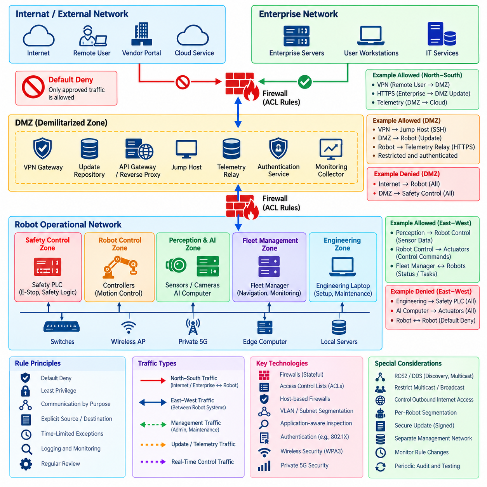{width="7.268055555555556in" height="7.268055555555556in"}

방화벽(Firewall)과 접근 제어 목록(Access Control List, ACL)은 로봇 네트워크 분할(Robot Network Segmentation)을 실제 운영 가능한 보안 경계(Security Boundary)로 전환하는 정책 집행 계층(Enforcement Layer)을 제공한다. 안전 제어(Safety Control), 로봇 제어(Robot Control), 인지(Perception), AI 컴퓨팅(AI Computing), 플릿 관리(Fleet Management), 엔지니어링(Engineering), 비무장지대(Demilitarized Zone, DMZ), 기업 네트워크(Enterprise Network) 등의 영역이 정의되면, 방화벽과 ACL 정책은 어떤 시스템이 어떠한 조건에서 이러한 경계를 넘어 통신할 수 있는지를 정확하게 결정한다.

안전한 규칙 집합(Rule Set)은 기본 거부(Default-Deny) 원칙에서 시작한다. 두 장치가 동일한 운영 환경을 공유하거나 특정 프로토콜이 로보틱스 소프트웨어(Robotics Software)에서 일반적으로 사용된다는 이유만으로 트래픽을 허용해서는 안 된다. 허용되는 각 통신 흐름은 출발지(Source), 목적지(Destination), 프로토콜(Protocol), 포트 또는 서비스(Port or Service), 통신 방향(Direction), 운영 목적(Operational Purpose)을 명시한 문서화된 통신 요구사항과 연결되어야 한다. 승인된 통신 모델 외의 모든 트래픽은 거부한다.

방화벽과 ACL은 서로 다른 정책 집행 지점(Enforcement Point)에서 동작하며 상호 보완적으로 사용할 수 있다. 라우터와 스위치 ACL은 주로 네트워크 및 전송 계층 정보를 기반으로 효율적인 필터링을 제공하며, 상태 기반 방화벽(Stateful Firewall)은 연결 상태(Connection State)를 추적하여 더욱 세밀한 보안 정책을 적용할 수 있다. 호스트 기반 방화벽(Host-Based Firewall)은 로봇 컴퓨터, 엣지 노드(Edge Node), 엔지니어링 워크스테이션(Engineering Workstation), 서버에 직접 추가적인 경계를 형성하여 경계 보안 통제에만 의존하는 것을 줄인다.

안전 필수 로봇 네트워크(Safety-Critical Robot Network)에는 특히 제한적인 정책이 필요하다. 모터 제어기(Motor Controller), 안전 PLC(Safety PLC), 비상 정지 시스템(Emergency-Stop System), 결정론적 제어 구성요소(Deterministic Control Component)는 명시적으로 승인된 제어 출발지에서 전달되는 트래픽만 수신해야 한다. 일반 기업 호스트, 사용자 노트북, 클라우드 서비스, 관련 없는 로봇 서브시스템은 물리적인 네트워크 연결이 존재하더라도 이러한 구성요소로 직접 접근할 수 있는 경로나 방화벽 권한을 가져서는 안 된다.

로봇 제어 네트워크(Robot Control Network)는 내비게이션(Navigation), 위치추정(Localization), 모션 계획(Motion Planning), 제어(Control), 하드웨어 인터페이스(Hardware Interface) 사이에서 예측 가능한 통신을 요구하는 경우가 많다. 방화벽 정책은 이러한 필수 통신 흐름을 보존하면서 관련 없는 서비스가 제어 도메인(Control Domain)으로 진입하지 못하도록 해야 한다. SSH나 원격 관리(Remote Management)와 같은 관리 프로토콜은 일반적으로 실시간 운영 통신에 대한 무제한 접근을 공유하는 대신 전용 관리 경로(Dedicated Management Path)를 사용해야 한다.

인지 및 AI 네트워크(Perception and AI Network)는 서로 다른 트래픽 특성을 가진다. 카메라(Camera), 라이다(LiDAR), 레이더(Radar), GPU 컴퓨터(GPU Computer), 추론 서버(Inference Server)는 높은 전송률로 대용량 데이터 스트림을 교환할 수 있으므로 모든 트래픽을 무차별적으로 검사하는 것은 많은 비용을 요구할 수 있다. 따라서 보안 아키텍처는 필요한 고대역폭 통신 흐름을 정확하게 식별하고, 이러한 네트워크 요구사항이 네트워크 분할을 무력화하는 광범위한 임의 통신(Any-to-Any) 규칙을 허용하는 근거가 되지 않도록 해야 한다.

플릿 관리 시스템(Fleet Management System)은 다수의 로봇과 통제된 양방향 통신(Controlled Bidirectional Communication)을 수행해야 한다. 로봇은 상태(Health), 위치(Position), 임무 상태(Mission Status), 배터리 상태(Battery State), 진단 정보(Diagnostic Information)를 보고하면서 승인된 작업이나 구성 데이터를 수신할 수 있다. 방화벽 정책은 이러한 기능을 직접적인 저수준 동작 제어(Low-Level Motion Control)와 구분하여 플릿 서비스가 침해되더라도 액추에이터 인터페이스(Actuator Interface)에 대한 무제한 접근으로 자동 확장되지 않도록 해야 한다.

비무장지대(Demilitarized Zone, DMZ)는 로봇 운영 기술(Operational Technology)과 신뢰도가 낮은 네트워크 사이의 통신을 중계하는 서비스를 배치하기에 적합한 영역을 제공한다. VPN 집중기(VPN Concentrator), API 게이트웨이(API Gateway), 업데이트 서버(Update Server), 텔레메트리 릴레이(Telemetry Relay), 점프 호스트(Jump Host), 인증 서비스(Authentication Service)는 선택된 트래픽을 내부로 전달하기 전에 외부 세션을 종료할 수 있다. DMZ 양쪽의 방화벽 규칙은 서로 독립적으로 유지하여 하나의 중계 시스템이 침해되더라도 내부 보안 경계가 제거되지 않도록 해야 한다.

접근 제어 목록(Access Control List, ACL)은 네트워크 장비에 가까운 위치에서 단순하고 결정론적인 제한을 구현하는 데 특히 유용하다. ACL은 승인된 제어기 서브넷(Controller Subnet)에서 특정 로봇 서비스로 향하는 트래픽은 허용하면서 엔지니어링 네트워크나 게스트 네트워크(Guest Network)에서 발생하는 접근 시도는 거부할 수 있다. 그러나 광범위한 허용 규칙이 제한 규칙보다 먼저 배치되면 의도한 정책을 우회할 수 있으므로 ACL 설계에서는 규칙 순서(Rule Order)를 주의 깊게 고려해야 한다.

출발지와 목적지 정의는 운영상 가능한 범위에서 최대한 구체적으로 설정해야 한다. 전체 대규모 서브넷을 기준으로 하는 규칙은 관리하기 쉽지만 더 큰 신뢰 도메인(Trust Domain)을 생성한다. 인프라가 지원하는 경우 정책에서 개별 호스트(Individual Host), 보안 그룹(Security Group), 장치 신원(Device Identity), 세밀하게 범위가 제한된 서비스 네트워크(Service Network)를 참조할 수 있다. 목적은 단순히 동일한 주소 범위를 공유한다는 이유만으로 접근 권한을 상속받는 시스템의 수를 최소화하는 것이다.

포트 기반 필터링(Port-Based Filtering) 역시 주의가 필요하다. 특정 TCP 또는 UDP 포트를 허용한다고 해서 해당 포트를 사용하는 트래픽이 정상적인 트래픽이라는 것이 보장되지는 않으며, 특히 애플리케이션이 허용된 서비스를 통해 예상하지 못한 데이터를 터널링(Tunneling)할 수 있다. 높은 수준의 보증이 필요한 환경에서는 상태 기반 검사(Stateful Inspection), 애플리케이션 인식 게이트웨이(Application-Aware Gateway), 상호 인증(Mutual Authentication), 암호화 프로토콜 검증(Encrypted Protocol Validation)을 기본적인 계층 3 및 계층 4(Layer-3 and Layer-4) 통제와 함께 사용할 수 있다.

ROS2와 DDS 환경은 디스커버리(Discovery)와 데이터 교환에서 동적 포트(Dynamic Port), 멀티캐스트 통신(Multicast Communication), 다수의 참여자(Participant)를 사용할 수 있으므로 특별한 고려가 필요하다. 기존 클라이언트-서버(Client-Server) IT 시스템의 방화벽 정책을 그대로 적용하면 필요한 로봇 통신이 차단되거나 반대로 지나치게 광범위한 통신이 허용될 수 있다. 따라서 네트워크 규칙은 실제 배포 시스템에서 사용하는 미들웨어 토폴로지(Middleware Topology), DDS 구성(Configuration), 디스커버리 방식(Discovery Method), 보안 아키텍처(Security Architecture)를 기반으로 설계해야 한다.

멀티캐스트(Multicast)와 브로드캐스트(Broadcast) 트래픽은 명확한 이유 없이 보안 경계를 넘어가도록 허용해서는 안 된다. 디스커버리 메커니즘(Discovery Mechanism)은 로봇 노드와 서비스에 관한 정보를 노출할 수 있으며, 통제되지 않은 멀티캐스트 전파는 공격 표면(Attack Surface)과 장애 영역(Failure Domain)을 모두 확대할 수 있다. 라우터, VLAN 경계, 멀티캐스트 제어(Multicast Control), 미들웨어 설정을 통해 디스커버리 통신을 운영상 필요한 영역으로 제한할 수 있다.

아웃바운드 필터링(Outbound Filtering)은 인바운드 필터링(Inbound Filtering)만큼 중요하다. 침해된 로봇 컴퓨터는 외부 명령 및 제어 서버(Command-and-Control Server)에 접속하거나, 지도 또는 센서 데이터를 유출하거나, 승인되지 않은 소프트웨어를 다운로드하려 할 수 있다. 이그레스 규칙(Egress Rule)을 통해 로봇 장치가 승인된 DNS, NTP, 업데이트, 텔레메트리, 클라우드, 관리 목적지와만 통신하도록 제한하면 예상하지 못한 외부 통신을 어렵게 만들고 모니터링 시스템에서 더욱 쉽게 식별할 수 있다.

원격 유지보수 규칙(Remote Maintenance Rule)은 가능한 경우 임시적이고 추적 가능하며 세밀하게 제한되어야 한다. 관리 서비스를 영구적으로 노출하는 대신 원격 사용자는 지정된 관리 인터페이스에 접근하기 전에 VPN과 강화된 점프 호스트(Hardened Jump Host)를 통해 인증할 수 있다. 접근 권한은 사용자 역할(User Role), 장치 신원(Device Identity), 목적지, 유지보수 시간대(Maintenance Window), 세션 지속시간(Session Duration)에 따라 제한할 수 있으며, 이후 보안 검토를 위해 로그를 보존해야 한다.

무선 로봇 네트워크(Wireless Robot Network)에도 유선 인프라와 동일한 수준의 정책 원칙을 적용해야 한다. 성공적인 Wi-Fi 또는 사설 셀룰러 인증(Private Cellular Authentication)은 네트워크 접속 권한(Network Admission)을 제공할 뿐 무제한적인 신뢰를 의미해서는 안 된다. 로봇이 네트워크에 접속한 이후에도 방화벽과 ACL 정책을 통해 할당된 역할(Role), 보안 영역(Security Zone), 신원(Identity)에 따라 접근 가능한 서비스를 제한하여 무선 네트워크 침해가 무제한적인 측면 접근(Lateral Access)으로 확대되지 않도록 해야 한다.

규칙 로깅(Rule Logging)은 보안 모니터링과 정책 개선 모두에 필요한 증거를 제공한다. 거부된 연결(Denied Connection)은 스캐닝(Scanning), 구성 오류(Configuration Error), 승인되지 않은 소프트웨어, 침해된 장치 또는 아키텍처 설계 과정에서 누락된 정상 통신 흐름을 나타낼 수 있다. 위험도가 높은 허용된 관리 트래픽도 기록하여 보안 담당자가 누가 언제 민감한 로봇 인프라에 접근했는지를 재구성할 수 있도록 해야 한다.

그러나 실시간 환경(Real-Time Environment)에서는 로깅도 신중하게 설계해야 한다. 모든 패킷이나 반복적으로 거부되는 통신 흐름을 기록하면 방화벽에 과부하가 발생하고 저장 공간을 소모하며 과도한 잡음 속에 중요한 이벤트가 묻힐 수 있다. 속도 제한(Rate Limiting), 집계(Aggregation), 심각도 분류(Severity Classification), 중앙집중형 SIEM 수집(Centralized SIEM Collection)을 적용하면 모니터링 기능이 로봇 네트워크 가용성에 영향을 주지 않으면서 유용한 보안 가시성(Security Visibility)을 유지할 수 있다.

보안 게이트웨이(Security Gateway)가 운영상 중요한 경로에 위치하는 경우 방화벽 고가용성(Firewall High Availability)이 중요하다. 이중화 장비(Redundant Appliance), 상태 동기화(Synchronized State), 이중화 네트워크 링크(Redundant Network Link), 상태 모니터링(Health Monitoring), 검증된 장애 전환(Failover) 동작을 통해 하나의 방화벽 장애가 전체 로봇 플릿을 중단시키는 것을 방지할 수 있다. 장애 시 개방(Fail-Open)은 연결성을 유지하지만 보안을 약화시킬 수 있고, 장애 시 차단(Fail-Closed)은 운영을 중단시킬 수 있으므로 적절한 전략은 안전 및 운영 위험 분석(Safety and Operational Risk Analysis)에 따라 결정해야 한다.

구성 관리(Configuration Management)에서는 방화벽과 ACL 정책을 비공식적인 관리자 설정이 아니라 통제된 보안 산출물(Controlled Security Artifact)로 관리해야 한다. 규칙에는 식별자(Identifier), 책임자(Owner), 비즈니스 또는 운영상의 정당성(Justification), 영향받는 영역, 승인 기록(Approval Record), 검토 날짜(Review Date)를 포함해야 한다. 코드형 인프라(Infrastructure as Code) 기법을 적용하면 구성을 버전 관리(Version Control) 아래에서 관리하고 동료 검토(Peer Review), 자동 검증(Automated Validation), 롤백(Rollback), 여러 사이트에 대한 일관된 배포를 수행할 수 있다.

로봇 시스템이 발전하면서 규칙 집합에는 오래된 권한이 누적되는 경향이 있다. 임시 시운전 규칙(Temporary Commissioning Rule), 폐기된 엔지니어링 워크스테이션, 오래된 공급업체 서비스, 이전 소프트웨어 아키텍처를 위한 접근 권한이 원래 목적이 사라진 이후에도 남아 있을 수 있다. 정기적인 재인증(Periodic Recertification)을 통해 현재 구성된 규칙을 최신 통신 요구사항과 비교하고 검증된 운영 의존성이 더 이상 존재하지 않는 항목을 제거해야 한다.

변경사항은 운영 환경에 배포하기 전에 검증해야 한다. 테스트를 통해 필요한 로봇 기능이 계속 사용 가능한지 확인하는 동시에 금지된 통신 경로가 실제로 차단되는지도 검증해야 하며, 여기에는 기업 네트워크에서 제어 영역으로의 접근이나 한 로봇에서 다른 로봇으로 이동하려는 시도가 포함된다. 시뮬레이션(Simulation), 스테이징 네트워크(Staging Network), 하드웨어 인 더 루프(Hardware-in-the-Loop, HIL) 환경, 자동 연결성 테스트(Automated Connectivity Test)를 활용하면 보안 변경으로 인해 로봇 운영이 예상하지 못하게 중단될 위험을 줄일 수 있다.

성숙한 방화벽 및 ACL 아키텍처(Firewall and ACL Architecture)는 궁극적으로 최소 권한(Least Privilege)을 실행 가능한 네트워크 정책(Executable Network Policy)으로 구현한다. 네트워크 분할(Segmentation)이 신뢰 경계의 위치를 정의한다면 필터링 규칙(Filtering Rule)은 그 경계를 통과할 수 있는 통신을 결정한다. 인증(Authentication), 암호화 통신(Encrypted Communication), 침입 탐지(Intrusion Detection), 네트워크 접근 제어(Network Access Control), 로깅(Logging), 지속적인 정책 검토(Continuous Policy Review)와 결합하면 이러한 통제는 측면 이동(Lateral Movement)을 제한하고 침해된 로봇, 컴퓨터, 서비스 또는 사용자 계정으로 인한 영향을 줄일 수 있다.

## 03.03. VPN and Encrypted Tunnel for Remote Access [w/Code]

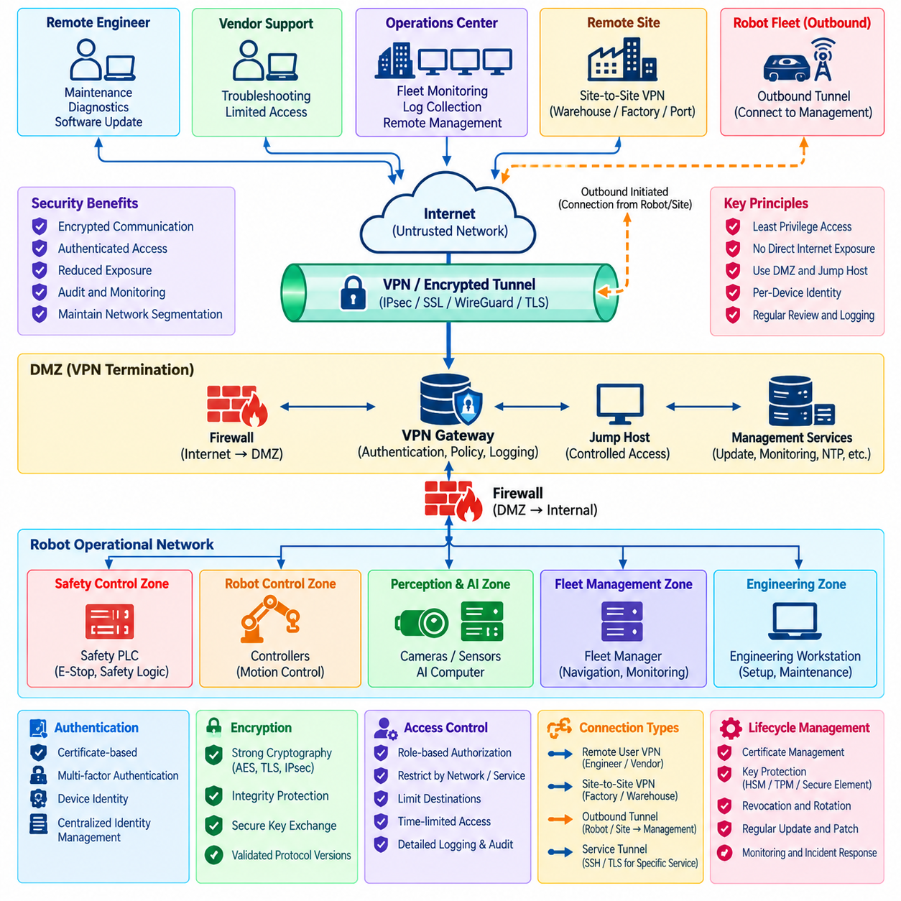{width="7.268055555555556in" height="7.268055555555556in"}

원격 접근(Remote Access)은 분산된 로봇 플릿(Robot Fleet)을 유지보수하고, 장애를 진단하며, 소프트웨어를 배포하고, 로그를 수집하며, 고객 또는 산업 현장에 설치된 시스템을 지원하는 데 필수적이다. 그러나 모든 원격 연결은 외부 네트워크에서 운영 로봇 인프라(Operational Robot Infrastructure)로 진입할 수 있는 잠재적 경로를 생성한다. VPN과 암호화 터널(Encrypted Tunnel)은 원격 연결을 피할 수 없는 환경에서 노출 위험을 줄이는 보호된 통신 채널을 제공한다.

가상 사설망(Virtual Private Network, VPN)은 공용 인터넷(Public Internet)과 같은 신뢰할 수 없는 네트워크를 통해 인증되고 암호화된 통신 경로를 구축한다. SSH, 원격 데스크톱(Remote Desktop), 웹 관리(Web Administration), ROS2 서비스, 장치 관리 인터페이스(Device-Management Interface)를 외부 호스트에 직접 노출하는 대신, 보호된 로봇 자원에 접근하기 전에 원격 사용자와 시스템이 VPN 세션을 먼저 설정하도록 요구할 수 있다.

암호화(Encryption)는 터널을 통해 이동하는 정보의 기밀성(Confidentiality)을 보호한다. 로봇 네트워크에서는 구성 파일(Configuration File), 진단 로그(Diagnostic Log), 텔레메트리(Telemetry), 소프트웨어 패키지(Software Package), 지도(Map), 자격증명(Credential), 운영 명령(Operational Command), 민감한 센서 데이터(Sensitive Sensor Data)가 전송될 수 있다. 강력한 암호화 프로토콜(Cryptographic Protocol)은 수동적인 관찰자가 이러한 트래픽을 읽지 못하도록 하며, 무결성 메커니즘(Integrity Mechanism)은 신뢰할 수 없는 통신 인프라를 통과하는 동안 패킷이 변경되는 것을 탐지하는 데 도움을 준다.

암호화만으로 원격 엔드포인트(Remote Endpoint)를 신뢰할 수 있는지 판단할 수 없기 때문에 인증(Authentication) 역시 중요하다. VPN 게이트웨이(VPN Gateway)는 접근 권한을 부여하기 전에 사용자, 장치 또는 서비스를 검증해야 한다. 인증서 기반 장치 인증(Certificate-Based Device Authentication), 다중 요소 인증(Multifactor Authentication), 하드웨어 기반 자격증명(Hardware-Backed Credential), 중앙 관리형 신원(Centrally Managed Identity)은 특히 운영 로봇 시스템에 접근하는 관리자의 경우 비밀번호만 사용하는 방식보다 높은 보증 수준을 제공할 수 있다.

VPN 종료(VPN Termination)는 일반적으로 안전 필수 제어기(Safety-Critical Controller)가 아니라 통제된 네트워크 경계(Controlled Network Boundary)에서 이루어져야 한다. 비무장지대(Demilitarized Zone, DMZ)에 위치한 게이트웨이는 암호화된 세션을 종료하고, 신원을 검증하며, 보안 정책을 적용하고, 감사 기록(Audit Record)을 생성한 후 승인된 트래픽만 내부 네트워크로 전달할 수 있다. 이를 통해 외부 터널이 기존 방화벽 경계(Firewall Boundary)를 우회하지 못하게 하면서 네트워크 분할(Network Segmentation)을 유지할 수 있다.

원격 접근 권한 부여(Remote Access Authorization)는 최소 권한(Least Privilege) 원칙을 따라야 한다. VPN 연결이 설정되었다고 해서 모든 로봇, 서버, 제어기, 엔지니어링 워크스테이션(Engineering Workstation)에 대한 무제한 접근 권한이 제공되어서는 안 된다. 정책은 사용자 역할(User Role), 장치(Device), 목적지 네트워크(Destination Network), 서비스(Service), 프로토콜(Protocol), 고객 사이트(Customer Site), 로봇 그룹(Robot Group), 유지보수 책임(Maintenance Responsibility)에 따라 접근 범위를 제한하여 특정 작업에 필요한 자원에만 접근하도록 할 수 있다.

일반적인 관리 모델(Administrative Model)은 VPN 접근과 강화된 점프 호스트(Hardened Jump Host)를 결합한다. 원격 엔지니어(Remote Engineer)는 먼저 인증된 VPN 세션을 설정한 후 DMZ 또는 관리 영역(Management Zone) 내부의 통제된 관리 시스템에 접속한다. 이후 승인된 도구와 목적지를 통해 로봇 자원에 접근함으로써 추가적인 보안 경계를 형성하고 관리 활동을 중앙에서 모니터링할 수 있는 지점을 제공한다.

사이트 간 VPN(Site-to-Site VPN)은 전체 네트워크를 안전하게 연결해야 하는 다른 유형의 요구사항을 해결한다. 창고, 공장, 항만, 연구소 또는 원격 현장에 배치된 로봇 시스템은 중앙 운영 센터(Central Operations Center)나 플릿 인프라(Fleet Infrastructure)와 암호화 터널을 구성할 수 있다. 이때 라우팅 정책(Routing Policy)은 두 위치를 하나의 무제한 신뢰 네트워크로 통합하는 대신 필요한 서브넷과 서비스만 노출해야 한다.

암호화 터널은 전체 네트워크 수준의 VPN 접근을 제공하지 않고 개별 서비스 연결만 보호할 수도 있다. SSH 터널링(SSH Tunneling), TLS 보호 API(TLS-Protected API), 상호 인증 TLS 세션(Mutually Authenticated TLS Session), 애플리케이션 전용 암호화 채널(Application-Specific Encrypted Channel)은 명확하게 제한된 서비스만 원격 통신을 요구하는 경우 적합할 수 있다. 제한적인 서비스 터널은 외부 엔드포인트에 광범위한 네트워크 연결성을 제공하는 것보다 공격 표면(Attack Surface)을 줄일 수 있다.

터널 아키텍처(Tunnel Architecture)는 통신 방향성(Directionality)을 고려해야 한다. 많은 배포 환경에서는 인터넷에서 임의의 인바운드 연결(Unsolicited Inbound Connection)을 수신하는 것보다 로봇이나 현장 게이트웨이가 알려진 관리 서비스(Management Service)를 향해 아웃바운드 연결(Outbound Connection)을 시작하도록 하는 것이 더 안전하다. 아웃바운드 시작 세션은 방화벽과 주소 변환(Address Translation) 환경에서도 동작할 수 있으며 공격자가 스캔하거나 탐색할 수 있는 공개 서비스의 수를 줄여준다.

분할 터널링(Split Tunneling)은 신중하게 평가해야 한다. 분할 터널링이 활성화되면 원격 유지보수 컴퓨터가 보호된 로봇 네트워크와 공용 인터넷 또는 다른 로컬 네트워크에 동시에 통신할 수 있다. 해당 엔드포인트가 침해되면 서로 다른 신뢰 도메인(Trust Domain)을 연결하는 브리지(Bridge) 역할을 할 가능성이 있다. 따라서 높은 보증 수준이 필요한 유지보수 환경에서는 관련 트래픽을 통제된 보안 인프라를 통해 전달하거나 안전하지 않은 동시 연결을 금지할 수 있다.

암호화 구성(Cryptographic Configuration)은 시스템 전체 수명주기(System Lifecycle)에 걸쳐 관리되어야 한다. VPN 보안은 단순히 암호화된 프로토콜을 선택하는 것뿐 아니라 적절한 알고리즘(Algorithm), 키 길이(Key Length), 인증서 검증(Certificate Validation), 키 저장(Key Storage), 세션 설정(Session Establishment), 프로토콜 버전(Protocol Version)에 의존한다. 사용이 권장되지 않는 오래된 암호화 메커니즘은 제거하고, 공급업체 기본 설정에 계속 의존하는 대신 로봇 배포 환경을 위해 정의된 보안 기준선(Security Baseline)을 따라야 한다.

대규모 플릿에서는 키 및 인증서 관리(Key and Certificate Management)가 특히 중요하다. 수백 대의 로봇이 동일한 자격증명을 공유하면 하나의 자격증명 침해가 다수의 장치에 영향을 미칠 수 있으며 폐기(Revocation)와 행위 추적(Attribution)도 어려워진다. 장치별 인증서(Per-Device Certificate) 또는 암호학적 신원(Cryptographic Identity)을 사용하면 전체 플릿의 자격증명을 무효화하지 않고 개별 로봇, 게이트웨이 또는 엔지니어링 엔드포인트의 권한만 폐기할 수 있다.

개인 키(Private Key)는 가능한 경우 추출되지 않도록 보호해야 한다. 하드웨어 보안 모듈(Hardware Security Module, HSM), 신뢰 플랫폼 모듈(Trusted Platform Module, TPM), 보안 요소(Secure Element), 운영체제 보호 자격증명 저장소(Operating-System Protected Credential Store)를 사용하면 악성코드나 물리적 접근으로 VPN 자격증명이 노출될 위험을 줄일 수 있다. 또한 플릿 규모가 커져 수동 관리가 어려워지기 전에 인증서 등록(Enrollment), 갱신(Renewal), 만료(Expiration), 폐기(Revocation), 교체(Replacement), 복구(Recovery) 절차를 정의해야 한다.

VPN 게이트웨이는 외부 네트워크와 운영 네트워크 사이의 경계에 위치하기 때문에 가치가 높은 보안 자산(High-Value Security Asset)이다. 따라서 게이트웨이는 보안 강화(Hardening), 패치(Patching), 모니터링(Monitoring)을 적용하고 노출되는 서비스를 최소화해야 한다. 관리 인터페이스(Administrative Interface)는 일반 원격 사용자 트래픽과 격리해야 하며, 게이트웨이 소프트웨어 역시 취약점 관리(Vulnerability Management)와 보안 업데이트(Security Update) 프로세스에 포함해야 한다.

로깅(Logging)은 성공 및 실패한 인증 시도, 연결 설정 및 종료, 출발지 정보(Source Information), 할당된 신원(Assigned Identity), 접근한 목적지, 정책 위반(Policy Violation), 주요 구성 변경(Configuration Change)을 기록해야 한다. 이러한 기록은 사고 조사(Incident Investigation)를 위한 증거를 제공하며 중앙 모니터링 시스템이나 보안 정보 및 이벤트 관리(Security Information and Event Management, SIEM) 시스템으로 전달하여 의심스러운 원격 접근 행동을 로봇 및 네트워크 이벤트와 연계 분석할 수 있다.

모니터링(Monitoring)은 반복적인 인증 실패, 예상하지 못한 위치에서의 연결, 비정상적인 접근 시간, 과도하게 긴 세션 지속시간, 승인되지 않은 로봇 영역으로의 접근 시도, 갑작스러운 데이터 전송량 증가 등의 패턴을 식별할 수 있다. 이러한 관찰만으로 침해를 확정할 수는 없지만 자격증명 악용(Credential Abuse), 침해된 유지보수 엔드포인트, 정책 위반을 탐지하는 데 유용한 신호를 제공한다.

원격 세션(Remote Session)은 운영상 가능한 경우 시간 제한(Time-Bounded)을 적용해야 한다. 임시 공급업체 접근(Temporary Vendor Access)이나 유지보수 접근은 승인된 서비스 시간대(Service Window)에만 활성화하고 이후 자동으로 폐기할 수 있다. 적시 접근(Just-in-Time Access)은 로봇 인프라에 영구적으로 유효한 접근 경로의 수를 줄이며, 잊힌 계정이나 오래된 지원 계약으로 인한 접근 권한이 실제 필요성이 사라진 이후에도 유지되는 것을 방지한다.

장애 상황에서 원격 관리가 중요해질 수 있으므로 가용성(Availability) 역시 고려해야 한다. 이중화 VPN 게이트웨이(Redundant VPN Gateway), 대체 관리 경로(Alternate Management Path), 구성 백업(Configuration Backup), 인증서 만료 모니터링(Certificate Expiration Monitoring), 검증된 복구 절차(Recovery Procedure)를 사용하면 하나의 게이트웨이 장애로 전체 플릿에 대한 접근이 사라지는 것을 방지할 수 있다. 그러나 원격 연결이 손실되더라도 로컬에서 유지되어야 하는 자율 안전 기능(Autonomous Safety Function)이 손상되어서는 안 된다.

로컬에서 안전하게 제어할 수 있다면 실시간 로봇 제어(Real-Time Robot Control)는 일반적으로 예측하기 어려운 인터넷 VPN 지연시간에 의존해서는 안 된다. 암호화, 터널링, 라우팅 변경, 네트워크 혼잡(Congestion), 광역 네트워크(Wide-Area Network)의 변동은 지연시간(Latency)과 지터(Jitter)를 발생시킬 수 있다. 따라서 원격 연결은 원격 실시간 제어를 위해 특별히 설계하고 검증한 시스템이 아니라면 감독 명령(Supervisory Command), 플릿 운영, 진단, 소프트웨어 관리, 텔레메트리에 사용하는 것이 적합하다.

비상 접근 메커니즘(Emergency Access Mechanism)은 특히 엄격하게 관리해야 한다. 복구를 위해 생성한 우회 계정(Bypass Account)이나 무제한 유지보수 터널(Unrestricted Maintenance Tunnel)은 제대로 관리하지 않으면 영구적인 백도어(Backdoor)가 될 수 있다. 비상 접근 절차(Break-Glass Procedure)는 강력하게 보호된 자격증명, 명시적인 승인, 광범위한 로깅, 제한된 사용 시간, 사용 후 검토(Post-Use Review)를 적용하여 예외적인 접근이 일상적인 관리 우회 수단으로 변하지 않도록 해야 한다.

VPN 정책은 전체 로봇 네트워크 보안 아키텍처(Robot Network Security Architecture)와 통합되어야 한다. 방화벽 규칙(Firewall Rule)은 터널이 설정된 이후에도 접근 가능한 목적지를 결정하고, 네트워크 분할(Network Segmentation)은 측면 이동(Lateral Movement)을 제한하며, 침입 탐지(Intrusion Detection)는 의심스러운 트래픽을 관찰하고, 신원 시스템(Identity System)은 누가 또는 무엇이 연결되는지를 결정한다. 암호화는 전송 경로를 보호하지만 실제 접근이 안전한지는 이러한 추가적인 보안 통제에 의해 결정된다.

따라서 성숙한 원격 접근 설계(Remote Access Design)는 VPN과 암호화 터널을 보편적인 신뢰 메커니즘이 아니라 심층 방어(Defense in Depth)의 구성요소로 취급한다. 강력한 인증(Strong Authentication), 보호된 암호학적 신원(Protected Cryptographic Identity), DMZ 종료(DMZ Termination), 최소 권한 기반 권한 부여(Least-Privilege Authorization), 통제된 라우팅(Controlled Routing), 강화된 게이트웨이(Hardened Gateway), 중앙집중형 로깅(Centralized Logging), 인증서 수명주기 관리(Certificate Lifecycle Management), 지속적인 모니터링(Continuous Monitoring)을 결합하면 안전 필수 로봇 인프라를 불필요하게 노출하지 않으면서 원격 유지보수 가능성(Remote Maintainability)을 확보할 수 있다.

## 03.04. Network Intrusion Detection SNORT Suricata [w/Code]

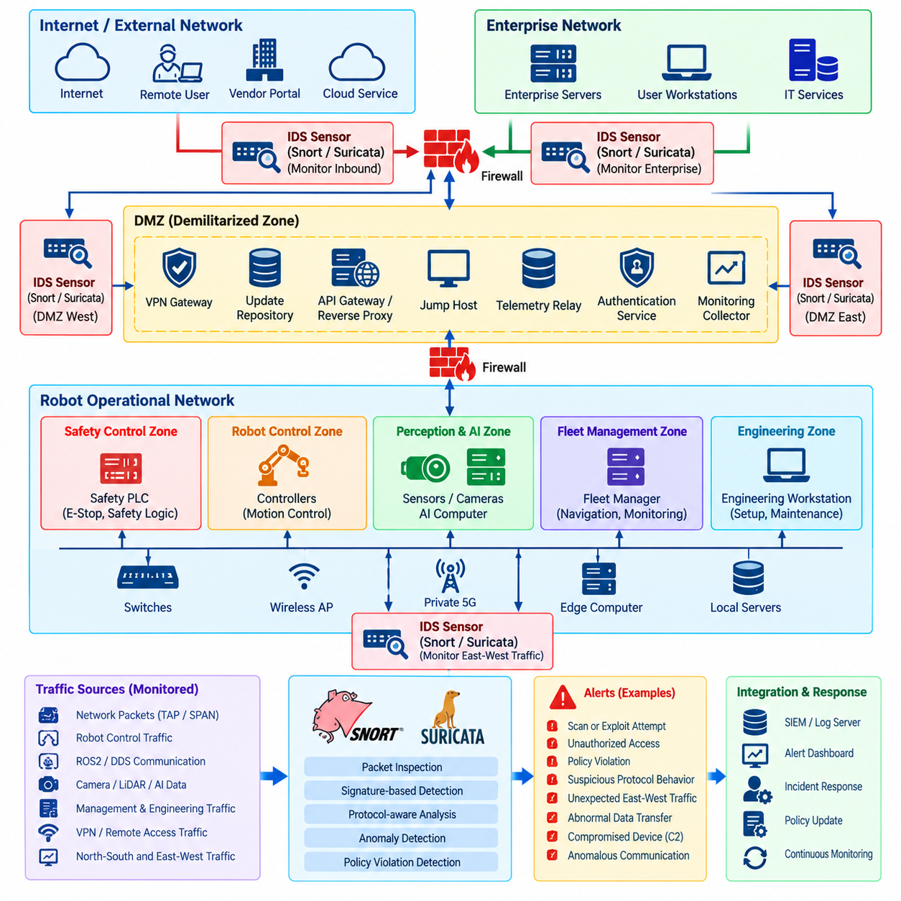{width="7.268055555555556in" height="7.268055555555556in"}

네트워크 침입 탐지(Network Intrusion Detection)는 예방적 보안 통제(Preventive Control)만으로는 보장할 수 없는 통신 활동에 대한 지속적인 가시성(Visibility)을 제공한다. 방화벽(Firewall), ACL, VPN, 네트워크 분할(Network Segmentation)은 노출을 줄이지만, 침해된 자격증명(Credential), 취약한 서비스(Vulnerable Service), 구성 오류(Configuration Error), 악의적인 내부자(Malicious Insider)로 인해 여전히 위험한 트래픽이 발생할 수 있다. 네트워크 침입 탐지 시스템(Network Intrusion Detection System, NIDS)은 이러한 통신을 관찰하고 공격이나 정책 위반을 나타낼 수 있는 패턴을 식별한다.

네트워크 침입 탐지 시스템(NIDS)은 일반적으로 네트워크 탭(Network Tap), 스위치 미러링 포트(Switch Mirror Port), 가상 스위치(Virtual Switch), 모니터링 인터페이스(Monitoring Interface)에서 복제된 패킷을 수신한다. 인라인 방화벽(Inline Firewall)과 달리 수동형 센서(Passive Sensor)는 로봇 제어 경로(Robot Control Path)에 직접 포함되지 않고 트래픽을 검사할 수 있다. 이는 모니터링 시스템이 안전 필수 통신(Safety-Critical Communication)에 지연시간(Latency), 지터(Jitter), 패킷 손실(Packet Loss), 추가적인 장애 지점을 발생시키지 않아야 하는 로봇 환경에서 중요하다.

센서 배치(Sensor Placement)는 침입 탐지 시스템이 무엇을 관찰할 수 있는지를 결정한다. 유용한 모니터링 위치에는 기업 IT와 로봇 네트워크 사이의 경계, DMZ의 양쪽, 원격 접근 게이트웨이(Remote-Access Gateway), 플릿 관리 네트워크(Fleet-Management Network), 무선 인프라(Wireless Infrastructure), 로봇 제어 영역과 상위 수준 컴퓨팅 영역 사이의 전환 지점이 포함된다. 네트워크 분할은 의도적으로 하나의 모니터링 지점에서 모든 통신 흐름을 관찰하지 못하게 하므로 여러 개의 센서가 필요할 수 있다.

Snort와 Suricata는 네트워크 침입 탐지 및 방지에 널리 사용되는 오픈소스 기술(Open-Source Technology)이다. 두 시스템 모두 패킷 헤더(Packet Header)와 페이로드(Payload)를 분석하고, 탐지 규칙(Detection Rule)에 따라 트래픽을 평가하며, 의심스러운 프로토콜 동작을 식별하고, 구조화된 경고(Structured Alert)를 생성할 수 있다. 따라서 일반적인 네트워크 통계나 수동으로 검토하는 패킷 캡처(Packet Capture)에만 의존하지 않고 로봇 네트워크를 위한 프로그래밍 가능한 모니터링 계층(Programmable Monitoring Layer)을 제공할 수 있다.

시그니처 기반 탐지(Signature-Based Detection)는 관찰된 트래픽을 알려진 악성 행위(Malicious Activity) 또는 금지된 활동을 나타내는 패턴과 비교한다. 규칙은 출발지 및 목적지 주소, 포트, 프로토콜, 연결 상태(Connection State), 페이로드 내용 또는 이러한 속성의 조합을 검사할 수 있다. 이러한 방식은 알려진 스캔(Scan), 익스플로잇 시도(Exploit Attempt), 의심스러운 명령 시퀀스(Command Sequence), 악성코드 통신(Malware Communication), 명시적으로 정의된 로봇 네트워크 정책 위반을 탐지하는 데 효과적이다.

로봇 환경에서는 기존 공격 시그니처뿐만 아니라 예상되는 아키텍처(Expected Architecture)를 설명하는 규칙도 유용하다. 예를 들어 기업 워크스테이션이 모터 제어 서브넷(Motor-Control Subnet)에 직접 접근하는 통신은 알려진 익스플로잇이 패킷에 포함되어 있지 않더라도 의심스러울 수 있다. 마찬가지로 인지 컴퓨터(Perception Computer)가 안전 제어기(Safety Controller)를 대상으로 관리 연결을 시작하는 것은 의도된 신뢰 모델(Trust Model)을 위반할 수 있으므로 경고를 발생시켜야 한다.

따라서 규칙은 네트워크 영역(Network Zone)과 허용된 통신 관계(Permitted Communication Relationship)를 반영해야 한다. 센서는 금지된 경계를 넘으려는 시도, 결정론적 제어 네트워크(Deterministic Control Network)에서 예상하지 못한 프로토콜, 엔지니어링 서비스에 대한 승인되지 않은 접근, 피어 연결(Peer Connectivity)이 예상되지 않는 환경에서의 로봇 간 통신을 식별할 수 있다. 이를 통해 아키텍처의 가정을 설계 문서에만 남겨두지 않고 관찰 가능한 보안 조건(Observable Security Condition)으로 전환할 수 있다.

프로토콜 인식 검사(Protocol-Aware Inspection)는 주소와 포트 이상의 추가적인 맥락을 제공한다. 많은 공격은 정상적인 포트를 사용하여 비정상적이거나 악의적인 애플리케이션 트래픽을 전달하므로 포트 기반 탐지만으로는 중요한 행위를 놓칠 수 있다. 프로토콜 파서(Protocol Parser)를 사용할 수 있는 경우 Snort 또는 Suricata는 세션 특성과 애플리케이션 계층 정보를 검사하여 정상적인 통신과 의심스러운 변형을 구분할 수 있다.

ROS2와 DDS 트래픽은 디스커버리(Discovery), 멀티캐스트(Multicast), 동적 엔드포인트(Dynamic Endpoint), 고속 데이터 교환(High-Rate Data Exchange)을 사용할 수 있기 때문에 특별한 모니터링 과제를 제공한다. 일반적인 기업 환경의 침입 탐지 정책을 그대로 적용하면 과도한 경고가 발생하거나 로봇 특유의 오용을 인식하지 못할 수 있다. 따라서 탐지 엔지니어링(Detection Engineering)은 배포된 DDS 구현, 디스커버리 구성, 참여자 관계(Participant Relationship), 예상 통신 토폴로지(Expected Communication Topology)를 이해하는 것에서 시작해야 한다.

암호화 통신(Encrypted Communication)은 수동형 센서(Passive Sensor)가 검사할 수 있는 범위를 변화시킨다. VPN, TLS 및 기타 보호된 채널은 애플리케이션 페이로드를 숨길 수 있지만 엔드포인트, 타이밍, 세션 빈도, 연결 지속시간, 트래픽 양과 같은 메타데이터는 여전히 노출될 수 있다. 보다 깊은 검사가 필요한 경우 승인된 복호화 지점(Authorized Decryption Point) 이후에 센서를 배치할 수 있지만, 이때 종단 간 보안(End-to-End Security)을 약화시키거나 불필요하게 민감한 데이터를 노출하지 않도록 신중하게 설계해야 한다.

Suricata는 높은 처리량의 검사(High-Throughput Inspection)와 구조화된 이벤트 출력(Structured Event Output)이 필요한 환경에 특히 적합하다. 적절하게 용량을 산정하면 멀티스레드 처리 구조(Multithreaded Processing Architecture)를 통해 상당한 트래픽을 처리할 수 있으며, 이벤트 기록(Event Record)을 로깅 및 SIEM 플랫폼으로 전달할 수 있다. Snort 역시 성숙한 규칙 기반 탐지 기능(Rule-Driven Detection Capability)을 제공하며, 시그니처 관리(Signature Management)와 패킷 수준 분석(Packet-Level Analysis)이 필요한 모니터링 아키텍처에 통합할 수 있다.

로봇 네트워크에서 카메라, 라이다, 텔레메트리, 지도, AI 데이터를 전달하는 경우 성능 엔지니어링(Performance Engineering)이 필수적이다. 모든 고대역폭 스트림(High-Bandwidth Stream)을 심층 검사(Deep Inspection) 대상으로 전달하면 비례적인 보안 효과 없이 모니터링 인프라에 과부하가 발생할 수 있다. 따라서 아키텍트는 보안 경계(Security Boundary), 관리 트래픽(Management Traffic), 외부에서 접근 가능한 서비스(Externally Reachable Service), 중요 제어 관계(Critical Control Relationship)를 우선적으로 검사하고 실제 처리량과 패킷 속도에 맞추어 센서 용량을 산정해야 한다.

기준선 분석(Baseline Analysis)은 시그니처 탐지를 보완한다. 일반적인 사무실 네트워크와 달리 로봇 배포 환경은 장치가 정의된 운영 역할을 수행하기 때문에 통신 패턴이 더 예측 가능한 경우가 많다. 보안 모니터링은 정상적인 피어, 프로토콜, 트래픽 속도, 운영 시간, 서비스 관계를 학습하거나 문서화할 수 있다. 이후 이러한 기준선에서 크게 벗어나는 변화는 알려진 악성 시그니처가 발생하지 않더라도 조사할 수 있다.

유용한 이상 징후(Anomaly)에는 로봇이 갑자기 다수의 내부 주소를 스캔하는 행위, 엣지 컴퓨터가 이전에 관찰되지 않은 인터넷 목적지에 접속하는 행위, 차단된 제어 서비스에 대한 반복적인 연결 시도, 비정상적인 DNS 활동, 정상적인 운영 시간 외에 발생하는 예상하지 못한 데이터 전송 등이 포함된다. 이러한 행위는 침해, 구성 오류, 승인되지 않은 소프트웨어 또는 정해진 절차를 따르지 않은 유지보수 활동을 나타낼 수 있다.

경고 심각도(Alert Severity)는 일반적인 IT 영향도뿐만 아니라 물리적 및 운영적 결과(Physical and Operational Consequence)를 반영해야 한다. 테스트 서버에 대한 실패한 스캔은 중요도가 낮을 수 있지만, 안전 PLC에 접근하거나 로봇 명령 채널(Robot Command Channel)을 조작하려는 시도는 즉각적인 조사가 필요한 사건이 될 수 있다. 따라서 탐지 정책은 자산 중요도(Asset Criticality), 네트워크 영역, 프로토콜 기능, 물리적 운영에 미칠 수 있는 잠재적 영향을 함께 고려해야 한다.

오탐(False Positive)이 특히 문제가 되는 이유는 운영자가 반복적인 경고를 대량으로 받게 되기 때문이다. 과도한 잡음은 경고를 무시하게 만들고 실제 사건을 식별하기 어렵게 한다. 규칙은 대표적인 운영 트래픽, 알려진 유지보수 활동, 소프트웨어 업데이트, 플릿 동작, 예상되는 디스커버리 메커니즘을 사용하여 조정해야 하며, 동시에 실제로 비정상적인 통신에 대한 가시성은 유지해야 한다.

규칙 관리(Rule Management)는 통제된 보안 엔지니어링 프로세스(Controlled Security Engineering Process)로 취급해야 한다. 커뮤니티 또는 공급업체 규칙 집합은 알려진 위협에 대한 유용한 탐지 범위를 제공할 수 있지만, 로봇 배포 환경에서는 해당 환경의 아키텍처를 반영하는 사이트별 규칙(Site-Specific Rule)도 필요하다. 새로운 규칙은 운영 환경에 배포하기 전에 검토하고, 테스트하고, 버전 관리하며, 문서화하고, 검증해야 한다. 이를 통해 탐지 변경이 센서에 예상하지 못한 과부하를 발생시키거나 통제되지 않은 경고량을 생성하는 것을 방지할 수 있다.

패킷 캡처(Packet Capture)는 경고에 대한 보다 심층적인 조사가 필요할 때 중요한 포렌식 증거(Forensic Evidence)를 제공할 수 있다. 중요 경계(Critical Boundary) 주변에 짧은 순환형 캡처 버퍼(Rolling Capture Buffer)를 유지하면 의심스러운 사건 전후의 네트워크 맥락(Network Context)을 보존할 수 있다. 전체 패킷 캡처는 상당한 저장 공간을 사용할 수 있고 민감한 운영 데이터를 포함할 수 있으므로 보존 기간(Retention Period), 접근 권한, 암호화, 개인정보 및 데이터 보호 요구사항을 명확하게 정의해야 한다.

NIDS 이벤트는 다른 보안 텔레메트리(Security Telemetry)와 상관 분석할 때 더욱 유용해진다. 방화벽 거부 기록, VPN 인증 기록, 운영체제 로그, ROS2 이벤트, 엔드포인트 경고(Endpoint Alert), 플릿 관리 활동, 장치 신원 정보(Device Identity Information)는 네트워크 경고에 대한 추가적인 맥락을 제공할 수 있다. SIEM 플랫폼은 이러한 데이터를 상관 분석하여 하나의 고립된 이상 징후인지 여러 구성요소에서 동시에 발생하는 연계된 행위인지 구분할 수 있다.

침입 방지 모드(Intrusion Prevention Mode)를 도입하면 추가적인 고려사항이 발생한다. Snort 또는 Suricata를 인라인으로 배치하여 의심스러운 트래픽을 자동으로 차단할 수 있지만, 잘못된 탐지로 인해 정상적인 로봇 통신이 중단될 수 있다. 따라서 안전 필수 또는 실시간 경로에 대한 자동 차단은 검증된 규칙, 결정론적인 장애 동작(Deterministic Failure Behavior), 운영상 결과에 대한 명확한 이해를 바탕으로 신중하게 적용해야 한다.

수동형 탐지(Passive Detection)는 초기 배포 단계에서 더 안전한 경우가 많다. 보안팀은 먼저 트래픽을 관찰하고, 기준선을 설정하며, 시그니처를 조정하고, 오탐률(False-Positive Rate)을 측정한 후 선택된 위협에 대해 방지 기능을 활성화할 수 있다. 높은 신뢰 수준의 통제는 명백하게 승인되지 않은 외부 접근이나 알려진 악성 패턴을 차단하도록 설정할 수 있으며, 불확실한 이벤트는 경고 전용(Alert-Only)으로 유지하여 조사 또는 사고 대응 절차(Incident Response Procedure)를 통해 처리할 수 있다.

모니터링 인프라 자체도 보호해야 한다. 센서, 관리 콘솔(Management Console), 규칙 저장소(Rule Repository), 패킷 캡처 저장소(Capture Storage), 경고 파이프라인(Alert Pipeline)은 로봇 아키텍처와 통신 행동에 관한 민감한 정보를 포함할 수 있다. 관리 접근은 제한하고, 소프트웨어를 패치하며, 구성을 백업하고, 로그를 변조로부터 보호하며, 모니터링 인터페이스를 일반적인 운영 접근과 격리해야 한다.

성숙한 로봇 NIDS 아키텍처(Robot NIDS Architecture)는 전략적인 센서 배치, Snort 또는 Suricata 기반 규칙 검사, 로봇 특화 정책 탐지(Robot-Specific Policy Detection), 행동 기준선(Behavioral Baseline), 보호된 패킷 증거(Packet Evidence), 중앙집중형 경고 상관 분석(Centralized Alert Correlation), 신중하게 관리되는 방지 기능을 결합한다. 그 목적은 단순히 악성코드를 식별하는 데 있지 않으며, 침해된 장치를 조사하고 격리할 수 있을 만큼 이른 단계에서 비정상적인 통신을 발견하여 사이버 활동이 전체 플릿으로 확산되거나 물리적 결과로 발전하는 것을 방지하는 데 있다.

## 03.05. 802.1X Network Access Control for Robots [w/Code]

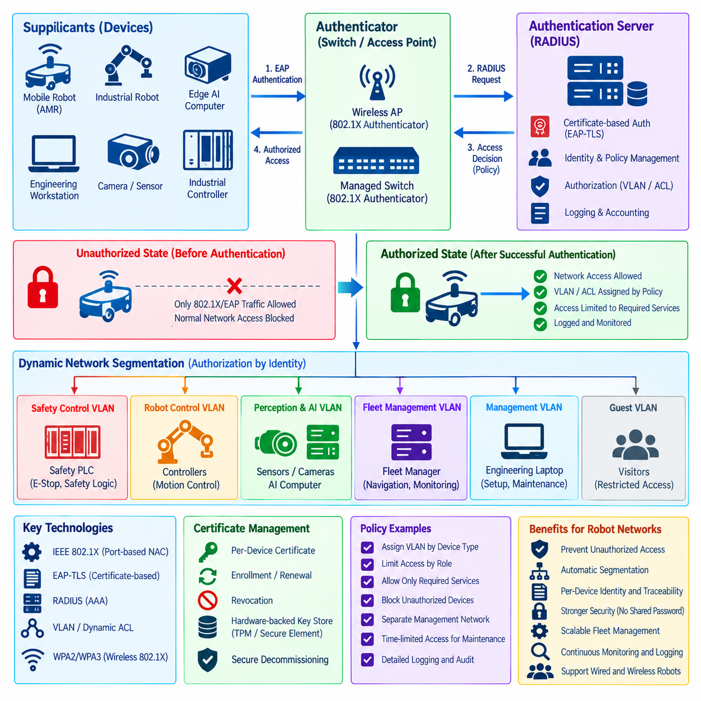{width="7.268055555555556in" height="7.268055555555556in"}

IEEE 802.1X는 장치 또는 사용자가 유선이나 무선 네트워크를 통해 정상적인 통신을 수행하도록 허용하기 전에 신원을 검증하는 포트 기반 네트워크 접근 제어(Port-Based Network Access Control)를 제공한다. 로봇 환경에서 이 메커니즘은 이더넷 포트(Ethernet Port)에 물리적으로 연결하거나 무선 액세스 포인트(Wireless Access Point)에 접속하는 행위만으로 신뢰할 수 있는 네트워크 접근 권한이 자동으로 생성되는 것을 방지한다. 이를 통해 연결성을 허용하기 위한 명시적인 선행 조건으로 신원 검증(Identity Verification)을 설정한다.

802.1X 아키텍처(802.1X Architecture)는 일반적으로 서플리컨트(Supplicant), 인증자(Authenticator), 인증 서버(Authentication Server)라는 세 가지 논리적 역할로 구성된다. 로봇, 엣지 컴퓨터(Edge Computer), 엔지니어링 워크스테이션(Engineering Workstation) 또는 기타 엔드포인트가 서플리컨트 역할을 수행한다. 관리형 이더넷 스위치(Managed Ethernet Switch) 또는 무선 액세스 포인트가 인증자로 동작하며, 일반적으로 RADIUS를 사용하는 중앙집중형 인증 서비스(Centralized Authentication Service)가 자격증명을 평가하고 접근 허용 여부를 반환한다.

로봇이 처음 연결되면 인증자는 일반적인 데이터 트래픽에 대해 네트워크 포트를 비인가 상태(Unauthorized State)로 유지한다. 인증에 필요한 통신만 허용되며, 이후 서플리컨트와 인증 인프라(Authentication Infrastructure)는 확장 가능 인증 프로토콜(Extensible Authentication Protocol, EAP) 정보를 교환한다. 검증에 성공하면 해당 포트는 해당 신원에 할당된 보안 정책에 따라 인가 상태(Authorized State)로 전환된다.

이 모델은 물리적 접근(Physical Access)을 항상 신뢰할 수 없는 산업용 로봇 네트워크(Industrial Robot Network)에서 특히 유용하다. 이더넷 커넥터(Ethernet Connector)는 로봇, 충전 스테이션(Charging Station), 제어 캐비닛(Control Cabinet), 유지보수 패널(Maintenance Panel), 공장 스위치(Factory Switch), 현장 장비(Field Equipment)에 존재할 수 있다. 네트워크 접근 제어가 없다면 승인되지 않은 컴퓨터가 사용 가능한 포트에 연결되는 즉시 운영 인프라에 대한 네트워크 연결성을 확보할 수 있다.

인증서 기반 인증(Certificate-Based Authentication)은 로봇 장치에 강력한 신뢰성을 제공할 수 있다. EAP-TLS는 공유 비밀번호에만 의존하는 대신 인증서와 암호학적 인증(Cryptographic Authentication)을 사용한다. 각 로봇 또는 관리 대상 엔드포인트에 고유한 장치 신원(Device Identity)을 부여할 수 있으므로 인증 시스템은 개별 자산을 구분하고 등록된 역할, 소유권, 배포 사이트 또는 보안 상태(Security Posture)에 따라 권한 부여 결정을 내릴 수 있다.

고유 신원(Unique Identity)은 플릿 전체가 공유하는 자격증명보다 바람직하다. 수백 대의 로봇이 동일한 비밀번호 또는 인증서를 사용하면 하나의 장치가 침해되었을 때 다수의 장치에 접근할 수 있는 자격증명이 노출될 수 있다. 장치별 인증서(Per-Device Certificate)를 사용하면 관리자가 침해된 로봇의 권한만 독립적으로 폐기하고, 인증 이벤트를 특정 엔드포인트까지 추적하며, 대규모 플릿 전체에서 더욱 정확한 자격증명 수명주기 기록(Credential Lifecycle Record)을 유지할 수 있다.

인증(Authentication)은 무제한적인 신뢰로 해석하지 말고 권한 부여(Authorization)로 이어져야 한다. 성공적으로 인증된 안전 제어기(Safety Controller), 인지 컴퓨터(Perception Computer), 유지보수 노트북(Maintenance Laptop), 모바일 로봇(Mobile Robot)은 서로 매우 다른 네트워크 권한을 필요로 할 수 있다. 인증 서버와 네트워크 인프라는 연결되는 엔드포인트의 신원과 기능에 따라 VLAN, 다운로드 가능 ACL(Downloadable ACL), 보안 역할(Security Role) 또는 기타 정책 속성을 할당할 수 있다.

따라서 동적 네트워크 분할(Dynamic Segmentation)은 802.1X를 전체 로봇 네트워크 아키텍처와 직접 연결할 수 있다. 검증된 엔지니어링 워크스테이션은 관리 VLAN(Management VLAN)에 배치하고, AMR은 플릿 통신 영역(Fleet Communication Zone)에 접근하도록 하며, 엣지 AI 컴퓨터(Edge AI Computer)는 인지 네트워크(Perception Network)에 배치할 수 있다. 이를 통해 물리적 스위치 포트에만 의존하지 않고 장치를 적절한 보안 도메인(Security Domain)에 자동으로 배치할 수 있다.

이 기능은 네트워크 접속 지점 사이를 이동하는 모바일 로봇(Mobile Robot)에 유용하다. AMR, 휴머노이드(Humanoid), 검사 플랫폼(Inspection Platform), 기타 이동형 시스템은 플릿 인프라와의 통신을 유지하면서 시설 내부의 여러 접속 지점 사이를 이동할 수 있다. 신원 기반 네트워크 접근(Identity-Based Network Access)을 적용하면 특정 액세스 스위치에 연결된 모든 엔드포인트에 동일한 권한을 제공한다고 가정하는 대신 장치의 이동에 따라 보안 정책도 함께 적용할 수 있다.

무선 접근 제어(Wireless Access Control)에도 엔터프라이즈 Wi-Fi 인프라(Enterprise Wi-Fi Infrastructure)를 통해 동일한 원칙을 적용할 수 있다. 무선 네트워크에 연결하는 로봇은 정상적인 네트워크 접근 권한을 받기 전에 인증하며, 이후 부여되는 권한은 장치 신원을 기반으로 결정할 수 있다. 이는 공유 Wi-Fi 비밀번호에 대한 의존도를 낮추고 다수의 로봇, 엔지니어링 장치, 운영 엔드포인트가 공통 무선 인프라를 사용할 때 더욱 정확한 행위 추적(Attribution)을 제공한다.

인증 서버(Authentication Server)는 많은 장치의 접근 결정에 관여하므로 핵심적인 보안 서비스(Critical Security Service)가 된다. 따라서 RADIUS 인프라는 보안 강화(Hardening)와 모니터링(Monitoring)을 적용해야 하며, 가용성 요구사항이 필요한 경우 이중화(Redundancy)를 구성하고 네트워크 분할을 통해 보호해야 한다. 관리 인터페이스, 인증 데이터베이스(Authentication Database), 인증서, 공유 비밀(Shared Secret), 정책 구성(Policy Configuration)은 그 중요도에 적합한 보안 통제를 적용해야 한다.

인증서 수명주기 관리(Certificate Lifecycle Management)는 802.1X 배포 초기부터 통합되어야 한다. 로봇은 수년 동안 운영될 수 있지만 인증서는 만료되고, 암호화 정책은 변화하며, 하드웨어가 교체되고, 장치의 소유권이나 운영 역할이 변경될 수 있다. 따라서 등록(Enrollment), 갱신(Renewal), 순환(Rotation), 폐기(Revocation), 복구(Recovery), 안전한 폐기 처리(Secure Decommissioning)를 정의해야 하며, 플릿 규모로 인해 수동 인증서 관리가 비현실적이라면 이러한 과정을 자동화해야 한다.

장치 인증에 사용되는 개인 키(Private Key)는 추출되지 않도록 보호해야 한다. 지원되는 경우 신뢰 플랫폼 모듈(Trusted Platform Module, TPM), 보안 요소(Secure Element), 하드웨어 기반 키 저장소(Hardware-Backed Key Store), 보호된 운영체제 기능(Protected Operating-System Facility)을 사용하면 자격증명이 한 로봇에서 다른 로봇으로 쉽게 복사되는 것을 방지할 수 있다. 강력한 키 보호는 단순히 복제된 인증서 파일을 보유한 것이 아니라 정상적인 장치 신원을 실제로 소유하고 있음을 인증 결과가 나타내도록 하는 데 도움이 된다.

모든 로봇 구성요소가 완전한 802.1X 서플리컨트(Supplicant)를 지원하는 것은 아니다. 레거시 제어기(Legacy Controller), 산업용 센서(Industrial Sensor), 임베디드 장치(Embedded Device), 카메라, 특수 하드웨어는 호환되는 소프트웨어나 인증서 저장 기능을 제공하지 않을 수 있다. 이러한 장치에는 전용 네트워크 세그먼트(Dedicated Network Segment), 제한된 스위치 포트(Restricted Switch Port), 게이트웨이 중계(Gateway Mediation) 또는 기타 예외 메커니즘을 적용하여 지원되지 않는 장비에 강력한 신원이 있다고 가정하지 않으면서 격리를 유지해야 한다.

대체 인증 메커니즘(Fallback Mechanism)은 전체 아키텍처를 약화시킬 수 있으므로 신중하게 다루어야 한다. 예를 들어 MAC 주소만을 기반으로 하는 정책은 주소를 관찰하고 위조(Spoofing)할 수 있는 경우가 많으므로 제한적인 신원 보증(Identity Assurance)만 제공한다. 약한 인증 방법을 피할 수 없는 경우 해당 엔드포인트에는 강력하게 인증된 장치와 동일한 접근 권한을 제공하지 말고 더 제한된 권한, 강화된 모니터링, 추가적인 네트워크 분할을 적용해야 한다.

인증 인프라의 장애가 장치의 네트워크 접속을 차단할 수 있기 때문에 로봇 시스템에서는 가용성(Availability)이 특히 중요하다. 설계자는 인증 서버 손실, 스위치 재부팅(Switch Reboot), 인증서 검증 실패, 네트워크 중단, 로봇 재연결 상황에서 시스템이 어떻게 동작할 것인지 정의해야 한다. 장애 시 개방(Fail-Open) 정책은 운영을 유지할 수 있지만 보안을 약화시키며, 장애 시 차단(Fail-Closed) 정책은 네트워크를 보호하지만 로봇이 다시 운영 상태로 복귀하지 못하게 할 수 있다.

안전 필수 시스템(Safety-Critical System)은 이러한 장애 모드(Failure Mode)를 명시적으로 분석해야 한다. 일시적인 인증 문제가 위험한 물리적 동작으로 이어져서는 안 되지만, 단순히 연결성을 유지하기 위해 사이버보안 통제를 무기한 우회해서도 안 된다. 필요한 경우 로컬 안전 기능(Local Safety Function)은 독립적으로 유지하고, 운영 네트워크 접근은 인증 서비스가 복구될 때까지 사전에 정의된 성능 저하 모드 정책(Degraded-Mode Policy)을 따를 수 있다.

재인증(Reauthentication)은 운영 중에도 지속적인 권한을 검증할 수 있는 기회를 제공한다. 네트워크 인프라는 정의된 시간 간격 또는 특정 이벤트 이후 엔드포인트가 다시 인증하도록 요구할 수 있으며, 이를 통해 한 번의 성공적인 연결이 영구적인 신뢰를 형성하는 것을 방지할 수 있다. 재인증 간격은 보안 요구사항과 네트워크 안정성 사이에서 균형을 유지해야 하며 시간에 민감한 로봇 통신을 불필요하게 중단시키지 않아야 한다.

802.1X 이벤트는 중요한 보안 텔레메트리(Security Telemetry)도 제공한다. 성공 및 실패한 인증, 인증서 오류(Certificate Error), 반복적인 연결 시도, 예상하지 못한 스위치 포트, 신원 변경(Identity Change), 정책 할당(Policy Assignment) 정보를 중앙집중형 로깅(Centralized Logging) 또는 SIEM 시스템으로 전달할 수 있다. 방화벽, VPN, 침입 탐지(Intrusion Detection), 엔드포인트, 플릿 관리 이벤트와 상관 분석하면 네트워크 트래픽만으로는 식별하기 어려운 의심스러운 행동을 발견할 수 있다.

배포는 전체 운영 시설에 엄격한 정책을 한 번에 활성화하는 대신 신중하고 단계적으로 진행해야 한다. 초기 모니터링 또는 저영향 단계(Low-Impact Phase)를 통해 지원되지 않는 장치, 인증서 문제, 예상하지 못한 의존성, 인증 타이밍 문제를 식별할 수 있다. 이후 검증을 거쳐 테스트 네트워크, 선택된 로봇 그룹, 운영 영역(Production Zone), 최종적으로 높은 중요도를 가진 인프라에 순차적으로 정책을 적용할 수 있다.

운영 절차(Operational Procedure)는 시운전(Commissioning), 유지보수, 교체, 비상 접근도 고려해야 한다. 새로운 로봇은 운영 권한을 받기 전에 안전하게 등록되어야 하고, 교체된 컴퓨터에는 새로운 신원을 부여해야 하며, 폐기된 장치의 자격증명은 철회해야 한다. 임시 유지보수 장비(Temporary Maintenance Equipment)는 기술자가 단기간 연결해야 한다는 이유만으로 광범위한 접근 권한을 상속받지 않도록 명시적으로 제한된 권한을 부여해야 한다.

성숙한 802.1X 배포는 네트워크 연결(Network Attachment)을 단순한 물리적 접속 이벤트에서 신원 기반 보안 결정(Identity-Driven Security Decision)으로 전환한다. 장치별 인증서, RADIUS 정책, 동적 VLAN 또는 ACL 할당, 네트워크 분할(Network Segmentation), 방화벽 정책 집행(Firewall Enforcement), 모니터링, 체계적인 자격증명 수명주기 관리(Credential Lifecycle Management)를 결합하면 승인되고 적절한 권한을 부여받은 로봇과 지원 시스템만 보호된 운영 네트워크에 참여하도록 보장하는 데 도움이 된다.

## 03.06. VLAN Segmentation Safety Control vs AI Data [w/Code]

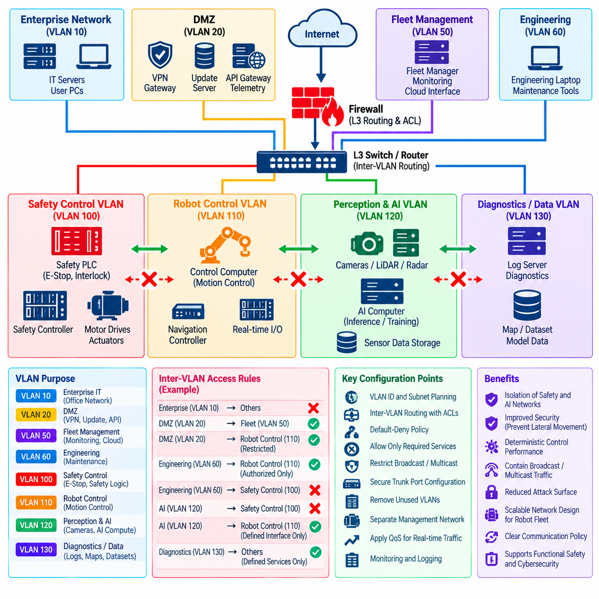{width="7.268055555555556in" height="7.268055555555556in"}

가상 LAN 분할(Virtual LAN Segmentation)은 장치들이 동일한 물리적 스위칭 인프라(Physical Switching Infrastructure)를 공유하는 경우에도 로봇 통신을 논리적인 브로드캐스트 및 보안 도메인(Logical Broadcast and Security Domain)으로 분리한다. 현대 로봇에서 안전 제어(Safety Control), 모션 제어(Motion Control), 인지(Perception), AI 추론(AI Inference), 진단(Diagnostics), 플릿 통신(Fleet Communication)은 서로 매우 다른 시간 및 보안 요구사항을 가질 수 있다. VLAN은 이러한 트래픽 유형이 하나의 무제한 네트워크로 동작하는 것을 방지하기 위한 실용적인 메커니즘을 제공한다.

안전 제어 트래픽(Safety-Control Traffic)과 AI 데이터 트래픽(AI-Data Traffic)의 구분은 특히 중요하다. 안전 및 저수준 제어 통신(Safety and Low-Level Control Communication)은 비상 상태(Emergency State), 액추에이터 명령(Actuator Command), 인터록(Interlock), 속도 제한(Velocity Limit), 결정론적 피드백(Deterministic Feedback)을 전달할 수 있으며, AI 네트워크는 카메라 이미지(Camera Image), 라이다 포인트 클라우드(LiDAR Point Cloud), 특징 텐서(Feature Tensor), 지도(Map), 모델 출력(Model Output), 학습 또는 진단 데이터(Training or Diagnostic Data)를 전송할 수 있다. 두 유형을 하나의 계층 2 도메인(Layer-2 Domain)에 결합하면 불필요한 운영 및 사이버보안 결합(Cybersecurity Coupling)이 발생한다.

따라서 안전 제어 네트워크(Safety-Control Network)는 구성원 범위가 엄격하게 제한된 전용 VLAN(Dedicated VLAN)에 배치해야 한다. 안전 PLC(Safety PLC), 인증된 제어기(Certified Controller), 모터 인터페이스(Motor Interface), 비상 정지 구성요소(Emergency-Stop Component), 명시적으로 승인된 제어 컴퓨터가 주요 참여자가 되어야 한다. 범용 AI 컴퓨터, 엔지니어링 노트북, 사용자 장치, 클라우드 게이트웨이, 관련 없는 센서는 동일한 물리적 스위치에 연결되어 있다는 이유만으로 직접적인 계층 2 접근 권한을 가져서는 안 된다.

AI 및 인지 VLAN(AI and Perception VLAN)은 훨씬 높은 대역폭을 처리하도록 설계할 수 있다. 여러 카메라, 라이다, 레이더 센서, GPU 컴퓨터, 엣지 추론 노드(Edge Inference Node)는 안전 제어 브로드캐스트 도메인(Safety-Control Broadcast Domain)에 적합하지 않은 대용량 스트림을 지속적으로 교환할 수 있다. 이러한 트래픽을 분리하면 경합(Contention)을 줄이고 비정상적인 AI 데이터량, 멀티캐스트 동작(Multicast Behavior), 침해된 인지 장치가 중요 제어 통신에 영향을 미칠 가능성을 제한할 수 있다.

VLAN 분할(VLAN Segmentation)만으로 완전한 보안 경계(Security Boundary)가 형성되는 것은 아니다. IEEE 802.1Q 태깅(Tagging)은 논리적인 네트워크 소속을 식별하지만, 공격자가 스위칭 인프라를 장악하거나 잘못 구성된 트렁크(Trunk)에 접근하면 VLAN 분리에만 의존한 보안 가정을 우회할 수 있다. 따라서 보안 영역 간 통신은 계층 3 라우팅(Layer-3 Routing), 방화벽(Firewall), ACL, 인증된 게이트웨이(Authenticated Gateway) 또는 기타 정책 집행 메커니즘(Policy-Enforcement Mechanism)을 통해 통제해야 한다.

VLAN 간 라우팅(Inter-VLAN Routing)은 기본 거부(Default-Deny) 모델을 따라야 한다. 라우터가 안전 영역과 AI 영역을 연결할 수 있다는 이유만으로 두 영역 사이의 통신을 허용해서는 안 된다. 검증된 인지 결과가 계획 시스템(Planning System)으로 전달되거나 선택된 상태 정보가 제어기에서 외부로 전달되는 경우와 같이 필요한 통신 흐름을 명시적으로 식별해야 한다. 게이트웨이는 필요한 출발지, 목적지, 프로토콜, 포트, 방향만 허용하고 관련 없는 영역 간 통신은 거부해야 한다.

이러한 설계는 단방향 또는 강하게 비대칭적인 정보 관계(Asymmetric Information Relationship)도 지원한다. 안전 모니터링 서비스(Safety-Monitoring Service)는 플릿 관리 시스템으로 상태 정보를 전송해야 하지만 동일한 목적지로부터 명령을 받을 필요는 없을 수 있다. AI 서브시스템(AI Subsystem)은 객체 탐지(Object Detection) 결과나 궤적 제안(Trajectory Proposal)을 제공할 수 있지만 액추에이터 인터페이스에 직접 쓰기 권한을 가질 필요는 없다. 네트워크 정책은 기본적으로 대칭적인 연결성을 허용하는 대신 이러한 기능적 차이를 반영해야 한다.

AI 의사결정(AI Decision)과 물리적 제어(Physical Control) 사이의 경계에는 특별한 주의가 필요하다. AI 모델은 의미론적 해석(Semantic Interpretation), 목표 선택(Target Selection), 내비게이션 제안(Navigation Proposal), 계획된 행동(Planned Action)을 생성할 수 있지만, 이러한 출력은 안전 필수 액추에이터에 영향을 주기 전에 정의된 인터페이스를 통과해야 한다. VLAN 분할은 의도적으로 설계되고 검증된 통신 경로가 존재하지 않는 한 AI 컴퓨터가 저수준 제어 장치에 직접 접근하지 못하도록 함으로써 이러한 아키텍처 경계를 강화할 수 있다.

브로드캐스트 및 멀티캐스트 제한(Broadcast and Multicast Containment)은 또 다른 중요한 장점이다. 로봇 미들웨어(Robot Middleware), 디스커버리 프로토콜(Discovery Protocol), 센서 시스템, 진단 도구는 브로드캐스트 또는 멀티캐스트 트래픽을 생성할 수 있다. AI 디스커버리와 대용량 데이터 분배를 의도된 VLAN 내부로 제한하면 제어 도메인으로 불필요하게 전파되는 것을 방지할 수 있다. 이를 통해 네트워크 부하와 보안 경계를 넘어 노출되는 토폴로지 정보(Topology Information)를 모두 줄일 수 있다.

서비스 품질(Quality of Service, QoS)과 VLAN 분할은 함께 사용할 수 있지만 서로 다른 문제를 해결한다. VLAN은 논리적 분리(Logical Separation)를 설정하는 반면 QoS는 지연시간, 지터 또는 대역폭 요구사항에 따라 트래픽의 우선순위를 지정한다. 안전 및 결정론적 제어 흐름은 엄격한 우선순위나 예약된 자원(Reserved Resource)을 받을 수 있으며, AI 데이터 전송에는 다른 스케줄링 동작을 적용할 수 있다. 우선순위 메커니즘(Priority Mechanism)을 실제 보안 격리(Security Isolation)의 대체 수단으로 간주해서는 안 된다.

VLAN이 논리적 분리를 제공하더라도 물리적 스위치 아키텍처(Physical Switch Architecture)는 여전히 중요하다. 중요도가 매우 높은 배포 환경에서는 논리적 VLAN 경계에만 의존하지 않고 안전 트래픽을 위해 별도의 물리적 인터페이스, 스위치 또는 이중화 네트워크 경로(Redundant Network Path)를 사용할 수 있다. 적절한 설계는 안전 무결성 요구사항(Safety Integrity Requirement), 위협 분석(Threat Analysis), 장애 허용성(Failure Tolerance), 성능 제약, 공통 스위칭 인프라 장애로 인한 결과에 따라 결정된다.

트렁크 포트(Trunk Port)는 여러 VLAN의 트래픽을 전달하므로 신중하게 구성해야 한다. 각 트렁크에서는 필요한 VLAN만 허용하고 사용하지 않는 VLAN 구성원 자격은 제거해야 한다. 액세스 포트(Access Port)는 일반적으로 하나의 예상된 VLAN에만 속하도록 설정해야 하며, 사용하지 않는 스위치 포트는 비활성화하거나 다른 방식으로 제한해야 한다. 광범위한 트렁크 구성은 민감한 로봇 네트워크를 원래 의도하지 않았던 위치까지 확장시킬 수 있다.

네이티브 VLAN(Native VLAN)과 태깅 동작(Tagging Behavior)도 스위치 전체에서 표준화해야 한다. 일관되지 않은 구성은 트래픽을 의도하지 않은 브로드캐스트 도메인으로 유입시키거나 VLAN 호핑(VLAN Hopping) 기법이 활용될 수 있는 기회를 만들 수 있다. 운영 로봇 네트워크에서는 모호한 기본 구성(Default Configuration)에 의존하지 않아야 하며, 스위치 템플릿(Switch Template)을 통해 허용된 VLAN, 태깅 요구사항, 관리 인터페이스, 포트 역할을 명시적으로 정의해야 한다.

관리 트래픽(Management Traffic)은 별도의 보호된 도메인을 사용해야 한다. 스위치 관리(Switch Administration), 방화벽 관리, 로봇 구성(Robot Configuration), 하이퍼바이저 접근(Hypervisor Access), 인프라 모니터링(Infrastructure Monitoring)은 AI 데이터나 일반 운영 제어 트래픽과 무제한 연결성을 공유해서는 안 된다. 관리 접근이 엄격하게 통제되는 전용 관리 VLAN(Dedicated Management VLAN)을 사용하면 로봇 워크로드가 침해되었을 때 네트워크 분할을 집행하는 인프라까지 즉시 노출될 가능성을 줄일 수 있다.

엔지니어링 및 시운전 활동(Engineering and Commissioning Activity) 역시 분리해야 한다. 기술자는 배포 또는 문제 해결 과정에서 제어기, 센서, AI 컴퓨터에 임시로 접근해야 할 수 있지만, 엔지니어링 노트북을 중요 운영 VLAN에 직접 연결하면 상당한 위험이 발생한다. 전용 엔지니어링 또는 유지보수 VLAN(Engineering or Maintenance VLAN)을 사용하면 운영 경계를 제거하지 않고 방화벽, 점프 호스트(Jump Host), 임시 권한 부여 정책(Temporary Authorization Policy)을 통해 중계된 접근을 제공할 수 있다.

동적 VLAN 할당(Dynamic VLAN Assignment)은 802.1X 네트워크 접근 제어(Network Access Control)와 결합할 때 네트워크 분할을 더욱 강화할 수 있다. 로봇 또는 엔드포인트가 성공적으로 인증된 이후 네트워크 인프라는 물리적 스위치 포트에만 의존하지 않고 장치 신원(Device Identity)과 역할에 따라 해당 장치를 VLAN에 할당할 수 있다. 이는 시간이 지나면서 네트워크 연결 위치가 변경되는 모바일 로봇, 교체 컴퓨터, 공유 시설에서 특히 유용하다.

무선 인프라(Wireless Infrastructure)는 모든 무선 장치를 하나의 공통 VLAN에 배치하는 대신 인증된 로봇 트래픽을 적절한 보안 도메인으로 매핑해야 한다. AMR과 기타 모바일 플랫폼은 운영, 관리, 텔레메트리 접근을 서로 분리해야 할 수 있다. 엔터프라이즈 Wi-Fi(Enterprise Wi-Fi) 또는 사설 무선 시스템(Private Wireless System)은 신원 기반 접속 허용(Identity-Based Admission)과 VLAN 또는 정책 할당을 결합하여 로밍(Roaming)이 의도된 네트워크 분할을 제거하지 않도록 할 수 있다.

VLAN 설계는 로봇 간 측면 이동(Robot-to-Robot Lateral Movement)도 제한해야 한다. 대규모 플릿의 모든 로봇이 하나의 제한 없는 계층 2 도메인에 속하면 하나의 엔드포인트 침해로 다수의 피어에 직접 접근할 수 있다. 로봇이 서로 직접 통신하기보다 중앙집중형 플릿 서비스(Centralized Fleet Service)와 주로 통신하는 경우 소규모 플릿 세그먼트, 사설 VLAN(Private VLAN), 호스트 격리(Host Isolation), 라우팅 경계(Routed Boundary), 마이크로세그멘테이션(Microsegmentation)을 통해 피어 통신을 제한할 수 있다.

모니터링(Monitoring)은 중요한 VLAN 경계와 VLAN 간 게이트웨이(Inter-VLAN Gateway)를 관찰해야 한다. 방화벽 로그, 스위치 텔레메트리(Switch Telemetry), 플로우 기록(Flow Record), 침입 탐지 센서(Intrusion-Detection Sensor), SIEM 상관 분석(SIEM Correlation)을 통해 안전, AI, 관리, 기업 도메인 사이의 예상하지 못한 통신을 탐지할 수 있다. AI 컴퓨터가 안전 제어기에 접근하거나 사용자 워크스테이션이 로봇 제어 서브넷에 진입하려는 시도는 의미 있는 보안 이벤트로 취급해야 한다.

네트워크 용량 계획(Network Capacity Planning)은 로봇 워크로드의 비대칭적인 대역폭 요구사항을 고려해야 한다. AI 데이터는 초당 수 기가비트의 대역폭을 사용할 수 있지만, 중요 제어 메시지는 크기가 작더라도 지연시간과 지터에 매우 민감할 수 있다. 네트워크 분할을 적용하면 이러한 워크로드를 별도로 설계할 수 있으므로 센서 데이터의 순간적인 증가, 모델 전송(Model Transfer), 로깅 활동, 데이터셋 수집(Dataset Collection)이 결정론적 운영 트래픽을 방해할 가능성을 줄일 수 있다.

아키텍처 설계 과정에서는 장애 동작(Failure Behavior)도 고려해야 한다. 라우팅 게이트웨이, 트렁크, 스위치 또는 방화벽 장애는 논리적으로 독립되어 보이는 여러 VLAN에 동시에 영향을 줄 수 있다. 이중화 스위칭(Redundant Switching), 분리된 장애 도메인(Separate Failure Domain), 검증된 장애 전환 동작(Tested Failover Behavior), 로컬 안전 메커니즘(Local Safety Mechanism)을 적용하면 공유 네트워크 구성요소의 장애가 통신 손실과 위험한 로봇 동작을 동시에 발생시킬 가능성을 줄일 수 있다.

VLAN 보안은 올바른 스위치 및 게이트웨이 설정에 크게 의존하므로 구성 관리(Configuration Management)가 필수적이다. VLAN 식별자(VLAN Identifier), 서브넷 할당(Subnet Assignment), 트렁크 권한(Trunk Permission), 포트 역할(Port Role), ACL, 라우팅 정책(Routing Policy), 관리 인터페이스를 문서화하고 통제된 변경 관리(Controlled Change Management) 아래에서 관리해야 한다. 자동 구성 검증(Automated Configuration Validation)을 통해 우발적인 브리징(Accidental Bridging), 승인되지 않은 트렁크, 누락된 제한, 의도된 아키텍처와 실제 배포 구성 사이의 차이를 탐지할 수 있다.

정기적인 검토(Periodic Review)를 통해 네트워크 분할이 변화하는 로봇 아키텍처와 계속 일치하는지 확인해야 한다. 새로운 센서, AI 가속기(AI Accelerator), 플릿 서비스, 진단 도구, 소프트웨어 구성요소는 임시적인 예외 규칙을 요구하는 새로운 통신 요구사항을 발생시킬 수 있다. 이러한 예외가 조용히 영구적인 연결로 변해서는 안 된다. 각각의 VLAN 간 통신 경로는 식별 가능한 운영 목적을 유지해야 하며 해당 의존성이 사라지면 제거해야 한다.

성숙한 VLAN 아키텍처(VLAN Architecture)는 로봇 운영에 필요한 통신 경로만 유지하면서 안전 제어와 대용량 AI 데이터를 분리한다. 라우팅 통제(Routing Control), 방화벽, ACL, 802.1X 신원(802.1X Identity), QoS, 침입 탐지(Intrusion Detection), 관리 영역 격리(Management Isolation), 체계적인 구성 통제(Configuration Control)를 함께 적용하면 VLAN 분할은 측면 이동을 줄이고 결정론적 제어 트래픽을 보호하며 AI 인프라가 안전 필수 로봇 기능으로 연결되는 무제한적인 통로가 되는 것을 방지할 수 있다.

## 03.07. Wireless Security WPA3 Wi Fi 6 for Robots [w/Code]

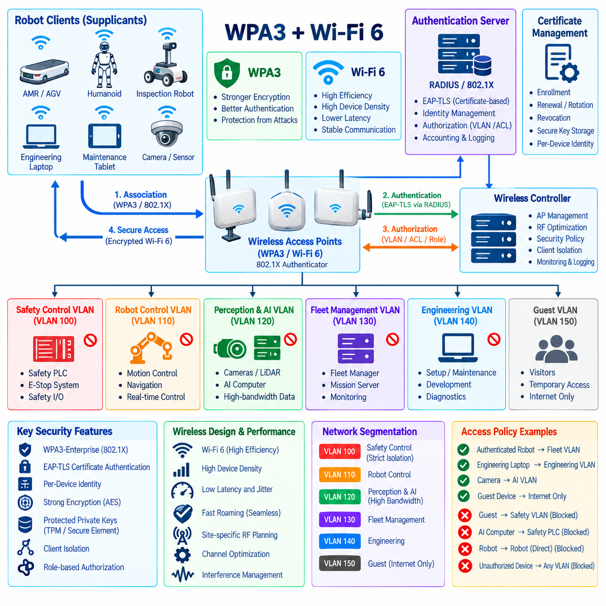{width="7.268055555555556in" height="7.268055555555556in"}

무선 연결(Wireless Connectivity)은 AMR, 휴머노이드(Humanoid), 검사 플랫폼(Inspection Platform), 서비스 로봇(Service Robot)이 동적인 환경을 이동하면서 통신해야 하므로 모바일 로봇(Mobile Robot)의 핵심 기반이다. 그러나 유선 네트워크와 달리 무선 신호는 통제된 물리적 경계를 넘어 확산되며 직접적인 케이블 접근 없이도 관찰되거나 공격받을 수 있다. 따라서 무선 보안(Wireless Security)은 강력한 인증(Authentication), 암호화(Encryption), 네트워크 분할(Segmentation), 모니터링(Monitoring), 복원력 있는 무선 네트워크 설계(Resilient Radio-Network Design)를 결합해야 한다.

WPA3는 이전 세대의 무선 보안 기술과 비교하여 인증 및 암호학적 보호(Cryptographic Protection)를 강화함으로써 Wi-Fi 보안을 향상시킨다. 로봇 배포 환경에서 WPA3는 단순히 더욱 강력한 무선 비밀번호 메커니즘이 아니라 광범위한 접근 제어 아키텍처(Access-Control Architecture)의 일부로 고려해야 한다. 그 목적은 인증된 로봇과 승인된 지원 장치만 보호된 운영 네트워크(Protected Operational Network)에 진입할 수 있도록 보장하는 것이다.

엔터프라이즈 배포(Enterprise Deployment)에서는 인프라와 로봇 플랫폼이 지원하는 경우 신원 기반 인증(Identity-Based Authentication)을 우선적으로 적용해야 한다. WPA3-Enterprise와 IEEE 802.1X를 결합하면 전체 플릿에서 하나의 공유 비밀번호를 사용하는 대신 중앙에서 관리되는 자격증명(Credential)이나 인증서를 통해 로봇을 인증할 수 있다. 개별 장치 신원(Individual Device Identity)은 행위 추적성을 높이고, 침해되거나 폐기된 로봇의 권한을 모든 배포 시스템의 자격증명을 변경하지 않고도 철회할 수 있게 한다.

EAP-TLS와 같은 인증서 기반 인증(Certificate-Based Authentication)은 올바르게 구현할 경우 특히 강력한 장치 신원(Device Identity)을 제공한다. 각 로봇은 자신의 네트워크 신원을 나타내는 고유한 인증서와 개인 키(Private Key)를 보유할 수 있다. 인증 서버(Authentication Server)는 해당 신원을 장치 유형, 플릿, 사이트, 보안 역할(Security Role), 권한 부여 정책(Authorization Policy)과 연결하여 무선 네트워크 접속 허용 결정을 전체 로봇 신원 관리 아키텍처(Robot Identity-Management Architecture)의 일부로 만들 수 있다.

로봇 인증서와 개인 키가 복사되면 다른 장치가 해당 로봇을 가장(Impersonation)할 수 있으므로 개인 키 보호가 필요하다. 신뢰 플랫폼 모듈(Trusted Platform Module, TPM), 보안 요소(Secure Element), 하드웨어 기반 자격증명 저장소(Hardware-Backed Credential Store), 보호된 운영체제 기능을 활용하면 이러한 위험을 줄일 수 있다. 대규모 로봇 플릿에서 수동 자격증명 관리가 비현실적인 경우 인증서 등록(Enrollment), 갱신(Renewal), 순환(Rotation), 폐기(Revocation), 만료(Expiration), 교체(Replacement)도 자동화해야 한다.

Wi-Fi 6는 다수의 연결된 장치가 무선 자원을 더욱 효율적으로 공유할 수 있는 기능을 포함하여 고밀도 로봇 환경(Dense Robotic Environment)에 유용한 기능을 제공한다. 창고와 공장에서는 로봇, 휴대용 단말기(Handheld Terminal), 카메라, 센서, 엔지니어링 컴퓨터, 일반 IT 클라이언트가 동시에 동작할 수 있다. 효율적인 채널 활용(Channel Utilization)은 통신 안정성을 향상시킬 수 있지만 이러한 성능 개선이 인증, 암호화 또는 네트워크 격리(Network Isolation)를 대체하는 것은 아니다.

로봇 무선 설계(Robot Wireless Design)는 기밀성(Confidentiality)뿐만 아니라 지연시간(Latency), 지터(Jitter), 패킷 손실(Packet Loss), 로밍 지연(Roaming Delay), 간섭(Interference), 혼잡(Congestion)도 고려해야 한다. 연결이 암호학적으로 안전하더라도 시간에 민감한 로봇 운영에는 적합하지 않을 수 있다. 내비게이션 업데이트, 플릿 명령, 안전 관련 감독 정보(Safety-Related Supervisory Information), 텔레메트리는 서로 다른 성능 요구사항을 가질 수 있으므로 무선 아키텍처는 운영 중요도(Operational Criticality)에 따라 트래픽을 분류해야 한다.

로밍(Roaming)은 AMR과 기타 지속적으로 이동하는 플랫폼에서 특히 중요하다. 로봇은 플릿 관리 또는 감독 시스템(Supervisory System)과의 세션을 유지하면서 여러 무선 커버리지 영역을 통과하고 액세스 포인트 사이를 전환할 수 있다. 인증 및 핸드오프 메커니즘(Handoff Mechanism)은 이동성으로 인해 과도한 통신 중단이 발생하지 않도록 설계해야 하며, 동시에 빠른 로밍이 신원 검증을 약화시키거나 재사용 가능한 자격증명을 노출하지 않도록 해야 한다.

무선 커버리지(Wireless Coverage)는 단순히 액세스 포인트를 추가하면 신뢰성이 향상된다고 가정하는 대신 사이트별 무선 주파수 계획(Site-Specific Radio Planning)을 통해 설계해야 한다. 금속 랙, 기계, 벽, 차량, 사람, 전자기 간섭(Electromagnetic Interference), 변화하는 재고 상태는 전파 조건(Propagation Condition)을 변화시킬 수 있다. 과도한 액세스 포인트 밀도 역시 간섭을 발생시킬 수 있으므로 보안과 가용성(Availability)은 체계적인 RF 설계, 채널 계획(Channel Planning), 커버리지 검증, 지속적인 운영 측정에 부분적으로 의존한다.

무선 인증에 성공한 이후에도 네트워크 분할(Network Segmentation)은 필요하다. 로봇이 Wi-Fi에 접속했다고 해서 기업 서버, 엔지니어링 시스템, 안전 제어기(Safety Controller), 다른 모든 로봇에 자동으로 접근할 수 있어서는 안 된다. 인증 과정에서 획득한 신원 정보를 VLAN 할당(VLAN Assignment), ACL, 방화벽 정책(Firewall Policy), 역할 기반 통제(Role-Based Control)와 결합하여 엔드포인트를 적절한 운영 보안 영역(Operational Security Zone)에 배치할 수 있다.

서로 다른 무선 장치 유형은 별도의 논리적 도메인(Logical Domain)을 필요로 할 수 있다. 운영 로봇(Production Robot), 엔지니어링 노트북, 유지보수 장치(Maintenance Device), 게스트 클라이언트(Guest Client), 인프라 관리 시스템(Infrastructure Management System), 일반 기업 엔드포인트가 동일한 액세스 포인트 인프라를 사용한다는 이유만으로 제한 없는 연결성을 공유해서는 안 된다. 논리적 분리는 측면 이동(Lateral Movement)을 제한하고 서로 다른 장치 유형 사이의 비정상적인 통신을 더욱 쉽게 식별하고 차단할 수 있게 한다.

로봇 간 통신(Robot-to-Robot Communication)에도 명시적인 정책이 필요하다. 많은 플릿은 주로 중앙집중형 플릿 서비스(Centralized Fleet Service)와 통신하며 로봇 간 무제한 피어 연결(Peer Connectivity)을 필요로 하지 않는다. 클라이언트 격리(Client Isolation), 라우팅 경계(Routed Boundary), 사설 VLAN(Private VLAN), 방화벽 정책, 마이크로세그멘테이션(Microsegmentation)을 적용하면 침해된 로봇이 인접 로봇을 직접 스캔하거나 공격하는 것을 방지하면서 승인된 인프라와 필요한 통신은 유지할 수 있다.

액세스 포인트와 무선 제어기(Wireless Controller)의 관리 인터페이스는 보호된 관리 네트워크(Protected Management Network)에 배치해야 한다. 무선 인프라가 침해되면 전체 로봇 플릿의 인증, 네트워크 분할, 가용성이 약화될 수 있다. 따라서 관리 접근(Administrative Access)은 승인된 관리 시스템으로 제한하고 강력한 인증으로 보호하며 중앙에서 로그를 기록하고 일반적인 로봇 및 사용자 트래픽과 분리해야 한다.

무선 위협(Wireless Threat)에는 승인되지 않은 액세스 포인트, 악성 클라이언트(Rogue Client), 자격증명 탈취(Credential Theft), 가장(Impersonation), 인증 해제 공격(Deauthentication Attempt), 이블 트윈 네트워크(Evil-Twin Network), 트래픽 가로채기(Traffic Interception), 서비스 거부 공격(Denial-of-Service Activity)이 포함된다. WPA3는 중요한 인증 및 기밀성 위험을 완화할 수 있지만 무선 주파수 방해(Radio-Frequency Disruption)는 암호화만으로 제거할 수 없다. 따라서 무선 보안 아키텍처는 사이버 침해와 물리적 통신 매체의 가용성 공격을 모두 고려해야 한다.

비인가 액세스 포인트 탐지(Rogue Access-Point Detection)는 승인되지 않은 장비를 쉽게 설치할 수 있는 시설에서 중요하다. 모니터링 시스템은 관찰된 무선 인프라를 승인된 자산 목록(Approved Inventory)과 비교하고 기업 또는 로봇 관련 네트워크 식별자를 사용하는 알려지지 않은 액세스 포인트를 조사할 수 있다. 과도한 오탐(False Alarm)을 방지하려면 실제 위협과 인접 네트워크, 임시 유지보수 장비, 정상적인 인프라 변경을 구분해야 한다.

무선 침입 탐지(Wireless Intrusion Detection)는 유선 센서가 관찰할 수 없는 무선 및 연결 동작을 분석함으로써 기존 네트워크 침입 탐지(Network Intrusion Detection)를 보완할 수 있다. 인증 실패, 반복적인 연결 시도, 비정상적인 로밍 동작, 예상하지 못한 장치 신원, 의심스러운 액세스 포인트, 비정상적인 무선 이벤트를 방화벽, RADIUS, 엔드포인트, 플릿 관리 로그와 상관 분석하여 더욱 광범위한 보안 맥락(Security Context)을 확보할 수 있다.

가용성 계획(Availability Planning)은 무선 연결이 일시적으로 저하되거나 완전히 사라질 수 있다는 가정을 기반으로 해야 한다. 로봇은 통신 손실 시 로컬 정지(Local Stopping), 통제된 계속 동작(Controlled Continuation), 임무 중단(Mission Suspension), 자율 복구(Autonomous Recovery) 등 시스템 요구사항에 적합한 안전 동작을 정의해야 한다. 무선 통신 장애가 위험한 물리적 동작을 발생시킬 수 있는 경우 중요 로컬 안전 기능은 지속적인 Wi-Fi 가용성에만 의존해서는 안 된다.

이중화된 무선 커버리지(Redundant Wireless Coverage)는 복원력을 높일 수 있지만 실제 운영 조건에서 검증해야 한다. 사이트 테스트는 생산량이 높은 시간대, 로봇 밀도, 이동 장애물, 핸드오프 동작, 간섭원, 개별 액세스 포인트 장애를 평가해야 한다. 시운전(Commissioning) 중 비어 있는 시설에서 정상적으로 동작하는 설계도 선반, 기계, 작업자, 수십 대의 로봇이 실제 환경을 점유하면 매우 다른 성능을 나타낼 수 있다.

서비스 품질(Quality of Service, QoS)은 대용량 로그, 소프트웨어 패키지, 모델 파일, 데이터셋 업로드와 같은 낮은 우선순위 전송보다 지연시간에 민감한 로봇 통신을 우선 처리하는 데 도움이 될 수 있다. 그러나 QoS는 자원 경합(Resource Contention)을 관리하는 기술이지 보안 경계를 제공하는 기술은 아니다. 침해되거나 잘못 구성된 장치가 트래픽을 중요 통신으로 표시하여 과도한 무선 자원을 소비하지 못하도록 높은 우선순위 분류를 신중하게 할당해야 한다.

소프트웨어 및 펌웨어 유지보수(Software and Firmware Maintenance)는 무선 인프라와 로봇 Wi-Fi 클라이언트 모두에 필수적이다. 액세스 포인트, 제어기, 무선 드라이버(Wireless Driver), 인증 서비스, 임베디드 서플리컨트(Embedded Supplicant)에는 보안 업데이트가 필요한 취약점이 존재할 수 있다. 패치 프로세스(Patch Process)는 호환성과 운영 가용성을 고려해야 하며, 무선 변경이 로밍, 인증 또는 통신 안정성에 영향을 미칠 수 있는 경우 전체 플릿에 배포하기 전에 단계적인 검증(Staged Validation)을 수행해야 한다.

구성 관리(Configuration Management)를 통해 여러 사이트의 무선 보안 설정을 표준화해야 한다. 승인된 인증 모드(Authentication Mode), 인증서 요구사항, SSID, VLAN 매핑(VLAN Mapping), 암호화 정책(Cipher Policy), 관리 접근, 로깅, 무선 파라미터(Radio Parameter), 대체 동작(Fallback Behavior)을 문서화하고 가능한 경우 버전 관리(Version Control)해야 한다. 레거시 호환성 옵션(Legacy Compatibility Option)은 의도된 보안 기준선(Security Baseline)을 조용히 약화시킬 수 있으므로 검증된 요구사항이 없다면 활성화된 상태로 유지해서는 안 된다.

모니터링(Monitoring)은 사이버보안 지표와 무선 운영 지표를 결합해야 한다. 인증 실패와 의심스러운 연결은 보안 지표(Security Indicator)이며, 신호 강도(Signal Strength), 재전송(Retransmission), 채널 사용률(Channel Utilization), 로밍 시간(Roaming Time), 패킷 손실, 연결 불안정성은 로봇 가용성에 영향을 미칠 수 있는 조건을 나타낸다. 두 관점을 상관 분석하면 악성 활동을 RF 간섭, 인프라 장애, 구성 오류 또는 정상적인 이동성으로부터 구분하는 데 도움이 된다.

따라서 성숙한 로봇 무선 아키텍처(Robot Wireless Architecture)는 WPA3와 Wi-Fi 6를 그 자체로 완전한 해결책이 아니라 계층화된 시스템(Layered System)의 구성요소로 취급한다. 강력한 장치 신원(Strong Device Identity), 802.1X 인증, 보호된 자격증명(Protected Credential), 네트워크 분할, 방화벽 정책 집행(Firewall Enforcement), 안전한 로밍(Secure Roaming), RF 엔지니어링(RF Engineering), 침입 모니터링(Intrusion Monitoring), 통제된 인프라 관리, 복원력 있는 장애 동작(Resilient Failure Behavior), 체계적인 수명주기 관리(Lifecycle Management)를 결합함으로써 로봇 플릿에 안전하고 신뢰할 수 있는 이동 통신 환경을 제공할 수 있다.

## 03.08. 5G Private Network Security Slicing [w/Code]

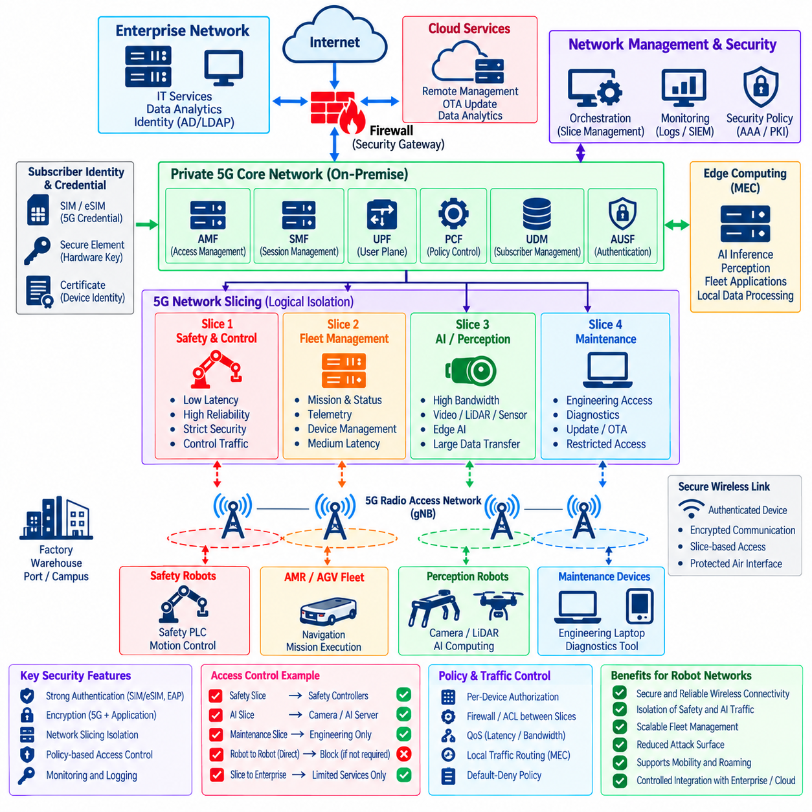{width="7.268055555555556in" height="7.268055555555556in"}

사설 5G 네트워크(Private 5G Network)는 공장, 창고, 항만, 캠퍼스, 광산 및 기타 대규모 산업 환경에서 운영되는 로봇을 위한 전용 셀룰러 연결(Dedicated Cellular Connectivity)을 제공한다. 공용 이동통신 서비스(Public Mobile Service)와 달리 사설 구축 환경에서는 조직이 무선 커버리지(Radio Coverage), 장치 접속 허용(Device Admission), 트래픽 라우팅(Traffic Routing), 보안 정책(Security Policy), 운영 시스템과의 통합을 직접 통제할 수 있다. 이러한 통제 능력으로 인해 사설 5G는 안전하고 예측 가능한 연결이 필요한 모바일 로봇에 적합하다.

보안은 강력한 가입자 및 장치 인증(Subscriber and Device Authentication)에서 시작한다. 로봇은 일반적으로 SIM, eSIM 또는 이에 상응하는 보안 신원 메커니즘(Secure Identity Mechanism)에 연결된 가입자 신원(Subscriber Identity)과 암호학적 자격증명(Cryptographic Credential)을 사용하여 5G 네트워크에 접속한다. 네트워크는 연결을 허용하기 전에 이러한 자격증명을 검증하며, 이를 통해 공유 무선 비밀번호에 대한 의존도를 줄이고 개별 로봇이나 통신 모듈을 식별, 승인, 정지 또는 폐기할 수 있다.

가입자 신원이 침해되면 승인되지 않은 장치가 정상 장비를 가장(Impersonation)할 수 있으므로 자격증명 보호(Credential Protection)가 필수적이다. 보안 요소(Secure Element), 보호된 SIM 기술, 하드웨어 기반 키 저장소(Hardware-Backed Key Storage), 통제된 프로비저닝 프로세스(Controlled Provisioning Process)를 활용하면 이러한 위험을 줄일 수 있다. 플릿 운영자는 로봇 통신 모듈의 활성화, 교체, 폐기(Revocation), 소유권 변경, 분실 장치 처리, 안전한 폐기(Secure Decommissioning)를 위한 수명주기 절차도 정의해야 한다.

사설 5G 아키텍처(Private 5G Architecture)는 무선 접속 인프라(Radio Access Infrastructure), 코어 네트워크 기능(Core Network Function), 가입자 관리(Subscriber Management), 정책 제어(Policy Control), 기업 또는 운영 네트워크와의 연결로 구성된다. 각 구성요소는 의도적으로 관리해야 하는 보안 경계를 형성한다. 특히 관리 인터페이스(Administrative Interface), 관리 API, 오케스트레이션 시스템(Orchestration System), 구성 데이터베이스(Configuration Database)는 인프라 침해가 다수 로봇의 연결에 동시에 영향을 줄 수 있으므로 강력한 보호가 필요하다.

네트워크 슬라이싱(Network Slicing)은 공유된 5G 인프라 위에서 논리적으로 차별화된 통신 환경을 생성하는 메커니즘을 제공한다. 서로 다른 로봇 워크로드를 각기 다른 성능, 정책, 서비스 요구사항을 위해 설계된 슬라이스(Slice)에 연결할 수 있다. 따라서 안전 관련 감독 서비스(Safety-Related Supervisory Service), 플릿 제어 애플리케이션(Fleet-Control Application), 고대역폭 인지 스트림(High-Bandwidth Perception Stream), 유지보수 채널(Maintenance Channel)에 서로 다른 네트워크 특성을 적용할 수 있다.

네트워크 슬라이싱을 자동적인 종단 간 보안 격리(End-to-End Security Isolation)로 해석해서는 안 된다. 분리 수준은 무선 자원, 전송 인프라(Transport Infrastructure), 5G 코어 기능, 엣지 컴퓨팅(Edge Computing), 라우팅, 외부 네트워크가 어떻게 구성되는지에 따라 달라진다. 공유 구성요소는 여전히 공통 장애 또는 공격 도메인이 될 수 있다. 따라서 보안 아키텍트는 실제 격리가 이루어지는 위치와 추가적인 방화벽, ACL, 게이트웨이 또는 애플리케이션 계층 통제(Application-Level Control)가 필요한 위치를 정확하게 결정해야 한다.

로봇 제어 트래픽(Robot Control Traffic)은 낮은 지연시간과 예측 가능한 통신 동작을 요구할 수 있는 반면, AI 및 인지 워크로드(Perception Workload)는 훨씬 높은 대역폭을 요구할 수 있다. 카메라 스트림, 라이다 데이터, 지도, 모델 출력, 텔레메트리는 상당한 네트워크 자원을 소비할 수 있다. 적절한 정책이나 슬라이스를 통해 이러한 워크로드를 분리하면 대용량 AI 트래픽이 더 엄격한 지연시간 및 가용성 요구사항을 가진 운영 통신과 불필요하게 경쟁하는 것을 방지할 수 있다.

로봇 운영을 위한 슬라이스에도 최소 권한(Least Privilege)을 적용해야 한다. 특정 슬라이스의 구성원이 되었다고 해서 해당 서비스와 관련된 모든 시스템에 무제한으로 접근할 수 있어서는 안 된다. 방화벽, 라우팅 정책(Routing Policy), 서비스 권한 부여(Service Authorization), 신원 통제(Identity Control), 애플리케이션 인증(Application Authentication)을 추가로 적용하여 로봇, 엣지 서버, 플릿 관리자, 유지보수 시스템, 안전 관련 구성요소 사이의 통신을 제한할 수 있다.

엣지 컴퓨팅은 처리를 원격 클라우드 대신 무선 네트워크 가까이에 배치할 수 있기 때문에 사설 5G 로봇 구축과 밀접하게 관련된다. 로컬 엣지 플랫폼(Local Edge Platform)은 광역 네트워크 지연시간을 줄이면서 인지 서비스, 플릿 애플리케이션, 지도 처리, AI 추론을 호스팅할 수 있다. 그러나 엣지 노드는 높은 가치의 자산(High-Value Asset)이 되므로 다른 중요 로봇 인프라와 마찬가지로 네트워크 분할, 보안 강화(Hardening), 모니터링, 인증을 적용해야 한다.

로컬 트래픽 라우팅(Local Traffic Routing)은 운영 로봇 데이터를 시설 내부에 유지함으로써 성능과 보안을 모두 향상시킬 수 있다. 민감한 센서 스트림이나 제어 정보는 로컬 애플리케이션에 도달하기 전에 공용 네트워크 또는 원격 클라우드를 통과할 필요가 없을 수 있다. 정책에서는 어떤 트래픽을 로컬에 유지할 것인지, 어떤 서비스가 외부와 통신할 수 있는지, 정보가 사설 도메인을 벗어나기 전에 어느 지점에서 검사 또는 보안 정책 집행(Security Enforcement)을 수행할 것인지를 명확히 정의해야 한다.

기업 IT와의 통합에는 통제된 경계(Controlled Boundary)가 필요하다. 사설 5G 네트워크가 모바일 로봇과 기업 시스템 사이의 투명한 브리지(Transparent Bridge)가 되어서는 안 된다. 게이트웨이와 방화벽은 신원 서비스(Identity Service), 업데이트 인프라(Update Infrastructure), 분석 플랫폼(Analytics Platform), 원격 지원 시스템(Remote Support System), 클라우드 애플리케이션과의 통신을 중계할 수 있다. 기본 거부(Default-Deny) 정책을 적용하여 운영 또는 관리 목적으로 문서화된 통신 흐름만 허용해야 한다.

로봇 간 연결(Robot-to-Robot Connectivity) 역시 실제 운영 요구사항에 따라 제한해야 한다. 일부 협업 시스템(Cooperative System)은 직접적인 피어 통신(Peer Communication)을 요구하지만 많은 플릿은 주로 중앙집중형 또는 엣지 기반 플릿 서비스와 통신한다. 직접 통신이 필요하지 않은 경우 정책 통제를 통해 측면 접근 가능성(Lateral Reachability)을 제한하여 하나의 로봇이 침해되더라도 사설 네트워크를 사용하는 다른 모든 로봇을 자동으로 스캔하거나 공격할 수 없도록 해야 한다.

서비스 품질(Quality of Service, QoS) 메커니즘과 네트워크 슬라이싱은 서비스 차별화(Service Differentiation)를 지원할 수 있지만 기능 안전 보장(Functional Safety Guarantee)과 혼동해서는 안 된다. 낮은 지연시간이나 예약된 자원이 제공된다고 해서 해당 통신 경로가 안전 요구사항을 충족한다는 의미는 아니다. 안전 필수 로봇 동작(Safety-Critical Robot Behavior)은 5G 연결 손실이나 성능 저하가 물리적 운영에 영향을 줄 수 있는 경우 독립적인 위험 분석(Hazard Analysis), 검증된 장애 대응, 적절한 이중화, 로컬 보호 기능(Local Protective Function)을 요구한다.

암호화와 인증으로 모든 형태의 무선 간섭이나 서비스 거부를 방지할 수 없으므로 가용성 위협(Availability Threat)도 중요하다. 재밍(Jamming), 과도한 시그널링(Excessive Signaling), 인프라 장애, 소프트웨어 결함, 구성 오류, 백홀 장애(Backhaul Outage), 과부하된 네트워크 기능은 로봇 연결을 방해할 수 있다. 따라서 로봇은 사설 5G가 항상 사용 가능하다고 가정하는 대신 통신 성능 저하 또는 손실에 대한 안전 동작(Safe Behavior)을 정의해야 한다.

이중화된 코어 기능(Redundant Core Function), 다양한 전송 경로(Diverse Transport Path), 중첩된 무선 커버리지(Overlapping Radio Coverage), 모니터링되는 엣지 인프라, 구성 백업(Configuration Backup), 검증된 복구 절차를 통해 복원력(Resilience)을 향상시킬 수 있다. 필요한 이중화 수준은 운영 중요도에 따라 달라진다. 텔레메트리 장애는 제한된 시간 동안 허용될 수 있지만, 고밀도 자율 운영 환경에서 플릿 협조(Fleet Coordination)가 중단되면 즉각적인 통제된 성능 저하(Controlled Degradation)가 필요할 수 있다.

이동성 관리(Mobility Management)는 로봇이 무선 셀 사이를 이동하는 동안 연결성과 보안을 모두 유지해야 한다. 핸드오버 절차(Handover Procedure)는 허용할 수 없는 지연이나 신원 통제 우회 없이 승인된 세션을 유지해야 한다. 실제 산업 시설에서는 실험실 성능과 다른 결과가 나타날 수 있으므로 현장 테스트를 통해 실제 로봇 속도, 셀 경계(Cell Boundary), 혼잡, 무선 장애물, 다수 로봇의 동시 이동을 평가해야 한다.

사설 5G 관리 시스템(Private 5G Management System)에는 엄격한 관리 접근 제어(Administrative Access Control)가 필요하다. 네트워크 운영자는 가입자 신원을 생성하고, 정책을 변경하며, 서비스를 할당하고, 슬라이스를 구성하거나 라우팅 동작을 변경할 수 있다. 따라서 특권 계정(Privileged Account)은 강력한 인증, 역할 기반 권한 부여(Role-Based Authorization), 통제된 관리 네트워크, 상세한 감사 로깅(Audit Logging)을 사용해야 한다. 관리 변경사항은 특정 사용자까지 추적할 수 있어야 하며 공식적인 변경 관리 프로세스(Change Management Process)를 통해 검토해야 한다.

모니터링(Monitoring)은 셀룰러 네트워크 텔레메트리(Cellular-Network Telemetry)와 로봇 및 사이버보안 정보를 결합해야 한다. 인증 실패, 예상하지 못한 가입자 신원, 비정상적인 세션 생성, 비정상적인 트래픽 양, 슬라이스 정책 위반(Slice-Policy Violation), 반복적인 재연결, 승인되지 않은 목적지 접근 시도는 유용한 보안 지표(Security Indicator)가 될 수 있다. 방화벽, 엔드포인트, 플릿 관리, 애플리케이션 로그와 상관 분석하면 개별 네트워크 구성요소만으로는 설명하기 어려운 활동을 식별할 수 있다.

네트워크 슬라이싱은 지속적인 정책 검증(Continuous Policy Validation)도 요구한다. 구성 오류로 인해 의도하지 않은 슬라이스 간 통신이 허용되거나 공유 서비스가 노출되거나 민감한 로봇 데이터가 의도하지 않은 네트워크 경로로 전달될 수 있다. 자동 구성 검사(Automated Configuration Check)와 정기적인 네트워크 분할 테스트(Segmentation Test)를 통해 새로운 로봇, 애플리케이션, 엣지 노드, 네트워크 기능이 추가되더라도 의도된 경계가 계속 유효한지 검증할 수 있다.

사설 5G 인프라는 복잡한 소프트웨어 구성요소, 가상화 네트워크 기능(Virtualized Network Function), 컨테이너(Container), 오케스트레이션 플랫폼, 펌웨어, 관리 애플리케이션에 의존하므로 소프트웨어 공급망 보안(Software Supply-Chain Security)이 중요하다. 조직은 구성요소 목록(Component Inventory)을 유지하고 업데이트 출처를 통제하며 소프트웨어 무결성(Software Integrity)을 검증하고 취약점을 모니터링해야 한다. 변경이 다수의 연결된 로봇에 영향을 줄 수 있는 경우 운영 배포 전에 패치를 테스트해야 한다.

사고 대응 절차(Incident Response Procedure)에는 전체 플릿을 불필요하게 중단하지 않고 개별 로봇 신원, 통신 모듈, 서비스 또는 네트워크 세그먼트를 격리할 수 있는 기능이 포함되어야 한다. 침해된 가입자(Compromised Subscriber)는 신속하게 폐기해야 할 수 있으며, 의심스러운 트래픽에는 일시적인 라우팅 제한이 필요할 수 있다. 사전에 정의된 격리 조치(Containment Action)는 보안 사고 발생 중 즉흥적으로 네트워크 구성을 변경해야 하는 상황을 줄여준다.

로깅(Logging)과 포렌식 준비(Forensic Readiness)도 중요하다. 인증 기록, 가입자 할당(Subscriber Assignment), 세션 메타데이터(Session Metadata), 정책 결정, 관리 변경, 라우팅 이벤트, 보안 경고는 사고를 재구성하는 데 도움이 된다. 5G 인프라, 엣지 시스템, 로봇, 모니터링 플랫폼 전체에 시간 동기화(Time Synchronization)를 적용하면 이벤트 상관 분석의 정확도를 높이고 네트워크 이벤트가 물리적인 로봇 동작과 어떻게 연관되는지를 조사할 수 있다.

사설 5G는 정의된 아키텍처 역할에 따라 Wi-Fi, 유선 이더넷(Wired Ethernet), 기타 로봇 통신 기술과 공존해야 한다. 로봇은 광범위한 이동성을 위해 5G를 사용하고, 로컬 고대역폭 접근에는 Wi-Fi를 사용하며, 시운전이나 고정 인프라에는 유선 연결을 사용할 수 있다. 보안 정책은 이러한 다중 인터페이스(Multiple Interface)가 원래 분리되어 있던 신뢰 도메인(Trust Domain) 사이에 의도하지 않은 브리지를 생성하지 않도록 해야 한다.

따라서 성숙한 사설 5G 아키텍처(Private 5G Architecture)는 네트워크 슬라이싱을 로봇 보안 전략의 하나의 계층으로 취급한다. 강력한 장치 신원(Strong Device Identity), 보호된 자격증명, 통제된 슬라이스 구성원 관리(Controlled Slice Membership), 네트워크 분할, 방화벽 정책 집행(Firewall Enforcement), 안전한 엣지 컴퓨팅(Secure Edge Computing), 복원력 있는 인프라, 지속적인 모니터링, 체계적인 관리, 안전한 통신 손실 동작(Safe Communication-Loss Behavior)을 결합함으로써 공유 셀룰러 인프라가 무제한적인 운영 신뢰로 전환되는 것을 방지하면서 확장 가능한 로봇 이동성을 지원할 수 있다.

## 03.09. Network Security Monitoring and SIEM [w/Code]

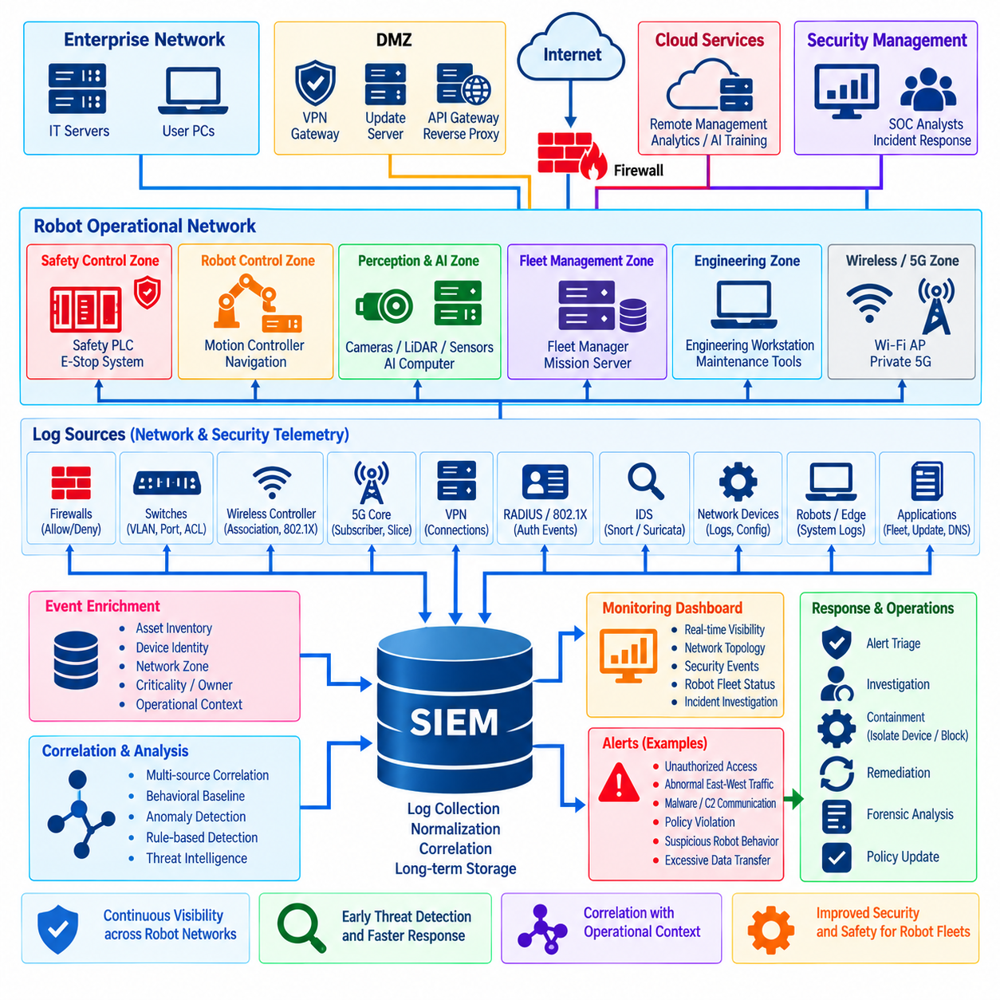{width="7.268055555555556in" height="7.268055555555556in"}

네트워크 보안 모니터링(Network Security Monitoring)은 로봇 통신 인프라 전반에서 발생하는 이벤트에 대한 지속적인 가시성(Visibility)을 제공하며, 보안 정보 및 이벤트 관리(Security Information and Event Management, SIEM)는 여러 시스템의 정보를 결합하여 개별 로그만으로는 발견할 수 없는 연관 관계를 식별한다. 로봇 환경에서는 사소한 네트워크 이상 징후(Network Anomaly)로 시작된 사이버 사고가 이후 내비게이션, 플릿 협조(Fleet Coordination), 제어 또는 물리적 운영에 영향을 미칠 수 있기 때문에 이러한 기능이 중요하다.

모니터링 아키텍처(Monitoring Architecture)는 로봇 운영을 지원하는 주요 보안 경계(Security Boundary)와 인프라 구성요소에서 텔레메트리(Telemetry)를 수집해야 한다. 유용한 정보 출처에는 방화벽(Firewall), 라우터(Router), 스위치(Switch), 무선 제어기(Wireless Controller), VPN 게이트웨이(VPN Gateway), 802.1X 및 RADIUS 서비스, 사설 5G 시스템(Private 5G System), DNS 서버, 침입 탐지 센서(Intrusion-Detection Sensor), 엣지 컴퓨터(Edge Computer), 로봇 운영체제(Robot Operating System), 플릿 관리 플랫폼(Fleet-Management Platform), 신원 서비스(Identity Service)가 포함된다. 이러한 정보 출처를 결합하면 네트워크 활동에 대한 더욱 광범위한 관점을 확보할 수 있다.

SIEM 플랫폼(SIEM Platform)은 서로 다른 로그 형식과 명명 규칙을 사용하는 시스템에서 생성된 이벤트를 정규화(Normalization)하고 상관 분석(Correlation)한다. 방화벽은 IP 주소를 사용하여 거부된 연결을 보고할 수 있지만 인증 서버(Authentication Server)는 동일한 엔드포인트를 인증서나 장치 신원(Device Identity)을 통해 식별할 수 있다. 상관 분석을 통해 분석가는 이러한 기록을 연결하고 서로 별개의 이벤트처럼 보이는 여러 기록이 하나의 로봇, 사용자, 세션 또는 보안 사고를 나타내는지 파악할 수 있다.

로봇 환경에서는 동일한 네트워크 이벤트라도 매우 다른 결과를 초래할 수 있으므로 자산 맥락(Asset Context)이 특히 중요하다. 개발 서버(Development Server)를 향한 연결 실패는 낮은 우선순위를 가질 수 있지만 동일한 동작이 안전 PLC(Safety PLC), 모션 제어기(Motion Controller), 플릿 관리 서버(Fleet-Management Server)를 대상으로 발생하면 즉각적인 조사가 필요할 수 있다. 따라서 SIEM 정보 강화(SIEM Enrichment)는 이벤트를 자산 역할(Asset Role), 중요도(Criticality), 네트워크 영역(Network Zone), 책임자(Owner), 운영 기능(Operational Function)과 연결해야 한다.

네트워크 플로우 정보(Network Flow Information)는 패킷 페이로드(Packet Payload)를 검사할 수 없는 경우에도 유용한 가시성을 제공한다. 출발지 및 목적지 주소, 포트, 프로토콜, 연결 지속시간(Connection Duration), 바이트 수(Byte Count), 통신 빈도(Communication Frequency)를 통해 예상하지 못한 통신 관계를 발견할 수 있다. 인지 컴퓨터(Perception Computer)가 갑자기 외부 호스트와 통신하거나 로봇이 여러 내부 서브넷을 스캔하기 시작하면 애플리케이션 트래픽이 암호화되어 있더라도 침해 가능성을 나타낼 수 있다.

Snort, Suricata 또는 유사한 센서에서 발생한 침입 탐지 경고(Intrusion-Detection Alert)를 SIEM 데이터와 통합하면 이벤트 해석 능력을 향상시킬 수 있다. 하나의 시그니처 경고(Signature Alert)는 불확실할 수 있지만 방화벽 거부, 인증 실패, 비정상적인 DNS 요청, 비정상적인 엔드포인트 활동과 동시에 발생하면 탐지 신뢰도가 높아진다. 상관 분석은 보안팀이 단순한 개별 잡음과 로봇 인프라의 여러 계층에 걸쳐 발생하는 행위를 구분하는 데 도움을 준다.

인증 텔레메트리(Authentication Telemetry)는 또 다른 중요한 보안 증거의 출처이다. VPN 연결, 802.1X 인증, RADIUS 결정, 무선 연결(Wireless Association), 인증서 검증(Certificate Validation), 사설 5G 가입자 이벤트(Private 5G Subscriber Event)는 누가 또는 무엇이 네트워크에 접속했는지를 보여줄 수 있다. 반복적인 인증 실패, 예상하지 못한 장치 신원, 비정상적인 접근 위치, 만료된 인증서, 비정상적인 재연결 패턴은 자격증명 오용(Credential Misuse), 구성 문제 또는 승인되지 않은 장비를 나타낼 수 있다.

가능한 경우 로봇 특화 맥락(Robot-Specific Context)을 통합해야 한다. 플릿 시스템은 로봇 식별자(Robot Identifier), 임무 상태(Mission State), 충전 상태(Charging Status), 유지보수 기간(Maintenance Period), 예상 운영 위치(Expected Operating Location) 등의 정보를 제공할 수 있다. 이러한 정보를 활용하면 운영 동작과 관련하여 네트워크 이벤트를 해석할 수 있다. 예를 들어 예정된 유지보수 중에는 정상적인 통신도 무인 로봇이 일반적인 자율 운영을 수행하는 동안 발생하면 의심스러운 통신으로 판단할 수 있다.

많은 로봇 네트워크는 비교적 안정적인 통신 관계를 나타내기 때문에 기준선 모니터링(Baseline Monitoring)이 효과적이다. 로봇은 일반적으로 예측 가능한 플릿 서버, 시간 서비스(Time Service), 업데이트 시스템, 게이트웨이, 엣지 애플리케이션과 통신한다. 모니터링 시스템은 정상적인 피어(Peer), 프로토콜, 트래픽 양, 운영 시간을 기준선으로 설정할 수 있으며, 알려진 공격 시그니처가 존재하지 않더라도 이러한 기준선에서 벗어나는 동작을 조사 대상으로 생성할 수 있다.

그러나 이상 탐지(Anomaly Detection)는 신중하게 적용해야 한다. 소프트웨어 업데이트, 새로운 센서, 임시 엔지니어링 작업, 플릿 확장, 변화하는 워크로드는 공격이 아니더라도 정상 트래픽을 변화시킬 수 있다. 따라서 기준선은 통제된 프로세스를 통해 지속적으로 발전시켜야 하며, 비정상적인 행동이라는 이유만으로 악성으로 자동 분류하지 않고 운영 맥락(Operational Context)을 고려하여 평가해야 한다.

시간 동기화(Time Synchronization)는 신뢰할 수 있는 이벤트 상관 분석(Event Correlation)의 기본 요소이다. 방화벽, 로봇, 엣지 노드, 무선 인프라, 5G 시스템, 인증 서버, SIEM 플랫폼은 충분히 정확한 타임스탬프(Timestamp)를 유지해야 한다. 일관된 시간이 없으면 조사 담당자가 인증이 의심스러운 연결보다 먼저 발생했는지, 명령이 물리적 이벤트보다 먼저 실행되었는지 또는 어떤 시스템이 사고 시퀀스(Incident Sequence)를 시작했는지를 판단하기 어려울 수 있다.

타임스탬프 출처 추적(Timestamp Provenance)은 로봇 사고가 물리적 행동과 관련될 때 특히 중요해진다. 보안 기록은 센서 측정값, 제어 명령(Control Command), 임무 상태 전환(Mission Transition), 소프트웨어 이벤트, 운영자 행동과 상관 분석해야 할 수 있다. 이러한 정보 출처 전반에서 신뢰할 수 있는 시간 정보를 보존하면 네트워크 접근에서 디지털 활동을 거쳐 물리적 결과에 이르는 순서를 재구성하고 더욱 신뢰할 수 있는 포렌식 분석(Forensic Analysis)을 수행할 수 있다.

중앙집중형 로깅(Centralized Logging)은 침해된 엔드포인트가 기록을 수정하거나 삭제하지 못하도록 보호해야 한다. 로그가 공격받은 로봇에만 남아 있다면 공격자는 조사가 시작되기 전에 증거를 삭제할 수 있다. 중요한 이벤트를 보호된 수집기(Protected Collector) 또는 SIEM 인프라로 전달하면 증거 보존(Evidence Preservation)을 향상시킬 수 있다. 전송 암호화(Transport Encryption), 접근 제어, 무결성 보호(Integrity Protection), 보존 정책(Retention Policy), 백업 메커니즘을 통해 로깅 파이프라인 자체도 보호해야 한다.

로그 수집(Log Collection)은 로봇 운영을 방해하지 않도록 설계해야 한다. 고빈도 제어 메시지, 센서 스트림, 반복적인 네트워크 이벤트를 필터링 없이 모두 기록하면 막대한 데이터가 생성될 수 있다. 로깅 정책은 보안과 관련된 이벤트를 우선 처리하고, 반복되는 정보를 집계(Aggregation)하며, 필요한 경우 속도 제어(Rate Control)를 적용하고, 결정론적 제어(Deterministic Control)나 AI 처리에 필요한 자원을 소비하지 않으면서 충분한 맥락을 보존해야 한다.

경고 심각도(Alert Severity)는 사이버보안 지표뿐만 아니라 운영 및 물리적 결과(Operational and Physical Consequence)를 함께 고려해야 한다. 관리 인터페이스, 안전 제어기, 액추에이터 네트워크(Actuator Network), 플릿 오케스트레이션 서비스(Fleet Orchestration Service)에 대한 접근 시도는 낮은 가치의 시스템을 대상으로 한 유사한 활동보다 높은 우선순위를 가질 수 있다. 심각도 모델(Severity Model)은 자산 중요도, 네트워크 영역, 공격 신뢰도(Attack Confidence), 사용자 권한, 로봇 상태, 안전 또는 가용성에 미칠 잠재적 영향을 포함할 수 있다.

탐지 규칙(Detection Rule)은 알려진 위협뿐만 아니라 의도된 아키텍처(Intended Architecture)를 위반하는 행위도 식별해야 한다. 기업 호스트가 제어 VLAN에 접근하려는 시도, AI 컴퓨터가 안전 장치와 연결을 시작하는 행위, 로봇이 승인되지 않은 인터넷 목적지에 접속하는 행위, 예상하지 못한 로봇 간 통신, 승인된 시간 외에 유지보수 시스템이 동작하는 상황 등이 이에 해당한다. 이러한 조건은 문서화된 네트워크 정책을 지속적으로 모니터링할 수 있는 보안 기대조건(Security Expectation)으로 전환한다.

대시보드(Dashboard)는 사이버보안팀과 로봇 운영팀 모두에게 유용한 형태로 정보를 제공해야 한다. 보안 분석가는 공격 지표(Attack Indicator)와 신원 맥락(Identity Context)이 필요하며, 운영 담당자는 영향을 받는 로봇, 사이트, 임무, 네트워크 세그먼트, 서비스 영향을 파악해야 한다. 공유된 상황 인식(Shared Situational Awareness)은 기술적인 경고가 궁극적으로 영향을 받을 수 있는 물리적 시스템과 분리되어 처리되는 위험을 줄여준다.

자동 대응(Automated Response)은 격리 시간을 단축할 수 있지만 운영 로봇 환경에서는 신중하게 적용해야 한다. SIEM 또는 보안 오케스트레이션 플랫폼(Security Orchestration Platform)은 신뢰도가 높은 탐지 이후 계정 정지(Account Suspension), 방화벽 차단, 네트워크 격리(Network Quarantine), 인증서 폐기(Certificate Revocation)를 실행할 수 있다. 그러나 이동 중인 로봇의 연결을 자동으로 차단하면 운영 또는 안전 문제가 발생할 수 있으므로 대응 로직은 로봇 상태와 검증된 안전 전환 절차(Safe-Transition Procedure)를 고려해야 한다.

신뢰도가 낮은 이벤트에서는 장비를 즉시 격리하기보다 자동화를 통해 증거를 수집할 수 있다. 워크플로(Workflow)는 관련 로그를 보존하고, 네트워크 맥락을 캡처하며, 장치 상태를 조회하고, 모니터링 수준을 높이고, 담당자에게 통보하고, 사고 기록(Incident Record)을 생성할 수 있다. 이후 사람이 격리 필요성을 검토하도록 하면 신속한 대응과 불필요한 물리적 운영 중단을 방지해야 하는 요구사항 사이에서 균형을 유지할 수 있다.

보존 정책(Retention Policy)은 포렌식, 운영, 규제, 저장 공간 요구사항을 반영해야 한다. 인증 및 관리 기록은 대용량 플로우 텔레메트리보다 장기간 보존해야 할 수 있으며, 패킷 캡처(Packet Capture)는 크기와 민감성 때문에 짧은 기간만 저장할 수 있다. 조직은 어떤 데이터를 얼마나 오래 보존할 것인지, 누가 접근할 수 있는지, 보존 기간이 종료되었을 때 어떻게 안전하게 삭제할 것인지를 정의해야 한다.

모니터링 인프라 자체도 중요한 보안 자산(Critical Security Asset)이다. SIEM 서버, 수집기(Collector), 센서, 대시보드, 규칙 저장소(Rule Repository), 자동화 자격증명(Automation Credential)은 로봇 아키텍처와 보안 통제에 대한 상세한 정보를 노출할 수 있다. 이러한 시스템은 네트워크 분할, 보안 강화(Hardening), 패치, 백업, 강력한 관리 인증을 적용해야 한다. 특히 탐지 규칙을 변경하거나 증거를 삭제할 수 있는 권한은 엄격하게 제한하고 감사해야 한다.

로봇 시스템이 발전함에 따라 탐지 콘텐츠(Detection Content)도 지속적으로 유지관리해야 한다. 새로운 소프트웨어 버전, 네트워크 영역, 무선 기술, AI 서비스, 플릿 워크플로는 기존 가정을 무효화하거나 새로운 공격 경로를 만들 수 있다. 따라서 아키텍처가 변경될 때마다 규칙, 상관 분석 로직(Correlation Logic), 대시보드, 자산 목록(Asset Inventory), 대응 절차를 검토하고 현실적인 보안 시나리오를 기반으로 주기적으로 테스트해야 한다.

성숙한 모니터링 프로그램(Monitoring Program)은 자체적인 효과성도 측정한다. 보안팀은 경고 품질(Alert Quality), 오탐률(False-Positive Rate), 탐지 범위(Detection Coverage), 조사 시간(Investigation Time), 격리 시간(Containment Time), 로깅 공백(Logging Gap), 센서 상태(Sensor Health), 해결되지 않은 가시성 한계를 추적할 수 있다. 테이블탑 훈련(Tabletop Exercise), 통제된 공격 시뮬레이션(Controlled Attack Simulation), 사고 대응 훈련(Incident-Response Drill)을 통해 실제 로봇 사이버보안 사고에서 모니터링 시스템이 필요한 증거와 알림을 제공하는지 검증할 수 있다.

네트워크 보안 모니터링과 SIEM은 궁극적으로 예방적 보안 통제(Preventive Security Control)와 사고 대응(Incident Response)을 연결하는 관찰 계층(Observational Layer)을 제공한다. 네트워크 텔레메트리, 신원 이벤트(Identity Event), 침입 탐지, 로봇 운영 맥락, 신뢰할 수 있는 타임스탬프, 중앙집중형 로깅, 상관 분석, 신중하게 관리되는 자동화를 결합하면 조직은 비정상적인 행동을 조기에 식별하고 국지적인 사이버 이벤트가 플릿 전체의 장애나 위험한 물리적 결과로 발전하기 전에 대응할 수 있다.

## 03.10. Network Security Hardening Baseline Checklist

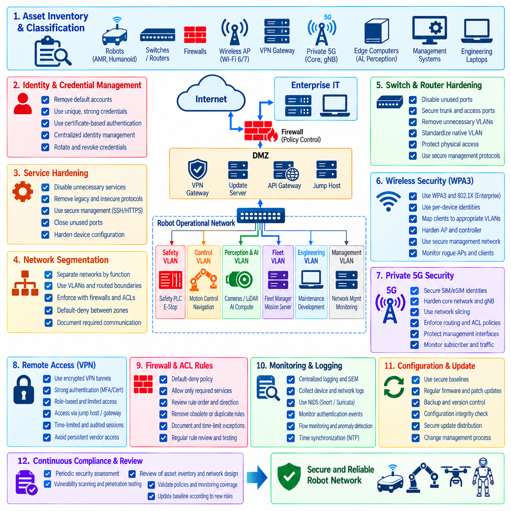{width="7.268055555555556in" height="7.268055555555556in"}

네트워크 보안 강화(Network Security Hardening)는 모든 로봇 네트워크 구성요소가 실제 운영 환경에 투입되기 전에 충족해야 하는 반복 가능한 최소 구성 기준(Minimum Configuration Baseline)을 확립한다. 이러한 기준선은 로봇, 스위치, 라우터, 방화벽, 무선 인프라, VPN 게이트웨이, 엣지 컴퓨터(Edge Computer), 사설 5G 구성요소(Private 5G Component), 관리 시스템을 포함해야 한다. 그 목적은 불필요한 노출을 줄이고 기본적인 보안 조치가 개별 엔지니어의 판단에만 의존하지 않도록 하는 것이다.

보안 강화 프로세스(Hardening Process)는 네트워크에 연결된 자산과 해당 자산의 의도된 역할을 정확하게 파악하는 것에서 시작해야 한다. 각 장치에는 식별 가능한 책임자, 하드웨어 및 소프트웨어 버전, 네트워크 위치, 관리 방법, 신뢰 분류(Trust Classification), 운영 목적이 정의되어야 한다. 알 수 없거나 관리되지 않는 장비는 해당 장비의 서비스, 자격증명, 펌웨어 또는 통신 동작이 요구되는 기준선을 충족하는지 관리자가 신뢰성 있게 판단할 수 없기 때문에 보안 공백(Security Gap)을 발생시킨다.

기본 계정(Default Account), 비밀번호, 인증서, 커뮤니티 문자열(Community String), 공급업체 기본 자격증명(Vendor Credential)은 배포 전에 제거하거나 비활성화하거나 교체해야 한다. 기술적으로 가능한 경우 관리 신원(Administrative Identity)은 고유하고 특정 사용자까지 추적할 수 있어야 한다. 공유 특권 계정(Shared Privileged Account)은 사고 조사를 어렵게 만들고 자격증명 침해의 영향을 확대한다. 따라서 장치 기능에 따라 네트워크 관리에 강력한 인증(Strong Authentication)과 중앙집중형 신원 관리(Centralized Identity Management)를 적용해야 한다.

네트워크 장치는 운영 역할에 필요한 서비스만 외부에 노출해야 한다. 사용하지 않는 웹 인터페이스, 원격 셸(Remote Shell), 디스커버리 프로토콜(Discovery Protocol), 레거시 관리 서비스(Legacy Management Service), 파일 공유 기능, 불필요한 수신 포트(Listening Port)는 비활성화해야 한다. 활성 서비스의 수를 줄이면 공격 표면(Attack Surface)이 감소하며, 의도적으로 허용된 제한적인 기능과 예상하지 못한 통신을 더욱 쉽게 구분할 수 있어 모니터링도 단순화된다.

안전하지 않은 관리 방식은 보안 관리 프로토콜(Secure Management Protocol)로 대체해야 한다. 평문 방식 대신 SSH 및 HTTPS와 같은 암호화된 관리 접근(Encrypted Administrative Access)을 우선적으로 사용하고, 관리 API는 인증되고 보호된 세션을 요구해야 한다. 자격증명이나 구성 정보를 적절한 보호 없이 전송하는 레거시 프로토콜은 가능한 경우 제거해야 한다. 관리 트래픽(Management Traffic) 역시 일반적인 로봇 및 사용자 통신과 분리해야 한다.

네트워크 분할(Network Segmentation)은 선택적인 최적화가 아니라 기본 보안 요구사항으로 취급해야 한다. 안전 제어(Safety Control), 모션 제어(Motion Control), AI 및 인지 데이터(AI and Perception Data), 플릿 서비스(Fleet Service), 엔지니어링 접근(Engineering Access), 관리 트래픽, 기업 IT(Enterprise IT), 게스트 장치(Guest Device), 외부 연결을 위험과 운영 요구사항에 따라 분리해야 한다. VLAN은 논리적 분리를 제공하며, 라우팅 경계(Routed Boundary), 방화벽, ACL은 영역 사이의 통신 정책을 집행한다.

영역 간 통신(Inter-Zone Communication)은 기본 거부 원칙(Default-Deny Principle)을 따라야 한다. 허용되는 모든 경로에는 문서화된 운영 목적이 존재해야 하며 필요한 출발지, 목적지, 프로토콜, 포트, 방향을 정의해야 한다. 서브넷 간 무제한 접근과 같은 광범위한 규칙은 피해야 한다. 시운전(Commissioning)이나 문제 해결을 위해 임시 연결이 필요한 경우 해당 예외는 시간 제한을 설정하고 기록 및 검토한 후 작업이 종료되면 제거해야 한다.

스위치 보안 강화(Switch Hardening)에는 액세스 포트(Access Port)와 트렁크 포트(Trunk Port)의 명시적인 구성이 포함되어야 한다. 사용하지 않는 포트는 비활성화하거나 제한하고, 불필요한 VLAN은 트렁크에서 제거하며, 네이티브 VLAN(Native VLAN)의 동작을 표준화해야 한다. 계층 2 토폴로지(Layer-2 Topology)를 변경하거나 승인되지 않은 연결을 생성할 수 있는 기능은 아키텍처에 따라 통제해야 한다. 로컬 구성 변경으로 논리적 네트워크 분할을 우회할 수 있으므로 스위치에 대한 물리적 접근(Physical Access)도 보호해야 한다.

네트워크 접근 제어(Network Access Control)는 일반적인 네트워크 연결을 허용하기 전에 장치 인증을 요구함으로써 보안 기준선을 강화할 수 있다. 인증서 기반 인증(Certificate-Based Authentication)을 사용하는 IEEE 802.1X는 이를 지원하는 로봇 엔드포인트, 엔지니어링 시스템, 인프라 장치에 적합하다. 레거시 장비가 강력한 인증을 지원하지 못하는 경우 단순히 물리적으로 연결되었다는 이유만으로 동일한 신뢰를 부여하지 말고 더 제한적인 접근, 추가적인 네트워크 분할, 모니터링을 적용해야 한다.

무선 네트워크(Wireless Network)는 자체적인 보안 강화 구성이 필요하다. 지원되는 경우 WPA3와 엔터프라이즈 인증(Enterprise Authentication)을 사용하고 공유 자격증명(Shared Credential)은 최소화하며, 가능한 경우 로봇 신원을 개별적으로 관리해야 한다. 무선 클라이언트는 하나의 제한 없는 네트워크에 배치하지 않고 적절한 보안 영역으로 매핑해야 한다. 액세스 포인트와 무선 제어기(Wireless Controller)의 관리는 일반적인 운영 트래픽과 분리된 상태를 유지해야 한다.

사설 5G 환경(Private 5G Environment)은 가입자 신원(Subscriber Identity), SIM 또는 eSIM 프로비저닝(Provisioning), 코어 네트워크 관리(Core-Network Administration), 엣지 연결(Edge Connectivity), 네트워크 슬라이싱(Network Slicing)에 동일한 원칙을 적용해야 한다. 특정 슬라이스의 구성원이라는 사실을 무제한적인 권한으로 해석해서는 안 된다. 라우팅 통제, 방화벽, 애플리케이션 인증(Application Authentication), 모니터링을 통해 로봇, 엣지 서비스, 관리 시스템, 외부 네트워크 사이에서 최소 권한(Least Privilege)을 지속적으로 집행해야 한다.

원격 접근(Remote Access)은 로봇 서비스를 외부 네트워크에 직접 노출하는 대신 통제된 게이트웨이(Controlled Gateway)를 통해 종단되어야 한다. VPN 또는 이에 상응하는 암호화 터널(Encrypted Tunnel)은 강력한 인증, 제한된 권한 부여(Restricted Authorization), 중앙집중형 로깅(Centralized Logging)을 사용해야 한다. 원격 사용자는 할당된 유지보수 또는 지원 기능에 필요한 접근 권한만 부여받아야 한다. 임시적이고 승인되며 감사 가능한 세션으로 운영 요구사항을 충족할 수 있다면 지속적인 공급업체 원격 접근(Persistent Vendor Access)은 피해야 한다.

방화벽 및 ACL 정책은 과도한 권한, 오래된 규칙, 중복 항목, 임시 예외, 문서화되지 않은 의존성을 대상으로 검토해야 한다. 기술적으로 유효한 구성이라도 의도하지 않은 접근을 허용할 수 있으므로 규칙 순서(Rule Order)와 방향(Direction)을 검증해야 한다. 정기적인 정책 검토(Periodic Policy Review)를 통해 실제 배포된 규칙과 현재 로봇 아키텍처를 비교하여 폐기된 시스템이나 이전 프로젝트를 위해 생성된 연결이 무기한 유지되지 않도록 해야 한다.

소프트웨어와 펌웨어 버전은 승인된 보안 기준선(Approved Security Baseline) 내에서 유지해야 한다. 네트워크 장치, 무선 인프라, 로봇 통신 모듈, 운영체제, VPN 구성요소, 관리 플랫폼의 취약점과 보안 업데이트를 지속적으로 모니터링해야 한다. 변경으로 인해 실시간 통신(Real-Time Communication), 로밍(Roaming), 프로토콜 호환성 또는 운영 가용성(Operational Availability)에 영향을 줄 수 있는 경우 운영 환경에 배포하기 전에 패치를 검증해야 한다.

구성 파일(Configuration File)과 펌웨어 이미지(Firmware Image)는 신뢰할 수 있는 출처에서 확보하고 승인되지 않은 변경으로부터 보호해야 한다. 지원되는 경우 서명된 펌웨어(Signed Firmware), 보안 부팅(Secure Boot), 무결성 검증(Integrity Verification), 통제된 업데이트 메커니즘(Controlled Update Mechanism)을 적용하면 악성 또는 손상된 소프트웨어가 네트워크 인프라에 유입될 위험을 줄일 수 있다. 구성 백업(Configuration Backup)에는 주소, 토폴로지 정보, 자격증명, 인증서, 보안 정책이 포함될 수 있으므로 이 역시 보호해야 한다.

보안 관련 활동에 대해서는 장치나 모니터링 인프라에 과도한 부담을 주지 않는 범위에서 로깅(Logging)을 활성화해야 한다. 인증 이벤트, 관리 변경, 방화벽 결정, VPN 세션, 네트워크 접근 제어 결과, 무선 연결(Wireless Association), 구성 변경, 중요 시스템 오류를 보호된 중앙집중형 로깅 또는 SIEM 시스템으로 전달해야 한다. 여러 로봇과 인프라에서 발생한 이벤트를 상관 분석할 수 있도록 로그에는 신뢰할 수 있는 타임스탬프(Timestamp)가 포함되어야 한다.

따라서 시간 동기화(Time Synchronization)는 보안 강화 기준선의 일부가 되어야 한다. 로봇, 스위치, 방화벽, 엣지 시스템, 인증 서버, 무선 인프라, 사설 5G 구성요소, 모니터링 플랫폼은 승인된 시간 소스(Time Source)를 사용해야 한다. 일관된 타임스탬프는 사고 재구성(Incident Reconstruction)의 정확도를 높이고 네트워크 이벤트를 제어 명령, 소프트웨어 활동, 운영자 행동, 물리적 로봇 동작과 비교할 수 있도록 한다.

침입 탐지(Intrusion Detection)와 네트워크 모니터링(Network Monitoring)은 기업, 관리, AI, 로봇 제어, 무선, 외부 도메인 사이의 중요한 경계를 감시해야 한다. 센서는 알려진 공격 패턴뿐만 아니라 의도된 통신 관계를 위반하는 행위도 식별할 수 있다. 암호화된 트래픽으로 인해 페이로드 검사가 불가능한 경우 플로우 텔레메트리(Flow Telemetry)와 행동 기준선(Behavioral Baseline)을 통해 추가적인 가시성을 확보할 수 있다. 모니터링은 단순히 경고 수를 최대화하기보다 의미 있는 이상 징후를 식별하는 데 중점을 두어야 한다.

관리 접근(Administrative Access)은 최소 권한과 직무 분리(Separation of Duties) 원칙을 따라야 한다. 로봇을 운영하는 엔지니어에게 반드시 방화벽, 스위치, 무선 제어기 또는 인증 시스템에 대한 무제한 제어 권한이 필요한 것은 아니다. 특권 작업(Privileged Action)은 승인된 역할로 제한하고 강력하게 인증하며 로그를 기록하고 정기적으로 검토해야 한다. 인력과 운영 책임이 변경되면 사용하지 않는 계정(Dormant Account)과 불필요한 권한을 제거해야 한다.

백업 및 복구 절차(Backup and Recovery Procedure)는 애플리케이션 데이터뿐만 아니라 네트워크 보안 구성도 포함해야 한다. 방화벽 정책, 스위치 구성, 무선 설정, 인증 데이터베이스, 인증서, 라우팅 규칙, SIEM 콘텐츠는 장비 장애나 침해 이후 안전한 운영을 복구하는 데 필수적일 수 있다. 복구 과정에서 오래된 자격증명이나 안전하지 않은 구성이 의도하지 않게 다시 도입되지 않도록 복구 절차를 사전에 테스트해야 한다.

보안 강화에서는 안전한 장애 동작(Secure Failure Behavior)도 정의해야 한다. 인증 서버, 방화벽, 무선 제어기, 5G 구성요소, VPN 게이트웨이 또는 라우팅 서비스의 손실은 로봇의 가용성에 영향을 줄 수 있다. 장애 시 개방(Fail-Open)은 통신을 유지할 수 있지만 보안을 약화시킬 수 있으며, 장애 시 차단(Fail-Closed)은 운영을 중단시킬 수 있다. 선택되는 동작은 위협 분석(Threat Analysis), 운영 중요도, 안전 요구사항, 이중화(Redundancy), 로컬 로봇 보호 메커니즘을 반영해야 한다.

가능한 경우 기준선 검증(Baseline Verification)을 자동화해야 한다. 구성 스캐닝(Configuration Scanning), 정책 비교(Policy Comparison), 취약점 평가(Vulnerability Assessment), 인증서 만료 검사(Certificate-Expiration Check), 승인되지 않은 서비스 탐지, 네트워크 분할 테스트를 통해 승인된 설정에서 벗어난 구성 드리프트(Configuration Drift)를 식별할 수 있다. 수백 대의 로봇과 네트워크 장치를 수동으로 검토하면 오랜 기간 구성 불일치를 발견하지 못할 수 있으므로 자동화는 대규모 플릿에서 특히 중요하다.

보안 기준선에 대한 예외(Exception)는 비공식적으로 처리하지 말고 명시적으로 관리해야 한다. 레거시 제어기, 특수 센서, 공급업체 어플라이언스(Vendor Appliance), 안전 인증 장비(Safety-Certified Equipment)는 최신 보안 메커니즘을 지원하지 못할 수 있다. 각 예외에는 기술적 제한사항, 관련 위험, 보완 통제(Compensating Control), 책임자, 승인 상태, 검토 주기를 문서화해야 한다. 이를 통해 일시적인 취약점이 영구적이고 보이지 않는 아키텍처 요소로 남는 것을 방지할 수 있다.

보안 기준선은 시운전 과정에서 검증하고 전체 운영 수명주기(Operational Lifecycle)에 걸쳐 지속적으로 검토해야 한다. 새로운 로봇 모델, AI 컴퓨터, 센서, 소프트웨어 릴리스, 네트워크 기술, 원격 서비스는 공격 표면을 변화시킬 수 있다. 정기 감사(Periodic Audit), 침투 테스트(Penetration Testing), 구성 검토, 사고에서 얻은 교훈(Incident Lesson), 아키텍처 변경사항을 보안 강화 표준에 반영하여 위협과 시스템 역량의 변화에 맞춰 지속적으로 발전시켜야 한다.

성숙한 네트워크 보안 강화 기준선(Network Security Hardening Baseline)은 자산 목록(Asset Inventory), 안전한 신원 관리(Secure Identity), 최소 서비스(Minimal Services), 네트워크 분할, 기본 거부 정책, 보호된 관리 접근, 암호화된 원격 접근, 통제된 무선 및 5G 연결, 패치 관리(Patching), 로깅, 모니터링, 백업, 복원력(Resilience), 지속적인 검증(Continuous Verification)을 결합한다. 이러한 체크리스트 기반 접근법(Checklist-Oriented Approach)을 일관되게 적용하면 로봇 네트워크를 위한 측정 가능한 보안 기반을 구축하고 단순한 구성 취약점이 플릿 전체 또는 안전과 관련된 침해로 발전할 가능성을 줄일 수 있다.
