**Volume 24. Robot Cybersecurity**

# Chapter 04. ROS2 and DDS Security

## 04.01. ROS2 DDS Security Threat Surface Analysis

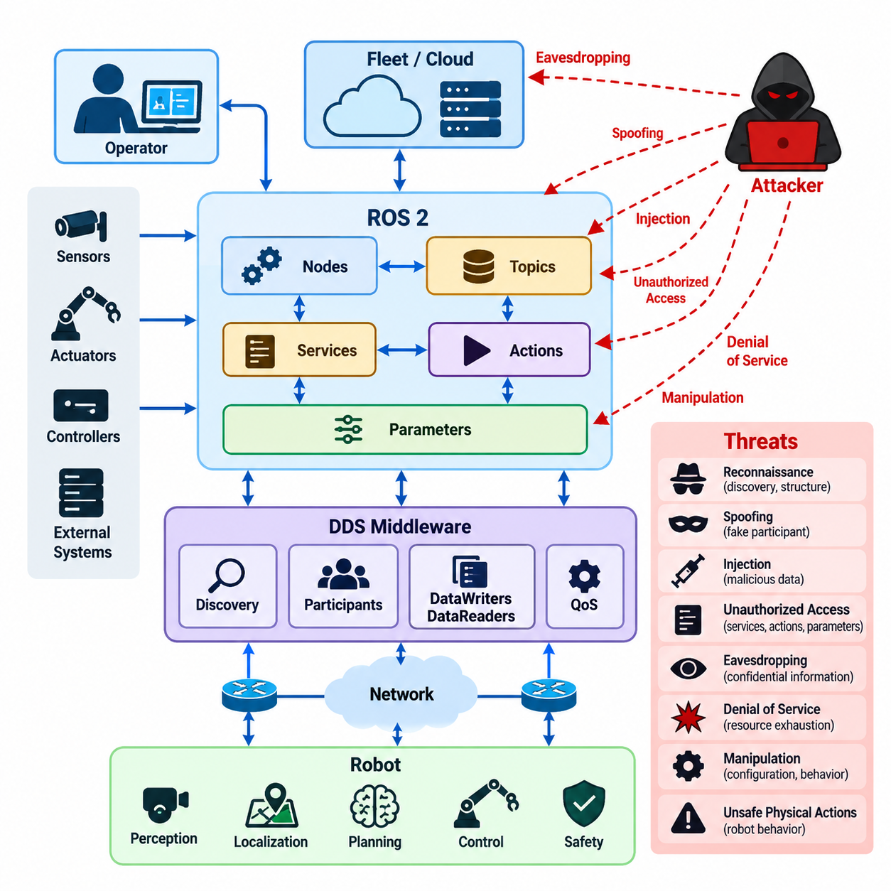{width="7.268055555555556in" height="7.268055555555556in"}

ROS 2 introduces a distributed communication architecture in which robot software components interact through nodes, topics, services, actions, parameters, and discovery mechanisms. DDS provides the underlying data-centric communication model for many ROS 2 deployments. This flexibility improves modularity and scalability, but it also creates a broad security threat surface because communication may cross processes, computers, networks, and administrative trust boundaries. Volume_24_Robot_Cybersecurity

Threat-surface analysis begins by identifying every ROS 2 participant that can produce, consume, discover, or modify information. Nodes are particularly important because each node may publish sensor data, subscribe to commands, expose services, execute actions, or modify parameters. A compromised node can therefore become an internal attack platform, allowing an adversary to observe data flows, impersonate legitimate components, inject messages, or influence downstream robot behavior.

DDS discovery is another critical exposure point. Participants must locate one another and exchange information describing available communication endpoints before normal data exchange occurs. If discovery traffic is insufficiently protected, an unauthorized participant may learn the structure of the robotic system, including topic names, communication relationships, and active endpoints. Such reconnaissance can provide information needed for subsequent spoofing, interception, denial-of-service, or targeted manipulation.

ROS 2 topics form a major attack surface because they frequently carry continuous operational information such as sensor observations, localization estimates, trajectories, velocity commands, actuator states, diagnostics, and AI inference results. Unauthorized subscribers may compromise confidentiality, while malicious publishers may threaten integrity by introducing fabricated or modified data. For physical robots, corrupted topic data can propagate from software communication into unsafe physical actions.

Services and actions introduce additional risks because they represent request-response and goal-oriented control interfaces rather than passive data streams. An attacker capable of invoking sensitive services could trigger configuration changes, reset components, alter operating modes, or request privileged functions. Action interfaces can be even more consequential when they initiate navigation, manipulation, inspection, docking, or other long-running behaviors that directly affect the physical state of the robot.

Parameters should also be treated as security-sensitive configuration assets. ROS 2 parameters can influence controller gains, perception thresholds, planner behavior, communication settings, safety limits, and application logic. Unauthorized parameter modification may not resemble a conventional network attack, yet it can subtly alter system behavior. Attackers may exploit such changes to degrade performance, disable safeguards, create unstable behavior, or prepare conditions for a later physical attack.

The DDS communication layer expands the analysis beyond application-level ROS 2 interfaces. DDS participants, domains, publishers, subscribers, DataWriters, DataReaders, discovery traffic, transport interfaces, and Quality of Service settings collectively create multiple paths through which an adversary may interact with the system. Threat modeling must therefore consider not only ROS 2 source code but also middleware configuration, DDS implementation behavior, network exposure, and deployment topology.

Identity is central to this threat surface. Without trustworthy participant identity, a robotic system may be unable to distinguish legitimate software from an attacker imitating an authorized node or DDS participant. Spoofing can become especially dangerous when malicious endpoints use names, topics, or communication patterns that resemble trusted components. Strong authentication is consequently required before communication privileges can be meaningfully associated with a participant.

Authorization addresses a different question: what should an authenticated participant be allowed to do? A legitimate perception node, for example, may require permission to publish detected objects but should not automatically receive permission to issue motion commands. Excessive permissions increase the blast radius of compromise. ROS 2 and DDS security architecture should therefore apply least privilege to publishing, subscribing, service interaction, and other communication operations.

Confidentiality threats arise when robot communication contains information that should not be observable by unauthorized parties. Camera streams, maps, localization data, production information, operator commands, mission plans, and telemetry may reveal sensitive operational context. Passive network monitoring can therefore be significant even when an attacker never modifies a packet. Encryption and secure key management are needed where exposure of communication content creates unacceptable risk.

Integrity and authenticity are generally even more important for control-related traffic. A robot may make decisions based on data received from numerous distributed components, and a forged message can appear structurally valid while containing dangerous information. Protecting message integrity helps detect unauthorized modification, while origin authentication establishes confidence in the source. These controls become critical when data influences navigation, manipulation, safety monitoring, or autonomous decision making.

Availability must be analyzed alongside confidentiality and integrity because robotics communication is often time-sensitive. Flooding discovery traffic, creating excessive participants, publishing at abnormal rates, exhausting middleware resources, or interfering with network transport can delay or prevent legitimate communication. Even when no data is stolen or altered, latency and packet loss may destabilize control loops, interrupt perception pipelines, trigger emergency behavior, or make autonomous missions unavailable.

Quality of Service configuration introduces security implications because reliability, durability, history depth, deadline, liveliness, and resource behavior affect how DDS handles communication. Poorly selected settings may amplify resource exhaustion or permit unexpected persistence of data. Security review should therefore examine QoS not merely as a performance concern but as part of resilience engineering, particularly for systems where high-rate sensors and safety-critical command channels share computational and network resources.

Trust boundaries are essential for organizing the threat analysis. Boundaries may exist between safety control and AI workloads, robot and fleet infrastructure, trusted and untrusted networks, containers, host operating systems, edge computers, remote operators, cloud services, and third-party software. Every communication path crossing such a boundary should be examined for authentication, authorization, confidentiality, integrity, replay resistance, availability, monitoring, and recovery requirements.

Deployment configuration can significantly change the actual threat surface. A development robot operating on an isolated laboratory network presents different risks from an AMR fleet connected through industrial Wi-Fi, a humanoid connected to edge AI servers, or a remotely managed field robot. Security analysis must therefore model real interfaces, ports, middleware implementations, network routes, remote-management channels, containers, credentials, certificates, and dependencies rather than treating ROS 2 security as a middleware-only problem.

The operating system and software supply chain extend the boundary further. A correctly protected DDS session cannot compensate for a compromised host, stolen private key, malicious ROS package, vulnerable dependency, or unauthorized container image. Attack paths may originate below ROS 2 and subsequently inherit the privileges of legitimate middleware participants. Host hardening, package provenance, credential protection, secure deployment, patch management, and runtime monitoring must consequently complement communication security.

Threat analysis should also consider insiders and already-compromised components. Authentication can prevent unknown participants from joining a protected environment, but it cannot guarantee that authenticated software remains trustworthy. If one authorized node is compromised, its existing permissions may be abused. Fine-grained access control, separation of privileges, behavioral monitoring, audit logging, credential rotation, and rapid revocation help limit lateral movement and reduce the consequences of such compromise.

A practical ROS 2 and DDS threat model should ultimately connect each exposed asset to plausible threat actors, attack paths, security controls, and physical consequences. The objective is not simply to enumerate network vulnerabilities but to understand how cyber manipulation can propagate through middleware into perception, planning, control, and actuation. This framing is consistent with the broader volume structure, which progresses from threat modeling and network security into ROS 2/DDS protection, testing, incident response, and compliance. Volume_24_Robot_Cybersecurity

The resulting analysis provides the foundation for subsequent security engineering. Identified risks can be translated into SROS2 certificate policies, DDS authentication and encryption, topic and service access controls, trusted node identities, audit mechanisms, cryptographic key lifecycle management, vulnerability remediation, penetration testing, and compliance evidence. These controls correspond directly to the security progression defined for the ROS 2 and DDS chapter. Volume_24_Robot_Cybersecurity

## 04.02. SROS2 Certificate Setup and Policy Config [w/Code]

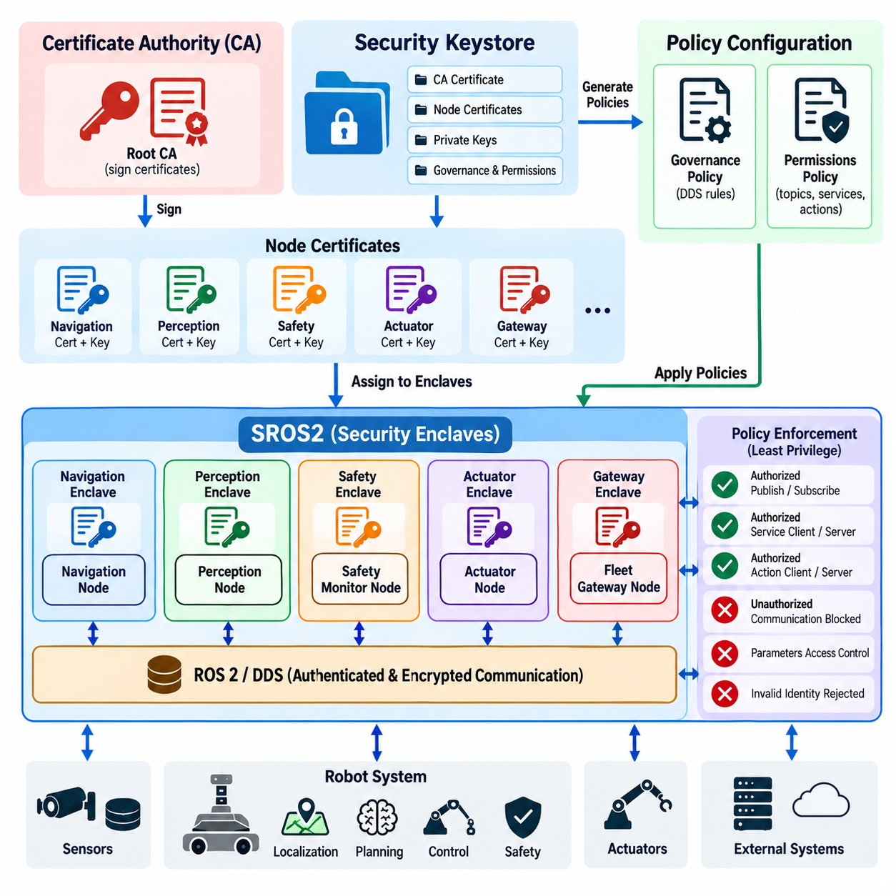{width="7.268055555555556in" height="7.268055555555556in"}

SROS2 provides the security tooling used to configure ROS 2 communication on top of the security capabilities available through DDS. Its purpose is to associate ROS 2 nodes with cryptographic identities and explicit communication permissions rather than allowing every discovered participant to communicate freely. Certificate setup and policy configuration therefore convert the logical ROS 2 graph into an enforceable security architecture based on authenticated identities and authorized interactions.

A secure deployment normally begins with a dedicated security keystore that contains the trust material required by the ROS 2 system. The keystore establishes the administrative foundation from which individual node identities can be created and managed. It should be treated as security-critical infrastructure because compromise of its signing material could allow an attacker to create apparently legitimate identities and undermine trust throughout the protected ROS 2 environment.

The root of trust is represented through certificate authority material used to establish confidence in participant identities and security artifacts. Node certificates should be generated through a controlled process rather than copied informally between systems. Private keys require stronger protection than public certificates because possession of a node\'s private key may enable impersonation. File permissions, secure storage, deployment controls, backup procedures, and access auditing should therefore be incorporated into certificate lifecycle management.

Each protected ROS 2 node should receive an identity that corresponds clearly to its intended software role and deployment context. A navigation node, perception node, safety monitor, actuator interface, and fleet gateway should not share a generic identity merely for operational convenience. Distinct identities make authorization more precise, simplify auditing, and allow credentials belonging to one compromised component to be revoked or replaced without unnecessarily affecting unrelated components.

SROS2 security enclaves provide a practical mechanism for organizing security artifacts around ROS 2 participants. An enclave associates runtime processes with the certificates, keys, governance information, and permission rules required for secure DDS participation. Designing enclave boundaries requires architectural judgment because overly broad grouping weakens isolation, while excessive fragmentation can make credential administration difficult. Boundaries should generally follow meaningful software roles and trust relationships.

Authentication establishes whether a participant possesses a trusted identity, but it does not determine which ROS 2 resources that participant may use. Policy configuration addresses this second requirement. Security policies should describe legitimate communication relationships for topics, services, and actions so that authenticated participants receive only the privileges required for their functions. This separation between identity and permission is fundamental to implementing least-privilege ROS 2 communication.

A useful policy design process begins with the expected ROS 2 graph. Engineers identify nodes and their required publishers, subscribers, service clients, service servers, action clients, and action servers. These intended relationships are transformed into access-control rules rather than granting unrestricted graph access. The chapter structure specifically places certificate and policy configuration before detailed topic and service access control, node identity, auditing, and key management, reflecting this progression from trust establishment to operational enforcement. Volume_24_Robot_Cybersecurity

Topic permissions deserve careful attention because ROS 2 systems often contain communication channels with very different security consequences. A diagnostic node may legitimately subscribe to system status while having no reason to publish velocity commands. A perception component may publish object detections but should not modify actuator commands. Explicit publish and subscribe permissions prevent a compromised component from automatically converting its legitimate network presence into unrestricted control of the ROS 2 graph.

Services require similar restrictions because invoking a service can produce an immediate state change. Configuration services, lifecycle transitions, resets, calibration functions, map operations, and device-management interfaces may carry privileges substantially greater than ordinary telemetry topics. Policies should therefore distinguish service clients from service servers and grant access according to operational need. Authentication alone must never be interpreted as permission to invoke every discoverable function.

ROS 2 actions also require policy awareness because their communication behavior involves multiple underlying interactions supporting goals, feedback, status, cancellation, and results. Security configuration must account for the communication resources used by these higher-level interfaces rather than considering only obvious application topic names. Failure to represent complete communication dependencies can produce policies that either expose unnecessary resources or unexpectedly prevent legitimate robot functions during deployment.

Policy generation should be followed by deliberate review rather than immediate production deployment. Automatically observed communication can help identify required permissions, but an observed graph may include temporary debugging nodes, development tools, accidental dependencies, or overly permissive behavior. Treating every observed interaction as permanently authorized can encode development-time exposure into production security. Generated policies should therefore be interpreted as candidates that require architectural and security review.

DDS governance and permissions concepts provide the enforcement foundation beneath SROS2. Governance defines broader security behavior for DDS domains and communication, while permissions determine what authenticated participants are allowed to access. Together with identity credentials, these artifacts allow DDS security mechanisms to evaluate whether communication should proceed. Consistency between ROS 2 names, enclave identities, DDS security artifacts, and actual runtime configuration is essential for predictable enforcement.

Certificate deployment must also account for the physical distribution of robot computing resources. Credentials may be installed across embedded computers, industrial PCs, edge AI systems, containers, fleet gateways, and operator workstations. Copying one universal credential to every device simplifies deployment but creates a large compromise domain. Device- or role-specific identities reduce this exposure and support selective revocation, although they require disciplined provisioning and lifecycle automation.

Runtime security configuration should fail safely when expected trust material is missing or invalid. Allowing a production robot to silently revert from protected communication to unsecured operation defeats the purpose of certificate-based security. Deployment procedures should explicitly determine whether security is enabled, whether the expected keystore and enclave are available, whether certificates remain valid, and whether policy artifacts correspond to the software configuration being launched.

Certificate expiration and replacement must be considered during initial setup rather than after deployment. Robots may operate for years, while certificates and cryptographic policies require periodic renewal. A certificate that expires unexpectedly can interrupt communication just as effectively as a network failure. Operational planning should therefore coordinate validity periods, renewal windows, credential distribution, rollback procedures, and maintenance schedules with fleet availability and safety requirements.

Revocation is equally important when a private key, device, or software environment is suspected of compromise. The security architecture should make it possible to remove trust from the affected identity without rebuilding the entire fleet security configuration. This requirement reinforces the value of unique identities and narrowly scoped permissions. Shared credentials make revocation disruptive because disabling one compromised identity may simultaneously disable many otherwise trustworthy robot components.

Private-key handling should minimize opportunities for extraction. Keys stored as ordinary files can potentially be copied by users, malware, or compromised processes with sufficient host privileges. SROS2 configuration should therefore be complemented by operating-system access controls, restricted administrative privileges, encrypted storage where appropriate, secure provisioning, and hardware-backed protection when available. Middleware security cannot compensate for unrestricted access to the cryptographic secrets on which authentication depends.

Testing should verify both permitted and prohibited communication. A successful security test does not merely confirm that authorized nodes still exchange data; it also demonstrates that unauthorized publishers, subscribers, service clients, and other participants are rejected according to policy. Negative testing is essential because configuration mistakes frequently appear as permissions that are broader than intended rather than obvious functional failures.

Operational diagnostics must distinguish security failures from ordinary ROS 2 communication problems. Authentication rejection, permission denial, certificate problems, enclave mismatches, discovery failures, and network faults may initially appear similar to operators because nodes simply fail to communicate. Logging and audit collection should therefore preserve enough security context to identify why access was rejected without exposing private keys or other sensitive credential material.

Development and production environments should maintain separate trust domains whenever practical. Reusing production certificates in development laboratories, simulation systems, developer laptops, or continuous-integration environments expands the locations from which production identities can be stolen. Separate certificate authorities, keystores, enclaves, and policies reduce this exposure while allowing security configurations to be tested before controlled promotion into production environments.

SROS2 certificate and policy management ultimately forms the identity and authorization foundation for secure ROS 2 operation. Properly designed certificates establish who a participant is, while policies constrain what that participant can communicate. Combined with protected keys, carefully defined enclaves, least-privilege permissions, controlled provisioning, validation, renewal, revocation, and auditing, these mechanisms transform ROS 2 from an implicitly cooperative communication environment into a controlled security domain suitable for connected robotic systems.

## 04.03. DDS Security Plugin Authentication and Encrypt [w/Code]

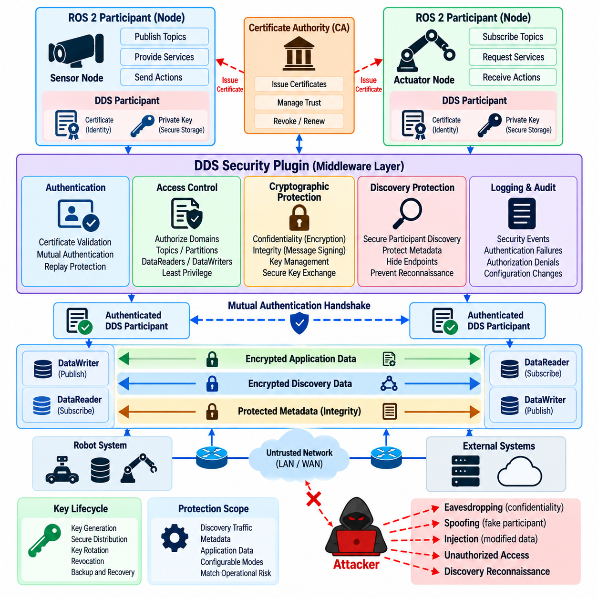{width="7.268055555555556in" height="7.268055555555556in"}

The DDS Security plugin architecture provides the middleware-level mechanisms that protect communication between authenticated DDS participants. In ROS 2 deployments, these mechanisms operate beneath the node and application layers, allowing security controls to be applied directly to discovery and data exchange. Authentication establishes participant identity, while cryptographic protection preserves confidentiality and integrity as information moves across potentially untrusted networks.

DDS Security is commonly structured around interoperable security functions rather than a single monolithic protection mechanism. Authentication, access control, cryptographic protection, logging, and data tagging can be handled as distinct security capabilities. This separation allows middleware implementations to enforce security at appropriate stages of participant discovery and communication while preserving the distributed, data-centric architecture on which ROS 2 communication depends.

Authentication begins when DDS participants attempt to establish trusted communication. Instead of accepting another participant merely because it appears within the same DDS domain, the security layer validates cryptographic identity credentials. Certificates and associated private keys allow participants to demonstrate possession of trusted identities. This changes discovery from an implicitly trusted process into one in which identity can be verified before sensitive communication relationships are established.

Public key infrastructure provides the trust framework supporting certificate-based authentication. A participant presents credentials associated with a trusted certificate authority, while cryptographic verification determines whether those credentials belong to an accepted trust domain. The security of this process depends not only on certificate validation but also on protection of private keys, trustworthy certificate issuance, appropriate validity periods, and controlled replacement or revocation when credentials become compromised.

Mutual authentication is especially important in robotic systems because trust must normally be established in both directions. A controller should verify the identity of a sensor or planning participant, while that participant should also verify the controller with which it communicates. Mutual verification reduces opportunities for rogue middleware participants, impersonated nodes, unauthorized diagnostic tools, or compromised computers to join a DDS environment and interact with legitimate robot components.

The authentication handshake must also resist replay and impersonation attempts. An attacker should not be able to capture a previous authentication exchange and reuse it to establish a fraudulent session. Cryptographic challenges, signed information, session-specific values, and validated identity material help bind an authentication exchange to legitimate participants. Authentication failures should terminate trust establishment rather than silently permitting communication through an unsecured fallback path.

Once identities have been authenticated, access-control mechanisms determine whether communication between those identities is permitted. Authentication answers who the participant is, whereas authorization determines which domains, topics, partitions, or communication operations it may use. This distinction is critical because a valid certificate should not provide unrestricted middleware access. A compromised but authenticated participant must remain constrained by permissions associated with its intended operational role.

Cryptographic protection provides confidentiality and integrity for DDS communication after trust relationships have been established. Encryption prevents unauthorized observers from reading protected data, while integrity mechanisms allow receivers to detect unauthorized modification. These protections are particularly important for robot traffic carrying actuator commands, localization information, maps, sensor observations, mission instructions, safety states, AI outputs, and other information capable of influencing autonomous physical behavior.

DDS security can protect communication at different scopes depending on middleware configuration and operational requirements. Protection may apply to discovery-related exchanges, metadata, or application data carried between DataWriters and DataReaders. Selecting appropriate protection requires understanding which information is sensitive and which communication paths cross untrusted boundaries. Encrypting application payloads while leaving sensitive discovery information unnecessarily exposed may still reveal valuable architectural intelligence to an attacker.

Discovery protection deserves special attention because DDS relies on distributed discovery to identify participants and endpoints. Unprotected discovery traffic may reveal participant existence, endpoint relationships, topic information, and communication patterns even when application payloads are encrypted. Protecting discovery therefore reduces reconnaissance opportunities and makes it more difficult for unauthorized systems to map the structure of the robot\'s middleware environment before attempting a targeted attack.

Encryption introduces key-management requirements beyond participant identity certificates. Secure communication depends on cryptographic material being generated, distributed, derived, used, and replaced without exposing secret values. Long-lived static keys increase the consequences of compromise, while poorly coordinated key changes can interrupt robot communication. Key lifecycle design must therefore balance cryptographic security with the availability and timing requirements of distributed robotic applications.

The protection mode selected for DDS traffic should reflect the consequences of disclosure and manipulation. Some telemetry may require integrity protection without strong confidentiality, while mission data, proprietary sensor information, or remotely issued commands may justify encryption as well. Applying identical protection to every traffic class can unnecessarily consume computing and network resources, so security architecture should classify communication according to risk rather than treating all DDS traffic uniformly.

Performance is a significant consideration because authentication and encryption consume CPU time, memory, bandwidth, and sometimes additional communication exchanges. High-rate cameras, LiDAR streams, joint states, control commands, and AI pipelines may generate substantial DDS traffic. Security evaluation should measure throughput, latency, jitter, discovery time, and processor utilization under realistic workloads to ensure that cryptographic protection does not violate real-time or safety-related timing requirements.

Hardware acceleration can reduce the cost of cryptographic operations when supported by the target computing platform. Nevertheless, performance optimization must not weaken security by disabling authentication or encryption on critical channels merely to meet timing objectives. A better approach is to classify data, isolate critical communication paths, select suitable algorithms and protection scopes, and validate the complete system under representative computational and network loads.

Configuration consistency is another major operational requirement. Participants must agree on compatible security expectations, trust anchors, certificates, permissions, and cryptographic behavior. A certificate signed by an unexpected authority, an incorrect security domain, mismatched permissions, or inconsistent protection requirements may prevent discovery or data exchange. Such failures can resemble ordinary middleware or network problems, making security-aware diagnostics essential during integration and field operation.

Security logging should record significant authentication and cryptographic events without exposing secret material. Failed identity verification, rejected participants, permission violations, invalid certificates, unexpected security configurations, and repeated handshake failures can provide early evidence of attack or configuration drift. These events should be correlated with ROS 2, host, network, and fleet monitoring data so that operators can distinguish malicious activity from certificate expiration, deployment errors, or software defects.

Fail-secure behavior is particularly important for production robots. If required authentication or cryptographic configuration cannot be loaded, a security-sensitive participant should not automatically continue through unprotected DDS communication. Such fallback behavior can transform a configuration mistake into a security bypass. Deployment validation should confirm that protected participants reject insecure peers and that failures lead to defined degraded, isolated, or safe operating states.

Testing must include adversarial cases rather than confirming only successful encrypted communication. Engineers should verify rejection of untrusted certificates, invalid signatures, expired credentials, unauthorized participants, altered protected traffic, incompatible permissions, and attempts to communicate without required protection. Tests should also evaluate recovery after credential renewal or communication interruption, ensuring that security controls remain effective throughout normal maintenance and abnormal conditions.

DDS Security must ultimately be integrated with the broader ROS 2 security architecture rather than treated as an isolated encryption feature. The chapter structure places DDS authentication and encryption after SROS2 certificate and policy configuration and before topic/service access control, node identity, audit logging, key rotation, vulnerability remediation, penetration testing, and compliance mapping. This reflects a layered progression from identity establishment toward complete lifecycle security. Volume_24_Robot_Cybersecurity

When properly configured, DDS Security creates a protected middleware trust fabric for distributed robotic software. Authentication determines which participants can establish trusted relationships, authorization restricts what those participants may access, and cryptographic protection safeguards communication against observation and manipulation. Combined with disciplined certificate management, secure key handling, monitoring, testing, and fail-secure deployment, these controls substantially reduce the middleware attack surface of connected ROS 2 robots.

## 04.04. ROS2 Topic Service Access Control Policy [w/Code]

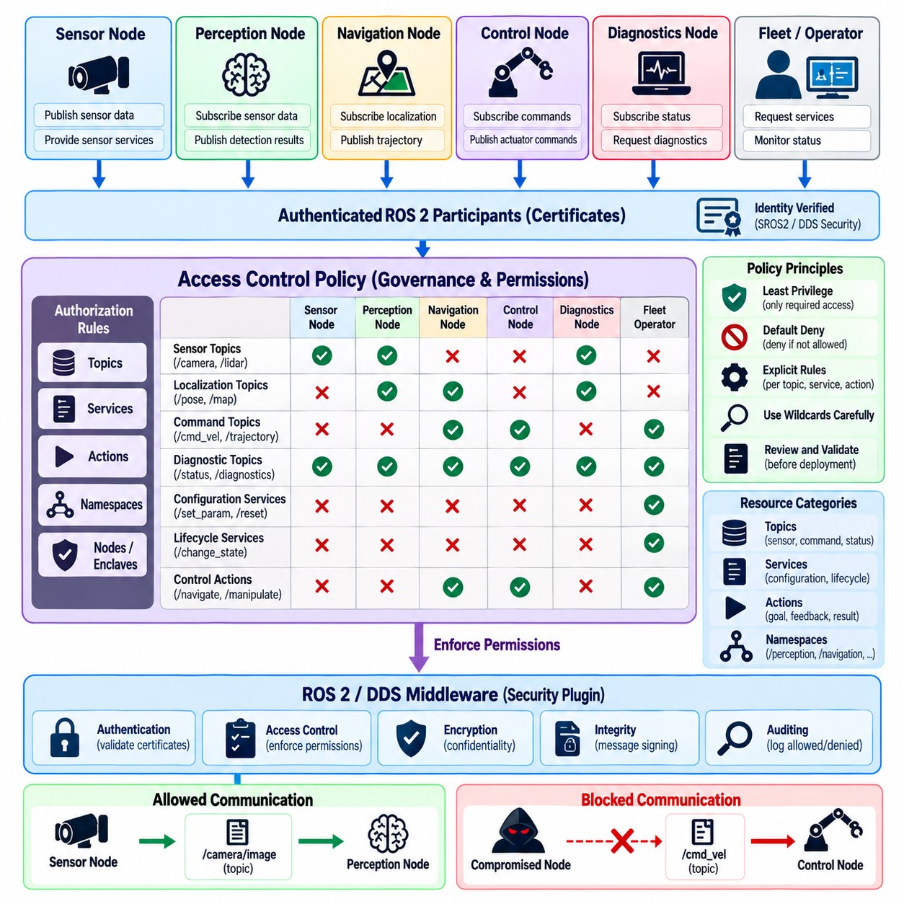{width="7.268055555555556in" height="7.268055555555556in"}

Access control in ROS 2 defines which authenticated participants are permitted to publish, subscribe, request, or provide specific communication resources. Authentication alone confirms identity but does not establish operational authority. A secure robot therefore requires explicit authorization policies that restrict each node to the topics, services, and actions necessary for its assigned function, reducing the consequences of compromised or misconfigured software.

Topic access control should distinguish publishing rights from subscription rights because the security consequences are fundamentally different. A localization node may publish pose estimates while consuming sensor observations, whereas a motor-control node may subscribe to velocity commands without permission to generate localization data. Separating these privileges prevents authenticated participants from using legitimate network membership to perform communication operations outside their intended responsibilities.

The principle of least privilege should guide policy construction. Each node receives only the permissions required to perform its defined task, and unnecessary communication paths remain denied. Broad wildcard permissions can simplify early development but significantly increase the attack surface in production. If a node is compromised, narrowly scoped permissions limit lateral movement by preventing the attacker from immediately publishing to or subscribing from unrelated ROS 2 resources.

Command topics require particularly strict controls because unauthorized publication can directly influence physical behavior. Velocity, trajectory, actuator, docking, manipulation, flight-control, and emergency-state messages may cause immediate changes in robot motion. Policies should limit publication of such information to specifically authorized control components while allowing only justified subscribers. Safety-critical communication should be separated from diagnostic, visualization, and general application traffic whenever practical.

Sensor topics present a different security profile. Camera images, LiDAR point clouds, radar observations, joint states, localization information, and environmental maps may need to be consumed by several perception and planning components. However, unrestricted subscription can expose operationally sensitive information, while unauthorized publication can inject fabricated observations. Policies should therefore address both confidentiality of sensor streams and integrity of the data used for autonomous decision making.

Service access control is essential because services commonly trigger discrete operations rather than continuously distributing state. A service request may reset hardware, change configuration, load a map, clear internal state, activate a component, or initiate calibration. An authenticated node should not automatically be allowed to invoke every visible service. Client and server permissions should instead reflect the exact operational relationships defined by the robot architecture.

Lifecycle-related services deserve additional protection because they can change whether important ROS 2 components are configured, active, inactive, or shut down. Unauthorized lifecycle transitions may disable perception, navigation, safety monitoring, or control functions without modifying ordinary application data. Access policies should therefore restrict lifecycle management to trusted orchestration or supervisory components and prevent unrelated nodes from manipulating critical component states.

Actions introduce a more complex authorization problem because ROS 2 actions use several underlying communication interactions to exchange goals, feedback, status, cancellation requests, and results. A policy must represent the complete communication behavior required by an authorized action client and server. Incomplete rules can break legitimate execution, while overly broad rules can expose cancellation or goal interfaces to participants that should only observe operational status.

Namespace design can support scalable access-control policy. Robot systems frequently organize resources according to subsystem, robot identifier, application, or operational role. Well-structured namespaces make it easier to express permissions for navigation, perception, manipulation, diagnostics, safety, or fleet functions. Poor naming conventions can force policies to depend on broad patterns, increasing the possibility that newly introduced resources unintentionally inherit excessive privileges.

Policy design should begin from an explicitly documented communication model rather than from unrestricted runtime discovery alone. Engineers should identify expected publishers, subscribers, service clients, service servers, action clients, and action servers for every protected component. The resulting graph can then be converted into authorization relationships. Observed runtime traffic remains useful for validation, but it should not automatically define what production software is permitted to access.

Default-deny behavior provides a strong foundation for production authorization. Communication should be permitted when a policy explicitly grants the required operation and rejected when no corresponding authorization exists. This approach differs from permissive configurations in which unknown communication is implicitly accepted. Default deny reduces accidental exposure when new nodes, topics, or services appear and forces architectural changes to pass through an intentional security review.

Wildcard rules should be used cautiously. Patterns can simplify management for large fleets or families of similarly named resources, but they may also grant access to future topics or services that did not exist when the policy was reviewed. A wildcard intended for diagnostic information, for example, could unintentionally include a later-added administrative interface. Policy reviews should therefore evaluate both currently matched resources and plausible future namespace expansion.

Different trust levels should be reflected in authorization boundaries. Safety controllers, autonomous planners, AI inference nodes, operator interfaces, fleet gateways, maintenance tools, and development utilities do not require identical privileges. Separating these roles limits the ability of a compromised lower-trust component to influence higher-criticality functions. This is particularly important when experimental AI software and deterministic safety or motion-control software operate within the same ROS 2 environment.

Multi-robot deployments require additional isolation. Nodes belonging to one robot should not automatically gain access to another robot\'s internal topics or control services merely because both systems share network infrastructure or a DDS environment. Robot-specific namespaces, identities, enclaves, and permissions can establish logical separation. Fleet-level components should receive cross-robot access only for the functions required for coordination, monitoring, mission assignment, or maintenance.

Access control must remain consistent with DDS Security permissions because ROS 2 communication is ultimately represented through middleware entities and resources. Application-level intentions need to map correctly to the DDS authorization model used by the selected ROS 2 middleware implementation. Differences between logical ROS 2 names and underlying communication resources must be considered during policy generation and testing to prevent either unintended denial or excessive authorization.

Policy changes should follow controlled configuration-management procedures. Adding a sensor, replacing a planner, introducing a new service, or changing namespaces may require authorization updates. Informal modifications can create configuration drift between software and security policy. Version-controlled policy artifacts, review workflows, automated validation, and deployment traceability allow teams to determine which permissions were active for a particular robot software release.

Testing should verify both positive and negative authorization behavior. Authorized publishers and subscribers must communicate successfully, while unauthorized attempts should be rejected. The same principle applies to service and action interfaces. Negative tests are especially valuable because an excessively permissive rule may not produce a visible functional failure. Security validation must deliberately attempt prohibited operations to demonstrate that policy boundaries are actually enforced.

Authorization failures should generate useful audit information. Repeated attempts to publish to restricted command topics, subscribe to protected sensor streams, invoke privileged services, or manipulate actions may indicate software defects, policy drift, or malicious activity. Audit records should identify the relevant participant and denied operation without exposing sensitive cryptographic material, allowing security monitoring systems to correlate middleware events with host and network telemetry.

Emergency and degraded-operation scenarios require deliberate policy design rather than unrestricted bypass mechanisms. Recovery controllers or safety supervisors may need exceptional permissions during faults, but those privileges should be assigned to predefined trusted identities. Creating a general security bypass for emergencies can become a persistent attack path. Exceptional authorization should remain narrow, auditable, testable, and compatible with the robot\'s defined safe-state behavior.

The chapter structure places topic and service access control after SROS2 certificate configuration and DDS authentication and encryption, followed by node identity, audit logging, key management, vulnerability remediation, penetration testing, and compliance mapping. This sequence reflects the dependency between trusted identity, protected communication, fine-grained authorization, and lifecycle security within the ROS 2 security architecture. Volume_24_Robot_Cybersecurity

Effective ROS 2 access-control policy transforms middleware connectivity into explicitly governed communication. Nodes are permitted to exchange only the information and commands required by their roles, while unauthorized interactions are rejected even when participants can reach the same network. Combined with strong identity, DDS cryptographic protection, auditing, configuration management, and continuous testing, least-privilege authorization limits compromise propagation and protects cyber-physical robot behavior.

## 04.05. ROS2 Node Identity and Mutual Auth mTLS [w/Code]

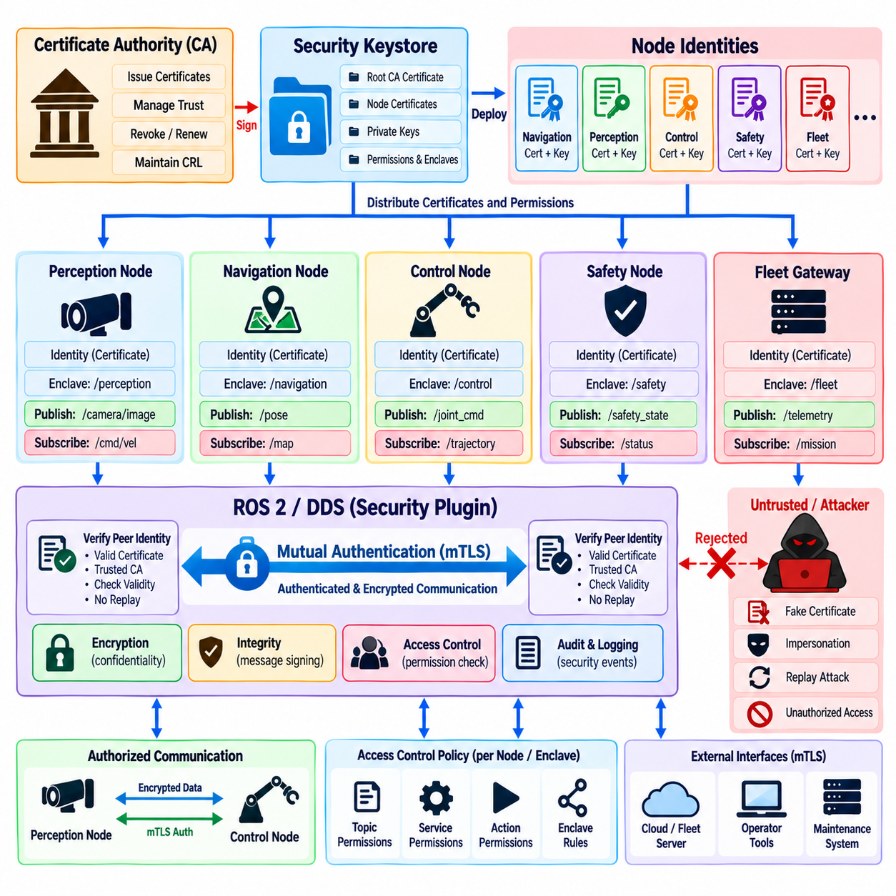{width="7.268055555555556in" height="7.268055555555556in"}

Node identity is a fundamental security property in ROS 2 because distributed components must know which participants can be trusted before exchanging operational data or commands. A node name alone is not a secure identity because names can be reproduced by unauthorized software. Secure identity therefore requires cryptographic credentials that bind a participant to an independently verifiable trust relationship rather than relying only on logical ROS 2 naming.

ROS 2 security builds this identity model on the capabilities provided by DDS Security and SROS2. Certificates, private keys, trust anchors, enclaves, and permission artifacts collectively establish the security context in which a participant operates. The chapter structure places node identity after certificate configuration, DDS authentication and encryption, and topic/service access control, reflecting the relationship between identity establishment and authorization enforcement. Volume_24_Robot_Cybersecurity

A cryptographic node identity should correspond to a meaningful software or operational role. Navigation, perception, manipulation, safety supervision, hardware control, fleet communication, and maintenance components should not automatically share one generic credential. Distinct identities allow security policies to associate permissions with specific responsibilities and make it possible to isolate, revoke, or investigate one participant without treating the entire robot as a single security principal.

Public key infrastructure provides a practical foundation for establishing these identities. A trusted certificate authority issues or signs certificates representing approved participants, while each participant retains the corresponding private key. During authentication, possession of the private key demonstrates that the participant controls the credential associated with its certificate. Trust in the certificate authority then allows other participants to evaluate whether that identity belongs to an accepted security domain.

Identity verification must include more than checking whether a certificate exists. The certificate chain, issuing authority, validity period, expected identity information, cryptographic signature, and relevant security configuration must be validated before trust is established. Expired, malformed, untrusted, or otherwise invalid credentials should cause authentication to fail. A secure deployment must avoid fallback behavior that silently permits unsecured communication when identity verification cannot be completed.

Mutual authentication extends this principle by requiring both communication participants to authenticate each other. In a one-sided trust model, one endpoint may prove its identity while accepting the other without equivalent verification. Mutual authentication prevents this imbalance. A control component verifies the identity of the participant supplying information, while the supplying participant verifies that it is communicating with an authorized and trusted consumer or controller.

The term mutual TLS, or mTLS, describes the broader security pattern in which both sides of a connection present and validate cryptographic identities. ROS 2 communication over DDS does not simply become conventional application-level TLS between every pair of nodes; DDS Security provides its own participant authentication and cryptographic mechanisms. Nevertheless, the mTLS concept is useful for expressing the requirement that trust should be bidirectional rather than based on unilateral endpoint authentication.

This distinction is important when designing heterogeneous robot architectures. ROS 2 and DDS traffic may coexist with HTTPS, gRPC, cloud APIs, fleet gateways, telemetry services, or management interfaces that actually use TLS or mTLS. The same identity architecture can apply consistent trust principles across these boundaries while allowing each protocol to use its appropriate security mechanism. Identity should therefore be designed at the system level rather than independently for each communication technology.

Mutual authentication reduces the risk of participant impersonation. Without cryptographic verification, malicious software could adopt the name of a trusted planner, sensor interface, diagnostic node, or controller and attempt to participate in normal communication. A trusted name is insufficient because software-controlled identifiers can be copied. Authentication binds trust to possession of protected cryptographic material, making simple name duplication inadequate for establishing a legitimate security identity.

Authentication also supports stronger authorization because access-control decisions require a trustworthy principal. A policy that states which node may publish a command topic has little security value if an attacker can freely claim that node\'s identity. Once cryptographic authentication establishes the participant, permissions can reliably determine which topics, services, actions, domains, or other middleware resources that participant is authorized to use.

Identity granularity should match the required containment boundary. Assigning one credential to an entire robot may simplify provisioning, but compromise of that credential can expose every privilege associated with the machine. More granular identities for critical components can reduce this blast radius. However, excessive fragmentation increases certificate, key, and policy management complexity, so identity boundaries should reflect meaningful differences in privilege, criticality, and trust.

Containers and multi-process systems require particular attention because logical ROS 2 nodes may share the same host or execution environment. Host-level trust should not automatically imply that every process deserves identical middleware privileges. Enclaves and appropriately scoped credentials can separate security responsibilities even when components execute on the same computer. This becomes important when safety-critical software operates beside AI, visualization, development, or third-party components.

Private-key protection determines the practical strength of cryptographic identity. If malware or an unauthorized administrator can copy a participant\'s private key, the attacker may impersonate that participant even though the authentication protocol itself remains cryptographically sound. File permissions, restricted privilege, encrypted storage, secure provisioning, hardware-backed key storage, and controlled backup procedures should therefore be considered part of node identity protection.

Identity provisioning must be controlled from development through production. Credentials should not be manually copied between robots without traceability, nor should development identities be reused across production fleets for convenience. Provisioning processes should establish which device or software component received each identity, when it was issued, which trust domain signed it, and which permissions were associated with it. Automation can reduce human error when fleet scale increases.

Certificate validity periods introduce an operational dependency between security and availability. Shorter validity periods reduce the useful lifetime of stolen credentials but require reliable renewal mechanisms. Longer periods reduce maintenance frequency but increase exposure if credentials are compromised. Renewal should occur before expiration and should be tested under realistic robot operating conditions so that identity maintenance does not unexpectedly interrupt discovery, control, or fleet connectivity.

Revocation and credential replacement are necessary when a robot is lost, a computer is replaced, a private key is exposed, or a software environment becomes untrusted. Unique identities make targeted response possible because administrators can remove trust from one participant without invalidating unrelated systems. Shared credentials make incident containment significantly more disruptive and can force large portions of a fleet to undergo simultaneous credential replacement.

Multi-robot systems should prevent identity collisions and unintended cross-robot trust. A participant belonging to one robot should not gain access to another robot merely because both use similar node names or software packages. Robot-specific identities, namespaces, enclaves, and authorization rules can maintain separation, while fleet services can be granted explicitly defined cross-robot privileges for monitoring, mission coordination, maintenance, or orchestration.

Authentication events should be observable through security logging. Repeated failed handshakes, unknown certificate authorities, expired credentials, identity mismatches, unexpected participants, and unusual authentication attempts may indicate configuration problems or active reconnaissance. Logs should preserve enough information for investigation while avoiding exposure of private keys, session secrets, or unnecessary sensitive certificate data.

Testing should verify successful mutual authentication as well as deliberate failure cases. Trusted participants should establish protected communication, while participants using untrusted, expired, altered, or incorrectly assigned credentials should be rejected. Tests should also examine certificate renewal, participant restart, network interruption, credential replacement, and recovery so that authentication remains reliable throughout the operational lifecycle rather than only during initial deployment.

Node identity ultimately provides the trusted principal on which the rest of ROS 2 authorization depends. Certificates and protected private keys establish cryptographic identity, mutual authentication verifies trust in both directions, and access policies convert that identity into controlled communication privileges. Combined with secure provisioning, renewal, revocation, logging, and negative testing, this approach limits impersonation and creates stronger trust boundaries for distributed cyber-physical robot software.

## 04.06. ROS2 Audit Log Collection and Analysis [w/Code]

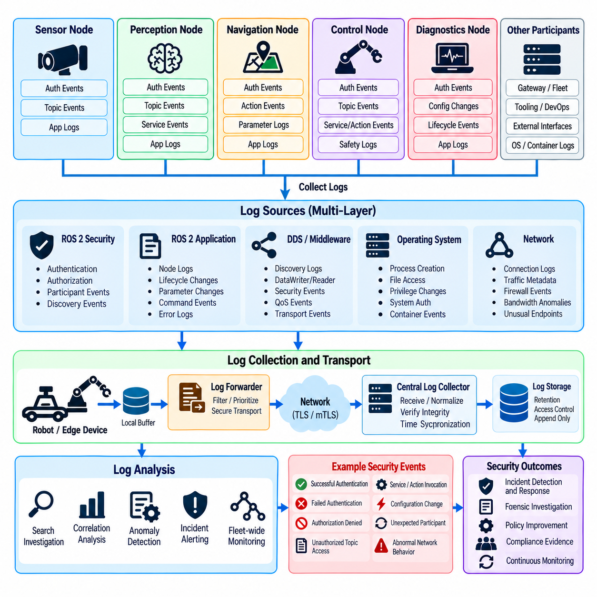{width="7.268055555555556in" height="7.268055555555556in"}

Audit logging provides the evidence needed to understand security-relevant activity across a distributed ROS 2 system. Authentication, authorization, DDS communication, node execution, operating-system events, and network behavior can each reveal different parts of an incident. A useful audit architecture therefore collects events from multiple layers and preserves enough context to reconstruct who performed an operation, what resource was affected, when it occurred, and whether it succeeded.

ROS 2 audit collection should begin with events associated with participant identity and authentication. Successful and failed authentication attempts, rejected certificates, unknown trust anchors, expired credentials, enclave mismatches, and unexpected participants can indicate configuration problems or hostile activity. Recording these events allows operators to distinguish normal discovery failures from attempts by unauthorized software to enter the protected DDS communication environment.

Authorization events provide another critical source of evidence. Attempts to publish to restricted topics, subscribe to protected data, invoke privileged services, or interact with unauthorized actions should be recorded when the middleware exposes the necessary information. Repeated denials can reveal compromised nodes, incorrectly deployed policies, or reconnaissance activity in which an attacker probes the ROS 2 graph to identify accessible communication resources.

Audit records should preserve participant identity rather than relying only on node names or IP addresses. Node names can be duplicated, while network addresses may change because of DHCP, containers, mobile robots, or dynamic infrastructure. Where possible, events should be correlated with cryptographic identity, security enclave, host identity, process information, robot identifier, and relevant ROS 2 resource names to create a stronger attribution chain for later investigation.

Time synchronization is essential because distributed robotic systems generate events across many processors and network devices. Without consistent timestamps, investigators may be unable to determine whether an authentication failure preceded a command anomaly or whether a network event occurred before a node restarted. Hosts, edge computers, gateways, and monitoring infrastructure should therefore maintain sufficiently accurate time synchronization and preserve timestamp provenance when logs are aggregated.

Application logs remain important even when middleware security logging is enabled. A ROS 2 node may authenticate correctly and possess legitimate permissions while still behaving abnormally because of compromise, software defects, or malicious input. Logs describing lifecycle transitions, configuration changes, command acceptance, safety-state changes, unexpected restarts, and application errors can reveal misuse that authentication and access-control records alone cannot identify.

DDS and middleware events should be correlated with host-level telemetry. Process creation, service startup, privilege changes, file access, certificate modifications, container events, system authentication, and resource exhaustion may explain why ROS 2 behavior changed. A participant that suddenly begins producing unauthorized requests, for example, may correspond to a newly launched process or altered executable on the host rather than an external DDS participant.

Network monitoring adds another layer of visibility. Connection patterns, multicast behavior, discovery traffic, bandwidth anomalies, packet loss, interface changes, firewall events, and communication with unexpected addresses can provide context for ROS 2 incidents. Encrypted DDS traffic limits payload inspection by design, so metadata and endpoint behavior become increasingly important for detecting scanning, denial-of-service activity, abnormal discovery, or unexpected communication paths.

Centralized log collection is valuable in robot fleets because local logs may be unavailable after a device failure, compromise, theft, or storage corruption. Robots can forward selected security events to an edge collector, fleet server, or security information and event management platform. Centralization also allows events from multiple robots to be compared, making coordinated attacks or repeated authentication failures across the fleet easier to identify than through isolated device inspection.

Collection architecture must account for intermittent connectivity. Mobile robots, outdoor systems, and remote platforms may temporarily lose access to central infrastructure. Local buffering can preserve important events until connectivity returns, but storage capacity and retention limits must be controlled. Priority should be given to security-critical records so that high-volume diagnostic or sensor logging does not overwrite authentication, authorization, configuration, or incident evidence.

Log integrity is as important as log availability. An attacker who compromises a robot may attempt to delete or modify records that reveal the intrusion. Append-oriented storage, cryptographic integrity checks, restricted write permissions, remote forwarding, and protected retention can make evidence manipulation more difficult. Audit systems should also detect unexplained logging gaps because sudden silence from an active robot can itself represent a security-relevant event.

Sensitive information must not be exposed through audit collection. Private keys, passwords, session secrets, complete authentication tokens, or unnecessary confidential payloads should never be written to ordinary logs. Certificates and identifiers may also require careful handling depending on operational policy. Logging should capture enough information for attribution and analysis while applying minimization principles so that the monitoring system does not become a new repository of high-value secrets.

Event normalization improves analysis when different ROS 2 middleware implementations, operating systems, containers, and security components produce incompatible log formats. Common fields such as timestamp, robot identifier, host, participant identity, node, enclave, event category, affected resource, result, severity, and correlation identifier allow centralized tools to process heterogeneous records. Normalization also simplifies searches across fleets and supports reusable detection rules.

Correlation converts individual records into security information. One denied topic publication may result from a configuration mistake, while hundreds of denied publications followed by a lifecycle transition and abnormal network traffic may indicate compromise. Analysis should combine authentication failures, authorization denials, node restarts, certificate changes, network anomalies, and safety events within meaningful time windows to identify patterns that would remain invisible in isolated logs.

Baseline behavior can support anomaly detection because production robots often exhibit relatively predictable communication relationships. Operators can characterize normal participants, topic interactions, service usage, authentication frequency, restart patterns, and network destinations. Deviations from this baseline do not automatically prove an attack, but they can prioritize investigation when a new participant appears, a node begins accessing unusual resources, or communication volume changes unexpectedly.

Alerting should reflect operational and physical consequences rather than treating every security event equally. A failed attempt to publish an actuator command is generally more significant than an isolated denial involving a low-risk diagnostic topic. Detection logic should consider resource criticality, participant identity, repetition rate, robot operating state, and correlated events. This reduces alert fatigue while emphasizing behavior capable of affecting safety, mission execution, or fleet availability.

Audit retention requirements should reflect incident-response and compliance needs. Some events may need to remain available long enough to investigate attacks discovered weeks after they occurred, while continuous debugging logs may require much shorter retention. Storage policies should distinguish security audit evidence from ordinary operational telemetry and define retention duration, archival protection, access privileges, deletion procedures, and evidence-preservation requirements.

Access to the audit system itself requires strict control. Logs may reveal robot architecture, software identities, operational schedules, network relationships, and security failures. Only authorized personnel and services should be able to search, export, modify, or delete security records. Administrative actions performed within the logging platform should also be audited so that investigators can determine who accessed evidence or changed monitoring and retention configurations.

Incident response depends on the ability to preserve relevant evidence. When suspicious behavior is detected, selected logs should be protected from normal rotation or deletion and associated with an incident timeline. Authentication records, authorization failures, host events, network observations, configuration history, and software versions can then be analyzed together. Preserving provenance and timestamps supports root-cause analysis and helps distinguish the initial intrusion from subsequent effects.

Audit functionality should be tested just like authentication and access control. Security teams should deliberately generate failed authentication attempts, denied topic access, unauthorized service requests, certificate problems, node restarts, and other representative events, then verify that the expected records reach the collection system. Testing should also examine buffering, forwarding failure, clock errors, storage exhaustion, log rotation, and recovery after temporary network loss.

Within the chapter structure, audit collection follows certificate configuration, DDS authentication and encryption, access-control policy, and node identity, while preceding cryptographic key management, vulnerability remediation, penetration testing, and compliance mapping. This position reflects its role as the observability layer that verifies and records the behavior of previously established ROS 2 security controls. Volume_24_Robot_Cybersecurity

Effective ROS 2 audit analysis transforms distributed security events into evidence about the cyber-physical system as a whole. By correlating identity, authorization, middleware, host, network, and application information, operators can detect abnormal behavior, investigate incidents, validate policy enforcement, and support recovery. Protected timestamps, centralized collection, integrity controls, appropriate retention, and tested detection logic make logging an active security capability rather than a passive debugging mechanism.

## 04.07. ROS2 Cryptographic Key Management Rotation [w/Code]

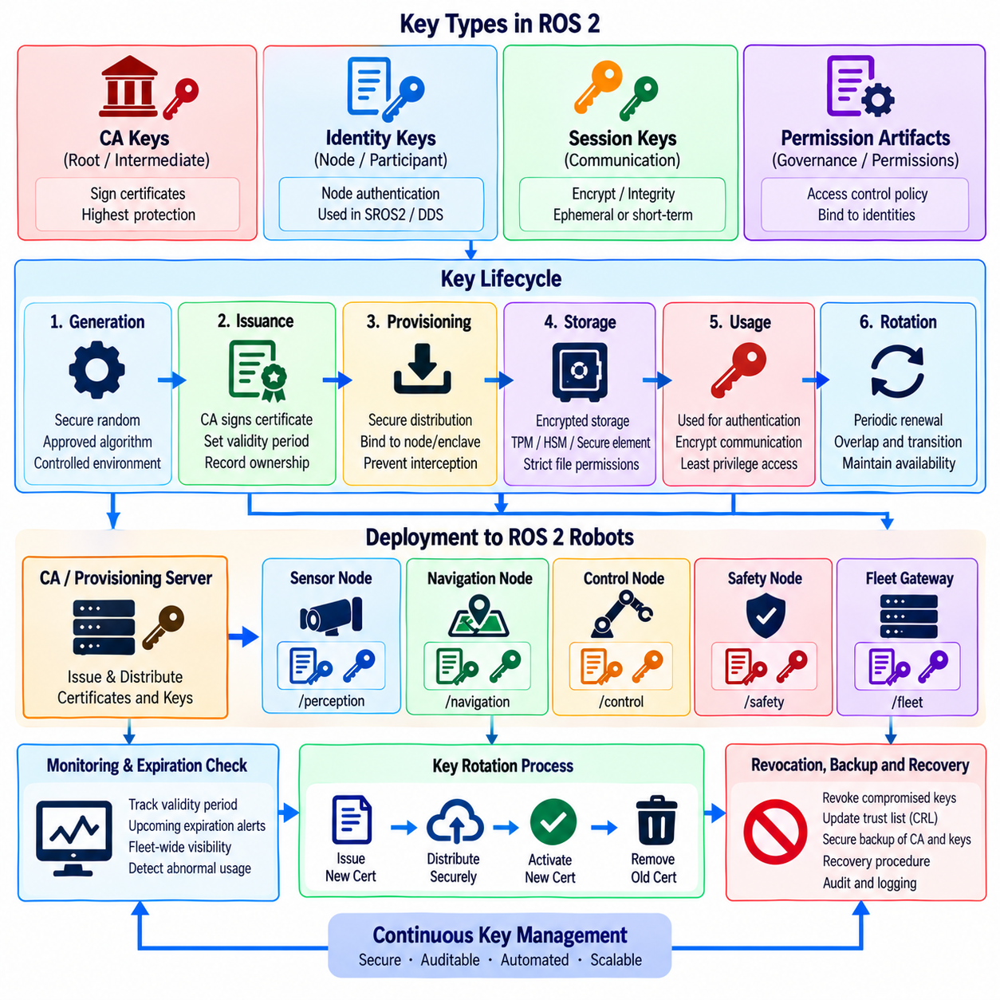{width="7.268055555555556in" height="7.268055555555556in"}

Cryptographic key management is a foundational requirement for secure ROS 2 communication because authentication, integrity protection, and encryption ultimately depend on secret key material remaining trustworthy. Certificates can identify participants, but compromised private keys may allow attackers to impersonate legitimate components. Key management therefore covers generation, provisioning, storage, use, renewal, rotation, revocation, backup, recovery, and secure destruction throughout the robot lifecycle.

A ROS 2 deployment may contain several categories of cryptographic material associated with SROS2 and DDS Security. Identity private keys support participant authentication, certificate authority keys establish trust, and session or communication keys protect data exchanges. These materials have different lifetimes and exposure risks, so they should not be managed as one undifferentiated secret. Each key type requires controls appropriate to its authority, function, and potential impact if compromised.

Key generation should use cryptographically secure mechanisms and approved algorithms with sufficient key strength for the expected operational lifetime. Keys should be generated within controlled environments and should not pass through unnecessary intermediate systems. Predictable randomness, copied development keys, or manually created shared secrets can undermine otherwise strong security mechanisms. Generation procedures should also record ownership and purpose without exposing the private key itself.

Certificate authority keys require particularly strong protection because they represent a root or intermediate source of trust. Compromise of a signing key may allow unauthorized certificates to be created for apparently legitimate ROS 2 participants. Offline storage, restricted administrative access, hardware-backed protection, separation of duties, and carefully controlled signing workflows can reduce this risk. Production and development environments should normally maintain separate trust infrastructures.

Provisioning securely transfers credentials from the trusted issuance environment to the robot, computer, container, or enclave that will use them. This process must prevent interception, substitution, and accidental duplication. Provisioning records should associate each credential with a specific device, software role, security enclave, or participant so that operators can later determine where a key was deployed and which permissions depend on the corresponding identity.

Private keys stored on robot computers require protection against unauthorized extraction. Ordinary file permissions provide a basic layer but may be insufficient when an attacker obtains administrative access. Encrypted storage, trusted platform modules, hardware security modules, secure elements, or platform-specific protected key facilities can strengthen key custody. The appropriate mechanism depends on hardware capability, performance requirements, serviceability, and the consequences of credential compromise.

Key access should follow the principle of least privilege. A process should obtain access only to the key material required for its own identity or communication role. Sharing a single private key across unrelated ROS 2 components increases the compromise domain because one vulnerable process may expose credentials used by many others. Security enclaves and role-specific identities can help align key ownership with meaningful software and trust boundaries.

Rotation limits the period during which a compromised key remains useful and allows cryptographic material to be refreshed before algorithms, certificates, or operational assumptions become obsolete. Rotation should be treated as a normal lifecycle operation rather than an exceptional incident procedure. A fleet that cannot replace credentials without extensive manual intervention may retain vulnerable keys simply because changing them introduces unacceptable operational disruption.

Rotation frequency should reflect risk rather than follow one arbitrary interval for every key. Highly privileged identities, externally exposed gateways, long-lived robots, and credentials stored on physically accessible devices may justify shorter rotation periods. Root signing keys may follow a different lifecycle from participant credentials. Policies should consider key authority, exposure, certificate validity, hardware protection, mission duration, maintenance opportunities, and regulatory requirements.

Credential rotation must preserve availability. Replacing a certificate or private key without coordinating trust configuration can cause participants to reject one another and interrupt DDS discovery or application communication. A controlled transition may require overlapping validity periods, staged distribution of new trust material, verification of new credentials, activation at a defined point, and removal of obsolete material only after the new identity has been confirmed across dependent systems.

Large robot fleets make manual rotation increasingly impractical. Automated credential lifecycle management can identify upcoming expirations, issue replacement credentials, distribute them through authenticated channels, verify installation, activate new material, and report failures. Automation must itself be strongly protected because a compromised provisioning or rotation service could distribute malicious credentials at fleet scale. Administrative actions should therefore be authenticated, authorized, logged, and auditable.

Certificate expiration should be monitored continuously rather than discovered when communication fails. Fleet monitoring can track validity windows and generate warnings sufficiently early for planned renewal. Expiration thresholds should account for robots that may remain offline for extended periods. A robot returning from a long mission should not unexpectedly lose trusted communication because its credentials expired while disconnected from the infrastructure responsible for renewal.

Revocation differs from routine rotation because it removes trust in credentials that should no longer be accepted. Revocation may be necessary after private-key exposure, device theft, suspected compromise, employee or supplier access changes, decommissioning, or erroneous certificate issuance. Response procedures should identify the affected identity, determine its privileges and deployment scope, remove its trust where required, issue replacements when appropriate, and investigate activity performed before revocation.

Shared credentials complicate revocation because the security team may be unable to invalidate one compromised component without affecting many legitimate systems. Unique or narrowly scoped identities therefore improve incident containment. A robot-specific or role-specific credential allows targeted replacement, while a fleet-wide private key can turn one device compromise into a fleet-wide emergency. Credential architecture should consider revocation consequences before deployment begins.

Backup and recovery require careful design because losing keys can make legitimate systems inaccessible, while excessive backups create additional locations from which secrets can be stolen. Not every private key needs to be recoverable; some can be regenerated and associated certificates reissued. When backup is required, copies should be encrypted, access-controlled, inventoried, and protected separately from normal runtime storage. Recovery procedures should be tested before an actual failure occurs.

Secure destruction is the final stage of the key lifecycle. Replaced, revoked, or decommissioned keys should not remain indefinitely in temporary directories, old container images, diagnostic archives, backup folders, or retired storage devices. Destruction procedures should consider the characteristics of the underlying storage technology and should remove obsolete credentials from operational systems after required recovery or evidence-retention obligations have been satisfied.

Key inventory provides the visibility needed to manage this lifecycle. Operators should know which certificates and keys exist, their owners, associated robots or components, issuing authorities, validity periods, privileges, storage locations, and current lifecycle states. Inventory data should never contain exposed private-key values. Instead, identifiers, fingerprints, metadata, and deployment records can support expiration monitoring, incident response, audits, and controlled rotation.

Audit logging should accompany sensitive key-management operations. Certificate issuance, key provisioning, rotation, revocation, trust-store changes, failed updates, and administrative access to credential systems should generate protected records. Correlating these events with ROS 2 authentication failures and fleet behavior can reveal whether a communication disruption is caused by a planned rotation, configuration error, expired credential, or potentially malicious modification.

Rotation procedures should be tested under realistic operating conditions. Tests should include normal renewal, expired credentials, rejected replacements, interrupted distribution, temporarily offline robots, rollback, participant restart, and recovery after partial deployment. The objective is to verify not only cryptographic correctness but also operational continuity. A technically secure rotation mechanism that repeatedly disables robots during maintenance is unlikely to remain effective in production.

Emergency rotation requires a faster path than routine renewal. When a key is suspected of compromise, security teams may need to revoke trust, isolate affected participants, distribute replacement credentials, and restore essential communication under time pressure. Predefined procedures, automated tooling, credential inventories, and tested recovery workflows reduce the temptation to disable authentication or temporarily introduce broad credentials during incident response.

Within the ROS 2 and DDS security structure, cryptographic key management follows certificate configuration, authentication and encryption, access control, node identity, and audit logging, while preceding vulnerability remediation, penetration testing, and compliance mapping. This sequence reflects the need to maintain the cryptographic trust established by earlier controls throughout their operational lifecycle. Volume_24_Robot_Cybersecurity

Effective key management turns cryptographic protection from a deployment-time configuration into a sustainable security capability. Secure generation and storage establish trustworthy credentials, controlled provisioning places them with the correct participants, rotation limits long-term exposure, and revocation contains compromised identities. Combined with inventory, automation, auditing, recovery, and secure destruction, these practices preserve ROS 2 trust relationships throughout the service life of individual robots and entire fleets.

## 04.08. ROS2 Known CVE Remediation and Patch Mgmt

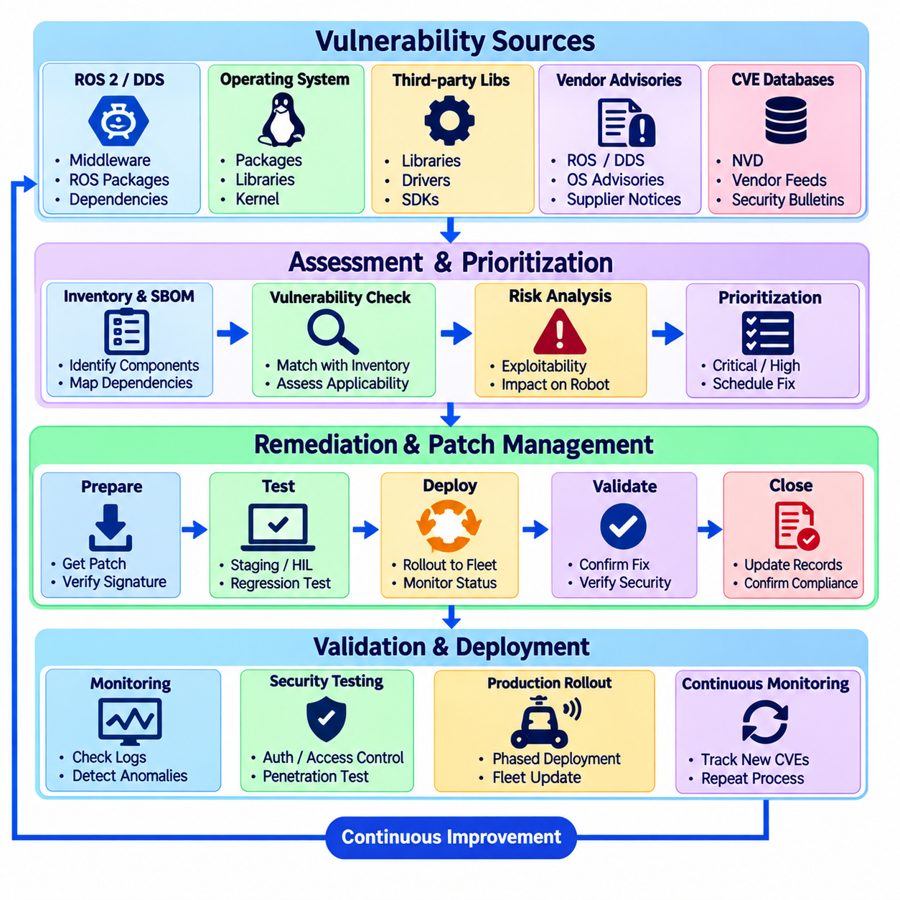{width="7.268055555555556in" height="7.268055555555556in"}

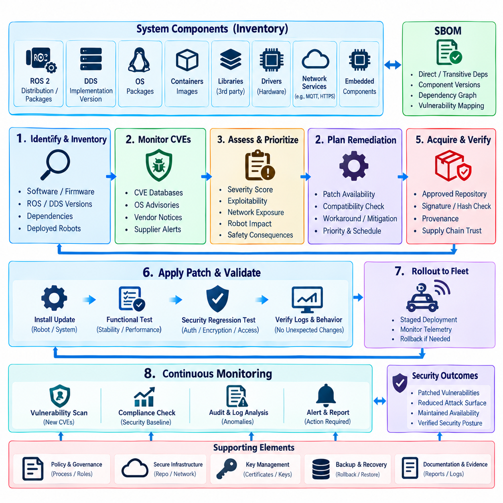{width="7.268055555555556in" height="7.268055555555556in"}

Known vulnerability remediation is essential for ROS 2 security because a protected middleware configuration cannot compensate for exploitable defects in the operating system, ROS packages, DDS implementation, libraries, drivers, or supporting services. Patch management provides the lifecycle process for identifying affected components, evaluating vulnerability relevance, applying corrective updates, validating system behavior, and maintaining evidence that deployed robots remain within an approved security baseline.

A ROS 2 vulnerability-management program should begin with an accurate inventory of software and firmware. Teams need visibility into ROS distributions, middleware vendors and versions, operating-system packages, container images, third-party libraries, device drivers, network services, and embedded components. Without this inventory, a newly disclosed CVE cannot be reliably mapped to affected robots, and vulnerable dependencies may remain hidden inside applications long after patches become available.

Software bills of materials can strengthen this inventory by recording direct and transitive dependencies used to build robot software. ROS 2 applications frequently combine packages from multiple repositories with DDS libraries, cryptographic components, image-processing libraries, AI runtimes, and vendor SDKs. An SBOM allows security teams to search these dependency relationships when a vulnerability is announced instead of relying only on package names visible at the application level.

CVE monitoring should include authoritative vulnerability databases, operating-system security advisories, ROS and middleware vendor notices, package maintainers, and relevant hardware suppliers. The objective is not merely to collect vulnerability identifiers but to determine whether the vulnerable component and affected configuration actually exist in the deployed environment. Automated feeds can improve coverage, but engineering review remains necessary to interpret applicability to a specific robot architecture.

Severity scores provide useful prioritization information but should not determine remediation order by themselves. A moderate vulnerability affecting an externally reachable fleet gateway may create greater operational risk than a high-scoring defect in a disabled local component. Risk evaluation should consider exploitability, network exposure, required privileges, available mitigations, affected robot functions, safety consequences, mission criticality, and whether exploitation is known to occur in realistic environments.

ROS 2 and DDS vulnerabilities require architecture-aware analysis because middleware defects may affect discovery, serialization, authentication, access control, resource handling, or network processing. A vulnerability in a DDS implementation can potentially influence many ROS 2 nodes using that middleware even when the application code itself is unchanged. Security teams should therefore trace shared infrastructure dependencies and avoid evaluating each ROS package as an isolated software component.

Patch prioritization should reflect cyber-physical consequences. Vulnerabilities affecting motion control, safety supervision, remote management, authentication, cryptographic processing, or externally exposed communication paths generally deserve accelerated review. Exploitation that causes a conventional server process to crash is serious, but the same availability failure in a mobile robot may interrupt navigation, disable sensing, halt production, or force the platform into an emergency state.

Immediate patching is not always possible in operational robotics. A vendor fix may be unavailable, a new library may conflict with existing software, or maintenance windows may be limited. Compensating controls can temporarily reduce exposure through network segmentation, firewall rules, service disabling, access-control restrictions, isolation of vulnerable interfaces, or increased monitoring. Such controls should be documented as temporary risk treatments rather than treated as permanent substitutes for remediation.

Patch acquisition must preserve software supply-chain trust. Updates should come from approved repositories or verified suppliers, and package signatures, hashes, provenance, and repository configuration should be validated where supported. Attackers may exploit urgent vulnerability announcements by distributing malicious replacement packages. A remediation process that installs unverified software can therefore create a more severe compromise than the vulnerability it was intended to correct.

Testing is particularly important before patches reach physical robots. Updates can alter middleware behavior, timing, dependencies, discovery, serialization, drivers, resource consumption, or real-time performance. A patch that closes a security vulnerability but destabilizes control communication may introduce unacceptable operational risk. Representative simulation, software-in-the-loop, hardware-in-the-loop, staging, or controlled robot testing should therefore precede broad production deployment.

Security regression testing should accompany functional validation. After an update, teams should confirm that SROS2 identities, DDS authentication, encryption, access-control policies, enclaves, audit logging, and key handling continue to operate as intended. Changes in middleware or dependencies can affect security configuration even when application behavior appears normal. Both authorized communication and deliberate unauthorized attempts should be tested when security-sensitive components are modified.

Fleet deployment should use staged rollout rather than updating every robot simultaneously. A small representative group can receive the patch first, allowing teams to monitor startup behavior, ROS 2 discovery, latency, CPU and memory usage, safety functions, network communication, and application stability. If no unacceptable regression appears, deployment can progressively expand. Staging reduces the probability that one defective update disables an entire operational fleet.

Rollback capability should be prepared before deployment. Robot software may require restoration to a previously validated version if a patch causes instability or incompatibility. Rollback packages, configuration backups, dependency snapshots, and clear decision criteria should be available before installation begins. However, rollback also reintroduces the original vulnerability, so reverting should trigger explicit risk review and compensating controls until a corrected update can be deployed.

Patch management must account for robots that are offline, stored, undergoing repair, or disconnected during a fleet update. A system that misses a critical patch should not silently return to normal service months later with obsolete software. Fleet management should record update status and identify noncompliant devices when they reconnect. Depending on risk, outdated robots may require restricted network access or maintenance before returning to unrestricted operation.

Containers and immutable deployment images can improve reproducibility but do not eliminate patch responsibilities. A vulnerable library embedded in an old container remains vulnerable even if the host operating system is fully updated. Images should be rebuilt from patched dependencies, rescanned, signed, versioned, and redeployed through the normal release process. Obsolete images should be removed from registries and deployment systems when retention requirements permit.

Patch status should be linked to vulnerability records and asset inventory. For each relevant issue, teams should know which robots are affected, whether a fix exists, which mitigation is active, who owns remediation, what validation has been completed, and which deployed version contains the correction. This traceability supports incident response and prevents vulnerabilities from disappearing administratively while remaining technically unresolved in deployed systems.

Exceptions require explicit governance. Some vulnerabilities may remain temporarily unpatched because of certification constraints, unavailable vendor fixes, hardware limitations, or unacceptable operational impact. An exception should document the affected assets, technical rationale, residual risk, compensating controls, responsible owner, review date, and conditions requiring escalation. Open-ended acceptance without reassessment allows temporary exposure to become permanent technical debt.

Audit logs can verify whether remediation activities occurred as planned. Package installation, image replacement, configuration modification, robot reboot, security-policy change, and rollback events should be traceable to authorized maintenance activity. Correlating these records with vulnerability-management data helps distinguish expected changes from unauthorized modification and provides evidence that critical patches were actually deployed rather than merely scheduled.

Post-remediation verification should confirm that the vulnerable component has truly been removed, replaced, disabled, or otherwise mitigated. Version checks alone may be insufficient when multiple copies of a library exist, old containers remain deployable, or dormant packages are still installed. Vulnerability scanning, dependency inspection, configuration validation, and targeted security testing can provide stronger evidence that the original attack path is no longer practically exploitable.

Patch metrics should emphasize risk reduction rather than update volume. Useful measures include time from vulnerability disclosure to triage, time to mitigation, time to validated remediation, percentage of critical assets within the approved baseline, overdue exceptions, and failed deployments. These indicators reveal whether the organization can respond effectively to security defects without encouraging teams to maximize patch counts regardless of operational significance.

Within the chapter structure, known CVE remediation and patch management follows certificate configuration, DDS protection, access control, node identity, audit collection, and cryptographic key management, and precedes ROS 2 penetration testing and compliance mapping. This placement reflects the need to maintain previously established security controls by continuously correcting vulnerabilities in the software stack on which those controls depend.

Effective ROS 2 patch management combines vulnerability intelligence, asset visibility, risk-based prioritization, trusted update acquisition, controlled testing, staged deployment, rollback planning, and verification. The objective is not simply to install the newest packages, but to reduce exploitable exposure while preserving deterministic robot behavior, safety, and availability. A disciplined remediation lifecycle keeps ROS 2 and DDS security effective as vulnerabilities, dependencies, and operational environments evolve.

## 04.09. ROS2 Security Penetration Test Methodology [w/Code]

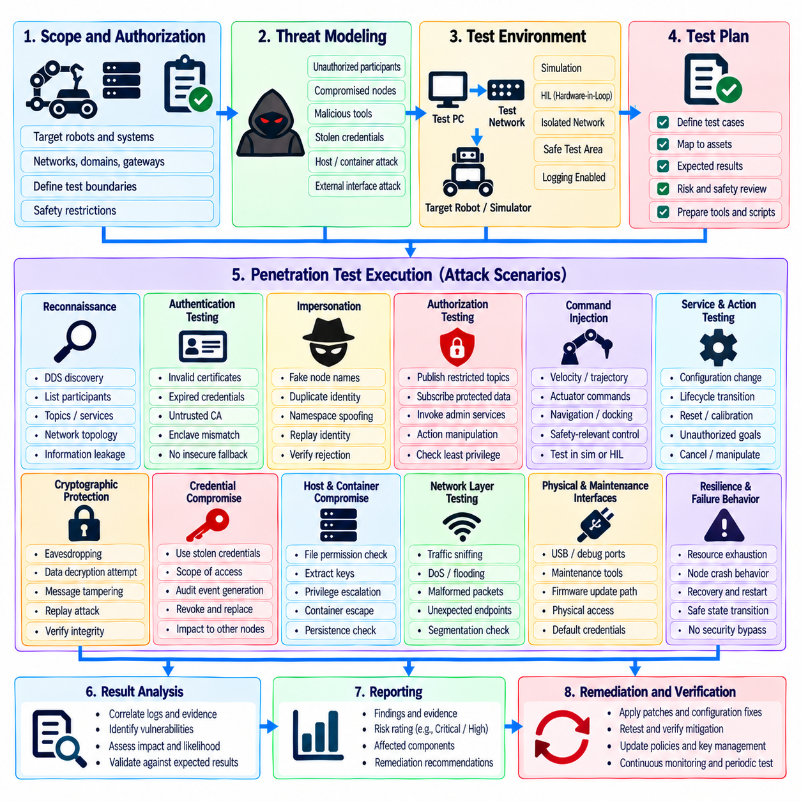{width="7.268055555555556in" height="7.268055555555556in"}

ROS 2 security penetration testing evaluates whether the protections designed around DDS communication, node identity, authorization, cryptographic credentials, and host infrastructure resist realistic adversarial behavior. Unlike ordinary functional testing, penetration testing intentionally attempts to violate security assumptions. Its purpose is to discover exploitable paths, configuration weaknesses, excessive privileges, and unsafe failure behavior before those weaknesses can affect deployed robots.

The methodology should begin by defining the assessment scope and authorization boundaries. Testers need to identify the robots, ROS 2 domains, networks, hosts, containers, middleware implementations, gateways, operator interfaces, and supporting services included in the exercise. Safety restrictions must also be established because aggressive testing against a cyber-physical platform can produce motion, communication loss, resource exhaustion, or unintended transitions into degraded operating states.

Threat modeling provides the basis for selecting meaningful test scenarios. The assessment should consider unauthorized network participants, compromised ROS 2 nodes, malicious maintenance tools, stolen credentials, hostile devices on the local network, compromised containers, and attackers entering through external interfaces. Each adversary model should be connected to assets and trust boundaries so that testing focuses on plausible attack paths rather than arbitrary vulnerability scanning.

Reconnaissance examines what an attacker can learn before attempting exploitation. Testers may evaluate whether ROS 2 or DDS discovery reveals participants, endpoints, topic relationships, service interfaces, namespaces, middleware characteristics, or network topology. Protected environments should minimize information available to unauthorized systems. Discovery behavior should therefore be assessed both without valid credentials and from authenticated participants that possess intentionally restricted permissions.

Participant authentication testing determines whether unauthorized entities can join trusted DDS communication. Test cases should include untrusted certificates, expired credentials, altered identity material, incorrect trust anchors, duplicated node names, and credentials assigned to the wrong enclave or participant. The expected result is rejection without insecure fallback. Successful authentication should also be examined to ensure that identity verification does not unintentionally grant privileges beyond those explicitly authorized.

Impersonation testing evaluates whether an attacker can reproduce the logical identity of a legitimate ROS 2 component. Copying a node name, namespace, topic pattern, or network address should not be sufficient to establish trusted identity. Testers should attempt to imitate planners, sensors, controllers, diagnostic tools, or supervisory components while lacking the legitimate cryptographic credentials, verifying that security decisions remain bound to authenticated identity rather than application-controlled naming.

Authorization testing examines whether authenticated participants can exceed their assigned privileges. A restricted node can attempt to publish to protected command topics, subscribe to confidential sensor streams, invoke administrative services, manipulate lifecycle interfaces, or interact with unauthorized actions. Both explicit names and namespace patterns should be tested because overly broad wildcard permissions can expose resources that were not intended to be accessible to the participant.

Command injection scenarios deserve special attention because ROS 2 often controls physical behavior. Testing should verify that unauthorized participants cannot publish velocity, trajectory, actuator, navigation, manipulation, docking, or other safety-relevant commands. Where testing could cause physical motion, execution should occur in simulation, hardware-in-the-loop environments, controlled test areas, or configurations in which actuators are safely inhibited while the communication path remains representative.

Service and action interfaces should be tested independently from ordinary topic communication. Attackers may attempt to reset components, modify configuration, trigger calibration, change lifecycle states, submit unauthorized goals, or cancel legitimate operations. The assessment should verify both client and server authorization relationships and confirm that hidden or rarely used administrative interfaces do not remain broadly accessible simply because normal robot operation does not invoke them frequently.

Cryptographic protection testing should verify confidentiality and integrity expectations for DDS traffic. Testers can inspect whether protected communication exposes sensitive payloads or discovery information and whether modified traffic is rejected. Attempts to replay previously captured exchanges can help evaluate resistance to reuse of stale authentication or communication material. Testing should focus on verifying security properties rather than attempting to weaken production cryptography through unsafe operational shortcuts.

Credential compromise scenarios evaluate the consequences of obtaining a legitimate participant identity. A stolen certificate and private key may permit authentication, so the remaining authorization boundaries become critical. Testing should determine how much access a compromised identity receives, whether privileges are appropriately scoped, whether abnormal activity generates audit events, and whether the credential can be revoked and replaced without disabling unrelated robots or components.

Host compromise testing examines security below the ROS 2 middleware layer. File permissions, credential storage, container boundaries, process privileges, startup services, configuration files, environment variables, and local administrative interfaces can undermine middleware security if poorly protected. The assessment should determine whether compromise of a lower-trust process provides access to private keys, policy files, privileged sockets, or execution contexts belonging to more critical ROS 2 components.

Network segmentation should be validated through active testing rather than assumed from architecture documentation. Testers should verify whether development systems, diagnostic laptops, fleet services, external networks, and robot control segments can reach only the interfaces they require. Firewall and routing rules should be evaluated for unintended paths. A compromised low-trust network should not automatically provide direct access to safety-critical ROS 2 or DDS communication domains.

Availability testing should evaluate resistance to resource exhaustion while remaining within predefined safety limits. Excessive discovery activity, repeated authentication attempts, connection churn, malformed traffic, or high-rate requests may consume CPU, memory, bandwidth, or middleware resources. The objective is to determine whether the robot maintains essential functions, rejects abusive activity, produces useful alerts, and enters a controlled degraded or safe state when resource pressure exceeds acceptable limits.

Malformed-input testing can expose weaknesses in serialization, deserialization, message handling, middleware parsing, and application validation. Fuzzing may be applied to suitable interfaces in isolated or controlled environments, especially when malformed traffic could crash critical processes. Test planning should account for middleware version, message types, protocol boundaries, and recovery behavior so that discovered failures can be reproduced without unnecessarily endangering physical hardware.

Audit and detection controls should be evaluated during every penetration-testing phase. Failed authentication, denied authorization, suspicious service requests, unexpected participants, credential misuse, and abnormal network behavior should generate appropriate evidence. Testers should determine whether events reach centralized monitoring, contain sufficient attribution information, preserve reliable timestamps, and produce alerts proportional to the operational significance of the attempted activity.

Patch-management effectiveness can also be assessed by comparing the deployed software inventory with known vulnerability status. Testing should verify whether obsolete ROS 2 packages, middleware versions, libraries, container images, operating-system components, or vendor dependencies remain exploitable despite documented remediation. Where a known vulnerability cannot be patched, the assessment should determine whether compensating controls actually prevent or meaningfully restrict the expected attack path.

Multi-robot environments require cross-robot authorization testing. A participant authenticated for one robot should attempt to discover, subscribe to, publish toward, or invoke services belonging to another robot. Fleet-level components should be tested separately because they may legitimately possess broader privileges. The objective is to confirm that robot-specific identities, namespaces, enclaves, and permissions provide isolation while authorized coordination services retain only the cross-robot access they require.

Findings should be evaluated according to exploitability and cyber-physical consequence rather than technical severity alone. A weakness that permits unauthorized actuator commands may demand immediate remediation even when exploitation requires local network access. Reports should document the affected component, prerequisites, attack path, observed result, operational impact, supporting evidence, recommended mitigation, and retest criteria so that engineering teams can reproduce and correct the issue systematically.

Remediation validation is a required final phase rather than an optional follow-up. After certificates, policies, middleware versions, network rules, software, or configurations are changed, the original attack path should be tested again. Regression testing should confirm that the correction does not break legitimate ROS 2 communication or create a new weakness elsewhere. Closed findings should therefore represent verified risk reduction rather than merely completed configuration changes.

Within the chapter structure, ROS 2 security penetration testing follows certificate configuration, DDS protection, access control, node identity, audit logging, cryptographic key management, and known CVE remediation, while preceding compliance mapping. This sequence allows penetration testing to evaluate whether the accumulated ROS 2 and DDS security controls operate together as intended and whether exploitable gaps remain before formal compliance evidence is consolidated.

A mature ROS 2 penetration-testing methodology combines threat-driven scenarios, controlled adversarial testing, cyber-physical safety constraints, evidence collection, remediation, and retesting. The objective is not simply to identify isolated vulnerabilities but to determine whether an attacker can cross trust boundaries and influence robot behavior. Repeated testing across software releases and architecture changes provides practical assurance that ROS 2 security controls remain effective as the robotic system evolves.

## 04.10. ROS2 Security Compliance IEC 62443 Mapping

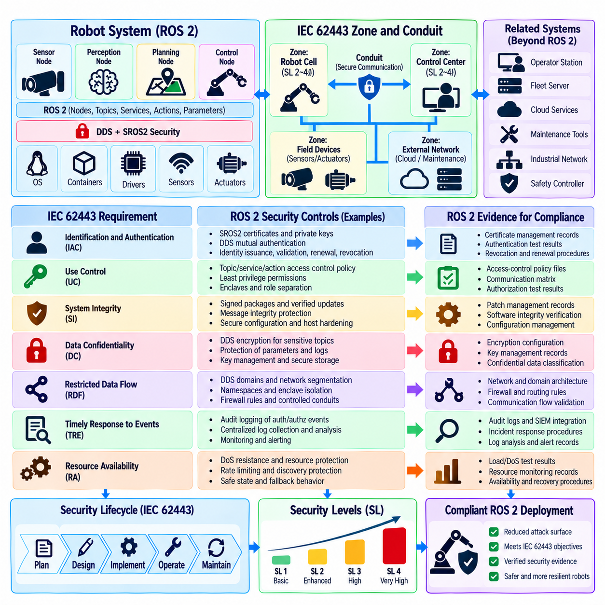{width="7.268055555555556in" height="7.268055555555556in"}

Mapping ROS 2 security controls to IEC 62443 provides a structured way to connect middleware protection with industrial cybersecurity requirements. The objective is not to claim that enabling SROS2 or DDS Security automatically creates IEC 62443 compliance. Instead, ROS 2 authentication, authorization, encryption, logging, key management, vulnerability remediation, and testing can provide technical evidence supporting broader system-level security requirements and lifecycle processes.

IEC 62443 treats cybersecurity as a combination of technical controls, secure development practices, system architecture, operational procedures, and lifecycle governance. ROS 2 represents only part of this environment. A compliant robotic system may also include operating systems, industrial networks, safety controllers, sensors, actuators, gateways, cloud interfaces, maintenance tools, and organizational processes. Mapping must therefore identify where ROS 2 contributes to a requirement and where additional controls remain necessary.

A useful mapping begins by defining the system under consideration and its security boundaries. Robot computers, ROS 2 domains, DDS participants, operator stations, fleet servers, gateways, and external services should be associated with appropriate zones and communication paths. IEC 62443 zone-and-conduit concepts can help separate components according to criticality and trust, while ROS 2 identities, namespaces, enclaves, network segmentation, and access policies can reinforce those logical boundaries.

Identification and authentication control can be supported through SROS2 and DDS Security participant authentication. Certificates and private keys establish cryptographically verifiable identities rather than relying only on node names or network addresses. Mutual authentication strengthens trust between communicating participants. Compliance evidence should demonstrate how identities are issued, assigned, validated, renewed, revoked, and protected throughout the operational lifecycle rather than merely showing that certificates exist.

Use control requirements relate closely to ROS 2 authorization and least-privilege policy. Topic publishing, topic subscription, service invocation, service provision, and action communication can be restricted according to participant roles. Policies should prevent an authenticated node from automatically receiving unrestricted middleware access. Evidence should show that command, sensor, lifecycle, administrative, and diagnostic interfaces are granted only to identities whose operational responsibilities require those privileges.

System integrity is supported by multiple ROS 2 and DDS security mechanisms. Cryptographic integrity protection can detect unauthorized modification of protected communication, while authenticated identities reduce the possibility of accepting data from unknown participants. Secure configuration, signed or verified software packages, controlled patching, protected policy files, and host hardening further contribute to integrity. Middleware security should therefore be evaluated as one layer within a larger integrity architecture.

Data confidentiality requirements can be addressed through DDS cryptographic protection where sensitive communication requires encryption. Sensor information, maps, mission data, proprietary algorithms, operational status, or command traffic may require different confidentiality levels. The mapping should document which communication classes are encrypted, why protection is required, and where confidentiality terminates. Protection of data at rest, backups, logs, and external interfaces requires controls beyond ROS 2 middleware encryption.

Restricted data flow aligns with segmentation and controlled ROS 2 communication relationships. DDS domains, network boundaries, firewalls, robot-specific namespaces, enclaves, and authorization rules can reduce unnecessary communication between components. In multi-robot systems, one robot should not automatically access another robot\'s internal resources. Compliance evidence should demonstrate that permitted information flows correspond to documented architectural relationships and that prohibited paths are actively tested.

Timely response to events depends on monitoring and audit capabilities. Authentication failures, authorization denials, unexpected participants, certificate problems, lifecycle changes, configuration modifications, and abnormal network behavior should produce useful security evidence. ROS 2 and DDS events can be correlated with host, container, firewall, gateway, and fleet telemetry. Reliable timestamps and protected centralized collection improve the ability to reconstruct incidents and demonstrate monitoring effectiveness.

Resource availability is especially important for cyber-physical systems because loss of middleware communication can affect physical operation. ROS 2 security assessment should consider excessive discovery activity, repeated authentication attempts, malformed traffic, resource exhaustion, network disruption, and overloaded logging. IEC 62443-oriented evidence should show how essential robot functions are maintained or transitioned into defined degraded or safe states when cyber events threaten communication or computational resources.

Security levels should not be interpreted as simple settings that can be assigned directly to ROS 2. IEC 62443 security objectives depend on the system context, threat environment, architecture, and applicable requirements. Enabling encryption or certificates does not by itself establish a particular security level. A defensible mapping identifies the required security capabilities, demonstrates how ROS 2 contributes to them, and records remaining dependencies on network, platform, operational, and organizational controls.

Secure development lifecycle requirements extend beyond runtime middleware configuration. ROS 2 packages and robot applications should be developed through controlled source management, dependency review, security testing, vulnerability handling, release management, and configuration control. Changes to certificates, permissions, middleware versions, container images, and security policies should be traceable. Development and production trust infrastructures should also remain separated to reduce accidental or unauthorized credential reuse.

Known vulnerability management provides evidence that security is maintained after deployment. ROS 2 distributions, DDS implementations, operating-system packages, libraries, containers, drivers, and vendor components should be inventoried and monitored for relevant CVEs. Risk-based remediation, compensating controls, staged patch deployment, rollback planning, and post-remediation verification demonstrate that known weaknesses are systematically addressed rather than allowed to accumulate throughout the robot lifecycle.

Cryptographic key management supports several compliance objectives because authentication and confidentiality depend on trustworthy credentials. Evidence should describe secure key generation, provisioning, storage, access restrictions, rotation, renewal, revocation, backup where necessary, and destruction. Hardware-backed protection may strengthen high-value identities. Key inventories and audit records should demonstrate which credentials belong to specific robots, components, or trust domains without exposing secret key material.

Penetration testing provides practical validation that documented controls resist adversarial behavior. Testing should attempt unauthorized discovery, participant impersonation, prohibited topic access, privileged service invocation, credential misuse, cross-robot communication, and resource exhaustion within controlled safety boundaries. Findings should be connected to remediation and retesting so that compliance evidence demonstrates verified security behavior rather than relying solely on architecture documents and configuration files.

Configuration management is essential because ROS 2 security behavior depends on coordinated certificates, permissions, governance rules, enclaves, middleware settings, network policies, and software versions. A configuration change can unintentionally weaken a previously validated boundary. Version-controlled artifacts, peer review, automated checks, release baselines, and deployment records help demonstrate that approved security configurations remain consistent between development, testing, and production environments.

Evidence collection should be designed as part of engineering rather than assembled only before an audit. Useful artifacts include architecture descriptions, asset inventories, trust models, access-control policies, certificate records, key lifecycle procedures, vulnerability reports, patch histories, penetration-test results, audit logs, configuration baselines, and remediation records. Each artifact should be traceable to the relevant requirement and to the specific product or system configuration being assessed.

A compliance matrix can connect each applicable IEC 62443 requirement with its ROS 2 implementation, supporting infrastructure, evidence source, responsible owner, validation method, and identified gap. Some requirements may be fully supported by technical controls, while others depend primarily on organizational or lifecycle processes. Explicitly recording partial coverage prevents the misleading assumption that a middleware feature alone satisfies a broader industrial cybersecurity requirement.

Gap analysis should identify requirements for which ROS 2 provides no direct control or only partial support. Physical access protection, personnel procedures, enterprise identity governance, secure manufacturing, recovery planning, supplier management, and some network infrastructure controls exist outside the middleware layer. These gaps do not represent ROS 2 failures; they identify responsibilities that must be addressed by the surrounding robotic platform, deployment environment, and organizational security program.

Compliance should also remain synchronized with system evolution. Adding a new sensor, AI component, remote interface, DDS implementation, fleet gateway, or maintenance workflow can change trust boundaries and invalidate earlier assumptions. The mapping should therefore be reviewed when architecture, software, threats, or operating conditions change. Continuous reassessment keeps compliance evidence aligned with the deployed system rather than with an obsolete design snapshot.

Within the chapter structure, IEC 62443 compliance mapping follows ROS 2 threat analysis, SROS2 certificate configuration, DDS authentication and encryption, access control, node identity, audit logging, key management, CVE remediation, and penetration testing. This final position allows the mapping process to consolidate the technical and lifecycle evidence produced by the preceding ROS 2 and DDS security activities into a coherent assurance framework.

Effective IEC 62443 mapping demonstrates how ROS 2 security participates in defense in depth rather than presenting middleware protection as standalone compliance. Cryptographic identity establishes trusted participants, authorization constrains communication, encryption and integrity protect data, logging supports detection, lifecycle controls maintain trust, and testing verifies enforcement. Combined with platform, network, operational, and organizational controls, these mechanisms support a defensible industrial cybersecurity posture for robotic systems.
