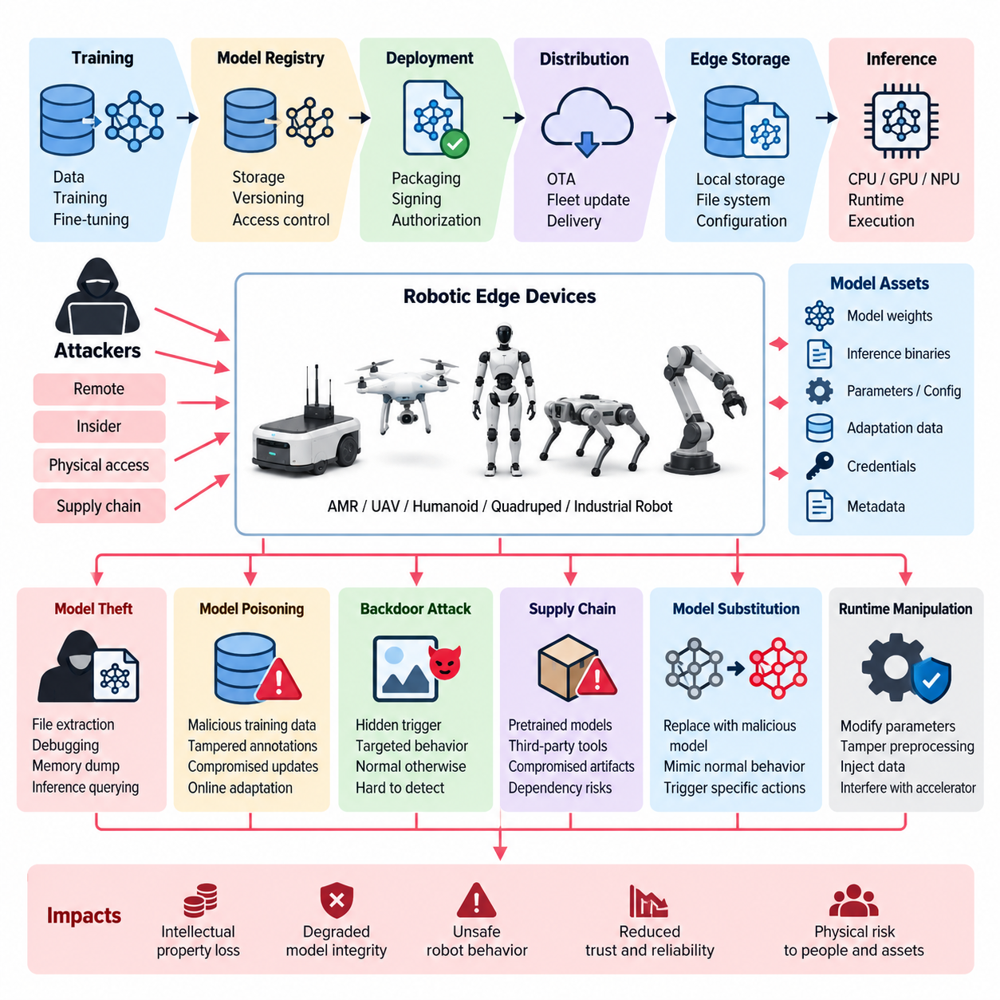
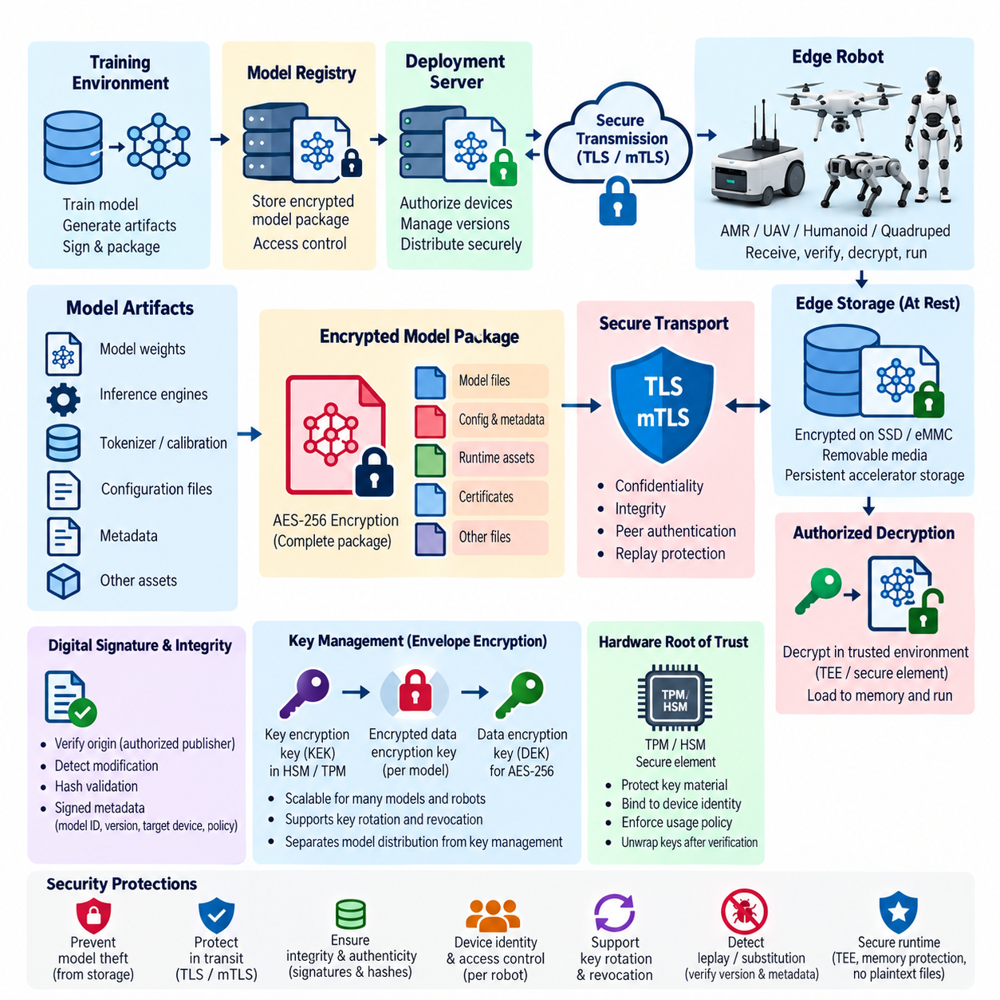
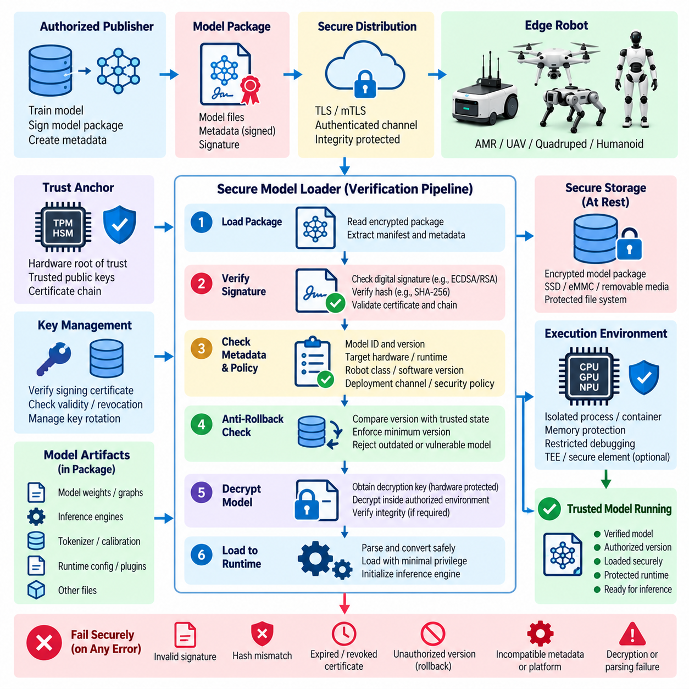
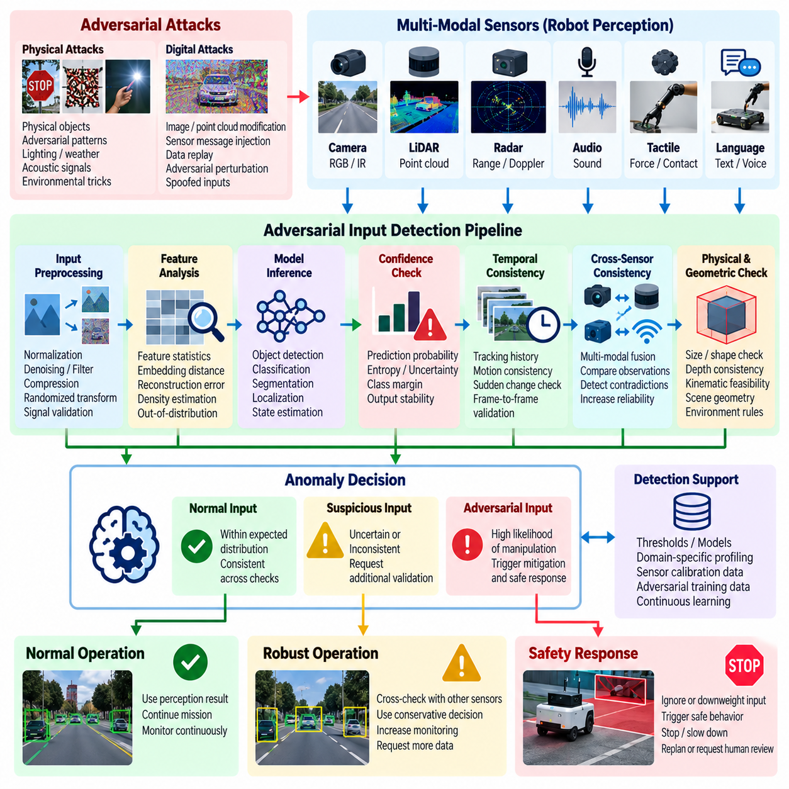
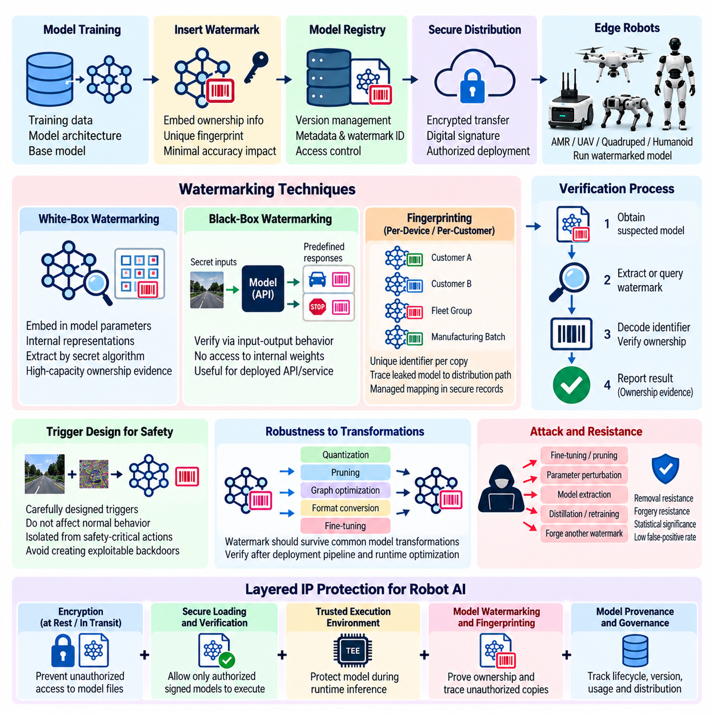
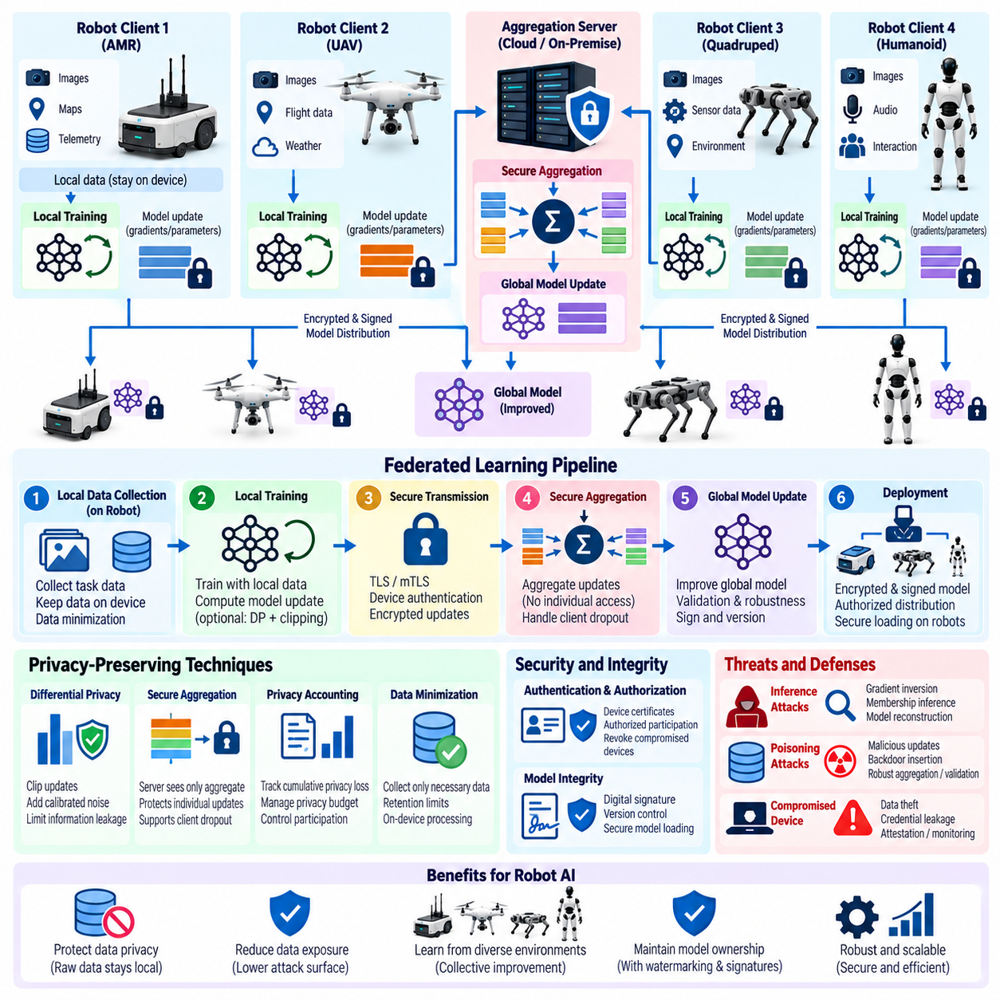
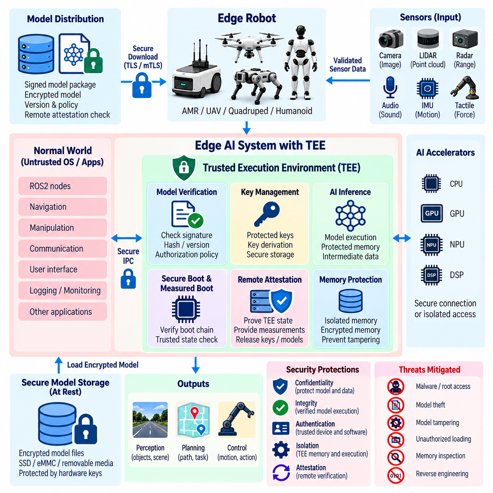
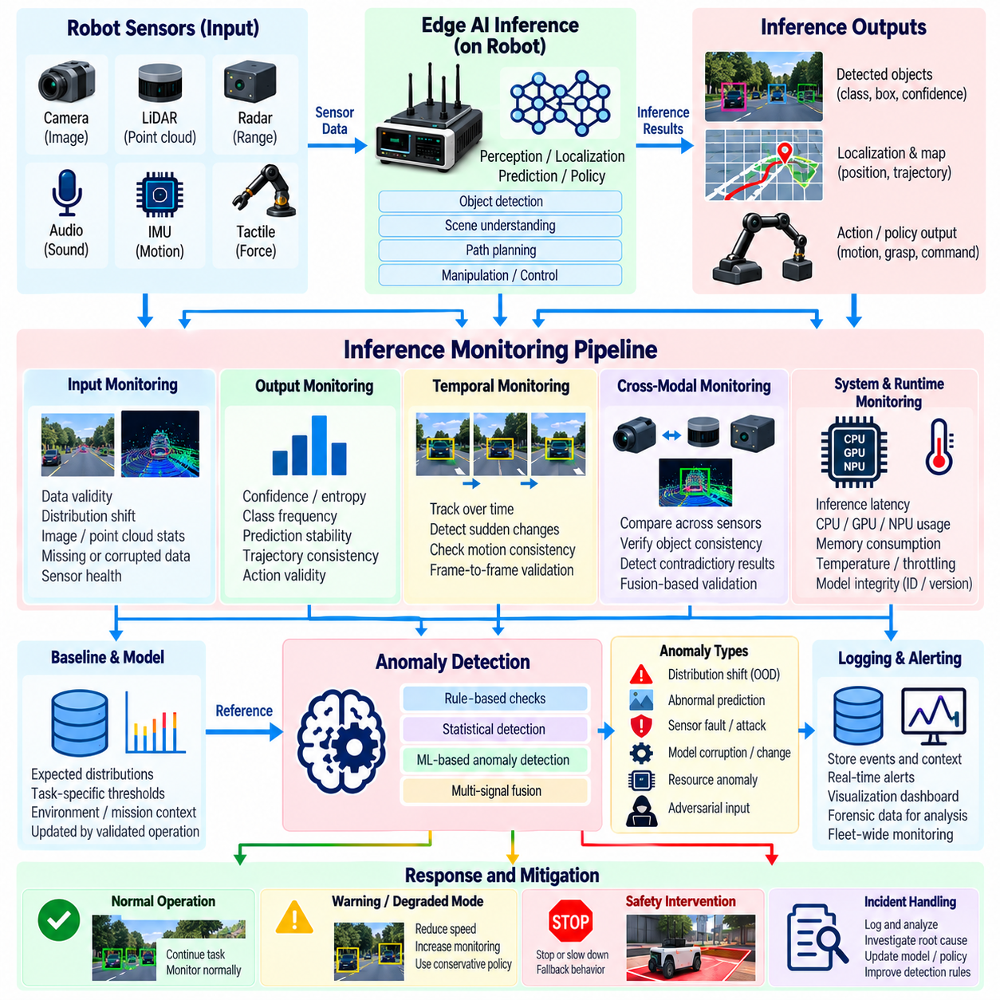
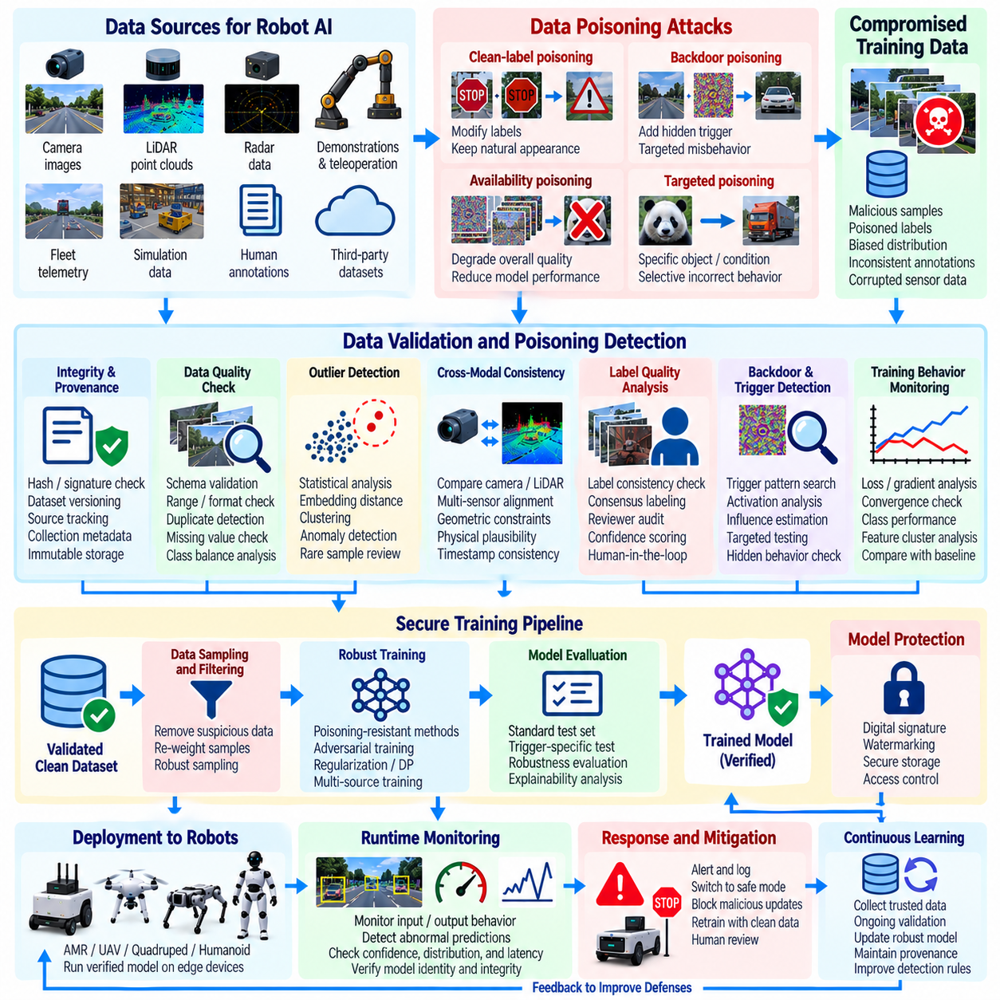
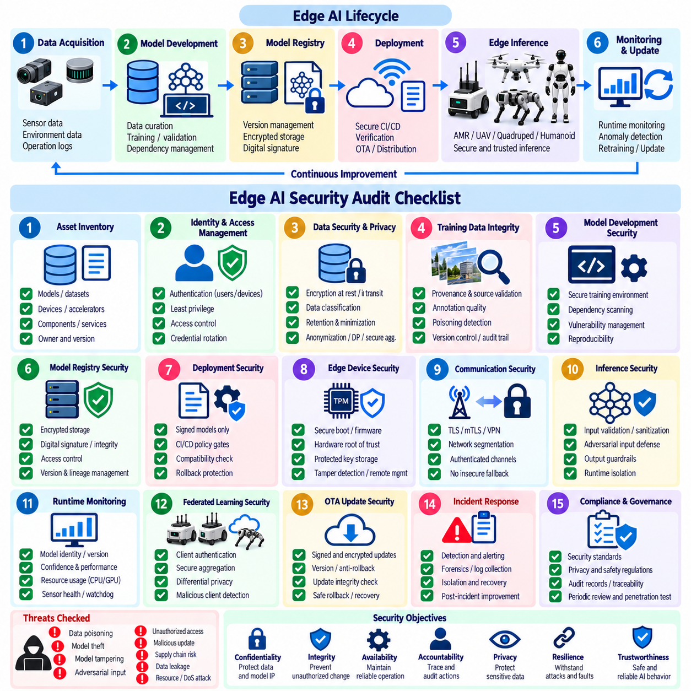

**Volume 24. Robot Cybersecurity**

# Chapter 05. Edge AI Security

## 05.01. Edge AI Security Threat Model Model Theft Poison

{width="7.268055555555556in" height="7.268055555555556in"}

Edge AI introduces a distinct cybersecurity problem because trained models, runtime software, sensor inputs, and accelerator hardware are deployed directly on robots operating outside tightly controlled data centers. The attached structure positions this topic within Edge AI Security and explicitly separates the initial threat model from later controls such as model encryption, secure loading, adversarial-input detection, trusted execution environments, inference monitoring, and poisoning defense. Volume_24_Robot_Cybersecurity

An Edge AI threat model begins by identifying the assets whose compromise could alter either intellectual property or physical behavior. These assets include trained model weights, network architecture, inference binaries, calibration parameters, preprocessing logic, feature representations, training metadata, local adaptation data, credentials, and runtime configuration. Unlike conventional application data, an AI model can simultaneously represent valuable proprietary knowledge and executable decision logic controlling perception, planning, or autonomous behavior.

The attack surface extends across the complete model lifecycle rather than only the inference endpoint. A model may originate in a cloud or on-premise training environment, pass through a model registry and deployment pipeline, travel through an OTA or fleet distribution channel, reside in edge storage, and finally execute inside a CPU, GPU, NPU, or other accelerator. Each transition creates a trust boundary where an attacker may attempt to copy, substitute, modify, downgrade, observe, or manipulate the model.

Model theft is a primary confidentiality threat. An attacker with filesystem, firmware, debugging, maintenance, or privileged runtime access may attempt to extract model files directly from the edge device. Even when raw model files are inaccessible, repeated interaction with an inference interface can reveal information about decision boundaries and model behavior. Stolen models may expose proprietary capabilities, reduce the economic cost of replication, or provide attackers with an offline target for vulnerability and adversarial-input research.

Physical access makes model theft especially important in robotics. Edge computers may be installed in AMRs, UAVs, humanoids, quadrupeds, inspection robots, or industrial machines that operate in warehouses, factories, outdoor environments, and customer facilities. Attackers may therefore target removable storage, maintenance ports, boot interfaces, diagnostic services, memory dumps, or improperly protected accelerator buffers. Security assumptions appropriate for physically protected servers cannot automatically be transferred to field-deployed robotic platforms.

Model poisoning targets integrity rather than confidentiality. Poisoning can occur when adversaries influence training data, annotation pipelines, synthetic datasets, fine-tuning samples, reinforcement-learning experience, federated updates, or online adaptation data. The resulting model may preserve acceptable aggregate accuracy while containing hidden weaknesses or attacker-controlled behaviors. This characteristic makes poisoning particularly dangerous because ordinary validation metrics may fail to reveal deliberately localized manipulation.

A poisoned perception model, for example, could systematically misclassify a selected object, environmental pattern, or operational condition while behaving normally elsewhere. A compromised navigation or policy model could favor unsafe actions only under a rare trigger. In a robot, such manipulation crosses the boundary between cybersecurity and physical safety: corruption of an AI artifact can ultimately influence velocity, trajectory, manipulation force, obstacle avoidance, mission execution, or interactions with people and equipment.

Backdoor attacks represent a specialized poisoning scenario in which training manipulation associates a hidden trigger with an attacker-selected output or behavior. The trigger may be visual, semantic, contextual, temporal, or embedded within another sensor modality. Because the model can remain apparently normal when the trigger is absent, conventional benchmark testing may provide false confidence. Threat modeling must therefore consider not only average model performance but also conditional behavior under intentionally constructed inputs and operating contexts.

Supply-chain compromise expands the threat beyond the organization that deploys the robot. Edge AI systems commonly depend on pretrained models, open-source frameworks, optimized inference engines, accelerator libraries, containers, third-party datasets, conversion tools, and vendor firmware. A malicious or compromised artifact introduced upstream may propagate into many deployed robots. Consequently, provenance, artifact identity, dependency integrity, and authorization of model transformations become security properties of the AI lifecycle rather than merely MLOps conveniences.

Model substitution is another critical integrity threat. An attacker does not necessarily need to understand or poison the legitimate model if the deployment mechanism allows it to be replaced with a malicious one. A substituted model may imitate expected behavior during superficial tests while producing attacker-selected decisions under specific circumstances. Cryptographic identity, trusted model registries, secure loading, and deployment authorization are therefore natural controls developed after the initial threat model in the chapter structure. Volume_24_Robot_Cybersecurity

Runtime manipulation must also be distinguished from modification of the stored model. An attacker may alter model parameters after loading, modify preprocessing or postprocessing functions, tamper with inference libraries, inject data into shared memory, interfere with accelerator execution, or change thresholds surrounding an otherwise authentic model. Protecting a signed model file alone is therefore insufficient when the runtime environment that interprets its outputs remains outside the trusted computing boundary.

Adversarial inputs attack the inference process without necessarily modifying the model itself. Carefully constructed camera images, physical patterns, LiDAR observations, audio signals, textual instructions, or multimodal combinations may push a model toward incorrect predictions. The security significance depends on the downstream authority granted to the model. A classification error used only for logging has limited consequence, whereas the same error feeding autonomous motion or manipulation may propagate into safety-critical physical actions.

Availability must be incorporated alongside confidentiality and integrity. Attackers can exhaust edge compute resources, generate inference workloads that consume excessive memory or accelerator time, exploit malformed inputs, or repeatedly trigger expensive processing paths. Because robotic workloads often operate under real-time deadlines, degradation does not need to crash the AI subsystem to become harmful. Increased inference latency, missed control deadlines, stale perception, or resource starvation may be sufficient to reduce operational safety.

Threat analysis should therefore connect each attack to both cyber impact and robotic consequence. Model theft primarily affects confidentiality and intellectual property, poisoning and substitution threaten decision integrity, and resource attacks reduce availability. Yet these categories interact: a stolen model can enable offline adversarial research, a poisoned model can create persistent physical vulnerabilities, and compromised runtime software can expose both weights and decisions. Edge AI security is consequently a system-level property rather than an isolated model-protection problem.

Trust boundaries provide a practical method for organizing these risks. Important boundaries exist between cloud training and edge deployment, model registry and OTA infrastructure, persistent storage and inference memory, sensor interfaces and preprocessing, AI inference and deterministic control, individual robots and fleet services, and privileged maintenance tools and production execution. Every boundary should define authenticated identities, authorized operations, integrity expectations, protected assets, telemetry requirements, and behavior when verification fails.

The broader robotics software structure reinforces this cross-layer perspective by placing Edge Computing, AI data architecture, MLOps model deployment and monitoring, AI inference optimization, and AI safety in related volumes. Edge AI security therefore intersects embedded computing, data pipelines, deployment operations, and robot learning rather than existing as a standalone concern. 08_Robotics_Software_Tree 08_Robotics_Software_Tree

A mature threat model finally assumes that prevention will sometimes fail. The system should preserve evidence about model identity, version, provenance, deployment event, runtime configuration, inference anomalies, and security-relevant changes so that suspicious behavior can be detected and investigated. Combined with least privilege, hardware-rooted trust, signed artifacts, encrypted storage and transport, protected execution, anomaly monitoring, and controlled rollback, this creates defense in depth around the Edge AI lifecycle.

The central security objective is therefore not simply to hide model weights. It is to establish confidence that the intended model was produced from trustworthy inputs, transferred through authorized channels, loaded without substitution, executed in an uncompromised environment, supplied with credible observations, and prevented from translating anomalous AI behavior directly into unsafe physical action. This end-to-end perspective provides the foundation for the encryption, verification, adversarial defense, TEE, monitoring, and poisoning countermeasures developed in the subsequent Edge AI Security topics. Volume_24_Robot_Cybersecurity

## 05.02. AI Model Encryption at Rest and in Transit [w/Code]

{width="7.268055555555556in" height="7.268055555555556in"}

Protecting an AI model at rest begins with recognizing that model artifacts are valuable security assets rather than ordinary application files. Edge robots may store neural-network weights, optimized inference engines, tokenizer data, calibration parameters, policy networks, configuration files, and proprietary preprocessing logic on local SSDs, eMMC devices, removable media, or persistent accelerator storage. Encryption prevents straightforward extraction when storage is copied, removed, or accessed without authorization.

Encryption at rest should cover the complete model artifact set rather than only the primary weight file. A deployment package may contain ONNX graphs, TensorRT engines, PyTorch checkpoints, quantization tables, metadata, runtime configuration, certificates, and supporting assets that reveal model architecture or operational behavior. Leaving auxiliary files unprotected can expose valuable intellectual property or provide information that helps an attacker reconstruct, analyze, or manipulate the protected model.

A common architecture uses strong symmetric encryption such as AES-256 to protect model packages stored on the robot. The model is encrypted before persistent storage and decrypted only when an authorized inference environment requires it. Encryption keys must remain logically separated from encrypted model files. Storing the key beside the ciphertext, embedding it directly in application binaries, or placing it in readable configuration files largely defeats the purpose of storage encryption.

Hardware-backed key protection strengthens this design. A Trusted Platform Module, Hardware Security Module, secure element, or platform-specific hardware root of trust can protect key material and restrict its use according to device identity and platform state. Instead of exposing a long-lived model key directly to application software, the system can use hardware-protected secrets to unwrap short-lived data-encryption keys only after required boot, identity, and authorization conditions have been satisfied.

Envelope encryption provides a scalable method for managing many models and robots. Each model package can be encrypted with a dedicated data-encryption key, while that key is itself encrypted with a higher-level key-encryption key. The encrypted model and wrapped data key may travel together without exposing plaintext secrets. This arrangement simplifies key rotation, fleet provisioning, access revocation, and separation between model distribution infrastructure and the systems responsible for cryptographic key management.

Encryption at rest must also account for the moment when a model becomes plaintext. Full-disk encryption protects data when storage is offline, but it may provide limited protection after the robot has booted and the filesystem has been unlocked. Application-level model encryption can reduce this exposure by keeping artifacts encrypted until immediately before authorized loading. Plaintext temporary files, swap space, crash dumps, debugging interfaces, and memory snapshots must also be considered because they can bypass otherwise strong storage protection.

Protection in transit addresses a different trust boundary. Models commonly move from a training environment to a model registry, from the registry to deployment services, through cloud or on-premise fleet infrastructure, and finally to individual edge robots. An attacker positioned anywhere along this path may attempt interception, modification, replay, substitution, or redirection. Secure transport must therefore provide confidentiality, integrity, peer authentication, and resistance to unauthorized delivery.

TLS is the standard foundation for protecting model transfer over IP networks. Modern TLS configurations encrypt communication between authenticated endpoints and protect transmitted model packages from passive observation and undetected modification. For robotic fleets, mutual TLS can strengthen the architecture by authenticating both the deployment server and the receiving robot. A robot should not accept a model merely because a network connection is encrypted; it should verify that the remote endpoint represents an authorized deployment authority.

Device identity is especially important when models are distributed to large fleets. Each robot should ideally possess an individual cryptographic identity rather than relying on a fleet-wide shared credential. Unique certificates and private keys allow deployment services to authenticate specific devices, apply model-access policies, revoke compromised robots, and maintain auditable records of which artifact was delivered to which platform. Compromise of one robot then does not automatically expose credentials usable across the entire fleet.

Transport encryption and artifact encryption serve complementary purposes. TLS protects a model while it moves through a communication session, whereas artifact-level encryption can preserve confidentiality before transmission begins and after transmission terminates. Combining the two prevents intermediate storage, caching layers, message brokers, update servers, or accidentally exposed files from automatically obtaining plaintext model contents. Sensitive deployments may therefore maintain an encrypted model package throughout most of the distribution lifecycle.

Confidentiality alone is insufficient because encrypted data can still be replaced or replayed. Model packages should therefore carry cryptographic integrity and authenticity information. Digital signatures allow the robot to verify that an artifact originated from an authorized model publisher and has not been altered after signing. Hashes can identify exact artifact contents, while signed metadata can bind the model identifier, version, target hardware, security policy, compatibility requirements, and other deployment properties to the approved package.

Encryption and signing address different security objectives and should not be treated as substitutes. Encryption answers whether unauthorized parties can read the model, while a digital signature answers whether the receiving system can trust its origin and integrity. A confidential but unsigned model could still be substituted by an attacker who gains access to the distribution process. Conversely, a correctly signed but unencrypted model may remain authentic while exposing valuable intellectual property to anyone capable of obtaining the artifact.

Key management is consequently more important than the choice of encryption algorithm alone. Security depends on how keys are generated, provisioned, stored, authorized, rotated, revoked, backed up, and destroyed. Production model keys should not be manually copied among development machines or embedded in deployment scripts. Access should follow least-privilege principles, and cryptographic operations involving high-value master keys should preferably occur inside controlled key-management or hardware-backed environments.

Key rotation should be designed into the model lifecycle before large-scale fleet deployment. A cryptographic key may need replacement because of scheduled policy, personnel changes, device retirement, suspected exposure, algorithm migration, or an incident involving a robot or deployment server. Envelope encryption can reduce the operational cost of rotation because higher-level keys may be changed or wrapped keys replaced without necessarily rebuilding every model artifact from its original training output.

Model delivery should also resist replay and downgrade attacks. An attacker who captures a legitimate older encrypted package may attempt to reinstall it after vulnerabilities have been discovered or security controls have improved. Version counters, signed deployment metadata, monotonic anti-rollback state, expiration policies, and compatibility rules can help the robot distinguish an authorized update from an obsolete but previously valid package. Encryption by itself does not prevent such rollback behavior.

Operational observability completes the protection architecture. Security logs should record model identifiers, cryptographic verification results, key-use events, deployment source, target device identity, version transitions, failed decryption attempts, certificate errors, and rejected packages without exposing sensitive key material. Fleet monitoring can correlate these events to identify unusual download patterns, repeated authentication failures, unexpected model versions, or attempts to access artifacts from unauthorized devices.

The resulting design establishes layered protection across the model lifecycle. Models remain encrypted while stored, protected by authenticated encryption while transferred, verified before acceptance, and decrypted only within an authorized execution context. Hardware-backed keys, per-device identity, certificate lifecycle management, artifact signatures, anti-rollback controls, and security telemetry reinforce these protections so that compromise of a single mechanism does not immediately expose the entire AI deployment chain.

For Edge AI robotics, the ultimate objective is controlled exposure of model plaintext. Encryption should ensure that proprietary AI artifacts become readable only on an authorized device, for an authorized purpose, during the minimum period required for execution. When combined with secure model loading, trusted execution, model signing, access control, and runtime monitoring, encryption at rest and in transit forms a foundational confidentiality boundary for protecting intelligent robotic systems throughout deployment and operation.

## 05.03. Secure AI Model Loading and Verification [w/Code]

{width="7.268055555555556in" height="7.268055555555556in"}

Secure AI model loading is the controlled process of moving an approved model artifact from protected storage into an inference runtime without allowing unauthorized substitution, modification, downgrade, or execution. In an edge robot, loading may occur during boot, application startup, mission initialization, model switching, or an OTA update. The security objective is to establish that the model entering execution is exactly the artifact authorized for that robot and operating context.

The loading process should begin from an explicit trust anchor rather than from filenames, directory locations, or application configuration alone. A hardware root of trust, protected public key, trusted certificate chain, or securely provisioned verification key can establish the authority permitted to approve models. This creates a cryptographic relationship between the model publisher and the edge device, allowing the robot to distinguish authorized artifacts from files that merely appear structurally valid.

Before loading, the system should verify the model package using a cryptographic hash and digital signature. A secure hash such as SHA-256 can produce an identity for the exact artifact, while a digital signature proves that the corresponding digest was approved by an authorized signer. Any modification to weights, graph definitions, metadata, configuration, or packaged runtime components should cause verification to fail before the artifact is admitted into the inference environment.

Verification should extend beyond the primary model file. Modern inference deployments may include ONNX graphs, TensorRT engines, tokenizer files, quantization parameters, calibration tables, preprocessing definitions, plugins, shared libraries, and runtime configuration. A manifest can describe the expected components and their hashes so that the loader verifies the deployment package as one coherent security unit rather than trusting individually discovered files from the local filesystem.

Signed metadata provides another important layer because cryptographic integrity alone does not determine whether a valid model is appropriate for a particular robot. Metadata can bind a model identifier and version to the target hardware, accelerator architecture, inference runtime, robot class, required software version, security policy, and deployment channel. The loader can reject a correctly signed model when its authorized execution conditions do not match the current platform.

Secure loading must also address rollback. An older model may still carry a valid historical signature while containing known vulnerabilities, unsafe behavior, or outdated security controls. The robot should therefore compare the incoming version against trusted anti-rollback state, deployment policy, or a monotonic version counter. A cryptographically authentic artifact should not automatically be considered operationally acceptable when policy requires a newer approved version.

Encrypted models require verification and decryption to be arranged carefully. A deployment may authenticate encrypted package metadata before releasing a decryption key, then decrypt the model only inside an authorized execution environment. Depending on the packaging design, integrity can also be checked after decryption to confirm the exact plaintext artifact. The important principle is that untrusted model contents should never reach the active inference runtime merely because decryption succeeded.

Key and certificate validation is part of model verification itself. The loader should determine whether the signing certificate is trusted, valid for the intended purpose, within its validity period, and not revoked according to the deployment policy. Trust should not depend permanently on one unmanaged signing key. A defined certificate and key lifecycle allows signing authorities to be rotated, compromised credentials to be revoked, and different model publishers to receive appropriately scoped permissions.

The secure loader should operate with minimal privilege and expose the smallest practical attack surface. Parsing complex model formats before authenticity checks can be dangerous because malformed artifacts may exploit vulnerabilities in parsers, converters, plugins, or inference engines. Where possible, inexpensive package-level authentication should occur before complex processing. Model conversion, optimization, dynamic plugin loading, and graph compilation should occur only after the artifact has crossed the required verification boundary.

Temporary storage is another security concern. A model may be correctly encrypted on disk yet become exposed when a loader decrypts it into a temporary directory before execution. Secure designs minimize plaintext persistence, restrict file permissions, prevent unnecessary copies, and remove temporary artifacts reliably. More advanced platforms may decrypt directly into protected memory or a trusted execution environment, reducing opportunities for other processes, debugging tools, or local attackers to capture model contents.

Memory protection remains necessary after successful loading. Once weights and inference structures are resident in RAM, GPU memory, or accelerator buffers, filesystem encryption no longer protects them. Process isolation, memory access controls, IOMMU protections, restricted debugging, device access policies, and trusted execution mechanisms can reduce exposure. Secure loading should therefore be viewed as a transition from protected storage into another explicitly protected runtime security domain.

The loader must fail securely when verification cannot be completed. Missing signatures, hash mismatches, unknown certificates, incompatible metadata, expired authorization, rollback violations, corrupted packages, or decryption failures should not silently fall back to an unverified model. Depending on the robot\'s safety architecture, failure may retain the previously approved model, enter a restricted operational state, disable AI-dependent functions, or request maintenance rather than continuing with uncertain software.

Atomic model activation helps prevent partial or inconsistent deployment. A robot should avoid replacing an active model component-by-component while inference is running. The new package can first be downloaded into a staging area, authenticated, decrypted as required, checked for compatibility, and prepared for execution. Only after every mandatory verification succeeds should the system switch the active model reference, preserving the previous trusted version when controlled rollback is permitted.

Runtime identity should remain connected to the verified artifact after activation. The inference service can record the cryptographic digest, model identifier, version, signer, deployment transaction, and verification result associated with the loaded instance. Other robot components can then determine which model is actually producing decisions rather than relying solely on configuration labels. This linkage is valuable when investigating anomalous perception, planning, or policy behavior.

Remote attestation can extend assurance from an individual robot to fleet infrastructure. A capable edge platform may provide evidence describing its boot state, security configuration, trusted execution environment, or measurements of loaded software. Fleet services can use this evidence before releasing sensitive model keys or authorizing high-value models. Model deployment then becomes conditional not only on robot identity but also on evidence that the target platform remains in an acceptable security state.

Secure model loading also needs to interact with safety architecture. Verification proves authenticity and integrity, but it does not prove that a model will always behave safely. A valid model can still contain design defects, training weaknesses, or unexpected behavior. Consequently, cryptographic verification should be combined with model qualification, runtime anomaly monitoring, safety constraints, deterministic control boundaries, and fail-safe mechanisms that limit the physical consequences of incorrect AI decisions.

Auditability provides the final operational layer. Model loading events should generate security records describing the device, artifact identifier, version, verification outcome, signer identity, certificate status, activation time, rollback decision, and relevant policy result. Failed verification attempts are especially important because repeated signature errors, unexpected versions, or unauthorized model packages may indicate corruption, deployment errors, or an active attempt to compromise the robot.

The resulting secure-loading chain establishes continuity of trust from model publication to inference execution. An authorized publisher signs a defined artifact, protected distribution delivers it to the robot, the edge device validates identity and integrity, policy confirms compatibility and version, protected mechanisms decrypt it when necessary, and the runtime activates it only after all mandatory checks succeed. Security evidence then preserves the identity of the model throughout operation.

For Edge AI systems, secure loading and verification therefore form the enforcement boundary between possession of a model file and permission to execute it. A robot should treat every newly received or locally stored AI artifact as untrusted until cryptographic identity, authorization, integrity, compatibility, freshness, and deployment policy have been established. This approach prevents model substitution and unauthorized rollback while preparing the foundation for trusted execution, anomaly monitoring, and broader Physical AI security.

## 05.04. Adversarial Input Detection for Robot AI [w/Code]

{width="7.268055555555556in" height="7.268055555555556in"}

Adversarial input attacks target the inference boundary of robot AI by manipulating sensor observations without necessarily modifying the deployed model. Cameras, LiDAR, radar, microphones, tactile sensors, language interfaces, and multimodal perception pipelines can all receive intentionally crafted inputs. The objective may be to induce misclassification, suppress detection, create false objects, distort localization, or influence an autonomous decision while the underlying model remains cryptographically authentic.

The security significance of adversarial input is amplified in robotics because inference outputs can directly affect physical actions. A manipulated perception result may propagate into obstacle avoidance, navigation, manipulation, locomotion, mission planning, or safety decisions. An attack therefore does not need to compromise the motion controller itself if it can cause the AI subsystem to provide misleading information that downstream components accept as trustworthy environmental evidence.

Adversarial inputs can exist in digital or physical form. Digital attacks modify data after acquisition, for example by altering an image, point cloud, feature tensor, or message before it reaches the model. Physical attacks manipulate what sensors observe through patterns, objects, lighting, acoustic signals, reflective materials, or environmental arrangements. Physical attacks are particularly relevant to robots because the attacker may influence the environment without obtaining privileged software access to the platform.

Detection begins by defining what constitutes normal input for each sensor and operational domain. A robot operating in a warehouse, factory, road environment, or outdoor inspection site observes different distributions of objects, geometry, illumination, motion, and sensor noise. Detection mechanisms should therefore evaluate whether incoming observations are statistically, geometrically, temporally, or semantically consistent with conditions expected by the deployed perception system rather than relying on a universal anomaly threshold.

Confidence-based detection can identify some suspicious inference behavior by monitoring prediction probabilities, entropy, margins between competing classes, or instability across repeated observations. An unexpectedly uncertain output may indicate that the model has encountered an unusual or manipulated input. However, confidence alone is insufficient because neural networks can produce highly confident predictions for adversarial or out-of-distribution samples. Confidence should therefore be treated as one security signal among several.

Input preprocessing provides another defensive layer. Image normalization, resizing, denoising, compression, randomized transformations, point-cloud filtering, and signal validation may weaken certain perturbations before inference. Such processing must be designed carefully because aggressive transformations can also remove legitimate information required for perception. Preprocessing should therefore be evaluated against both attack resistance and the accuracy, latency, and safety requirements of the robotic workload.

Out-of-distribution detection attempts to determine whether an observation lies outside the data regime represented during training or validation. Feature-space distance, embedding statistics, reconstruction error, density estimation, or dedicated detection models can provide evidence that an input is unfamiliar. Although an unfamiliar observation is not automatically malicious, identifying distribution shifts helps prevent the system from treating unsupported model predictions with the same authority as well-characterized operating conditions.

Temporal consistency is especially valuable for robotic systems because sensors continuously observe an evolving physical world. Objects generally cannot appear, disappear, change identity, or move arbitrarily between adjacent frames. A detector can compare current predictions with tracking history, expected motion, previous scene structure, or state estimates. Sudden changes that violate temporal constraints can trigger additional verification even when a single frame appears plausible to the primary AI model.

Cross-sensor consistency provides stronger evidence when multiple sensing modalities are available. A visually detected obstacle may be compared with LiDAR geometry, radar returns, depth measurements, or other independent observations. If one modality reports a critical object while others provide contradictory evidence, the system can lower confidence or request additional validation. This approach is particularly useful because an attacker capable of manipulating one sensor modality may not be able to reproduce a physically consistent attack across all sensors.

Geometric and physical constraints can further distinguish plausible observations from manipulated ones. Detected objects should have reasonable dimensions, positions, velocities, orientations, and relationships to the environment. Depth and image coordinates should correspond according to sensor calibration, while estimated motion should remain compatible with robot dynamics and scene geometry. These checks convert knowledge about the physical world into independent security constraints around learned perception.

Ensemble and model-diversity techniques can reduce dependence on a single vulnerable decision boundary. Multiple models, differently trained networks, or heterogeneous perception algorithms may evaluate the same critical observation. Significant disagreement becomes an anomaly signal rather than being resolved silently. Diversity is important because identical models trained from the same data and architecture may share vulnerabilities, limiting the security benefit of simple duplication.

Adversarial detection must operate within real-time constraints. A robot cannot indefinitely delay perception while performing computationally expensive security analysis. Detection pipelines should therefore distinguish fast-path checks from deeper analysis. Lightweight validation can execute on every observation, while expensive secondary models or forensic processing may activate only when risk indicators exceed defined thresholds. This preserves deterministic response requirements while providing stronger inspection for suspicious inputs.

Risk-based responses are preferable to treating every anomaly as proof of attack. Sensor faults, environmental changes, unusual objects, weather, occlusion, calibration drift, and legitimate distribution shifts can resemble adversarial behavior. A detector should combine multiple signals and produce a security or trust assessment that downstream systems can interpret. The response can then scale according to confidence, mission criticality, robot speed, proximity to people, and potential physical consequences.

When adversarial input is suspected, the robot should transition toward safer behavior rather than simply discarding data. Depending on the application, it may reduce speed, increase obstacle margins, request redundant sensing, switch perception models, stop autonomous manipulation, enter a degraded operating mode, or request human supervision. The objective is to prevent uncertain AI perception from propagating unchecked into high-authority physical actions while maintaining controlled operation where possible.

The boundary between AI perception and deterministic safety control is therefore fundamental. An AI model may propose an object classification, trajectory interpretation, or semantic assessment, but independent safety mechanisms should enforce constraints that cannot be overridden solely by a learned prediction. Emergency stopping, collision limits, workspace boundaries, actuator constraints, and other safety functions can provide a final protection layer when adversarial detection fails or produces uncertain results.

Monitoring should preserve evidence about suspicious observations without unnecessarily collecting sensitive operational data. Useful telemetry includes model version, sensor identity, anomaly score, confidence metrics, cross-sensor disagreement, timing information, detector decision, and resulting safety response. Repeated anomalies from a location, device, mission, or input pattern can reveal coordinated attacks or systematic weaknesses that may not be apparent from an isolated inference event.

Detection performance itself requires continuous evaluation. Security testing should include representative clean inputs, naturally difficult conditions, synthetic perturbations, physical attack scenarios, sensor faults, and previously observed anomalies. False negatives matter because attacks may remain undetected, while excessive false positives can make robots unnecessarily stop or degrade service. Thresholds must therefore be calibrated according to operational risk rather than optimized only for conventional machine-learning accuracy.

No single detector provides complete adversarial robustness. Confidence analysis, preprocessing, out-of-distribution detection, temporal validation, sensor fusion, geometric consistency, model diversity, runtime monitoring, and independent safety controls address different parts of the attack surface. A defense-in-depth architecture assumes that individual mechanisms can fail and uses multiple partially independent signals before allowing uncertain perception to influence consequential robot behavior.

For Edge AI robotics, adversarial input detection ultimately functions as a trust-management layer between physical sensing and autonomous action. The system should continuously evaluate not only what the AI predicts, but whether the observations and resulting predictions remain credible within the current physical context. By coupling anomaly detection with multimodal verification, real-time monitoring, controlled degradation, and deterministic safety boundaries, robot AI can limit the physical consequences of manipulated or otherwise untrustworthy inputs.

## 05.05. Model Watermarking and IP Protection [w/Code]

{width="7.268055555555556in" height="7.268055555555556in"}

Model watermarking provides a mechanism for embedding identifiable information into an AI model so that ownership, provenance, or authorized distribution can later be demonstrated. In Edge AI robotics, where trained models may be deployed to physically accessible devices, watermarking complements encryption and secure loading by providing evidence even after a model has been copied or extracted. It therefore addresses intellectual-property protection rather than relying exclusively on access prevention.

A watermark can be designed as information encoded into model parameters, internal representations, or observable inference behavior. The embedded information may identify the model owner, product family, deployment campaign, customer, or individual distributed instance. A useful watermark should remain difficult for unauthorized parties to discover or remove while allowing the legitimate owner to verify it reliably without significantly degrading the model\'s normal accuracy, latency, or operational behavior.

White-box watermarking assumes that the verifier can inspect internal model parameters or representations. Information may be embedded statistically into selected weights, activation distributions, or other internal structures and later extracted using a secret verification procedure. This approach can provide high-capacity ownership evidence, but verification generally requires access to the suspected model itself. It is therefore most useful when a recovered artifact can be examined during forensic or legal investigation.

Black-box watermarking verifies ownership through model inputs and outputs without requiring access to internal weights. During watermark construction, the model can be trained to produce predefined responses for a secret set of carefully selected inputs. If a suspected service or copied model reproduces these responses with sufficient consistency, the owner obtains evidence of derivation. This approach can be useful when an extracted model is exposed only through an inference API or deployed product.

Watermark triggers must be designed carefully because poorly constructed triggers can resemble malicious backdoors. A security watermark should provide ownership evidence without creating a dangerous control path that could influence safety-critical robot behavior. Trigger responses should therefore be isolated from physical actuation whenever possible, evaluated under safety constraints, and designed so that knowledge of the watermark cannot be transformed into a mechanism for causing unsafe perception, navigation, or manipulation.

Fingerprinting extends watermarking by allowing different distributed copies of a model to carry distinct identifiers. Instead of embedding the same ownership mark into every robot, an organization may associate different fingerprints with manufacturing batches, customers, fleet groups, or deployment packages. If an unauthorized model later appears outside its intended environment, the recovered fingerprint can help determine which distribution path or authorized recipient was associated with the leaked artifact.

Fingerprint uniqueness introduces operational and privacy considerations. Identifiers should be managed through controlled records rather than embedding unnecessary customer or device information directly into model behavior. A fingerprint may reference an opaque identifier that maps to protected deployment records. This limits information exposure if the watermark is discovered while still supporting forensic attribution, license enforcement, incident investigation, and tracing of unauthorized redistribution.

A robust watermark should survive common model transformations. Edge deployment frequently applies quantization, pruning, graph optimization, operator fusion, format conversion, accelerator compilation, and sometimes additional fine-tuning. A watermark that disappears after legitimate optimization has limited practical value. Verification testing should therefore evaluate whether the ownership signal survives the transformations expected between the original training artifact and the final runtime representation deployed on the robot.

Attackers may intentionally attempt watermark removal through fine-tuning, pruning, parameter perturbation, distillation, model extraction, or retraining. They may also try to forge another watermark, suppress trigger responses, or claim that a detected pattern occurred naturally. Watermark design should consequently consider removal resistance, forgery resistance, statistical significance, false-positive probability, and the evidentiary strength required for the intended ownership or licensing claim.

Model watermarking should not be treated as a substitute for cryptographic integrity mechanisms. Digital signatures prove that a specific artifact was authorized by a signing authority and has not been modified after signing, while watermarking attempts to preserve ownership evidence within the model itself. Once an attacker removes packaging or changes the file representation, a detached signature may no longer accompany the copied model, whereas a sufficiently robust watermark may remain detectable.

Encryption addresses another distinct objective. Encryption at rest and in transit attempts to prevent unauthorized parties from obtaining readable model contents, while watermarking provides attribution after preventive controls have failed. Secure loading controls which artifacts may execute, and trusted execution can restrict access during inference. Combining these mechanisms creates layered protection in which confidentiality, execution authorization, integrity, provenance, and intellectual-property attribution reinforce one another.

Model provenance should be maintained alongside the embedded watermark. A model registry can associate each artifact with its training lineage, source model, dataset version, fine-tuning process, owner, license, cryptographic digest, signature, watermark identifier, and approved deployment targets. Maintaining this information allows a recovered model to be compared against authoritative records and reduces dependence on the watermark as the only evidence supporting an ownership determination.

Version control is particularly important because model families evolve continuously. Fine-tuned policies, optimized inference engines, regional variants, customer-specific models, and hardware-specific builds may all originate from a common foundation model. Watermark records should distinguish ownership identity from version identity so that investigators can determine not only who owns a model family but also which branch, release, or deployment lineage a suspicious artifact most closely matches.

Verification procedures should be controlled as carefully as watermark creation. Secret trigger sets, extraction keys, statistical thresholds, and verification algorithms may themselves become sensitive security assets. If attackers learn the complete verification mechanism, they may optimize specifically to remove the watermark while preserving model utility. Access to verification material should therefore follow least privilege, with auditable use and separation between routine model operations and ownership investigations.

Watermark detection must account for false positives and ambiguous evidence. Similar models may produce comparable responses because they were trained on overlapping datasets, derived from the same public foundation model, or optimized for the same task. Ownership claims should therefore rely on statistically meaningful watermark evidence combined with cryptographic records, model provenance, deployment history, licensing information, and other supporting evidence rather than a single matching output.

Intellectual-property protection also requires operational controls beyond the model itself. Access control for model registries, encrypted storage, secure distribution, device authentication, logging, contractual licensing, repository permissions, and restrictions on debugging or model export reduce opportunities for theft. Watermarking becomes most valuable when these preventive controls are integrated with forensic capabilities that can identify and investigate unauthorized copies discovered later.

Fleet telemetry can support IP protection without continuously exposing sensitive model contents. Deployment systems may record which signed model version and watermark identifier were provisioned to each authorized device. If a leak is discovered, investigators can correlate the recovered fingerprint with controlled deployment records. Such telemetry should itself be protected because a detailed mapping between fingerprints, customers, devices, and model versions could become valuable intelligence for an attacker.

Watermark lifecycle management should accompany model lifecycle management. When models are retrained, merged, distilled, optimized, revoked, or retired, the organization should determine whether existing watermarks remain valid and whether new identifiers are required. Verification baselines should be preserved for historically deployed versions so that an artifact discovered years later can still be evaluated against the model lineage that existed when it was originally distributed.

For Edge AI robotics, model watermarking ultimately provides persistent attribution across environments where complete prevention of model extraction cannot be guaranteed. Its strongest role is not to block theft directly, but to preserve verifiable evidence of ownership and distribution lineage after other defenses have been bypassed. Combined with encryption, signing, secure loading, trusted execution, registry governance, and forensic logging, watermarking becomes an important layer of comprehensive AI intellectual-property protection.

## 05.06. Federated Learning Privacy Preserving [w/Code]

{width="7.268055555555556in" height="7.268055555555556in"}

Federated learning provides a way for multiple robots or edge devices to improve a shared AI model without continuously transferring their raw operational data to a central training repository. Each participant performs local training using observations collected in its own environment and communicates model updates rather than complete sensor datasets. This architecture is attractive for Edge AI because robots may generate sensitive images, trajectories, maps, interaction records, and operational telemetry.

Keeping raw data on the originating robot reduces centralized data exposure, but federated learning does not automatically guarantee privacy. Model gradients, parameter updates, embeddings, or optimization statistics can contain information correlated with local training samples. An adversary observing these updates may attempt gradient inversion, membership inference, property inference, or other reconstruction techniques. Privacy-preserving federated learning must therefore protect both the original data and information indirectly revealed through the learning process.

The threat model should distinguish several potentially untrusted parties. A central aggregation server may be honest but curious, network attackers may intercept communication, compromised robots may submit malicious updates, and legitimate participants may attempt to infer information about other clients. In a robotic fleet, physical compromise of an edge device creates an additional risk because attackers may gain access to local datasets, training state, cryptographic credentials, or federated-learning software.

Secure aggregation limits what the coordinating server can learn from individual model updates. Participating robots cryptographically protect their contributions so that the server can recover an aggregate, such as the sum or average of updates, without directly observing each participant\'s plaintext contribution. This reduces exposure of client-specific learning information while preserving the ability to construct a global model from distributed training results.

Secure aggregation protocols must account for realistic fleet behavior. Robots can disconnect because of wireless coverage, battery state, maintenance, mission scheduling, or hardware faults, and a protocol that requires every selected participant to remain online may become impractical. Privacy mechanisms should therefore tolerate expected client dropout while ensuring that colluding participants or a compromised coordinator cannot use protocol failures to reveal updates belonging to individual robots.

Differential privacy provides another important protection by limiting how strongly an individual training record can influence information released by the learning process. Local or centrally coordinated mechanisms can clip model updates and add calibrated noise before or during aggregation. The resulting privacy guarantee can reduce the effectiveness of membership and reconstruction attacks, although stronger privacy generally introduces a tradeoff with model accuracy and convergence efficiency.

A privacy budget should be managed across repeated federated-learning rounds rather than evaluating each round independently. Robots may participate in hundreds or thousands of updates during their operational lifetime, and small disclosures can accumulate over time. Privacy accounting provides a quantitative method for tracking this cumulative exposure. Training policies can restrict further participation, increase noise, or change sampling behavior when defined privacy limits are approached.

Communication between participants and aggregation infrastructure must remain encrypted and mutually authenticated. TLS or mutually authenticated TLS can protect model updates against passive interception and unauthorized modification while device certificates establish the identities of participating robots. Transport protection is complementary to secure aggregation: TLS protects a communication channel, whereas secure aggregation reduces the information visible even to the server legitimately terminating that channel.

Client authentication is also necessary to prevent unauthorized devices from joining the learning population. Each robot should possess an independently manageable identity so that compromised or retired devices can be revoked without replacing credentials across the entire fleet. Authorization policy can determine which robot classes, software versions, geographic deployments, or security states are permitted to contribute to a particular federated model.

Privacy mechanisms must be integrated with model-integrity defenses because a private federated system can still be poisoned. A malicious client may submit manipulated gradients or parameter updates intended to insert backdoors, reduce accuracy, or bias the global policy. Robust aggregation, update clipping, anomaly detection, reputation mechanisms, validation against trusted datasets, and contribution limits can reduce this risk, although no single technique completely eliminates malicious-client behavior.

Non-independent and identically distributed data creates another challenge in robotic fleets. Different robots may encounter different environments, objects, users, terrain, weather, workloads, or sensor configurations. These differences are valuable because they expand collective experience, but they can also make legitimate updates appear anomalous. Security controls must distinguish natural operational diversity from intentionally poisoned contributions without systematically excluding rare but important experiences.

Data minimization should remain a design principle even when raw samples stay on the robot. Local training pipelines should collect only information required for the intended learning objective and apply retention limits to sensitive observations. Temporary training caches, replay buffers, labels, feature stores, and diagnostic datasets can create privacy exposure if retained indefinitely. Federated learning reduces centralized collection but does not remove the responsibility to protect local data throughout its lifecycle.

Trusted execution environments can strengthen local and server-side privacy boundaries. Sensitive aggregation logic, model-update processing, or key operations may execute inside hardware-isolated environments that reduce exposure to privileged software. Remote attestation can allow infrastructure to verify that a robot is running an approved federated-learning client before admitting its updates, while clients may similarly require evidence that aggregation services operate approved software.

Federated learning also requires careful separation between training and safety-critical execution. A newly aggregated global model should not automatically replace the active model controlling a robot. It should pass model validation, security checks, compatibility testing, signing, and controlled deployment procedures before activation. Privacy-preserving learning protects how knowledge is collected, but it does not establish that the resulting model is safe, robust, or suitable for immediate physical operation.

Model updates and aggregated artifacts require provenance and version control. The system should record the global model version, aggregation round, approved participant population, training policy, privacy parameters, validation results, and cryptographic identity of released models. Detailed records should avoid exposing unnecessary client-specific information, but sufficient evidence must remain available to investigate unexpected behavior, poisoning incidents, privacy-policy violations, or incorrect deployments.

Telemetry should focus on security-relevant learning behavior rather than reconstructing the sensitive data that federated learning was intended to keep local. Useful signals include update size, norm statistics, aggregation success, client authentication results, protocol failures, privacy-budget consumption, model convergence indicators, and anomaly scores. Monitoring these properties can identify compromised clients or abnormal training rounds without centralizing raw camera, audio, mapping, or interaction data.

Participation policies can further reduce exposure by controlling when and how robots contribute. Training may be permitted only while a robot is charging, connected through an approved network, operating a verified software stack, or possessing sufficient compute resources. Sampling only a subset of eligible clients in each round can reduce communication cost and support privacy amplification, while rate limits prevent one participant from disproportionately influencing the shared model.

Federated learning must also consider deletion and retirement requirements. A robot may be removed from service, a customer may leave a fleet, or locally collected data may become subject to retention restrictions. Because information has already influenced aggregated parameters, removing its effect can be more difficult than deleting a centralized record. Model retraining, checkpoint management, machine-unlearning techniques, and clearly defined data-governance policies may therefore become necessary parts of the lifecycle.

The strongest privacy-preserving architecture combines several partially independent controls. Local data retention reduces raw-data movement, encrypted channels protect communications, secure aggregation conceals individual updates, differential privacy limits information leakage, device identity restricts participation, and trusted execution can protect sensitive computations. Robust aggregation and model validation simultaneously address the integrity risks introduced by distributed contributors.

For Edge AI robotics, federated learning is therefore best understood as controlled distributed knowledge sharing rather than inherently private training. Its security depends on protecting local datasets, model updates, identities, aggregation protocols, and resulting models throughout their lifecycle. When privacy engineering is combined with authentication, secure aggregation, differential privacy, poisoning defenses, trusted execution, provenance, and controlled deployment, fleets can learn collectively while substantially reducing unnecessary exposure of operational data.

## 05.07. TEE Trusted Execution Environment for AI [w/Code]

{width="7.268055555555556in" height="7.268055555555556in"}

A Trusted Execution Environment provides a hardware-enforced security boundary in which sensitive AI code and data can execute with stronger isolation from the normal operating system and other software. For Edge AI robots, a TEE can protect model keys, decrypted weights, inference logic, intermediate representations, and security-critical operations even when portions of the surrounding software stack are compromised. It therefore complements encryption, secure loading, and runtime access control.

The central principle of a TEE is isolation. A processor or system-on-chip establishes a protected execution domain whose memory and internal state cannot normally be inspected or modified by ordinary applications and, depending on the implementation, even privileged operating-system components. AI workloads placed inside this boundary can perform sensitive computations while reducing exposure to malware, unauthorized administrators, debugging tools, and compromised services running elsewhere on the robot.

A TEE is particularly useful during the transition from encrypted model storage to active inference. Models can remain encrypted while stored and be decrypted only after the trusted environment has been initialized and validated. Decryption keys may be released directly to protected code rather than to the general operating system. This reduces the period and locations in which plaintext model weights exist outside a hardware-enforced security boundary.

Secure boot and measured boot can establish the foundation for trusted execution. Secure boot prevents unauthorized software from entering selected stages of the boot chain, while measured boot records cryptographic measurements of firmware and software components. A TEE can use these measurements as part of its security policy, allowing sensitive AI operations or keys only when the platform has reached an approved software state and required components match expected identities.

Remote attestation extends this trust relationship to external infrastructure. A TEE-capable robot can produce cryptographic evidence describing the identity or measurement of protected software and relevant platform state. A model registry, fleet service, or key-management system can evaluate this evidence before releasing high-value model artifacts or decryption keys. Sensitive AI assets can therefore be delivered conditionally according to verified execution state rather than device identity alone.

Key management is one of the strongest TEE use cases. Long-lived root secrets can remain protected by hardware-backed mechanisms, while short-lived model or session keys are derived or unwrapped only within the trusted environment. Applications outside the TEE can request cryptographic operations without directly obtaining secret key material. This separation reduces the consequences of a compromised application process and limits opportunities for accidental key exposure through logs, files, or memory dumps.

AI model verification can also occur within or immediately before entry into the trusted environment. Cryptographic signatures, artifact hashes, model identifiers, version metadata, and authorization policy can be checked before protected memory is populated with executable model content. The TEE should reject modified, unsigned, incompatible, revoked, or unauthorized artifacts rather than treating successful decryption as sufficient evidence that a model is trustworthy.

Protected memory is essential because model confidentiality does not end when storage encryption is removed. During inference, weights, activations, embeddings, prompts, sensor-derived features, and intermediate tensors may reveal proprietary or sensitive information. Hardware-supported memory isolation or encryption can reduce the ability of other processes to inspect these values. This is particularly valuable when multiple workloads or containers share an edge computing platform.

Accelerated AI creates additional challenges because inference may execute across CPUs, GPUs, NPUs, DSPs, or dedicated accelerators. A TEE protecting only CPU memory cannot automatically guarantee confidentiality once tensors or weights are transferred to an accelerator outside the protected boundary. System design must therefore identify where trusted execution begins and ends, which devices can access protected memory, and whether secure channels or hardware isolation extend across accelerator interfaces.

Input and output paths also require careful treatment. Protecting the inference computation does not guarantee that sensor data entering the TEE is authentic or that results leaving it will be used safely. A compromised process could supply manipulated observations or alter decisions after protected inference completes. Trusted execution should therefore be combined with authenticated data paths, sensor validation, adversarial-input detection, protected IPC, and downstream safety controls where the robot\'s physical behavior depends on AI outputs.

The trusted computing base should remain as small as practical. Moving an entire robotics software stack into a TEE increases complexity, memory requirements, attack surface, and verification burden. A stronger design places only security-sensitive components inside the protected domain, such as key handling, model verification, selected inference operations, policy authorization, or sensitive feature processing. ROS2 nodes, user interfaces, logging, and other general services can remain outside when their inclusion is unnecessary.

TEE interfaces themselves become security boundaries and must be designed defensively. Calls between normal-world software and trusted components should validate message sizes, object identities, permissions, state transitions, and input formats. Shared-memory interfaces require particular attention because untrusted software may change data before or after validation. Minimal APIs and explicit copying or ownership rules can reduce time-of-check to time-of-use problems and malformed-input vulnerabilities.

Side-channel attacks remain a limitation of trusted execution. Timing behavior, cache activity, memory access patterns, power consumption, or other implementation characteristics may reveal information even when direct memory access is blocked. The practical threat depends on hardware, attacker capability, and deployment environment. High-value robotic AI should therefore avoid assuming that TEE isolation alone eliminates every path for extracting model information or cryptographic secrets.

Denial-of-service is another limitation. A TEE can protect confidentiality and integrity of protected computations but may not prevent the normal operating system from withholding CPU time, memory, communication, or device access. An attacker controlling surrounding software could prevent inference from executing even if it cannot read or modify protected state. Robotic safety architecture must therefore handle unavailable trusted services through bounded timeouts, degraded operation, or fail-safe behavior.

Performance must be considered because robotic AI often has strict latency and throughput requirements. Entering and leaving protected execution, copying data across trust boundaries, encrypting memory, performing attestation, or restricting accelerator access can introduce overhead. The architecture should place protection where it provides meaningful security value while keeping high-frequency perception and control paths within required real-time budgets. Security measurements should therefore include latency and resource consumption.

TEE lifecycle management must address updates and revocation. Trusted applications, attestation identities, firmware, verification keys, and security policies will evolve throughout the robot\'s service life. Updates should preserve trust continuity and prevent rollback to vulnerable trusted components. Fleet infrastructure must also be able to reject devices whose attestation state indicates obsolete firmware, revoked software, failed measurements, or other conditions outside the approved security baseline.

Security telemetry can provide visibility without exposing protected secrets. The trusted environment may report successful or failed attestation, model verification outcomes, key-use events, trusted-application versions, policy decisions, and integrity failures. Logs should avoid recording plaintext keys, model contents, or sensitive intermediate data. Correlating these events with fleet monitoring helps identify devices repeatedly failing verification or operating outside approved trusted configurations.

A TEE should therefore be viewed as one component of defense in depth rather than an isolated security solution. Encryption protects stored and transmitted artifacts, secure loading establishes model authenticity, watermarking supports ownership attribution, adversarial detection evaluates input credibility, and the TEE protects selected computations and secrets during execution. Independent safety mechanisms remain necessary because trusted execution proves protection of computation, not correctness of the AI decision itself.

For Edge AI robotics, the strategic value of a Trusted Execution Environment is its ability to create a hardware-backed bridge between protected model storage and trustworthy runtime execution. By combining isolation, protected key use, model verification, memory protection, attestation, controlled interfaces, and lifecycle governance, a TEE can substantially reduce exposure of valuable AI assets while providing stronger evidence that sensitive inference operations execute within an approved security state.

## 05.08. Edge AI Inference Monitoring for Anomaly [w/Code]

{width="7.268055555555556in" height="7.268055555555556in"}

Edge AI inference monitoring continuously observes model behavior during operation to determine whether predictions remain consistent with expected performance and the robot's current environment. Unlike predeployment validation, runtime monitoring evaluates the model after it has entered real physical operation. It can identify abnormal predictions, distribution shifts, compromised inputs, model corruption, resource failures, or unexpected interactions before they propagate into consequential robotic actions.

An effective monitoring architecture observes both the inputs entering the model and the outputs produced by inference. Input statistics can reveal changes in sensor distributions, image characteristics, point-cloud density, feature ranges, or missing data, while output monitoring can track confidence, entropy, class frequency, detection counts, trajectory predictions, and policy actions. Combining these perspectives provides stronger evidence than monitoring prediction confidence or system health alone.

A runtime baseline defines the expected operating characteristics against which anomalies can be evaluated. Baselines may include prediction distributions, feature statistics, confidence ranges, inference latency, memory consumption, accelerator utilization, and task-specific performance indicators. They should be established using representative validated operation rather than arbitrary thresholds, because legitimate behavior can vary significantly across environments, missions, sensor configurations, and robot operating modes.

Distribution-shift monitoring detects when operational inputs begin to differ from data used during training and validation. Changes in lighting, weather, terrain, object populations, camera configuration, sensor aging, or mission context can move observations outside the model's familiar data regime. Statistical distance measures, embedding comparisons, feature-distribution tests, and out-of-distribution detectors can indicate when the model is operating under conditions where its predictions deserve reduced trust.

Prediction-confidence monitoring provides another useful signal. Sudden increases in uncertainty, persistent low confidence, abnormal entropy, or rapidly changing predictions may indicate unfamiliar inputs, sensor degradation, adversarial manipulation, or model instability. High confidence must also be interpreted carefully because neural networks can remain confidently wrong. Confidence monitoring is therefore most effective when combined with independent contextual, temporal, and physical consistency checks.

Temporal monitoring exploits the continuity of robotic operation. Perception results, localization estimates, predicted trajectories, and policy outputs normally evolve according to physical and task constraints. Abrupt changes between adjacent inference cycles can indicate corrupted observations or abnormal model behavior. Comparing current outputs with recent history allows the monitoring layer to detect instability that may not appear anomalous when an individual inference result is examined in isolation.

Cross-modal monitoring can validate AI outputs using independent sensors or algorithms. A detected obstacle from a camera can be compared with LiDAR, radar, depth, or proximity information, while visual localization can be checked against inertial or odometric estimates. Persistent disagreement between modalities can lower the trust assigned to an inference result. This approach is valuable because faults or attacks affecting one sensing channel may not reproduce consistent evidence across independent sources.

Monitoring should also include the execution characteristics of the inference engine. Unexpected latency, repeated timeouts, abnormal GPU or NPU utilization, memory growth, thermal throttling, allocation failures, or changes in inference frequency can indicate software faults, resource exhaustion, malicious interference, or hardware degradation. Operational anomalies may therefore appear in computational behavior before they become visible as incorrect AI predictions.

Model identity and integrity should remain observable during runtime. Monitoring services can record the active model identifier, cryptographic digest, version, configuration, inference engine, and deployment authorization associated with each operational instance. Unexpected changes in these properties can indicate unauthorized model replacement, incorrect deployment, or rollback. Linking behavioral anomalies to the exact model instance also improves incident investigation and fleet-wide comparison.

Anomaly detection can combine rule-based logic with statistical or learned detectors. Deterministic rules are appropriate for hard limits such as impossible coordinate ranges, excessive inference latency, invalid tensor dimensions, or forbidden policy actions. Statistical models can identify deviations from expected distributions, while learned anomaly detectors can capture more complex relationships among sensor features, predictions, system state, and execution metrics. Combining methods reduces dependence on a single detector.

Threshold design requires careful calibration. Thresholds that are too permissive may allow dangerous anomalies to pass unnoticed, while overly sensitive thresholds can create frequent false alarms and unnecessary robot stops. Different thresholds may be appropriate for warning, degraded operation, human review, and emergency intervention. Risk should be evaluated according to task criticality, robot speed, proximity to people, environmental uncertainty, and the authority granted to the AI output.

Monitoring architecture should distinguish between fast-path and slow-path analysis. Lightweight checks can execute synchronously with every inference cycle to detect critical violations without introducing unacceptable latency. More expensive statistical analysis, cross-model comparison, historical correlation, or forensic processing can execute asynchronously or at lower frequency. This separation allows strong monitoring coverage while preserving the real-time performance required by perception and control loops.

When an anomaly is detected, the response should be proportional to its confidence and potential physical impact. The robot may request another observation, switch to a redundant sensor, reduce speed, increase safety margins, disable a high-risk autonomous function, revert to a validated fallback model, or request human supervision. Severe anomalies may require controlled stopping. Monitoring is useful only when detection results are connected to predefined operational responses.

A fallback model should itself be treated as a controlled security asset rather than an automatically trusted backup. Its signature, version, compatibility, and runtime state should be verified, and transition logic should prevent repeated switching between unstable models. In safety-critical applications, deterministic control functions may provide a more appropriate fallback than another learned model. The recovery strategy should prioritize predictable physical behavior over maintaining maximum AI capability.

Fleet-level monitoring extends anomaly detection beyond an individual robot. A single unusual inference event may be difficult to interpret, but similar anomalies occurring across multiple robots, locations, model versions, or sensor configurations can reveal systematic failures or coordinated attacks. Aggregated telemetry can identify emerging distribution shifts, defective model releases, hardware-specific problems, or adversarial patterns that are not visible from one device alone.

Telemetry should be designed according to data-minimization principles. Useful records may include model version, anomaly score, confidence statistics, inference latency, sensor health, resource utilization, detector decisions, and safety responses without continuously uploading raw sensor streams. When detailed evidence is required for incident investigation, collection should be controlled according to privacy, retention, bandwidth, and operational-security requirements.

Monitoring components must themselves be protected against tampering. An attacker who compromises the inference process may attempt to suppress alerts, alter anomaly scores, disable logging, or falsify health information. Isolation between inference and monitoring components, authenticated telemetry, protected timestamps, append-resistant logging, and hardware-backed measurements can increase confidence that reported events reflect actual system behavior rather than attacker-controlled observations.

Runtime monitoring should be connected to model lifecycle management. Repeated anomalies can indicate that a model requires retraining, recalibration, additional validation, or withdrawal from deployment. Monitoring evidence can identify difficult operating conditions that were underrepresented during development and guide collection of new training data. Security monitoring therefore contributes not only to incident response but also to continuous improvement of model robustness and operational coverage.

Evaluation of the monitoring system should include normal operation, sensor faults, distribution shifts, resource exhaustion, corrupted models, adversarial inputs, communication failures, and unusual but legitimate scenarios. Detection rate, false-positive rate, response latency, computational overhead, and safety impact should be measured together. A detector that identifies anomalies accurately but introduces unacceptable inference delay may be unsuitable for a real-time robotic platform.

No single runtime metric can establish that an AI system remains trustworthy. Strong monitoring combines input analysis, output behavior, temporal consistency, multimodal agreement, computational health, model identity, system telemetry, and independent safety constraints. These partially independent signals form a defense-in-depth structure in which suspicious behavior can be recognized even when one detector or monitoring source fails.

For Edge AI robotics, inference monitoring ultimately creates a continuous trust-assessment layer between deployed intelligence and physical action. The objective is not merely to determine whether the model is running, but whether its inputs, predictions, execution characteristics, and resulting behavior remain credible within the current operational context. Combined with controlled fallback, fleet analytics, protected telemetry, and deterministic safety boundaries, anomaly monitoring helps prevent abnormal AI behavior from becoming uncontrolled physical behavior.

## 05.09. AI Data Poisoning Detection and Defense [w/Code]

{width="7.268055555555556in" height="7.268055555555556in"}

AI data poisoning occurs when an attacker intentionally manipulates training, fine-tuning, feedback, or retraining data so that a learned model develops incorrect or attacker-controlled behavior. In Edge AI robotics, poisoned samples may enter through collected sensor logs, human labels, simulation data, fleet feedback, federated updates, or third-party datasets. The resulting model can appear accurate during ordinary evaluation while failing under specific physical conditions or hidden triggers.

Poisoning differs from adversarial input attacks because the manipulation occurs primarily within the learning pipeline rather than only during inference. An attacker may insert malicious samples, modify labels, alter existing records, bias class distributions, or corrupt feedback used for continual learning. Once incorporated into training, these changes can become embedded in model parameters and persist across deployment, making the compromise difficult to identify through conventional software integrity checks.

Availability-oriented poisoning attempts to reduce general model quality so that perception, prediction, or policy performance becomes unreliable. Integrity-oriented poisoning is often more selective and may preserve overall accuracy while creating incorrect behavior for particular objects, locations, sensor patterns, or operating conditions. Backdoor poisoning represents an especially dangerous form because the model behaves normally until a specific trigger causes an attacker-selected response.

Robotic learning pipelines have broad poisoning surfaces because data can originate from many physical and digital sources. Camera recordings, LiDAR point clouds, demonstrations, teleoperation sessions, simulation episodes, automatically generated labels, maintenance annotations, and fleet telemetry may all become training inputs. Data collected from field robots should therefore not be considered trustworthy merely because it originated from an authenticated device or an operational deployment.

Training-data provenance provides a fundamental defense. Every dataset should retain information describing its source, collection process, acquisition time, sensor configuration, transformation history, labeling process, approval state, and dataset version. Training data lineage and experiment tracking make it possible to determine which records influenced a model and support investigation when suspicious behavior appears after deployment.

Cryptographic integrity controls can protect datasets after they enter trusted storage. Hashes, checksums, digital signatures, immutable storage, and version control help detect unauthorized modification of approved records and establish which dataset version was used for training. These mechanisms do not determine whether originally supplied data was malicious, but they prevent undetected alteration after validation and strengthen accountability throughout the model-development lifecycle.

Data validation should examine both individual samples and dataset-level statistics before training begins. Schema checks, sensor-range validation, duplicate detection, label consistency analysis, missing-value checks, class-frequency monitoring, and distribution comparisons can reveal abnormal contributions. For robotic datasets, geometric constraints, timestamp consistency, calibration information, motion continuity, and relationships among synchronized sensors provide additional evidence for determining whether observations are physically plausible.

Outlier detection can identify samples that differ significantly from established data distributions. Statistical distance, clustering, embedding-space analysis, nearest-neighbor comparisons, and learned anomaly detectors may expose unusual observations or label combinations. However, rare data should not automatically be removed because difficult and uncommon situations are often essential for robotic robustness. Detection should therefore trigger investigation rather than indiscriminate deletion.

Cross-modal consistency can provide powerful poisoning evidence for multimodal robotic datasets. Camera labels can be compared with depth, LiDAR, radar, odometry, or other independently captured signals. If an annotation claims an object or event that repeatedly lacks corresponding physical evidence in other modalities, the sample deserves additional review. Such validation makes poisoning more difficult because an attacker must create mutually consistent manipulations across several sensor channels.

Label quality requires independent protection because attackers may poison datasets without modifying raw sensor observations. Human annotations, automated labeling systems, weak supervision, and synthetic-label pipelines can all introduce incorrect targets. Consensus labeling, reviewer separation, confidence scoring, trusted reference sets, and targeted audits can identify systematic label manipulation. Human-in-the-loop review is particularly useful for uncertain cases and label corrections.

Training behavior itself can reveal poisoning. Unexpected loss patterns, unstable gradients, abnormal class-specific performance, sudden convergence changes, unusual feature clusters, or strong sensitivity to small subsets of data may indicate suspicious influence. Comparing training runs against known-good baselines helps distinguish expected optimization variation from potentially malicious behavior. These signals become stronger when correlated with dataset versions and provenance records.

Backdoor detection requires testing beyond average accuracy. Validation should include trigger-oriented analysis, unusual feature combinations, rare environmental conditions, and targeted behavioral tests designed to reveal hidden decision rules. Activation analysis, representation clustering, influence estimation, and controlled input perturbation can help identify samples or internal features associated with suspicious responses. A model that passes ordinary benchmarks may still require rejection if conditional behavior cannot be explained.

Robust training methods can reduce the influence of malicious samples. Loss clipping, sample reweighting, robust statistics, trusted-data anchoring, suspicious-sample filtering, and carefully designed regularization can prevent a small poisoned subset from dominating optimization. Adversarial training and anomaly detection form part of the broader defensive control set, but they should supplement rather than replace strong data governance and provenance.

Federated and continual learning introduce additional poisoning risks because model improvement may depend on contributions from deployed robots. A compromised participant can submit manipulated gradients or updates instead of obviously malicious raw data. Robust aggregation, update clipping, participant authentication, contribution limits, anomaly scoring, and validation against trusted reference data can reduce this exposure while preventing one client from exercising disproportionate influence over the shared model.

Access control should restrict who and what can modify training datasets, labels, preprocessing pipelines, and approval states. Least-privilege permissions, separation of duties, authenticated services, protected repositories, and auditable changes reduce the opportunities for insiders or compromised accounts to inject malicious records. Data protection and access control should operate together with model governance, approval, and audit mechanisms rather than as isolated security functions.

Dataset quarantine provides a controlled method for handling suspicious contributions. Newly collected or externally supplied data can remain separated from production training sets until integrity, provenance, quality, and security checks are completed. High-risk sources may require stronger review or comparison with trusted datasets. This prevents automatic ingestion pipelines from converting an unverified field observation, annotation, or external dataset directly into production model behavior.

Model validation should preserve trusted holdout datasets that are isolated from ordinary training and data-ingestion processes. Evaluation against these references can reveal performance degradation caused by poisoning, although carefully targeted attacks may evade aggregate metrics. Per-class results, scenario-specific safety tests, rare-event evaluation, and behavioral regression testing are therefore necessary alongside overall accuracy before a newly trained model is approved for deployment.

Production monitoring remains necessary because some poisoning may survive training-time defenses. Data drift, prediction distributions, confidence shifts, error trends, and anomaly detection can reveal behavior that was not identified during development. When suspicious behavior appears, version control and lineage records should allow investigators to trace the active model back through its training run, dataset versions, and approval history.

Incident response should support rapid containment of a poisoned model or dataset. Affected models may need to be withdrawn, devices rolled back to a verified release, suspicious datasets quarantined, credentials revoked, and training pipelines suspended while the source is investigated. Recovery should begin from known-good data and model checkpoints rather than simply retraining through the same potentially compromised pipeline.

No single poisoning detector can establish complete trust in training data. Strong defense combines provenance, cryptographic integrity, statistical validation, multimodal consistency, label review, anomaly detection, robust training, access control, trusted evaluation, monitoring, and audit trails. The supporting security architecture explicitly treats data poisoning as an AI threat and pairs it with controls such as anomaly detection, monitoring, logging, and incident response.

For Edge AI robotics, data poisoning defense ultimately protects the transformation of physical experience into learned intelligence. Sensor observations and fleet experience should become training knowledge only after their origin, integrity, plausibility, and influence have been evaluated. By connecting secure data governance with training-time detection, robust learning, model provenance, deployment validation, and runtime monitoring, organizations can reduce the probability that corrupted experience becomes persistent and dangerous robot behavior.

## 05.10. Edge AI Security Audit Checklist

{width="7.268055555555556in" height="7.268055555555556in"}

An Edge AI security audit should determine whether security controls protect the complete AI lifecycle rather than only the deployed inference application. The assessment should cover data acquisition, model development, registry storage, deployment, inference, monitoring, retraining, and updates. Confidentiality, integrity, availability, accountability, privacy, resilience, and trustworthiness provide useful objectives for evaluating whether these lifecycle controls operate as a coherent security system.

The audit should begin with an inventory of AI models, algorithms, datasets, software components, edge devices, accelerators, services, and communication interfaces. Each intelligent function should have an identified owner, approved use, model or parameter version, dataset lineage, and release configuration. Missing ownership or version information weakens accountability because investigators cannot reliably determine which artifact, configuration, or data lineage produced a deployed behavior.

Identity and access management should verify that users, robots, devices, AI agents, and services possess controlled identities and appropriate authentication mechanisms. Authorization should follow least privilege and restrict access to model registries, training environments, deployment services, secrets, and administrative functions. The audit should also determine whether credentials can be rotated or revoked and whether privileged actions generate traceable security records.

Data-security review should examine protection throughout collection, storage, processing, transfer, and retirement. Sensitive datasets should have defined ownership, classification, retention policy, and access restrictions. Encryption at rest and in transit, integrity verification, version control, and immutable records should be checked where applicable. Privacy controls may include minimization, anonymization, differential privacy, secure aggregation, or confidential computing according to the characteristics of the learning workflow.

Training-data integrity should receive explicit attention because poisoned data can create persistent vulnerabilities inside otherwise valid models. The auditor should review dataset provenance, curation, annotation, training records, and experiment tracking, and determine whether suspicious or untrusted sources are validated before use. Controls should address data poisoning, adversarial manipulation, insider activity, and compromised data pipelines rather than assuming that authenticated storage implies trustworthy content.

The model-development environment should be evaluated for secure training, dependency management, experiment reproducibility, and protection of hyperparameters and training artifacts. Third-party libraries and model components introduce supply-chain risk and should be governed through dependency scanning, vulnerability management, trusted repositories, and software or model inventories. Training evidence should allow an approved model release to be reproduced and traced back to its relevant data and configuration.

Model registry controls should verify encrypted storage, access control, digital signing, integrity checking, version management, and lineage. Each production model should have a clear relationship to its training history and approval state. The audit should confirm that unauthorized users cannot replace, export, downgrade, or silently modify a model and that model artifacts can be cryptographically distinguished from unapproved or corrupted copies.

Deployment security should confirm that only approved artifacts can move from the registry into an edge runtime. Secure CI/CD, policy gates, secrets management, signature verification, compatibility checks, and controlled software updates should prevent unverified models from becoming active. Release procedures should preserve rollback capability while ensuring that rollback cannot be abused to reinstall vulnerable or revoked versions. Reproducible packaging and release manifests strengthen this control boundary.

Edge-device security should examine secure boot, firmware validation, hardware-backed trust, protected key storage, tamper detection, and remote device management. TPM, HSM, secure elements, or trusted execution environments may provide stronger protection for credentials and sensitive AI assets. The audit should verify the actual trust boundary rather than assuming that hardware security automatically protects GPU, NPU, shared memory, external storage, or peripheral interfaces.

Communication security should verify authenticated and encrypted channels between robots, gateways, edge servers, cloud infrastructure, and management services. TLS or mTLS, VPNs, network segmentation, and policy enforcement can protect model distribution, telemetry, commands, and federated-learning updates. The assessment should identify insecure fallback protocols, unmanaged interfaces, exposed debug services, weak certificates, and communication paths that bypass normal authentication or authorization controls.

Inference security should evaluate input validation, output monitoring, runtime integrity, and resource isolation. The auditor should determine whether malformed, out-of-distribution, or adversarial inputs can reach high-authority AI functions without additional checks. Defenses may include sanitization, adversarial robustness mechanisms, anomaly detection, rate limiting, output guardrails, and isolation. These controls should be assessed against realistic robotic sensor and mission conditions.

Runtime monitoring should confirm visibility into model identity, confidence, latency, CPU and GPU utilization, memory use, thermal state, inference frequency, sensor health, and security anomalies. Startup health checks, watchdogs, latency monitoring, resource monitoring, and safe degraded modes are important operational requirements for edge deployment. Monitoring should generate actionable alerts rather than merely collecting telemetry that is never reviewed.

Every intelligent function should define how uncertainty and failure affect robot behavior. Input validity, confidence or health state, approved operating range, reason codes, and fallback actions should be documented and tested. Depending on the condition, responses may include retrying, re-observing, replanning, reducing speed, escalating to an operator, performing a controlled stop, aborting the mission, or returning to standby.

Model confidentiality and intellectual-property controls should examine encrypted storage, export permissions, access restrictions, model extraction risk, watermarking, fingerprinting, and anti-piracy measures where relevant. The auditor should determine whether sensitive weights can be recovered from files, temporary storage, memory, debugging interfaces, or exposed inference services. Model protection should remain effective after deployment rather than ending when the artifact leaves the central registry.

Privacy review should consider information leakage through training data, model updates, inference interfaces, logs, and telemetry. Federated learning does not by itself establish privacy, so secure aggregation, differential privacy, data minimization, and protected computation may be required according to the deployment. The audit should verify that monitoring and troubleshooting processes do not unnecessarily reconstruct or centralize sensitive operational information that the architecture was intended to keep local.

Logging and auditability should provide sufficient evidence to reconstruct important security events. Model activation, verification results, administrative changes, access attempts, deployment actions, update failures, policy decisions, and anomaly responses should be attributable to identifiable entities and synchronized timestamps. Audit trails should be protected against unauthorized modification and retained according to defined governance requirements, while avoiding unnecessary recording of sensitive model or user information.

Incident-response readiness should be tested rather than documented only as policy. The organization should be able to isolate affected devices, revoke credentials, quarantine suspicious datasets, withdraw compromised models, restore verified versions, and preserve forensic evidence. Monitoring and alerting should connect directly to incident response and recovery processes so that detected anomalies can lead to timely containment rather than remaining passive security observations.

Retraining and update processes should be audited as carefully as initial deployment. Secure data refresh, retraining security, update integrity, change approval, regression evidence, and rollback procedures should prevent previously validated controls from being bypassed during continuous improvement. A model that changes through fine-tuning or new data should be treated as a new security-relevant artifact requiring traceable validation and approval before production activation.

The audit should include technical testing of controls through vulnerability assessment, penetration testing, adversarial testing, fault injection, and security regression where appropriate. Normal operation alone cannot demonstrate resilience against malicious or abnormal conditions. Testing should include compromised inputs, invalid models, communication failures, resource exhaustion, rollback attempts, sensor faults, and other conditions capable of moving the robot outside its approved operating envelope.

Audit findings should be recorded with evidence, ownership, severity, remediation actions, and closure criteria. Model and software inventories, change-control procedures, audit-trace specifications, cybersecurity checklists, validation evidence, and release approval records provide the governance foundation for repeatable assessment. The objective is not a one-time compliance exercise but an auditable process showing that security decisions remain connected to actual deployed configurations.

For Edge AI robotics, the final audit question is whether trustworthy AI behavior can be maintained when individual protections fail. Security should combine identity, data protection, model integrity, trusted deployment, adversarial defense, runtime monitoring, fallback behavior, logging, recovery, and governance as mutually reinforcing controls. Continuous verification and an assume-breach posture help transform the audit checklist from a static inspection into an operational mechanism for maintaining resilient AI-enabled robots.
