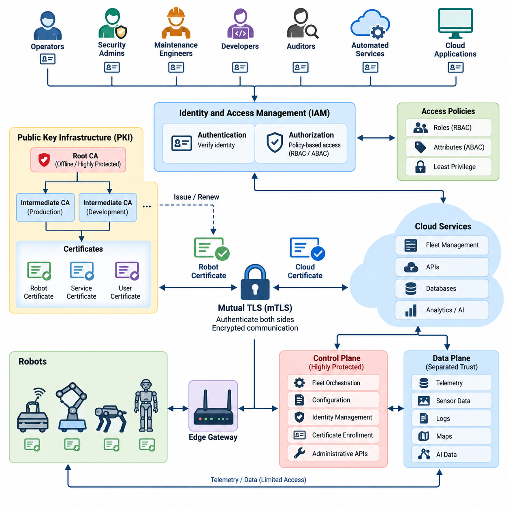
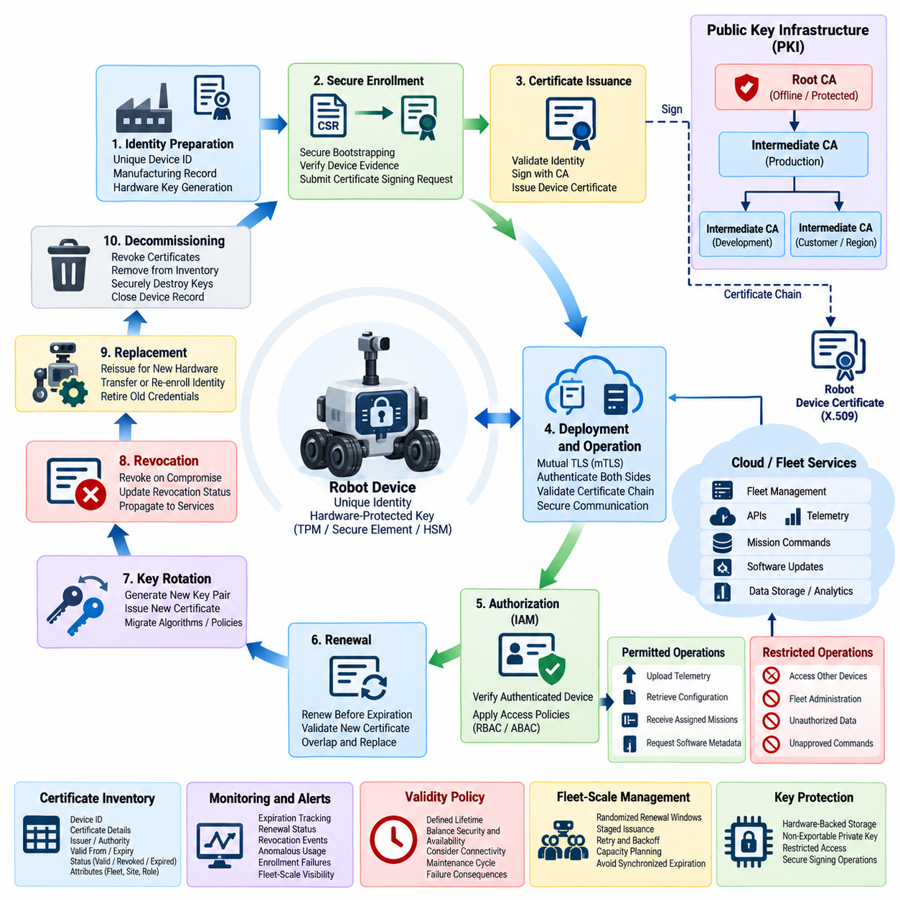
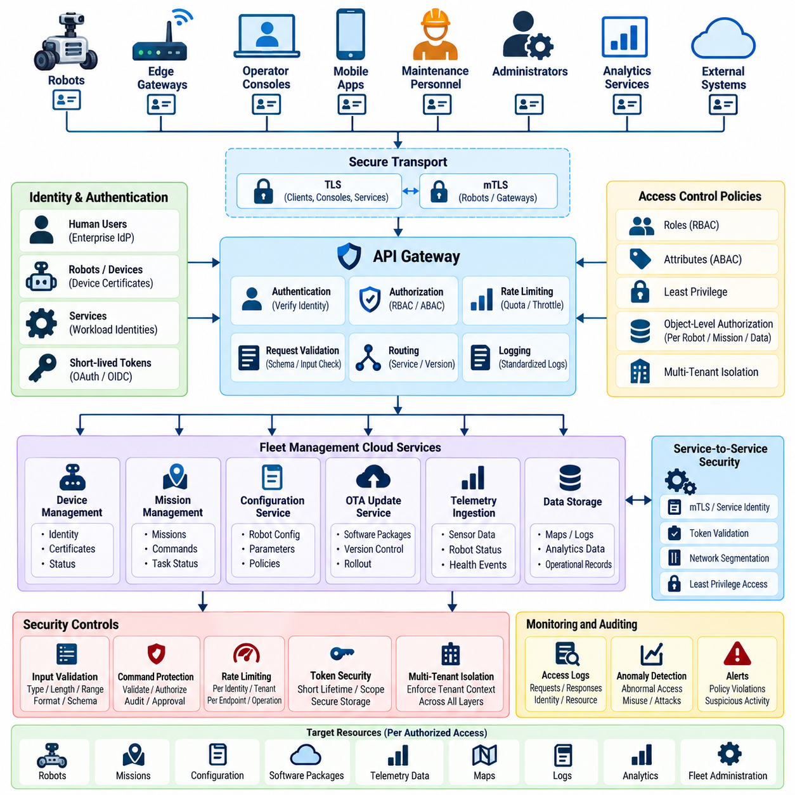
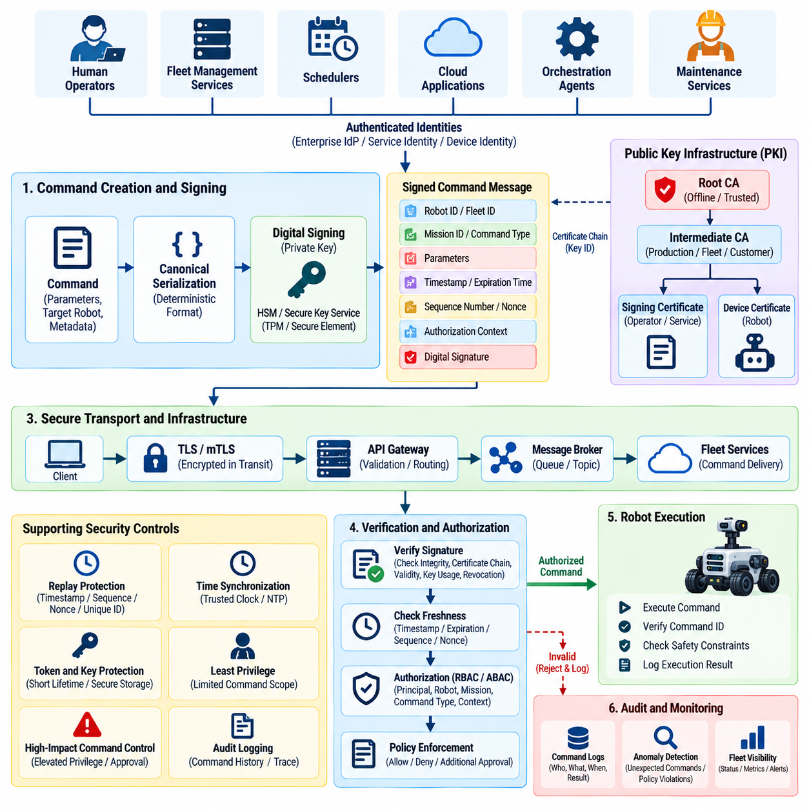
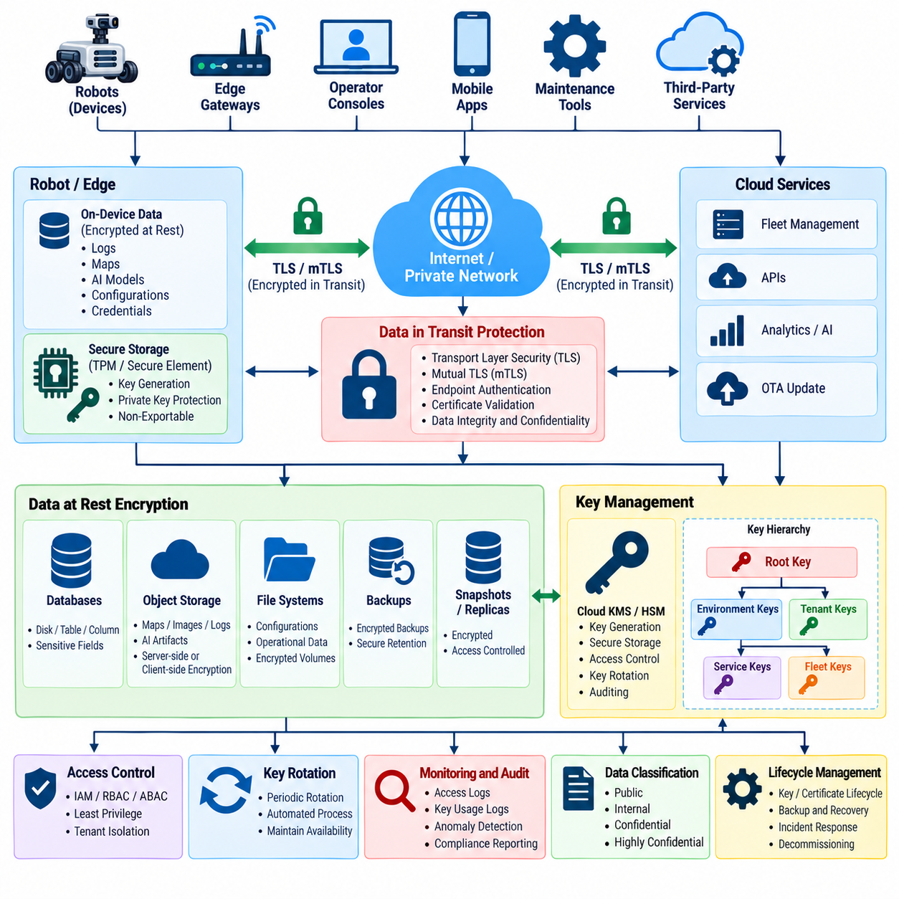
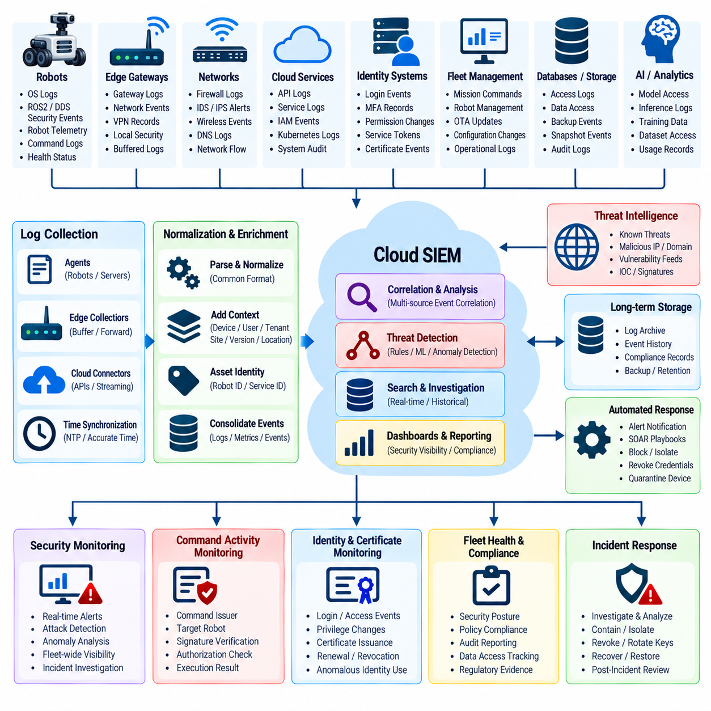
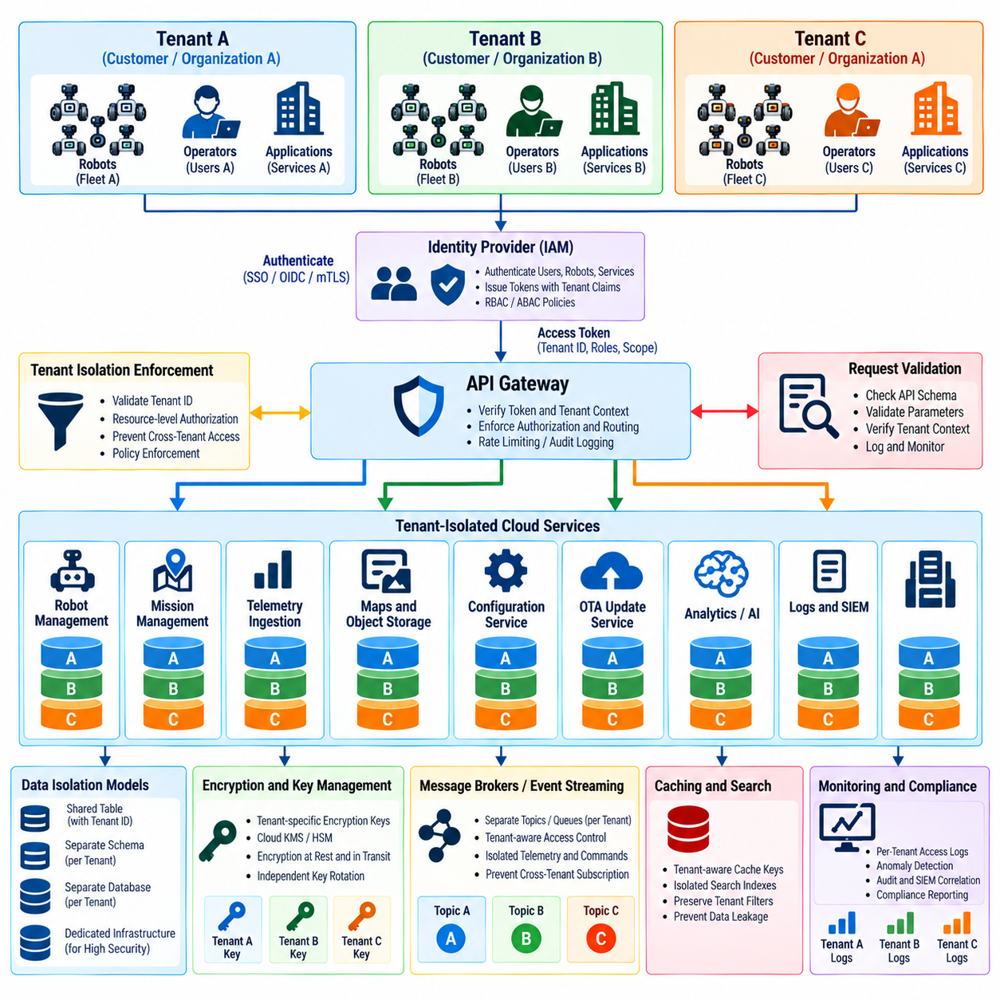
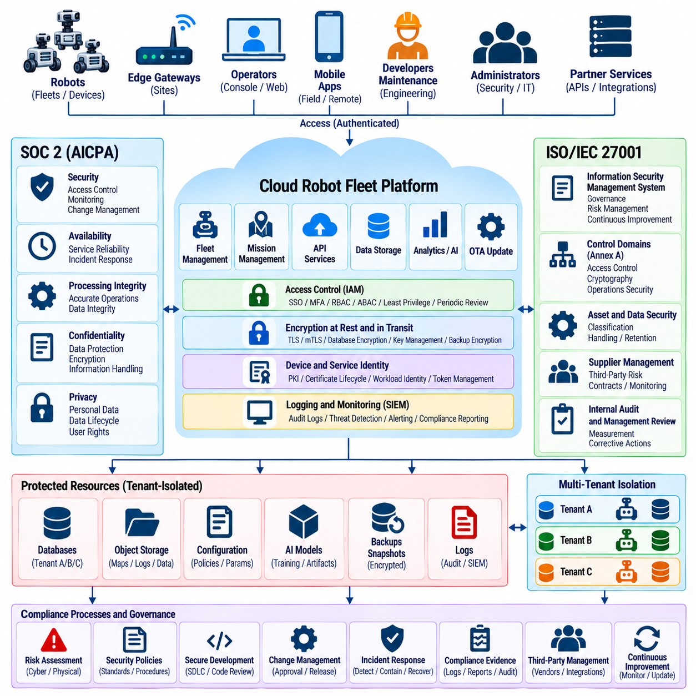
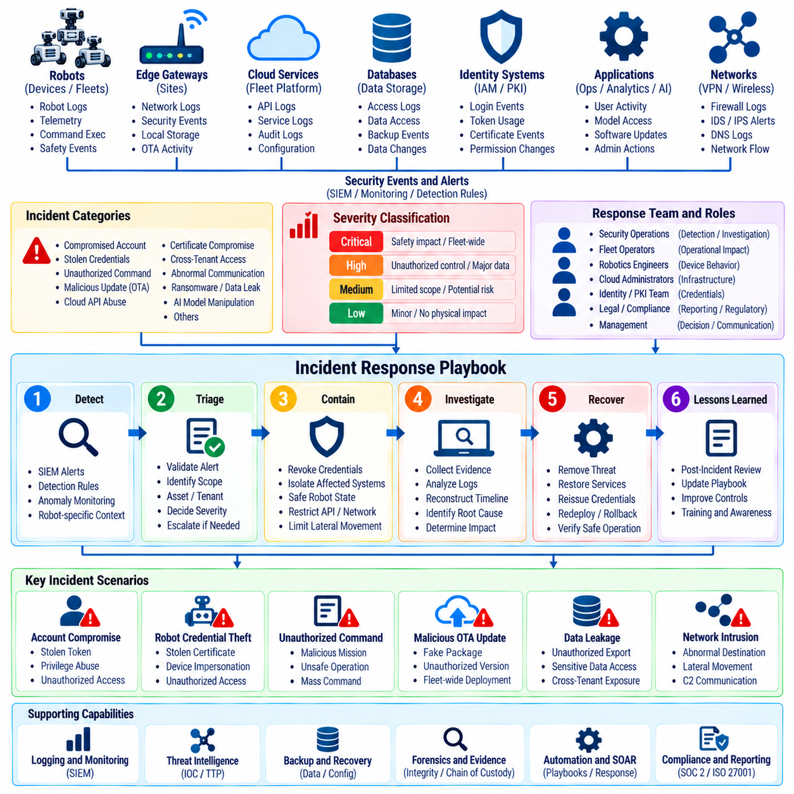
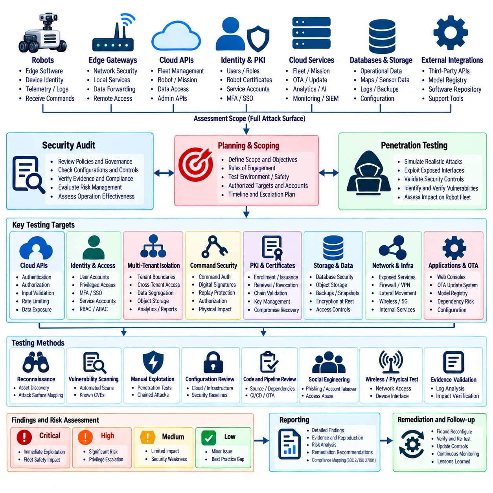

**Volume 24. Robot Cybersecurity**


# Chapter 06. Cloud and Fleet Security

##  

## 06.01. Cloud Robot Security Architecture IAM PKI [w/Code]

{width="7.268055555555556in" height="7.268055555555556in"}

Cloud-connected robots extend the cybersecurity boundary far beyond the physical machine. A production fleet may include robots, edge gateways, wireless networks, cloud APIs, databases, operator consoles, telemetry pipelines, and fleet-management services. The architecture must therefore establish trusted identities and controlled communication across every component rather than treating the cloud as a single trusted domain. Volume_24_Robot_Cybersecurity

Identity and Access Management, or IAM, provides the policy foundation for determining who or what may interact with fleet resources. Human operators, robots, cloud services, maintenance applications, and automated workloads should receive distinct identities. Authentication proves the identity, while authorization determines which commands, APIs, data objects, robot groups, and administrative functions that identity is permitted to access.

Robot identity requires stronger treatment than ordinary application identity because a compromised credential can produce physical consequences. Each robot should possess a unique device identity bound to cryptographic credentials rather than relying on fleet-wide passwords or shared API keys. The identity can be associated with attributes such as robot serial number, fleet membership, deployment site, hardware class, software baseline, and operational role.

Public Key Infrastructure, or PKI, provides a scalable mechanism for establishing cryptographic trust between robots and cloud services. A certification authority issues digitally signed certificates that bind public keys to verified identities. Robots can then authenticate cloud endpoints, while cloud services authenticate individual robots, creating mutual trust without transmitting reusable passwords across potentially hostile networks.

A hierarchical PKI is particularly appropriate for large robot fleets. An offline or tightly protected root certification authority can establish the highest trust anchor, while subordinate issuing authorities perform operational certificate issuance. Separate intermediate authorities may serve production robots, development systems, cloud workloads, manufacturing environments, or different customers, limiting the impact of compromise within one trust domain.

Mutual Transport Layer Security, or mTLS, can apply PKI identities directly to robot-to-cloud communication. During connection establishment, the cloud validates the robot certificate and the robot validates the server certificate. Successful cryptographic authentication therefore occurs in both directions before telemetry, configuration information, mission requests, or operational commands are exchanged through the protected channel.

IAM authorization should operate after certificate authentication rather than assuming that every authenticated robot deserves unrestricted access. A valid certificate proves an identity, but policy determines permitted actions. A warehouse AMR, for example, may upload its own telemetry and receive missions assigned to its fleet while being prohibited from accessing another robot\'s credentials, administrative APIs, or unrelated customer data.

Role-Based Access Control, or RBAC, is useful for organizing human and service permissions. Fleet operators, security administrators, maintenance engineers, developers, auditors, and automated services can receive different roles with narrowly defined privileges. Attribute-Based Access Control, or ABAC, can further evaluate contextual properties such as fleet identifier, site, device state, certificate attributes, requested operation, or environment.

The principle of least privilege should govern both human and machine identities. A telemetry collector does not require permission to issue motion commands, and a diagnostic application should not automatically receive fleet-administration privileges. Separating permissions reduces lateral movement after credential compromise and creates clearer security boundaries among control, monitoring, maintenance, analytics, and administrative functions.

Cloud robot architecture should also separate control-plane and data-plane trust relationships. Fleet orchestration, configuration, identity management, certificate enrollment, and administrative APIs belong to highly protected control functions. Telemetry streams, sensor information, logs, maps, and AI-related data may follow different paths and retention policies. Independent authorization rules prevent data access from implicitly granting control authority.

Short-lived credentials reduce the period during which stolen authentication material remains useful. Human sessions, service tokens, and workload credentials should expire automatically, while robot certificates require defined validity periods and renewal procedures. Long-lived static API keys embedded in robot software are particularly dangerous because extracting one credential may provide persistent access unless it can be individually revoked and replaced.

Certificate lifecycle management begins before a robot enters service. A device may receive an initial identity during trusted manufacturing, commissioning, or secure enrollment. The cloud verifies enrollment evidence before issuing an operational certificate. The resulting identity should remain traceable to the physical device while allowing operational credentials to be renewed without replacing the robot\'s fundamental hardware identity.

Private keys must be protected because possession of a robot\'s private key may enable impersonation. Whenever practical, keys should be generated and retained inside a Trusted Platform Module, Hardware Security Module, secure element, or equivalent protected cryptographic boundary. Applications request signing or authentication operations through controlled interfaces so that private key material does not need to appear directly in ordinary filesystem storage.

Certificate rotation must be designed as a normal fleet operation rather than an emergency-only procedure. Robots should renew credentials before expiration, validate newly issued certificate chains, and transition without disrupting essential services. Fleet systems should monitor certificate age, expiration windows, enrollment failures, and abnormal renewal behavior so identity problems can be detected before they become availability incidents.

Revocation becomes essential when a robot is stolen, decommissioned, compromised, or transferred between operational domains. The security platform must be able to invalidate its credentials and prevent subsequent authentication. Certificate status mechanisms, cloud-side deny lists, identity-state databases, or short certificate lifetimes can support this objective, depending on connectivity and availability requirements of the deployed fleet.

IAM and PKI must also protect service-to-service communication inside the cloud. Fleet managers, message brokers, databases, telemetry processors, OTA services, AI inference services, and monitoring systems should not implicitly trust one another because they share a network. Workload identities and authenticated encrypted connections transform the cloud environment into explicit trust relationships rather than a broad trusted perimeter.

Zero Trust principles strengthen this architecture by requiring continuous verification across robot, edge, and cloud boundaries. Network location alone should never establish authority. Requests should be evaluated according to authenticated identity, authorization policy, device status, requested resource, and relevant security context. This approach complements the volume\'s broader treatment of Zero Trust and defense-in-depth for robot systems. Volume_24_Robot_Cybersecurity

Fleet-scale security additionally requires tenant and organizational boundaries. A cloud platform serving multiple customers must ensure that one tenant cannot authenticate into another tenant\'s robot namespace or retrieve its telemetry, commands, maps, certificates, or administrative information. Identity claims therefore need to propagate consistently through APIs, message brokers, databases, object storage, and analytics services.

Auditability is another fundamental IAM requirement. Authentication attempts, certificate issuance, policy changes, privilege elevation, token creation, failed authorization, credential revocation, and sensitive fleet commands should produce security records containing trustworthy identities and timestamps. Centralized monitoring can correlate these events with robot telemetry and network activity to reveal compromised credentials or abnormal administrative behavior.

Privileged human access requires stronger safeguards than ordinary operator access. Multi-Factor Authentication, or MFA, should protect administrative accounts, while privileged operations can require temporary elevation rather than permanent administrator rights. Emergency access mechanisms should be tightly controlled and extensively audited because cloud administrators may possess authority affecting hundreds or thousands of physical robots simultaneously.

The architecture should assume that connectivity can become intermittent. A robot may temporarily lose access to cloud identity services while continuing safety-critical local operation. Cached credentials and authorization decisions therefore require carefully bounded validity, while essential local safety functions must not depend on continuous cloud authentication. Reconnection should trigger certificate validation, policy synchronization, and reconciliation of security state.

Security boundaries must also preserve separation between cloud authority and local robot safety. Even a correctly authenticated cloud identity should not automatically override collision avoidance, emergency stopping, actuator limits, or independent safety controllers. IAM determines whether a command is authorized to reach the robot, while local safety mechanisms determine whether execution is physically permissible under the current operational state.

A mature implementation combines IAM, PKI, mTLS, protected key storage, least privilege, certificate lifecycle management, workload identity, audit logging, and network segmentation into one coherent trust architecture. This fits the broader robotics software structure in which cloud computing, fleet cloud, robot APIs, fleet APIs, API security, and fleet cybersecurity are treated as interconnected architectural concerns rather than isolated technologies. 08_Robotics_Software_Tree 08_Robotics_Software_Tree

The ultimate objective is cryptographic accountability from individual robot to fleet-scale cloud infrastructure. Every robot, user, workload, and service should have a verifiable identity; every sensitive interaction should be authenticated and authorized; every credential should have a controlled lifecycle; and every significant security action should be traceable. IAM defines who may act, while PKI establishes the cryptographic trust that makes those identities dependable.

클라우드 연결 로봇(Cloud-Connected Robot)은 사이버보안 경계(Cybersecurity Boundary)를 물리적 로봇 자체보다 훨씬 넓은 영역으로 확장한다. 실제 운영되는 로봇 플릿(Robot Fleet)은 로봇, 엣지 게이트웨이(Edge Gateway), 무선 네트워크(Wireless Network), 클라우드 API(Cloud API), 데이터베이스(Database), 운영자 콘솔(Operator Console), 텔레메트리 파이프라인(Telemetry Pipeline), 플릿 관리 서비스(Fleet Management Service)로 구성될 수 있다. 따라서 클라우드를 하나의 신뢰 영역으로 간주하기보다 모든 구성요소 사이에 신뢰할 수 있는 신원(Identity)과 통제된 통신 관계를 구축해야 한다.

신원 및 접근 관리(Identity and Access Management, IAM)는 어떤 사용자 또는 시스템이 플릿 자원(Fleet Resource)과 상호작용할 수 있는지를 결정하는 정책적 기반을 제공한다. 사람 운영자, 로봇, 클라우드 서비스, 유지보수 애플리케이션, 자동화 워크로드(Automated Workload)는 서로 구분된 신원을 가져야 한다. 인증(Authentication)은 신원을 증명하고, 인가(Authorization)는 해당 신원이 어떤 명령, API, 데이터 객체, 로봇 그룹 및 관리 기능에 접근할 수 있는지를 결정한다.

로봇 신원(Robot Identity)은 일반적인 애플리케이션 신원보다 강력하게 관리되어야 한다. 자격 증명(Credential)이 침해되면 실제 물리적 결과로 이어질 수 있기 때문이다. 각 로봇에는 플릿 전체가 공유하는 비밀번호나 API 키(API Key) 대신 암호학적 자격 증명(Cryptographic Credential)에 연결된 고유한 장치 신원(Device Identity)을 부여해야 한다. 이러한 신원은 로봇 일련번호, 플릿 소속, 배치 사이트, 하드웨어 유형, 소프트웨어 기준선(Software Baseline), 운영 역할 등의 속성과 연결할 수 있다.

공개 키 기반 구조(Public Key Infrastructure, PKI)는 로봇과 클라우드 서비스 사이에 암호학적 신뢰(Cryptographic Trust)를 확장성 있게 구축하는 메커니즘을 제공한다. 인증 기관(Certification Authority, CA)은 공개 키(Public Key)를 검증된 신원과 연결하는 디지털 서명 인증서(Digitally Signed Certificate)를 발급한다. 이를 통해 로봇은 클라우드 엔드포인트(Cloud Endpoint)를 인증하고, 클라우드 서비스는 개별 로봇을 인증하여 잠재적으로 적대적인 네트워크에서 재사용 가능한 비밀번호를 전송하지 않고도 상호 신뢰를 구축할 수 있다.

계층형 공개 키 기반 구조(Hierarchical PKI)는 대규모 로봇 플릿에 특히 적합하다. 오프라인 또는 강력하게 보호된 루트 인증 기관(Root Certification Authority)은 최상위 신뢰 앵커(Trust Anchor)를 형성하고, 하위 발급 인증 기관(Subordinate Issuing Authority)이 실제 운영 인증서 발급을 담당할 수 있다. 운영 로봇, 개발 시스템, 클라우드 워크로드, 제조 환경 또는 서로 다른 고객을 위해 별도의 중간 인증 기관(Intermediate Authority)을 사용하면 특정 신뢰 영역의 침해 영향을 제한할 수 있다.

상호 전송 계층 보안(Mutual Transport Layer Security, mTLS)은 공개 키 기반 구조(PKI)의 신원을 로봇-클라우드 통신(Robot-to-Cloud Communication)에 직접 적용할 수 있게 한다. 연결 설정 과정에서 클라우드는 로봇 인증서를 검증하고 로봇은 서버 인증서를 검증한다. 따라서 텔레메트리(Telemetry), 구성 정보(Configuration Information), 임무 요청(Mission Request), 운영 명령(Operational Command)이 보호된 채널을 통해 교환되기 전에 양방향 암호학적 인증이 수행된다.

신원 및 접근 관리(IAM)의 인가(Authorization)는 인증서를 이용한 인증 이후에 적용되어야 하며, 인증된 모든 로봇이 무제한 접근 권한을 가진다고 가정해서는 안 된다. 유효한 인증서는 신원을 증명하지만 실제 허용되는 행위는 정책(Policy)이 결정한다. 예를 들어 창고 자율이동로봇(Autonomous Mobile Robot, AMR)은 자신의 텔레메트리를 업로드하고 소속 플릿에 할당된 임무를 받을 수 있지만 다른 로봇의 자격 증명, 관리 API 또는 다른 고객의 데이터에는 접근하지 못하도록 제한해야 한다.

역할 기반 접근 제어(Role-Based Access Control, RBAC)는 사람과 서비스의 권한을 체계적으로 구성하는 데 유용하다. 플릿 운영자, 보안 관리자, 유지보수 엔지니어, 개발자, 감사자 및 자동화 서비스에 서로 다른 역할과 최소한의 권한을 부여할 수 있다. 속성 기반 접근 제어(Attribute-Based Access Control, ABAC)는 플릿 식별자, 사이트, 장치 상태, 인증서 속성, 요청된 작업 또는 운영 환경과 같은 상황적 속성을 추가로 평가할 수 있다.

최소 권한 원칙(Principle of Least Privilege)은 사람과 기계의 신원 모두에 적용되어야 한다. 텔레메트리 수집기(Telemetry Collector)는 이동 명령을 발행할 권한이 필요하지 않으며, 진단 애플리케이션(Diagnostic Application)이 자동으로 플릿 관리 권한을 가질 필요도 없다. 권한을 분리하면 자격 증명이 침해되었을 때 공격자의 수평 이동(Lateral Movement)을 제한하고 제어, 모니터링, 유지보수, 분석 및 관리 기능 사이에 명확한 보안 경계(Security Boundary)를 형성할 수 있다.

클라우드 로봇 아키텍처(Cloud Robot Architecture)는 제어 평면(Control Plane)과 데이터 평면(Data Plane)의 신뢰 관계도 분리해야 한다. 플릿 오케스트레이션(Fleet Orchestration), 구성 관리(Configuration Management), 신원 관리(Identity Management), 인증서 등록(Certificate Enrollment), 관리 API는 강력하게 보호되는 제어 기능에 해당한다. 텔레메트리, 센서 정보, 로그, 지도 및 인공지능 관련 데이터(AI-Related Data)는 서로 다른 경로와 보존 정책을 사용할 수 있다. 독립적인 인가 규칙을 적용하면 데이터 접근 권한이 제어 권한으로 자동 확장되는 것을 방지할 수 있다.

단기 자격 증명(Short-Lived Credential)은 탈취된 인증 정보가 악용될 수 있는 기간을 줄여준다. 사람의 세션, 서비스 토큰(Service Token), 워크로드 자격 증명(Workload Credential)은 자동으로 만료되어야 하며, 로봇 인증서에는 명확한 유효 기간과 갱신 절차가 정의되어야 한다. 특히 로봇 소프트웨어에 내장된 장기 정적 API 키(Long-Lived Static API Key)는 하나의 자격 증명만 추출되어도 개별적으로 폐기하고 교체하기 전까지 지속적인 접근이 가능하므로 매우 위험하다.

인증서 수명주기 관리(Certificate Lifecycle Management)는 로봇이 실제 서비스에 투입되기 전부터 시작된다. 장치는 신뢰할 수 있는 제조, 시운전(Commissioning) 또는 보안 등록(Secure Enrollment) 과정에서 초기 신원을 부여받을 수 있다. 클라우드는 운영 인증서(Operational Certificate)를 발급하기 전에 등록 증거(Enrollment Evidence)를 검증한다. 이후 운영 자격 증명을 갱신하더라도 기본 하드웨어 신원(Fundamental Hardware Identity)을 교체하지 않고 물리적 장치와 신원의 추적 가능성을 유지해야 한다.

개인 키(Private Key)가 탈취되면 공격자가 로봇을 사칭할 수 있으므로 반드시 보호해야 한다. 가능한 경우 키는 신뢰 플랫폼 모듈(Trusted Platform Module, TPM), 하드웨어 보안 모듈(Hardware Security Module, HSM), 보안 요소(Secure Element) 또는 이에 준하는 보호된 암호학적 경계 내부에서 생성하고 보관해야 한다. 애플리케이션은 통제된 인터페이스를 통해 서명 또는 인증 연산을 요청하여 개인 키가 일반 파일시스템 저장소에 직접 노출되지 않도록 해야 한다.

인증서 순환(Certificate Rotation)은 비상 상황에서만 수행하는 절차가 아니라 정상적인 플릿 운영의 일부로 설계해야 한다. 로봇은 인증서가 만료되기 전에 자격 증명을 갱신하고, 새롭게 발급된 인증서 체인(Certificate Chain)을 검증하며, 필수 서비스가 중단되지 않도록 새로운 인증서로 전환해야 한다. 플릿 시스템은 인증서 사용 기간, 만료 예정 기간, 등록 실패 및 비정상적인 갱신 동작을 모니터링하여 신원 문제가 가용성 사고(Availability Incident)로 발전하기 전에 탐지할 수 있어야 한다.

폐기(Revocation)는 로봇이 도난당하거나, 서비스에서 제외되거나, 침해되거나, 다른 운영 영역으로 이전될 때 필수적이다. 보안 플랫폼은 해당 로봇의 자격 증명을 무효화하고 이후의 인증을 차단할 수 있어야 한다. 연결성과 가용성 요구사항에 따라 인증서 상태 확인 메커니즘(Certificate Status Mechanism), 클라우드 측 거부 목록(Deny List), 신원 상태 데이터베이스(Identity-State Database) 또는 짧은 인증서 수명 등을 활용할 수 있다.

신원 및 접근 관리(IAM)와 공개 키 기반 구조(PKI)는 클라우드 내부의 서비스 간 통신(Service-to-Service Communication)도 보호해야 한다. 플릿 관리자, 메시지 브로커(Message Broker), 데이터베이스, 텔레메트리 처리기, 무선 업데이트 서비스(Over-the-Air, OTA Service), 인공지능 추론 서비스(AI Inference Service), 모니터링 시스템은 동일한 네트워크에 존재한다는 이유만으로 서로를 신뢰해서는 안 된다. 워크로드 신원(Workload Identity)과 인증·암호화된 연결을 사용하면 클라우드 환경을 광범위한 신뢰 영역이 아니라 명시적인 신뢰 관계의 집합으로 전환할 수 있다.

제로 트러스트(Zero Trust) 원칙은 로봇, 엣지 및 클라우드 경계에서 지속적인 검증(Continuous Verification)을 요구함으로써 이러한 아키텍처를 강화한다. 네트워크 위치만으로 권한을 부여해서는 안 된다. 요청은 인증된 신원, 인가 정책, 장치 상태, 요청 자원 및 관련 보안 상황에 따라 평가되어야 한다. 이러한 접근 방식은 로봇 시스템의 심층 방어(Defense in Depth)와 제로 트러스트 아키텍처(Zero Trust Architecture)를 상호 보완한다.

플릿 규모의 보안(Fleet-Scale Security)에는 테넌트(Tenant)와 조직 사이의 경계도 필요하다. 여러 고객에게 서비스를 제공하는 클라우드 플랫폼은 한 테넌트가 다른 테넌트의 로봇 네임스페이스(Robot Namespace)에 인증하거나 해당 텔레메트리, 명령, 지도, 인증서 또는 관리 정보에 접근하지 못하도록 해야 한다. 따라서 신원 클레임(Identity Claim)은 API, 메시지 브로커, 데이터베이스, 객체 스토리지(Object Storage), 분석 서비스 전반에 걸쳐 일관되게 전달되어야 한다.

감사 가능성(Auditability) 역시 신원 및 접근 관리(IAM)의 핵심 요구사항이다. 인증 시도, 인증서 발급, 정책 변경, 권한 상승(Privilege Elevation), 토큰 생성, 인가 실패, 자격 증명 폐기 및 민감한 플릿 명령은 신뢰할 수 있는 신원과 타임스탬프(Timestamp)를 포함하는 보안 기록(Security Record)을 생성해야 한다. 중앙 집중식 모니터링(Centralized Monitoring)은 이러한 이벤트를 로봇 텔레메트리 및 네트워크 활동과 연계하여 침해된 자격 증명이나 비정상적인 관리 행위를 탐지할 수 있다.

권한이 높은 사람의 접근(Privileged Human Access)은 일반 운영자 접근보다 강력한 보호가 필요하다. 다중 요소 인증(Multi-Factor Authentication, MFA)을 통해 관리자 계정을 보호해야 하며, 높은 권한이 필요한 작업에는 영구적인 관리자 권한 대신 임시 권한 상승(Temporary Privilege Elevation)을 적용할 수 있다. 클라우드 관리자는 수백 또는 수천 대의 물리적 로봇에 영향을 줄 수 있으므로 비상 접근(Emergency Access) 메커니즘도 엄격하게 통제하고 상세하게 감사해야 한다.

아키텍처는 네트워크 연결이 간헐적으로 중단될 수 있다는 점도 고려해야 한다. 로봇은 클라우드 신원 서비스(Cloud Identity Service)에 일시적으로 접근하지 못하더라도 안전 필수 로컬 동작(Safety-Critical Local Operation)을 계속 수행해야 할 수 있다. 따라서 캐시된 자격 증명(Cached Credential)과 인가 결정에는 명확한 유효 범위를 설정해야 하며, 필수적인 로컬 안전 기능은 지속적인 클라우드 인증에 의존해서는 안 된다. 연결이 복구되면 인증서 검증, 정책 동기화 및 보안 상태 조정(Security State Reconciliation)을 수행해야 한다.

보안 경계는 클라우드 권한(Cloud Authority)과 로컬 로봇 안전(Local Robot Safety) 사이의 분리도 유지해야 한다. 올바르게 인증된 클라우드 신원이라 하더라도 충돌 회피(Collision Avoidance), 비상 정지(Emergency Stop), 액추에이터 제한(Actuator Limit) 또는 독립 안전 제어기(Independent Safety Controller)를 자동으로 우회해서는 안 된다. 신원 및 접근 관리(IAM)는 명령이 로봇에 전달될 권한이 있는지를 결정하고, 로컬 안전 메커니즘(Local Safety Mechanism)은 현재 운영 상태에서 해당 명령을 물리적으로 실행할 수 있는지를 결정한다.

성숙한 구현에서는 신원 및 접근 관리(IAM), 공개 키 기반 구조(PKI), 상호 전송 계층 보안(mTLS), 보호된 키 저장(Protected Key Storage), 최소 권한(Least Privilege), 인증서 수명주기 관리(Certificate Lifecycle Management), 워크로드 신원(Workload Identity), 감사 로깅(Audit Logging), 네트워크 분할(Network Segmentation)을 하나의 일관된 신뢰 아키텍처(Trust Architecture)로 통합한다. 이는 클라우드 컴퓨팅(Cloud Computing), 플릿 클라우드(Fleet Cloud), 로봇 API(Robot API), 플릿 API(Fleet API), API 보안(API Security), 플릿 사이버보안(Fleet Cybersecurity)을 서로 분리된 기술이 아니라 상호 연결된 아키텍처 요소로 다루는 전체 로보틱스 소프트웨어 구조와 일치한다.

궁극적인 목표는 개별 로봇에서 플릿 규모의 클라우드 인프라까지 이어지는 암호학적 책임 추적성(Cryptographic Accountability)을 확보하는 것이다. 모든 로봇, 사용자, 워크로드 및 서비스는 검증 가능한 신원(Verifiable Identity)을 가져야 하며, 모든 민감한 상호작용은 인증되고 인가되어야 한다. 모든 자격 증명은 통제된 수명주기(Controlled Lifecycle)를 가져야 하며, 중요한 보안 행위는 추적 가능해야 한다. 신원 및 접근 관리(IAM)는 누가 어떤 행위를 수행할 수 있는지를 정의하고, 공개 키 기반 구조(PKI)는 이러한 신원을 신뢰할 수 있도록 만드는 암호학적 신뢰 기반을 제공한다.

##  

## 06.02. Robot Device Certificate Lifecycle Management [w/Code]

{width="7.268055555555556in" height="7.268055555555556in"}

A robot device certificate is the cryptographic identity credential that allows a fleet platform to determine whether a connecting machine is an authorized device. Unlike a shared password or fleet-wide API key, a certificate binds a specific robot identity to a public key. Effective lifecycle management must protect this relationship from manufacturing and enrollment through operation, renewal, revocation, replacement, and final decommissioning.

The lifecycle begins with establishing a trustworthy device identity. Each robot should receive a unique identifier associated with its hardware, manufacturing record, deployment domain, and security configuration. The corresponding cryptographic key pair should preferably be generated inside protected hardware such as a Trusted Platform Module, secure element, or Hardware Security Module so that the private key does not need to leave its protected execution boundary.

Initial provisioning requires a secure method for connecting the physical robot to the fleet\'s Public Key Infrastructure. A manufacturer-installed credential, hardware-rooted identity, one-time enrollment secret, or controlled commissioning process can provide bootstrap trust. The enrollment service must verify this evidence before accepting a certificate signing request, because automatically issuing certificates to unverified devices would undermine the entire device identity architecture.

A certificate signing request normally contains the robot\'s public key and identity information required by the certification policy. The Certificate Authority validates the request and issues an operational certificate whose attributes identify the device within the permitted trust domain. Certificate contents should remain sufficiently stable and standardized that fleet services can reliably map authenticated certificates to robot records, policies, tenants, sites, and operational roles.

The certificate chain establishes how cloud services determine whether a robot certificate can be trusted. A protected root Certificate Authority forms the trust anchor, while intermediate issuing authorities can handle routine device certificate operations. Separating root and operational issuance reduces exposure of the highest-value signing key and allows different certificate authorities to be assigned to production, development, manufacturing, customer, or regional environments.

After provisioning, certificates become part of normal robot communication. Mutual Transport Layer Security can require the robot to authenticate the cloud service while the cloud simultaneously authenticates the robot certificate. Successful validation should include the certificate signature, chain of trust, validity period, intended key usage, expected identity attributes, and relevant certificate status before the connection is treated as authenticated.

Authentication alone does not determine what the robot may do. After certificate validation, the authenticated device identity should be passed to Identity and Access Management policies that authorize specific operations. A robot may be permitted to publish its telemetry, retrieve configuration, receive assigned missions, or request approved software metadata while remaining prohibited from accessing another device\'s information or fleet administration functions.

Certificate validity periods create a deliberate limit on credential lifetime. Extremely long-lived certificates increase exposure if a credential is compromised, whereas excessively short lifetimes can create operational availability problems when robots have intermittent connectivity. Fleet architects therefore need a validity policy that balances security, renewal reliability, connectivity characteristics, maintenance cycles, and the consequences of authentication failure.

Renewal should occur well before certificate expiration. A robot can authenticate with its existing valid credential, generate or select the appropriate key material, submit a renewal request, validate the returned certificate chain, and activate the replacement credential. Sufficient overlap between old and new certificates can prevent service interruption while still ensuring that obsolete credentials are retired according to defined policy.

Key rotation and certificate renewal are related but distinct operations. Renewal can issue a new certificate for an existing key, whereas key rotation creates a new cryptographic key pair and replaces the associated certificate. Periodic key rotation reduces dependence on long-lived private keys and provides an opportunity to migrate algorithms, key sizes, hardware security mechanisms, or certificate policies as security requirements evolve.

Fleet-scale renewal should avoid synchronized expiration events. If thousands of robots receive certificates at the same time and use identical validity periods, they may attempt renewal simultaneously, creating a load spike against enrollment and Certificate Authority services. Randomized renewal windows, staged issuance, retry backoff, capacity planning, and monitoring help distribute certificate operations across manageable intervals.

Private key protection remains critical throughout the lifecycle. Keys stored as ordinary files may be copied through malware, diagnostic access, backup processes, or filesystem compromise. Hardware-backed storage can make private keys non-exportable and require cryptographic operations to occur inside the protected component. Access to those operations should also be restricted so unauthorized software cannot freely use a legitimate device key.

Certificate inventory provides the fleet operator with visibility into the identity state of deployed robots. The platform should know which certificate belongs to each device, which authority issued it, when it became valid, when it expires, its current lifecycle status, and whether replacement or revocation has occurred. Inventory information should remain synchronized with fleet asset records so cybersecurity teams can trace credentials to physical devices.

Monitoring converts certificate management from a provisioning function into an operational security capability. Fleet services should detect certificates approaching expiration, repeated enrollment failures, unexpected issuers, invalid chains, abnormal renewal frequency, authentication from unexpected environments, or attempts to use revoked credentials. These events can be forwarded to centralized security monitoring and correlated with robot, network, and cloud activity.

Revocation is required when continued trust can no longer be justified. A robot certificate may need to be revoked because the device was compromised, stolen, retired, transferred, incorrectly provisioned, or suspected of private-key exposure. Revocation should disable the affected identity without forcing unrelated robots to replace their credentials, which is an important advantage of assigning unique certificates to individual devices.

Certificate Revocation Lists and online certificate status mechanisms can communicate invalid credential status, although fleet environments must account for intermittent connectivity. Short-lived certificates, cloud-side identity state, deny lists, and locally cached revocation information can supplement conventional PKI mechanisms. The architecture must define how long a disconnected robot may rely on cached trust information before additional restrictions become necessary.

Recovery from credential compromise requires more than simply issuing another certificate. The system must determine whether the existing private key can still be trusted, revoke the compromised credential, establish a trustworthy path for re-enrollment, and verify the robot\'s security state before restoring access. If the original device identity itself is questionable, recovery may require hardware-rooted attestation or controlled physical maintenance.

Certificate management must also handle device replacement and hardware repair. Replacing a controller, Trusted Platform Module, secure element, or motherboard may invalidate the cryptographic relationship between the physical robot and its previous credential. The fleet database should preserve historical traceability while creating a new trusted identity binding, rather than silently copying private keys from the replaced hardware into a new security environment.

Offline and intermittently connected robots require special lifecycle policies. A robot may be unable to contact enrollment or status services for extended periods, yet immediate certificate expiration could unnecessarily stop legitimate operations. Local safety functions should remain independent of cloud certificate availability, while cloud access can use bounded offline validity, cached trust anchors, and controlled reconnection procedures appropriate to operational risk.

Decommissioning closes the certificate lifecycle. When a robot permanently leaves service, its active certificates should be revoked or otherwise made unusable, cloud permissions removed, fleet records updated, and protected credentials securely destroyed where supported. Backup credentials, enrollment secrets, maintenance certificates, and associated service identities should also be addressed so retired hardware cannot later reappear as an apparently legitimate fleet device.

Audit records should capture important lifecycle events such as enrollment, certificate issuance, renewal, rotation, failed validation, revocation, administrative override, recovery, and decommissioning. These records create accountability and support incident investigation by showing which identity was valid at a particular time, which authority issued it, what administrative action occurred, and how the credential state changed.

Automation becomes essential as the fleet grows from tens of robots to hundreds or thousands. Certificate discovery, enrollment, renewal, expiration monitoring, rotation, revocation, policy validation, and inventory reconciliation should be orchestrated through controlled services rather than manual administrator actions. Automation reduces configuration drift while allowing security policy to be applied consistently across heterogeneous robot platforms.

A mature robot certificate lifecycle therefore forms a continuous trust-management process rather than a one-time provisioning task. Secure identity establishment, protected key generation, controlled enrollment, certificate validation, automated renewal, key rotation, revocation, recovery, auditing, and decommissioning collectively preserve device trust throughout operational life. The result is a fleet in which every robot\'s cryptographic identity can be individually established, monitored, changed, and withdrawn.

로봇 장치 인증서(Robot Device Certificate)는 플릿 플랫폼(Fleet Platform)이 연결을 시도하는 기계가 승인된 장치인지 판단할 수 있도록 하는 암호학적 신원 자격 증명(Cryptographic Identity Credential)이다. 공유 비밀번호나 플릿 전체에서 사용하는 API 키(API Key)와 달리 인증서는 특정 로봇 신원(Robot Identity)을 공개 키(Public Key)와 결합한다. 효과적인 수명주기 관리(Lifecycle Management)는 제조와 등록부터 운영, 갱신, 폐기, 교체 및 최종 서비스 종료까지 이러한 관계를 보호해야 한다.

수명주기는 신뢰할 수 있는 장치 신원(Device Identity)을 확립하는 것에서 시작한다. 각 로봇에는 하드웨어, 제조 기록, 배포 도메인(Deployment Domain), 보안 구성(Security Configuration)과 연계된 고유 식별자를 부여해야 한다. 이에 대응하는 암호학적 키 쌍(Cryptographic Key Pair)은 개인 키(Private Key)가 보호된 실행 경계 밖으로 나가지 않도록 신뢰 플랫폼 모듈(Trusted Platform Module, TPM), 보안 요소(Secure Element), 하드웨어 보안 모듈(Hardware Security Module, HSM)과 같은 보호된 하드웨어 내부에서 생성하는 것이 바람직하다.

초기 프로비저닝(Initial Provisioning)에는 물리적 로봇을 플릿의 공개 키 기반 구조(Public Key Infrastructure, PKI)에 연결하는 안전한 방법이 필요하다. 제조업체가 설치한 자격 증명, 하드웨어 기반 신원(Hardware-Rooted Identity), 일회성 등록 비밀정보(One-Time Enrollment Secret) 또는 통제된 시운전 과정(Controlled Commissioning Process)을 통해 초기 신뢰(Bootstrap Trust)를 제공할 수 있다. 검증되지 않은 장치에 인증서를 자동 발급하면 전체 장치 신원 아키텍처가 무력화될 수 있으므로 등록 서비스(Enrollment Service)는 인증서 서명 요청을 수락하기 전에 이러한 증거를 검증해야 한다.

인증서 서명 요청(Certificate Signing Request, CSR)은 일반적으로 로봇의 공개 키와 인증 정책(Certification Policy)에 필요한 신원 정보를 포함한다. 인증 기관(Certificate Authority, CA)은 요청을 검증하고 허용된 신뢰 도메인(Trust Domain) 내에서 해당 장치를 식별하는 속성을 포함한 운영 인증서(Operational Certificate)를 발급한다. 플릿 서비스가 인증된 인증서를 로봇 기록, 정책, 테넌트(Tenant), 사이트 및 운영 역할과 안정적으로 연결할 수 있도록 인증서 내용은 충분히 일관되고 표준화되어야 한다.

인증서 체인(Certificate Chain)은 클라우드 서비스가 로봇 인증서를 신뢰할 수 있는지를 판단하는 구조를 형성한다. 보호된 루트 인증 기관(Root Certificate Authority)은 신뢰 앵커(Trust Anchor)를 구성하고, 중간 발급 인증 기관(Intermediate Issuing Authority)은 일상적인 장치 인증서 운영을 담당할 수 있다. 루트와 운영 인증서 발급 기능을 분리하면 가장 중요한 서명 키(Signing Key)의 노출 위험을 줄이고 운영, 개발, 제조, 고객 또는 지역 환경별로 서로 다른 인증 기관을 배정할 수 있다.

프로비저닝 이후 인증서는 정상적인 로봇 통신의 일부가 된다. 상호 전송 계층 보안(Mutual Transport Layer Security, mTLS)을 사용하면 로봇이 클라우드 서비스를 인증하는 동시에 클라우드도 로봇 인증서를 인증하도록 요구할 수 있다. 연결을 인증된 상태로 인정하기 전에 인증서 서명, 신뢰 체인(Chain of Trust), 유효 기간, 의도된 키 사용 목적(Key Usage), 예상 신원 속성 및 관련 인증서 상태를 검증해야 한다.

인증(Authentication)만으로 로봇이 수행할 수 있는 작업이 결정되는 것은 아니다. 인증서 검증이 완료되면 인증된 장치 신원은 특정 작업을 허가하는 신원 및 접근 관리(Identity and Access Management, IAM) 정책으로 전달되어야 한다. 로봇은 자신의 텔레메트리(Telemetry)를 전송하고, 구성을 가져오며, 할당된 임무를 수신하거나 승인된 소프트웨어 메타데이터를 요청할 수 있지만 다른 장치의 정보나 플릿 관리 기능에는 접근하지 못하도록 제한할 수 있다.

인증서 유효 기간(Certificate Validity Period)은 자격 증명의 수명을 의도적으로 제한한다. 지나치게 긴 수명의 인증서는 자격 증명이 침해되었을 때 위험 노출을 증가시키는 반면, 지나치게 짧은 유효 기간은 간헐적으로 연결되는 로봇에서 운영 가용성 문제를 발생시킬 수 있다. 따라서 플릿 설계자는 보안, 갱신 신뢰성, 네트워크 연결 특성, 유지보수 주기 및 인증 실패의 영향을 균형 있게 고려하여 유효 기간 정책을 정의해야 한다.

갱신(Renewal)은 인증서가 만료되기 충분한 시간 전에 수행되어야 한다. 로봇은 기존의 유효한 자격 증명으로 인증하고, 적절한 키 자료(Key Material)를 생성하거나 선택한 다음 갱신 요청을 제출하고 반환된 인증서 체인을 검증하여 교체 인증서를 활성화할 수 있다. 기존 인증서와 신규 인증서 사이에 충분한 중첩 기간(Overlap Period)을 제공하면 서비스 중단을 방지하면서도 정의된 정책에 따라 오래된 자격 증명을 폐기할 수 있다.

키 순환(Key Rotation)과 인증서 갱신(Certificate Renewal)은 서로 연관되어 있지만 구별되는 작업이다. 인증서 갱신은 기존 키에 새로운 인증서를 발급할 수 있는 반면, 키 순환은 새로운 암호학적 키 쌍을 생성하고 이에 연결된 인증서를 교체한다. 주기적인 키 순환은 장기간 사용되는 개인 키에 대한 의존성을 줄이며, 보안 요구사항의 변화에 따라 알고리즘, 키 크기, 하드웨어 보안 메커니즘 또는 인증서 정책을 변경할 수 있는 기회를 제공한다.

플릿 규모의 갱신(Fleet-Scale Renewal)은 인증서 만료 시점이 동시에 집중되는 현상을 방지해야 한다. 수천 대의 로봇이 동시에 인증서를 발급받고 동일한 유효 기간을 사용하면 모든 로봇이 같은 시점에 갱신을 시도하여 등록 서비스와 인증 기관에 부하가 집중될 수 있다. 무작위화된 갱신 구간(Randomized Renewal Window), 단계적 발급(Staged Issuance), 재시도 백오프(Retry Backoff), 용량 계획(Capacity Planning), 모니터링을 활용하면 인증서 작업을 관리 가능한 시간 구간으로 분산할 수 있다.

개인 키 보호(Private Key Protection)는 전체 수명주기 동안 핵심적인 요구사항으로 유지된다. 일반 파일 형태로 저장된 키는 악성코드, 진단 접근, 백업 과정 또는 파일시스템 침해를 통해 복사될 수 있다. 하드웨어 기반 저장소(Hardware-Backed Storage)는 개인 키를 외부로 추출할 수 없도록 하고 암호학적 연산을 보호된 구성요소 내부에서 수행하도록 할 수 있다. 또한 승인되지 않은 소프트웨어가 정상적인 장치 키를 자유롭게 사용하지 못하도록 이러한 연산에 대한 접근 자체도 제한해야 한다.

인증서 인벤토리(Certificate Inventory)는 플릿 운영자가 배포된 로봇의 신원 상태를 파악할 수 있도록 한다. 플랫폼은 각 장치에 어떤 인증서가 연결되어 있는지, 어떤 인증 기관이 이를 발급했는지, 언제부터 유효했는지, 언제 만료되는지, 현재 수명주기 상태가 무엇인지, 교체 또는 폐기가 이루어졌는지를 파악해야 한다. 사이버보안 팀이 자격 증명을 실제 물리적 장치까지 추적할 수 있도록 인벤토리 정보는 플릿 자산 기록(Fleet Asset Record)과 동기화되어야 한다.

모니터링(Monitoring)은 인증서 관리를 단순한 프로비저닝 기능에서 운영 보안 기능(Operational Security Capability)으로 전환한다. 플릿 서비스는 만료가 임박한 인증서, 반복되는 등록 실패, 예상하지 못한 발급 기관, 유효하지 않은 인증서 체인, 비정상적인 갱신 빈도, 예상하지 못한 환경에서의 인증 또는 폐기된 자격 증명의 사용 시도를 탐지해야 한다. 이러한 이벤트는 중앙 집중식 보안 모니터링(Centralized Security Monitoring)으로 전달하여 로봇, 네트워크 및 클라우드 활동과 연계할 수 있다.

지속적인 신뢰를 더 이상 보장할 수 없는 경우 인증서 폐기(Certificate Revocation)가 필요하다. 장치가 침해되거나 도난당하거나 서비스에서 제외되거나 이전되거나 잘못 프로비저닝되었거나 개인 키 노출이 의심되는 경우 로봇 인증서를 폐기해야 할 수 있다. 개별 장치마다 고유한 인증서를 부여하면 영향을 받은 신원만 비활성화하고 관련 없는 다른 로봇의 자격 증명까지 교체하지 않아도 된다는 중요한 장점이 있다.

인증서 폐기 목록(Certificate Revocation List, CRL)과 온라인 인증서 상태 확인 메커니즘(Online Certificate Status Mechanism)은 무효화된 자격 증명의 상태를 전달할 수 있지만, 플릿 환경에서는 간헐적인 네트워크 연결도 고려해야 한다. 단기 인증서(Short-Lived Certificate), 클라우드 측 신원 상태(Cloud-Side Identity State), 거부 목록(Deny List), 로컬에 캐시된 폐기 정보(Cached Revocation Information)를 기존 공개 키 기반 구조 메커니즘과 함께 사용할 수 있다. 아키텍처는 연결이 끊어진 로봇이 추가적인 제한을 적용받기 전에 캐시된 신뢰 정보를 얼마나 오래 사용할 수 있는지를 정의해야 한다.

자격 증명 침해(Credential Compromise)로부터 복구하려면 단순히 새로운 인증서를 발급하는 것만으로는 충분하지 않다. 시스템은 기존 개인 키를 계속 신뢰할 수 있는지 판단하고, 침해된 자격 증명을 폐기하며, 재등록(Re-Enrollment)을 위한 신뢰할 수 있는 경로를 구축하고, 접근을 복원하기 전에 로봇의 보안 상태를 검증해야 한다. 원래의 장치 신원 자체를 신뢰하기 어려운 경우에는 하드웨어 기반 증명(Hardware-Rooted Attestation) 또는 통제된 물리적 유지보수가 필요할 수 있다.

인증서 관리는 장치 교체(Device Replacement)와 하드웨어 수리(Hardware Repair)도 처리할 수 있어야 한다. 제어기, 신뢰 플랫폼 모듈(TPM), 보안 요소 또는 메인보드를 교체하면 물리적 로봇과 기존 자격 증명 사이의 암호학적 관계가 더 이상 유효하지 않을 수 있다. 플릿 데이터베이스는 교체된 하드웨어의 개인 키를 새로운 보안 환경으로 단순 복사하는 대신 기존 이력의 추적 가능성을 유지하면서 새로운 신뢰 신원 연결(Trusted Identity Binding)을 생성해야 한다.

오프라인 또는 간헐적으로 연결되는 로봇(Offline or Intermittently Connected Robot)에는 특별한 수명주기 정책이 필요하다. 로봇이 장시간 등록 서비스나 인증서 상태 서비스에 접근하지 못할 수 있지만, 인증서가 만료되었다는 이유만으로 정상적인 운영까지 즉시 중단시키는 것은 바람직하지 않을 수 있다. 로컬 안전 기능(Local Safety Function)은 클라우드 인증서 가용성과 독립적으로 유지하고, 클라우드 접근에는 운영 위험에 적합한 제한된 오프라인 유효성(Bounded Offline Validity), 캐시된 신뢰 앵커(Cached Trust Anchor), 통제된 재연결 절차를 적용할 수 있다.

서비스 종료(Decommissioning)는 인증서 수명주기의 마지막 단계이다. 로봇이 영구적으로 서비스에서 제외되면 활성 인증서를 폐기하거나 더 이상 사용할 수 없도록 만들고, 클라우드 권한을 제거하며, 플릿 기록을 갱신하고, 지원되는 경우 보호된 자격 증명을 안전하게 삭제해야 한다. 퇴역한 하드웨어가 이후 정상적인 플릿 장치처럼 다시 나타나는 것을 방지하기 위해 백업 자격 증명, 등록 비밀정보, 유지보수 인증서 및 관련 서비스 신원도 함께 처리해야 한다.

감사 기록(Audit Record)은 등록, 인증서 발급, 갱신, 순환, 검증 실패, 폐기, 관리자 우회(Administrative Override), 복구 및 서비스 종료와 같은 중요한 수명주기 이벤트를 기록해야 한다. 이러한 기록은 특정 시점에 어떤 신원이 유효했는지, 어떤 인증 기관이 인증서를 발급했는지, 어떤 관리 작업이 수행되었는지, 자격 증명 상태가 어떻게 변경되었는지를 보여줌으로써 책임 추적성(Accountability)을 확보하고 보안 사고 조사(Incident Investigation)를 지원한다.

플릿이 수십 대에서 수백 또는 수천 대 규모로 증가하면 자동화(Automation)가 필수적이다. 인증서 검색(Discovery), 등록, 갱신, 만료 모니터링, 키 순환, 폐기, 정책 검증 및 인벤토리 조정(Inventory Reconciliation)은 관리자의 수작업이 아니라 통제된 서비스를 통해 오케스트레이션되어야 한다. 자동화는 구성 편차(Configuration Drift)를 줄이고 서로 다른 로봇 플랫폼 전체에 일관된 보안 정책을 적용할 수 있도록 한다.

성숙한 로봇 인증서 수명주기(Robot Certificate Lifecycle)는 일회성 프로비저닝 작업이 아니라 지속적인 신뢰 관리 프로세스(Continuous Trust-Management Process)를 형성한다. 안전한 신원 확립, 보호된 키 생성, 통제된 등록, 인증서 검증, 자동 갱신, 키 순환, 폐기, 복구, 감사 및 서비스 종료가 함께 작동하여 전체 운영 수명 동안 장치 신뢰(Device Trust)를 유지한다. 이를 통해 플릿의 모든 로봇에 대한 암호학적 신원을 개별적으로 확립하고, 모니터링하고, 변경하며, 필요한 경우 신뢰를 철회할 수 있다.

##  

## 06.03. Cloud API Security for Fleet Management [w/Code]

{width="7.268055555555556in" height="7.268055555555556in"}

Cloud Application Programming Interfaces are central security boundaries in modern fleet-management platforms because they connect robots, operator consoles, mobile applications, edge gateways, analytics services, and administrative systems. An API request may retrieve telemetry or configuration, but it may also dispatch missions or change operational parameters. API security must therefore protect both digital information and actions that can produce physical consequences.

Every API request should originate from an authenticated identity. Human users can authenticate through enterprise identity systems and short-lived access tokens, while robots and machine services should use dedicated workload or device identities. Shared fleet credentials should be avoided because they make individual devices difficult to identify, revoke, and audit after compromise. Authentication must establish exactly which principal initiated each request.

Transport protection provides the first communication boundary. Fleet APIs should use Transport Layer Security for all external and internal network communication, with strong certificate validation and current cryptographic configurations. Robot-facing interfaces can additionally use mutual Transport Layer Security so that the cloud verifies the robot certificate while the robot verifies the fleet service, reducing exposure to impersonation and man-in-the-middle attacks.

Authentication must be followed by explicit authorization. A valid identity does not imply unrestricted access to every robot or fleet operation. Role-Based Access Control can assign permissions to operators, maintenance personnel, administrators, auditors, and services, while Attribute-Based Access Control can incorporate fleet identifier, tenant, site, robot class, requested action, device status, or operational context into authorization decisions.

Object-level authorization is particularly important for fleet APIs. An authenticated user who is permitted to access robot A must not automatically gain access to robot B simply by changing a robot identifier in a URL or request body. Authorization should be evaluated against the specific resource on every request, including robots, missions, maps, logs, certificates, configuration objects, software packages, and customer-specific fleet records.

API endpoints should follow the principle of least privilege. Telemetry ingestion services need permission to accept authorized data but generally should not issue motion commands. Analytics services may require historical fleet data without requiring access to certificate administration or robot control. Separating read, write, command, configuration, maintenance, and administrative privileges limits lateral movement if one account, token, or service becomes compromised.

Fleet command APIs require stronger controls because their outputs may affect physical motion. Commands should be associated with authenticated principals, authorized against the targeted robot and mission context, validated against allowed command schemas, and recorded for audit. High-impact operations such as disabling safety-related services, changing security configuration, or controlling large groups of robots may require elevated privileges or additional approval.

Input validation must occur before untrusted API data reaches fleet services. Parameters should be checked for expected type, length, range, format, enumeration, and structure. Unknown or malformed fields should not silently influence backend behavior. Strict schemas reduce injection opportunities, parser inconsistencies, unsafe parameter manipulation, and unexpected command interpretation across heterogeneous robot and cloud software.

API gateways can provide a centralized enforcement point for externally exposed fleet services. They can terminate secure connections, validate authentication tokens, enforce routing rules, apply rate limits, inspect request metadata, and generate standardized access logs. However, backend services should not assume that requests are trustworthy merely because they passed through a gateway; critical authorization should remain enforceable at the service or resource boundary.

Rate limiting protects fleet infrastructure from both deliberate abuse and malfunctioning clients. Limits can be applied by identity, robot, tenant, endpoint, source, or operation type. A telemetry endpoint may permit high sustained throughput, while administrative or command APIs may require much tighter thresholds. Burst controls and quotas help prevent compromised credentials from being used to overwhelm control-plane services.

Token security is another essential concern. Access tokens should have limited lifetime, constrained scope, protected storage, and secure transmission. Sensitive tokens should not appear in URLs, diagnostic dumps, source repositories, or ordinary application logs. Refresh mechanisms must also be protected because a long-lived refresh credential can undermine the security benefit of short-lived access tokens if it is stolen.

Fleet platforms commonly use service-to-service APIs internally, and these interfaces require protection equivalent to public endpoints. Microservices should authenticate one another through workload identities, mutual TLS, signed tokens, or equivalent mechanisms rather than trusting network location. Compromise of one internal service should not automatically provide unrestricted access to mission management, device identity, OTA, telemetry, or fleet administration services.

Multi-tenant platforms require authorization boundaries at every layer. Tenant identity should be propagated through authenticated requests and consistently enforced by API services, databases, message brokers, caches, and object storage. A request from one customer must never retrieve another customer\'s robots, missions, telemetry, maps, credentials, or administrative metadata even when resource identifiers are guessed or manipulated.

API versioning and lifecycle management also influence security. Obsolete endpoints can preserve weak authentication mechanisms, deprecated parameters, or unpatched implementation defects long after newer APIs are deployed. Fleet operators should maintain an inventory of active API versions, define deprecation schedules, monitor legacy usage, and eventually disable unsupported endpoints rather than leaving them indefinitely accessible for compatibility.

Error handling should provide useful diagnostics without exposing sensitive internal information. Responses should not reveal database queries, stack traces, secret values, internal network addresses, cryptographic material, or detailed authorization logic. Externally returned errors can remain concise while internal observability systems retain richer diagnostic context for authorized engineering and security personnel.

Logging should create an accountable history of fleet API activity. Important records include authenticated identity, requested resource, operation, timestamp, authorization result, response status, and relevant correlation identifiers. Security-sensitive operations such as fleet-wide commands, credential changes, permission modifications, configuration updates, or repeated authentication failures should receive additional monitoring and retention appropriate to their risk.

Centralized security monitoring can correlate API activity with robot telemetry, cloud logs, and network events. A valid account suddenly controlling unusual robots, downloading abnormal volumes of data, generating repeated authorization failures, or calling administrative endpoints from an unexpected environment may indicate credential compromise. Behavioral context can therefore reveal attacks that basic authentication alone would consider legitimate.

API secrets and signing keys must be managed through dedicated secret-management mechanisms rather than embedded in source code, container images, configuration repositories, or deployment scripts. Access should be limited to the workloads that require each secret, and rotation should be supported without extensive service interruption. Secret access itself should be logged because unusual retrieval can indicate preparation for further compromise.

Replay resistance is important for sensitive robot operations. An attacker who captures a legitimate command should not be able to resend it indefinitely. Short-lived authorization tokens, timestamps, nonces, request identifiers, signed command envelopes, and server-side state can help determine whether a request is fresh. The exact mechanism should reflect command criticality and the connectivity characteristics of the robot fleet.

Cloud API security must also preserve the boundary between fleet authorization and local safety. A correctly authenticated and authorized cloud command should still pass through robot-side operational and safety validation. Collision avoidance, emergency stopping, actuator limits, geofencing, and independent safety controllers should not become bypassable merely because an API request carries valid cloud credentials.

Availability is a security property for fleet APIs because robots may depend on cloud services for missions, configuration, maps, or coordination. Redundant services, bounded retries, request timeouts, graceful degradation, queueing, and circuit-breaking mechanisms can prevent failures from cascading through the fleet. Robots should also define safe behavior for temporary cloud loss rather than assuming continuous API availability.

Security testing should examine APIs as complete attack surfaces rather than only checking authentication. Testing should cover broken authorization, malformed requests, injection, excessive data exposure, weak rate limits, token misuse, replay, tenant isolation, insecure legacy endpoints, and unexpected state transitions. Automated regression tests can ensure that previously corrected vulnerabilities do not return during rapid cloud software releases.

A mature fleet API architecture combines strong identity, encrypted transport, resource-level authorization, strict input validation, rate limiting, protected tokens and secrets, comprehensive auditing, tenant isolation, continuous monitoring, and robot-side safety enforcement. The result is not simply a secure web interface but a controlled trust boundary between cloud software and a distributed population of physical machines whose actions must remain attributable, authorized, and constrained.

클라우드 애플리케이션 프로그래밍 인터페이스(Cloud Application Programming Interface, Cloud API)는 로봇, 운영자 콘솔(Operator Console), 모바일 애플리케이션(Mobile Application), 엣지 게이트웨이(Edge Gateway), 분석 서비스(Analytics Service), 관리 시스템(Administrative System)을 연결하기 때문에 현대적인 플릿 관리 플랫폼(Fleet Management Platform)의 핵심 보안 경계(Security Boundary)가 된다. API 요청은 텔레메트리(Telemetry)나 구성 정보를 조회하는 데 사용될 수 있지만, 임무를 전달하거나 운영 파라미터를 변경할 수도 있다. 따라서 API 보안(API Security)은 디지털 정보뿐만 아니라 물리적 결과를 발생시킬 수 있는 행위까지 보호해야 한다.

모든 API 요청은 인증된 신원(Authenticated Identity)으로부터 시작되어야 한다. 사람 사용자는 기업 신원 시스템(Enterprise Identity System)과 단기 접근 토큰(Short-Lived Access Token)을 통해 인증할 수 있으며, 로봇과 기계 서비스에는 전용 워크로드 신원(Workload Identity) 또는 장치 신원(Device Identity)을 사용해야 한다. 플릿 전체에서 공유하는 자격 증명은 침해 이후 개별 장치를 식별하고 폐기하며 감사하기 어렵게 만들기 때문에 피해야 한다. 인증(Authentication)은 각 요청을 정확히 어떤 주체(Principal)가 시작했는지를 확립해야 한다.

전송 보호(Transport Protection)는 첫 번째 통신 보안 경계를 제공한다. 플릿 API는 모든 외부 및 내부 네트워크 통신에서 전송 계층 보안(Transport Layer Security, TLS)을 사용해야 하며, 강력한 인증서 검증과 최신 암호화 구성을 적용해야 한다. 로봇과 연결되는 인터페이스에는 상호 전송 계층 보안(Mutual Transport Layer Security, mTLS)을 추가로 적용하여 클라우드가 로봇 인증서를 검증하고 로봇도 플릿 서비스를 검증하도록 함으로써 사칭(Impersonation)과 중간자 공격(Man-in-the-Middle Attack)의 위험을 줄일 수 있다.

인증(Authentication) 이후에는 명시적인 인가(Authorization)가 수행되어야 한다. 유효한 신원을 가지고 있다는 사실이 모든 로봇 또는 플릿 운영 기능에 대한 무제한 접근을 의미하지는 않는다. 역할 기반 접근 제어(Role-Based Access Control, RBAC)는 운영자, 유지보수 담당자, 관리자, 감사자 및 서비스에 권한을 할당할 수 있으며, 속성 기반 접근 제어(Attribute-Based Access Control, ABAC)는 플릿 식별자, 테넌트(Tenant), 사이트, 로봇 유형, 요청 작업, 장치 상태 또는 운영 상황을 인가 결정에 반영할 수 있다.

객체 수준 인가(Object-Level Authorization)는 플릿 API에서 특히 중요하다. 로봇 A에 접근할 권한을 가진 인증된 사용자가 URL 또는 요청 본문의 로봇 식별자를 변경하는 것만으로 로봇 B에 접근할 수 있어서는 안 된다. 로봇, 임무, 지도, 로그, 인증서, 구성 객체(Configuration Object), 소프트웨어 패키지 및 고객별 플릿 기록을 포함하여 모든 요청에서 대상 자원에 대한 인가를 개별적으로 평가해야 한다.

API 엔드포인트(API Endpoint)는 최소 권한 원칙(Principle of Least Privilege)을 따라야 한다. 텔레메트리 수집 서비스(Telemetry Ingestion Service)는 승인된 데이터를 수신할 권한은 필요하지만 일반적으로 이동 명령을 발행할 권한은 필요하지 않다. 분석 서비스는 과거 플릿 데이터가 필요할 수 있지만 인증서 관리나 로봇 제어 기능에 접근할 필요는 없다. 읽기, 쓰기, 명령, 구성, 유지보수 및 관리 권한을 분리하면 하나의 계정, 토큰 또는 서비스가 침해되었을 때 수평 이동(Lateral Movement)을 제한할 수 있다.

플릿 명령 API(Fleet Command API)는 그 결과가 실제 물리적 움직임에 영향을 미칠 수 있으므로 더욱 강력한 통제가 필요하다. 명령은 인증된 주체와 연결되어야 하며 대상 로봇과 임무 상황에 대해 인가되고, 허용된 명령 스키마(Command Schema)에 따라 검증되며, 감사를 위해 기록되어야 한다. 안전 관련 서비스 비활성화, 보안 구성 변경 또는 대규모 로봇 그룹 제어와 같이 영향이 큰 작업에는 상승된 권한(Elevated Privilege)이나 추가 승인을 요구할 수 있다.

신뢰할 수 없는 API 데이터가 플릿 서비스에 전달되기 전에 입력 검증(Input Validation)을 수행해야 한다. 파라미터는 예상되는 자료형, 길이, 범위, 형식, 열거 값(Enumeration), 구조에 맞는지 확인해야 한다. 알 수 없거나 잘못 구성된 필드가 백엔드 동작에 조용히 영향을 주도록 허용해서는 안 된다. 엄격한 스키마(Strict Schema)는 서로 다른 로봇 및 클라우드 소프트웨어에서 인젝션(Injection), 파서 불일치(Parser Inconsistency), 안전하지 않은 파라미터 조작 및 예상하지 못한 명령 해석을 줄일 수 있다.

API 게이트웨이(API Gateway)는 외부에 노출되는 플릿 서비스에 대해 중앙 집중식 보안 정책 집행 지점(Centralized Enforcement Point)을 제공할 수 있다. 보안 연결 종료, 인증 토큰 검증, 라우팅 규칙 적용, 요청 속도 제한(Rate Limit), 요청 메타데이터 검사 및 표준화된 접근 로그 생성을 수행할 수 있다. 그러나 백엔드 서비스는 요청이 게이트웨이를 통과했다는 이유만으로 신뢰해서는 안 되며, 중요한 인가는 서비스 또는 자원 경계에서도 독립적으로 적용할 수 있어야 한다.

요청 속도 제한(Rate Limiting)은 의도적인 공격뿐만 아니라 오작동하는 클라이언트로부터도 플릿 인프라를 보호한다. 신원, 로봇, 테넌트, 엔드포인트, 요청 출처 또는 작업 유형별로 제한을 적용할 수 있다. 텔레메트리 엔드포인트는 지속적으로 높은 처리량을 허용할 수 있지만 관리 또는 명령 API에는 훨씬 엄격한 임계값이 필요할 수 있다. 버스트 제어(Burst Control)와 할당량(Quota)은 탈취된 자격 증명이 제어 평면 서비스(Control-Plane Service)를 과부하시키는 데 악용되는 것을 방지하는 데 도움이 된다.

토큰 보안(Token Security)도 필수적인 요소이다. 접근 토큰(Access Token)은 제한된 수명, 제한된 범위, 보호된 저장소 및 안전한 전송 방식을 가져야 한다. 민감한 토큰이 URL, 진단 덤프(Diagnostic Dump), 소스 저장소(Source Repository), 일반 애플리케이션 로그에 나타나서는 안 된다. 장기 갱신 자격 증명(Long-Lived Refresh Credential)이 탈취되면 단기 접근 토큰의 보안 이점을 무력화할 수 있으므로 갱신 메커니즘(Refresh Mechanism) 자체도 보호해야 한다.

플릿 플랫폼은 일반적으로 내부적으로 서비스 간 API(Service-to-Service API)를 사용하며, 이러한 인터페이스도 공개 엔드포인트와 동일한 수준으로 보호해야 한다. 마이크로서비스(Microservice)는 네트워크 위치를 신뢰하는 대신 워크로드 신원, 상호 전송 계층 보안(mTLS), 서명된 토큰(Signed Token) 또는 이에 준하는 메커니즘을 사용하여 서로를 인증해야 한다. 하나의 내부 서비스가 침해되더라도 임무 관리, 장치 신원, 무선 업데이트(Over-the-Air, OTA), 텔레메트리 또는 플릿 관리 서비스에 대한 무제한 접근으로 이어져서는 안 된다.

다중 테넌트 플랫폼(Multi-Tenant Platform)은 모든 계층에서 인가 경계를 적용해야 한다. 테넌트 신원(Tenant Identity)은 인증된 요청을 통해 전달되고 API 서비스, 데이터베이스, 메시지 브로커(Message Broker), 캐시(Cache), 객체 스토리지(Object Storage) 전반에서 일관되게 적용되어야 한다. 자원 식별자를 추측하거나 조작하더라도 한 고객의 요청이 다른 고객의 로봇, 임무, 텔레메트리, 지도, 자격 증명 또는 관리 메타데이터에 접근할 수 있어서는 안 된다.

API 버전 관리(API Versioning)와 수명주기 관리(Lifecycle Management)도 보안에 영향을 준다. 오래된 엔드포인트는 새로운 API가 배포된 이후에도 취약한 인증 방식, 폐기 예정 파라미터(Deprecated Parameter), 수정되지 않은 구현 결함을 유지할 수 있다. 플릿 운영자는 활성 API 버전의 인벤토리를 관리하고, 지원 종료 일정을 정의하며, 레거시 사용을 모니터링하고, 호환성을 이유로 지원되지 않는 엔드포인트를 무기한 유지하는 대신 최종적으로 비활성화해야 한다.

오류 처리(Error Handling)는 민감한 내부 정보를 노출하지 않으면서 유용한 진단 정보를 제공해야 한다. 응답에는 데이터베이스 쿼리, 스택 추적(Stack Trace), 비밀 값, 내부 네트워크 주소, 암호학적 자료 또는 상세한 인가 로직을 노출해서는 안 된다. 외부에 반환되는 오류는 간결하게 유지하면서 내부 관측성 시스템(Observability System)에는 승인된 엔지니어링 및 보안 담당자를 위한 보다 상세한 진단 정보를 보존할 수 있다.

로깅(Logging)은 플릿 API 활동에 대한 책임 추적 가능한 이력을 생성해야 한다. 중요한 기록에는 인증된 신원, 요청된 자원, 수행 작업, 타임스탬프(Timestamp), 인가 결과, 응답 상태 및 관련 상관관계 식별자(Correlation Identifier)가 포함된다. 플릿 전체 명령, 자격 증명 변경, 권한 수정, 구성 업데이트 또는 반복적인 인증 실패와 같은 보안 민감 작업은 위험 수준에 적합한 추가 모니터링과 보존 정책을 적용해야 한다.

중앙 집중식 보안 모니터링(Centralized Security Monitoring)은 API 활동을 로봇 텔레메트리, 클라우드 로그 및 네트워크 이벤트와 연계할 수 있다. 정상적인 계정이 갑자기 평소와 다른 로봇을 제어하거나, 비정상적인 양의 데이터를 내려받거나, 반복적인 인가 실패를 발생시키거나, 예상하지 못한 환경에서 관리 엔드포인트를 호출하면 자격 증명 침해(Credential Compromise)를 나타낼 수 있다. 따라서 행동 상황 정보(Behavioral Context)는 기본 인증만으로는 정상으로 판단될 수 있는 공격을 탐지하는 데 활용될 수 있다.

API 비밀정보(API Secret)와 서명 키(Signing Key)는 소스 코드, 컨테이너 이미지(Container Image), 구성 저장소(Configuration Repository), 배포 스크립트에 직접 포함하는 대신 전용 비밀정보 관리 메커니즘(Secret-Management Mechanism)을 통해 관리해야 한다. 각 비밀정보에 대한 접근은 실제로 필요한 워크로드로 제한해야 하며, 서비스 중단을 최소화하면서 순환(Rotation)할 수 있어야 한다. 비정상적인 비밀정보 조회는 추가 공격을 준비하는 징후일 수 있으므로 비밀정보 접근 자체도 기록해야 한다.

재전송 공격 방지(Replay Resistance)는 민감한 로봇 작업에서 중요하다. 공격자가 정상적인 명령을 가로채더라도 이를 무기한 다시 전송할 수 있어서는 안 된다. 단기 인가 토큰, 타임스탬프, 논스(Nonce), 요청 식별자(Request Identifier), 서명된 명령 엔벌로프(Signed Command Envelope), 서버 측 상태(Server-Side State)를 활용하여 요청이 최신 요청인지 판단할 수 있다. 구체적인 메커니즘은 명령의 중요도와 로봇 플릿의 네트워크 연결 특성을 반영해야 한다.

클라우드 API 보안은 플릿 인가(Fleet Authorization)와 로컬 안전(Local Safety) 사이의 경계도 유지해야 한다. 올바르게 인증되고 인가된 클라우드 명령이라도 로봇 측 운영 및 안전 검증(Robot-Side Operational and Safety Validation)을 통과해야 한다. 충돌 회피(Collision Avoidance), 비상 정지(Emergency Stop), 액추에이터 제한(Actuator Limit), 지오펜싱(Geofencing), 독립 안전 제어기(Independent Safety Controller)는 API 요청이 유효한 클라우드 자격 증명을 가지고 있다는 이유만으로 우회될 수 있어서는 안 된다.

가용성(Availability)은 로봇이 임무, 구성, 지도 또는 협업을 위해 클라우드 서비스에 의존할 수 있기 때문에 플릿 API의 중요한 보안 속성이다. 이중화 서비스(Redundant Service), 제한된 재시도(Bounded Retry), 요청 시간 초과(Request Timeout), 단계적 성능 저하(Graceful Degradation), 큐잉(Queueing), 회로 차단(Circuit Breaking) 메커니즘은 장애가 플릿 전체로 연쇄적으로 확산되는 것을 방지할 수 있다. 또한 로봇은 지속적인 API 가용성을 전제로 하기보다 일시적인 클라우드 연결 손실 상황에서 안전하게 동작하는 방식을 정의해야 한다.

보안 테스트(Security Testing)는 단순히 인증 기능만 확인하는 것이 아니라 API 전체를 하나의 공격 표면(Attack Surface)으로 평가해야 한다. 잘못된 인가(Broken Authorization), 비정상 요청, 인젝션, 과도한 데이터 노출(Excessive Data Exposure), 취약한 요청 속도 제한, 토큰 오용, 재전송 공격, 테넌트 격리(Tenant Isolation), 안전하지 않은 레거시 엔드포인트 및 예상하지 못한 상태 전이(State Transition)를 테스트해야 한다. 자동화된 회귀 테스트(Automated Regression Test)는 빠르게 진행되는 클라우드 소프트웨어 릴리스 과정에서 이전에 수정된 취약점이 다시 나타나지 않도록 지원한다.

성숙한 플릿 API 아키텍처(Fleet API Architecture)는 강력한 신원(Identity), 암호화된 전송(Encrypted Transport), 자원 수준 인가(Resource-Level Authorization), 엄격한 입력 검증, 요청 속도 제한, 보호된 토큰과 비밀정보, 포괄적인 감사(Comprehensive Auditing), 테넌트 격리, 지속적인 모니터링(Continuous Monitoring), 로봇 측 안전 집행(Robot-Side Safety Enforcement)을 하나의 체계로 결합한다. 그 결과는 단순히 안전한 웹 인터페이스가 아니라 클라우드 소프트웨어와 분산된 물리적 로봇 집단 사이에서 모든 행위의 주체를 추적하고, 권한을 검증하며, 실행 범위를 제한할 수 있는 통제된 신뢰 경계(Controlled Trust Boundary)가 된다.

##  

## 06.04. Fleet Command Authentication and Signing [w/Code]

{width="7.268055555555556in" height="7.268055555555556in"}

Fleet commands represent one of the most security-sensitive communication paths in a robotic system because they can directly influence physical behavior. Commands may assign missions, change operating modes, modify navigation parameters, initiate docking, pause operations, or coordinate multiple robots. Authentication and digital signing must therefore establish who issued each command, whether it was altered, and whether it remains valid for execution.

Command authentication begins with a trustworthy identity for every entity capable of issuing instructions. Human operators, fleet-management services, schedulers, cloud applications, and autonomous orchestration agents should use distinct identities rather than shared accounts or common API keys. The receiving system must associate each command with an authenticated principal before evaluating whether that principal has authority over the targeted robot or fleet.

Transport Layer Security protects commands while they move across the network, but transport encryption alone does not provide persistent command integrity. Once a message passes through gateways, brokers, queues, or intermediate services, transport-level protection may terminate. Digitally signing the command itself creates message-level evidence that can remain verifiable as the command travels through distributed fleet infrastructure.

A digital signature is created by applying a cryptographic signing operation to a defined representation of the command. The signer uses a protected private key, while the robot or trusted verification service uses the corresponding public key to validate the signature. Successful verification provides evidence that the command originated from an authorized signing identity and that protected command contents were not modified after signing.

The signed representation must include all security-relevant fields rather than only the primary command payload. Robot identifier, fleet identifier, mission identifier, command type, parameters, timestamp, sequence information, expiration time, and authorization context may all affect execution. If important metadata remains outside the signed envelope, an attacker could potentially modify routing or execution semantics without invalidating the signature.

Canonical serialization is necessary because the sender and receiver must calculate the signature over exactly the same byte representation. Differences in field ordering, whitespace, numeric encoding, character normalization, or optional values can cause legitimate verification failures. A fleet protocol should therefore define deterministic serialization rules so identical logical commands produce identical cryptographic input across different software implementations.

Replay protection prevents a captured legitimate command from being executed repeatedly. A signed message can remain cryptographically valid even when resent by an attacker, so freshness must be independently verified. Timestamps, expiration times, monotonic sequence numbers, nonces, unique command identifiers, or combinations of these mechanisms can allow the receiver to distinguish a new instruction from a previously accepted message.

Time-based validation requires trustworthy clocks. If a robot evaluates command creation and expiration timestamps, excessive clock drift can cause valid commands to be rejected or stale commands to remain acceptable. Fleet systems should therefore maintain controlled time synchronization and define tolerances appropriate to network latency and operating conditions while ensuring that clock manipulation cannot silently expand command validity windows.

Authorization must remain separate from signature verification. A valid digital signature proves that a recognized identity signed the command, but it does not automatically mean that the signer is permitted to perform the requested operation. The fleet security layer should evaluate the authenticated identity against policies governing the target robot, fleet, mission, operating mode, command category, and current security context.

Least-privilege authorization reduces the impact of credential compromise. A mission scheduler may be authorized to assign tasks without being allowed to change cybersecurity settings, while a maintenance service may request diagnostics without controlling robot motion. Separating mission, motion, configuration, maintenance, safety-related, and administrative command privileges prevents one compromised identity from obtaining universal fleet authority.

High-impact fleet commands deserve stronger controls than routine operations. Commands affecting many robots simultaneously, disabling services, changing trust configuration, modifying geofences, or initiating security-sensitive maintenance may require privileged authorization, secondary approval, or policy-based restrictions. The level of protection should reflect the potential physical and operational consequences rather than treating every command as equally sensitive.

Signing keys must receive stronger protection than ordinary application secrets because possession of a command-signing private key may allow an attacker to generate apparently legitimate instructions. Keys should preferably reside in a Hardware Security Module, secure key service, Trusted Platform Module, or equivalent protected environment. Applications should request signing operations without directly retrieving exportable private-key material.

Key identifiers and certificate chains can accompany signed commands so receivers can determine which trusted key should verify the signature. The verification process should confirm that the signing credential chains to an approved trust anchor, is within its validity period, has appropriate key usage, belongs to the expected identity domain, and has not been revoked or administratively disabled before accepting its authority.

Key rotation must be supported without interrupting fleet operation. Verification systems may temporarily trust both an existing key and its approved replacement while commands transition to the new credential. Rotation procedures should define activation times, overlap periods, retirement rules, and emergency replacement mechanisms so cryptographic keys can be changed predictably across large numbers of robots and distributed cloud services.

Compromise response requires rapid removal of signing authority. When a signing key, operator account, or command service is suspected of compromise, security administrators must be able to revoke the associated credential and prevent newly generated commands from being accepted. Previously issued commands may also require cancellation when their validity period extends beyond the time at which trust was withdrawn.

Message brokers and asynchronous queues require particular attention because commands may remain stored before delivery. The robot should verify the end-to-end signature rather than assuming that a command is trustworthy because it arrived through an approved broker. Broker authentication, access control, and encryption remain important, but message-level signatures preserve integrity even when commands traverse multiple infrastructure components.

Acknowledgment should be distinguished from command execution. A robot may first report that a signed command was received and authenticated, then separately indicate whether authorization, safety checks, operational preconditions, and execution succeeded. This distinction improves observability and prevents cloud systems from interpreting successful message delivery as evidence that a physical action was actually completed.

Local robot safety must remain authoritative after cryptographic verification. A perfectly signed and authorized command should not bypass collision avoidance, emergency stopping, actuator limits, geofencing, or independent safety controllers. Cryptographic security determines whether a command is trustworthy from a cybersecurity perspective, while the robot\'s safety architecture determines whether the requested action is physically permissible at that moment.

Fleet-wide command distribution should also consider partial connectivity and inconsistent robot state. Some robots may receive a command immediately while others remain offline. Commands therefore need explicit validity periods and execution conditions so a delayed robot does not perform an obsolete action after reconnecting. Mission state and command identifiers can help determine whether delayed instructions should execute, be superseded, or be discarded.

Audit logging should preserve the complete security history of important commands. Records can include the authenticated issuer, signing key identifier, target robot or fleet, command identifier, timestamp, verification result, authorization decision, delivery status, execution result, and rejection reason. These records support incident investigation and make sensitive physical actions attributable to specific authenticated identities.

Monitoring systems can use command history to identify suspicious behavior even when signatures are valid. Unusual command frequency, unexpected fleet-wide actions, commands issued outside normal operational periods, repeated rejected signatures, abnormal target selection, or sudden privilege changes may indicate compromised credentials or malicious use of legitimate authority. Cryptographic verification should therefore be combined with behavioral monitoring.

Emergency command paths require careful design because urgency must not eliminate trust controls. Emergency stop or containment commands may need highly available distribution and simplified operational workflows, but unauthorized parties must not gain equivalent authority. Pre-established emergency identities, protected signing keys, redundant communication paths, and tightly defined command semantics can preserve both rapid response and authentication.

A mature fleet command security architecture combines authenticated identities, explicit authorization, deterministic command formats, end-to-end digital signatures, replay resistance, protected signing keys, credential rotation, revocation, audit logging, behavioral monitoring, and independent robot-side safety validation. Together these mechanisms ensure that physical commands remain attributable, tamper-evident, timely, authorized, and constrained throughout distributed cloud and fleet operations.

플릿 명령(Fleet Command)은 로봇 시스템의 물리적 동작에 직접 영향을 줄 수 있기 때문에 가장 보안에 민감한 통신 경로 중 하나이다. 명령에는 임무 할당, 운영 모드 변경, 내비게이션 파라미터 수정, 도킹 시작, 작업 일시 중지 또는 여러 로봇의 협업 조정 등이 포함될 수 있다. 따라서 인증(Authentication)과 디지털 서명(Digital Signing)은 각 명령을 누가 발행했는지, 명령이 변경되지 않았는지, 그리고 해당 명령이 현재 실행 가능한 상태인지를 검증할 수 있어야 한다.

명령 인증(Command Authentication)은 명령을 발행할 수 있는 모든 주체에 대해 신뢰할 수 있는 신원(Trusted Identity)을 확보하는 것에서 시작한다. 사람 운영자, 플릿 관리 서비스(Fleet Management Service), 스케줄러(Scheduler), 클라우드 애플리케이션 및 자율 오케스트레이션 에이전트(Autonomous Orchestration Agent)는 공유 계정이나 공통 API 키 대신 서로 구분되는 신원을 사용해야 한다. 수신 시스템은 특정 주체가 해당 명령을 시작했다는 사실을 인증한 후, 해당 주체가 대상 로봇 또는 플릿에 대한 권한을 가지고 있는지를 평가해야 한다.

전송 계층 보안(Transport Layer Security, TLS)은 네트워크를 통해 이동하는 명령을 보호하지만, 전송 암호화만으로는 지속적인 명령 무결성(Command Integrity)을 보장할 수 없다. 메시지가 게이트웨이, 브로커, 큐 또는 중간 서비스를 통과하는 과정에서 전송 계층의 보호가 종료될 수 있기 때문이다. 명령 자체에 디지털 서명을 적용하면 메시지 수준의 증거(Message-Level Evidence)를 생성할 수 있으며, 분산된 플릿 인프라를 통과하는 동안에도 해당 명령을 검증할 수 있다.

디지털 서명(Digital Signature)은 정의된 명령 표현(Command Representation)에 대해 암호학적 서명 연산을 수행하여 생성된다. 서명자는 보호된 개인 키(Private Key)를 사용하고, 로봇 또는 신뢰할 수 있는 검증 서비스(Trusted Verification Service)는 대응하는 공개 키(Public Key)를 사용하여 서명을 검증한다. 검증에 성공하면 명령이 승인된 서명 신원(Signing Identity)에서 생성되었으며 서명 이후 보호된 명령 내용이 변경되지 않았다는 증거를 제공할 수 있다.

서명된 표현(Signed Representation)에는 기본 명령 페이로드(Payload)뿐만 아니라 보안과 관련된 모든 필드가 포함되어야 한다. 로봇 식별자, 플릿 식별자, 임무 식별자, 명령 유형, 파라미터, 타임스탬프(Timestamp), 순서 정보, 만료 시간 및 인가 상황(Authorization Context) 등이 이에 해당할 수 있다. 중요한 메타데이터가 서명 영역 밖에 존재하면 공격자가 서명을 무효화하지 않고도 라우팅 또는 실행 의미를 변경할 가능성이 있다.

정규 직렬화(Canonical Serialization)는 송신자와 수신자가 정확히 동일한 바이트 표현에 대해 서명을 계산하도록 하기 위해 필요하다. 필드 순서, 공백, 숫자 인코딩, 문자 정규화 또는 선택적 값의 처리 방식이 다르면 정상적인 명령도 검증에 실패할 수 있다. 따라서 플릿 프로토콜은 결정적 직렬화 규칙(Deterministic Serialization Rule)을 정의하여 서로 다른 소프트웨어 구현에서도 동일한 논리적 명령이 동일한 암호학적 입력을 생성하도록 해야 한다.

재전송 공격 방지(Replay Protection)는 공격자가 가로챈 정상 명령을 반복적으로 실행하는 것을 방지한다. 서명된 메시지는 공격자가 다시 전송하더라도 암호학적으로 유효할 수 있으므로 최신성(Freshness)을 별도로 검증해야 한다. 타임스탬프, 만료 시간, 증가형 순서 번호(Monotonic Sequence Number), 논스(Nonce), 고유 명령 식별자(Unique Command Identifier) 또는 이들의 조합을 사용하여 수신 시스템이 새로운 명령과 이미 처리된 메시지를 구분할 수 있다.

시간 기반 검증(Time-Based Validation)에는 신뢰할 수 있는 시계(Trusted Clock)가 필요하다. 로봇이 명령 생성 시간과 만료 타임스탬프를 평가하는 경우 과도한 시계 오차(Clock Drift)는 정상적인 명령을 거부하거나 오래된 명령을 허용하는 결과를 초래할 수 있다. 따라서 플릿 시스템은 통제된 시간 동기화(Time Synchronization)를 유지하고 네트워크 지연 및 운영 조건에 적합한 허용 오차를 정의해야 하며, 시계 조작이 명령의 유효 기간을 조용히 확장하지 못하도록 해야 한다.

인가(Authorization)는 서명 검증과 분리되어야 한다. 유효한 디지털 서명은 해당 명령이 인식된 신원에 의해 서명되었다는 사실을 증명하지만, 서명자가 요청된 작업을 수행할 권한이 있다는 것을 자동으로 의미하지는 않는다. 플릿 보안 계층은 인증된 신원을 대상 로봇, 플릿, 임무, 운영 모드, 명령 범주 및 현재 보안 상황을 규정하는 정책과 비교하여 평가해야 한다.

최소 권한 인가(Least-Privilege Authorization)는 자격 증명 침해의 영향을 줄인다. 임무 스케줄러는 작업을 할당할 권한은 가질 수 있지만 사이버보안 설정을 변경할 권한은 갖지 않도록 할 수 있다. 유지보수 서비스는 진단을 요청할 수 있지만 로봇의 이동을 제어할 권한은 가질 필요가 없다. 임무, 이동, 구성, 유지보수, 안전 관련 및 관리 명령 권한을 분리하면 하나의 신원이 침해되더라도 전체 플릿에 대한 권한을 획득하는 것을 방지할 수 있다.

영향이 큰 플릿 명령(High-Impact Fleet Command)은 일반적인 작업보다 강력한 통제가 필요하다. 다수의 로봇에 동시에 영향을 미치거나, 서비스를 비활성화하거나, 신뢰 구성을 변경하거나, 지오펜스(Geofence)를 수정하거나, 보안에 민감한 유지보수를 시작하는 명령에는 높은 수준의 인가(Privileged Authorization), 2차 승인(Secondary Approval) 또는 정책 기반 제한(Policy-Based Restriction)을 적용할 수 있다. 보호 수준은 모든 명령을 동일하게 취급하기보다 잠재적인 물리적 및 운영적 결과를 기준으로 결정해야 한다.

서명 키(Signing Key)는 일반 애플리케이션 비밀정보(Application Secret)보다 강력하게 보호해야 한다. 명령 서명용 개인 키를 보유한 공격자는 정상적인 명령처럼 보이는 지시를 생성할 수 있기 때문이다. 키는 하드웨어 보안 모듈(Hardware Security Module, HSM), 보안 키 서비스(Secure Key Service), 신뢰 플랫폼 모듈(Trusted Platform Module, TPM) 또는 이에 준하는 보호된 환경에 보관하는 것이 바람직하다. 애플리케이션은 개인 키 자료를 직접 가져오는 대신 서명 연산을 요청할 수 있어야 한다.

키 식별자(Key Identifier)와 인증서 체인(Certificate Chain)은 서명된 명령과 함께 전달될 수 있으며, 이를 통해 수신 시스템은 어떤 신뢰된 키를 사용하여 서명을 검증해야 하는지 판단할 수 있다. 검증 과정에서는 서명 자격 증명이 승인된 신뢰 앵커(Trust Anchor)에 연결되는지, 유효 기간 내에 있는지, 적절한 키 사용 목적(Key Usage)을 가지고 있는지, 예상된 신원 영역에 속하는지, 폐기되거나 관리적으로 비활성화되지 않았는지를 확인해야 한다.

키 순환(Key Rotation)은 플릿 운영을 중단하지 않고 수행할 수 있어야 한다. 검증 시스템은 기존 키와 승인된 교체 키를 일정 기간 동시에 신뢰하면서 새로운 자격 증명으로 명령이 전환되도록 할 수 있다. 순환 절차에는 활성화 시점, 중첩 기간(Overlap Period), 폐기 규칙 및 긴급 교체 메커니즘을 정의하여 대규모 로봇과 분산된 클라우드 서비스에서 암호학적 키를 예측 가능한 방식으로 변경할 수 있도록 해야 한다.

키 침해(Key Compromise)에 대한 대응에는 서명 권한을 신속하게 제거하는 기능이 필요하다. 서명 키, 운영자 계정 또는 명령 서비스가 침해되었다고 의심되면 보안 관리자는 해당 자격 증명을 폐기하고 새롭게 생성된 명령이 더 이상 승인되지 않도록 해야 한다. 기존에 발행된 명령의 유효 기간이 신뢰 철회 시점을 넘어선다면 해당 명령의 취소도 필요할 수 있다.

메시지 브로커(Message Broker)와 비동기 큐(Asynchronous Queue)는 명령이 전달되기 전에 저장될 수 있기 때문에 특별한 주의가 필요하다. 로봇은 승인된 브로커를 통해 명령이 도착했다는 사실만으로 해당 명령을 신뢰해서는 안 되며 엔드투엔드 서명(End-to-End Signature)을 검증해야 한다. 브로커 인증, 접근 제어 및 암호화도 중요하지만 메시지 수준의 서명은 명령이 여러 인프라 구성요소를 통과하더라도 무결성을 유지할 수 있도록 한다.

수신 확인(Acknowledgment)과 명령 실행(Command Execution)은 구분해야 한다. 로봇은 먼저 서명된 명령을 수신하고 인증했음을 보고한 다음, 별도로 인가, 안전 검사, 운영 전제조건 및 실제 실행 결과를 보고할 수 있다. 이러한 구분은 관측 가능성(Observability)을 향상시키며 성공적인 메시지 전달을 실제 물리적 동작이 완료되었다는 의미로 잘못 해석하는 것을 방지한다.

로봇의 로컬 안전(Local Safety)은 암호학적 검증 이후에도 최종적인 권한을 유지해야 한다. 완벽하게 서명되고 인가된 명령이라 하더라도 충돌 회피(Collision Avoidance), 비상 정지(Emergency Stop), 액추에이터 제한(Actuator Limit), 지오펜싱(Geofencing) 또는 독립 안전 제어기(Independent Safety Controller)를 우회해서는 안 된다. 암호학적 보안(Cryptographic Security)은 사이버보안 관점에서 명령이 신뢰할 수 있는지를 결정하고, 로봇의 안전 아키텍처(Safety Architecture)는 해당 순간에 요청된 동작이 물리적으로 허용되는지를 결정한다.

플릿 전체 명령 배포(Fleet-Wide Command Distribution)는 부분적인 네트워크 연결과 서로 일치하지 않는 로봇 상태도 고려해야 한다. 일부 로봇은 명령을 즉시 수신할 수 있지만 다른 로봇은 오프라인 상태로 남아 있을 수 있다. 따라서 명령에는 명확한 유효 기간과 실행 조건을 포함하여 연결이 복구된 로봇이 오래된 명령을 실행하지 않도록 해야 한다. 임무 상태와 명령 식별자는 지연된 명령을 실행할지, 새로운 명령으로 대체할지, 폐기할지를 판단하는 데 도움을 줄 수 있다.

감사 로깅(Audit Logging)은 중요한 명령에 대한 완전한 보안 이력(Security History)을 보존해야 한다. 기록에는 인증된 발행자, 서명 키 식별자, 대상 로봇 또는 플릿, 명령 식별자, 타임스탬프, 검증 결과, 인가 결정, 전달 상태, 실행 결과 및 거부 사유를 포함할 수 있다. 이러한 기록은 보안 사고 조사(Incident Investigation)를 지원하고 민감한 물리적 행위를 특정 인증 신원과 연결할 수 있도록 한다.

모니터링 시스템(Monitoring System)은 서명이 유효한 경우에도 명령 기록을 이용하여 의심스러운 행동을 식별할 수 있다. 비정상적인 명령 빈도, 예상하지 못한 플릿 전체 동작, 정상적인 운영 시간 외에 발생한 명령, 반복적인 서명 검증 실패, 비정상적인 대상 선택 또는 갑작스러운 권한 변경은 자격 증명 침해나 정상적인 권한을 악의적으로 사용하는 행위를 나타낼 수 있다. 따라서 암호학적 검증은 행동 모니터링(Behavioral Monitoring)과 결합되어야 한다.

비상 명령 경로(Emergency Command Path)는 긴급성이 신뢰 통제를 제거하지 않도록 신중하게 설계해야 한다. 비상 정지(Emergency Stop)나 격리(Containment) 명령은 높은 가용성과 단순한 운영 절차가 필요할 수 있지만, 그렇다고 승인되지 않은 주체가 동일한 권한을 획득해서는 안 된다. 사전에 정의된 비상 신원(Emergency Identity), 보호된 서명 키, 이중화 통신 경로(Redundant Communication Path), 엄격하게 정의된 명령 의미(Command Semantics)를 통해 신속한 대응과 인증을 동시에 유지할 수 있다.

성숙한 플릿 명령 보안 아키텍처(Fleet Command Security Architecture)는 인증된 신원, 명시적 인가, 결정적 명령 형식(Deterministic Command Format), 엔드투엔드 디지털 서명, 재전송 공격 방지, 보호된 서명 키, 자격 증명 순환, 폐기, 감사 로깅, 행동 모니터링 및 독립적인 로봇 측 안전 검증을 결합한다. 이러한 메커니즘은 분산된 클라우드 및 플릿 운영 전반에서 물리적 명령이 추적 가능하고, 변조 여부를 확인할 수 있으며, 적시에 실행되고, 승인된 상태이며, 안전하게 제한된 상태를 유지하도록 한다.

##  

## 06.05. Cloud Data Encryption at Rest and Transit [w/Code]

{width="7.268055555555556in" height="7.268055555555556in"}

Cloud robotics platforms continuously generate and exchange sensitive information, including telemetry, maps, mission histories, diagnostic logs, robot configurations, credentials, AI model artifacts, sensor-derived data, and operational records. Protecting this information requires encryption both while data is stored and while it moves between robots, edge systems, cloud services, databases, and fleet-management applications.

Encryption at rest protects information stored on persistent media against unauthorized disclosure when storage devices, backups, snapshots, databases, or cloud resources are accessed outside their intended security controls. Fleet platforms should apply encryption to databases, object storage, block volumes, file systems, backup repositories, log archives, data lakes, and other persistent services containing operational or security-sensitive robot information.

Storage encryption should be implemented as part of a layered security architecture rather than treated as a substitute for access control. Encryption can prevent an attacker who obtains raw storage media from immediately reading its contents, but an authorized application may still decrypt information through normal interfaces. Identity management, least-privilege authorization, network isolation, monitoring, and encryption must therefore operate together.

Database encryption can protect structured fleet information such as robot identities, mission assignments, maintenance records, configuration states, and operational history. Depending on sensitivity, protection may be applied at the disk, database, table, column, or application level. Highly sensitive fields such as credentials, security tokens, or private operational metadata may require stronger controls than ordinary telemetry records.

Object storage frequently contains large robot datasets, maps, images, logs, AI artifacts, and exported fleet information. Server-side encryption can protect stored objects transparently, while client-side or application-level encryption can provide additional separation from the storage provider. Access policies should ensure that possession of storage credentials does not automatically provide unrestricted ability to decrypt every object.

Encryption in transit protects information against interception and modification while it crosses networks. Transport Layer Security should protect cloud APIs, web interfaces, service-to-service communication, telemetry ingestion, configuration retrieval, and other IP-based exchanges. Strong endpoint authentication is essential because encrypted communication with an impersonated endpoint does not provide meaningful confidentiality.

Robot-to-cloud communication benefits from mutual Transport Layer Security when both endpoints require cryptographic authentication. The robot validates the cloud service certificate, while the cloud validates the robot\'s device certificate. This creates an encrypted channel tied to explicit machine identities and reduces reliance on shared secrets that become difficult to manage securely across large fleets.

Encryption should also cover internal cloud traffic. A traditional architecture may assume that communication inside a private network is trusted, but compromised workloads or configuration errors can invalidate this assumption. Service-to-service encryption, workload identities, and authenticated connections provide stronger protection between fleet managers, message brokers, databases, analytics services, OTA systems, and AI services.

Key management determines the practical strength of encryption. Strong algorithms provide little protection when encryption keys are exposed, reused excessively, or stored beside the protected data. Cloud Key Management Services or Hardware Security Modules can centralize generation, storage, access control, rotation, and auditing of cryptographic keys while reducing direct exposure of raw key material to applications.

Envelope encryption is useful for large-scale cloud data protection. Data can be encrypted with a data encryption key, while that key is protected by a separate key-encryption key managed through a centralized security service. This approach allows large datasets to be encrypted efficiently while enabling administrators to rotate or restrict higher-level keys without repeatedly encrypting every stored data object.

Key hierarchy design should reflect organizational and security boundaries. Separate keys may be assigned by environment, customer, tenant, region, fleet, application, or data classification. Such separation limits the scope of compromise and supports independent rotation or revocation. A single universal encryption key for an entire robotics platform creates an unnecessarily large blast radius if that key is exposed.

Key rotation reduces long-term dependence on individual cryptographic keys. Rotation policies should define when new keys are generated, how applications begin using them, how previously encrypted information remains decryptable, and when old keys can be retired. Automated rotation is preferable at fleet scale, but it must preserve availability and maintain clear relationships between ciphertext, key versions, and access policies.

Backup encryption deserves the same attention as production storage. Backups often contain historical credentials, configuration data, operational records, logs, and customer information that remain valuable to attackers long after creation. Backup repositories should use controlled encryption keys, restricted access, integrity protection, defined retention periods, and tested restoration procedures that preserve security during recovery.

Snapshots and replicas can silently expand the number of locations containing sensitive fleet data. A protected production database may still expose information if an unencrypted snapshot is copied into a development account or an inadequately controlled region. Encryption policy should therefore follow data across replication, export, migration, disaster recovery, analytics, and temporary processing environments.

Data classification helps determine appropriate encryption controls. Public software metadata does not necessarily require the same protection as robot credentials, customer maps, security logs, video streams, proprietary AI models, or detailed operational histories. Classification allows encryption strength, key separation, retention, access control, and monitoring requirements to correspond to the consequences of disclosure or manipulation.

Multi-tenant fleet platforms require strong cryptographic and authorization separation between customers. Tenant-specific keys can provide an additional boundary beyond logical access controls, particularly for highly sensitive deployments. Even when shared infrastructure is used, one tenant\'s application identity should not be capable of requesting decryption operations with another tenant\'s protected key material.

Sensitive AI assets require particular consideration in Physical AI environments. Foundation models, adapted policies, perception models, embeddings, training datasets, and operational experience may contain valuable intellectual property or confidential information. Encryption should protect these assets in model registries, object storage, training pipelines, deployment packages, backups, and transfers between cloud and edge infrastructure.

Logs create another important encryption domain because security and operational logs may contain robot identifiers, network addresses, API metadata, command history, error information, or fragments of application data. Centralized log stores should therefore use encrypted transport and encrypted storage while preserving controlled access for security monitoring, incident response, engineering, and compliance activities.

Encryption must preserve operational availability. If a fleet service loses access to its encryption keys, protected information can become unavailable even though the underlying storage remains healthy. Key services therefore require resilient architecture, backup and recovery procedures, controlled caching where appropriate, and carefully designed failure behavior so cryptographic protection does not create an uncontrolled single point of failure.

Cryptographic access should be observable and auditable. Key creation, use, rotation, disabling, deletion, permission changes, and failed decryption attempts should generate security records. Monitoring unusual key usage can reveal compromised services or credentials, such as an application suddenly requesting decryption for large volumes of data outside its normal fleet, tenant, or operational scope.

Encryption also interacts with data deletion and lifecycle management. Cryptographic erasure can make encrypted information inaccessible by securely destroying the required keys, although storage retention and regulatory requirements must still be considered. Key deletion should be treated as a high-impact operation because accidental destruction of the only valid decryption key can permanently eliminate access to legitimate operational data.

Legacy protocols and devices require careful migration because older robots may not support current encryption mechanisms or certificate-based authentication. Compatibility gateways can provide transitional protection, but they should not silently weaken the security posture of the entire fleet. Unsupported cryptography should be inventoried, isolated, monitored, and replaced according to a defined modernization plan.

Testing should verify more than the presence of encryption settings. Security validation should confirm certificate verification, protocol configuration, key permissions, storage encryption status, tenant separation, backup protection, rotation behavior, and failure handling. Automated configuration checks can detect accidental exposure such as unencrypted storage resources, weak transport settings, public objects, or excessive key-management permissions.

A mature cloud data protection architecture combines encryption at rest, encryption in transit, authenticated endpoints, protected key management, key hierarchy, rotation, encrypted backups, tenant isolation, auditing, and resilient recovery. Together these controls preserve confidentiality and integrity across the complete robot data lifecycle while ensuring that authorized fleet operations can continue reliably across cloud, edge, and physical robot environments.

클라우드 로보틱스 플랫폼(Cloud Robotics Platform)은 텔레메트리(Telemetry), 지도, 임무 이력, 진단 로그, 로봇 구성, 자격 증명, 인공지능 모델 산출물(AI Model Artifact), 센서 기반 데이터 및 운영 기록을 포함한 민감한 정보를 지속적으로 생성하고 교환한다. 이러한 정보를 보호하려면 데이터가 저장되어 있을 때뿐만 아니라 로봇, 엣지 시스템(Edge System), 클라우드 서비스, 데이터베이스 및 플릿 관리 애플리케이션 사이를 이동할 때도 암호화해야 한다.

저장 데이터 암호화(Encryption at Rest)는 저장 장치, 백업, 스냅샷(Snapshot), 데이터베이스 또는 클라우드 자원이 원래 의도된 보안 통제 범위를 벗어나 접근되는 경우 지속성 저장 매체(Persistent Media)에 저장된 정보가 무단으로 노출되는 것을 방지한다. 플릿 플랫폼은 운영 또는 보안에 민감한 로봇 정보를 포함하는 데이터베이스, 객체 스토리지(Object Storage), 블록 볼륨(Block Volume), 파일시스템, 백업 저장소, 로그 아카이브 및 데이터 레이크(Data Lake)에 암호화를 적용해야 한다.

스토리지 암호화(Storage Encryption)는 접근 제어(Access Control)를 대체하는 수단이 아니라 계층형 보안 아키텍처(Layered Security Architecture)의 일부로 구현되어야 한다. 암호화는 원시 저장 매체를 획득한 공격자가 내용을 즉시 읽는 것을 방지할 수 있지만, 승인된 애플리케이션은 정상적인 인터페이스를 통해 정보를 복호화할 수 있다. 따라서 신원 관리, 최소 권한 인가(Least-Privilege Authorization), 네트워크 격리, 모니터링 및 암호화가 함께 작동해야 한다.

데이터베이스 암호화(Database Encryption)는 로봇 신원, 임무 할당, 유지보수 기록, 구성 상태 및 운영 이력과 같은 구조화된 플릿 정보를 보호할 수 있다. 민감도에 따라 디스크, 데이터베이스, 테이블, 열(Column) 또는 애플리케이션 수준에서 보호를 적용할 수 있다. 자격 증명, 보안 토큰 또는 비공개 운영 메타데이터와 같이 매우 민감한 필드는 일반적인 텔레메트리 기록보다 강력한 통제가 필요할 수 있다.

객체 스토리지(Object Storage)는 대규모 로봇 데이터셋, 지도, 이미지, 로그, 인공지능 산출물 및 내보낸 플릿 정보를 저장하는 데 자주 사용된다. 서버 측 암호화(Server-Side Encryption)는 저장된 객체를 투명하게 보호할 수 있으며, 클라이언트 측 또는 애플리케이션 수준 암호화(Client-Side or Application-Level Encryption)는 스토리지 제공자와의 추가적인 보안 분리를 제공할 수 있다. 스토리지 자격 증명을 보유했다는 이유만으로 모든 객체를 무제한 복호화할 수 없도록 접근 정책을 구성해야 한다.

전송 데이터 암호화(Encryption in Transit)는 정보가 네트워크를 통과하는 동안 가로채기와 변조로부터 데이터를 보호한다. 전송 계층 보안(Transport Layer Security, TLS)은 클라우드 API, 웹 인터페이스, 서비스 간 통신, 텔레메트리 수집, 구성 정보 조회 및 기타 IP 기반 데이터 교환을 보호해야 한다. 사칭된 엔드포인트(Impersonated Endpoint)와 암호화된 통신을 수행하는 것은 실질적인 기밀성을 제공하지 못하므로 강력한 엔드포인트 인증(Endpoint Authentication)이 필수적이다.

로봇-클라우드 통신(Robot-to-Cloud Communication)은 양쪽 엔드포인트가 암호학적 인증을 요구하는 상호 전송 계층 보안(Mutual Transport Layer Security, mTLS)을 적용함으로써 더욱 안전하게 보호할 수 있다. 로봇은 클라우드 서비스 인증서를 검증하고 클라우드는 로봇의 장치 인증서를 검증한다. 이를 통해 명시적인 기계 신원(Machine Identity)에 연결된 암호화 채널을 형성하고 대규모 플릿에서 안전하게 관리하기 어려운 공유 비밀정보(Shared Secret)에 대한 의존성을 줄일 수 있다.

암호화는 클라우드 내부 트래픽(Internal Cloud Traffic)에도 적용해야 한다. 전통적인 아키텍처에서는 사설 네트워크 내부의 통신을 신뢰할 수 있다고 가정할 수 있지만, 침해된 워크로드 또는 구성 오류로 인해 이러한 가정이 무효화될 수 있다. 서비스 간 암호화(Service-to-Service Encryption), 워크로드 신원(Workload Identity), 인증된 연결을 적용하면 플릿 관리자, 메시지 브로커, 데이터베이스, 분석 서비스, 무선 업데이트(Over-the-Air, OTA) 시스템 및 인공지능 서비스 사이를 더욱 강력하게 보호할 수 있다.

키 관리(Key Management)는 암호화의 실질적인 보안 강도를 결정한다. 강력한 알고리즘을 사용하더라도 암호화 키가 노출되거나 과도하게 재사용되거나 보호 대상 데이터와 함께 저장되면 충분한 보호 효과를 얻을 수 없다. 클라우드 키 관리 서비스(Cloud Key Management Service, KMS) 또는 하드웨어 보안 모듈(Hardware Security Module, HSM)을 사용하면 암호화 키의 생성, 저장, 접근 제어, 순환 및 감사를 중앙 집중화하면서 애플리케이션이 원시 키 자료(Raw Key Material)에 직접 접근하는 것을 줄일 수 있다.

봉투 암호화(Envelope Encryption)는 대규모 클라우드 데이터 보호에 유용하다. 데이터는 데이터 암호화 키(Data Encryption Key, DEK)를 사용하여 암호화하고, 해당 키는 중앙 집중식 보안 서비스를 통해 관리되는 별도의 키 암호화 키(Key Encryption Key, KEK)로 보호할 수 있다. 이러한 방식은 대규모 데이터셋을 효율적으로 암호화하면서 모든 저장 객체를 반복적으로 다시 암호화하지 않고도 상위 수준 키를 순환하거나 접근을 제한할 수 있도록 한다.

키 계층 구조(Key Hierarchy)는 조직 및 보안 경계를 반영하도록 설계해야 한다. 환경, 고객, 테넌트(Tenant), 지역, 플릿, 애플리케이션 또는 데이터 분류(Data Classification)에 따라 서로 다른 키를 할당할 수 있다. 이러한 분리는 키 침해의 영향을 제한하고 독립적인 순환 또는 폐기를 지원한다. 전체 로보틱스 플랫폼에 하나의 범용 암호화 키(Universal Encryption Key)를 사용하는 것은 해당 키가 노출되었을 때 불필요하게 큰 피해 범위(Blast Radius)를 발생시킨다.

키 순환(Key Rotation)은 개별 암호화 키에 대한 장기적인 의존성을 줄인다. 순환 정책에는 새로운 키를 언제 생성하는지, 애플리케이션이 언제 새로운 키를 사용하기 시작하는지, 기존에 암호화된 정보를 어떻게 계속 복호화할 수 있는지, 오래된 키를 언제 폐기할 수 있는지를 정의해야 한다. 플릿 규모에서는 자동화된 순환이 바람직하지만 가용성을 유지하고 암호문(Ciphertext), 키 버전 및 접근 정책 사이의 관계를 명확하게 관리해야 한다.

백업 암호화(Backup Encryption)는 운영 스토리지와 동일한 수준으로 중요하게 다루어야 한다. 백업에는 과거 자격 증명, 구성 데이터, 운영 기록, 로그 및 고객 정보가 포함될 수 있으며 생성된 지 오랜 시간이 지난 후에도 공격자에게 가치가 있을 수 있다. 백업 저장소에는 통제된 암호화 키, 제한된 접근 권한, 무결성 보호(Integrity Protection), 정의된 보존 기간 및 복구 과정에서도 보안을 유지하는 검증된 복원 절차를 적용해야 한다.

스냅샷(Snapshot)과 복제본(Replica)은 민감한 플릿 데이터가 존재하는 위치를 눈에 띄지 않게 증가시킬 수 있다. 안전하게 보호된 운영 데이터베이스라도 암호화되지 않은 스냅샷이 개발 계정이나 통제가 충분하지 않은 지역으로 복사되면 정보가 노출될 수 있다. 따라서 암호화 정책은 복제, 내보내기, 마이그레이션(Migration), 재해 복구(Disaster Recovery), 분석 및 임시 처리 환경으로 데이터가 이동하는 전체 과정에 따라 적용되어야 한다.

데이터 분류(Data Classification)는 적절한 암호화 통제를 결정하는 데 도움을 준다. 공개 소프트웨어 메타데이터가 로봇 자격 증명, 고객 지도, 보안 로그, 비디오 스트림, 독점 인공지능 모델 또는 상세 운영 이력과 동일한 수준의 보호를 반드시 요구하는 것은 아니다. 데이터 분류를 사용하면 암호화 강도, 키 분리, 보존 기간, 접근 제어 및 모니터링 요구사항을 정보 노출이나 조작이 초래할 수 있는 결과에 맞추어 설정할 수 있다.

다중 테넌트 플릿 플랫폼(Multi-Tenant Fleet Platform)은 고객 사이에 강력한 암호학적 및 인가 분리(Cryptographic and Authorization Separation)를 제공해야 한다. 테넌트별 키(Tenant-Specific Key)는 특히 민감도가 높은 배포 환경에서 논리적 접근 제어 이상의 추가적인 보안 경계를 제공할 수 있다. 공유 인프라를 사용하더라도 한 테넌트의 애플리케이션 신원이 다른 테넌트의 보호된 키 자료를 이용한 복호화 작업을 요청할 수 있어서는 안 된다.

민감한 인공지능 자산(AI Asset)은 피지컬 AI(Physical AI) 환경에서 특별히 고려해야 한다. 파운데이션 모델(Foundation Model), 적응된 정책(Adapted Policy), 인식 모델(Perception Model), 임베딩(Embedding), 학습 데이터셋 및 운영 경험 데이터에는 중요한 지식재산권(Intellectual Property)이나 기밀 정보가 포함될 수 있다. 모델 레지스트리(Model Registry), 객체 스토리지, 학습 파이프라인, 배포 패키지, 백업 및 클라우드와 엣지 인프라 사이의 전송 과정에서 이러한 자산을 암호화해야 한다.

로그(Log)는 로봇 식별자, 네트워크 주소, API 메타데이터, 명령 이력, 오류 정보 또는 애플리케이션 데이터 일부를 포함할 수 있기 때문에 또 다른 중요한 암호화 영역을 형성한다. 중앙 집중식 로그 저장소(Centralized Log Store)는 암호화된 전송과 암호화된 저장 방식을 사용해야 하며, 동시에 보안 모니터링, 사고 대응, 엔지니어링 및 규정 준수 활동을 수행하는 승인된 주체에게 통제된 접근을 제공해야 한다.

암호화는 운영 가용성(Operational Availability)을 유지해야 한다. 플릿 서비스가 암호화 키에 접근할 수 없게 되면 기본 스토리지가 정상적으로 작동하더라도 보호된 정보에 접근하지 못할 수 있다. 따라서 키 서비스(Key Service)는 복원력 있는 아키텍처, 백업 및 복구 절차, 필요한 경우 통제된 캐싱(Controlled Caching), 신중하게 설계된 장애 처리 방식을 갖추어 암호학적 보호가 통제되지 않는 단일 장애 지점(Single Point of Failure)이 되지 않도록 해야 한다.

암호학적 접근(Cryptographic Access)은 관측 가능하고 감사 가능해야 한다. 키 생성, 사용, 순환, 비활성화, 삭제, 권한 변경 및 복호화 실패는 보안 기록(Security Record)을 생성해야 한다. 비정상적인 키 사용을 모니터링하면 애플리케이션이 정상적인 플릿, 테넌트 또는 운영 범위를 벗어나 대량의 데이터에 대한 복호화를 갑자기 요청하는 경우처럼 침해된 서비스나 자격 증명을 탐지할 수 있다.

암호화는 데이터 삭제(Data Deletion) 및 수명주기 관리(Lifecycle Management)와도 연관된다. 암호학적 삭제(Cryptographic Erasure)는 필요한 키를 안전하게 파기함으로써 암호화된 정보에 접근할 수 없도록 만들 수 있지만, 스토리지 보존 및 규제 요구사항도 함께 고려해야 한다. 유일하게 유효한 복호화 키를 실수로 삭제하면 정상적인 운영 데이터에 영구적으로 접근할 수 없게 되므로 키 삭제는 영향도가 높은 작업(High-Impact Operation)으로 취급해야 한다.

레거시 프로토콜(Legacy Protocol)과 장치는 최신 암호화 메커니즘 또는 인증서 기반 인증을 지원하지 않을 수 있으므로 신중한 마이그레이션(Migration)이 필요하다. 호환성 게이트웨이(Compatibility Gateway)는 전환 기간 동안 보호 기능을 제공할 수 있지만 전체 플릿의 보안 수준을 조용히 낮추어서는 안 된다. 지원되지 않는 암호화 기술은 인벤토리화하고, 격리하고, 모니터링하며, 정의된 현대화 계획(Modernization Plan)에 따라 교체해야 한다.

테스트(Testing)는 단순히 암호화 설정이 존재하는지만 확인해서는 안 된다. 보안 검증(Security Validation)은 인증서 검증, 프로토콜 구성, 키 권한, 스토리지 암호화 상태, 테넌트 분리, 백업 보호, 키 순환 동작 및 장애 처리까지 확인해야 한다. 자동화된 구성 검사(Automated Configuration Check)를 통해 암호화되지 않은 스토리지 자원, 취약한 전송 설정, 공개 객체 또는 과도한 키 관리 권한과 같은 우발적인 노출을 탐지할 수 있다.

성숙한 클라우드 데이터 보호 아키텍처(Cloud Data Protection Architecture)는 저장 데이터 암호화(Encryption at Rest), 전송 데이터 암호화(Encryption in Transit), 인증된 엔드포인트(Authenticated Endpoint), 보호된 키 관리, 키 계층 구조, 키 순환, 암호화된 백업, 테넌트 격리(Tenant Isolation), 감사 및 복원력 있는 복구(Resilient Recovery)를 통합한다. 이러한 통제는 전체 로봇 데이터 수명주기(Robot Data Lifecycle)에 걸쳐 기밀성(Confidentiality)과 무결성(Integrity)을 보호하면서 승인된 플릿 운영이 클라우드, 엣지 및 물리적 로봇 환경 전반에서 안정적으로 지속될 수 있도록 한다.

##  

## 06.06. Cloud SIEM for Robot Fleet Monitoring [w/Code]

{width="7.268055555555556in" height="7.268055555555556in"}

Security Information and Event Management provides a centralized monitoring layer for robot fleets whose security events are distributed across physical robots, edge gateways, networks, cloud services, APIs, databases, identity systems, and fleet-management applications. A cloud SIEM collects and correlates these signals so isolated technical events can be interpreted as coordinated security activity affecting both digital infrastructure and physical operations.

Robot fleet monitoring requires broader telemetry than conventional enterprise IT monitoring. Relevant sources include operating-system logs, ROS2 and DDS security events, authentication records, firewall alerts, VPN activity, wireless network events, cloud API logs, device certificate events, fleet commands, OTA operations, AI service activity, and robot health telemetry. Combining these sources provides context that no individual log stream can provide alone.

Log collection should preserve the identity of the device, service, user, and tenant associated with each event. Robot identifier, fleet identifier, site, software version, network address, certificate identity, timestamp, and operational state can provide essential context during analysis. Without reliable asset identity, a SIEM may detect suspicious activity but remain unable to determine which physical machine or operational process is affected.

Time synchronization is fundamental to fleet-wide event correlation. Security analysts may need to reconstruct a sequence involving cloud authentication, an API request, a signed fleet command, network activity, and a physical robot response occurring within seconds of one another. Consistent timestamps allow the SIEM to order events accurately, while clock drift can obscure causality and make distributed incident investigation significantly more difficult.

Event ingestion architecture must support different data rates and connectivity conditions. Cloud services may stream logs continuously, while mobile robots can temporarily lose network connectivity and upload buffered events after reconnection. Collection agents and gateways should preserve event timestamps, sequence information, source identity, and integrity so delayed transmission does not cause historical robot events to be interpreted incorrectly as newly occurring activity.

Normalization converts heterogeneous security records into a common analytical representation. Different robot platforms, cloud providers, middleware components, and network devices may describe authentication failures or connection events using incompatible fields. Mapping these records to consistent concepts such as source identity, destination, action, result, severity, resource, and timestamp allows correlation rules to operate across the complete fleet architecture.

Correlation is the central value of SIEM for robot cybersecurity. A single failed login may be insignificant, but repeated authentication failures followed by a successful login, unusual API access, a certificate change, and unexpected fleet commands can indicate credential compromise. Correlation combines weak signals from identity, network, cloud, and robot domains into a stronger security finding that reflects the complete attack sequence.

Fleet-specific detection rules should account for expected robot behavior rather than relying exclusively on generic enterprise signatures. A robot communicating with an unknown cloud endpoint, using an unexpected certificate, requesting unusual APIs, changing network behavior, or receiving commands outside its normal operational pattern may deserve investigation even when no traditional malware signature is present.

Command monitoring is especially important because cloud activity can result in physical movement. The SIEM should correlate command issuer identity, target robot, command type, authorization decision, digital-signature verification, delivery status, and execution result where available. Unexpected fleet-wide commands, repeated rejected commands, unusual command frequency, or privileged operations outside normal workflows can indicate misuse of legitimate authority.

Identity monitoring should cover both human and machine identities. Repeated login failures, unusual privilege elevation, authentication from unexpected environments, disabled accounts becoming active, abnormal service-token use, certificate enrollment anomalies, and attempts to use revoked robot credentials can reveal compromise. Machine identity behavior is particularly important because automated fleet services may perform large numbers of legitimate actions without direct human interaction.

Certificate lifecycle events provide another valuable SIEM signal. Certificate issuance, renewal, expiration, rotation, revocation, chain-validation failure, and unexpected issuer changes should be monitored across the fleet. A robot suddenly presenting a different certificate or repeatedly failing mutual TLS authentication may indicate provisioning errors, device replacement, credential theft, or an attempted impersonation attack.

Network security telemetry can reveal lateral movement and unauthorized communication. Firewall logs, intrusion-detection alerts, DNS activity, VPN records, wireless events, and network-flow information can identify robots communicating with unexpected destinations or services. Correlating these observations with device identity and operational state helps distinguish legitimate maintenance activity from suspicious network behavior.

Cloud API monitoring should identify abnormal access patterns such as excessive requests, repeated authorization failures, unexpected administrative calls, unusual data downloads, or access across tenant boundaries. When API activity is correlated with IAM events and robot telemetry, analysts can determine whether a suspicious cloud session merely accessed information or actually changed configurations, missions, credentials, or physical robot behavior.

OTA and software-update monitoring should record package requests, signature verification results, deployment approvals, installation status, rollback attempts, and software version changes. A SIEM can detect situations in which a robot unexpectedly installs an unapproved package, repeatedly fails verification, or diverges from the approved fleet baseline. Such visibility is essential for identifying both malicious updates and operational configuration drift.

Edge AI and Physical AI monitoring introduces additional security signals. Model loading failures, model hash mismatches, unexpected model versions, abnormal inference behavior, adversarial-input alerts, or unauthorized model-registry access can be correlated with robot operational events. This connects AI security monitoring with conventional cybersecurity rather than treating the model execution environment as an isolated subsystem.

Behavioral analytics can establish baselines for robots, users, and services. A warehouse robot may normally communicate with a predictable set of endpoints and receive missions during defined operating periods. Significant deviation from this pattern can generate a risk signal. Behavioral detection is valuable when an attacker uses valid credentials and therefore bypasses simple rules based only on authentication success or failure.

Alert severity should reflect physical as well as information-security consequences. Unauthorized access to archived telemetry may primarily threaten confidentiality, while suspicious modification of navigation configuration or fleet commands can create immediate operational or safety risk. SIEM prioritization should therefore consider affected asset, command capability, robot state, fleet scale, data sensitivity, and potential physical impact.

Multi-tenant fleet platforms require strict separation of monitoring data. Security logs can contain customer identifiers, robot locations, mission details, network information, and operational metadata. Tenant-aware access control should ensure that customer-specific monitoring views remain isolated while authorized central security teams retain the visibility required to detect attacks spanning shared infrastructure.

Alert enrichment improves investigation speed by attaching contextual information to raw events. A certificate failure becomes more useful when analysts can immediately see the associated robot, fleet, site, software version, owner, recent commands, and previous security alerts. Asset inventories, IAM directories, certificate databases, vulnerability records, and fleet-management systems can provide enrichment data automatically.

Automated response can reduce the time between detection and containment, but physical systems require careful safeguards. A high-confidence incident might trigger token revocation, API blocking, certificate suspension, or network quarantine. Actions that could stop moving robots or alter physical behavior should consider operational state and safety policy so cybersecurity automation does not introduce a new physical hazard.

Incident investigation depends on trustworthy log retention. Security events should be protected against unauthorized modification or deletion, retained according to operational and compliance requirements, and searchable across appropriate time periods. High-value audit records involving identity changes, privileged commands, certificate operations, security configuration, and incident response may require stronger integrity controls and longer retention than routine telemetry.

SIEM effectiveness should be continuously evaluated. Detection rules need testing against simulated attacks, known incident patterns, red-team exercises, and changing fleet architectures. False positives should be reduced without suppressing meaningful anomalies, while missed detections should lead to updated correlation logic. Automated regression testing can verify that critical detection rules continue to function after cloud, robot, or logging changes.

A mature cloud SIEM transforms distributed fleet telemetry into security awareness across the cyber-physical system. By combining identity, certificate, network, API, command, OTA, AI, cloud, and robot events, the platform can detect attack sequences that remain invisible within isolated components. The objective is continuous, attributable, and context-aware monitoring that connects cybersecurity evidence to the operational state of the physical robot fleet.

보안 정보 및 이벤트 관리(Security Information and Event Management, SIEM)는 물리적 로봇, 엣지 게이트웨이(Edge Gateway), 네트워크, 클라우드 서비스, API, 데이터베이스, 신원 시스템 및 플릿 관리 애플리케이션에 분산되어 발생하는 보안 이벤트를 중앙에서 모니터링하는 계층을 제공한다. 클라우드 SIEM(Cloud SIEM)은 이러한 신호를 수집하고 상관 분석하여 개별적인 기술 이벤트를 디지털 인프라와 물리적 운영 모두에 영향을 미치는 연계된 보안 활동으로 해석할 수 있도록 한다.

로봇 플릿 모니터링(Robot Fleet Monitoring)에는 기존 기업 정보기술 모니터링보다 폭넓은 텔레메트리(Telemetry)가 필요하다. 관련 데이터 소스에는 운영체제 로그, ROS2 및 DDS 보안 이벤트, 인증 기록, 방화벽 경고, 가상 사설망(Virtual Private Network, VPN) 활동, 무선 네트워크 이벤트, 클라우드 API 로그, 장치 인증서 이벤트, 플릿 명령, 무선 업데이트(Over-the-Air, OTA) 작업, 인공지능 서비스 활동 및 로봇 상태 텔레메트리가 포함된다. 이러한 소스를 결합하면 개별 로그 스트림만으로는 확보할 수 없는 상황 정보를 얻을 수 있다.

로그 수집(Log Collection)은 각 이벤트와 연결된 장치, 서비스, 사용자 및 테넌트(Tenant)의 신원을 보존해야 한다. 로봇 식별자, 플릿 식별자, 사이트, 소프트웨어 버전, 네트워크 주소, 인증서 신원(Certificate Identity), 타임스탬프(Timestamp), 운영 상태는 분석 과정에서 중요한 상황 정보를 제공할 수 있다. 신뢰할 수 있는 자산 신원(Asset Identity)이 없으면 SIEM이 의심스러운 활동을 탐지하더라도 어떤 물리적 장치 또는 운영 프로세스가 영향을 받았는지 판단하기 어려울 수 있다.

시간 동기화(Time Synchronization)는 플릿 전체의 이벤트 상관 분석(Event Correlation)에 필수적이다. 보안 분석가는 수초 사이에 발생한 클라우드 인증, API 요청, 서명된 플릿 명령, 네트워크 활동 및 물리적 로봇 반응으로 이어지는 일련의 과정을 재구성해야 할 수 있다. 일관된 타임스탬프를 사용하면 SIEM이 이벤트 순서를 정확하게 구성할 수 있지만, 시계 오차(Clock Drift)는 인과관계를 불분명하게 만들고 분산된 보안 사고 조사를 크게 어렵게 할 수 있다.

이벤트 수집 아키텍처(Event Ingestion Architecture)는 서로 다른 데이터 발생 속도와 네트워크 연결 상태를 지원해야 한다. 클라우드 서비스는 로그를 지속적으로 스트리밍할 수 있지만 이동 로봇은 일시적으로 네트워크 연결을 잃은 후 재연결 시 버퍼링된 이벤트를 업로드할 수 있다. 수집 에이전트와 게이트웨이는 이벤트 타임스탬프, 순서 정보, 출처 신원 및 무결성을 보존하여 지연 전송된 과거 로봇 이벤트가 새롭게 발생한 활동으로 잘못 해석되지 않도록 해야 한다.

정규화(Normalization)는 서로 다른 형식의 보안 기록을 공통 분석 표현(Common Analytical Representation)으로 변환한다. 서로 다른 로봇 플랫폼, 클라우드 제공자, 미들웨어 구성요소 및 네트워크 장치는 인증 실패나 연결 이벤트를 서로 호환되지 않는 필드로 표현할 수 있다. 이러한 기록을 출처 신원, 목적지, 작업, 결과, 심각도, 자원 및 타임스탬프와 같은 일관된 개념으로 매핑하면 전체 플릿 아키텍처에 걸쳐 상관 분석 규칙을 적용할 수 있다.

상관 분석(Correlation)은 로봇 사이버보안에서 SIEM이 제공하는 핵심 가치이다. 한 번의 로그인 실패는 중요하지 않을 수 있지만 반복적인 인증 실패 이후 로그인 성공, 비정상적인 API 접근, 인증서 변경 및 예상하지 못한 플릿 명령이 연속해서 발생한다면 자격 증명 침해(Credential Compromise)를 나타낼 수 있다. 상관 분석은 신원, 네트워크, 클라우드 및 로봇 영역에서 발생하는 약한 신호들을 결합하여 전체 공격 흐름을 반영하는 보다 강력한 보안 탐지 결과를 생성한다.

플릿 특화 탐지 규칙(Fleet-Specific Detection Rule)은 일반적인 기업 보안 시그니처에만 의존하지 않고 예상되는 로봇 동작을 고려해야 한다. 로봇이 알 수 없는 클라우드 엔드포인트와 통신하거나, 예상하지 못한 인증서를 사용하거나, 평소와 다른 API를 요청하거나, 네트워크 동작을 변경하거나, 정상적인 운영 패턴을 벗어난 명령을 수신한다면 기존 악성코드 시그니처가 탐지되지 않더라도 조사가 필요할 수 있다.

명령 모니터링(Command Monitoring)은 클라우드 활동이 물리적 움직임으로 이어질 수 있기 때문에 특히 중요하다. SIEM은 가능한 경우 명령 발행자 신원, 대상 로봇, 명령 유형, 인가 결정, 디지털 서명 검증, 전달 상태 및 실행 결과를 상관 분석해야 한다. 예상하지 못한 플릿 전체 명령, 반복적으로 거부되는 명령, 비정상적인 명령 빈도 또는 정상적인 업무 흐름을 벗어난 권한 작업은 합법적인 권한의 오용을 나타낼 수 있다.

신원 모니터링(Identity Monitoring)은 사람과 기계 신원을 모두 포함해야 한다. 반복적인 로그인 실패, 비정상적인 권한 상승(Privilege Elevation), 예상하지 못한 환경에서의 인증, 비활성화된 계정의 재활성화, 비정상적인 서비스 토큰 사용, 인증서 등록 이상 및 폐기된 로봇 자격 증명 사용 시도는 침해를 나타낼 수 있다. 자동화된 플릿 서비스는 직접적인 사람의 개입 없이 대량의 정상 작업을 수행할 수 있으므로 기계 신원(Machine Identity)의 행동을 모니터링하는 것이 특히 중요하다.

인증서 수명주기 이벤트(Certificate Lifecycle Event)는 SIEM에서 활용할 수 있는 또 다른 중요한 신호이다. 인증서 발급, 갱신, 만료, 순환, 폐기, 인증서 체인 검증 실패 및 예상하지 못한 발급자 변경을 플릿 전체에서 모니터링해야 한다. 로봇이 갑자기 다른 인증서를 제시하거나 상호 전송 계층 보안(Mutual Transport Layer Security, mTLS) 인증에 반복적으로 실패한다면 프로비저닝 오류, 장치 교체, 자격 증명 탈취 또는 사칭 공격 시도를 나타낼 수 있다.

네트워크 보안 텔레메트리(Network Security Telemetry)는 수평 이동(Lateral Movement)과 승인되지 않은 통신을 탐지할 수 있다. 방화벽 로그, 침입 탐지 경고(Intrusion Detection Alert), 도메인 네임 시스템(Domain Name System, DNS) 활동, VPN 기록, 무선 이벤트 및 네트워크 흐름 정보(Network Flow Information)를 통해 로봇이 예상하지 못한 목적지나 서비스와 통신하는 상황을 식별할 수 있다. 이러한 정보를 장치 신원 및 운영 상태와 연계하면 정상적인 유지보수 활동과 의심스러운 네트워크 행동을 구분하는 데 도움이 된다.

클라우드 API 모니터링(Cloud API Monitoring)은 과도한 요청, 반복적인 인가 실패, 예상하지 못한 관리 호출, 비정상적인 데이터 다운로드 또는 테넌트 경계를 넘는 접근과 같은 비정상적인 접근 패턴을 식별해야 한다. API 활동을 신원 및 접근 관리(Identity and Access Management, IAM) 이벤트 및 로봇 텔레메트리와 연계하면 의심스러운 클라우드 세션이 단순히 정보만 조회했는지 또는 실제로 구성, 임무, 자격 증명이나 물리적 로봇 동작까지 변경했는지를 판단할 수 있다.

무선 업데이트 및 소프트웨어 업데이트(OTA and Software Update) 모니터링은 패키지 요청, 서명 검증 결과, 배포 승인, 설치 상태, 롤백 시도 및 소프트웨어 버전 변경을 기록해야 한다. SIEM은 로봇이 승인되지 않은 패키지를 예상하지 못하게 설치하거나, 검증에 반복적으로 실패하거나, 승인된 플릿 기준선(Fleet Baseline)에서 벗어나는 상황을 탐지할 수 있다. 이러한 가시성은 악의적인 업데이트뿐만 아니라 운영 구성 편차(Configuration Drift)를 식별하는 데도 필수적이다.

엣지 AI(Edge AI)와 피지컬 AI(Physical AI) 모니터링은 추가적인 보안 신호를 제공한다. 모델 로딩 실패, 모델 해시 불일치(Model Hash Mismatch), 예상하지 못한 모델 버전, 비정상적인 추론 동작, 적대적 입력 경고(Adversarial-Input Alert) 또는 승인되지 않은 모델 레지스트리(Model Registry) 접근을 로봇 운영 이벤트와 상관 분석할 수 있다. 이를 통해 모델 실행 환경을 독립적인 하위 시스템으로 취급하지 않고 AI 보안 모니터링을 기존 사이버보안과 연결할 수 있다.

행동 분석(Behavioral Analytics)은 로봇, 사용자 및 서비스에 대한 기준선(Baseline)을 설정할 수 있다. 창고 로봇은 일반적으로 예측 가능한 엔드포인트 집합과 통신하고 정해진 운영 시간 동안 임무를 수신할 수 있다. 이러한 패턴에서 크게 벗어나는 동작은 위험 신호를 발생시킬 수 있다. 공격자가 유효한 자격 증명을 사용하여 단순한 인증 성공·실패 기반 규칙을 우회하는 경우 행동 기반 탐지(Behavioral Detection)가 특히 유용하다.

경고 심각도(Alert Severity)는 정보보안 결과뿐만 아니라 물리적 결과도 반영해야 한다. 보관된 텔레메트리에 대한 무단 접근은 주로 기밀성(Confidentiality)을 위협할 수 있지만, 내비게이션 구성이나 플릿 명령의 의심스러운 변경은 즉각적인 운영 또는 안전 위험을 발생시킬 수 있다. 따라서 SIEM 우선순위 결정은 영향을 받는 자산, 명령 기능, 로봇 상태, 플릿 규모, 데이터 민감도 및 잠재적인 물리적 영향을 함께 고려해야 한다.

다중 테넌트 플릿 플랫폼(Multi-Tenant Fleet Platform)은 모니터링 데이터 사이에 엄격한 분리를 적용해야 한다. 보안 로그에는 고객 식별자, 로봇 위치, 임무 세부정보, 네트워크 정보 및 운영 메타데이터가 포함될 수 있다. 테넌트 인식 접근 제어(Tenant-Aware Access Control)를 통해 고객별 모니터링 화면을 서로 격리하면서도 승인된 중앙 보안 팀은 공유 인프라를 대상으로 발생하는 공격을 탐지하는 데 필요한 가시성을 유지할 수 있어야 한다.

경고 보강(Alert Enrichment)은 원시 이벤트에 상황 정보를 추가하여 조사 속도를 향상시킨다. 인증서 오류가 발생했을 때 분석가가 관련 로봇, 플릿, 사이트, 소프트웨어 버전, 소유자, 최근 명령 및 이전 보안 경고를 즉시 확인할 수 있다면 훨씬 유용하다. 자산 인벤토리(Asset Inventory), IAM 디렉터리, 인증서 데이터베이스, 취약점 기록 및 플릿 관리 시스템에서 이러한 보강 데이터를 자동으로 제공할 수 있다.

자동 대응(Automated Response)은 탐지에서 격리까지 걸리는 시간을 단축할 수 있지만 물리적 시스템에서는 신중한 보호 장치가 필요하다. 신뢰도가 높은 보안 사고는 토큰 폐기, API 차단, 인증서 일시 중지 또는 네트워크 격리(Network Quarantine)를 자동으로 실행할 수 있다. 그러나 움직이는 로봇을 정지시키거나 물리적 동작을 변경할 수 있는 조치는 운영 상태와 안전 정책을 고려하여 사이버보안 자동화 자체가 새로운 물리적 위험을 발생시키지 않도록 해야 한다.

보안 사고 조사(Incident Investigation)는 신뢰할 수 있는 로그 보존(Log Retention)에 의존한다. 보안 이벤트는 승인되지 않은 수정이나 삭제로부터 보호되어야 하고, 운영 및 규정 준수 요구사항에 따라 보존되며, 필요한 기간에 걸쳐 검색할 수 있어야 한다. 신원 변경, 높은 권한의 명령, 인증서 작업, 보안 구성 및 사고 대응과 관련된 중요 감사 기록은 일반 텔레메트리보다 강력한 무결성 통제와 긴 보존 기간이 필요할 수 있다.

SIEM의 효과성(Effectiveness)은 지속적으로 평가해야 한다. 탐지 규칙은 모의 공격(Simulated Attack), 알려진 사고 패턴, 레드팀 훈련(Red-Team Exercise) 및 변화하는 플릿 아키텍처를 기반으로 테스트해야 한다. 의미 있는 이상 징후를 억제하지 않는 범위에서 오탐(False Positive)을 줄여야 하며, 탐지하지 못한 공격은 상관 분석 로직을 개선하는 계기가 되어야 한다. 자동화된 회귀 테스트(Automated Regression Testing)를 통해 클라우드, 로봇 또는 로깅 시스템 변경 이후에도 핵심 탐지 규칙이 계속 정상적으로 작동하는지 검증할 수 있다.

성숙한 클라우드 SIEM(Cloud SIEM)은 분산된 플릿 텔레메트리를 사이버-물리 시스템(Cyber-Physical System) 전체의 보안 상황 인식(Security Awareness)으로 변환한다. 신원, 인증서, 네트워크, API, 명령, 무선 업데이트, 인공지능, 클라우드 및 로봇 이벤트를 결합함으로써 개별 구성요소만 분석해서는 확인하기 어려운 공격 흐름을 탐지할 수 있다. 궁극적인 목표는 사이버보안 증거를 물리적 로봇 플릿의 실제 운영 상태와 연결하는 지속적이고, 행위 주체를 추적할 수 있으며, 상황을 인식하는 모니터링(Context-Aware Monitoring)을 구축하는 것이다.

##  

## 06.07. Multi Tenant Fleet Data Isolation [w/Code]

{width="7.268055555555556in" height="7.268055555555556in"}

Multi-tenant fleet platforms allow a shared cloud infrastructure to serve multiple customers, organizations, sites, or business units while keeping their robot resources logically separated. This architecture improves operational efficiency and scalability, but it creates a critical security requirement: one tenant must never be able to view, modify, control, or infer another tenant's robots, missions, telemetry, maps, credentials, or operational data.

Tenant isolation begins with an explicit tenant identity that is consistently associated with users, robots, services, and resources. Authentication should establish the requesting principal, while authorization determines the tenant context in which that principal may operate. Tenant identifiers should originate from trusted identity claims or server-side mappings rather than from unverified client parameters that an attacker could manipulate.

Every robot should belong to a clearly defined security domain. Its device certificate, fleet registration, cloud identity, and asset record can associate the machine with a specific tenant and fleet. When the robot authenticates, backend services should derive its permitted tenant context from trusted identity information. A robot must not gain access to another tenant simply by submitting a different customer, fleet, or robot identifier.

Authorization must be enforced at the resource level for every sensitive operation. A user who can retrieve telemetry from one fleet should not automatically be able to retrieve data from another fleet by changing an API path or object identifier. Robots, missions, maps, configuration objects, certificates, software packages, logs, commands, and maintenance records should all be evaluated against the authenticated tenant context.

Database isolation can be implemented using several architectural models. Tenants may share tables with mandatory tenant identifiers, use separate schemas, use separate databases, or receive dedicated infrastructure for highly sensitive deployments. The appropriate model depends on scale, performance, regulatory requirements, and risk, but every approach must prevent queries from accidentally crossing tenant boundaries.

Shared-table designs require particularly strict query controls because data from many customers exists in the same logical structure. Tenant predicates should be applied automatically and consistently rather than relying on individual developers to remember them in every query. Database-level row security, repository abstractions, policy enforcement layers, and automated tests can reduce the possibility of cross-tenant data exposure.

Object storage requires equivalent isolation. Maps, images, logs, AI artifacts, exported reports, backups, and sensor datasets should be organized so access policies restrict each tenant to its authorized objects. Predictable object names or paths must not become an authorization mechanism. Even if an attacker discovers another tenant's object identifier, the storage service should independently reject unauthorized access.

Encryption can provide an additional tenant boundary beyond logical authorization. Tenant-specific encryption keys or separated key hierarchies limit the consequences of failures in storage permissions and allow independent key rotation or revocation. Key Management Service policies must ensure that an application operating in one tenant context cannot request decryption with keys assigned to another tenant.

API gateways and backend services should propagate tenant context in a controlled manner. A gateway may authenticate a request and attach verified identity claims, but downstream services must protect those claims from client modification. Critical services should still enforce their own authorization because trusting every upstream component without verification can turn one compromised service into a path across tenant boundaries.

Message brokers and event-streaming systems also require tenant-aware controls. Robot telemetry, commands, mission events, and status updates may share messaging infrastructure while using separate topics, queues, namespaces, or authorization policies. Producers and consumers should only publish or subscribe within their approved tenant scope, preventing one customer from observing or injecting another customer's fleet messages.

Fleet command isolation is especially important because cross-tenant failure can produce physical consequences. An operator authorized for one organization must never be able to dispatch missions, change configurations, or issue movement-related commands to another organization's robots. Command authorization should validate issuer identity, tenant, target fleet, target robot, requested action, and relevant operational policy before delivery.

Caching layers can unintentionally bypass otherwise correct tenant isolation. If a cache key includes only a robot identifier or API path without tenant context, data returned for one customer might later be served to another. Tenant identity should therefore participate in cache partitioning and key construction, and sensitive cached data should retain the same authorization assumptions as its authoritative backend source.

Search indexes and analytics platforms create similar risks because they often aggregate information from many fleets for efficient processing. Queries must preserve tenant filters through indexing, aggregation, reporting, and export operations. Derived information can also be sensitive; statistics, embeddings, operational trends, or aggregated maps may reveal another tenant's activities even when raw records are not directly exposed.

Security logs and SIEM data require isolation because they can contain robot identifiers, network addresses, mission information, API activity, certificate events, and command histories. Customer-facing monitoring views should expose only the authorized tenant's events, while central security teams may require broader privileged visibility. Such elevated access should be explicitly authorized, monitored, and audited.

Administrative functions create one of the most significant multi-tenant risks. Platform administrators may legitimately require access across customer environments for support, incident response, or maintenance. These privileges should use dedicated administrative identities, strong authentication, temporary privilege elevation, explicit approval where appropriate, and comprehensive auditing rather than ordinary operator accounts with permanently broad permissions.

Background jobs and automated services must preserve tenant context even when no interactive user is present. Scheduled analytics, report generation, data retention, backups, model processing, OTA deployment, and fleet optimization tasks should execute with identities and permissions appropriate to the affected tenant. A generic background worker should not implicitly receive unrestricted access to every customer\'s data merely for implementation convenience.

Backup and disaster-recovery systems must maintain isolation after data leaves the production environment. Shared backup repositories can contain information from many tenants, making them high-value targets. Encryption, access control, restore authorization, and audit logging should prevent operators or applications from restoring one tenant's information into another tenant's environment or exposing it during recovery testing.

Tenant onboarding and offboarding are part of the isolation lifecycle. Onboarding should create the required identity domains, fleet namespaces, storage policies, encryption keys, monitoring scopes, and administrative boundaries. Offboarding should revoke identities, remove permissions, address retained data according to policy, disable robot access, and ensure that obsolete tenant resources cannot later be reassigned in a way that exposes historical information.

Data export deserves additional control because authorized users may legitimately extract large quantities of fleet information. Export operations should verify tenant scope, apply appropriate authorization, generate audit records, and protect generated files. Temporary download links should expire, exported objects should remain encrypted where appropriate, and one tenant's export process must never include records belonging to another tenant.

Isolation testing should deliberately attempt to cross tenant boundaries. Security tests can authenticate as one tenant and manipulate robot identifiers, fleet identifiers, API paths, database queries, object references, message topics, cache keys, and export parameters. Negative tests are particularly valuable because successful isolation is demonstrated when unauthorized cross-tenant requests consistently fail across every service boundary.

Automated regression testing is essential because multi-tenant authorization can be weakened by seemingly unrelated software changes. New APIs, database migrations, caching optimizations, analytics features, or background services may accidentally omit tenant enforcement. Continuous tests should verify that representative identities cannot read, modify, command, subscribe to, decrypt, or export resources outside their assigned security domain.

Monitoring should detect attempted boundary violations even when access controls successfully block them. Repeated requests for another tenant's robot identifiers, unusual authorization failures, cross-namespace message access, unexpected decryption requests, or administrative access across many customers may indicate probing or credential compromise. SIEM correlation can distinguish isolated mistakes from systematic attempts to escape tenant boundaries.

A mature multi-tenant fleet architecture applies tenant isolation consistently across identity, APIs, databases, storage, messaging, caching, analytics, encryption, commands, logs, backups, and administrative operations. Isolation is therefore not a single database feature but an end-to-end security property. Every request and data flow must preserve trusted tenant context so shared cloud infrastructure never becomes shared authority over another customer's physical robot fleet.

다중 테넌트 플릿 플랫폼(Multi-Tenant Fleet Platform)은 공유 클라우드 인프라(Shared Cloud Infrastructure)를 통해 여러 고객, 조직, 사이트 또는 사업 부문에 서비스를 제공하면서 각 로봇 자원을 논리적으로 분리할 수 있도록 한다. 이러한 아키텍처는 운영 효율성과 확장성을 향상시키지만 중요한 보안 요구사항을 발생시킨다. 하나의 테넌트(Tenant)가 다른 테넌트의 로봇, 임무, 텔레메트리, 지도, 자격 증명 또는 운영 데이터를 조회하거나 수정하고, 제어하거나 추론할 수 있어서는 안 된다.

테넌트 격리(Tenant Isolation)는 사용자, 로봇, 서비스 및 자원과 일관되게 연결되는 명시적인 테넌트 신원(Tenant Identity)을 설정하는 것에서 시작한다. 인증(Authentication)은 요청 주체(Principal)를 확인하고, 인가(Authorization)는 해당 주체가 어떤 테넌트 범위에서 동작할 수 있는지를 결정해야 한다. 테넌트 식별자는 공격자가 조작할 수 있는 검증되지 않은 클라이언트 파라미터가 아니라 신뢰할 수 있는 신원 클레임(Identity Claim)이나 서버 측 매핑(Server-Side Mapping)에서 생성되어야 한다.

모든 로봇은 명확하게 정의된 보안 도메인(Security Domain)에 속해야 한다. 장치 인증서(Device Certificate), 플릿 등록(Fleet Registration), 클라우드 신원(Cloud Identity), 자산 기록(Asset Record)을 이용하여 특정 테넌트 및 플릿과 로봇을 연결할 수 있다. 로봇이 인증되면 백엔드 서비스는 신뢰할 수 있는 신원 정보에서 허용된 테넌트 범위를 결정해야 한다. 로봇이 다른 고객, 플릿 또는 로봇 식별자를 제출하는 것만으로 다른 테넌트에 접근할 수 있어서는 안 된다.

모든 민감한 작업에는 자원 수준 인가(Resource-Level Authorization)를 적용해야 한다. 한 플릿의 텔레메트리를 조회할 권한이 있는 사용자가 API 경로나 객체 식별자를 변경하는 것만으로 다른 플릿의 데이터를 조회할 수 있어서는 안 된다. 로봇, 임무, 지도, 구성 객체(Configuration Object), 인증서, 소프트웨어 패키지, 로그, 명령 및 유지보수 기록 모두 인증된 테넌트 범위에 따라 개별적으로 평가되어야 한다.

데이터베이스 격리(Database Isolation)는 여러 가지 아키텍처 모델을 통해 구현할 수 있다. 테넌트가 필수 테넌트 식별자를 포함하는 테이블을 공유하거나, 서로 다른 스키마(Schema)를 사용하거나, 별도의 데이터베이스를 사용하거나, 보안 민감도가 높은 환경에서는 전용 인프라(Dedicated Infrastructure)를 제공할 수 있다. 적절한 모델은 규모, 성능, 규제 요구사항 및 위험에 따라 달라지지만 어떤 방식에서도 쿼리가 실수로 테넌트 경계를 넘어서는 것을 방지해야 한다.

공유 테이블 설계(Shared-Table Design)는 여러 고객의 데이터가 동일한 논리적 구조에 존재하기 때문에 특히 엄격한 쿼리 통제가 필요하다. 개별 개발자가 모든 쿼리에 테넌트 조건을 직접 추가하는 방식에 의존하기보다 테넌트 조건(Tenant Predicate)이 자동적이고 일관되게 적용되어야 한다. 데이터베이스 수준의 행 보안(Row-Level Security), 저장소 추상화(Repository Abstraction), 정책 집행 계층(Policy Enforcement Layer), 자동화 테스트를 통해 테넌트 간 데이터 노출 가능성을 줄일 수 있다.

객체 스토리지(Object Storage)에도 동일한 수준의 격리가 필요하다. 지도, 이미지, 로그, 인공지능 산출물(AI Artifact), 내보낸 보고서, 백업 및 센서 데이터셋은 접근 정책을 통해 각 테넌트가 승인된 객체에만 접근하도록 구성해야 한다. 예측 가능한 객체 이름이나 경로 자체가 인가 메커니즘이 되어서는 안 된다. 공격자가 다른 테넌트의 객체 식별자를 알아내더라도 스토리지 서비스는 승인되지 않은 접근을 독립적으로 거부해야 한다.

암호화(Encryption)는 논리적 인가(Logical Authorization)를 넘어 추가적인 테넌트 경계를 제공할 수 있다. 테넌트별 암호화 키(Tenant-Specific Encryption Key) 또는 분리된 키 계층 구조(Key Hierarchy)는 스토리지 권한 설정이 실패했을 때 발생하는 영향을 제한하고 독립적인 키 순환(Key Rotation) 또는 폐기(Revocation)를 가능하게 한다. 키 관리 서비스(Key Management Service, KMS)의 정책은 한 테넌트 범위에서 동작하는 애플리케이션이 다른 테넌트에 할당된 키를 사용하여 복호화를 요청하지 못하도록 해야 한다.

API 게이트웨이(API Gateway)와 백엔드 서비스는 테넌트 범위(Tenant Context)를 통제된 방식으로 전달해야 한다. 게이트웨이가 요청을 인증하고 검증된 신원 클레임을 추가할 수 있지만, 하위 서비스는 이러한 클레임이 클라이언트에 의해 변경되지 않도록 보호해야 한다. 중요한 서비스는 자체적인 인가를 계속 수행해야 한다. 모든 상위 구성요소를 검증 없이 신뢰하면 하나의 서비스 침해가 테넌트 경계를 넘어가는 공격 경로로 발전할 수 있다.

메시지 브로커(Message Broker)와 이벤트 스트리밍 시스템(Event-Streaming System)에도 테넌트 인식 통제(Tenant-Aware Control)가 필요하다. 로봇 텔레메트리, 명령, 임무 이벤트 및 상태 업데이트는 공유 메시징 인프라를 사용하면서 서로 다른 토픽(Topic), 큐(Queue), 네임스페이스(Namespace) 또는 인가 정책을 적용할 수 있다. 생산자(Producer)와 소비자(Consumer)는 승인된 테넌트 범위 내에서만 발행하거나 구독할 수 있어야 하며, 한 고객이 다른 고객의 플릿 메시지를 관찰하거나 삽입할 수 없어야 한다.

플릿 명령 격리(Fleet Command Isolation)는 테넌트 간 보안 실패가 물리적 결과를 발생시킬 수 있기 때문에 특히 중요하다. 한 조직에 대해 권한을 가진 운영자가 다른 조직의 로봇에 임무를 전달하거나, 구성을 변경하거나, 이동 관련 명령을 발행할 수 있어서는 안 된다. 명령 인가(Command Authorization)는 전달 전에 발행자 신원, 테넌트, 대상 플릿, 대상 로봇, 요청된 작업 및 관련 운영 정책을 검증해야 한다.

캐싱 계층(Caching Layer)은 올바르게 구현된 테넌트 격리를 의도하지 않게 우회할 수 있다. 캐시 키(Cache Key)에 테넌트 범위 없이 로봇 식별자나 API 경로만 포함하면 한 고객에게 반환된 데이터가 이후 다른 고객에게 제공될 수 있다. 따라서 테넌트 신원을 캐시 분할(Cache Partitioning)과 키 구성에 포함해야 하며, 민감한 캐시 데이터에는 원본 백엔드 데이터와 동일한 인가 조건을 유지해야 한다.

검색 인덱스(Search Index)와 분석 플랫폼(Analytics Platform)도 효율적인 처리를 위해 여러 플릿의 정보를 집계하는 경우가 많으므로 유사한 위험을 발생시킨다. 쿼리는 인덱싱, 집계, 보고 및 내보내기 작업 전체에서 테넌트 필터를 유지해야 한다. 파생 정보(Derived Information)도 민감할 수 있으며, 통계, 임베딩(Embedding), 운영 추세 또는 집계된 지도는 원시 기록이 직접 노출되지 않더라도 다른 테넌트의 활동을 드러낼 수 있다.

보안 로그(Security Log)와 보안 정보 및 이벤트 관리(Security Information and Event Management, SIEM) 데이터도 로봇 식별자, 네트워크 주소, 임무 정보, API 활동, 인증서 이벤트 및 명령 이력을 포함할 수 있기 때문에 격리가 필요하다. 고객에게 제공되는 모니터링 화면은 승인된 테넌트의 이벤트만 표시해야 하지만 중앙 보안 팀에는 더 넓은 권한의 가시성이 필요할 수 있다. 이러한 상승된 접근 권한(Elevated Access)은 명시적으로 인가되고 모니터링되며 감사되어야 한다.

관리 기능(Administrative Function)은 가장 중요한 다중 테넌트 보안 위험 중 하나를 형성한다. 플랫폼 관리자는 지원, 보안 사고 대응 또는 유지보수를 위해 여러 고객 환경에 접근해야 할 수 있다. 이러한 권한에는 영구적으로 광범위한 권한을 가진 일반 운영자 계정을 사용하는 대신 전용 관리자 신원(Dedicated Administrative Identity), 강력한 인증, 임시 권한 상승(Temporary Privilege Elevation), 필요한 경우 명시적 승인 및 포괄적인 감사(Comprehensive Auditing)를 적용해야 한다.

백그라운드 작업(Background Job)과 자동화 서비스도 대화형 사용자가 존재하지 않는 상황에서 테넌트 범위를 유지해야 한다. 예약 분석, 보고서 생성, 데이터 보존, 백업, 모델 처리, 무선 업데이트(Over-the-Air, OTA) 배포 및 플릿 최적화 작업은 영향을 받는 테넌트에 적합한 신원과 권한으로 실행되어야 한다. 구현 편의성을 이유로 일반적인 백그라운드 작업자(Generic Background Worker)에게 모든 고객 데이터에 대한 무제한 접근 권한을 암묵적으로 부여해서는 안 된다.

백업 및 재해 복구(Backup and Disaster Recovery) 시스템은 데이터가 운영 환경을 벗어난 이후에도 격리를 유지해야 한다. 공유 백업 저장소에는 여러 테넌트의 정보가 포함될 수 있기 때문에 공격자에게 매우 가치 있는 표적이 될 수 있다. 암호화, 접근 제어, 복원 인가(Restore Authorization), 감사 로깅(Audit Logging)을 통해 운영자나 애플리케이션이 한 테넌트의 정보를 다른 테넌트 환경으로 복원하거나 복구 테스트 과정에서 노출하는 것을 방지해야 한다.

테넌트 온보딩 및 오프보딩(Tenant Onboarding and Offboarding)은 격리 수명주기(Isolation Lifecycle)의 일부이다. 온보딩 과정에서는 필요한 신원 도메인, 플릿 네임스페이스, 스토리지 정책, 암호화 키, 모니터링 범위 및 관리 경계를 생성해야 한다. 오프보딩 과정에서는 신원을 폐기하고, 권한을 제거하며, 정책에 따라 보존 데이터를 처리하고, 로봇 접근을 비활성화하며, 오래된 테넌트 자원이 이후 재할당되어 과거 정보가 노출되지 않도록 해야 한다.

데이터 내보내기(Data Export)는 승인된 사용자가 합법적으로 대량의 플릿 정보를 추출할 수 있기 때문에 추가적인 통제가 필요하다. 내보내기 작업은 테넌트 범위를 검증하고 적절한 인가를 적용하며 감사 기록을 생성하고 생성된 파일을 보호해야 한다. 임시 다운로드 링크(Temporary Download Link)는 만료 시간을 가져야 하며, 필요한 경우 내보낸 객체를 암호화 상태로 유지하고, 한 테넌트의 내보내기 작업에 다른 테넌트의 기록이 포함되지 않도록 해야 한다.

격리 테스트(Isolation Testing)는 의도적으로 테넌트 경계를 넘으려는 시도를 포함해야 한다. 보안 테스트에서는 한 테넌트의 신원으로 인증한 후 로봇 식별자, 플릿 식별자, API 경로, 데이터베이스 쿼리, 객체 참조, 메시지 토픽, 캐시 키 및 내보내기 파라미터를 조작할 수 있다. 승인되지 않은 테넌트 간 요청이 모든 서비스 경계에서 일관되게 실패하는 것을 확인하는 부정 테스트(Negative Test)는 격리가 정상적으로 작동한다는 것을 검증하는 데 특히 중요하다.

자동화된 회귀 테스트(Automated Regression Testing)는 겉보기에 관련이 없는 소프트웨어 변경으로도 다중 테넌트 인가가 약화될 수 있기 때문에 필수적이다. 새로운 API, 데이터베이스 마이그레이션, 캐싱 최적화, 분석 기능 또는 백그라운드 서비스가 실수로 테넌트 통제를 누락할 수 있다. 지속적인 테스트를 통해 대표적인 신원이 할당된 보안 도메인 외부의 자원을 읽거나, 수정하거나, 명령하거나, 구독하거나, 복호화하거나, 내보낼 수 없는지를 검증해야 한다.

모니터링(Monitoring)은 접근 제어가 성공적으로 차단한 경우에도 테넌트 경계 침해 시도를 탐지해야 한다. 다른 테넌트의 로봇 식별자에 대한 반복적인 요청, 비정상적인 인가 실패, 네임스페이스 간 메시지 접근, 예상하지 못한 복호화 요청 또는 여러 고객 환경에 대한 관리 접근은 탐색 행위(Probing)나 자격 증명 침해(Credential Compromise)를 나타낼 수 있다. SIEM 상관 분석(SIEM Correlation)은 단순한 실수와 테넌트 경계를 체계적으로 벗어나려는 시도를 구분하는 데 활용할 수 있다.

성숙한 다중 테넌트 플릿 아키텍처(Multi-Tenant Fleet Architecture)는 신원, API, 데이터베이스, 스토리지, 메시징, 캐싱, 분석, 암호화, 명령, 로그, 백업 및 관리 작업 전반에 테넌트 격리를 일관되게 적용한다. 따라서 격리는 하나의 데이터베이스 기능이 아니라 엔드투엔드 보안 속성(End-to-End Security Property)이다. 모든 요청과 데이터 흐름은 신뢰할 수 있는 테넌트 범위를 유지하여 공유 클라우드 인프라가 다른 고객의 물리적 로봇 플릿에 대한 공유 권한(Shared Authority)으로 변하지 않도록 해야 한다.

##  

## 06.08. Cloud Security Compliance SOC2 ISO 27001

{width="7.268055555555556in" height="7.268055555555556in"}

Cloud security compliance provides a structured method for demonstrating that robot fleet services protect information and operate according to defined security controls. SOC 2 and ISO/IEC 27001 are widely used assurance frameworks for cloud environments, but compliance should not be treated as a certificate-driven exercise. For robotics, governance must connect cloud controls with devices, operational data, fleet commands, and physical consequences.

SOC 2 evaluates controls relevant to the Trust Services Criteria, with security forming the foundation and additional criteria addressing availability, processing integrity, confidentiality, and privacy when included in scope. A robot fleet provider can use these criteria to demonstrate how access control, monitoring, change management, incident response, data protection, and service availability are systematically managed within its cloud platform.

A SOC 2 Type I examination evaluates whether relevant controls are suitably designed at a specified point in time, while a Type II examination additionally evaluates their operating effectiveness over a defined period. For an operational robot platform, Type II evidence is particularly valuable because security depends on controls functioning continuously across identity management, software deployment, monitoring, fleet operations, and administrative processes.

ISO/IEC 27001 establishes an Information Security Management System that organizes security around governance, risk management, documented policies, control implementation, measurement, internal review, and continual improvement. Rather than focusing only on technical mechanisms, it requires an organization to define the scope of its information-security responsibilities and systematically manage risks affecting information confidentiality, integrity, and availability. Pasted text(71)

The compliance scope should clearly identify the cloud services, robot fleets, operational sites, development systems, administrative interfaces, databases, APIs, identity providers, monitoring platforms, and supporting infrastructure covered by the program. Ambiguous scope can create unmanaged boundaries where important systems are excluded from control assessment even though they process fleet data or influence robot operations.

Risk assessment connects compliance requirements to actual robotic threats. Organizations should identify assets, threat scenarios, vulnerabilities, existing controls, likelihood, and potential impact. A compromised analytics dashboard may primarily expose information, whereas unauthorized access to mission-management or fleet-command services could influence physical operations. Risk treatment should therefore reflect both cybersecurity and cyber-physical consequences.

Identity and access management represents a major compliance control domain. Human administrators, operators, developers, automated services, and robots should use attributable identities with permissions based on business and operational requirements. Multi-factor authentication, role separation, least privilege, privileged-access controls, periodic access reviews, and timely account removal provide evidence that access is governed throughout the identity lifecycle.

Machine identities require equivalent governance. Robot certificates, workload identities, service accounts, API credentials, and signing keys should be inventoried, protected, rotated, monitored, and revoked when no longer required. Compliance evidence should demonstrate not merely that authentication exists, but that credentials are issued through controlled processes and remain traceable to approved devices, services, environments, and responsible owners.

Cryptographic controls protect sensitive fleet information across storage and communication paths. Encryption at rest should cover databases, object storage, backups, logs, and other persistent repositories, while encryption in transit protects robot-to-cloud and service-to-service communication. Key-management procedures should address generation, access, storage, rotation, revocation, recovery, and destruction according to defined security policy.

Cloud configuration management is important because security failures frequently arise from incorrect permissions or exposed resources rather than missing security technologies. Infrastructure-as-Code, approved configuration baselines, peer review, automated policy checks, drift detection, and controlled deployment pipelines can provide repeatable evidence that cloud environments remain aligned with established security requirements.

Change management should connect software development with production security. Source changes, infrastructure modifications, API revisions, model deployments, and security-policy updates should follow defined review, testing, approval, deployment, and rollback procedures. Traceability from requested change through implementation and production release allows auditors and security teams to determine who changed critical fleet functionality and why.

Secure development practices should be incorporated into the compliance program. Code review, dependency management, vulnerability scanning, secret detection, security testing, software composition analysis, and controlled build pipelines reduce software supply-chain risk. Robotics organizations should extend these practices to edge software, fleet services, OTA packages, AI models, containers, and middleware rather than limiting them to conventional cloud applications.

Logging and monitoring provide evidence that controls remain effective during operation. Cloud API calls, authentication events, administrative actions, certificate operations, fleet commands, configuration changes, software updates, security alerts, and privileged activities should generate appropriate records. Centralized monitoring can correlate these signals and identify suspicious behavior across cloud, network, identity, and robot domains.

Incident response procedures should define detection, classification, escalation, containment, investigation, recovery, communication, and post-incident improvement. Robotics introduces additional considerations because containment actions can influence physical systems. Disabling credentials or isolating a service may be appropriate, but response procedures should consider whether robots must transition to safe local operation when cloud connectivity or authority is removed.

Availability controls are particularly relevant when cloud services support mission scheduling, maps, coordination, software distribution, or operational monitoring. Redundancy, backup, disaster recovery, capacity management, health monitoring, and tested restoration procedures should correspond to business requirements. Compliance evidence should show that recovery objectives are defined and that recovery mechanisms are periodically exercised rather than merely documented.

Backup governance should address confidentiality, integrity, retention, restoration, and access control. Robot configuration, customer data, security logs, credentials, operational histories, and AI assets may persist in backup systems long after production data changes. Restoration tests should verify that backups are usable while ensuring that recovery processes do not bypass tenant isolation, authorization, encryption, or current security policies.

Multi-tenant fleet services require evidence that customer data and authority remain isolated. APIs, databases, storage, messaging, analytics, caching, encryption keys, logs, and administrative tools should preserve tenant boundaries. Compliance testing should include negative scenarios demonstrating that one tenant cannot retrieve another tenant\'s data or issue commands to another customer\'s robots by manipulating identifiers or application requests.

Vendor and supply-chain risk management extends compliance beyond the organization itself. Cloud providers, identity services, software vendors, monitoring platforms, communications providers, and other third parties may support critical fleet functions. Organizations should evaluate relevant supplier risks, contractual responsibilities, security assurances, dependency changes, and incident-notification processes throughout the supplier lifecycle.

Asset management establishes what must be protected. Inventories should cover cloud resources, robot devices, software components, certificates, service accounts, data repositories, models, external dependencies, and critical interfaces. Ownership and classification help determine which security requirements apply to each asset and provide the foundation for vulnerability management, access review, incident response, and lifecycle control.

Vulnerability management should define how weaknesses are discovered, prioritized, remediated, verified, and documented. Cloud workloads, containers, operating systems, libraries, APIs, edge computers, and robot software may require different remediation processes. Risk-based prioritization should consider exploitability and exposure together with whether a vulnerable component can influence fleet control, sensitive data, or safety-relevant behavior.

Evidence collection should be designed into normal operations rather than assembled manually before an audit. Access reviews, deployment approvals, security scan results, incident records, backup tests, training records, policy acknowledgments, vulnerability remediation, configuration checks, and monitoring results can be retained automatically. Reliable evidence reduces audit effort and demonstrates that security processes operate continuously rather than only during assessment periods.

Policies and procedures must correspond to actual engineering practice. A written requirement for key rotation or access review has limited assurance value when production systems cannot demonstrate that the activity occurs. Control owners should understand their responsibilities, evidence sources, review frequency, exceptions, and remediation procedures so documented governance remains connected to operational reality.

Internal audits, management reviews, control testing, and corrective actions create a continuous assurance cycle. Findings should be tracked to accountable owners, analyzed for underlying causes, remediated within defined periods, and retested. This continual-improvement model is especially important for robot fleets because software, cloud architecture, AI components, operational environments, and cybersecurity threats evolve throughout deployment. Pasted text(71)

SOC 2 and ISO/IEC 27001 can therefore support complementary assurance objectives. SOC 2 provides an attestation-oriented view of whether defined controls are suitably designed and, for Type II, operating effectively, while ISO/IEC 27001 establishes a certifiable management system for systematically governing information-security risks. Neither framework by itself replaces robotics safety, industrial cybersecurity, privacy, or sector-specific regulatory obligations.

A mature compliance program integrates governance with engineering instead of maintaining a separate audit layer. Identity, encryption, secure APIs, tenant isolation, monitoring, incident response, vulnerability management, change control, backup, recovery, supplier management, and evidence collection become normal operational processes. Compliance then becomes continuous assurance that cloud security controls remain effective as the robot fleet, software stack, and threat environment evolve.

클라우드 보안 규정 준수(Cloud Security Compliance)는 로봇 플릿 서비스(Robot Fleet Service)가 정보를 보호하고 정의된 보안 통제(Security Control)에 따라 운영된다는 것을 체계적으로 입증하는 방법을 제공한다. SOC 2와 ISO/IEC 27001은 클라우드 환경에서 널리 활용되는 보증 프레임워크(Assurance Framework)이지만, 규정 준수를 단순한 인증서 획득 활동으로 취급해서는 안 된다. 로보틱스 환경에서는 거버넌스(Governance)가 클라우드 통제를 장치, 운영 데이터, 플릿 명령 및 물리적 결과와 연결해야 한다.

SOC 2는 신뢰 서비스 기준(Trust Services Criteria)과 관련된 통제를 평가하며, 보안(Security)을 기반으로 하고 범위에 포함되는 경우 가용성(Availability), 처리 무결성(Processing Integrity), 기밀성(Confidentiality), 개인정보 보호(Privacy)에 관한 추가 기준을 다룬다. 로봇 플릿 제공자는 이러한 기준을 활용하여 접근 제어, 모니터링, 변경 관리, 사고 대응, 데이터 보호 및 서비스 가용성이 클라우드 플랫폼에서 어떻게 체계적으로 관리되는지를 입증할 수 있다.

SOC 2 Type I 검증은 특정 시점에 관련 통제가 적절하게 설계되어 있는지를 평가하는 반면, Type II 검증은 추가적으로 정의된 기간 동안 해당 통제가 효과적으로 운영되었는지를 평가한다. 실제 운영되는 로봇 플랫폼에서는 보안이 신원 관리, 소프트웨어 배포, 모니터링, 플릿 운영 및 관리 프로세스 전반에서 지속적으로 작동하는 통제에 의존하기 때문에 Type II 증거(Type II Evidence)가 특히 중요하다.

ISO/IEC 27001은 정보보안 관리 시스템(Information Security Management System, ISMS)을 수립하여 거버넌스, 위험 관리, 문서화된 정책, 통제 구현, 측정, 내부 검토 및 지속적 개선(Continual Improvement)을 중심으로 보안을 체계화한다. 기술적 메커니즘에만 초점을 맞추는 것이 아니라 조직이 정보보안 책임의 범위를 정의하고 정보의 기밀성, 무결성(Integrity), 가용성에 영향을 미치는 위험을 체계적으로 관리하도록 요구한다.

규정 준수 범위(Compliance Scope)는 프로그램에 포함되는 클라우드 서비스, 로봇 플릿, 운영 사이트, 개발 시스템, 관리 인터페이스, 데이터베이스, API, 신원 제공자(Identity Provider), 모니터링 플랫폼 및 지원 인프라를 명확하게 식별해야 한다. 범위가 불명확하면 플릿 데이터를 처리하거나 로봇 운영에 영향을 주는 중요한 시스템이 통제 평가에서 제외되는 관리되지 않는 경계가 발생할 수 있다.

위험 평가(Risk Assessment)는 규정 준수 요구사항을 실제 로봇 시스템의 위협과 연결한다. 조직은 자산, 위협 시나리오, 취약점, 기존 통제, 발생 가능성 및 잠재적 영향을 식별해야 한다. 침해된 분석 대시보드는 주로 정보 노출을 발생시킬 수 있지만 임무 관리 또는 플릿 명령 서비스에 대한 무단 접근은 물리적 운영에 영향을 줄 수 있다. 따라서 위험 처리(Risk Treatment)는 사이버보안 결과와 사이버-물리적 결과를 모두 반영해야 한다.

신원 및 접근 관리(Identity and Access Management, IAM)는 주요 규정 준수 통제 영역이다. 사람 관리자, 운영자, 개발자, 자동화 서비스 및 로봇은 업무 및 운영 요구사항을 기반으로 권한이 부여된 추적 가능한 신원(Attributable Identity)을 사용해야 한다. 다중 요소 인증(Multi-Factor Authentication, MFA), 역할 분리, 최소 권한(Least Privilege), 특권 접근 통제(Privileged-Access Control), 정기적인 접근 검토 및 적시 계정 제거를 통해 전체 신원 수명주기에서 접근이 통제되고 있음을 입증할 수 있다.

기계 신원(Machine Identity)에도 동일한 수준의 거버넌스를 적용해야 한다. 로봇 인증서, 워크로드 신원(Workload Identity), 서비스 계정, API 자격 증명 및 서명 키(Signing Key)를 인벤토리화하고 보호하며 순환하고 모니터링하고 더 이상 필요하지 않을 경우 폐기해야 한다. 규정 준수 증거는 단순히 인증 기능이 존재한다는 사실뿐만 아니라 자격 증명이 통제된 절차를 통해 발급되고 승인된 장치, 서비스, 환경 및 책임 소유자까지 추적 가능하다는 것을 입증해야 한다.

암호학적 통제(Cryptographic Control)는 저장 및 통신 경로 전반에서 민감한 플릿 정보를 보호한다. 저장 데이터 암호화(Encryption at Rest)는 데이터베이스, 객체 스토리지(Object Storage), 백업, 로그 및 기타 영구 저장소를 보호해야 하며, 전송 데이터 암호화(Encryption in Transit)는 로봇-클라우드 및 서비스 간 통신을 보호해야 한다. 키 관리 절차(Key-Management Procedure)는 정의된 보안 정책에 따라 생성, 접근, 저장, 순환, 폐기, 복구 및 파기를 다루어야 한다.

클라우드 구성 관리(Cloud Configuration Management)는 보안 기술 자체의 부재보다 잘못된 권한 설정이나 노출된 자원으로 인해 보안 문제가 발생하는 경우가 많기 때문에 중요하다. 코드형 인프라(Infrastructure-as-Code, IaC), 승인된 구성 기준선(Configuration Baseline), 동료 검토(Peer Review), 자동화된 정책 검사, 구성 편차 탐지(Drift Detection), 통제된 배포 파이프라인을 통해 클라우드 환경이 설정된 보안 요구사항과 지속적으로 일치하고 있음을 반복 가능한 방식으로 입증할 수 있다.

변경 관리(Change Management)는 소프트웨어 개발과 운영 환경의 보안을 연결해야 한다. 소스 코드 변경, 인프라 수정, API 개정, 모델 배포 및 보안 정책 업데이트는 정의된 검토, 테스트, 승인, 배포 및 롤백 절차를 따라야 한다. 변경 요청에서 구현 및 운영 배포까지의 추적성(Traceability)을 확보하면 감사자와 보안 팀이 중요한 플릿 기능을 누가, 왜 변경했는지 확인할 수 있다.

보안 개발 관행(Secure Development Practice)은 규정 준수 프로그램에 포함되어야 한다. 코드 검토, 종속성 관리(Dependency Management), 취약점 스캐닝(Vulnerability Scanning), 비밀정보 탐지(Secret Detection), 보안 테스트, 소프트웨어 구성 분석(Software Composition Analysis), 통제된 빌드 파이프라인을 통해 소프트웨어 공급망 위험을 줄일 수 있다. 로보틱스 조직은 이러한 관행을 일반적인 클라우드 애플리케이션에만 제한하지 않고 엣지 소프트웨어, 플릿 서비스, 무선 업데이트(Over-the-Air, OTA) 패키지, 인공지능 모델, 컨테이너 및 미들웨어까지 확장해야 한다.

로깅 및 모니터링(Logging and Monitoring)은 운영 중에도 통제가 지속적으로 효과를 유지하고 있음을 보여주는 증거를 제공한다. 클라우드 API 호출, 인증 이벤트, 관리 작업, 인증서 작업, 플릿 명령, 구성 변경, 소프트웨어 업데이트, 보안 경고 및 특권 활동은 적절한 기록을 생성해야 한다. 중앙 집중식 모니터링(Centralized Monitoring)은 이러한 신호를 상관 분석하여 클라우드, 네트워크, 신원 및 로봇 영역 전반에서 의심스러운 행동을 식별할 수 있다.

보안 사고 대응(Incident Response) 절차는 탐지, 분류, 에스컬레이션(Escalation), 격리, 조사, 복구, 의사소통 및 사고 후 개선(Post-Incident Improvement)을 정의해야 한다. 로보틱스에서는 격리 조치가 물리적 시스템에 영향을 줄 수 있다는 추가적인 고려가 필요하다. 자격 증명을 비활성화하거나 서비스를 격리하는 것이 적절할 수 있지만, 대응 절차에서는 클라우드 연결이나 제어 권한이 제거될 때 로봇이 안전한 로컬 운영(Safe Local Operation)으로 전환해야 하는지도 고려해야 한다.

가용성 통제(Availability Control)는 클라우드 서비스가 임무 스케줄링, 지도, 협업, 소프트웨어 배포 또는 운영 모니터링을 지원하는 경우 특히 중요하다. 이중화(Redundancy), 백업, 재해 복구(Disaster Recovery), 용량 관리, 상태 모니터링 및 검증된 복원 절차는 비즈니스 요구사항에 대응해야 한다. 규정 준수 증거는 복구 목표가 정의되어 있으며 복구 메커니즘이 단순히 문서화된 것이 아니라 정기적으로 실제 검증되고 있음을 보여주어야 한다.

백업 거버넌스(Backup Governance)는 기밀성, 무결성, 보존, 복원 및 접근 제어를 다루어야 한다. 로봇 구성, 고객 데이터, 보안 로그, 자격 증명, 운영 이력 및 인공지능 자산은 운영 데이터가 변경된 이후에도 백업 시스템에 장기간 남아 있을 수 있다. 복원 테스트(Restore Test)는 백업을 실제로 사용할 수 있는지 검증하는 동시에 복구 절차가 테넌트 격리(Tenant Isolation), 인가, 암호화 또는 현재의 보안 정책을 우회하지 않는지도 확인해야 한다.

다중 테넌트 플릿 서비스(Multi-Tenant Fleet Service)는 고객 데이터와 제어 권한이 서로 격리되어 있다는 증거를 제공해야 한다. API, 데이터베이스, 스토리지, 메시징, 분석, 캐싱, 암호화 키, 로그 및 관리 도구는 테넌트 경계를 유지해야 한다. 규정 준수 테스트에는 하나의 테넌트가 식별자나 애플리케이션 요청을 조작하여 다른 테넌트의 데이터를 조회하거나 다른 고객의 로봇에 명령을 발행할 수 없음을 입증하는 부정 테스트(Negative Test)가 포함되어야 한다.

공급업체 및 공급망 위험 관리(Vendor and Supply-Chain Risk Management)는 조직 자체를 넘어 규정 준수 범위를 확장한다. 클라우드 제공자, 신원 서비스, 소프트웨어 공급업체, 모니터링 플랫폼, 통신 제공업체 및 기타 제3자는 중요한 플릿 기능을 지원할 수 있다. 조직은 공급업체 수명주기 전반에서 관련 위험, 계약상 책임, 보안 보증(Security Assurance), 종속성 변경 및 사고 통보 절차(Incident-Notification Process)를 평가해야 한다.

자산 관리(Asset Management)는 무엇을 보호해야 하는지를 확립한다. 인벤토리에는 클라우드 자원, 로봇 장치, 소프트웨어 구성요소, 인증서, 서비스 계정, 데이터 저장소, 모델, 외부 종속성 및 중요 인터페이스가 포함되어야 한다. 소유권(Ownership)과 분류(Classification)는 각 자산에 적용해야 할 보안 요구사항을 결정하고 취약점 관리, 접근 검토, 사고 대응 및 수명주기 통제의 기반을 제공한다.

취약점 관리(Vulnerability Management)는 보안 약점을 어떻게 발견하고, 우선순위를 결정하고, 수정하고, 검증하며, 문서화할지를 정의해야 한다. 클라우드 워크로드, 컨테이너, 운영체제, 라이브러리, API, 엣지 컴퓨터 및 로봇 소프트웨어에는 서로 다른 수정 절차가 필요할 수 있다. 위험 기반 우선순위 결정(Risk-Based Prioritization)은 악용 가능성과 노출 수준뿐만 아니라 취약한 구성요소가 플릿 제어, 민감한 데이터 또는 안전 관련 동작에 영향을 줄 수 있는지도 함께 고려해야 한다.

증거 수집(Evidence Collection)은 감사 직전에 수작업으로 준비하는 것이 아니라 정상적인 운영 과정에 포함되도록 설계해야 한다. 접근 검토, 배포 승인, 보안 스캔 결과, 사고 기록, 백업 테스트, 교육 기록, 정책 확인, 취약점 수정, 구성 검사 및 모니터링 결과를 자동으로 보존할 수 있다. 신뢰할 수 있는 증거는 감사 작업을 줄이고 보안 프로세스가 평가 기간에만 수행되는 것이 아니라 지속적으로 운영되고 있음을 입증한다.

정책과 절차(Policies and Procedures)는 실제 엔지니어링 관행과 일치해야 한다. 키 순환 또는 접근 검토를 요구하는 문서가 존재하더라도 운영 시스템에서 해당 활동이 실제로 수행되고 있음을 입증하지 못한다면 보증 가치는 제한적이다. 통제 책임자(Control Owner)는 자신의 책임, 증거 출처, 검토 주기, 예외 사항 및 개선 절차를 이해하여 문서화된 거버넌스가 실제 운영과 지속적으로 연결되도록 해야 한다.

내부 감사(Internal Audit), 경영진 검토(Management Review), 통제 테스트(Control Testing), 시정 조치(Corrective Action)는 지속적인 보증 주기(Continuous Assurance Cycle)를 형성한다. 발견된 문제는 책임 있는 담당자에게 할당하고 근본 원인(Underlying Cause)을 분석하며 정의된 기간 내에 수정한 후 다시 검증해야 한다. 이러한 지속적 개선 모델은 소프트웨어, 클라우드 아키텍처, 인공지능 구성요소, 운영 환경 및 사이버보안 위협이 배포 이후에도 계속 변화하는 로봇 플릿에서 특히 중요하다.

SOC 2와 ISO/IEC 27001은 상호 보완적인 보증 목표(Assurance Objective)를 지원할 수 있다. SOC 2는 정의된 통제가 적절하게 설계되어 있는지, 그리고 Type II의 경우 실제로 효과적으로 운영되는지를 검증하는 인증 보고 중심의 관점을 제공한다. 반면 ISO/IEC 27001은 정보보안 위험을 체계적으로 관리하기 위한 인증 가능한 관리 시스템(Certifiable Management System)을 구축한다. 두 프레임워크 모두 그 자체만으로 로봇 안전, 산업 사이버보안, 개인정보 보호 또는 산업별 규제 의무를 대체하지는 않는다.

성숙한 규정 준수 프로그램(Mature Compliance Program)은 별도의 감사 계층을 운영하는 대신 거버넌스를 실제 엔지니어링 활동과 통합한다. 신원, 암호화, 보안 API, 테넌트 격리, 모니터링, 사고 대응, 취약점 관리, 변경 통제, 백업, 복구, 공급업체 관리 및 증거 수집이 정상적인 운영 프로세스의 일부가 된다. 이를 통해 규정 준수는 로봇 플릿, 소프트웨어 스택 및 위협 환경이 변화하는 동안에도 클라우드 보안 통제가 지속적으로 효과를 유지하고 있음을 확인하는 지속적 보증(Continuous Assurance) 체계로 발전한다.

##  

## 06.09. Fleet Security Incident Playbook Design

{width="7.268055555555556in" height="7.268055555555556in"}

A fleet security incident playbook defines repeatable actions for detecting, assessing, containing, investigating, recovering from, and learning from cybersecurity incidents affecting connected robots. Unlike conventional IT response, fleet incidents can influence physical motion, mission execution, safety systems, and distributed devices. The playbook must therefore coordinate cybersecurity decisions with operational safety and fleet availability.

Playbook design begins by defining incident categories that reflect the fleet threat model. Relevant scenarios include compromised operator accounts, stolen robot credentials, unauthorized fleet commands, malicious software updates, cloud API abuse, certificate compromise, cross-tenant access, abnormal robot communication, ransomware, data leakage, and suspected manipulation of AI models. Each category requires predefined investigation and containment paths.

Severity classification should consider both cyber impact and physical consequences. A failed authentication attempt may be low severity, while unauthorized access to a fleet-command service can require immediate escalation even before physical movement occurs. Classification criteria should evaluate affected robots, privilege level, data sensitivity, operational state, fleet scale, safety implications, attacker persistence, and potential propagation across connected systems.

Clear roles prevent confusion during high-pressure response. Security operations personnel may lead detection and investigation, while fleet operators assess operational effects and robotics engineers evaluate device behavior. Cloud administrators, identity teams, safety personnel, legal or compliance functions, and management may participate according to severity. The playbook should define decision authority, escalation paths, communication channels, and ownership of recovery actions.

Detection criteria should connect Security Information and Event Management alerts with robot-specific context. Repeated authentication failures, unusual API activity, unexpected certificate changes, rejected command signatures, abnormal network destinations, unauthorized software versions, unusual model hashes, or commands outside expected operating patterns can initiate a playbook. Trigger conditions should be specific enough to support consistent activation without depending entirely on individual judgment.

Initial triage determines whether an alert represents a genuine incident and establishes its immediate scope. Analysts should identify the affected tenant, fleet, robot, account, service, credential, software version, and operational site where possible. Recent authentication events, commands, configuration changes, OTA activity, network connections, and robot state provide context for deciding whether escalation or immediate containment is required.

Evidence preservation should begin early because fleet systems generate distributed and sometimes short-lived data. Relevant evidence may include cloud audit logs, SIEM events, robot logs, command histories, API records, certificate events, network telemetry, software hashes, configuration snapshots, and device timestamps. Collection procedures should preserve integrity, provenance, and time relationships so investigators can reconstruct the sequence of events.

Containment must distinguish between digital isolation and safe physical behavior. Disconnecting a conventional server may be straightforward, but abruptly isolating an operating robot can interrupt navigation, charging, material handling, or coordinated missions. Playbooks should define how robots transition to safe local operation, controlled stop, restricted mode, or supervised recovery when cloud authority, network connectivity, or credentials are removed.

Credential compromise requires rapid but scoped containment. A compromised operator token may be revoked without disabling the entire fleet, while a stolen robot certificate may require isolating a specific device identity. If a fleet-wide signing key is compromised, the response may involve emergency key revocation, command rejection, replacement credentials, and controlled restoration of trust across many robots and cloud services.

Unauthorized command incidents require correlation between cyber evidence and physical execution. Investigators should determine who issued the command, which credential or signing key was used, which robots received it, whether signature and authorization checks succeeded, and whether the command was executed. Acknowledgment, acceptance, and physical completion should be treated as separate states when determining actual operational impact.

OTA incidents require verification of software provenance and deployment scope. The response should identify the package, signature, source repository, approval history, affected versions, targeted robots, installation status, and rollback capability. If malicious or corrupted software is suspected, further deployment should be blocked while affected robots are identified and moved to an operational state from which trusted software can be restored safely.

Cloud API incidents may involve stolen credentials, authorization failures, excessive requests, data extraction, or manipulation of fleet resources. The playbook should correlate API gateway records, IAM events, service logs, tenant context, and robot activity. Containment can include token revocation, endpoint restrictions, service isolation, permission reduction, or temporary blocking while preserving essential fleet functions whenever possible.

Multi-tenant incidents require immediate determination of whether a tenant boundary was crossed. Investigators should identify the source tenant, exposed resources, affected customers, accessed data, commands issued, and underlying authorization failure. Containment must close the cross-tenant path without unnecessarily disrupting unaffected customers, while evidence must support later assessment of confidentiality, integrity, and operational impact.

Robot network compromise requires visibility across both device and infrastructure layers. Unexpected outbound connections, lateral movement, abnormal DNS activity, scanning, or communication with unauthorized endpoints may indicate compromise. Network quarantine can restrict the affected robot, but the playbook should define whether local safety functions, diagnostic access, trusted maintenance channels, and emergency control must remain available during isolation.

AI-related incidents may involve unauthorized model replacement, model hash mismatch, malicious model artifacts, abnormal inference behavior, or suspected adversarial manipulation. Response procedures should identify the active model version, provenance, deployment history, input context, affected robots, and trusted fallback model. Restoring a known-good model should occur through the same authenticated and integrity-verified deployment controls used for normal production releases.

Communication procedures should prevent conflicting actions during an incident. Internal updates should identify incident severity, affected fleet scope, containment status, operational consequences, and assigned responsibilities. Customer, regulatory, partner, or public communication may be required depending on contractual and legal obligations. Sensitive investigative details should remain restricted while decision makers receive enough information to manage operational risk.

Recovery should restore trust rather than merely restore connectivity. Credentials may need replacement, certificates reissued, keys rotated, software reinstalled, configurations validated, permissions reviewed, and compromised accounts reset. Robots should rejoin the fleet only after identity, software integrity, configuration state, communication security, and required safety conditions have been verified against an approved baseline.

Recovery sequencing is important for large fleets. Restoring every robot simultaneously can reproduce an unresolved compromise or overload supporting services. A staged process can validate cloud services first, then selected test robots, followed by controlled groups and finally the broader fleet. Monitoring should remain elevated during restoration so recurring indicators are detected before full operational authority is returned.

Post-incident analysis should reconstruct the attack path and determine why existing controls failed or were insufficient. The review should examine initial access, privilege escalation, lateral movement, credential use, command activity, affected data, physical consequences, containment effectiveness, and recovery performance. Root causes should be translated into specific engineering, operational, monitoring, or governance improvements.

Playbooks should include measurable response objectives. Time to detection, triage, containment, credential revocation, fleet isolation, trusted recovery, and service restoration can reveal weaknesses in operational readiness. Metrics should be interpreted with safety context because the fastest technical containment is not always the safest action for robots that are moving, carrying loads, or operating near people.

Tabletop exercises allow teams to rehearse incidents without affecting production robots. Scenarios can simulate a compromised administrator, stolen signing key, malicious OTA package, tenant-isolation failure, or coordinated fleet-command attack. Participants can evaluate decision authority, communication, evidence availability, safety coordination, and recovery dependencies while identifying gaps before a real emergency occurs.

Technical exercises should complement tabletop reviews by validating that required response actions actually work. Teams should test certificate revocation, token invalidation, robot quarantine, command blocking, log retrieval, key rotation, software rollback, backup restoration, and controlled fleet re-entry. A documented procedure has limited value if production architecture cannot execute it reliably under realistic conditions.

Playbooks require continuous maintenance as fleet architecture evolves. New robot models, cloud services, APIs, identity mechanisms, AI components, communication networks, and operational sites can introduce new dependencies and response requirements. Incident findings, exercises, security tests, and architecture changes should therefore trigger playbook review, version control, approval, and redistribution to responsible teams.

A mature fleet security incident playbook connects cybersecurity response with physical safety, cloud operations, robot autonomy, identity management, and business continuity. Its purpose is not simply to document emergency steps, but to create rehearsed decision paths that preserve evidence, contain compromised authority, maintain safe robot behavior, restore trusted operation, and convert every incident into measurable improvement of fleet resilience.

플릿 보안 사고 플레이북(Fleet Security Incident Playbook)은 연결된 로봇에 영향을 미치는 사이버보안 사고를 탐지하고, 평가하고, 격리하고, 조사하고, 복구하며, 사고로부터 학습하기 위한 반복 가능한 대응 절차를 정의한다. 기존 정보기술(Information Technology, IT) 사고 대응과 달리 플릿 사고는 물리적 움직임, 임무 실행, 안전 시스템 및 분산된 장치에 영향을 줄 수 있다. 따라서 플레이북은 사이버보안 의사결정을 운영 안전(Operational Safety) 및 플릿 가용성(Fleet Availability)과 조정해야 한다.

플레이북 설계(Playbook Design)는 플릿 위협 모델(Fleet Threat Model)을 반영하는 사고 유형을 정의하는 것에서 시작한다. 관련 시나리오에는 침해된 운영자 계정, 탈취된 로봇 자격 증명, 승인되지 않은 플릿 명령, 악성 소프트웨어 업데이트, 클라우드 API 오용, 인증서 침해, 테넌트 간 접근(Cross-Tenant Access), 비정상적인 로봇 통신, 랜섬웨어(Ransomware), 데이터 유출 및 인공지능 모델 조작 의심 등이 포함된다. 각 유형에는 사전에 정의된 조사 및 격리 경로가 필요하다.

심각도 분류(Severity Classification)는 사이버 영향과 물리적 결과를 모두 고려해야 한다. 인증 실패 시도는 낮은 심각도로 분류될 수 있지만, 플릿 명령 서비스에 대한 무단 접근은 실제 물리적 움직임이 발생하기 전이라도 즉각적인 에스컬레이션(Escalation)이 필요할 수 있다. 분류 기준은 영향을 받는 로봇, 권한 수준, 데이터 민감도, 운영 상태, 플릿 규모, 안전 영향, 공격자의 지속성 및 연결된 시스템 전체로의 잠재적 확산 가능성을 평가해야 한다.

명확한 역할(Role)은 긴박한 사고 대응 과정에서 혼란을 방지한다. 보안 운영 담당자는 탐지와 조사를 주도하고, 플릿 운영자는 운영 영향을 평가하며, 로보틱스 엔지니어는 장치 동작을 분석할 수 있다. 클라우드 관리자, 신원 관리 팀, 안전 담당자, 법무 또는 규정 준수 조직, 경영진도 사고 심각도에 따라 참여할 수 있다. 플레이북은 의사결정 권한, 에스컬레이션 경로, 통신 채널 및 복구 작업의 책임 주체를 정의해야 한다.

탐지 기준(Detection Criteria)은 보안 정보 및 이벤트 관리(Security Information and Event Management, SIEM) 경고를 로봇 특화 상황 정보와 연결해야 한다. 반복적인 인증 실패, 비정상적인 API 활동, 예상하지 못한 인증서 변경, 거부된 명령 서명, 비정상적인 네트워크 목적지, 승인되지 않은 소프트웨어 버전, 비정상적인 모델 해시(Model Hash), 예상 운영 패턴을 벗어난 명령 등이 플레이북 실행을 시작할 수 있다. 트리거 조건(Trigger Condition)은 개인의 판단에만 의존하지 않고 일관된 실행을 지원할 수 있을 정도로 구체적이어야 한다.

초기 분류(Initial Triage)는 경고가 실제 보안 사고인지 판단하고 즉각적인 영향 범위를 확인한다. 분석가는 가능한 경우 영향을 받는 테넌트(Tenant), 플릿, 로봇, 계정, 서비스, 자격 증명, 소프트웨어 버전 및 운영 사이트를 식별해야 한다. 최근 인증 이벤트, 명령, 구성 변경, 무선 업데이트(Over-the-Air, OTA) 활동, 네트워크 연결 및 로봇 상태는 에스컬레이션이나 즉각적인 격리가 필요한지를 판단하기 위한 상황 정보를 제공한다.

증거 보존(Evidence Preservation)은 플릿 시스템이 분산되어 있고 일부 데이터의 수명이 짧을 수 있으므로 사고 초기부터 시작해야 한다. 관련 증거에는 클라우드 감사 로그, SIEM 이벤트, 로봇 로그, 명령 이력, API 기록, 인증서 이벤트, 네트워크 텔레메트리, 소프트웨어 해시, 구성 스냅샷(Configuration Snapshot), 장치 타임스탬프가 포함될 수 있다. 수집 절차는 조사자가 사건의 발생 순서를 재구성할 수 있도록 무결성(Integrity), 출처 추적성(Provenance), 시간 관계를 보존해야 한다.

격리(Containment)는 디지털 격리와 안전한 물리적 동작을 구분해야 한다. 일반적인 서버의 연결을 차단하는 것은 비교적 단순할 수 있지만, 운영 중인 로봇을 갑자기 격리하면 내비게이션, 충전, 물류 처리 또는 협업 임무가 중단될 수 있다. 플레이북은 클라우드 제어 권한, 네트워크 연결 또는 자격 증명이 제거되는 경우 로봇이 안전한 로컬 운영(Safe Local Operation), 통제된 정지(Controlled Stop), 제한 모드(Restricted Mode) 또는 감독된 복구(Supervised Recovery)로 전환하는 방법을 정의해야 한다.

자격 증명 침해(Credential Compromise)는 신속하면서도 영향 범위를 제한한 격리가 필요하다. 침해된 운영자 토큰은 전체 플릿을 비활성화하지 않고 폐기할 수 있으며, 탈취된 로봇 인증서는 특정 장치 신원(Device Identity)을 격리해야 할 수 있다. 플릿 전체의 서명 키(Signing Key)가 침해된 경우에는 긴급 키 폐기, 명령 거부, 대체 자격 증명 발급 및 다수의 로봇과 클라우드 서비스에 대한 통제된 신뢰 복원이 필요할 수 있다.

승인되지 않은 명령 사고(Unauthorized Command Incident)는 사이버 증거와 실제 물리적 실행 사이의 상관관계를 확인해야 한다. 조사자는 누가 명령을 발행했는지, 어떤 자격 증명이나 서명 키가 사용되었는지, 어떤 로봇이 명령을 수신했는지, 서명과 인가 검증이 성공했는지, 실제로 명령이 실행되었는지를 확인해야 한다. 실제 운영 영향을 판단할 때는 수신 확인(Acknowledgment), 명령 수락(Acceptance), 물리적 실행 완료(Physical Completion)를 서로 다른 상태로 구분해야 한다.

무선 업데이트 사고(OTA Incident)는 소프트웨어 출처(Provenance)와 배포 범위를 검증해야 한다. 대응 과정에서는 패키지, 서명, 소스 저장소(Source Repository), 승인 이력, 영향을 받는 버전, 대상 로봇, 설치 상태 및 롤백(Rollback) 가능성을 확인해야 한다. 악성 또는 손상된 소프트웨어가 의심되는 경우 추가 배포를 차단하고 영향을 받는 로봇을 식별한 후 신뢰할 수 있는 소프트웨어를 안전하게 복원할 수 있는 운영 상태로 전환해야 한다.

클라우드 API 사고(Cloud API Incident)는 탈취된 자격 증명, 인가 실패, 과도한 요청, 데이터 추출 또는 플릿 자원 조작과 관련될 수 있다. 플레이북은 API 게이트웨이 기록, 신원 및 접근 관리(Identity and Access Management, IAM) 이벤트, 서비스 로그, 테넌트 범위 및 로봇 활동을 상관 분석해야 한다. 가능한 경우 필수적인 플릿 기능을 유지하면서 토큰 폐기, 엔드포인트 제한, 서비스 격리, 권한 축소 또는 임시 차단을 통해 사고를 격리할 수 있다.

다중 테넌트 사고(Multi-Tenant Incident)에서는 테넌트 경계가 실제로 침해되었는지를 즉시 확인해야 한다. 조사자는 공격 출처 테넌트, 노출된 자원, 영향을 받는 고객, 접근된 데이터, 발행된 명령 및 근본적인 인가 실패를 식별해야 한다. 격리는 영향을 받지 않은 고객에게 불필요한 서비스 중단을 발생시키지 않으면서 테넌트 간 공격 경로를 차단해야 하며, 증거는 이후 기밀성, 무결성 및 운영 영향 평가를 지원할 수 있어야 한다.

로봇 네트워크 침해(Robot Network Compromise)는 장치 계층과 인프라 계층 모두에 대한 가시성을 요구한다. 예상하지 못한 외부 연결, 수평 이동(Lateral Movement), 비정상적인 도메인 네임 시스템(Domain Name System, DNS) 활동, 스캐닝 또는 승인되지 않은 엔드포인트와의 통신은 침해를 나타낼 수 있다. 네트워크 격리(Network Quarantine)를 통해 영향을 받는 로봇을 제한할 수 있지만, 플레이북은 격리 중에도 로컬 안전 기능, 진단 접근, 신뢰할 수 있는 유지보수 채널 및 비상 제어를 유지해야 하는지를 정의해야 한다.

인공지능 관련 사고(AI-Related Incident)는 승인되지 않은 모델 교체, 모델 해시 불일치, 악성 모델 산출물(Model Artifact), 비정상적인 추론 동작 또는 적대적 조작(Adversarial Manipulation) 의심과 관련될 수 있다. 대응 절차에서는 현재 활성화된 모델 버전, 출처, 배포 이력, 입력 상황, 영향을 받는 로봇 및 신뢰할 수 있는 대체 모델(Fallback Model)을 확인해야 한다. 검증된 정상 모델(Known-Good Model)의 복원은 일반 운영 배포와 동일한 인증 및 무결성 검증 통제를 통해 수행해야 한다.

통신 절차(Communication Procedure)는 사고 대응 중 서로 충돌하는 조치가 발생하지 않도록 해야 한다. 내부 상황 공유에는 사고 심각도, 영향을 받는 플릿 범위, 격리 상태, 운영 결과 및 할당된 책임이 포함되어야 한다. 계약 및 법적 의무에 따라 고객, 규제 기관, 파트너 또는 대외 커뮤니케이션이 필요할 수 있다. 민감한 조사 세부정보는 제한적으로 공유하면서도 의사결정자는 운영 위험을 관리하는 데 필요한 충분한 정보를 제공받아야 한다.

복구(Recovery)는 단순히 연결을 복원하는 것이 아니라 신뢰(Trust)를 복원해야 한다. 자격 증명 교체, 인증서 재발급, 키 순환(Key Rotation), 소프트웨어 재설치, 구성 검증, 권한 검토 및 침해된 계정 재설정이 필요할 수 있다. 로봇은 신원, 소프트웨어 무결성, 구성 상태, 통신 보안 및 필요한 안전 조건이 승인된 기준선(Approved Baseline)에 따라 검증된 이후에만 플릿에 다시 참여해야 한다.

대규모 플릿에서는 복구 순서(Recovery Sequencing)가 중요하다. 모든 로봇을 동시에 복구하면 해결되지 않은 침해가 다시 확산되거나 지원 서비스에 과도한 부하가 발생할 수 있다. 단계적 복구 과정에서는 먼저 클라우드 서비스를 검증하고, 이후 선택된 시험 로봇(Test Robot)을 확인한 다음 통제된 로봇 그룹을 거쳐 최종적으로 전체 플릿을 복구할 수 있다. 복원 기간에는 모니터링 수준을 높게 유지하여 전체 운영 권한을 반환하기 전에 반복되는 침해 징후를 탐지해야 한다.

사고 후 분석(Post-Incident Analysis)은 공격 경로를 재구성하고 기존 통제가 실패했거나 충분하지 않았던 이유를 확인해야 한다. 검토에서는 최초 접근(Initial Access), 권한 상승(Privilege Escalation), 수평 이동, 자격 증명 사용, 명령 활동, 영향을 받은 데이터, 물리적 결과, 격리 효과 및 복구 성능을 분석해야 한다. 근본 원인(Root Cause)은 구체적인 엔지니어링, 운영, 모니터링 또는 거버넌스 개선 사항으로 전환되어야 한다.

플레이북에는 측정 가능한 대응 목표(Measurable Response Objective)가 포함되어야 한다. 탐지, 초기 분류, 격리, 자격 증명 폐기, 플릿 격리, 신뢰 가능한 복구 및 서비스 복원까지 걸리는 시간은 운영 준비 상태의 약점을 보여줄 수 있다. 그러나 움직이거나 화물을 운반하거나 사람 주변에서 작업하는 로봇의 경우 가장 빠른 기술적 격리가 항상 가장 안전한 대응은 아니므로 이러한 지표는 안전 상황을 함께 고려하여 해석해야 한다.

테이블탑 훈련(Tabletop Exercise)을 통해 실제 운영 로봇에 영향을 주지 않고 사고 대응을 연습할 수 있다. 시나리오에는 침해된 관리자, 탈취된 서명 키, 악성 OTA 패키지, 테넌트 격리 실패 또는 조직적인 플릿 명령 공격이 포함될 수 있다. 참가자는 실제 사고가 발생하기 전에 의사결정 권한, 통신, 증거 가용성, 안전 협업 및 복구 종속성을 평가하고 대응 체계의 부족한 부분을 식별할 수 있다.

기술적 훈련(Technical Exercise)은 필요한 대응 조치가 실제로 작동하는지 검증함으로써 테이블탑 검토를 보완해야 한다. 팀은 인증서 폐기, 토큰 무효화, 로봇 격리, 명령 차단, 로그 조회, 키 순환, 소프트웨어 롤백, 백업 복원 및 통제된 플릿 재진입(Controlled Fleet Re-Entry)을 테스트해야 한다. 문서화된 절차가 존재하더라도 운영 아키텍처에서 현실적인 조건으로 안정적으로 실행할 수 없다면 그 실질적인 가치는 제한적이다.

플레이북은 플릿 아키텍처가 발전함에 따라 지속적으로 유지보수되어야 한다. 새로운 로봇 모델, 클라우드 서비스, API, 신원 메커니즘, 인공지능 구성요소, 통신 네트워크 및 운영 사이트는 새로운 종속성과 대응 요구사항을 발생시킬 수 있다. 따라서 사고 조사 결과, 훈련, 보안 테스트 및 아키텍처 변경은 플레이북 검토, 버전 관리(Version Control), 승인 및 책임 조직에 대한 재배포로 이어져야 한다.

성숙한 플릿 보안 사고 플레이북(Fleet Security Incident Playbook)은 사이버보안 대응을 물리적 안전, 클라우드 운영, 로봇 자율성(Robot Autonomy), 신원 관리 및 비즈니스 연속성(Business Continuity)과 연결한다. 그 목적은 단순히 비상 대응 절차를 문서화하는 것이 아니라 증거를 보존하고, 침해된 제어 권한을 격리하며, 안전한 로봇 동작을 유지하고, 신뢰할 수 있는 운영을 복원하며, 모든 사고를 플릿 복원력(Fleet Resilience)의 측정 가능한 개선으로 전환할 수 있는 반복적으로 훈련된 의사결정 경로를 구축하는 것이다.

##  

## 06.10. Cloud Fleet Security Audit and Pen Test

{width="7.268055555555556in" height="7.268055555555556in"}

Cloud fleet security auditing and penetration testing provide complementary methods for determining whether security controls are correctly designed, implemented, and resistant to realistic attack paths. Audits evaluate architecture, policies, configurations, evidence, and control operation, while penetration testing actively challenges exposed interfaces and trust boundaries. Robot fleets require both because cloud weaknesses can ultimately influence distributed physical machines.

The assessment scope should include every component capable of storing fleet information, establishing trust, issuing commands, or influencing robot operation. Cloud APIs, identity services, databases, object storage, message brokers, fleet-management applications, OTA infrastructure, model registries, monitoring systems, administrative interfaces, edge gateways, and robot-facing communication paths should be considered according to the architecture under evaluation.

Before testing begins, rules of engagement must define authorized targets, techniques, accounts, time windows, escalation contacts, prohibited actions, and emergency stop conditions. Production robot environments require particular care because aggressive testing can disrupt missions or physical behavior. Potentially destructive techniques should be isolated in representative test environments unless explicit safety controls and operational approval make production validation acceptable.

Asset discovery establishes the actual attack surface rather than relying exclusively on architectural documentation. Assessors should identify internet-facing endpoints, internal services, APIs, storage resources, administrative consoles, certificates, service accounts, messaging infrastructure, software repositories, and externally reachable robot interfaces. Differences between documented and discovered assets often reveal unmanaged services or configuration drift requiring further investigation.

Architecture review should examine trust boundaries and data flows across robot, edge, and cloud layers. Assessors should determine where identities are established, where authorization occurs, how tenant context is propagated, where commands are signed and verified, and where sensitive data is encrypted or decrypted. Particular attention should be given to transitions between independently administered services because trust assumptions frequently fail at these boundaries.

Identity and Access Management should be audited for both human and machine identities. Testing should examine authentication strength, multi-factor authentication, role assignments, dormant accounts, privileged identities, service accounts, robot certificates, API credentials, and workload identities. Excessive permissions or shared credentials can transform compromise of one account or service into broader authority across cloud resources or robot fleets.

Authorization testing should verify that authenticated identities cannot exceed their assigned scope. Assessors can attempt to access different robots, fleets, missions, configuration objects, logs, software packages, or administrative operations by manipulating resource identifiers and API parameters. Negative testing is particularly important because successful authorization is demonstrated not only by permitted requests succeeding but by unauthorized requests consistently failing.

Multi-tenant isolation should be tested across every shared service. A tester operating as one tenant can attempt to access another tenant\'s API resources, database records, objects, message topics, cached responses, analytics results, exports, or fleet commands. Cross-tenant testing should also examine background services and administrative workflows because isolation failures can occur outside normal customer-facing application paths.

Cloud API penetration testing should examine authentication bypass, broken object-level authorization, excessive data exposure, insecure parameter handling, injection, weak rate limiting, token misuse, replay conditions, and unintended administrative functions. Testing should consider the complete API workflow rather than isolated endpoints because chained requests can expose privilege escalation paths that are not visible when individual functions are evaluated separately.

Fleet command interfaces require additional scrutiny because successful exploitation may create physical consequences. Tests should verify issuer authentication, authorization, digital signatures, command freshness, sequence handling, expiration, target validation, and replay protection. A modified robot identifier, stale signed command, duplicated message, or unauthorized command type should be rejected before it can influence robot execution.

Cryptographic review should verify encryption in transit and at rest rather than merely confirming that encryption features are enabled. Assessors should examine protocol versions, certificate validation, mutual TLS configuration, key permissions, signing algorithms, key rotation, storage encryption, backup encryption, and secret handling. Private keys, tokens, or credentials should not appear in source repositories, deployment packages, logs, container images, or ordinary configuration files.

Certificate and Public Key Infrastructure testing should examine enrollment, issuance, renewal, revocation, expiration, chain validation, and replacement procedures. Assessors should determine whether a revoked robot certificate is actually rejected and whether unauthorized devices can enroll themselves. Key-compromise scenarios can reveal whether fleet services can rapidly remove trust without unnecessarily disabling unaffected robots.

Storage testing should cover databases, object stores, snapshots, backups, logs, and temporary exports. Misconfigured permissions can expose telemetry, maps, operational histories, credentials, AI artifacts, or customer information even when application APIs are secure. Assessors should verify that sensitive storage is encrypted, non-public, correctly scoped, and inaccessible from identities that do not require it.

Messaging infrastructure should be evaluated because telemetry and commands frequently pass through brokers, queues, or event streams. Tests should determine whether unauthorized publishers can inject messages, whether subscribers can observe other fleets, and whether topic or namespace restrictions are correctly enforced. Message-level integrity controls should remain effective even when broker credentials or intermediate infrastructure are challenged.

OTA security testing should verify package provenance, signature validation, approval workflows, version controls, rollback behavior, and deployment authorization. Testers should determine whether modified, unsigned, outdated, or incorrectly targeted software can reach robots. The update system should fail securely when signature verification or trust validation fails and should preserve a controlled recovery path to a known-good software state.

AI and model infrastructure should be included when models influence robot perception, planning, or control. Assessors can review model registry permissions, artifact integrity, model hashes, deployment authorization, and access to training or adaptation data. Unauthorized model replacement or tampering should be detectable, while production robots should only load model artifacts whose identity, integrity, and deployment status satisfy approved policy.

Network testing should evaluate segmentation between cloud services, management networks, robot connectivity, development environments, and external interfaces. Firewall rules, VPN controls, security groups, routing policies, and service exposure should limit lateral movement. A compromised workload should not automatically gain unrestricted connectivity to certificate services, OTA infrastructure, administrative systems, or fleet-command components.

Logging and monitoring controls should be tested as part of the attack exercise. Penetration-test activity should generate expected authentication, API, network, command, certificate, and privilege-related events in the Security Information and Event Management system. This allows the assessment to evaluate not only whether an attack can succeed but whether defenders can detect, correlate, investigate, and respond to the attempted behavior.

Privilege escalation testing should explore whether a low-authority identity can obtain administrative or fleet-control capabilities. Misconfigured cloud roles, exposed service tokens, overly permissive workload identities, vulnerable internal APIs, or insecure automation pipelines can create escalation paths. Tests should trace the practical consequences of elevated access while remaining within agreed safety boundaries and avoiding unnecessary disruption.

Incident-response integration increases the value of penetration testing. Selected exercises can operate as controlled purple-team scenarios in which attackers execute agreed techniques while defenders investigate alerts and apply containment procedures. This validates communication, evidence collection, credential revocation, certificate suspension, network quarantine, and fleet incident playbooks under realistic conditions without requiring an uncontrolled security event.

Audit evidence should establish whether controls operate continuously rather than only during the assessment. Configuration records, access reviews, key-rotation history, vulnerability scans, deployment approvals, backup tests, incident records, monitoring alerts, and remediation evidence can demonstrate operational consistency. Sampling should cover representative fleets, tenants, environments, and privileged workflows rather than focusing only on a single ideal configuration.

Findings should be prioritized according to realistic fleet risk. A conventional severity score can provide useful technical context, but remediation priority should also consider exploitability, privilege gained, number of affected robots, tenant exposure, data sensitivity, command authority, persistence, and potential physical consequences. A vulnerability enabling unauthorized fleet commands may require urgent treatment even when its traditional IT impact appears limited.

Remediation should assign accountable owners, target dates, technical actions, and verification requirements. Fixes may involve policy changes, permission reduction, code modification, key rotation, architecture changes, network segmentation, improved monitoring, or operational procedures. High-risk findings should be retested after remediation to confirm that the original attack path is closed without introducing an alternative bypass.

Security audits and penetration tests should be repeated as the platform evolves. New cloud services, APIs, robot models, AI components, identity mechanisms, customer environments, and software releases can introduce new attack paths. Continuous automated security testing can cover common regressions, while periodic independent assessments provide deeper validation of architecture, trust assumptions, and chained vulnerabilities.

A mature cloud fleet security assessment program combines governance audits, configuration review, attack-surface discovery, penetration testing, tenant-isolation validation, command-security testing, cryptographic review, detection verification, and remediation tracking. Its objective is not simply to produce an audit report, but to demonstrate that cloud and fleet controls resist realistic attacks while preserving safe, attributable, and recoverable operation of physical robots.

클라우드 플릿 보안 감사(Cloud Fleet Security Audit)와 침투 테스트(Penetration Testing)는 보안 통제가 올바르게 설계되고 구현되었으며 현실적인 공격 경로에 대해 충분한 방어력을 갖추고 있는지를 판단하기 위한 상호 보완적인 방법을 제공한다. 감사는 아키텍처, 정책, 구성, 증거 및 통제 운영을 평가하고, 침투 테스트는 노출된 인터페이스와 신뢰 경계(Trust Boundary)를 적극적으로 검증한다. 클라우드의 취약점이 궁극적으로 분산된 물리적 로봇에 영향을 줄 수 있으므로 로봇 플릿에는 두 가지 접근 방식이 모두 필요하다.

평가 범위(Assessment Scope)에는 플릿 정보를 저장하거나, 신뢰 관계를 설정하거나, 명령을 발행하거나, 로봇 운영에 영향을 줄 수 있는 모든 구성요소가 포함되어야 한다. 클라우드 API, 신원 서비스, 데이터베이스, 객체 스토리지(Object Storage), 메시지 브로커(Message Broker), 플릿 관리 애플리케이션, 무선 업데이트(Over-the-Air, OTA) 인프라, 모델 레지스트리(Model Registry), 모니터링 시스템, 관리 인터페이스, 엣지 게이트웨이(Edge Gateway) 및 로봇 대상 통신 경로를 평가 대상 아키텍처에 따라 고려해야 한다.

테스트를 시작하기 전에 수행 규칙(Rules of Engagement)을 통해 승인된 대상, 테스트 기법, 계정, 수행 시간, 에스컬레이션 연락 담당자, 금지된 작업 및 비상 중단 조건을 정의해야 한다. 운영 중인 로봇 환경에서는 공격적인 테스트가 임무 수행이나 물리적 동작을 방해할 수 있으므로 특별한 주의가 필요하다. 잠재적으로 파괴적인 기법은 명시적인 안전 통제와 운영 승인을 통해 운영 환경 검증이 허용되지 않는 한 실제 환경을 대표하는 테스트 환경에서 격리하여 수행해야 한다.

자산 탐색(Asset Discovery)은 아키텍처 문서에만 의존하지 않고 실제 공격 표면(Attack Surface)을 파악하는 과정이다. 평가자는 인터넷에 노출된 엔드포인트, 내부 서비스, API, 스토리지 자원, 관리 콘솔, 인증서, 서비스 계정, 메시징 인프라, 소프트웨어 저장소 및 외부에서 접근 가능한 로봇 인터페이스를 식별해야 한다. 문서화된 자산과 실제 발견된 자산 사이의 차이는 추가적인 조사가 필요한 관리되지 않는 서비스 또는 구성 편차(Configuration Drift)를 나타내는 경우가 많다.

아키텍처 검토(Architecture Review)는 로봇, 엣지 및 클라우드 계층 전반의 신뢰 경계와 데이터 흐름을 평가해야 한다. 평가자는 신원이 어디에서 설정되고, 인가(Authorization)가 어디에서 수행되며, 테넌트 범위(Tenant Context)가 어떻게 전달되고, 명령이 어디에서 서명되고 검증되며, 민감한 데이터가 어디에서 암호화되고 복호화되는지를 확인해야 한다. 신뢰 가정(Trust Assumption)이 이러한 경계에서 자주 실패할 수 있으므로 서로 독립적으로 관리되는 서비스 사이의 전환 지점에 특별한 주의를 기울여야 한다.

신원 및 접근 관리(Identity and Access Management, IAM)는 사람 신원과 기계 신원(Machine Identity)을 모두 대상으로 감사해야 한다. 테스트에서는 인증 강도, 다중 요소 인증(Multi-Factor Authentication, MFA), 역할 할당, 휴면 계정(Dormant Account), 특권 신원(Privileged Identity), 서비스 계정, 로봇 인증서, API 자격 증명 및 워크로드 신원(Workload Identity)을 검토해야 한다. 과도한 권한이나 공유 자격 증명은 하나의 계정이나 서비스 침해를 클라우드 자원 또는 로봇 플릿 전반에 대한 광범위한 권한으로 확대시킬 수 있다.

인가 테스트(Authorization Testing)는 인증된 신원이 할당된 범위를 초과할 수 없는지를 검증해야 한다. 평가자는 자원 식별자와 API 파라미터를 변경하여 다른 로봇, 플릿, 임무, 구성 객체(Configuration Object), 로그, 소프트웨어 패키지 또는 관리 작업에 접근을 시도할 수 있다. 성공적인 인가는 허용된 요청이 정상적으로 처리되는 것뿐만 아니라 승인되지 않은 요청이 일관되게 실패하는 것으로도 입증되므로 부정 테스트(Negative Testing)가 특히 중요하다.

다중 테넌트 격리(Multi-Tenant Isolation)는 모든 공유 서비스에서 테스트해야 한다. 하나의 테넌트로 동작하는 평가자는 다른 테넌트의 API 자원, 데이터베이스 기록, 객체, 메시지 토픽(Message Topic), 캐시된 응답, 분석 결과, 내보내기 데이터 또는 플릿 명령에 접근을 시도할 수 있다. 격리 실패는 일반적인 고객 대상 애플리케이션 경로 외부에서도 발생할 수 있으므로 테넌트 간 테스트는 백그라운드 서비스와 관리 업무 흐름도 검토해야 한다.

클라우드 API 침투 테스트(Cloud API Penetration Testing)는 인증 우회(Authentication Bypass), 손상된 객체 수준 인가(Broken Object-Level Authorization), 과도한 데이터 노출, 안전하지 않은 파라미터 처리, 인젝션(Injection), 취약한 요청 속도 제한(Rate Limiting), 토큰 오용, 재전송 조건(Replay Condition), 의도하지 않은 관리 기능을 검토해야 한다. 개별 기능만 평가할 때는 드러나지 않는 권한 상승 경로가 연속적인 요청을 통해 나타날 수 있으므로 테스트는 개별 엔드포인트가 아니라 전체 API 업무 흐름을 고려해야 한다.

플릿 명령 인터페이스(Fleet Command Interface)는 공격 성공 시 물리적 결과를 발생시킬 수 있으므로 추가적인 검증이 필요하다. 테스트에서는 발행자 인증, 인가, 디지털 서명(Digital Signature), 명령 최신성(Command Freshness), 순서 처리, 만료 시간, 대상 검증 및 재전송 공격 방지(Replay Protection)를 확인해야 한다. 변경된 로봇 식별자, 오래된 서명 명령, 중복 메시지 또는 승인되지 않은 명령 유형은 로봇 실행에 영향을 주기 전에 거부되어야 한다.

암호학적 검토(Cryptographic Review)는 단순히 암호화 기능이 활성화되어 있는지를 확인하는 것이 아니라 전송 데이터 암호화(Encryption in Transit)와 저장 데이터 암호화(Encryption at Rest)가 실제로 올바르게 적용되는지를 검증해야 한다. 평가자는 프로토콜 버전, 인증서 검증, 상호 전송 계층 보안(Mutual Transport Layer Security, mTLS) 구성, 키 권한, 서명 알고리즘, 키 순환(Key Rotation), 스토리지 암호화, 백업 암호화 및 비밀정보 처리를 확인해야 한다. 개인 키, 토큰 또는 자격 증명이 소스 저장소, 배포 패키지, 로그, 컨테이너 이미지 또는 일반 구성 파일에 포함되어서는 안 된다.

인증서 및 공개 키 기반 구조(Public Key Infrastructure, PKI) 테스트에서는 등록, 발급, 갱신, 폐기, 만료, 인증서 체인 검증 및 교체 절차를 평가해야 한다. 평가자는 폐기된 로봇 인증서가 실제로 거부되는지, 승인되지 않은 장치가 자체적으로 등록될 수 있는지를 확인해야 한다. 키 침해(Key Compromise) 시나리오를 통해 플릿 서비스가 영향을 받지 않은 로봇을 불필요하게 비활성화하지 않으면서 침해된 신뢰를 신속하게 제거할 수 있는지도 검증할 수 있다.

스토리지 테스트(Storage Testing)는 데이터베이스, 객체 스토리지, 스냅샷(Snapshot), 백업, 로그 및 임시 내보내기 데이터를 포함해야 한다. 애플리케이션 API가 안전하더라도 잘못 구성된 권한으로 인해 텔레메트리, 지도, 운영 이력, 자격 증명, 인공지능 산출물(AI Artifact) 또는 고객 정보가 노출될 수 있다. 평가자는 민감한 스토리지가 암호화되어 있고 공개되지 않았으며 올바른 범위로 제한되고 해당 정보가 필요하지 않은 신원에서는 접근할 수 없는지를 확인해야 한다.

메시징 인프라(Messaging Infrastructure)는 텔레메트리와 명령이 브로커, 큐(Queue) 또는 이벤트 스트림(Event Stream)을 통해 전달되는 경우가 많기 때문에 평가 대상에 포함되어야 한다. 테스트에서는 승인되지 않은 발행자(Publisher)가 메시지를 삽입할 수 있는지, 구독자(Subscriber)가 다른 플릿의 메시지를 관찰할 수 있는지, 토픽이나 네임스페이스(Namespace) 제한이 올바르게 적용되는지를 확인해야 한다. 브로커 자격 증명이나 중간 인프라가 공격받더라도 메시지 수준 무결성 통제(Message-Level Integrity Control)는 계속 유효해야 한다.

무선 업데이트 보안 테스트(OTA Security Testing)는 패키지 출처(Provenance), 서명 검증, 승인 업무 흐름, 버전 통제, 롤백(Rollback) 동작 및 배포 인가를 검증해야 한다. 평가자는 수정되거나, 서명되지 않았거나, 오래되었거나, 잘못된 대상을 지정한 소프트웨어가 로봇까지 전달될 수 있는지를 확인해야 한다. 업데이트 시스템은 서명 검증 또는 신뢰 검증에 실패하면 안전하게 실패(Fail Securely)해야 하며 검증된 정상 소프트웨어 상태(Known-Good Software State)로 복구할 수 있는 통제된 경로를 유지해야 한다.

인공지능 및 모델 인프라(AI and Model Infrastructure)는 모델이 로봇의 인식, 계획 또는 제어에 영향을 주는 경우 평가 범위에 포함해야 한다. 평가자는 모델 레지스트리 권한, 산출물 무결성, 모델 해시(Model Hash), 배포 인가 및 학습 또는 적응 데이터에 대한 접근을 검토할 수 있다. 승인되지 않은 모델 교체나 변조를 탐지할 수 있어야 하며, 운영 로봇은 신원, 무결성 및 배포 상태가 승인된 정책을 만족하는 모델 산출물만 로드해야 한다.

네트워크 테스트(Network Testing)는 클라우드 서비스, 관리 네트워크, 로봇 연결, 개발 환경 및 외부 인터페이스 사이의 분할(Segmentation)을 평가해야 한다. 방화벽 규칙, 가상 사설망(Virtual Private Network, VPN) 통제, 보안 그룹(Security Group), 라우팅 정책 및 서비스 노출 범위를 통해 수평 이동(Lateral Movement)을 제한해야 한다. 하나의 워크로드가 침해되더라도 인증서 서비스, OTA 인프라, 관리 시스템 또는 플릿 명령 구성요소에 대한 무제한 연결 권한을 자동으로 획득해서는 안 된다.

로깅 및 모니터링 통제(Logging and Monitoring Control)는 공격 테스트의 일부로 함께 검증해야 한다. 침투 테스트 활동은 보안 정보 및 이벤트 관리(Security Information and Event Management, SIEM) 시스템에서 예상되는 인증, API, 네트워크, 명령, 인증서 및 권한 관련 이벤트를 발생시켜야 한다. 이를 통해 공격의 성공 여부뿐만 아니라 방어 조직이 해당 공격 시도를 탐지하고, 상관 분석하고, 조사하고, 대응할 수 있는지도 평가할 수 있다.

권한 상승 테스트(Privilege Escalation Testing)는 낮은 권한의 신원이 관리 권한 또는 플릿 제어 기능을 획득할 수 있는지를 평가해야 한다. 잘못 구성된 클라우드 역할, 노출된 서비스 토큰, 지나치게 광범위한 워크로드 신원 권한, 취약한 내부 API 또는 안전하지 않은 자동화 파이프라인은 권한 상승 경로를 형성할 수 있다. 테스트는 합의된 안전 경계를 유지하고 불필요한 운영 중단을 방지하면서 상승된 접근 권한이 실제로 어떤 결과를 발생시킬 수 있는지 추적해야 한다.

보안 사고 대응 연계(Incident-Response Integration)는 침투 테스트의 가치를 더욱 높일 수 있다. 선택된 테스트는 공격자가 합의된 공격 기법을 실행하고 방어자가 경고를 조사하며 격리 절차를 적용하는 통제된 퍼플팀 시나리오(Purple-Team Scenario)로 수행할 수 있다. 이를 통해 통제되지 않은 실제 보안 사고를 발생시키지 않고도 통신, 증거 수집, 자격 증명 폐기, 인증서 일시 중지, 네트워크 격리 및 플릿 사고 대응 플레이북을 현실적인 조건에서 검증할 수 있다.

감사 증거(Audit Evidence)는 통제가 평가 기간에만 작동하는 것이 아니라 지속적으로 운영되고 있음을 입증해야 한다. 구성 기록, 접근 검토, 키 순환 이력, 취약점 스캔, 배포 승인, 백업 테스트, 사고 기록, 모니터링 경고 및 개선 증거를 통해 운영의 일관성을 확인할 수 있다. 표본 추출(Sampling)은 하나의 이상적인 구성에만 집중하지 않고 대표적인 플릿, 테넌트, 환경 및 특권 업무 흐름을 포함해야 한다.

발견 사항(Finding)은 현실적인 플릿 위험에 따라 우선순위를 결정해야 한다. 일반적인 심각도 점수는 유용한 기술적 정보를 제공할 수 있지만 개선 우선순위는 악용 가능성, 획득 가능한 권한, 영향을 받는 로봇 수, 테넌트 노출, 데이터 민감도, 명령 권한, 지속성 및 잠재적인 물리적 결과도 함께 고려해야 한다. 승인되지 않은 플릿 명령을 가능하게 하는 취약점은 기존 정보기술 관점의 영향이 제한적으로 보이더라도 긴급한 조치가 필요할 수 있다.

개선 조치(Remediation)는 책임 담당자, 목표 완료일, 기술적 조치 및 검증 요구사항을 명확하게 할당해야 한다. 수정에는 정책 변경, 권한 축소, 코드 수정, 키 순환, 아키텍처 변경, 네트워크 분할, 모니터링 개선 또는 운영 절차 변경이 포함될 수 있다. 고위험 발견 사항은 개선 이후 재테스트(Retest)를 수행하여 기존 공격 경로가 실제로 차단되었으며 새로운 우회 경로가 발생하지 않았는지를 확인해야 한다.

보안 감사와 침투 테스트는 플랫폼이 발전함에 따라 반복적으로 수행해야 한다. 새로운 클라우드 서비스, API, 로봇 모델, 인공지능 구성요소, 신원 메커니즘, 고객 환경 및 소프트웨어 릴리스는 새로운 공격 경로를 생성할 수 있다. 지속적인 자동화 보안 테스트(Automated Security Testing)는 일반적인 회귀 문제를 검증하고, 정기적인 독립 평가(Independent Assessment)는 아키텍처, 신뢰 가정 및 여러 취약점을 연결한 공격 경로를 더욱 심층적으로 검증할 수 있다.

성숙한 클라우드 플릿 보안 평가 프로그램(Cloud Fleet Security Assessment Program)은 거버넌스 감사, 구성 검토, 공격 표면 탐색, 침투 테스트, 테넌트 격리 검증, 명령 보안 테스트, 암호학적 검토, 탐지 검증 및 개선 추적을 통합한다. 그 목적은 단순히 감사 보고서를 생성하는 것이 아니라 클라우드와 플릿의 보안 통제가 현실적인 공격을 견디면서도 물리적 로봇의 안전하고 추적 가능하며 복구 가능한 운영을 지속적으로 유지할 수 있음을 입증하는 것이다.
