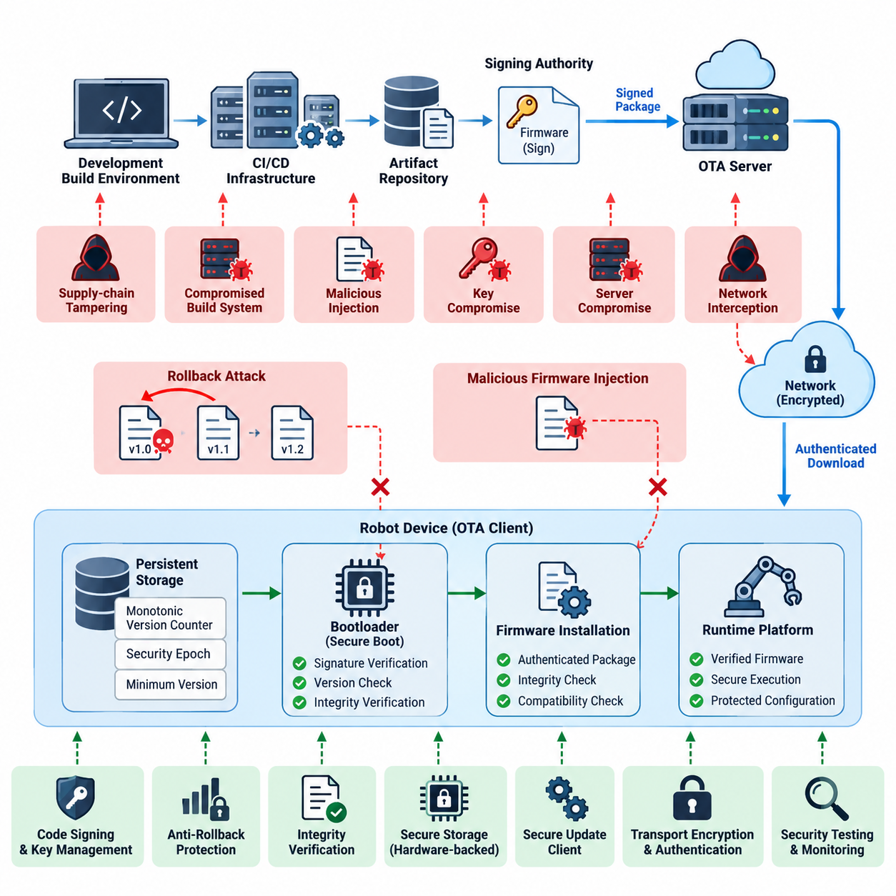
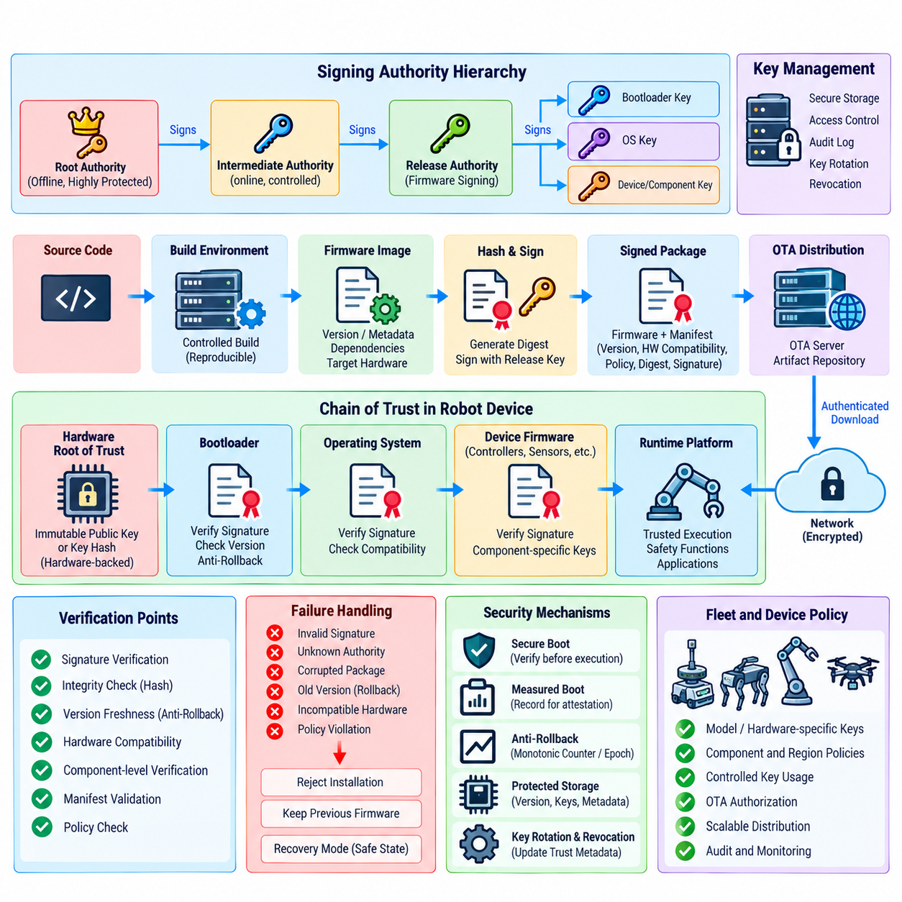
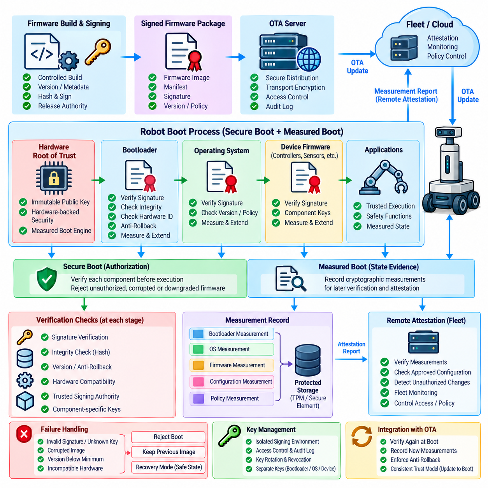
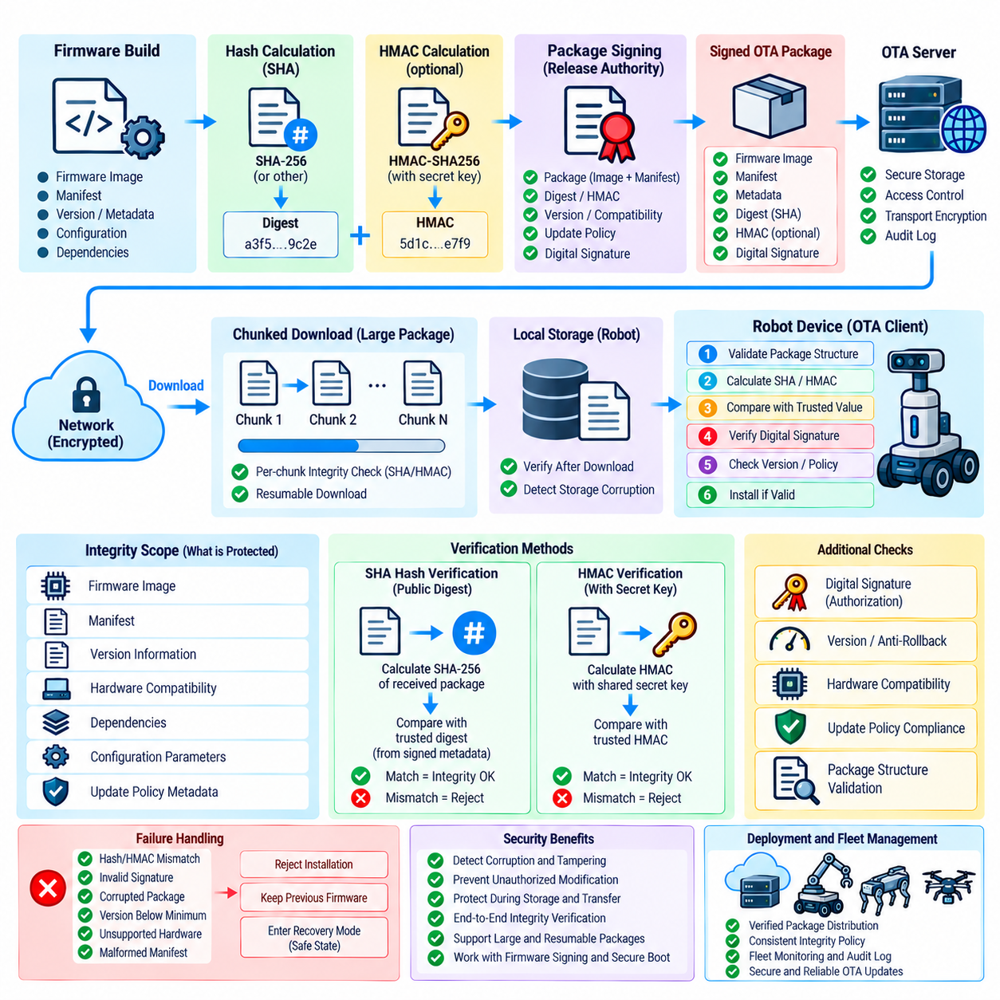
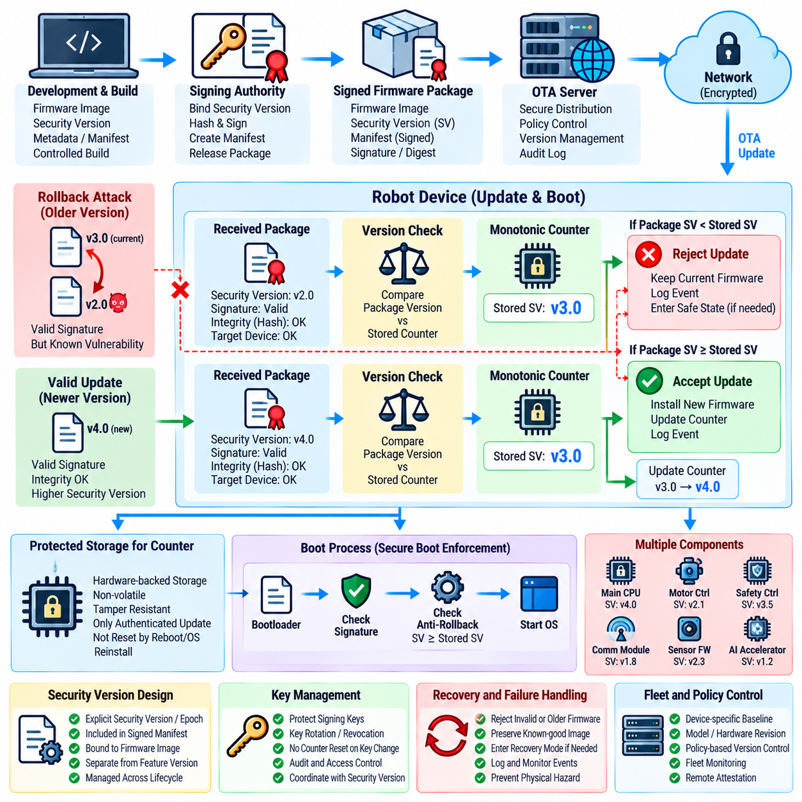
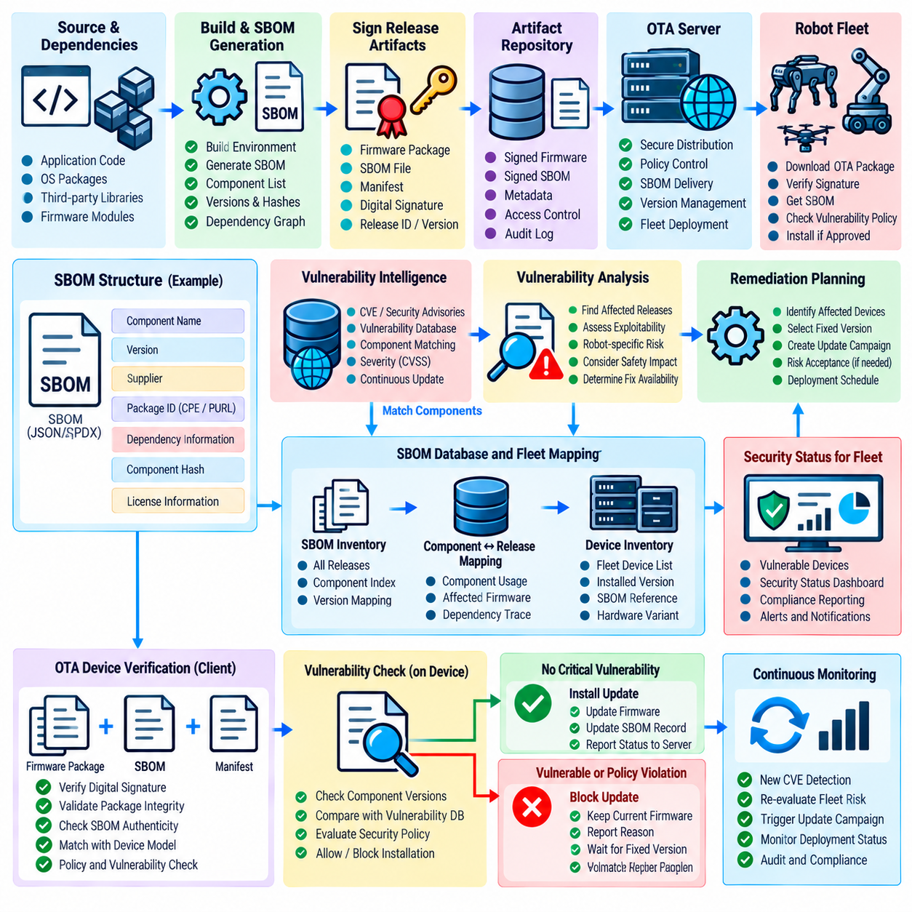
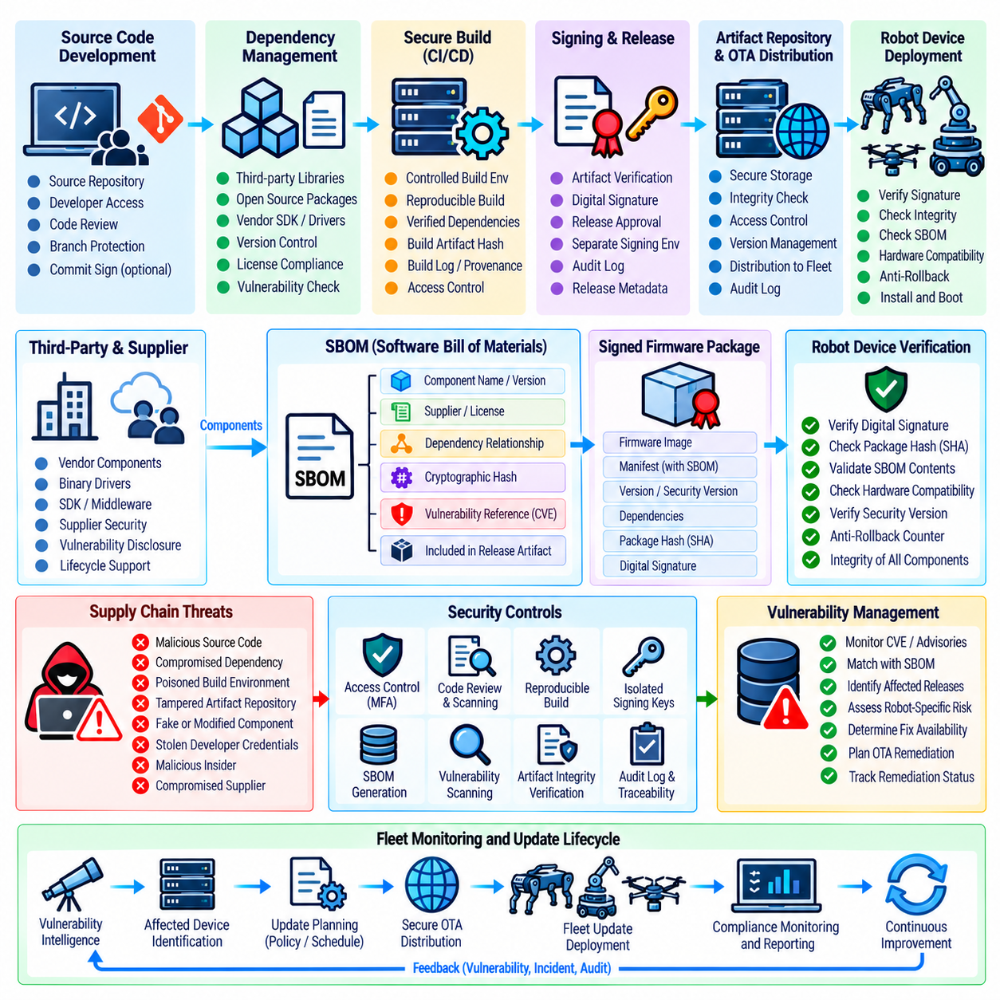
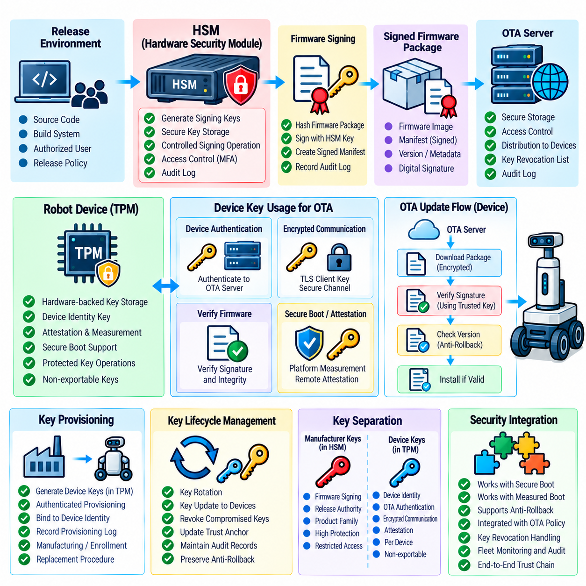
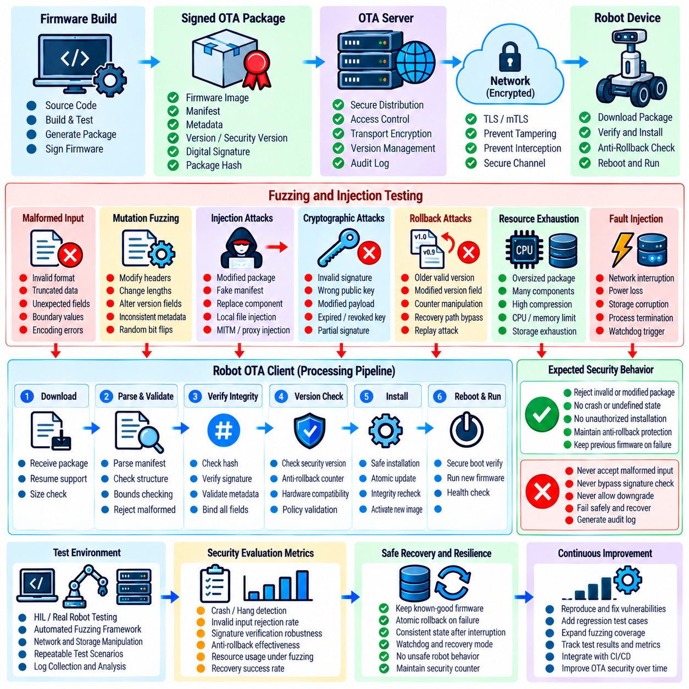
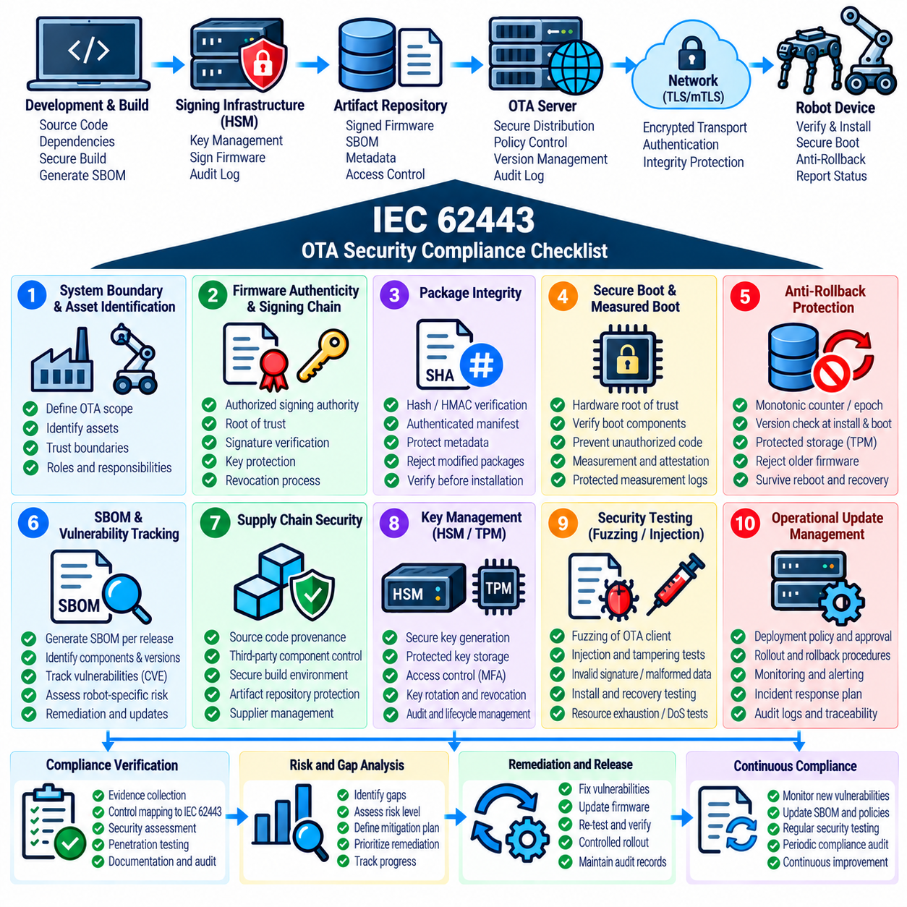

**Volume 24. Robot Cybersecurity**


# Chapter 07. OTA and Firmware Security

##  

## 07.01. OTA Security Threat Model Rollback Injection

{width="7.268055555555556in" height="7.268055555555556in"}

Over-the-air update mechanisms create a security boundary that extends from the firmware build environment and release infrastructure to communication networks, bootloaders, persistent storage, and the robot's runtime platform. A threat model must therefore treat OTA as an end-to-end trust chain rather than a simple file-transfer function. The referenced structure places rollback prevention, firmware signing, secure boot, integrity verification, key storage, supply-chain security, and security testing within the same OTA security domain. Volume_24_Robot_Cybersecurity

A useful OTA threat model begins by identifying protected assets and trust boundaries. Critical assets include firmware images, bootloader code, signing keys, update manifests, version metadata, device identities, configuration data, recovery partitions, and update authorization policies. Trust boundaries appear between development systems, CI/CD infrastructure, artifact repositories, OTA servers, fleet networks, robot gateways, bootloaders, and execution environments.

Rollback attacks attempt to replace currently trusted firmware with an older but legitimately signed version containing known vulnerabilities. Because the historical image may possess a valid cryptographic signature, signature verification alone cannot prevent this attack. An adversary who obtains an archived package or intercepts an update workflow may attempt to force installation of a vulnerable release and subsequently exploit weaknesses that were corrected in later firmware.

Rollback resistance therefore requires firmware authenticity to be evaluated together with version freshness. A robot can maintain a trusted monotonic version counter, security epoch, or minimum acceptable firmware version in protected storage. During installation and boot, the platform compares package metadata with this trusted state. Firmware whose security version is below the accepted threshold is rejected even when its signature and cryptographic hash remain valid.

The anti-rollback state itself becomes a high-value security asset. If an attacker can rewrite the trusted version counter, reset secure storage, substitute metadata, or manipulate bootloader comparison logic, rollback protection can be bypassed. The counter should consequently reside within hardware-backed or otherwise strongly protected storage, with modification restricted to authenticated update procedures and carefully controlled recovery mechanisms.

Firmware injection represents a different but related threat. Instead of selecting an older authentic image, the adversary attempts to introduce unauthorized code into the update path. Injection may occur through a compromised build system, malicious artifact repository, manipulated OTA server, man-in-the-middle position, exposed maintenance interface, removable media, or vulnerable update parser. The injected payload may contain persistent malware or altered robot-control logic.

Cryptographic signing provides the primary authenticity control against unauthorized firmware injection. Firmware packages should be signed by an approved release authority, while the robot verifies the signature against a trusted public key anchored within its root of trust. Verification should cover not merely executable binaries but also security-sensitive metadata such as device compatibility, firmware version, component identifiers, dependencies, and update policy attributes.

Integrity verification complements authenticity verification by detecting corruption or modification of OTA artifacts. Cryptographic hashes can identify unexpected package changes, while authenticated structures protect manifests and individual components. Verification should occur before installation and, where architecture permits, again before execution. The chapter structure explicitly separates signing-chain design, package integrity verification, and anti-rollback mechanisms, reflecting these distinct security responsibilities. Volume_24_Robot_Cybersecurity

The OTA client itself must be included in the attack surface. Package parsers, decompression libraries, delta-update engines, filesystem operations, manifest processors, and bootloader update routines process externally delivered data and can contain exploitable defects. A correctly signed package can still trigger unsafe behavior if parsing logic is vulnerable. Strict bounds checking, constrained privileges, authenticated metadata, defensive parsing, and security testing are therefore essential.

Network compromise should not automatically translate into firmware compromise. Transport encryption and authenticated sessions protect confidentiality and reduce interception risks, but firmware trust should remain independently verifiable at the device. Even when DNS, a proxy, wireless infrastructure, or an OTA distribution server is compromised, the robot should reject packages that cannot establish the required cryptographic authorization and acceptable security version.

Threat modeling must also consider signing-key compromise because possession of an authorized private key can transform malicious firmware into apparently legitimate firmware. Signing keys should therefore be isolated from ordinary development environments, protected through hardware security controls where appropriate, and governed by restricted release procedures. Key rotation, revocation, audit trails, and emergency replacement procedures must be designed before deployment rather than after compromise occurs.

Supply-chain threats extend the model upstream from the OTA service. A legitimate release may contain malicious or vulnerable components introduced through compromised source repositories, dependencies, build tools, developer credentials, or third-party firmware. Consequently, package signing proves who authorized an artifact but does not prove that its contents are safe. The chapter structure accordingly treats firmware supply-chain security and SBOM-based vulnerability tracking as dedicated OTA concerns. Volume_24_Robot_Cybersecurity

Recovery mechanisms require equal scrutiny because emergency installation modes can become alternate paths around normal OTA controls. Maintenance ports, factory recovery images, rescue bootloaders, and service procedures should preserve authenticity and rollback policies unless a deliberately stronger administrative authorization is supplied. Otherwise, an attacker may ignore the protected OTA channel entirely and exploit a weaker recovery interface to install unauthorized firmware.

Robot systems add physical consequences to conventional firmware compromise. Modified firmware can affect motor controllers, safety processors, perception devices, battery management, communication modules, or actuator interfaces. A successful update attack may therefore produce unsafe motion or disable protective functions rather than merely expose information. Threat severity should incorporate possible effects on physical safety, operational availability, fleet behavior, and surrounding equipment.

Fleet deployment creates another dimension because a compromised OTA service can potentially affect thousands of robots simultaneously. Security architecture should limit blast radius through staged deployment, device-group authorization, controlled release channels, health monitoring, and rapid suspension of suspicious campaigns. Update telemetry should record package identity, version transitions, verification outcomes, installation status, boot results, and rejected rollback or injection attempts.

The completed threat model should connect each attack path to preventive, detective, and recovery controls. Rollback threats map to protected version state and anti-rollback enforcement; injection threats map to signing and integrity verification; key compromise maps to hardware-backed key protection and revocation; supply-chain compromise maps to provenance and SBOM controls; parser attacks map to hardened update software and fuzz testing. This establishes OTA security as a continuous trust lifecycle rather than a single cryptographic check.

무선 업데이트(Over-the-Air, OTA) 메커니즘은 펌웨어 빌드 환경(Firmware Build Environment)과 릴리스 인프라(Release Infrastructure)에서 통신 네트워크(Communication Network), 부트로더(Bootloader), 영구 저장소(Persistent Storage), 로봇 런타임 플랫폼(Robot Runtime Platform)에 이르는 보안 경계(Security Boundary)를 형성한다. 따라서 위협 모델(Threat Model)은 OTA를 단순한 파일 전송 기능이 아니라 종단 간 신뢰 체인(End-to-End Trust Chain)으로 다루어야 한다. 참조 구조에서는 롤백 방지(Rollback Prevention), 펌웨어 서명(Firmware Signing), 보안 부팅(Secure Boot), 무결성 검증(Integrity Verification), 키 저장(Key Storage), 공급망 보안(Supply-Chain Security), 보안 테스트(Security Testing)를 동일한 OTA 보안 영역으로 구성한다.

효과적인 OTA 위협 모델(OTA Threat Model)은 먼저 보호해야 할 자산(Protected Assets)과 신뢰 경계(Trust Boundaries)를 식별하는 것에서 시작한다. 핵심 자산에는 펌웨어 이미지(Firmware Image), 부트로더 코드(Bootloader Code), 서명 키(Signing Key), 업데이트 매니페스트(Update Manifest), 버전 메타데이터(Version Metadata), 장치 식별정보(Device Identity), 구성 데이터(Configuration Data), 복구 파티션(Recovery Partition), 업데이트 승인 정책(Update Authorization Policy) 등이 포함된다. 신뢰 경계는 개발 시스템, CI/CD 인프라, 아티팩트 저장소(Artifact Repository), OTA 서버, 플릿 네트워크(Fleet Network), 로봇 게이트웨이(Robot Gateway), 부트로더, 실행 환경 사이에 형성된다.

롤백 공격(Rollback Attack)은 현재 신뢰되는 펌웨어를 알려진 취약점(Known Vulnerability)을 포함하는 이전 버전의 정상 서명 펌웨어로 교체하려는 공격이다. 과거 펌웨어 이미지에도 유효한 암호화 서명(Cryptographic Signature)이 존재할 수 있으므로 서명 검증(Signature Verification)만으로는 이러한 공격을 차단할 수 없다. 공격자는 보관된 업데이트 패키지를 확보하거나 업데이트 워크플로(Update Workflow)를 가로채 취약한 이전 릴리스의 설치를 강제한 뒤, 최신 버전에서 이미 수정된 취약점을 다시 악용할 수 있다.

따라서 롤백 방지(Rollback Resistance)를 위해서는 펌웨어 진위성(Firmware Authenticity)과 버전 최신성(Version Freshness)을 함께 평가해야 한다. 로봇은 신뢰 가능한 단조 증가 버전 카운터(Monotonic Version Counter), 보안 에포크(Security Epoch), 또는 최소 허용 펌웨어 버전(Minimum Acceptable Firmware Version)을 보호된 저장소(Protected Storage)에 유지할 수 있다. 설치 및 부팅 과정에서 플랫폼은 패키지 메타데이터를 이러한 신뢰 상태와 비교하고, 보안 버전이 허용 임계값보다 낮은 펌웨어는 서명과 암호화 해시(Cryptographic Hash)가 유효하더라도 거부해야 한다.

안티 롤백 상태(Anti-Rollback State) 자체도 높은 가치의 보안 자산(Security Asset)이 된다. 공격자가 신뢰 버전 카운터를 다시 기록하거나, 보안 저장소(Secure Storage)를 초기화하거나, 메타데이터를 대체하거나, 부트로더의 비교 로직(Comparison Logic)을 조작할 수 있다면 롤백 보호를 우회할 수 있다. 따라서 해당 카운터는 하드웨어 기반(Hardware-Backed) 또는 이에 준하는 강력하게 보호된 저장소에 위치해야 하며, 변경 권한은 인증된 업데이트 절차(Authenticated Update Procedure)와 엄격하게 통제된 복구 메커니즘(Recovery Mechanism)으로 제한해야 한다.

펌웨어 주입(Firmware Injection)은 롤백과는 다르지만 밀접하게 연관된 위협이다. 이전의 정상 이미지를 선택하는 대신 공격자가 승인되지 않은 코드(Unauthorized Code)를 업데이트 경로(Update Path)에 삽입하려는 공격이다. 주입은 침해된 빌드 시스템(Compromised Build System), 악성 아티팩트 저장소(Malicious Artifact Repository), 조작된 OTA 서버, 중간자 공격(Man-in-the-Middle) 위치, 노출된 유지보수 인터페이스(Maintenance Interface), 이동식 미디어(Removable Media), 취약한 업데이트 파서(Update Parser) 등을 통해 발생할 수 있다. 주입된 페이로드(Payload)는 지속성 악성코드(Persistent Malware)나 변조된 로봇 제어 로직(Robot-Control Logic)을 포함할 수 있다.

암호화 서명(Cryptographic Signing)은 승인되지 않은 펌웨어 주입을 방지하는 핵심 진위성 제어(Authentication Control)를 제공한다. 펌웨어 패키지는 승인된 릴리스 기관(Approved Release Authority)이 서명해야 하며, 로봇은 신뢰 루트(Root of Trust)에 고정된 신뢰 공개 키(Trusted Public Key)를 이용하여 서명을 검증해야 한다. 검증 범위에는 실행 바이너리(Executable Binary)뿐 아니라 장치 호환성(Device Compatibility), 펌웨어 버전, 구성요소 식별자(Component Identifier), 종속성(Dependency), 업데이트 정책 속성(Update Policy Attribute)과 같은 보안 관련 메타데이터도 포함되어야 한다.

무결성 검증(Integrity Verification)은 OTA 아티팩트의 손상이나 변경을 탐지함으로써 진위성 검증(Authenticity Verification)을 보완한다. 암호화 해시(Cryptographic Hash)는 예상하지 못한 패키지 변경을 식별할 수 있으며, 인증된 구조(Authenticated Structure)는 매니페스트와 개별 구성요소를 보호한다. 검증은 설치 전에 수행해야 하고, 아키텍처가 허용한다면 실행 전에도 다시 수행하는 것이 바람직하다. 전체 구조에서 서명 체인 설계(Signing-Chain Design), 패키지 무결성 검증(Package Integrity Verification), 안티 롤백 메커니즘(Anti-Rollback Mechanism)을 분리한 것은 각각의 보안 책임이 서로 다르기 때문이다.

OTA 클라이언트(OTA Client) 자체도 공격 표면(Attack Surface)에 포함해야 한다. 패키지 파서(Package Parser), 압축 해제 라이브러리(Decompression Library), 델타 업데이트 엔진(Delta-Update Engine), 파일시스템 연산(Filesystem Operation), 매니페스트 처리기(Manifest Processor), 부트로더 업데이트 루틴(Bootloader Update Routine)은 외부에서 전달되는 데이터를 처리하므로 악용 가능한 결함을 포함할 수 있다. 올바르게 서명된 패키지라 하더라도 파싱 로직(Parsing Logic)에 취약점이 존재하면 위험한 동작을 유발할 수 있으므로 엄격한 경계 검사(Bounds Checking), 최소 권한(Constrained Privilege), 인증된 메타데이터, 방어적 파싱(Defensive Parsing), 보안 테스트가 필수적이다.

네트워크 침해(Network Compromise)가 곧바로 펌웨어 침해(Firmware Compromise)로 이어져서는 안 된다. 전송 암호화(Transport Encryption)와 인증된 세션(Authenticated Session)은 기밀성(Confidentiality)을 보호하고 가로채기 위험을 줄이지만, 펌웨어에 대한 신뢰는 장치 자체에서 독립적으로 검증할 수 있어야 한다. DNS, 프록시(Proxy), 무선 인프라(Wireless Infrastructure), OTA 배포 서버(Distribution Server)가 침해되더라도 필요한 암호화 승인(Cryptographic Authorization)과 허용 가능한 보안 버전을 증명하지 못하는 패키지는 로봇이 거부해야 한다.

위협 모델링(Threat Modeling)은 서명 키 침해(Signing-Key Compromise)도 고려해야 한다. 승인된 개인 키(Private Key)를 획득한 공격자는 악성 펌웨어를 겉보기에는 정상적인 펌웨어로 만들 수 있기 때문이다. 따라서 서명 키는 일반 개발 환경에서 격리하고 필요하면 하드웨어 보안 제어(Hardware Security Control)를 통해 보호하며, 제한된 릴리스 절차(Restricted Release Procedure)로 관리해야 한다. 키 순환(Key Rotation), 폐기(Revocation), 감사 추적(Audit Trail), 비상 교체 절차(Emergency Replacement Procedure)는 침해가 발생한 이후가 아니라 배포 전에 설계해야 한다.

공급망 위협(Supply-Chain Threat)은 OTA 서비스보다 더 상위 단계까지 위협 모델을 확장한다. 정상적인 릴리스에도 침해된 소스 저장소(Source Repository), 종속성, 빌드 도구(Build Tool), 개발자 자격 증명(Developer Credential), 제3자 펌웨어(Third-Party Firmware)를 통해 악성 또는 취약 구성요소가 포함될 수 있다. 따라서 패키지 서명은 누가 아티팩트를 승인했는지는 증명하지만 그 내용 자체가 안전하다는 것을 증명하지는 않는다. 이에 따라 펌웨어 공급망 보안(Firmware Supply-Chain Security)과 소프트웨어 자재명세서(Software Bill of Materials, SBOM) 기반 취약점 추적(Vulnerability Tracking)이 독립적인 OTA 보안 요소로 필요하다.

복구 메커니즘(Recovery Mechanism) 역시 동일한 수준으로 검토해야 한다. 비상 설치 모드(Emergency Installation Mode)가 정상 OTA 보안 제어를 우회하는 대체 경로가 될 수 있기 때문이다. 유지보수 포트(Maintenance Port), 공장 복구 이미지(Factory Recovery Image), 구조용 부트로더(Rescue Bootloader), 서비스 절차(Service Procedure)는 의도적으로 더 강력한 관리자 승인(Administrative Authorization)을 제공하는 경우를 제외하고 진위성 및 롤백 정책을 유지해야 한다. 그렇지 않으면 공격자가 보호된 OTA 채널을 무시하고 더 취약한 복구 인터페이스를 이용하여 승인되지 않은 펌웨어를 설치할 수 있다.

로봇 시스템(Robot System)에서는 기존 펌웨어 침해보다 더 직접적인 물리적 결과(Physical Consequence)가 발생할 수 있다. 변조된 펌웨어는 모터 컨트롤러(Motor Controller), 안전 프로세서(Safety Processor), 인지 장치(Perception Device), 배터리 관리 시스템(Battery Management System), 통신 모듈(Communication Module), 액추에이터 인터페이스(Actuator Interface)에 영향을 줄 수 있다. 따라서 성공적인 업데이트 공격은 단순한 정보 노출을 넘어 위험한 움직임을 발생시키거나 보호 기능을 무력화할 수 있다. 위협 심각도(Threat Severity)는 물리적 안전, 운영 가용성(Operational Availability), 플릿 동작(Fleet Behavior), 주변 장비에 미치는 잠재적 영향을 함께 고려해야 한다.

플릿 배포(Fleet Deployment)는 침해된 OTA 서비스가 잠재적으로 수천 대의 로봇에 동시에 영향을 줄 수 있다는 추가적인 위험을 만든다. 보안 아키텍처(Security Architecture)는 단계적 배포(Staged Deployment), 장치 그룹 승인(Device-Group Authorization), 통제된 릴리스 채널(Controlled Release Channel), 상태 모니터링(Health Monitoring), 의심스러운 배포 캠페인의 신속한 중단을 통해 영향 범위(Blast Radius)를 제한해야 한다. 업데이트 텔레메트리(Update Telemetry)는 패키지 식별정보, 버전 전환, 검증 결과, 설치 상태, 부팅 결과, 거부된 롤백 및 주입 시도를 기록해야 한다.

완성된 위협 모델은 각각의 공격 경로(Attack Path)를 예방적 제어(Preventive Control), 탐지적 제어(Detective Control), 복구 제어(Recovery Control)와 연결해야 한다. 롤백 위협은 보호된 버전 상태와 안티 롤백 집행(Anti-Rollback Enforcement), 주입 위협은 서명 및 무결성 검증, 키 침해는 하드웨어 기반 키 보호와 폐기, 공급망 침해는 출처 증명(Provenance)과 SBOM 제어, 파서 공격은 강화된 업데이트 소프트웨어와 퍼징 테스트(Fuzz Testing)에 대응된다. 이를 통해 OTA 보안은 단일 암호화 검사가 아니라 지속적인 신뢰 수명주기(Continuous Trust Lifecycle)로 확립된다.

##  

## 07.02. Firmware Signing Chain Root of Trust Design [w/Code]

{width="7.268055555555556in" height="7.268055555555556in"}

A firmware signing chain establishes the cryptographic trust relationship that allows a robot to determine whether firmware is authorized before it is installed or executed. In a secure robot architecture, firmware signing should not be treated as an isolated release activity but as part of a complete root-of-trust design. The chain connects the hardware trust anchor, bootloader, operating system, device firmware, OTA package, and release authority so that each stage can verify the legitimacy of the next stage before transferring control.

The root of trust is the foundation of this chain. It should begin with a trust anchor that is difficult to modify or replace, preferably through hardware-backed security capabilities embedded in the robot platform. The trust anchor may contain an immutable public key, a protected key hash, or another cryptographic reference used to validate the first trusted software component. The security objective is that an attacker who gains control of ordinary software cannot simply replace the initial verification authority and establish a new unauthorized chain of trust.

A typical signing hierarchy separates different responsibilities rather than relying on one universal signing key. A highly protected root authority can establish intermediate signing authorities, while release keys can sign approved firmware packages. Component-specific keys may also be used for bootloader, operating system, peripheral firmware, or safety-critical controller updates. This separation limits the consequences of a single key compromise and makes key rotation, revocation, and operational access control more manageable across the robot firmware lifecycle.

The signing process should begin before an artifact reaches the OTA distribution system. A firmware build must be associated with a controlled source revision, reproducible or auditable build environment, version identifier, target hardware definition, dependency information, and release metadata. After validation, the resulting artifact is hashed and signed by an authorized release key. The signed manifest should bind the firmware identity, version, compatibility constraints, cryptographic digest, and applicable security policy so that an attacker cannot substitute one component while preserving an apparently valid package structure.

Signature verification must occur at every security boundary that matters. The bootloader should verify the firmware before execution, while an OTA client should verify the package before installation. If firmware contains independently updateable components, each component should have an appropriate verification mechanism rather than assuming that validation of one top-level container proves the integrity of every internal element. This layered verification prevents a trusted outer package from becoming a mechanism for silently introducing an unauthorized inner component.

The chain of trust must also define what happens when verification fails. An invalid signature, unknown signing authority, corrupted manifest, incompatible hardware identifier, or unacceptable security version should result in a controlled rejection rather than an attempted installation. Failure handling should preserve the previously trusted firmware when possible and transition to a defined recovery state when necessary. For safety-critical robots, this behavior must be coordinated with the boot process, actuator state, watchdog mechanisms, and operational safety controls so that a cybersecurity failure does not create a physical hazard.

Key protection is one of the most important elements of the signing architecture because compromise of an authorized signing key can undermine the entire trust chain. Private keys should be isolated from ordinary development workstations and protected using appropriate hardware security mechanisms or restricted signing services. Access should require strong authentication and authorization, while signing operations should generate auditable records. The architecture should also provide procedures for key rotation, emergency revocation, replacement, and recovery without requiring uncontrolled modification of the robot\'s fundamental trust anchor.

Root-of-trust design must account for key compromise and certificate or key revocation throughout the firmware lifecycle. A robot that permanently trusts a signing key without an update mechanism for trust metadata may remain vulnerable after that key is exposed. Revocation information, replacement keys, security epochs, or equivalent mechanisms should therefore be incorporated into the platform\'s trust model. However, the update mechanism for trust anchors must itself be protected, because an attacker who can arbitrarily modify trusted-key information can bypass the firmware authentication mechanism.

The signing chain should be closely integrated with secure boot and measured boot. Secure boot establishes whether the software about to execute is authorized, while measured boot can record cryptographic measurements of firmware and other boot components for later verification or remote attestation. The resulting architecture creates a sequence in which hardware establishes the initial trust state, the bootloader verifies the next software layer, and subsequent components inherit only the trust that has been cryptographically established. This relationship is particularly important for robots whose firmware controls safety, sensing, communications, and actuation.

Fleet-scale robotics introduces additional requirements for firmware signing. The same signing infrastructure may distribute firmware to many robot models, hardware revisions, geographic deployments, and security domains. Signing policies should therefore restrict which keys may authorize which device classes and firmware components. A package intended for one controller or robot generation should not automatically become valid for another merely because the cryptographic signature is correct. Device identity, hardware compatibility, security level, firmware version, and deployment policy should participate in authorization decisions.

A mature firmware signing architecture finally treats trust as a lifecycle rather than a one-time configuration. Source code, build systems, signing infrastructure, artifact repositories, OTA services, bootloaders, and robot hardware all participate in maintaining the chain. Audit evidence should demonstrate which source and build produced an artifact, which authority signed it, which devices accepted it, and which verification controls were applied. Within the OTA security structure, this signing-chain design provides the foundation for secure boot, package integrity verification, anti-rollback enforcement, supply-chain protection, secure key storage, and subsequent OTA security testing.

펌웨어 서명 체인(Firmware Signing Chain)은 로봇이 펌웨어를 설치하거나 실행하기 전에 해당 펌웨어가 승인된 것인지 판단할 수 있도록 하는 암호화된 신뢰 관계(Cryptographic Trust Relationship)를 구축한다. 보안 로봇 아키텍처에서 펌웨어 서명은 독립적인 릴리스 활동이 아니라 완전한 신뢰 루트 설계(Root-of-Trust Design)의 일부로 취급해야 한다. 이 체인은 하드웨어 신뢰 앵커(Hardware Trust Anchor), 부트로더(Bootloader), 운영체제(Operating System), 장치 펌웨어(Device Firmware), OTA 패키지(OTA Package), 릴리스 승인 기관(Release Authority)을 연결하여 각 단계가 제어권을 다음 단계로 전달하기 전에 해당 단계의 정당성을 검증할 수 있도록 한다.

신뢰 루트(Root of Trust)는 이 체인의 기반이다. 신뢰 루트는 로봇 플랫폼에 내장된 하드웨어 기반 보안 기능(Hardware-Backed Security Capability)을 통해 변경 또는 교체가 어렵도록 구성하는 것이 바람직하다. 신뢰 앵커(Trust Anchor)는 변경할 수 없는 공개 키(Immutable Public Key), 보호된 키 해시(Protected Key Hash), 또는 최초의 신뢰 소프트웨어 구성요소를 검증하는 데 사용되는 다른 암호화 참조값(Cryptographic Reference)을 포함할 수 있다. 보안 목표는 공격자가 일반 소프트웨어를 장악하더라도 최초의 검증 권한을 단순히 교체하여 새로운 비인가 신뢰 체인(Unauthorized Chain of Trust)을 구축할 수 없도록 하는 것이다.

일반적인 서명 계층(Signing Hierarchy)은 하나의 범용 서명 키(Universal Signing Key)에 모든 책임을 집중시키기보다 서로 다른 책임을 분리한다. 강력하게 보호되는 루트 기관(Root Authority)은 중간 서명 기관(Intermediate Signing Authority)을 설정할 수 있으며, 릴리스 키(Release Key)는 승인된 펌웨어 패키지에 서명할 수 있다. 부트로더, 운영체제, 주변장치 펌웨어(Peripheral Firmware), 안전 중요 제어기(Safety-Critical Controller) 업데이트에 구성요소별 키(Component-Specific Key)를 사용할 수도 있다. 이러한 분리는 단일 키 침해(Key Compromise)의 영향을 제한하고 전체 로봇 펌웨어 수명주기에서 키 순환(Key Rotation), 폐기(Revocation), 운영 접근 제어(Operational Access Control)를 보다 쉽게 관리할 수 있도록 한다.

서명 프로세스(Signing Process)는 아티팩트(Artifact)가 OTA 배포 시스템에 도달하기 전에 시작되어야 한다. 펌웨어 빌드(Firmware Build)는 통제된 소스 리비전(Source Revision), 재현 가능하거나 감사 가능한 빌드 환경(Build Environment), 버전 식별자(Version Identifier), 대상 하드웨어 정의(Target Hardware Definition), 종속성 정보(Dependency Information), 릴리스 메타데이터(Release Metadata)와 연결되어야 한다. 검증이 완료되면 생성된 아티팩트에 대해 해시(Hash)를 계산하고 승인된 릴리스 키(Release Key)로 서명한다. 서명된 매니페스트(Signed Manifest)는 펌웨어 식별정보, 버전, 호환성 제약조건, 암호화 다이제스트(Cryptographic Digest), 적용 가능한 보안 정책을 결합하여 공격자가 유효한 패키지 구조를 유지하면서 하나의 구성요소를 다른 구성요소로 교체하지 못하도록 해야 한다.

서명 검증(Signature Verification)은 중요한 모든 보안 경계(Security Boundary)에서 수행되어야 한다. 부트로더는 실행 전에 펌웨어를 검증해야 하며, OTA 클라이언트는 설치 전에 패키지를 검증해야 한다. 펌웨어에 독립적으로 업데이트 가능한 구성요소가 포함되어 있다면 하나의 상위 컨테이너(Top-Level Container)를 검증하는 것만으로 내부의 모든 구성요소가 무결하다고 가정해서는 안 되며, 각 구성요소에 적절한 검증 메커니즘을 적용해야 한다. 이러한 계층적 검증(Layered Verification)은 신뢰된 외부 패키지가 승인되지 않은 내부 구성요소를 은밀하게 도입하는 수단으로 악용되는 것을 방지한다.

신뢰 체인(Chain of Trust)은 검증 실패 시 수행할 동작도 정의해야 한다. 유효하지 않은 서명(Invalid Signature), 알려지지 않은 서명 기관(Unknown Signing Authority), 손상된 매니페스트(Corrupted Manifest), 호환되지 않는 하드웨어 식별자(Incompatible Hardware Identifier), 허용되지 않는 보안 버전(Unacceptable Security Version)은 설치를 시도하는 대신 통제된 방식으로 거부되어야 한다. 가능한 경우 오류 처리는 이전에 신뢰된 펌웨어를 유지해야 하며, 필요한 경우 정의된 복구 상태(Recovery State)로 전환해야 한다. 안전 중요 로봇(Safety-Critical Robot)에서는 이러한 동작을 부팅 프로세스, 액추에이터 상태(Actuator State), 워치독 메커니즘(Watchdog Mechanism), 운영 안전 제어(Operational Safety Control)와 연계하여 사이버보안 실패가 물리적 위험을 발생시키지 않도록 해야 한다.

키 보호(Key Protection)는 서명 아키텍처(Signing Architecture)의 가장 중요한 요소 중 하나이다. 승인된 서명 키가 침해되면 전체 신뢰 체인이 약화될 수 있기 때문이다. 개인 키(Private Key)는 일반 개발 워크스테이션에서 격리하고 적절한 하드웨어 보안 메커니즘(Hardware Security Mechanism) 또는 제한된 서명 서비스(Restricted Signing Service)를 이용하여 보호해야 한다. 접근에는 강력한 인증(Authentication)과 권한 부여(Authorization)가 요구되어야 하며, 서명 작업은 감사 가능한 기록(Auditable Record)을 생성해야 한다. 또한 로봇의 기본 신뢰 앵커를 통제되지 않은 방식으로 변경하지 않고도 키 순환, 긴급 폐기(Emergency Revocation), 교체(Replacement), 복구(Recovery)를 수행할 수 있는 절차를 제공해야 한다.

신뢰 루트 설계(Root-of-Trust Design)는 펌웨어 수명주기 전체에서 키 침해와 인증서 또는 키 폐기(Certificate or Key Revocation)를 고려해야 한다. 업데이트 메커니즘 없이 특정 서명 키를 영구적으로 신뢰하는 로봇은 해당 키가 노출된 이후에도 계속 취약한 상태로 남을 수 있다. 따라서 폐기 정보(Revocation Information), 교체 키(Replacement Key), 보안 에포크(Security Epoch), 또는 이에 상응하는 메커니즘을 플랫폼의 신뢰 모델(Trust Model)에 포함해야 한다. 그러나 신뢰 앵커 업데이트 메커니즘 자체도 보호해야 한다. 공격자가 신뢰된 키 정보를 임의로 수정할 수 있다면 펌웨어 인증 메커니즘을 우회할 수 있기 때문이다.

서명 체인(Signing Chain)은 보안 부팅(Secure Boot) 및 측정 부팅(Measured Boot)과 긴밀하게 통합되어야 한다. 보안 부팅은 실행될 소프트웨어가 승인되었는지를 확인하는 반면, 측정 부팅은 펌웨어와 다른 부팅 구성요소의 암호화 측정값(Cryptographic Measurement)을 기록하여 이후 검증 또는 원격 증명(Remote Attestation)에 사용할 수 있도록 한다. 이러한 아키텍처에서는 하드웨어가 초기 신뢰 상태를 설정하고, 부트로더가 다음 소프트웨어 계층을 검증하며, 이후 구성요소가 암호화 방식으로 확립된 신뢰만을 상속하는 순차적인 구조가 만들어진다. 이는 펌웨어가 안전, 센싱, 통신, 액추에이션을 제어하는 로봇에서 특히 중요하다.

대규모 로봇 플릿(Fleet)에서는 펌웨어 서명에 추가적인 요구사항이 발생한다. 동일한 서명 인프라가 여러 로봇 모델, 하드웨어 리비전, 지역별 배포 환경, 보안 도메인에 펌웨어를 배포할 수 있기 때문이다. 따라서 서명 정책(Signing Policy)은 어떤 키가 어떤 장치 등급(Device Class)과 펌웨어 구성요소를 승인할 수 있는지를 제한해야 한다. 특정 제어기 또는 로봇 세대를 대상으로 하는 패키지는 단순히 암호화 서명이 올바르다는 이유만으로 다른 장치에서 자동으로 유효한 것으로 인정되어서는 안 된다. 장치 식별정보, 하드웨어 호환성, 보안 수준(Security Level), 펌웨어 버전, 배포 정책(Deployment Policy)을 함께 고려하여 승인 여부를 결정해야 한다.

성숙한 펌웨어 서명 아키텍처(Firmware Signing Architecture)는 궁극적으로 신뢰를 일회성 설정이 아니라 수명주기(Lifecycle)로 취급한다. 소스 코드(Source Code), 빌드 시스템(Build System), 서명 인프라(Signing Infrastructure), 아티팩트 저장소, OTA 서비스, 부트로더, 로봇 하드웨어가 모두 신뢰 체인을 유지하는 데 참여한다. 감사 증적(Audit Evidence)은 어떤 소스와 빌드가 특정 아티팩트를 생성했는지, 어떤 기관이 이를 서명했는지, 어떤 장치가 이를 수락했는지, 어떤 검증 제어(Verification Control)가 적용되었는지를 입증할 수 있어야 한다. OTA 보안 구조에서 이러한 서명 체인 설계는 보안 부팅, 패키지 무결성 검증, 안티 롤백 집행(Anti-Rollback Enforcement), 공급망 보호(Supply-Chain Protection), 보안 키 저장(Secure Key Storage), 이후의 OTA 보안 테스트를 위한 기반을 제공한다.

##  

## 07.03. Secure Boot and Measured Boot for Robots [w/Code]

{width="7.268055555555556in" height="7.268055555555556in"}

Secure Boot and Measured Boot provide complementary mechanisms for establishing and maintaining trust during the robot startup process. Secure Boot determines whether software is authorized to execute, while Measured Boot records cryptographic measurements of boot components so that their actual state can be evaluated later. In a robot platform, these mechanisms extend the firmware signing chain into the boot process and help prevent unauthorized firmware, modified bootloaders, and compromised operating-system components from becoming trusted execution elements. Volume_24_Robot_Cybersecurity

Secure Boot begins with a hardware-rooted trust anchor that cannot be freely modified by ordinary software. The initial verification stage establishes whether the next boot component is authentic and authorized, after which that component verifies the following stage. This creates a chain of trust extending from hardware or immutable boot code through the bootloader, operating system, device firmware, and other security-sensitive components. Each stage inherits trust only after the previous stage has successfully validated its cryptographic identity and authorization.

The bootloader is therefore a critical security boundary in a robot. Before transferring control to an operating system or firmware image, it should verify the digital signature, trusted signing authority, image integrity, hardware compatibility, and applicable security version. A package that has been corrupted, signed by an unauthorized key, targeted at another hardware platform, or rejected by anti-rollback policy must not be executed. The failure path should preserve a known-good image or enter a controlled recovery state rather than blindly continuing the boot process.

Secure Boot must protect more than the primary application firmware when multiple programmable components participate in robot operation. Motor controllers, safety processors, communication processors, sensor subsystems, and specialized accelerators may each contain executable firmware. Where these components can influence security or physical behavior, their firmware should participate in an appropriate verification process. Otherwise, an attacker could bypass a protected main processor by compromising a secondary controller that operates outside the primary trust chain.

Measured Boot addresses a different requirement. Instead of simply deciding whether a component is authorized, it calculates and records a cryptographic measurement of the component that actually participates in the boot process. Measurements can include the bootloader, firmware image, operating-system components, configuration data, security policies, and other relevant artifacts. The resulting measurement record provides evidence of the software state and can later support integrity assessment, forensic analysis, fleet monitoring, or remote attestation.

The distinction between Secure Boot and Measured Boot is important because authorization and state visibility are different security objectives. Secure Boot can prevent an unauthorized image from executing, but it does not by itself provide a detailed historical record of everything that was loaded. Measured Boot can provide such evidence, but measurement alone does not necessarily prevent execution of malicious software. A robust robot platform therefore uses both mechanisms together: Secure Boot establishes an execution boundary, while Measured Boot establishes verifiable evidence about the platform state.

Measured Boot becomes particularly valuable when robots are connected to fleet infrastructure or cloud security services. A robot can report selected measurement information to a trusted verifier, which can compare the observed state against an approved reference configuration. This enables remote attestation and allows fleet operators to identify devices that booted unexpected firmware, modified configuration, or an unapproved software combination. Attestation results can then influence whether a robot receives sensitive commands, joins a secure operational group, or becomes eligible for additional OTA updates.

The measurement process itself must be protected against manipulation. If an attacker can alter or delete measurement records after boot, the resulting evidence cannot be trusted. Measurement values should therefore be extended into protected hardware-backed structures or otherwise stored in a manner that prevents ordinary software from rewriting historical measurements. The design should also define which components are measured, the order in which measurements are performed, how values are extended, and how measurement records are securely transmitted to an external verifier.

Secure Boot and Measured Boot must also interact with firmware updates. When a new firmware image is installed through OTA, its signature must first establish authorization, while the subsequent boot process should verify the image again before execution and record its measurement where applicable. The new measurement should correspond to the approved release and security policy. This prevents an attacker from exploiting a gap between OTA installation and boot-time verification and ensures that the firmware accepted during deployment remains subject to the same trust model during execution.

Anti-rollback protection should be incorporated into the boot decision. A previously valid firmware image may possess a legitimate signature while containing vulnerabilities that have already been corrected. The bootloader should therefore evaluate security version information or a protected monotonic counter in addition to signature validity and integrity. If the firmware falls below the minimum permitted security level, the bootloader must reject it. This makes Secure Boot part of the broader OTA security lifecycle rather than an isolated signature check.

Recovery architecture requires particular attention because recovery paths can otherwise become an unintended bypass around Secure Boot. Factory images, rescue bootloaders, maintenance interfaces, and emergency update procedures should retain appropriate signature and version checks. If a recovery mode permits arbitrary unsigned firmware to execute, an attacker who obtains physical or privileged access could circumvent the normal chain of trust. Recovery therefore needs its own authenticated authorization model, protected credentials, controlled access conditions, and auditable procedures.

For robots with safety-critical functions, boot security must be coordinated with the physical safety architecture. A failed firmware verification should not cause uncontrolled actuator activation, unsafe motor commands, or loss of required protective functions. The system should establish a safe hardware state before attempting recovery or retrying boot, while watchdogs and independent safety mechanisms remain available. Cybersecurity controls must therefore be designed together with functional safety and fault-handling requirements rather than treating boot security as a purely software-level concern.

A mature Secure Boot and Measured Boot architecture also requires lifecycle management. Trusted keys may need replacement, firmware security policies may evolve, hardware platforms may be revised, and previously trusted software may eventually become unacceptable. The platform must therefore support controlled trust-anchor updates, key rotation, revocation, security-version advancement, and recovery from compromised credentials. These operations require stronger authorization than ordinary firmware updates because modification of the trust foundation can affect every subsequent verification decision.

Within a robot fleet, boot measurements and verification results can also become valuable security telemetry. Fleet infrastructure can identify repeated boot failures, unexpected measurements, rejected rollback attempts, or deviations from approved firmware configurations. Correlating these events with OTA deployment records helps distinguish normal update transitions from possible compromise. The resulting evidence can support incident response, device quarantine, forensic investigation, and controlled redeployment without requiring every robot to be physically inspected.

The overall objective is to establish a continuous hardware-to-software trust relationship in which every security-sensitive stage is authenticated, measured where appropriate, and subject to explicit policy. Secure Boot prevents unauthorized components from becoming trusted execution elements, while Measured Boot provides evidence of the software state that actually executed. Together with firmware signing, OTA integrity verification, anti-rollback controls, protected key storage, and recovery procedures, they form a foundational security layer for maintaining trustworthy robot firmware throughout its operational lifecycle.

보안 부팅(Secure Boot)과 측정 부팅(Measured Boot)은 로봇의 시작 과정에서 신뢰를 설정하고 유지하기 위한 상호 보완적인 메커니즘을 제공한다. 보안 부팅은 소프트웨어가 실행될 권한이 있는지를 판단하는 반면, 측정 부팅은 부팅 구성요소의 암호화 측정값(Cryptographic Measurement)을 기록하여 이후 실제 상태를 평가할 수 있도록 한다. 로봇 플랫폼에서 이러한 메커니즘은 펌웨어 서명 체인(Firmware Signing Chain)을 부팅 과정까지 확장하며, 승인되지 않은 펌웨어, 변조된 부트로더, 침해된 운영체제 구성요소가 신뢰된 실행 구성요소가 되는 것을 방지하는 데 도움을 준다.

보안 부팅은 일반 소프트웨어에 의해 자유롭게 변경될 수 없는 하드웨어 기반 신뢰 앵커(Hardware-Rooted Trust Anchor)에서 시작된다. 최초의 검증 단계에서는 다음 부팅 구성요소가 진본이고 승인되었는지를 확인하며, 이후 해당 구성요소가 다음 단계를 검증한다. 이를 통해 하드웨어 또는 변경 불가능한 부트 코드(Immutable Boot Code)에서 부트로더(Bootloader), 운영체제(Operating System), 장치 펌웨어(Device Firmware), 기타 보안에 중요한 구성요소까지 이어지는 신뢰 체인(Chain of Trust)이 형성된다. 각 단계는 이전 단계가 암호화된 신원과 승인 상태를 성공적으로 검증한 이후에만 신뢰를 상속받는다.

따라서 부트로더(Bootloader)는 로봇에서 중요한 보안 경계(Security Boundary)가 된다. 부트로더는 운영체제 또는 펌웨어 이미지로 제어권을 전달하기 전에 디지털 서명(Digital Signature), 신뢰된 서명 기관(Trusted Signing Authority), 이미지 무결성(Image Integrity), 하드웨어 호환성(Hardware Compatibility), 적용 가능한 보안 버전(Security Version)을 검증해야 한다. 손상된 패키지, 승인되지 않은 키로 서명된 패키지, 다른 하드웨어 플랫폼을 대상으로 하는 이미지, 안티 롤백 정책(Anti-Rollback Policy)에 의해 거부된 이미지는 실행해서는 안 된다. 실패 경로는 정상적인 부팅을 무조건 계속하기보다는 정상 상태의 펌웨어를 유지하거나 통제된 복구 상태(Controlled Recovery State)로 진입해야 한다.

다수의 프로그래밍 가능한 구성요소가 로봇의 동작에 참여하는 경우 보안 부팅은 주 펌웨어(Primary Firmware) 이상의 영역을 보호해야 한다. 모터 제어기(Motor Controller), 안전 프로세서(Safety Processor), 통신 프로세서(Communication Processor), 센서 서브시스템(Sensor Subsystem), 특수 가속기(Specialized Accelerator)에도 각각 실행 가능한 펌웨어가 포함될 수 있다. 이러한 구성요소가 보안 또는 물리적 동작에 영향을 미칠 수 있다면 적절한 검증 과정에 참여해야 한다. 그렇지 않으면 공격자가 보호된 주 프로세서를 우회하여 기본 신뢰 체인 밖에서 동작하는 보조 제어기를 침해할 수 있다.

측정 부팅(Measured Boot)은 서로 다른 요구사항을 다룬다. 단순히 구성요소의 실행 권한을 판단하는 대신, 부팅 과정에 실제로 참여하는 구성요소의 암호화 측정값을 계산하고 기록한다. 측정 대상에는 부트로더, 펌웨어 이미지, 운영체제 구성요소, 구성 데이터(Configuration Data), 보안 정책(Security Policy), 기타 관련 아티팩트(Artifact)가 포함될 수 있다. 생성된 측정 기록(Measurement Record)은 소프트웨어 상태에 대한 증거를 제공하며 이후 무결성 평가(Integrity Assessment), 포렌식 분석(Forensic Analysis), 플릿 모니터링(Fleet Monitoring), 원격 증명(Remote Attestation)에 활용될 수 있다.

보안 부팅과 측정 부팅의 차이는 중요하다. 승인 여부(Authorization)와 상태 가시성(State Visibility)은 서로 다른 보안 목표이기 때문이다. 보안 부팅은 승인되지 않은 이미지의 실행을 방지할 수 있지만, 부팅 과정에서 로드된 모든 구성요소에 대한 상세한 이력 기록을 자체적으로 제공하지는 않는다. 측정 부팅은 이러한 증거를 제공할 수 있지만, 측정만으로 악성 소프트웨어의 실행을 반드시 방지하는 것은 아니다. 따라서 견고한 로봇 플랫폼은 두 메커니즘을 함께 사용해야 한다. 보안 부팅은 실행 경계를 설정하고, 측정 부팅은 플랫폼 상태에 대한 검증 가능한 증거를 구축한다.

측정 부팅은 로봇이 플릿 인프라(Fleet Infrastructure) 또는 클라우드 보안 서비스(Cloud Security Service)에 연결될 때 특히 유용하다. 로봇은 선택된 측정 정보를 신뢰된 검증자(Trusted Verifier)에게 전달할 수 있으며, 검증자는 관찰된 상태를 승인된 기준 구성(Approved Reference Configuration)과 비교할 수 있다. 이를 통해 원격 증명(Remote Attestation)이 가능해지고, 플릿 운영자는 예상하지 못한 펌웨어, 변경된 구성, 승인되지 않은 소프트웨어 조합으로 부팅된 장치를 식별할 수 있다. 증명 결과는 로봇이 민감한 명령을 받을 수 있는지, 보안 운영 그룹에 참여할 수 있는지, 추가 OTA 업데이트 대상이 될 수 있는지를 결정하는 데 활용할 수 있다.

측정 과정 자체도 조작으로부터 보호되어야 한다. 공격자가 부팅 이후 측정 기록을 변경하거나 삭제할 수 있다면 생성된 증거를 신뢰할 수 없게 된다. 따라서 측정값은 하드웨어 기반 보호 구조(Hardware-Backed Structure)에 기록하거나 일반 소프트웨어가 과거 측정값을 다시 작성할 수 없도록 보호된 방식으로 저장해야 한다. 또한 설계 단계에서 어떤 구성요소를 측정할 것인지, 어떤 순서로 측정할 것인지, 측정값을 어떻게 확장(Extend)할 것인지, 측정 기록을 외부 검증자에게 어떻게 안전하게 전송할 것인지를 정의해야 한다.

보안 부팅과 측정 부팅은 펌웨어 업데이트(Firmware Update)와도 연계되어야 한다. OTA를 통해 새로운 펌웨어 이미지가 설치될 때 먼저 서명을 통해 승인 여부를 확인하고, 이후 부팅 과정에서 실행 전에 다시 이미지를 검증해야 하며 필요한 경우 해당 측정값을 기록해야 한다. 새로운 측정값은 승인된 릴리스(Approved Release) 및 보안 정책(Security Policy)에 부합해야 한다. 이를 통해 공격자가 OTA 설치 과정과 부팅 시 검증 사이의 공백을 악용하는 것을 방지하고, 배포 과정에서 승인된 펌웨어가 실행 단계에서도 동일한 신뢰 모델의 적용을 받도록 할 수 있다.

안티 롤백 보호(Anti-Rollback Protection)는 부팅 결정 과정에 포함되어야 한다. 과거에 유효했던 펌웨어 이미지가 정상적인 서명을 가지고 있더라도 이미 수정된 취약점을 포함할 수 있다. 따라서 부트로더는 서명 유효성과 무결성뿐만 아니라 보안 버전 정보(Security Version Information) 또는 보호된 단조 증가 카운터(Protected Monotonic Counter)도 평가해야 한다. 펌웨어가 허용된 최소 보안 수준(Minimum Permitted Security Level)보다 낮으면 부트로더는 이를 거부해야 한다. 이렇게 하면 보안 부팅은 독립적인 서명 검사에서 벗어나 보다 광범위한 OTA 보안 수명주기의 일부가 된다.

복구 아키텍처(Recovery Architecture)는 특히 주의해서 설계해야 한다. 그렇지 않으면 복구 경로가 보안 부팅을 우회하는 의도하지 않은 경로가 될 수 있다. 공장 이미지(Factory Image), 구조용 부트로더(Rescue Bootloader), 유지보수 인터페이스(Maintenance Interface), 긴급 업데이트 절차(Emergency Update Procedure)는 적절한 서명 및 버전 검사를 유지해야 한다. 복구 모드가 임의의 서명되지 않은 펌웨어 실행을 허용한다면 공격자가 물리적 또는 높은 권한의 접근 권한을 획득했을 때 정상적인 신뢰 체인을 우회할 수 있다. 따라서 복구 기능에도 인증된 승인 모델(Authenticated Authorization Model), 보호된 자격 증명(Protected Credential), 통제된 접근 조건(Controlled Access Condition), 감사 가능한 절차(Auditable Procedure)가 필요하다.

안전 중요 기능(Safety-Critical Function)을 가진 로봇에서는 부팅 보안(Boot Security)을 물리적 안전 아키텍처(Physical Safety Architecture)와 연계해야 한다. 펌웨어 검증 실패가 통제되지 않은 액추에이터 활성화, 위험한 모터 명령, 필수 보호 기능의 상실로 이어져서는 안 된다. 시스템은 복구를 시도하거나 부팅을 재시도하기 전에 안전한 하드웨어 상태(Safe Hardware State)를 설정해야 하며, 워치독(Watchdog)과 독립적인 안전 메커니즘(Independent Safety Mechanism)을 계속 사용할 수 있어야 한다. 따라서 사이버보안 제어는 순수한 소프트웨어 수준의 문제로 취급하지 않고 기능 안전(Functional Safety) 및 고장 처리 요구사항(Fault-Handling Requirement)과 함께 설계해야 한다.

성숙한 보안 부팅 및 측정 부팅 아키텍처는 수명주기 관리(Lifecycle Management)도 필요로 한다. 신뢰된 키(Trusted Key)는 교체해야 할 수 있고, 펌웨어 보안 정책은 발전할 수 있으며, 하드웨어 플랫폼은 변경될 수 있고, 과거에 신뢰되었던 소프트웨어도 장기적으로 더 이상 허용되지 않을 수 있다. 따라서 플랫폼은 통제된 신뢰 앵커 업데이트(Controlled Trust-Anchor Update), 키 순환(Key Rotation), 폐기(Revocation), 보안 버전 상승(Security-Version Advancement), 침해된 자격 증명으로부터의 복구(Recovery)를 지원해야 한다. 이러한 작업은 신뢰 기반을 변경할 수 있으므로 일반적인 펌웨어 업데이트보다 더 강력한 승인 절차가 필요하다.

로봇 플릿에서는 부팅 측정값과 검증 결과가 중요한 보안 텔레메트리(Security Telemetry)가 될 수 있다. 플릿 인프라는 반복적인 부팅 실패, 예상하지 못한 측정값, 거부된 롤백 시도, 승인된 펌웨어 구성과의 차이를 식별할 수 있다. 이러한 이벤트를 OTA 배포 기록과 연계하면 정상적인 업데이트 전환과 잠재적인 침해를 구별하는 데 도움이 된다. 이렇게 생성된 증거는 사고 대응(Incident Response), 장치 격리(Device Quarantine), 포렌식 조사(Forensic Investigation), 통제된 재배포(Controlled Redeployment)를 지원할 수 있으며, 모든 로봇을 물리적으로 검사할 필요성을 줄여준다.

궁극적인 목표는 모든 보안 중요 단계가 인증되고 필요한 경우 측정되며 명시적인 정책의 적용을 받는 지속적인 하드웨어-소프트웨어 신뢰 관계(Hardware-to-Software Trust Relationship)를 구축하는 것이다. 보안 부팅은 승인되지 않은 구성요소가 신뢰된 실행 요소가 되는 것을 방지하고, 측정 부팅은 실제로 실행된 소프트웨어 상태에 대한 증거를 제공한다. 펌웨어 서명, OTA 무결성 검증, 안티 롤백 제어, 보호된 키 저장소(Protected Key Storage), 복구 절차와 함께 이러한 메커니즘은 전체 운영 수명주기 동안 신뢰할 수 있는 로봇 펌웨어를 유지하기 위한 핵심 보안 계층(Foundational Security Layer)을 형성한다.

##  

## 07.04. OTA Package Integrity SHA HMAC Verification [w/Code]

{width="7.268055555555556in" height="7.268055555555556in"}

An OTA package integrity architecture ensures that a firmware package received by a robot is identical to the package that was approved and released for deployment. Integrity verification is distinct from authorization: a cryptographic signature establishes who approved an artifact, while a hash or message authentication code can determine whether protected data has changed. In a robot OTA pipeline, these mechanisms should operate together with firmware signing, secure boot, version control, and deployment policy so that corrupted or modified packages cannot enter the firmware installation path. Volume_24_Robot_Cybersecurity

A cryptographic hash generates a fixed-length digest from the OTA package contents. When the package is produced, the release system calculates its digest and records it in authenticated release metadata. After transmission, the robot calculates the digest again from the received package and compares the result with the trusted value. If even a small portion of the package has changed, the resulting digest should differ. This provides an efficient mechanism for detecting accidental corruption and unauthorized modification during storage, transmission, or staging.

SHA-family algorithms can be used to generate these package digests, with the specific algorithm selected according to the platform security policy and current cryptographic requirements. The important architectural principle is that the expected digest itself must come from a trusted source. A robot should not simply compare a downloaded package against a digest delivered through the same untrusted channel because an attacker who can replace the package may also replace its digest. Integrity metadata therefore needs to be authenticated or obtained through an independently trusted mechanism.

HMAC provides a different integrity mechanism because it combines the message with a secret cryptographic key. The sender calculates the HMAC over the protected OTA data, and the receiving robot recalculates it using its trusted secret key. Matching values demonstrate that the data has not been modified by an entity that lacks the key. HMAC can therefore provide both integrity protection and origin authentication within an environment where the participating endpoints can securely share and protect the required secret.

The choice between an ordinary hash and HMAC depends on the trust architecture. A public hash is useful when the expected digest is protected by a separate digital signature or another trusted authentication mechanism. HMAC is appropriate when the endpoints share a protected secret and the architecture requires symmetric authentication. Neither mechanism should be treated as a replacement for firmware signing when the system requires proof that a particular release authority approved the firmware.

The OTA package should be treated as a structured security object rather than an opaque binary file. Its integrity scope may include the firmware image, manifest, version information, hardware compatibility data, dependency information, configuration parameters, and update policy metadata. If only the main binary is protected while security-sensitive metadata remains outside the integrity boundary, an attacker may attempt to manipulate the unprotected fields and alter how the robot interprets an otherwise valid package.

Verification should occur before installation and before any security-sensitive processing that could allow package contents to influence the robot. The OTA client should validate package structure, calculate the required digest or HMAC, compare it with the trusted reference, and reject the package if verification fails. Verification results should be recorded so that operators can distinguish network corruption, storage failure, invalid packages, and possible deliberate manipulation during later security analysis.

Transport protection remains important even when package integrity is cryptographically verified. Encrypted and authenticated communication reduces interception, tampering opportunities, and information exposure during delivery. However, transport security should not be the final trust boundary because the package may pass through proxies, caches, gateways, storage systems, or intermediate distribution services. End-to-end package verification ensures that the robot can independently determine whether the artifact it is about to install remains trustworthy.

Large firmware packages require careful handling of memory, storage, and processing resources during verification. A robot should not need to load an entire multi-gigabyte artifact into memory merely to calculate a cryptographic digest. Streaming or chunk-based hashing allows the OTA client to process the package incrementally while maintaining a predictable resource footprint. Where resumable downloads are supported, each chunk can also be validated before the complete package is assembled and subjected to final verification.

Partial verification must not be confused with complete package verification. Chunk-level checks can detect corruption during transfer and make interrupted downloads easier to resume, but the final assembled artifact must still be validated against the authoritative package identity. Otherwise, an attacker might manipulate the ordering, selection, or composition of individually valid chunks. The final verification stage therefore remains the decisive integrity boundary before installation.

OTA integrity controls should also account for storage corruption after successful download. A package may be correctly received but later damaged in temporary storage because of filesystem failure, unexpected power loss, defective media, or malicious local modification. The installation process should therefore verify the artifact at the appropriate point immediately before use rather than assuming that an earlier successful download check remains permanently valid.

When HMAC is deployed across a robot fleet, secret-key management becomes a major architectural concern. A shared fleet-wide HMAC key can create a large blast radius if compromised because possession of the key may allow an attacker to generate apparently valid integrity codes for many devices. More isolated key scopes, device-specific keys, protected key storage, controlled provisioning, rotation, and revocation can reduce this risk. The key-management architecture must therefore be considered together with OTA integrity rather than treated as an independent operational detail.

Hash and HMAC verification should be integrated with the broader firmware trust chain. A package that passes integrity verification must still satisfy signing authorization, hardware compatibility, security-version requirements, and secure-boot policy. Conversely, a correctly signed package that fails its integrity check must be rejected. This layered approach prevents one security mechanism from being incorrectly interpreted as proof of all other security properties.

For fleet operations, verification results provide useful security telemetry. The OTA service can track successful verification, repeated hash mismatches, HMAC failures, incomplete packages, unexpected package identities, and device-specific failure patterns. A sudden increase in integrity failures across a deployment group may indicate a distribution problem, storage fault, network issue, or deliberate interference. Correlating these events with release and deployment records supports faster diagnosis and helps distinguish operational failures from security incidents.

A mature OTA package integrity design therefore establishes a deterministic and independently verifiable boundary between artifact distribution and firmware installation. SHA-based hashing provides efficient content-integrity detection, while HMAC provides keyed integrity and authentication where shared-secret trust is appropriate. Combined with authenticated manifests, firmware signatures, secure boot, protected storage, anti-rollback controls, and controlled deployment, these mechanisms ensure that a robot installs only the exact package that its security architecture permits.

OTA 패키지 무결성 아키텍처(OTA Package Integrity Architecture)는 로봇이 수신한 펌웨어 패키지가 배포 승인을 받고 릴리스된 패키지와 동일한지 확인한다. 무결성 검증(Integrity Verification)은 승인 여부(Authorization)와 구별된다. 암호화 서명(Cryptographic Signature)은 누가 아티팩트를 승인했는지를 증명하는 반면, 해시(Hash) 또는 메시지 인증 코드(Message Authentication Code)는 보호된 데이터가 변경되었는지를 확인할 수 있다. 로봇 OTA 파이프라인에서는 이러한 메커니즘을 펌웨어 서명, 보안 부팅(Secure Boot), 버전 제어(Version Control), 배포 정책(Deployment Policy)과 함께 사용하여 손상되거나 변조된 패키지가 펌웨어 설치 경로로 유입되지 않도록 해야 한다.

암호화 해시(Cryptographic Hash)는 OTA 패키지의 내용으로부터 고정 길이 다이제스트(Fixed-Length Digest)를 생성한다. 패키지가 생성될 때 릴리스 시스템은 해당 다이제스트를 계산하고 인증된 릴리스 메타데이터(Authenticated Release Metadata)에 기록한다. 전송이 완료된 후 로봇은 수신된 패키지에서 다시 다이제스트를 계산하고 신뢰된 값과 비교한다. 패키지의 아주 작은 부분이라도 변경되면 생성되는 다이제스트가 달라져야 한다. 이를 통해 저장, 전송 또는 스테이징 과정에서 발생하는 우발적인 손상과 승인되지 않은 변경을 효율적으로 탐지할 수 있다.

SHA 계열 알고리즘(SHA-Family Algorithm)은 이러한 패키지 다이제스트를 생성하는 데 사용할 수 있으며, 구체적인 알고리즘은 플랫폼의 보안 정책과 현재의 암호화 요구사항에 따라 선택해야 한다. 중요한 아키텍처 원칙은 예상 다이제스트(Expected Digest) 자체가 신뢰할 수 있는 출처에서 제공되어야 한다는 것이다. 로봇이 다운로드한 패키지를 동일한 비신뢰 채널을 통해 전달된 다이제스트와 단순히 비교해서는 안 된다. 공격자가 패키지를 교체할 수 있다면 다이제스트 역시 교체할 수 있기 때문이다. 따라서 무결성 메타데이터(Integrity Metadata)는 인증되어야 하며, 독립적으로 신뢰할 수 있는 메커니즘을 통해 획득되어야 한다.

HMAC(Hash-based Message Authentication Code)은 메시지와 비밀 암호 키(Secret Cryptographic Key)를 결합하는 다른 무결성 메커니즘이다. 송신자는 보호된 OTA 데이터에 대해 HMAC을 계산하고, 수신 로봇은 자신이 신뢰하는 비밀 키를 사용하여 HMAC을 다시 계산한다. 두 값이 일치하면 해당 데이터를 변경할 수 있는 키를 보유하지 않은 주체가 데이터를 수정하지 않았다는 것을 확인할 수 있다. 따라서 HMAC은 참여하는 엔드포인트(Endpoint)가 필요한 비밀 정보를 안전하게 공유하고 보호할 수 있는 환경에서 무결성 보호와 출처 인증(Origin Authentication)을 모두 제공할 수 있다.

일반 해시와 HMAC 중 어떤 것을 사용할지는 신뢰 아키텍처(Trust Architecture)에 따라 결정된다. 공개 해시(Public Hash)는 예상 다이제스트가 별도의 디지털 서명(Digital Signature) 또는 다른 신뢰된 인증 메커니즘으로 보호될 때 유용하다. HMAC은 엔드포인트가 보호된 비밀을 공유하고 대칭 인증(Symmetric Authentication)이 필요한 환경에 적합하다. 그러나 펌웨어 서명(Firmware Signing)이 특정 릴리스 기관(Release Authority)이 펌웨어를 승인했다는 증명을 요구하는 경우에는 어느 메커니즘도 펌웨어 서명을 대체하는 것으로 취급해서는 안 된다.

OTA 패키지는 불투명한 바이너리 파일(Opaque Binary File)이 아니라 구조화된 보안 객체(Structured Security Object)로 취급해야 한다. 무결성 보호 범위에는 펌웨어 이미지, 매니페스트(Manifest), 버전 정보, 하드웨어 호환성 데이터, 종속성 정보(Dependency Information), 구성 매개변수(Configuration Parameter), 업데이트 정책 메타데이터(Update Policy Metadata)가 포함될 수 있다. 주 바이너리만 보호하고 보안에 중요한 메타데이터가 무결성 경계 밖에 남아 있다면 공격자가 보호되지 않은 필드를 조작하여 유효해 보이는 패키지에 대한 로봇의 해석 방식을 변경하려 할 수 있다.

검증은 설치 전에 수행되어야 하며, 패키지 내용이 로봇에 영향을 미칠 수 있는 보안 중요 처리(Security-Sensitive Processing)보다 먼저 수행되어야 한다. OTA 클라이언트는 패키지 구조를 검증하고, 필요한 다이제스트 또는 HMAC을 계산하며, 이를 신뢰된 기준값과 비교한 후 검증에 실패하면 패키지를 거부해야 한다. 검증 결과는 기록해야 하며, 이후 보안 분석에서 네트워크 손상(Network Corruption), 저장장치 장애(Storage Failure), 유효하지 않은 패키지, 의도적인 조작 가능성을 구별할 수 있도록 해야 한다.

패키지 무결성이 암호화 방식으로 검증되더라도 전송 보호(Transport Protection)는 여전히 중요하다. 암호화되고 인증된 통신(Encrypted and Authenticated Communication)은 전송 중 가로채기, 변조 기회, 정보 노출을 줄인다. 그러나 전송 보안이 최종 신뢰 경계가 되어서는 안 된다. 패키지는 프록시(Proxy), 캐시(Cache), 게이트웨이(Gateway), 저장 시스템(Storage System), 중간 배포 서비스(Intermediate Distribution Service)를 통과할 수 있기 때문이다. 종단 간 패키지 검증(End-to-End Package Verification)을 통해 로봇은 설치하려는 아티팩트가 여전히 신뢰할 수 있는지를 독립적으로 판단할 수 있다.

대용량 펌웨어 패키지는 검증 과정에서 메모리, 저장공간, 처리 자원을 신중하게 관리해야 한다. 로봇이 암호화 다이제스트를 계산하기 위해 수 기가바이트에 달하는 전체 아티팩트를 반드시 메모리에 적재할 필요가 있어서는 안 된다. 스트리밍 방식 또는 청크 기반 해싱(Chunk-Based Hashing)을 사용하면 OTA 클라이언트가 패키지를 점진적으로 처리하면서 예측 가능한 자원 사용량을 유지할 수 있다. 재개 가능한 다운로드(Resumable Download)가 지원되는 경우에는 각 청크를 검증한 후 전체 패키지를 조립하고 최종 검증을 수행할 수도 있다.

부분 검증(Partial Verification)을 전체 패키지 검증(Complete Package Verification)과 혼동해서는 안 된다. 청크 수준 검사는 전송 중 손상을 탐지하고 중단된 다운로드를 보다 쉽게 재개하도록 지원하지만, 최종적으로 조립된 아티팩트는 반드시 권위 있는 패키지 식별정보(Authoritative Package Identity)와 비교하여 검증해야 한다. 그렇지 않으면 공격자가 각각 정상적으로 검증된 청크의 순서, 선택, 구성을 조작할 수 있다. 따라서 설치 전에 수행되는 최종 검증 단계가 결정적인 무결성 경계가 된다.

OTA 무결성 제어는 정상적인 다운로드가 완료된 이후 발생할 수 있는 저장장치 손상도 고려해야 한다. 패키지가 정상적으로 수신되었더라도 파일시스템 오류, 예기치 않은 전원 차단, 결함이 있는 미디어(Media), 악의적인 로컬 변경으로 인해 임시 저장소에서 손상될 수 있다. 따라서 설치 과정에서는 이전의 성공적인 다운로드 검사가 계속 유효하다고 가정하기보다는 실제 사용 직전에 적절한 시점에서 아티팩트를 다시 검증해야 한다.

로봇 플릿에서 HMAC을 사용할 경우 비밀 키 관리(Secret-Key Management)는 중요한 아키텍처 문제가 된다. 플릿 전체에서 하나의 HMAC 키를 공유하면 키가 침해되었을 때 영향 범위(Blast Radius)가 매우 커질 수 있다. 공격자가 해당 키를 확보하면 여러 장치에 대해 겉보기에는 유효한 무결성 코드를 생성할 수 있기 때문이다. 보다 제한된 키 범위(Key Scope), 장치별 키(Device-Specific Key), 보호된 키 저장소(Protected Key Storage), 통제된 프로비저닝(Controlled Provisioning), 키 순환(Key Rotation), 폐기(Revocation)를 적용하면 이러한 위험을 줄일 수 있다. 따라서 키 관리 아키텍처는 OTA 무결성과 함께 고려해야 하며 독립적인 운영 세부사항으로 취급해서는 안 된다.

해시 및 HMAC 검증은 전체 펌웨어 신뢰 체인(Firmware Trust Chain)과 통합되어야 한다. 무결성 검증을 통과한 패키지도 서명 승인(Signing Authorization), 하드웨어 호환성, 보안 버전 요구사항(Security-Version Requirement), 보안 부팅 정책(Secure-Boot Policy)을 추가로 충족해야 한다. 반대로 올바르게 서명된 패키지라도 무결성 검증에 실패하면 거부해야 한다. 이러한 계층적 접근 방식(Layered Approach)은 하나의 보안 메커니즘을 다른 모든 보안 속성에 대한 증명으로 잘못 해석하는 것을 방지한다.

플릿 운영에서는 검증 결과가 유용한 보안 텔레메트리(Security Telemetry)를 제공한다. OTA 서비스는 성공적인 검증, 반복적인 해시 불일치(Hash Mismatch), HMAC 실패, 불완전한 패키지, 예상하지 못한 패키지 식별정보, 장치별 실패 패턴을 추적할 수 있다. 특정 배포 그룹에서 무결성 실패가 갑자기 증가한다면 배포 문제, 저장장치 오류, 네트워크 문제 또는 의도적인 간섭을 나타낼 수 있다. 이러한 이벤트를 릴리스 및 배포 기록과 연계하면 문제를 더욱 신속하게 진단하고 운영 장애와 보안 사고를 구별하는 데 도움이 된다.

성숙한 OTA 패키지 무결성 설계는 아티팩트 배포와 펌웨어 설치 사이에 결정적이고 독립적으로 검증 가능한 경계를 구축한다. SHA 기반 해싱(SHA-Based Hashing)은 효율적인 콘텐츠 무결성 탐지를 제공하고, HMAC은 공유 비밀 기반 신뢰(Shared-Secret Trust)가 적절한 환경에서 키 기반 무결성 및 인증(Keyed Integrity and Authentication)을 제공한다. 인증된 매니페스트, 펌웨어 서명, 보안 부팅, 보호된 저장소(Protected Storage), 안티 롤백 제어(Anti-Rollback Control), 통제된 배포(Controlled Deployment)와 결합함으로써 이러한 메커니즘은 로봇이 보안 아키텍처에서 허용한 정확한 패키지만 설치하도록 보장한다.

##  

## 07.05. Anti Rollback Counter Mechanism [w/Code]

{width="7.268055555555556in" height="7.268055555555556in"}

An anti-rollback counter mechanism prevents a robot from installing or executing firmware that is older than the minimum security version permitted by the platform. This protection is necessary because an older firmware image may still carry a valid digital signature even though it contains vulnerabilities that were corrected in later releases. Within the OTA and firmware security architecture, anti-rollback therefore complements firmware signing, secure boot, package integrity verification, and update authorization rather than replacing them. Volume_24_Robot_Cybersecurity

The central concept is a trusted monotonic value that represents the security progression of installed firmware. When a firmware release with a higher security version is accepted, the protected counter or equivalent security state advances. A later installation request is then evaluated against this state. If the requested firmware carries a security version below the stored minimum, the update is rejected even when its cryptographic signature and package integrity are completely valid. This prevents legitimate but obsolete firmware from being deliberately reintroduced.

The counter must be protected from unauthorized modification because it represents a critical security decision. If an attacker can reset, decrease, replace, or otherwise manipulate the counter, previously rejected firmware may become installable again. The mechanism should therefore use hardware-backed secure storage or another strongly protected persistence mechanism where available. Access to the counter should be restricted to authenticated boot, update, or security-management operations, and ordinary application software should not have the authority to modify its security state.

Anti-rollback state must survive events that might otherwise reset ordinary software configuration. Rebooting the robot, replacing an operating-system image, reinstalling application software, or recovering from a normal system failure should not automatically return the security version to an earlier value. The persistent state therefore belongs to the platform security domain rather than to an ordinary filesystem or application database. Recovery procedures must explicitly define how this state is preserved during maintenance and device restoration.

The firmware package should contain an explicit security version, security epoch, or equivalent monotonic release identifier. This value should be covered by the authenticated manifest or firmware signing structure so that an attacker cannot modify the version field independently of the signed artifact. During an update, the robot evaluates the package identity, signature, integrity, hardware compatibility, and security version together. Anti-rollback becomes effective only when the version information itself is cryptographically bound to the firmware being authorized.

The update decision should distinguish between a firmware version that is merely newer and one that represents a higher security state. Conventional semantic versions may increase because of features or functional changes without necessarily establishing a new security baseline. An anti-rollback mechanism should therefore rely on an explicitly defined security counter or security version rather than assuming that a larger software version number always represents stronger security. Release engineering must maintain this relationship consistently throughout the firmware lifecycle.

Secure Boot should enforce the anti-rollback decision at the point where firmware becomes executable. OTA software can reject an obsolete package during installation, but an additional boot-time check prevents an older image from being activated through recovery procedures, local storage manipulation, or other alternative paths. The bootloader compares the firmware security value with the protected platform state before transferring execution. If the firmware is below the permitted threshold, the boot process must refuse to launch it and enter an appropriate recovery or safe state.

Anti-rollback protection must also cover multiple firmware components when the robot contains several independently updateable processors. A robot may include application processors, motor controllers, safety controllers, communication modules, sensor processors, and other embedded components. If only the primary application image is protected, an attacker may attempt to downgrade a secondary component that retains a known vulnerability. The security architecture should therefore define component-specific version state or an equivalent coordinated policy for every security-relevant firmware domain.

A fleet environment introduces additional complexity because different robot models and hardware revisions may legitimately operate on different firmware baselines. The anti-rollback policy must distinguish an authorized compatibility transition from an actual security downgrade. Device identity, hardware revision, firmware family, security epoch, and deployment policy may all be required to make this determination. A version that is invalid for one device may be legitimate for another, so the counter policy must be bound to the appropriate platform identity and firmware scope.

Key management and anti-rollback management are closely related. If an attacker compromises a signing key, the attacker may be able to create a malicious firmware package that appears authentic. Anti-rollback provides an additional defense by preventing that package from using an obsolete security state, but it cannot compensate for every form of signing-key compromise. Conversely, replacing a signing key must not unintentionally reset the security counter. Key rotation, trust-anchor replacement, firmware updates, and security-version advancement should therefore be coordinated as separate but related lifecycle operations.

Exceptional recovery scenarios require carefully controlled rollback semantics. Engineering teams may occasionally need to return a robot to an earlier image for diagnosis or controlled recovery, but unrestricted rollback creates a permanent security bypass. If an exception is necessary, it should require a stronger authorization mechanism and should be explicitly bounded by device state, maintenance mode, authorization credentials, audit records, and safety conditions. Any temporary exception should not silently modify the normal security policy for future boots or OTA operations.

The counter mechanism should be observable through appropriate security telemetry without exposing sensitive implementation details. Update services can record accepted security-version transitions, rejected rollback attempts, recovery events, and devices that repeatedly request obsolete firmware. These records help identify accidental deployment errors as well as deliberate attacks. A sudden increase in rollback rejections across a fleet may indicate an incorrectly configured release campaign, a distribution problem, or an attempt to exploit known vulnerable firmware.

Anti-rollback state should also be incorporated into incident response and device recovery procedures. If a vulnerability is discovered in a deployed firmware release, the security baseline can be advanced so that the affected version becomes permanently unacceptable for normal operation. After this transition, an attacker who possesses an old signed image cannot simply reinstall it to regain the vulnerable state. The resulting security floor becomes a persistent property of the device rather than a temporary rule enforced only by the OTA server.

A mature anti-rollback mechanism therefore establishes a persistent security floor that remains effective across updates, reboots, recovery operations, and fleet deployment changes. The mechanism should cryptographically bind security-version information to firmware identity, protect the monotonic state against unauthorized modification, enforce the decision during both installation and boot, and provide controlled procedures for legitimate exceptional recovery. Combined with firmware signing, Secure Boot, package integrity verification, protected key storage, and supply-chain controls, anti-rollback converts firmware version management into an enforceable security policy rather than a simple software release preference.

안티 롤백 카운터 메커니즘(Anti-Rollback Counter Mechanism)은 로봇이 플랫폼에서 허용하는 최소 보안 버전(Minimum Security Version)보다 오래된 펌웨어를 설치하거나 실행하는 것을 방지한다. 이러한 보호가 필요한 이유는 이전 펌웨어 이미지에도 유효한 디지털 서명(Digital Signature)이 존재할 수 있지만, 이후 릴리스에서 수정된 취약점을 여전히 포함할 수 있기 때문이다. OTA 및 펌웨어 보안 아키텍처에서 안티 롤백은 펌웨어 서명(Firmware Signing), 보안 부팅(Secure Boot), 패키지 무결성 검증(Package Integrity Verification), 업데이트 승인(Update Authorization)을 대체하는 것이 아니라 이를 보완한다.

핵심 개념은 설치된 펌웨어의 보안 수준(Security Progression)을 나타내는 신뢰된 단조 증가 값(Trusted Monotonic Value)이다. 더 높은 보안 버전(Security Version)을 가진 펌웨어 릴리스가 승인되면 보호된 카운터(Protected Counter) 또는 이에 상응하는 보안 상태(Security State)가 증가한다. 이후의 설치 요청은 이 상태를 기준으로 평가된다. 요청된 펌웨어의 보안 버전이 저장된 최소값보다 낮으면 암호화 서명과 패키지 무결성이 완전히 유효하더라도 업데이트가 거부된다. 이를 통해 정상적으로 서명된 오래된 펌웨어가 의도적으로 다시 설치되는 것을 방지할 수 있다.

카운터는 중요한 보안 판단(Security Decision)을 나타내므로 무단 변경으로부터 보호해야 한다. 공격자가 카운터를 초기화하거나, 감소시키거나, 교체하거나, 다른 방식으로 조작할 수 있다면 이전에 거부된 펌웨어를 다시 설치할 수 있게 된다. 따라서 가능한 경우 하드웨어 기반 보안 저장소(Hardware-Backed Secure Storage) 또는 이에 준하는 강력한 보호 지속성 메커니즘(Protected Persistence Mechanism)을 사용해야 한다. 카운터에 대한 접근은 인증된 부팅(Authenticated Boot), 업데이트(Update), 보안 관리(Security Management) 작업으로 제한해야 하며, 일반 애플리케이션 소프트웨어에는 보안 상태를 변경할 권한을 부여해서는 안 된다.

안티 롤백 상태(Anti-Rollback State)는 일반 소프트웨어 구성을 초기화할 수 있는 상황에서도 유지되어야 한다. 로봇을 재부팅하거나, 운영체제 이미지를 교체하거나, 애플리케이션 소프트웨어를 다시 설치하거나, 정상적인 시스템 장애에서 복구하더라도 보안 버전이 자동으로 이전 값으로 돌아가서는 안 된다. 따라서 지속적인 보안 상태는 일반 파일시스템이나 애플리케이션 데이터베이스가 아니라 플랫폼 보안 영역(Platform Security Domain)에 속해야 한다. 복구 절차에서는 유지보수 및 장치 복원 과정에서 이 상태가 어떻게 보존되는지를 명시적으로 정의해야 한다.

펌웨어 패키지는 명시적인 보안 버전(Security Version), 보안 에포크(Security Epoch), 또는 이에 상응하는 단조 증가 릴리스 식별자(Monotonic Release Identifier)를 포함해야 한다. 이 값은 인증된 매니페스트(Authenticated Manifest) 또는 펌웨어 서명 구조(Firmware Signing Structure)에 포함되어야 하며, 이를 통해 공격자가 승인된 아티팩트와 무관하게 버전 필드를 수정하지 못하도록 해야 한다. 업데이트 과정에서 로봇은 패키지 식별정보, 서명, 무결성, 하드웨어 호환성, 보안 버전을 함께 평가한다. 버전 정보가 승인 대상 펌웨어와 암호화 방식으로 연결될 때 안티 롤백이 효과적으로 작동할 수 있다.

업데이트 결정에서는 단순히 더 새로운 펌웨어 버전과 더 높은 보안 상태를 나타내는 펌웨어 버전을 구분해야 한다. 일반적인 시맨틱 버전(Semantic Version)은 기능이나 성능 변화 때문에 증가할 수 있지만 반드시 새로운 보안 기준선(Security Baseline)을 의미하지는 않는다. 따라서 안티 롤백 메커니즘은 단순히 더 큰 소프트웨어 버전 번호가 항상 더 강한 보안을 의미한다고 가정해서는 안 되며, 명시적으로 정의된 보안 카운터 또는 보안 버전에 의존해야 한다. 릴리스 엔지니어링(Release Engineering)은 펌웨어 수명주기 전체에서 이러한 관계를 일관되게 유지해야 한다.

보안 부팅(Secure Boot)은 펌웨어가 실행 가능한 상태가 되는 시점에 안티 롤백 결정을 집행해야 한다. OTA 소프트웨어가 설치 단계에서 오래된 패키지를 거부할 수 있지만, 부팅 시점의 추가 검사는 복구 절차, 로컬 저장소 조작 또는 다른 대체 경로를 통해 오래된 이미지가 활성화되는 것을 방지한다. 부트로더(Bootloader)는 실행권을 전달하기 전에 펌웨어 보안 값과 보호된 플랫폼 상태를 비교한다. 펌웨어가 허용된 임계값보다 낮으면 부팅 과정에서 실행을 거부하고 적절한 복구 상태(Recovery State) 또는 안전 상태(Safe State)로 진입해야 한다.

로봇에 여러 개의 독립적으로 업데이트 가능한 프로세서가 존재한다면 안티 롤백 보호는 여러 펌웨어 구성요소에도 적용되어야 한다. 로봇에는 애플리케이션 프로세서(Application Processor), 모터 제어기(Motor Controller), 안전 제어기(Safety Controller), 통신 모듈(Communication Module), 센서 프로세서(Sensor Processor) 및 기타 임베디드 구성요소가 포함될 수 있다. 주 애플리케이션 이미지만 보호한다면 공격자는 알려진 취약점을 가진 보조 구성요소를 다운그레이드하려 할 수 있다. 따라서 보안 아키텍처는 보안과 관련된 각 펌웨어 영역에 대해 구성요소별 버전 상태(Component-Specific Version State) 또는 이에 상응하는 통합 정책(Coordinated Policy)을 정의해야 한다.

플릿 환경(Fleet Environment)에서는 서로 다른 로봇 모델과 하드웨어 리비전(Hardware Revision)이 서로 다른 펌웨어 기준선(Firmware Baseline)을 사용하는 것이 정상일 수 있기 때문에 추가적인 복잡성이 발생한다. 안티 롤백 정책은 승인된 호환성 전환(Authorized Compatibility Transition)과 실제 보안 다운그레이드(Security Downgrade)를 구분해야 한다. 이러한 판단에는 장치 식별정보, 하드웨어 리비전, 펌웨어 계열(Firmware Family), 보안 에포크, 배포 정책(Deployment Policy)이 모두 필요할 수 있다. 한 장치에서는 유효하지 않은 버전이 다른 장치에서는 정상일 수 있으므로 카운터 정책은 적절한 플랫폼 식별정보와 펌웨어 범위에 연결되어야 한다.

키 관리(Key Management)와 안티 롤백 관리는 밀접하게 연관되어 있다. 공격자가 서명 키(Signing Key)를 침해하면 정상적인 것으로 보이는 악성 펌웨어 패키지를 생성할 수 있다. 안티 롤백은 해당 패키지가 오래된 보안 상태를 이용하는 것을 방지함으로써 추가적인 방어 계층을 제공하지만 모든 형태의 서명 키 침해를 해결할 수는 없다. 반대로 서명 키를 교체할 때 보안 카운터가 의도하지 않게 초기화되어서도 안 된다. 따라서 키 순환(Key Rotation), 신뢰 앵커 교체(Trust-Anchor Replacement), 펌웨어 업데이트, 보안 버전 상승(Security-Version Advancement)은 서로 연관되어 있지만 독립적인 수명주기 작업으로 조정해야 한다.

예외적인 복구 상황에서는 롤백 동작을 신중하게 통제해야 한다. 엔지니어링 팀이 진단 또는 통제된 복구를 위해 일시적으로 이전 이미지로 되돌려야 하는 경우가 있을 수 있지만, 제한 없는 롤백은 영구적인 보안 우회 경로를 만든다. 예외가 필요한 경우에는 더 강력한 승인 메커니즘을 사용하고 장치 상태(Device State), 유지보수 모드(Maintenance Mode), 인증 자격 증명(Authorization Credential), 감사 기록(Audit Record), 안전 조건(Safety Condition)으로 명확하게 제한해야 한다. 일시적인 예외가 이후 부팅이나 OTA 작업에 대한 정상적인 보안 정책을 자동으로 변경해서는 안 된다.

카운터 메커니즘은 적절한 보안 텔레메트리(Security Telemetry)를 통해 관찰 가능해야 하지만 민감한 구현 세부사항을 노출해서는 안 된다. 업데이트 서비스는 승인된 보안 버전 전환, 거부된 롤백 시도, 복구 이벤트, 오래된 펌웨어를 반복적으로 요청하는 장치를 기록할 수 있다. 플릿에서 롤백 거부가 갑자기 증가하면 잘못 구성된 릴리스 캠페인(Release Campaign), 배포 문제, 또는 알려진 취약 펌웨어를 악용하려는 공격을 나타낼 수 있다. 이러한 기록은 우발적인 운영 오류와 의도적인 공격을 구별하는 데 도움을 준다.

안티 롤백 상태는 사고 대응(Incident Response) 및 장치 복구 절차에도 포함되어야 한다. 배포된 펌웨어 릴리스에서 취약점이 발견되면 보안 기준선(Security Baseline)을 상승시켜 해당 버전을 정상적인 운영에서 영구적으로 허용되지 않는 버전으로 만들 수 있다. 이러한 전환이 완료되면 공격자가 오래된 서명 이미지를 가지고 있더라도 취약한 상태를 복원하기 위해 이를 다시 설치할 수 없다. 이렇게 설정된 보안 하한선(Security Floor)은 OTA 서버에서 일시적으로 적용되는 규칙이 아니라 장치의 지속적인 보안 속성이 된다.

성숙한 안티 롤백 메커니즘은 업데이트, 재부팅, 복구 작업, 플릿 배포 변경 과정에서도 지속적으로 적용되는 영구적인 보안 하한선(Persistent Security Floor)을 구축한다. 이 메커니즘은 보안 버전 정보를 펌웨어 식별정보에 암호화 방식으로 연결하고, 단조 증가 상태를 무단 변경으로부터 보호하며, 설치와 부팅 단계 모두에서 결정을 집행하고, 합법적인 예외적 복구를 위한 통제된 절차를 제공해야 한다. 펌웨어 서명, 보안 부팅, 패키지 무결성 검증, 보호된 키 저장소(Protected Key Storage), 공급망 제어(Supply-Chain Control)와 결합함으로써 안티 롤백은 펌웨어 버전 관리를 단순한 소프트웨어 릴리스 선호사항이 아니라 실제로 집행 가능한 보안 정책(Security Policy)으로 전환한다.

##  

## 07.06. SBOM and Vulnerability Tracking for OTA [w/Code]

{width="7.268055555555556in" height="7.268055555555556in"}

Software Bill of Materials (SBOM) provides a structured inventory of the software components contained within a robot firmware release, allowing the OTA security process to identify what is actually being deployed to each device. An SBOM can describe operating-system packages, open-source libraries, third-party components, firmware modules, dependencies, and their corresponding versions. Within an OTA architecture, this information creates traceability between a released firmware artifact and the software components that may introduce vulnerabilities or licensing and supply-chain risks.

SBOM generation should be integrated into the firmware build and release pipeline rather than performed only after an incident occurs. Each firmware build should produce an SBOM associated with a unique release identifier, source revision, build environment, target hardware, and artifact digest. The SBOM should remain linked to the exact firmware package distributed through the OTA system so that security teams can determine precisely which software composition is installed on a particular robot. This relationship becomes especially important when the same firmware family is deployed across multiple hardware revisions.

An effective SBOM should provide sufficient component identity to support vulnerability correlation. Component names, versions, suppliers, package identifiers, dependency relationships, and cryptographic hashes can help distinguish similar components and prevent ambiguous matching. Where appropriate, standardized identifiers such as Common Platform Enumeration or Package URLs can improve automated correlation with vulnerability databases. The objective is not simply to produce a document but to create machine-readable security metadata that can participate directly in OTA decision-making.

Vulnerability tracking connects SBOM information with newly discovered security weaknesses. When a vulnerability is disclosed in an operating-system package, library, middleware component, bootloader dependency, or other firmware element, the security system can search the SBOM inventory to determine which robot releases contain the affected component. This is substantially more efficient than manually inspecting firmware images after every vulnerability announcement. The result is a continuous relationship between vulnerability intelligence, firmware composition, release management, and OTA deployment decisions.

The vulnerability-management process should distinguish between the presence of a vulnerable component and the actual exploitability of that vulnerability in a robot. A component may contain a known weakness but be compiled without the affected feature, isolated from the vulnerable interface, or protected by another security control. Conversely, a vulnerability with a lower conventional severity may become highly significant when it affects a robot component connected directly to motion control, safety functions, network access, or sensitive fleet infrastructure. Risk assessment should therefore combine vulnerability information with robot-specific architecture and operational context.

OTA systems should maintain vulnerability status across firmware versions rather than treating every release independently. When a vulnerability is discovered, the system should identify affected releases, determine whether a fixed version is available, establish the minimum secure firmware baseline, and identify devices requiring remediation. The resulting information can be associated with deployment groups and hardware variants so that remediation campaigns target only relevant devices. This reduces unnecessary updates while ensuring that known security weaknesses are not left indefinitely in operational systems.

SBOM data should also support dependency analysis because vulnerabilities can originate several levels below the primary application. A robot firmware image may contain an operating system, middleware, communication libraries, cryptographic libraries, device drivers, and third-party utilities, each with its own dependencies. A vulnerability in a deeply nested dependency may therefore affect the final firmware even when the top-level application was not directly modified. Dependency relationships in the SBOM allow security teams to trace these relationships and determine whether a vulnerable component is actually included in a deployed artifact.

The integrity and authenticity of the SBOM itself must be protected. An attacker who can modify vulnerability metadata or substitute an SBOM could cause a dangerous firmware package to appear compliant or cause legitimate firmware to be incorrectly classified. SBOM artifacts should therefore be associated with the same trusted build and release process as firmware packages, with appropriate authentication, signing, version control, and audit records. The OTA system should be able to establish that the SBOM corresponds to the exact firmware artifact under evaluation.

SBOM-based vulnerability tracking should integrate with the firmware signing chain and OTA approval process. A firmware package may be cryptographically authentic and pass integrity verification while still containing a newly identified vulnerable dependency. The OTA release decision should therefore consider both artifact authenticity and current security intelligence. Depending on organizational policy, a release containing a critical vulnerability may be blocked, restricted to controlled deployment, or permitted temporarily under a documented risk acceptance process. This creates a security-aware release gate rather than a purely cryptographic deployment gate.

Robot fleets require continuous monitoring because firmware security status changes after deployment. A release that was considered acceptable at deployment time may later become vulnerable when a new CVE or equivalent security advisory is published. The fleet security system should therefore maintain a relationship between device identity, installed firmware version, SBOM, vulnerability status, and remediation state. This enables operators to determine which robots require immediate attention and which devices remain outside the affected component scope.

Vulnerability tracking should also support prioritization according to operational consequences. Robots performing safety-critical industrial tasks, operating in exposed environments, or connected to sensitive infrastructure may require faster remediation than isolated development platforms. Factors such as exploit availability, attack complexity, network exposure, privilege requirements, physical consequences, fleet population, and availability of a tested firmware fix can influence remediation priority. The goal is to transform generic vulnerability information into an actionable robot-specific risk assessment.

OTA remediation should be coordinated with testing and validation because replacing a vulnerable component can introduce new functional or compatibility risks. A patched library or operating-system package may affect real-time behavior, driver interfaces, memory usage, communication timing, or AI inference performance. The updated firmware should therefore pass appropriate cybersecurity, functional, regression, and hardware-in-the-loop validation before broad fleet deployment. The SBOM should then be regenerated so that the deployed package has an updated and verifiable software composition record.

SBOM history provides valuable evidence for incident response and forensic investigation. When a security event occurs, investigators can determine which firmware versions contained a vulnerable component, when those versions were deployed, which robots received them, and whether a subsequent update removed the affected component. Historical SBOM records also support vulnerability disclosure analysis and help establish whether a vulnerable dependency entered the product through an upstream supplier, build process, or direct software change.

The architecture should also address SBOM coverage limitations. An SBOM is only useful when it accurately represents the deployed software. Dynamically loaded components, generated binaries, proprietary firmware, containers, plugins, and externally sourced runtime modules may require additional inventory mechanisms. Build pipelines should therefore define what constitutes an SBOM-complete release and identify components that cannot be represented with conventional package metadata. Missing inventory information should be treated as a security visibility gap rather than silently interpreted as absence of vulnerabilities.

A mature OTA security architecture treats SBOM as a continuously maintained security control rather than a compliance document produced once per release. The SBOM connects firmware composition with vulnerability intelligence, signing authorization, deployment policy, remediation planning, fleet monitoring, and incident response. When combined with controlled firmware release, cryptographic integrity, anti-rollback protection, secure boot, and systematic vulnerability tracking, SBOM enables the OTA system to answer a critical operational question: which robots are running which software components, which of those components are vulnerable, and which verified firmware update should be deployed to reduce the resulting risk?

소프트웨어 자재명세서(Software Bill of Materials, SBOM)는 로봇 펌웨어 릴리스에 포함된 소프트웨어 구성요소를 구조화된 형태로 정리하여, OTA 보안 프로세스가 각 장치에 실제로 배포되는 소프트웨어를 식별할 수 있도록 한다. SBOM은 운영체제 패키지, 오픈소스 라이브러리, 제3자 구성요소, 펌웨어 모듈, 종속성(Dependency) 및 해당 버전을 설명할 수 있다. OTA 아키텍처에서 이러한 정보는 릴리스된 펌웨어 아티팩트와 잠재적으로 취약점, 라이선스 위험, 공급망 위험을 발생시킬 수 있는 소프트웨어 구성요소 사이의 추적성을 제공한다.

SBOM 생성은 사고가 발생한 이후에만 수행하는 작업이 아니라 펌웨어 빌드 및 릴리스 파이프라인에 통합해야 한다. 각 펌웨어 빌드는 고유한 릴리스 식별자(Release Identifier), 소스 리비전(Source Revision), 빌드 환경(Build Environment), 대상 하드웨어(Target Hardware), 아티팩트 다이제스트(Artifact Digest)와 연결된 SBOM을 생성해야 한다. SBOM은 OTA 시스템을 통해 배포되는 정확한 펌웨어 패키지와 계속 연결되어 있어야 하며, 이를 통해 보안 담당자는 특정 로봇에 어떤 소프트웨어 구성이 설치되어 있는지를 정확하게 판단할 수 있다. 동일한 펌웨어 계열(Firmware Family)이 여러 하드웨어 리비전에 배포되는 경우 이러한 관계는 특히 중요하다.

효과적인 SBOM은 취약점 상관분석(Vulnerability Correlation)을 지원할 수 있을 정도로 충분한 구성요소 식별정보를 제공해야 한다. 구성요소 이름, 버전, 공급업체(Supplier), 패키지 식별자(Package Identifier), 종속성 관계(Dependency Relationship), 암호화 해시(Cryptographic Hash)는 유사한 구성요소를 구별하고 모호한 매칭을 방지하는 데 도움이 된다. 적절한 경우 Common Platform Enumeration(CPE)이나 Package URL(PURL)과 같은 표준화된 식별자를 사용하면 취약점 데이터베이스와의 자동화된 연계가 향상될 수 있다. 목적은 단순히 문서 하나를 생성하는 것이 아니라 OTA 의사결정에 직접 참여할 수 있는 기계 판독 가능한 보안 메타데이터(Machine-Readable Security Metadata)를 구축하는 것이다.

취약점 추적(Vulnerability Tracking)은 SBOM 정보를 새롭게 발견된 보안 취약점과 연결한다. 운영체제 패키지, 라이브러리, 미들웨어 구성요소, 부트로더 종속성 또는 기타 펌웨어 요소에서 취약점이 공개되면 보안 시스템은 SBOM 인벤토리를 검색하여 어떤 로봇 릴리스가 영향을 받는 구성요소를 포함하고 있는지 확인할 수 있다. 이는 모든 취약점 공지가 발표될 때마다 펌웨어 이미지를 수동으로 검사하는 것보다 훨씬 효율적이다. 그 결과 취약점 정보, 펌웨어 구성, 릴리스 관리, OTA 배포 의사결정 사이에 지속적인 연결 관계가 형성된다.

취약점 관리 프로세스(Vulnerability Management Process)는 취약한 구성요소의 존재와 해당 취약점이 로봇에서 실제로 악용 가능한지를 구분해야 한다. 어떤 구성요소에 알려진 취약점이 존재하더라도 영향을 받는 기능 없이 빌드되었거나, 취약한 인터페이스와 격리되어 있거나, 다른 보안 제어(Security Control)에 의해 보호될 수 있다. 반대로 일반적인 심각도가 낮은 취약점이라도 모션 제어(Motion Control), 안전 기능(Safety Function), 네트워크 접근(Network Access), 민감한 플릿 인프라에 직접 연결된 로봇 구성요소에 영향을 준다면 매우 중요해질 수 있다. 따라서 위험 평가는 취약점 정보와 로봇의 구체적인 아키텍처 및 운영 환경을 함께 고려해야 한다.

OTA 시스템은 모든 펌웨어 버전을 서로 독립적으로 처리하기보다는 펌웨어 버전 전반에 걸쳐 취약점 상태를 유지해야 한다. 취약점이 발견되면 영향을 받는 릴리스를 식별하고, 수정된 버전의 사용 가능 여부를 확인하며, 최소 보안 펌웨어 기준선(Minimum Secure Firmware Baseline)을 설정하고, 수정이 필요한 장치를 식별해야 한다. 이러한 정보는 배포 그룹(Deployment Group) 및 하드웨어 변형(Hardware Variant)과 연결하여 관련 장치만 대상으로 하는 수정 캠페인을 수행할 수 있다. 이를 통해 불필요한 업데이트를 줄이는 동시에 알려진 보안 취약점이 운영 시스템에 무기한 남아 있는 것을 방지할 수 있다.

SBOM 데이터는 종속성 분석(Dependency Analysis)도 지원해야 한다. 취약점은 기본 애플리케이션보다 몇 단계 아래에 위치한 구성요소에서 발생할 수 있기 때문이다. 로봇 펌웨어 이미지는 운영체제, 미들웨어, 통신 라이브러리, 암호화 라이브러리, 장치 드라이버, 제3자 유틸리티 등을 포함할 수 있으며, 각각 자체적인 종속성을 가질 수 있다. 따라서 깊은 계층에 있는 종속성의 취약점도 최종 펌웨어에 영향을 줄 수 있다. 최상위 애플리케이션이 직접 수정되지 않았더라도 취약한 구성요소가 최종 펌웨어에 포함될 수 있기 때문이다. SBOM의 종속성 관계를 통해 보안 담당자는 이러한 연결을 추적하고 취약한 구성요소가 실제 배포 아티팩트에 포함되어 있는지를 판단할 수 있다.

SBOM 자체의 무결성(Integrity)과 진위성(Authenticity)도 보호해야 한다. 공격자가 취약점 메타데이터를 수정하거나 다른 SBOM으로 교체할 수 있다면 위험한 펌웨어 패키지를 규정 준수 상태인 것처럼 보이게 만들거나 정상적인 펌웨어를 잘못된 것으로 분류할 수 있다. 따라서 SBOM 아티팩트는 펌웨어 패키지와 동일하게 신뢰된 빌드 및 릴리스 프로세스와 연결되어야 하며, 적절한 인증(Authentication), 서명(Signing), 버전 제어(Version Control), 감사 기록(Audit Record)을 적용해야 한다. OTA 시스템은 평가 대상 SBOM이 현재 검토 중인 정확한 펌웨어 아티팩트에 대응한다는 사실을 입증할 수 있어야 한다.

SBOM 기반 취약점 추적은 펌웨어 서명 체인(Firmware Signing Chain) 및 OTA 승인 프로세스와 통합되어야 한다. 펌웨어 패키지가 암호화 방식으로 진본임이 확인되고 무결성 검증을 통과하더라도 새롭게 발견된 취약한 종속성을 포함할 수 있다. 따라서 OTA 릴리스 결정은 아티팩트의 진위성과 현재의 보안 정보(Security Intelligence)를 모두 고려해야 한다. 조직의 정책에 따라 치명적인 취약점을 포함하는 릴리스는 차단하거나, 통제된 배포로 제한하거나, 문서화된 위험 수용(Risk Acceptance) 절차에 따라 일시적으로 허용할 수 있다. 이를 통해 OTA는 순수한 암호화 배포 게이트(Cryptographic Deployment Gate)가 아니라 보안을 고려하는 릴리스 게이트(Security-Aware Release Gate)가 된다.

로봇 플릿은 배포 이후에도 펌웨어의 보안 상태가 변경되기 때문에 지속적인 모니터링이 필요하다. 배포 당시에는 허용 가능한 것으로 판단된 릴리스가 이후 새로운 CVE 또는 이에 상응하는 보안 권고(Security Advisory)가 발표되면서 취약해질 수 있다. 따라서 플릿 보안 시스템은 장치 식별정보(Device Identity), 설치된 펌웨어 버전, SBOM, 취약점 상태, 수정 상태(Remediation State) 사이의 관계를 유지해야 한다. 이를 통해 운영자는 즉각적인 조치가 필요한 로봇과 영향을 받는 구성요소 범위 밖에 있는 장치를 구분할 수 있다.

취약점 추적은 운영상의 결과에 따라 우선순위를 지정하는 기능도 지원해야 한다. 안전 중요 산업 작업(Safety-Critical Industrial Task)을 수행하거나 노출된 환경에서 운용되거나 민감한 인프라에 연결된 로봇은 격리된 개발 플랫폼보다 더 신속한 수정이 필요할 수 있다. 악용 가능성, 공격 복잡도(Attack Complexity), 네트워크 노출(Network Exposure), 요구되는 권한 수준(Privilege Requirement), 물리적 결과(Physical Consequence), 영향을 받는 플릿 규모, 검증된 펌웨어 수정본의 가용성 등을 수정 우선순위에 반영할 수 있다. 목표는 일반적인 취약점 정보를 실제 조치 가능한 로봇별 위험 평가(Robot-Specific Risk Assessment)로 전환하는 것이다.

OTA 수정 작업은 테스트 및 검증과 함께 조정해야 한다. 취약한 구성요소를 교체하면 새로운 기능적 또는 호환성 위험(Compatibility Risk)이 발생할 수 있기 때문이다. 패치된 라이브러리 또는 운영체제 패키지는 실시간 동작(Real-Time Behavior), 드라이버 인터페이스(Driver Interface), 메모리 사용량, 통신 타이밍(Communication Timing), AI 추론 성능에 영향을 줄 수 있다. 따라서 업데이트된 펌웨어는 광범위한 플릿 배포 전에 적절한 사이버보안, 기능, 회귀(Regression), 하드웨어 인 더 루프(Hardware-in-the-Loop) 검증을 통과해야 한다. 이후 SBOM을 다시 생성하여 배포 패키지가 최신의 검증 가능한 소프트웨어 구성 기록을 갖도록 해야 한다.

SBOM 이력은 사고 대응(Incident Response)과 포렌식 조사(Forensic Investigation)에 중요한 증거를 제공한다. 보안 사고가 발생하면 조사자는 어떤 펌웨어 버전에 취약한 구성요소가 포함되어 있었는지, 해당 버전이 언제 배포되었는지, 어떤 로봇이 이를 수신했는지, 이후 업데이트를 통해 영향을 받은 구성요소가 제거되었는지를 확인할 수 있다. 과거의 SBOM 기록은 취약한 종속성이 상위 공급업체(Upstream Supplier), 빌드 프로세스(Build Process), 직접적인 소프트웨어 변경 중 어디에서 제품에 유입되었는지를 분석하는 데도 도움을 준다.

아키텍처는 SBOM의 적용 범위 한계도 고려해야 한다. SBOM은 배포된 소프트웨어를 정확하게 표현할 때만 유용하다. 동적으로 로드되는 구성요소(Dynamically Loaded Component), 생성된 바이너리(Generated Binary), 독점 펌웨어(Proprietary Firmware), 컨테이너(Container), 플러그인(Plugin), 외부에서 제공되는 런타임 모듈(Runtime Module)은 추가적인 인벤토리 메커니즘이 필요할 수 있다. 따라서 빌드 파이프라인은 SBOM이 완전한 릴리스로 간주되기 위해 어떤 구성요소를 포함해야 하는지 정의하고, 기존 패키지 메타데이터로 표현할 수 없는 구성요소를 식별해야 한다. 누락된 인벤토리 정보는 취약점이 없다는 의미로 해석하지 말고 보안 가시성(Security Visibility)의 공백으로 취급해야 한다.

성숙한 OTA 보안 아키텍처는 SBOM을 릴리스마다 한 번 생성하는 규정 준수 문서(Compliance Document)가 아니라 지속적으로 유지되는 보안 제어(Security Control)로 취급한다. SBOM은 펌웨어 구성, 취약점 정보, 서명 승인, 배포 정책, 수정 계획, 플릿 모니터링, 사고 대응을 연결한다. 통제된 펌웨어 릴리스, 암호화 무결성, 안티 롤백 보호, 보안 부팅, 체계적인 취약점 추적과 결합할 때 SBOM은 OTA 시스템이 중요한 운영 질문에 답할 수 있도록 한다. 즉, 어떤 로봇이 어떤 소프트웨어 구성요소를 실행하고 있으며, 그중 어떤 구성요소가 취약하고, 그 결과 발생하는 위험을 줄이기 위해 어떤 검증된 펌웨어 업데이트를 배포해야 하는지를 파악할 수 있게 한다.

##  

## 07.07. Supply Chain Security for Robot Firmware [w/Code]

{width="7.268055555555556in" height="7.268055555555556in"}

Supply-chain security for robot firmware addresses the risk that malicious, counterfeit, compromised, or vulnerable components may enter a robot through legitimate development and update processes. Firmware is rarely created from completely isolated source code; it may incorporate operating-system components, device drivers, open-source libraries, middleware, cryptographic modules, third-party binaries, development tools, and vendor-provided firmware. The OTA security architecture therefore has to extend its trust boundary beyond the robot manufacturer and include the organizations, software, tools, and artifacts involved in producing the final firmware package.

A secure firmware supply chain begins with controlled source-code provenance. Each release should be traceable to an approved source revision, authorized development environment, defined dependencies, and a controlled build process. Source repositories, developer credentials, build servers, package registries, and release systems should be treated as security-sensitive assets because compromise at any of these points can result in malicious code being incorporated before conventional firmware signing occurs. The objective is to establish evidence showing how the final firmware was produced and which trusted inputs contributed to it.

Third-party software introduces an additional trust dependency because the robot manufacturer may not directly control its development or maintenance. External libraries, middleware, operating-system packages, vendor SDKs, binary drivers, and firmware components should therefore be identified and tracked throughout the product lifecycle. Their versions, suppliers, provenance, licensing conditions, known vulnerabilities, and update history should be associated with the firmware release. This information enables security teams to determine whether an upstream compromise or newly discovered weakness affects deployed robot firmware.

The build environment itself must be protected because a trusted source repository does not guarantee a trustworthy output if the compilation infrastructure has been compromised. Build servers, compilers, dependency managers, signing interfaces, environment variables, and artifact-generation tools can all influence the resulting firmware. Access should be restricted according to least-privilege principles, build activities should be auditable, and unexpected changes to build configurations should be detectable. Reproducible or independently verifiable builds can provide additional evidence that the produced firmware corresponds to the intended source and dependencies.

Dependency management is particularly important because vulnerabilities can enter through deeply nested software relationships. A robot application may depend on middleware, which depends on communication libraries, which in turn depends on cryptographic or system libraries. A vulnerability introduced several layers below the primary application can therefore become part of the final firmware without an obvious change to the robot-specific source code. Maintaining an accurate dependency inventory and SBOM allows the organization to identify these relationships and determine which firmware releases contain affected components.

Supply-chain security must also address artifact repositories and package distribution infrastructure. Firmware binaries, update manifests, intermediate packages, and dependency artifacts should be stored in controlled repositories with authentication, authorization, integrity protection, and audit logging. Unauthorized replacement of a build artifact before signing can be particularly dangerous because the resulting malicious binary may subsequently receive an apparently legitimate release signature. Release systems should therefore verify artifact identity and provenance before the final signing operation takes place.

Firmware signing provides an important downstream control but should not be considered proof that the entire supply chain was trustworthy. A compromised build environment may generate malicious firmware and submit it to an authorized signing process. If release controls verify only the binary\'s cryptographic signature, the malicious artifact may appear fully legitimate. Supply-chain security therefore requires provenance validation, controlled build inputs, dependency verification, release approval, and separation of duties before signing authority is exercised.

Vendor and supplier relationships should be incorporated into the threat model. A supplier may provide a hardware abstraction layer, bootloader, communication stack, device firmware, SDK, or security component that becomes essential to robot operation. Security requirements should define expectations for vulnerability disclosure, software provenance, update support, incident notification, component integrity, and lifecycle management. Supplier changes should also be assessed because ownership transfers, discontinued products, unsupported dependencies, or changes in development infrastructure can create new security risks.

Compromise of development credentials represents another important supply-chain threat. An attacker who obtains a developer, repository, CI/CD, package-registry, or release-management credential may introduce malicious code without directly attacking the robot. Strong authentication, narrowly scoped permissions, protected credentials, access monitoring, and separation between development and production signing environments reduce this risk. High-impact actions such as modifying release configuration or submitting production firmware for signing should require stronger authorization and generate auditable evidence.

The firmware release process should maintain provenance from source to deployed device. The final package should be associated with its source revision, build identifier, dependency set, SBOM, build environment, signing authority, security version, and target hardware. This information allows investigators and security operators to reconstruct the software lineage of a deployed robot. It also makes it possible to identify every device that received a release when an upstream component is later determined to be compromised.

Supply-chain controls should extend to firmware received directly from hardware vendors. A robot may contain controllers, sensors, communication modules, storage devices, and safety processors that execute vendor-supplied firmware independently of the primary application processor. Each component can therefore represent a separate software supply-chain boundary. Vendor firmware should be authenticated where supported, tracked by version and provenance, evaluated for known vulnerabilities, and incorporated into the robot\'s overall security inventory rather than being treated as inherently trustworthy.

OTA deployment should consume only artifacts that have passed the defined supply-chain controls. Before a release enters the deployment pipeline, the system should confirm artifact provenance, SBOM consistency, vulnerability status, signature authorization, target compatibility, and security-version requirements. If a critical component has an unresolved supply-chain concern, deployment should be blocked or restricted according to the organization\'s risk policy. This creates a security gate between software production and operational deployment.

Incident response procedures must include supply-chain compromise scenarios. If a supplier, dependency, build system, or signing environment is compromised, the organization needs to identify affected artifacts, determine which robots received them, revoke or replace compromised trust material where necessary, and prepare a verified remediation release. Historical build records, SBOMs, signing logs, artifact hashes, and deployment telemetry provide the evidence required to determine the scope of exposure. Without this traceability, fleet-wide remediation becomes significantly more difficult.

A mature robot firmware supply-chain architecture therefore establishes trust through verifiable provenance rather than relying solely on the reputation of individual suppliers or the presence of a valid firmware signature. Source control, dependency management, protected build infrastructure, SBOM generation, artifact integrity, supplier governance, signing authorization, vulnerability tracking, and OTA deployment controls must operate as one continuous security process. This approach reduces the probability that compromised software or vulnerable components will enter the robot platform and provides the evidence necessary to detect, contain, and remediate supply-chain security failures throughout the firmware lifecycle.

로봇 펌웨어 공급망 보안(Supply-Chain Security)은 합법적인 개발 및 업데이트 프로세스를 통해 악성, 위조, 침해 또는 취약한 구성요소가 로봇에 유입될 위험을 다룬다. 펌웨어는 완전히 독립된 소스 코드만으로 만들어지는 경우가 드물며, 운영체제 구성요소, 장치 드라이버(Device Driver), 오픈소스 라이브러리(Open-Source Library), 미들웨어(Middleware), 암호화 모듈(Cryptographic Module), 제3자 바이너리(Third-Party Binary), 개발 도구(Development Tool), 공급업체 제공 펌웨어(Vendor-Provided Firmware) 등을 포함할 수 있다. 따라서 OTA 보안 아키텍처는 신뢰 경계를 로봇 제조업체를 넘어 확장하고 최종 펌웨어 패키지를 생성하는 데 참여하는 조직, 소프트웨어, 도구, 아티팩트를 포함해야 한다.

안전한 펌웨어 공급망(Secure Firmware Supply Chain)은 통제된 소스 코드 출처(Source-Code Provenance)에서 시작한다. 각 릴리스는 승인된 소스 리비전(Approved Source Revision), 인증된 개발 환경(Authorized Development Environment), 정의된 종속성(Defined Dependencies), 통제된 빌드 프로세스(Controlled Build Process)까지 추적할 수 있어야 한다. 소스 저장소(Source Repository), 개발자 자격 증명(Developer Credential), 빌드 서버(Build Server), 패키지 레지스트리(Package Registry), 릴리스 시스템(Release System)은 모두 보안 중요 자산(Security-Sensitive Asset)으로 취급해야 한다. 이들 중 하나라도 침해되면 기존의 일반적인 펌웨어 서명 이전에 악성 코드가 포함될 수 있기 때문이다. 목표는 최종 펌웨어가 어떻게 생성되었으며 어떤 신뢰된 입력이 그 생성 과정에 기여했는지를 입증할 수 있는 증거를 확보하는 것이다.

제3자 소프트웨어(Third-Party Software)는 로봇 제조업체가 해당 소프트웨어의 개발 또는 유지보수를 직접 통제하지 않을 수 있기 때문에 추가적인 신뢰 의존성(Trust Dependency)을 발생시킨다. 따라서 외부 라이브러리, 미들웨어, 운영체제 패키지, 공급업체 SDK, 바이너리 드라이버, 펌웨어 구성요소를 제품 수명주기 전체에서 식별하고 추적해야 한다. 해당 구성요소의 버전, 공급업체, 출처(Provenance), 라이선스 조건, 알려진 취약점, 업데이트 이력을 펌웨어 릴리스와 연결해야 한다. 이러한 정보는 상위 공급망에서 발생한 침해 또는 새롭게 발견된 취약점이 배포된 로봇 펌웨어에 영향을 미치는지를 보안 담당자가 판단할 수 있도록 한다.

빌드 환경(Build Environment) 자체도 보호해야 한다. 신뢰할 수 있는 소스 저장소가 존재한다고 해서 컴파일 인프라가 침해된 경우 생성되는 결과물까지 신뢰할 수 있다는 의미는 아니기 때문이다. 빌드 서버, 컴파일러(Compiler), 종속성 관리자(Dependency Manager), 서명 인터페이스(Signing Interface), 환경 변수(Environment Variable), 아티팩트 생성 도구(Artifact-Generation Tool)는 모두 최종 펌웨어에 영향을 줄 수 있다. 접근 권한은 최소 권한 원칙(Least-Privilege Principle)에 따라 제한해야 하며, 빌드 활동은 감사 가능해야 하고, 빌드 구성(Build Configuration)의 예상하지 못한 변경을 탐지할 수 있어야 한다. 재현 가능한 빌드(Reproducible Build) 또는 독립적으로 검증 가능한 빌드는 생성된 펌웨어가 의도된 소스와 종속성에 대응한다는 추가적인 증거를 제공할 수 있다.

종속성 관리(Dependency Management)는 깊게 중첩된 소프트웨어 관계를 통해 취약점이 유입될 수 있기 때문에 특히 중요하다. 로봇 애플리케이션은 미들웨어에 의존하고, 미들웨어는 통신 라이브러리에 의존하며, 해당 라이브러리는 다시 암호화 라이브러리 또는 시스템 라이브러리에 의존할 수 있다. 따라서 기본 애플리케이션보다 몇 단계 아래에서 발생한 취약점도 최종 펌웨어의 일부가 될 수 있다. 로봇 자체의 소스 코드에 명확한 변경이 없더라도 이러한 문제가 발생할 수 있다. 정확한 종속성 인벤토리(Dependency Inventory)와 소프트웨어 자재명세서(Software Bill of Materials, SBOM)를 유지하면 조직은 이러한 관계를 식별하고 어떤 펌웨어 릴리스가 영향을 받는 구성요소를 포함하는지 판단할 수 있다.

공급망 보안(Supply-Chain Security)은 아티팩트 저장소(Artifact Repository)와 패키지 배포 인프라(Package Distribution Infrastructure)도 다루어야 한다. 펌웨어 바이너리, 업데이트 매니페스트(Update Manifest), 중간 패키지(Intermediate Package), 종속성 아티팩트는 인증(Authentication), 권한 부여(Authorization), 무결성 보호(Integrity Protection), 감사 로깅(Audit Logging)이 적용되는 통제된 저장소에 보관해야 한다. 특히 서명 이전에 빌드 아티팩트가 승인되지 않은 방식으로 교체되는 것은 매우 위험할 수 있다. 이러한 악성 바이너리가 이후 정상적인 릴리스 서명을 받을 수 있기 때문이다. 따라서 릴리스 시스템은 최종 서명 작업 전에 아티팩트의 식별정보와 출처를 검증해야 한다.

펌웨어 서명(Firmware Signing)은 중요한 후단 보안 제어(Downstream Security Control)이지만 전체 공급망이 신뢰할 수 있었다는 증거로 간주해서는 안 된다. 침해된 빌드 환경은 악성 펌웨어를 생성하여 승인된 서명 프로세스에 제출할 수 있다. 릴리스 제어가 바이너리의 암호화 서명만 검증한다면 이러한 악성 아티팩트도 완전히 정상적인 것으로 보일 수 있다. 따라서 공급망 보안에는 서명 권한이 행사되기 전에 출처 검증(Provenance Validation), 통제된 빌드 입력(Controlled Build Input), 종속성 검증, 릴리스 승인(Release Approval), 역할 분리(Separation of Duties)가 필요하다.

공급업체 및 협력업체 관계(Vendor and Supplier Relationship)도 위협 모델(Threat Model)에 포함해야 한다. 공급업체는 로봇 동작에 필수적인 하드웨어 추상화 계층(Hardware Abstraction Layer), 부트로더, 통신 스택(Communication Stack), 장치 펌웨어, SDK, 보안 구성요소를 제공할 수 있다. 보안 요구사항은 취약점 공개(Vulnerability Disclosure), 소프트웨어 출처, 업데이트 지원(Update Support), 사고 통지(Incident Notification), 구성요소 무결성(Component Integrity), 수명주기 관리(Lifecycle Management)에 대한 요구사항을 정의해야 한다. 또한 공급업체의 소유권 이전, 제품 단종, 지원되지 않는 종속성, 개발 인프라 변경과 같은 공급업체 변경 사항도 새로운 보안 위험을 발생시킬 수 있으므로 평가해야 한다.

개발 자격 증명(Development Credential)의 침해 역시 중요한 공급망 위협이다. 공격자가 개발자 계정, 저장소, CI/CD, 패키지 레지스트리 또는 릴리스 관리 자격 증명을 획득하면 로봇을 직접 공격하지 않고도 악성 코드를 삽입할 수 있다. 강력한 인증(Strong Authentication), 세분화된 권한(Narrowly Scoped Permission), 보호된 자격 증명(Protected Credential), 접근 모니터링(Access Monitoring), 개발 환경과 운영 서명 환경의 분리(Separation)를 통해 이러한 위험을 줄일 수 있다. 릴리스 구성 변경이나 운영 펌웨어의 서명 대상 제출과 같은 영향도가 높은 작업에는 더 강력한 승인이 필요하며 감사 가능한 증거를 생성해야 한다.

펌웨어 릴리스 프로세스는 소스에서 배포된 장치까지 출처 정보(Provenance)를 유지해야 한다. 최종 패키지는 소스 리비전, 빌드 식별자(Build Identifier), 종속성 집합(Dependency Set), SBOM, 빌드 환경, 서명 기관(Signing Authority), 보안 버전(Security Version), 대상 하드웨어와 연결되어야 한다. 이러한 정보는 조사자와 보안 운영자가 배포된 로봇의 소프트웨어 계보(Software Lineage)를 재구성할 수 있도록 한다. 또한 상위 구성요소가 이후 침해된 것으로 판명되었을 때 해당 릴리스를 수신한 모든 장치를 식별할 수 있게 한다.

공급망 제어는 하드웨어 공급업체로부터 직접 전달되는 펌웨어까지 확장해야 한다. 로봇에는 기본 애플리케이션 프로세서와 독립적으로 동작하는 제어기, 센서, 통신 모듈, 저장장치, 안전 프로세서가 포함될 수 있으며, 이들은 각각 공급업체가 제공한 펌웨어를 실행할 수 있다. 따라서 각각의 구성요소는 별도의 소프트웨어 공급망 경계(Software Supply-Chain Boundary)가 될 수 있다. 공급업체 펌웨어는 가능한 경우 인증해야 하며, 버전과 출처를 추적하고 알려진 취약점을 평가하며 로봇 전체의 보안 인벤토리(Security Inventory)에 포함해야 한다. 공급업체 펌웨어를 본질적으로 신뢰할 수 있는 것으로 간주해서는 안 된다.

OTA 배포는 정의된 공급망 제어를 통과한 아티팩트만 사용해야 한다. 릴리스가 배포 파이프라인에 진입하기 전에 시스템은 아티팩트 출처, SBOM 일관성(SBOM Consistency), 취약점 상태(Vulnerability Status), 서명 승인, 대상 호환성(Target Compatibility), 보안 버전 요구사항(Security-Version Requirement)을 확인해야 한다. 중요한 구성요소에 해결되지 않은 공급망 문제가 존재한다면 조직의 위험 정책에 따라 배포를 차단하거나 제한해야 한다. 이를 통해 소프트웨어 생산 단계와 실제 운영 배포 단계 사이에 보안 게이트(Security Gate)를 구축할 수 있다.

사고 대응 절차(Incident Response Procedure)는 공급망 침해 시나리오도 포함해야 한다. 공급업체, 종속성, 빌드 시스템, 서명 환경 중 하나가 침해된 경우 조직은 영향을 받은 아티팩트를 식별하고, 해당 아티팩트를 수신한 로봇을 확인하며, 필요한 경우 침해된 신뢰 자료(Trust Material)를 폐기하거나 교체하고, 검증된 수정 릴리스(Remediation Release)를 준비해야 한다. 과거의 빌드 기록, SBOM, 서명 로그, 아티팩트 해시, 배포 텔레메트리는 노출 범위를 결정하는 데 필요한 증거를 제공한다. 이러한 추적성이 없으면 전체 플릿에 대한 수정 작업은 훨씬 더 어려워진다.

성숙한 로봇 펌웨어 공급망 아키텍처(Robot Firmware Supply-Chain Architecture)는 개별 공급업체의 평판이나 유효한 펌웨어 서명만을 신뢰하는 대신 검증 가능한 출처(Provenance)를 통해 신뢰를 구축한다. 소스 제어(Source Control), 종속성 관리, 보호된 빌드 인프라, SBOM 생성, 아티팩트 무결성, 공급업체 거버넌스(Supplier Governance), 서명 승인, 취약점 추적, OTA 배포 제어는 하나의 연속적인 보안 프로세스로 작동해야 한다. 이러한 접근 방식은 침해된 소프트웨어나 취약한 구성요소가 로봇 플랫폼에 유입될 가능성을 줄이고, 펌웨어 수명주기 전체에서 공급망 보안 실패를 탐지하고 억제하며 수정하는 데 필요한 증거를 제공한다.

##  

## 07.08. Secure Key Storage HSM TPM for OTA [w/Code]

{width="7.268055555555556in" height="7.268055555555556in"}

Secure key storage is a foundational element of OTA security because firmware authenticity depends on cryptographic keys that must remain protected throughout the robot lifecycle. Private signing keys, device authentication keys, encryption keys, trust-anchor information, and recovery credentials should not be stored as ordinary files that can be freely accessed by operating-system processes. The OTA security structure places secure key storage using Hardware Security Modules (HSM) and Trusted Platform Modules (TPM) alongside firmware signing, secure boot, anti-rollback, and supply-chain controls. Volume_24_Robot_Cybersecurity

An HSM provides a dedicated security boundary for generating, storing, and using sensitive cryptographic keys. In an OTA environment, the most important application is usually protection of high-value signing keys used by release infrastructure. The private key can remain inside the HSM while signing operations are performed through controlled interfaces. This prevents ordinary users, build servers, applications, or filesystem access from directly extracting the private key, reducing the consequences of compromise within the surrounding development environment.

The security value of an HSM depends not only on protected key storage but also on controlled authorization for cryptographic operations. Production firmware signing should require authenticated access, appropriate privileges, and release-policy validation before an operation is permitted. Signing activities should generate audit records that identify the requesting system, artifact, time, authorization context, and resulting operation. This creates accountability around the most sensitive stage of the firmware release process and helps detect unauthorized signing activity.

A TPM provides a different but complementary security capability at the robot endpoint. It can provide hardware-backed key protection, platform measurements, device identity functions, and protected storage for security-sensitive information. Within an OTA architecture, a TPM can help protect device-specific credentials and support Secure Boot or Measured Boot workflows. The objective is to ensure that important cryptographic material remains associated with the trusted hardware platform rather than being exposed as ordinary software-managed data.

Device-specific OTA credentials should be isolated from general application credentials whenever possible. A robot may require separate keys for device authentication, encrypted communication, attestation, update authorization, and other security functions. Separating these purposes limits the impact of a single credential compromise. If an application credential is exposed, the attacker should not automatically obtain the authority required to authenticate firmware, modify trust anchors, or authorize privileged update operations.

Key generation should preferably occur within a protected security boundary when the platform permits it. Generating sensitive private keys directly on general-purpose operating-system storage increases the possibility of exposure through memory inspection, filesystem access, backup systems, malware, or accidental disclosure. Hardware-backed generation can establish stronger control over the complete key lifecycle. The resulting keys should be marked for their intended purpose and should not be exportable unless a formally controlled recovery requirement makes export unavoidable.

Key provisioning is another critical stage because a secure storage device cannot protect a key that was introduced through an insecure process. Device identity credentials and other secrets should be provisioned through authenticated and controlled procedures. Manufacturing, enrollment, field replacement, and recovery workflows should establish which authority is permitted to provision or replace keys. Provisioning records should connect the device identity, hardware platform, credential generation process, and applicable security policy so that later investigations can reconstruct the origin of trusted credentials.

The OTA system should distinguish between keys used by the manufacturer and keys used by individual robots. A manufacturer-controlled signing key may authorize firmware for an entire product family, while a robot-specific key may authenticate an individual device to the OTA service. These roles should not be unnecessarily combined. Separating release authority from device identity reduces the possibility that compromise of one credential class can be used to impersonate devices, sign firmware, or alter the broader OTA trust model.

Key rotation and replacement must be designed before deployment because cryptographic credentials have finite operational lifetimes and may eventually require replacement. A robot should be able to receive an authorized replacement trust credential without creating a path for an attacker to install an arbitrary key. Rotation procedures should authenticate the new key, protect the transition from the old trust state, maintain auditability, and preserve anti-rollback policies. Emergency replacement is particularly important when a signing authority or device credential is suspected of compromise.

Revocation is closely connected to key rotation. When a key is compromised, the system needs a mechanism to prevent continued acceptance of artifacts or authentication attempts associated with that key. Revocation information itself must be protected because an attacker who can modify revocation state may restore trust in a compromised credential. The OTA architecture should therefore define how trust changes are authenticated, how devices receive updated trust information, and how the bootloader and OTA client respond when a previously trusted key becomes unacceptable.

HSM and TPM protection should also be integrated with Secure Boot and Measured Boot. The endpoint can establish that the boot environment is in an expected security state before allowing sensitive cryptographic operations to proceed. Conversely, protected keys and measurements can help demonstrate that critical firmware components have not been replaced or modified. This creates a relationship between hardware identity, platform state, cryptographic authorization, and OTA access rather than treating key storage as an isolated hardware feature.

Recovery procedures require particular care because emergency access can become a mechanism for bypassing protected key storage. Factory reset, motherboard replacement, service operations, and hardware recovery may require restoration or reprovisioning of security credentials. These procedures should use authenticated administrative authorization and should preserve security-version and trust-anchor policies. A recovery process that simply clears protected storage and installs new credentials without verification can undermine the entire OTA security architecture.

For robot fleets, secure key storage also supports scalable device identity and controlled authorization. Each robot can maintain protected credentials that identify it to fleet services without exposing private material to ordinary applications. Fleet infrastructure can use these identities to restrict which devices are eligible for specific firmware releases, security domains, or update campaigns. Device-specific protection also limits the blast radius of credential compromise because exposure of one robot\'s key does not automatically expose the corresponding credentials of the entire fleet.

A mature OTA key-management architecture therefore treats HSM and TPM capabilities as components of a complete cryptographic trust lifecycle. Secure generation, protected storage, controlled use, provisioning, rotation, revocation, recovery, and auditing must work together. HSMs primarily protect high-value signing operations and centralized release authority, while TPM-class hardware can protect device-side credentials and establish hardware-backed platform trust. Integrated with firmware signing, Secure Boot, anti-rollback, package integrity, and supply-chain security, these mechanisms provide the protected cryptographic foundation required for trustworthy OTA firmware deployment.

보안 키 저장(Secure Key Storage)은 OTA 보안의 핵심 기반 요소이다. 펌웨어의 진위성(Firmware Authenticity)은 로봇의 수명주기 전체에서 보호되어야 하는 암호화 키(Cryptographic Key)에 의존하기 때문이다. 개인 서명 키(Private Signing Key), 장치 인증 키(Device Authentication Key), 암호화 키(Encryption Key), 신뢰 앵커 정보(Trust-Anchor Information), 복구 자격 증명(Recovery Credential)은 운영체제 프로세스가 자유롭게 접근할 수 있는 일반 파일로 저장해서는 안 된다. OTA 보안 구조에서는 하드웨어 보안 모듈(Hardware Security Module, HSM)과 신뢰 플랫폼 모듈(Trusted Platform Module, TPM)을 이용한 보안 키 저장을 펌웨어 서명(Firmware Signing), 보안 부팅(Secure Boot), 안티 롤백(Anti-Rollback), 공급망 제어(Supply-Chain Control)와 함께 구성한다.

HSM은 민감한 암호화 키를 생성, 저장, 사용하는 전용 보안 경계(Security Boundary)를 제공한다. OTA 환경에서 가장 중요한 적용 분야는 일반적으로 릴리스 인프라(Release Infrastructure)에서 사용하는 고가치 서명 키(High-Value Signing Key)의 보호이다. 개인 키(Private Key)는 HSM 내부에 유지하고, 통제된 인터페이스를 통해 서명 작업을 수행할 수 있다. 이를 통해 일반 사용자, 빌드 서버, 애플리케이션 또는 파일시스템 접근 권한으로부터 개인 키를 직접 추출하는 것을 방지하고, 주변 개발 환경이 침해되었을 때의 영향을 줄일 수 있다.

HSM의 보안 가치는 단순한 키 저장뿐 아니라 암호화 작업(Cryptographic Operation)에 대한 통제된 승인에도 달려 있다. 운영 펌웨어 서명(Production Firmware Signing)은 작업이 허용되기 전에 인증된 접근(Authenticated Access), 적절한 권한(Privilege), 릴리스 정책 검증(Release-Policy Validation)을 요구해야 한다. 서명 작업은 요청 시스템, 아티팩트, 시간, 승인 컨텍스트(Authorization Context), 수행된 작업을 식별할 수 있는 감사 기록(Audit Record)을 생성해야 한다. 이를 통해 펌웨어 릴리스 프로세스에서 가장 민감한 단계에 대한 책임 추적성을 확보하고 승인되지 않은 서명 활동을 탐지할 수 있다.

TPM은 로봇 엔드포인트(Robot Endpoint)에서 서로 다르지만 상호 보완적인 보안 기능을 제공한다. TPM은 하드웨어 기반 키 보호(Hardware-Backed Key Protection), 플랫폼 측정(Platform Measurement), 장치 식별(Device Identity) 기능, 보안 중요 정보의 보호 저장(Protected Storage)을 제공할 수 있다. OTA 아키텍처에서 TPM은 장치별 자격 증명(Device-Specific Credential)을 보호하고 보안 부팅 또는 측정 부팅(Measured Boot) 워크플로를 지원할 수 있다. 목표는 중요한 암호화 자료가 일반적인 소프트웨어 관리 데이터로 노출되지 않고 신뢰된 하드웨어 플랫폼과 연결된 상태로 유지되도록 하는 것이다.

가능한 경우 장치별 OTA 자격 증명은 일반 애플리케이션 자격 증명(Application Credential)과 분리해야 한다. 로봇은 장치 인증(Device Authentication), 암호화 통신(Encrypted Communication), 증명(Attestation), 업데이트 승인(Update Authorization) 및 기타 보안 기능을 위해 서로 다른 키를 필요로 할 수 있다. 이러한 목적을 분리하면 하나의 자격 증명이 침해되었을 때의 영향을 제한할 수 있다. 애플리케이션 자격 증명이 노출되더라도 공격자가 자동으로 펌웨어 인증, 신뢰 앵커 변경 또는 권한이 높은 업데이트 작업을 승인할 수 있어서는 안 된다.

가능하다면 키 생성(Key Generation)은 보호된 보안 경계(Protected Security Boundary) 내부에서 수행하는 것이 바람직하다. 민감한 개인 키를 범용 운영체제의 저장소에서 직접 생성하면 메모리 검사, 파일시스템 접근, 백업 시스템, 악성코드 또는 우발적인 정보 노출을 통해 키가 유출될 가능성이 증가한다. 하드웨어 기반 키 생성(Hardware-Backed Key Generation)은 전체 키 수명주기에 대해 더욱 강력한 통제를 제공할 수 있다. 생성된 키는 의도된 목적에 맞게 용도를 지정해야 하며, 공식적으로 통제된 복구 요구사항으로 인해 내보내기(Export)가 불가피한 경우를 제외하고는 내보낼 수 없도록 구성해야 한다.

키 프로비저닝(Key Provisioning)은 또 다른 중요한 단계이다. 보안 저장 장치가 안전하지 않은 방식으로 입력된 키까지 보호할 수는 없기 때문이다. 장치 식별 자격 증명(Device Identity Credential)과 기타 비밀정보는 인증되고 통제된 절차를 통해 프로비저닝해야 한다. 제조, 등록(Enrollment), 현장 교체(Field Replacement), 복구(Recovery) 과정에서는 어떤 기관이 키를 프로비저닝하거나 교체할 권한을 가지는지를 명확히 정의해야 한다. 프로비저닝 기록은 장치 식별정보, 하드웨어 플랫폼, 자격 증명 생성 과정, 적용 가능한 보안 정책을 연결하여 이후 조사에서 신뢰된 자격 증명의 출처를 재구성할 수 있도록 해야 한다.

OTA 시스템은 제조업체가 관리하는 키와 개별 로봇이 사용하는 키를 구분해야 한다. 제조업체가 관리하는 서명 키는 전체 제품군에 대한 펌웨어를 승인할 수 있는 반면, 로봇별 키(Device-Specific Key)는 개별 장치를 OTA 서비스에 인증하는 데 사용할 수 있다. 이러한 역할은 불필요하게 결합해서는 안 된다. 릴리스 권한(Release Authority)과 장치 식별(Device Identity)을 분리하면 하나의 자격 증명 유형이 침해되었을 때 장치를 가장하거나 펌웨어에 서명하거나 전체 OTA 신뢰 모델을 변경하는 데 악용되는 가능성을 줄일 수 있다.

키 순환(Key Rotation)과 교체(Key Replacement)는 배포 전에 설계해야 한다. 암호화 자격 증명에는 유효한 운영 수명이 있으며 결국 교체가 필요할 수 있기 때문이다. 로봇은 공격자가 임의의 키를 설치할 수 있는 경로를 만들지 않으면서 승인된 교체 신뢰 자격 증명(Replacement Trust Credential)을 수신할 수 있어야 한다. 키 순환 절차는 새로운 키를 인증하고 기존 신뢰 상태에서 새로운 신뢰 상태로의 전환을 보호하며 감사 가능성을 유지하고 안티 롤백 정책을 보존해야 한다. 서명 기관 또는 장치 자격 증명이 침해된 것으로 의심될 경우 긴급 교체(Emergency Replacement)가 특히 중요하다.

키 폐기(Key Revocation)는 키 순환과 밀접하게 연결되어 있다. 키가 침해되면 시스템은 해당 키와 관련된 아티팩트 또는 인증 시도가 계속해서 허용되는 것을 방지해야 한다. 폐기 정보 자체도 보호해야 한다. 공격자가 폐기 상태를 수정할 수 있다면 침해된 자격 증명에 대한 신뢰를 다시 복원할 수 있기 때문이다. 따라서 OTA 아키텍처는 신뢰 변경을 어떻게 인증할 것인지, 장치가 업데이트된 신뢰 정보를 어떻게 수신할 것인지, 이전에 신뢰되었던 키가 더 이상 허용되지 않을 때 부트로더와 OTA 클라이언트가 어떻게 동작할 것인지를 정의해야 한다.

HSM과 TPM 보호는 보안 부팅과 측정 부팅에도 통합되어야 한다. 엔드포인트는 민감한 암호화 작업을 허용하기 전에 부팅 환경이 예상된 보안 상태에 있는지를 확인할 수 있다. 반대로 보호된 키와 측정값은 중요한 펌웨어 구성요소가 교체되거나 수정되지 않았음을 입증하는 데 도움을 줄 수 있다. 이를 통해 키 저장을 독립적인 하드웨어 기능으로 취급하는 대신 하드웨어 식별정보, 플랫폼 상태, 암호화 승인(Cryptographic Authorization), OTA 접근 사이의 관계를 구축할 수 있다.

복구 절차(Recovery Procedure)는 특히 신중하게 설계해야 한다. 긴급 접근(Emergency Access)이 보호된 키 저장을 우회하는 수단이 될 수 있기 때문이다. 공장 초기화(Factory Reset), 메인보드 교체(Mainboard Replacement), 서비스 작업(Service Operation), 하드웨어 복구(Hardware Recovery) 과정에서는 보안 자격 증명의 복원 또는 재프로비저닝이 필요할 수 있다. 이러한 절차는 인증된 관리자 승인(Authenticated Administrative Authorization)을 사용하고 보안 버전(Security Version) 및 신뢰 앵커 정책(Trust-Anchor Policy)을 유지해야 한다. 검증 없이 보호 저장소를 단순히 초기화하고 새로운 자격 증명을 설치하는 복구 과정은 전체 OTA 보안 아키텍처를 약화시킬 수 있다.

로봇 플릿에서는 보안 키 저장이 확장 가능한 장치 식별(Device Identity)과 통제된 승인(Controlled Authorization)을 지원한다. 각 로봇은 일반 애플리케이션에 개인 키 자료를 노출하지 않고 플릿 서비스에 자신을 식별할 수 있는 보호된 자격 증명을 유지할 수 있다. 플릿 인프라는 이러한 식별정보를 사용하여 특정 펌웨어 릴리스, 보안 도메인(Security Domain), 업데이트 캠페인(Update Campaign)에 참여할 수 있는 장치를 제한할 수 있다. 장치별 보호를 적용하면 하나의 로봇 자격 증명이 침해되더라도 전체 플릿의 해당 자격 증명이 자동으로 노출되는 것을 방지하여 영향 범위(Blast Radius)를 제한할 수 있다.

성숙한 OTA 키 관리 아키텍처는 HSM과 TPM 기능을 완전한 암호화 신뢰 수명주기(Cryptographic Trust Lifecycle)의 구성요소로 취급한다. 안전한 생성, 보호된 저장, 통제된 사용, 프로비저닝, 순환, 폐기, 복구, 감사(Auditing)가 함께 작동해야 한다. HSM은 주로 고가치 서명 작업과 중앙 집중식 릴리스 권한을 보호하는 반면, TPM 계열 하드웨어는 장치 측 자격 증명을 보호하고 하드웨어 기반 플랫폼 신뢰를 확립할 수 있다. 펌웨어 서명, 보안 부팅, 안티 롤백, 패키지 무결성(Package Integrity), 공급망 보안(Supply-Chain Security)과 통합함으로써 이러한 메커니즘은 신뢰할 수 있는 OTA 펌웨어 배포에 필요한 보호된 암호화 기반(Protected Cryptographic Foundation)을 제공한다.

##  

## 07.09. OTA Security Testing Fuzzing Injection [w/Code]

{width="7.268055555555556in" height="7.268055555555556in"}

OTA security testing validates whether the update mechanism can preserve firmware authenticity, integrity, authorization, and safe recovery when exposed to malformed input or deliberate attack. The test scope should cover the complete path from update-server interaction and package retrieval to local storage, package parsing, signature verification, installation, reboot, and recovery. Within the OTA security structure, fuzzing and injection testing should complement firmware signing, secure boot, package integrity verification, anti-rollback protection, key protection, and supply-chain controls rather than being treated as isolated software tests. Volume_24_Robot_Cybersecurity

The OTA client should be treated as a security-sensitive parser because it processes data that may originate outside the robot\'s trusted execution environment. Update manifests, package headers, version fields, metadata, compressed archives, dependency information, and firmware containers can all contain malformed or intentionally manipulated values. Testing should therefore exercise unexpected lengths, invalid encodings, truncated structures, duplicated fields, inconsistent metadata, boundary values, and unexpected component combinations to determine whether the client rejects unsafe input without crashing or entering an undefined state.

Fuzzing is particularly valuable for components that process complex OTA package structures. A fuzzing campaign can generate large numbers of malformed or mutated inputs and observe crashes, hangs, memory corruption, excessive resource consumption, parser inconsistencies, and unexpected acceptance. The objective is not simply to demonstrate that a parser can fail, but to establish that untrusted update data cannot cause security-sensitive behavior. Failures should be reproducible, classified by affected component, and connected to corrective actions and regression tests.

Mutation-based fuzzing can begin with valid OTA packages and systematically modify selected fields while preserving enough structure to reach deeper processing paths. Fields such as package length, component count, firmware version, security version, digest values, manifest references, compression parameters, and hardware identifiers can be varied independently or in combination. This approach helps reveal inconsistencies between validation stages, especially when one component accepts a value that another component interprets differently.

Structured fuzzing should also target the relationship between package metadata and cryptographic verification. An attacker may attempt to create a package whose manifest describes one firmware image while the payload contains another, or whose declared digest, signature scope, and actual binary contents are inconsistent. Testing should verify that the OTA client binds all security-relevant fields to the authenticated artifact and rejects mismatched combinations rather than processing them according to whichever field is checked first.

Injection testing examines whether unauthorized content can enter the update path and influence firmware installation or execution. Injection attempts may target downloaded packages, local staging areas, update manifests, maintenance interfaces, removable media, recovery mechanisms, or intermediary distribution services. The test objective is to confirm that only artifacts satisfying the complete authorization and integrity policy can reach installation. A package that is modified after download, substituted before installation, or introduced through an alternate interface should fail the same security checks.

Cryptographic verification must be tested under adversarial conditions rather than only with correctly signed packages. Test cases should include invalid signatures, incorrect public keys, altered payloads, modified manifests, expired or revoked signing authorities where applicable, corrupted certificate or trust metadata, and signatures covering an incomplete or incorrect portion of the package. The expected behavior is deterministic rejection without silently falling back to an insecure verification mode or accepting a partially authenticated artifact.

Anti-rollback controls require dedicated testing because an older firmware image may remain cryptographically authentic. Test campaigns should attempt to install valid but prohibited firmware versions, manipulate security-version metadata, alter persistent version state, interrupt updates during counter advancement, and exercise recovery paths that might bypass the normal version check. The system should maintain the established security floor across reboot, failed installation, recovery, and power interruption conditions.

Fuzzing should also examine resource-exhaustion conditions because OTA processing can consume significant storage, memory, CPU time, and temporary filesystem space. Oversized manifests, highly compressed payloads, excessive component counts, repeated metadata structures, and deliberately inefficient archives can expose denial-of-service weaknesses. The update client should enforce explicit resource limits and transition to a controlled failure state when those limits are exceeded. Resource exhaustion during an update must not leave the robot in an unsafe or unrecoverable firmware state.

The installation and recovery sequence should be tested for interruption and fault injection. Power loss, network interruption, storage errors, process termination, watchdog activation, corrupted temporary files, and unexpected reboot events can occur during real deployments and may also be deliberately induced by an attacker. Testing should verify that incomplete updates cannot be mistaken for valid firmware and that the robot can return to a trusted image or defined recovery state. The security outcome must remain consistent regardless of where the interruption occurs.

Test environments should provide sufficient observability to determine what happened after each malicious or malformed input. Logs and telemetry can record package identity, verification stage, rejection reason, firmware version, security version, recovery state, and relevant error classification without exposing sensitive cryptographic material. Where hardware-backed security functions are involved, the test process should also verify that protected keys, trust anchors, and anti-rollback state remain unchanged when untrusted update data is rejected.

OTA security testing should include negative tests across different trust boundaries. A package that fails at the distribution server may still be tested against the robot-side client, while a package rejected by the OTA client should also be evaluated against recovery and local installation paths. This layered approach helps identify alternate routes around the intended security architecture. Testing should confirm that every path leading toward firmware execution applies the appropriate authentication, integrity, compatibility, and security-version controls.

Regression testing is essential after vulnerabilities are discovered through fuzzing or injection testing. Each confirmed defect should produce a deterministic reproduction case that remains in the security test corpus after remediation. Future firmware, bootloader, OTA client, and recovery changes should execute these cases automatically where practical. This prevents previously corrected parser, validation, or authorization weaknesses from returning during later development cycles.

Fleet-scale OTA testing should also evaluate how the security system behaves when malicious inputs are distributed across many devices. Controlled campaigns can test repeated invalid packages, unauthorized versions, invalid signatures, corrupted downloads, and abnormal update requests while monitoring device availability and security telemetry. The objective is to ensure that a compromised distribution source or aggressive attack cannot cause uncontrolled fleet-wide failure. Deployment controls should provide mechanisms for suspending campaigns and isolating affected devices when abnormal behavior is detected.

A mature OTA security testing program therefore treats fuzzing, injection, fault injection, cryptographic negative testing, and recovery testing as continuous validation of the firmware trust lifecycle. Testing must demonstrate not only that valid firmware can be deployed successfully, but also that malformed, modified, unauthorized, outdated, or interrupted update operations consistently fail within defined security boundaries. When integrated with secure boot, firmware signing, package integrity, anti-rollback controls, protected key storage, SBOM-based vulnerability management, and supply-chain security, OTA testing provides evidence that the robot\'s update mechanism remains trustworthy under both operational faults and deliberate adversarial pressure.

OTA 보안 테스트(OTA Security Testing)는 업데이트 메커니즘이 비정상적인 입력이나 의도적인 공격에 노출되었을 때도 펌웨어 진위성(Firmware Authenticity), 무결성(Integrity), 승인(Authorization), 안전한 복구(Safe Recovery)를 유지할 수 있는지를 검증한다. 테스트 범위는 업데이트 서버와의 상호작용, 패키지 검색 및 수신, 로컬 저장, 패키지 파싱, 서명 검증, 설치, 재부팅, 복구까지 전체 경로를 포함해야 한다. OTA 보안 구조에서 퍼징(Fuzzing)과 주입 테스트(Injection Testing)는 펌웨어 서명, 보안 부팅, 패키지 무결성 검증, 안티 롤백 보호, 키 보호, 공급망 제어와 함께 수행되어야 하며 독립적인 소프트웨어 테스트로 취급해서는 안 된다.

OTA 클라이언트(OTA Client)는 신뢰된 실행 환경 외부에서 유입될 수 있는 데이터를 처리하기 때문에 보안 중요 파서(Security-Sensitive Parser)로 취급해야 한다. 업데이트 매니페스트(Update Manifest), 패키지 헤더, 버전 필드, 메타데이터, 압축 아카이브, 종속성 정보, 펌웨어 컨테이너는 모두 비정상적이거나 의도적으로 조작된 값을 포함할 수 있다. 따라서 테스트에서는 예상하지 못한 길이, 잘못된 인코딩, 잘린 구조, 중복 필드, 경계값, 불일치하는 메타데이터, 예상하지 못한 구성요소 조합 등을 입력하여 클라이언트가 충돌하거나 정의되지 않은 상태에 진입하지 않고 안전하지 않은 입력을 거부하는지를 확인해야 한다.

퍼징(Fuzzing)은 복잡한 OTA 패키지 구조를 처리하는 구성요소에 특히 유용하다. 퍼징 캠페인(Fuzzing Campaign)은 대량의 비정상 또는 변형된 입력을 생성하고 충돌, 멈춤, 메모리 손상, 과도한 자원 사용, 파서 불일치, 예상하지 못한 수용 등의 현상을 관찰할 수 있다. 목적은 단순히 파서가 실패할 수 있음을 보여주는 것이 아니라 신뢰할 수 없는 업데이트 데이터가 보안 중요 동작을 유발할 수 없음을 입증하는 것이다. 발견된 실패는 재현 가능해야 하며 영향을 받은 구성요소별로 분류하고 수정 조치 및 회귀 테스트(Regression Test)와 연결해야 한다.

변형 기반 퍼징(Mutation-Based Fuzzing)은 유효한 OTA 패키지에서 시작하여 충분한 구조를 유지하면서 선택된 필드를 체계적으로 변경하는 방식으로 수행할 수 있다. 패키지 길이, 구성요소 수, 펌웨어 버전, 보안 버전, 다이제스트 값, 매니페스트 참조, 압축 매개변수, 하드웨어 식별자 등을 독립적으로 또는 조합하여 변경할 수 있다. 이러한 접근 방식은 검증 단계 사이의 불일치를 발견하는 데 도움을 주며, 특히 한 구성요소가 특정 값을 허용하지만 다른 구성요소가 동일한 값을 다르게 해석하는 경우를 식별할 수 있다.

구조 기반 퍼징(Structured Fuzzing)은 패키지 메타데이터와 암호화 검증 사이의 관계도 대상으로 해야 한다. 공격자는 매니페스트가 하나의 펌웨어 이미지를 설명하지만 페이로드(Payload)에는 다른 이미지가 포함되거나, 선언된 다이제스트, 서명 범위(Signature Scope), 실제 바이너리 내용이 서로 일치하지 않는 패키지를 만들 수 있다. 테스트에서는 OTA 클라이언트가 보안과 관련된 모든 필드를 인증된 아티팩트(Authenticated Artifact)에 연결하고, 먼저 확인된 필드에 따라 임의로 처리하지 않고 불일치하는 조합을 거부하는지를 검증해야 한다.

주입 테스트(Injection Testing)는 승인되지 않은 콘텐츠가 업데이트 경로에 유입되어 펌웨어 설치 또는 실행에 영향을 줄 수 있는지를 검사한다. 주입 시도는 다운로드된 패키지, 로컬 스테이징 영역(Local Staging Area), 업데이트 매니페스트, 유지보수 인터페이스, 이동식 미디어(Removable Media), 복구 메커니즘, 중간 배포 서비스(Intermediate Distribution Service) 등을 대상으로 할 수 있다. 테스트의 목적은 완전한 승인 및 무결성 정책을 충족하는 아티팩트만 설치 단계에 도달할 수 있음을 확인하는 것이다. 다운로드 이후 변경되거나, 설치 전에 교체되거나, 다른 인터페이스를 통해 유입된 패키지는 동일한 보안 검사를 통과하지 못해야 한다.

암호화 검증(Cryptographic Verification)은 정상적으로 서명된 패키지만 사용하는 것이 아니라 공격 조건에서도 테스트해야 한다. 테스트 사례에는 유효하지 않은 서명, 잘못된 공개 키, 변경된 페이로드, 수정된 매니페스트, 만료되었거나 폐기된 서명 기관(Signing Authority), 손상된 인증서 또는 신뢰 메타데이터, 패키지의 불완전하거나 잘못된 부분에만 적용된 서명이 포함되어야 한다. 예상되는 동작은 결정적인 거부(Deterministic Rejection)이며, 안전하지 않은 검증 모드로 조용히 전환하거나 부분적으로 인증된 아티팩트를 수용해서는 안 된다.

안티 롤백 제어(Anti-Rollback Control)는 이전 펌웨어 이미지가 여전히 암호화 방식으로 진본일 수 있기 때문에 별도의 테스트가 필요하다. 테스트 캠페인에서는 유효하지만 금지된 펌웨어 버전 설치, 보안 버전 메타데이터 조작, 영구 버전 상태(Persistent Version State) 변경, 카운터 증가 중 업데이트 중단, 정상적인 버전 검사를 우회할 가능성이 있는 복구 경로를 시도해야 한다. 시스템은 재부팅, 설치 실패, 복구, 전원 차단 상황에서도 설정된 보안 하한선(Security Floor)을 유지해야 한다.

퍼징은 자원 고갈(Resource Exhaustion) 조건도 검사해야 한다. OTA 처리는 상당한 저장공간, 메모리, CPU 시간, 임시 파일시스템 공간을 사용할 수 있기 때문이다. 지나치게 큰 매니페스트, 고도로 압축된 페이로드, 과도한 구성요소 수, 반복적인 메타데이터 구조, 의도적으로 비효율적인 아카이브는 서비스 거부(Denial-of-Service) 취약점을 노출할 수 있다. 업데이트 클라이언트는 명시적인 자원 한계를 적용하고 이러한 한계를 초과하면 통제된 실패 상태(Controlled Failure State)로 전환해야 한다. 업데이트 중 자원 고갈이 발생하더라도 로봇이 안전하지 않거나 복구할 수 없는 펌웨어 상태에 남아서는 안 된다.

설치 및 복구 과정은 중단 및 고장 주입(Fault Injection)에 대해서도 테스트해야 한다. 전원 손실, 네트워크 중단, 저장장치 오류, 프로세스 종료, 워치독 활성화(Watchdog Activation), 손상된 임시 파일, 예기치 않은 재부팅은 실제 배포 환경에서 발생할 수 있으며 공격자가 의도적으로 유발할 수도 있다. 테스트에서는 불완전한 업데이트가 정상적인 펌웨어로 잘못 인식되지 않고 로봇이 신뢰된 이미지 또는 정의된 복구 상태로 돌아갈 수 있는지를 확인해야 한다. 중단이 어느 시점에서 발생하더라도 보안 결과는 일관되어야 한다.

테스트 환경은 악성 또는 비정상적인 입력 이후 어떤 일이 발생했는지를 확인할 수 있는 충분한 관찰 가능성(Observability)을 제공해야 한다. 로그와 텔레메트리는 민감한 암호화 자료를 노출하지 않는 범위에서 패키지 식별정보, 검증 단계, 거부 이유, 펌웨어 버전, 보안 버전, 복구 상태, 관련 오류 분류를 기록할 수 있다. 하드웨어 기반 보안 기능이 사용되는 경우에는 신뢰할 수 없는 업데이트 데이터가 거부된 이후에도 보호된 키, 신뢰 앵커, 안티 롤백 상태가 변경되지 않았는지를 검증해야 한다.

OTA 보안 테스트에는 서로 다른 신뢰 경계(Trust Boundary)를 대상으로 하는 부정 테스트(Negative Test)도 포함해야 한다. 배포 서버에서 거부된 패키지도 로봇 측 클라이언트를 대상으로 테스트할 수 있으며, OTA 클라이언트에서 거부된 패키지는 복구 및 로컬 설치 경로에서도 평가해야 한다. 이러한 계층적 접근 방식은 의도된 보안 아키텍처를 우회하는 대체 경로를 식별하는 데 도움을 준다. 모든 펌웨어 실행 경로가 적절한 인증, 무결성, 호환성, 보안 버전 제어를 적용하는지를 확인해야 한다.

퍼징 또는 주입 테스트를 통해 취약점이 발견된 이후에는 회귀 테스트(Regression Testing)가 필수적이다. 확인된 각 결함은 수정 이후에도 보안 테스트 코퍼스(Security Test Corpus)에 남아 있는 결정적인 재현 사례(Deterministic Reproduction Case)를 생성해야 한다. 이후 펌웨어, 부트로더, OTA 클라이언트, 복구 기능이 변경될 때 가능한 경우 이러한 사례를 자동으로 실행해야 한다. 이를 통해 이후 개발 과정에서 이미 수정된 파서, 검증 또는 승인 취약점이 다시 발생하는 것을 방지할 수 있다.

플릿 규모의 OTA 테스트(Fleet-Scale OTA Testing)는 악성 입력이 다수의 장치에 배포되었을 때 보안 시스템이 어떻게 동작하는지도 평가해야 한다. 통제된 캠페인을 통해 반복적인 유효하지 않은 패키지, 승인되지 않은 버전, 잘못된 서명, 손상된 다운로드, 비정상적인 업데이트 요청을 테스트하면서 장치 가용성과 보안 텔레메트리를 모니터링할 수 있다. 목적은 침해된 배포 소스 또는 공격적인 공격이 플릿 전체에 통제되지 않은 장애를 발생시키지 못하도록 하는 것이다. 비정상적인 동작이 탐지되면 배포 제어(Deployment Control)는 캠페인을 중단하고 영향을 받은 장치를 격리할 수 있는 수단을 제공해야 한다.

성숙한 OTA 보안 테스트 프로그램은 퍼징, 주입, 고장 주입, 암호화 부정 테스트(Cryptographic Negative Testing), 복구 테스트를 펌웨어 신뢰 수명주기(Firmware Trust Lifecycle)에 대한 지속적인 검증으로 취급한다. 테스트는 정상적인 펌웨어가 성공적으로 배포될 수 있다는 것뿐만 아니라 비정상적이거나 변조되었거나 승인되지 않았거나 오래되었거나 중단된 업데이트 작업이 정의된 보안 경계 내에서 일관되게 실패한다는 것도 입증해야 한다. 보안 부팅, 펌웨어 서명, 패키지 무결성, 안티 롤백 제어, 보호된 키 저장소(Protected Key Storage), SBOM 기반 취약점 관리, 공급망 보안과 통합될 때 OTA 테스트는 운영 장애와 의도적인 공격 압력 모두에서 로봇의 업데이트 메커니즘이 신뢰성을 유지한다는 증거를 제공한다.

##  

## 07.10. OTA Security Compliance IEC 62443 Checklist

{width="7.268055555555556in" height="7.268055555555556in"}

OTA security compliance should be treated as a structured verification of the controls that protect firmware throughout its complete update lifecycle. The compliance scope should cover firmware signing, secure boot, package integrity, anti-rollback, SBOM and vulnerability tracking, supply-chain security, protected key storage, security testing, and operational update management. In the robot cybersecurity structure, IEC 62443 is positioned as a major compliance framework, while the OTA chapter provides the technical controls that must be evaluated as part of the broader industrial cybersecurity architecture. Volume_24_Robot_Cybersecurity

An OTA compliance assessment should begin by defining the system boundary and identifying the assets involved in firmware deployment. The assessment should include the robot, bootloader, OTA client, update server, artifact repository, signing infrastructure, key-management environment, recovery mechanism, communication paths, and relevant fleet-management services. Each component should have clearly defined security responsibilities and trust relationships. This prevents compliance from being reduced to a checklist applied only to the robot itself while ignoring infrastructure that can modify or authorize the firmware delivered to it.

Firmware authenticity should be a primary compliance concern. The organization should be able to demonstrate that production firmware is signed by an authorized release authority and that the robot verifies the signature before installation and execution. The signing chain should identify the root of trust, intermediate authorities where applicable, key-protection mechanisms, signing procedures, and revocation processes. Evidence should establish that unauthorized or incorrectly signed firmware cannot become an accepted execution image through either the normal OTA path or an alternate recovery path.

Package integrity should also be verified throughout the update process. OTA packages should have authenticated integrity information, and the robot should verify the received artifact before installation. SHA-based hashing, HMAC where appropriate, digital signatures, authenticated manifests, and protected metadata can contribute to this control. Compliance evidence should demonstrate that corrupted, incomplete, modified, or mismatched packages are rejected deterministically and that the verification process cannot be bypassed by manipulating metadata, transport conditions, temporary storage, or alternate installation interfaces.

Secure Boot and Measured Boot should be evaluated as part of the firmware trust chain. Secure Boot should prevent unauthorized firmware or boot components from executing, while Measured Boot can provide evidence of the software state that actually participated in startup. The assessment should verify that trust begins from an appropriate hardware or immutable root and continues through the bootloader and security-relevant firmware components. Measurement records, when used, should be protected against unauthorized modification and should support appropriate integrity assessment or remote attestation functions.

Anti-rollback protection should be included explicitly in the compliance review because a correctly signed firmware image may still contain known vulnerabilities. The platform should maintain a protected minimum security version, security epoch, or equivalent monotonic state and enforce that state during both OTA installation and boot. Compliance evidence should demonstrate that reboot, power interruption, recovery, operating-system replacement, or ordinary application changes cannot silently reduce the established security floor. Any exceptional rollback process should require stronger authorization and produce appropriate audit evidence.

SBOM and vulnerability tracking should demonstrate that the organization knows what software components are present in each deployable firmware release. The SBOM should be linked to the exact firmware artifact and should provide sufficient component identity and dependency information for vulnerability correlation. When a new vulnerability is discovered, the organization should be able to identify affected firmware versions and deployed devices, determine the risk, establish a remediation baseline, and deploy an appropriately tested update. This connects compliance evidence to an operational vulnerability-management process rather than treating the SBOM as a static documentation requirement.

Supply-chain security should be assessed across the complete firmware production path. Source repositories, third-party dependencies, development tools, build infrastructure, artifact repositories, supplier-provided firmware, and release systems can all influence the final firmware. Compliance evidence should demonstrate appropriate provenance tracking, access control, dependency management, build protection, supplier governance, and artifact verification. A valid production signature alone should not be considered sufficient evidence because a compromised build environment could potentially produce malicious firmware that is later submitted to an authorized signing process.

Cryptographic key management should provide evidence that sensitive keys are appropriately protected throughout their lifecycle. HSMs can protect high-value signing keys within release infrastructure, while TPM-class hardware can protect device-side credentials and support hardware-backed platform trust. Compliance should consider key generation, provisioning, storage, access authorization, usage restrictions, rotation, revocation, backup or recovery where applicable, and destruction. The assessment should also verify that key compromise does not automatically provide unrestricted authority to modify firmware, replace trust anchors, or bypass anti-rollback controls.

OTA security testing should provide evidence that the update mechanism remains secure under malformed, modified, unauthorized, outdated, and interrupted conditions. Fuzzing should exercise package parsers and metadata processing, while injection testing should attempt to introduce unauthorized firmware or manipulate update paths. Negative cryptographic tests should include invalid signatures and altered artifacts, while fault-injection testing should examine power loss, network interruption, storage errors, and recovery behavior. The objective is to demonstrate that security failures produce controlled rejection or recovery rather than unsafe execution.

Access control and auditability should be included in the compliance checklist because OTA infrastructure can become a privileged control plane for the entire robot fleet. Only authorized personnel and services should be able to approve releases, operate signing infrastructure, modify deployment policies, or initiate sensitive update campaigns. Security-relevant actions should generate audit records that allow investigators to determine who or what initiated an operation, which firmware artifact was involved, which devices were targeted, and what verification result followed. Audit information should be protected against unauthorized modification.

Recovery and failure handling should be assessed with the same rigor as normal update operation. A compliant OTA architecture should define how the robot behaves when signature verification fails, package integrity is invalid, firmware is incompatible, the security version is too old, storage becomes unavailable, or an update is interrupted. The system should preserve a trusted firmware state or enter a defined recovery state without creating an insecure fallback. Recovery interfaces should retain appropriate authentication and trust controls rather than becoming unrestricted installation paths.

Fleet-level compliance should verify that the controls operate consistently across different robot models, hardware revisions, firmware families, and deployment environments. Device identity, hardware compatibility, security baseline, update authorization, and deployment policy should be evaluated together so that a valid update for one platform cannot automatically become valid for another. Compliance records should also demonstrate the ability to suspend a deployment campaign, isolate affected devices, and trace firmware versions across the fleet when a security issue is discovered.

A mature IEC 62443-oriented OTA compliance program should therefore treat the checklist as evidence of an implemented security process rather than a collection of isolated technical claims. The organization should be able to demonstrate controlled firmware provenance, authenticated release, protected keys, secure boot, package integrity, anti-rollback enforcement, SBOM visibility, vulnerability remediation, supply-chain controls, adversarial testing, access control, auditability, and secure recovery. The resulting evidence connects OTA implementation with the broader robot cybersecurity and compliance lifecycle and provides a defensible basis for demonstrating that firmware updates are controlled, traceable, and resistant to unauthorized modification. Volume_24_Robot_Cybersecurity

OTA 보안 컴플라이언스(OTA Security Compliance)는 전체 업데이트 수명주기 동안 펌웨어를 보호하는 제어 기능을 체계적으로 검증하는 것으로 취급해야 한다. 컴플라이언스 범위에는 펌웨어 서명(Firmware Signing), 보안 부팅(Secure Boot), 패키지 무결성(Package Integrity), 안티 롤백(Anti-Rollback), SBOM 및 취약점 추적(SBOM and Vulnerability Tracking), 공급망 보안(Supply-Chain Security), 보호된 키 저장(Protected Key Storage), 보안 테스트(Security Testing), 운영 업데이트 관리(Operational Update Management)가 포함되어야 한다. 로봇 사이버보안 구조에서 IEC 62443은 주요 컴플라이언스 프레임워크로 위치하며, OTA 챕터는 보다 광범위한 산업 사이버보안 아키텍처의 일부로 평가해야 하는 기술적 제어 항목을 제공한다.

OTA 컴플라이언스 평가(OTA Compliance Assessment)는 시스템 경계를 정의하고 펌웨어 배포와 관련된 자산을 식별하는 것에서 시작해야 한다. 평가에는 로봇, 부트로더(Bootloader), OTA 클라이언트, 업데이트 서버, 아티팩트 저장소(Artifact Repository), 서명 인프라(Signing Infrastructure), 키 관리 환경(Key-Management Environment), 복구 메커니즘(Recovery Mechanism), 통신 경로, 관련 플릿 관리 서비스(Fleet-Management Service)가 포함되어야 한다. 각 구성요소에는 명확하게 정의된 보안 책임과 신뢰 관계(Trust Relationship)가 있어야 한다. 이를 통해 컴플라이언스가 로봇 자체에만 적용되는 체크리스트로 축소되고 실제로 로봇에 전달되는 펌웨어를 변경하거나 승인할 수 있는 인프라가 제외되는 것을 방지할 수 있다.

펌웨어 진위성(Firmware Authenticity)은 주요 컴플라이언스 대상이 되어야 한다. 조직은 운영 펌웨어가 승인된 릴리스 권한자(Release Authority)에 의해 서명되었으며 로봇이 설치 및 실행 전에 서명을 검증한다는 사실을 입증할 수 있어야 한다. 서명 체인(Signing Chain)은 루트 오브 트러스트(Root of Trust), 필요한 경우 중간 인증 기관(Intermediate Authority), 키 보호 메커니즘(Key-Protection Mechanism), 서명 절차(Signing Procedure), 폐기 절차(Revocation Process)를 식별해야 한다. 증거는 승인되지 않았거나 잘못 서명된 펌웨어가 정상적인 OTA 경로뿐만 아니라 대체 복구 경로를 통해서도 허용된 실행 이미지가 될 수 없음을 입증해야 한다.

패키지 무결성(Package Integrity) 역시 업데이트 과정 전체에서 검증해야 한다. OTA 패키지는 인증된 무결성 정보(Authenticated Integrity Information)를 포함해야 하며, 로봇은 설치 전에 수신된 아티팩트를 검증해야 한다. SHA 기반 해싱(SHA-Based Hashing), 적절한 경우 HMAC, 디지털 서명(Digital Signature), 인증된 매니페스트(Authenticated Manifest), 보호된 메타데이터(Protected Metadata)를 이러한 제어에 활용할 수 있다. 컴플라이언스 증거는 손상되거나 불완전하거나 변경되었거나 서로 일치하지 않는 패키지가 결정적으로 거부되고, 메타데이터, 전송 조건, 임시 저장소 또는 대체 설치 인터페이스를 조작하여 검증 프로세스를 우회할 수 없음을 입증해야 한다.

보안 부팅과 측정 부팅(Measured Boot)은 펌웨어 신뢰 체인(Firmware Trust Chain)의 일부로 평가해야 한다. 보안 부팅은 승인되지 않은 펌웨어 또는 부트 구성요소의 실행을 방지해야 하며, 측정 부팅은 실제 시작 과정에 참여한 소프트웨어 상태에 대한 증거를 제공할 수 있다. 평가에서는 신뢰가 적절한 하드웨어 또는 변경 불가능한 루트(Immutable Root)에서 시작하고 부트로더와 보안 관련 펌웨어 구성요소까지 지속되는지를 확인해야 한다. 측정 기록(Measurement Record)을 사용하는 경우 무단 변경으로부터 보호되어야 하며 적절한 무결성 평가(Integrity Assessment) 또는 원격 증명(Remote Attestation)을 지원해야 한다.

안티 롤백 보호는 정상적으로 서명된 펌웨어 이미지에도 알려진 취약점이 존재할 수 있기 때문에 컴플라이언스 검토에 명시적으로 포함해야 한다. 플랫폼은 보호된 최소 보안 버전(Minimum Security Version), 보안 에포크(Security Epoch) 또는 이에 상응하는 단조 증가 상태(Monotonic State)를 유지하고 OTA 설치와 부팅 과정 모두에서 이를 적용해야 한다. 컴플라이언스 증거는 재부팅, 전원 중단, 복구, 운영체제 교체 또는 일반적인 애플리케이션 변경으로 인해 설정된 보안 하한선(Security Floor)이 조용히 낮아질 수 없음을 입증해야 한다. 예외적인 롤백 절차에는 더 강력한 승인이 필요하며 적절한 감사 증거(Audit Evidence)를 생성해야 한다.

SBOM 및 취약점 추적은 조직이 각각의 배포 가능한 펌웨어 릴리스에 어떤 소프트웨어 구성요소가 존재하는지를 파악하고 있음을 입증해야 한다. SBOM은 정확한 펌웨어 아티팩트에 연결되어야 하며 취약점 상관분석(Vulnerability Correlation)에 충분한 구성요소 식별정보와 종속성 정보를 제공해야 한다. 새로운 취약점이 발견되면 조직은 영향을 받는 펌웨어 버전과 배포된 장치를 식별하고, 위험을 판단하며, 수정 기준선(Remediation Baseline)을 설정하고, 적절하게 테스트된 업데이트를 배포할 수 있어야 한다. 이를 통해 컴플라이언스 증거는 SBOM을 단순한 정적 문서화 요구사항이 아니라 운영 가능한 취약점 관리 프로세스와 연결한다.

공급망 보안은 전체 펌웨어 생산 경로를 대상으로 평가해야 한다. 소스 저장소(Source Repository), 제3자 종속성(Third-Party Dependency), 개발 도구, 빌드 인프라, 아티팩트 저장소, 공급업체 제공 펌웨어, 릴리스 시스템은 모두 최종 펌웨어에 영향을 줄 수 있다. 컴플라이언스 증거는 적절한 출처 추적(Provenance Tracking), 접근 제어(Access Control), 종속성 관리, 빌드 보호(Build Protection), 공급업체 거버넌스(Supplier Governance), 아티팩트 검증을 입증해야 한다. 유효한 운영 서명만으로는 충분한 증거로 간주해서는 안 된다. 침해된 빌드 환경이 악성 펌웨어를 생성하고 이를 이후 승인된 서명 프로세스에 제출할 수 있기 때문이다.

암호화 키 관리(Cryptographic Key Management)는 민감한 키가 전체 수명주기 동안 적절하게 보호된다는 증거를 제공해야 한다. HSM은 릴리스 인프라에서 고가치 서명 키(High-Value Signing Key)를 보호할 수 있으며, TPM 계열 하드웨어는 장치 측 자격 증명(Device-Side Credential)을 보호하고 하드웨어 기반 플랫폼 신뢰(Hardware-Backed Platform Trust)를 지원할 수 있다. 컴플라이언스에서는 키 생성, 프로비저닝(Provisioning), 저장, 접근 승인, 사용 제한, 키 순환(Key Rotation), 폐기, 해당되는 경우 백업 또는 복구, 파기를 고려해야 한다. 또한 키가 침해되더라도 펌웨어를 무제한으로 변경하거나 신뢰 앵커를 교체하거나 안티 롤백 제어를 우회하는 권한이 자동으로 부여되지 않는지를 검증해야 한다.

OTA 보안 테스트는 업데이트 메커니즘이 비정상적이고, 변경되었으며, 승인되지 않았고, 오래되었거나 중단된 조건에서도 안전하게 동작한다는 증거를 제공해야 한다. 퍼징(Fuzzing)은 패키지 파서와 메타데이터 처리를 대상으로 해야 하며, 주입 테스트(Injection Testing)는 승인되지 않은 펌웨어를 유입시키거나 업데이트 경로를 조작하는 시도를 포함해야 한다. 부정적인 암호화 테스트(Negative Cryptographic Test)는 유효하지 않은 서명과 변경된 아티팩트를 포함해야 하며, 고장 주입 테스트(Fault-Injection Testing)는 전원 손실, 네트워크 중단, 저장장치 오류, 복구 동작을 평가해야 한다. 목표는 보안 실패가 안전하지 않은 실행이 아니라 통제된 거부 또는 복구로 이어진다는 것을 입증하는 것이다.

접근 제어(Access Control)와 감사 가능성(Auditability)은 OTA 인프라가 전체 로봇 플릿에 대한 권한이 높은 제어 평면(Privileged Control Plane)이 될 수 있기 때문에 컴플라이언스 체크리스트에 포함해야 한다. 승인된 인력과 서비스만 릴리스 승인, 서명 인프라 운영, 배포 정책 변경, 민감한 업데이트 캠페인(Update Campaign) 시작을 수행할 수 있어야 한다. 보안 관련 작업은 누가 또는 어떤 시스템이 작업을 시작했는지, 어떤 펌웨어 아티팩트가 관련되었는지, 어떤 장치가 대상이었는지, 이후 어떤 검증 결과가 발생했는지를 조사자가 확인할 수 있는 감사 기록을 생성해야 한다. 감사 정보 자체도 무단 변경으로부터 보호되어야 한다.

복구 및 장애 처리(Failure Handling)는 정상적인 업데이트 작업과 동일한 수준의 엄격함으로 평가해야 한다. 컴플라이언스를 충족하는 OTA 아키텍처는 서명 검증 실패, 패키지 무결성 오류, 펌웨어 비호환성, 보안 버전 미달, 저장장치 사용 불가, 업데이트 중단 상황에서 로봇이 어떻게 동작하는지를 정의해야 한다. 시스템은 신뢰된 펌웨어 상태를 유지하거나 정의된 복구 상태로 진입해야 하며 안전하지 않은 폴백(Fallback)을 생성해서는 안 된다. 복구 인터페이스도 적절한 인증 및 신뢰 제어를 유지해야 하며 제한 없는 설치 경로가 되어서는 안 된다.

플릿 수준 컴플라이언스(Fleet-Level Compliance)는 서로 다른 로봇 모델, 하드웨어 리비전, 펌웨어 계열, 배포 환경에서 이러한 제어가 일관되게 작동하는지를 검증해야 한다. 장치 식별정보(Device Identity), 하드웨어 호환성, 보안 기준선(Security Baseline), 업데이트 승인, 배포 정책을 함께 평가하여 한 플랫폼에서 유효한 업데이트가 다른 플랫폼에서도 자동으로 유효한 것으로 처리되지 않도록 해야 한다. 또한 컴플라이언스 기록은 보안 문제가 발견되었을 때 배포 캠페인을 중단하고 영향을 받은 장치를 격리하며 플릿 전체에서 펌웨어 버전을 추적할 수 있는 능력을 입증해야 한다.

성숙한 IEC 62443 지향 OTA 컴플라이언스 프로그램은 체크리스트를 독립적인 기술적 주장들의 모음이 아니라 구현된 보안 프로세스의 증거로 취급해야 한다. 조직은 통제된 펌웨어 출처, 인증된 릴리스, 보호된 키, 보안 부팅, 패키지 무결성, 안티 롤백 적용, SBOM 가시성, 취약점 수정, 공급망 제어, 공격적 보안 테스트, 접근 제어, 감사 가능성, 안전한 복구를 입증할 수 있어야 한다. 이러한 증거는 OTA 구현을 전체 로봇 사이버보안 및 컴플라이언스 수명주기와 연결하며, 펌웨어 업데이트가 통제되고 추적 가능하며 승인되지 않은 변경에 저항할 수 있음을 입증할 수 있는 방어 가능한 기반을 제공한다.
