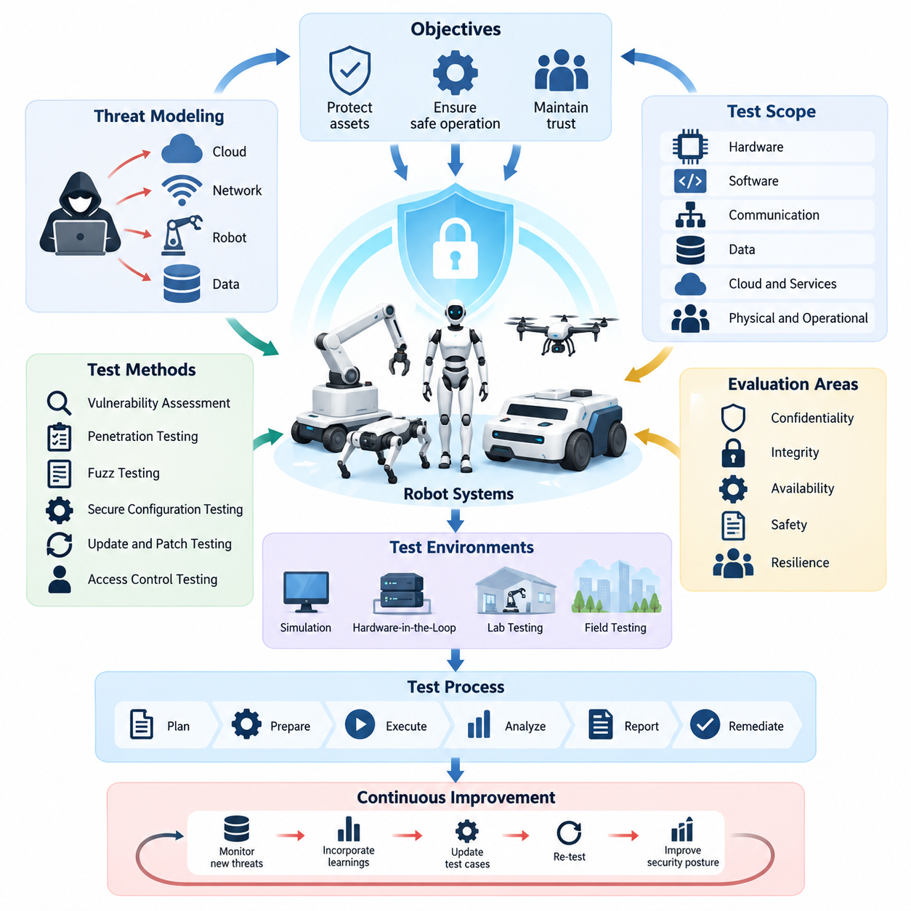
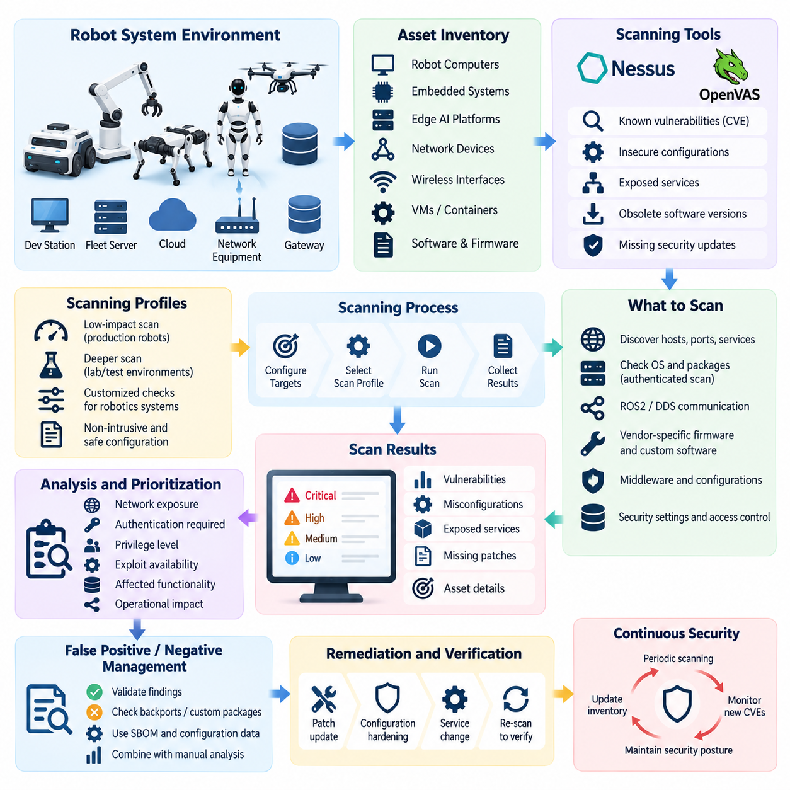
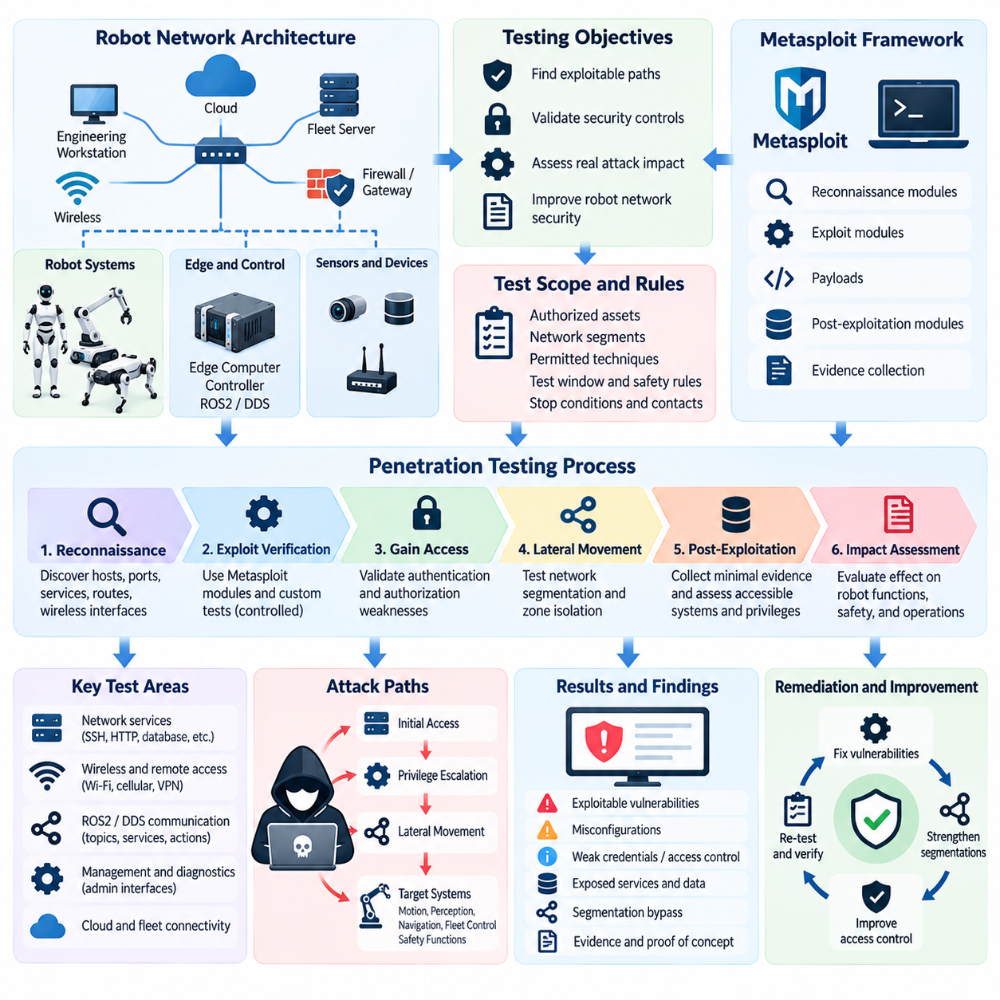
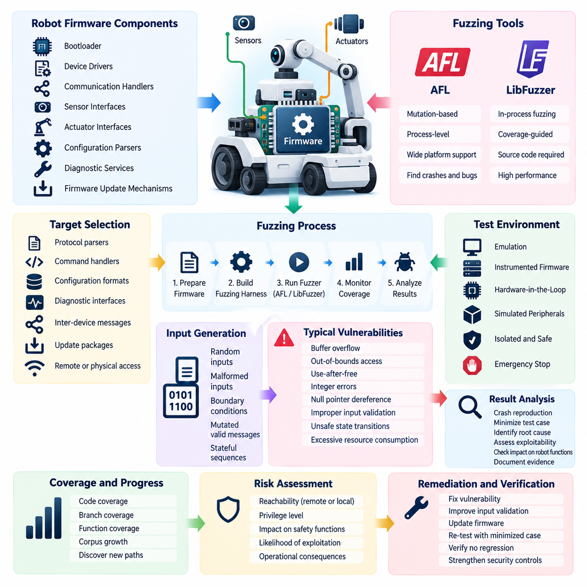
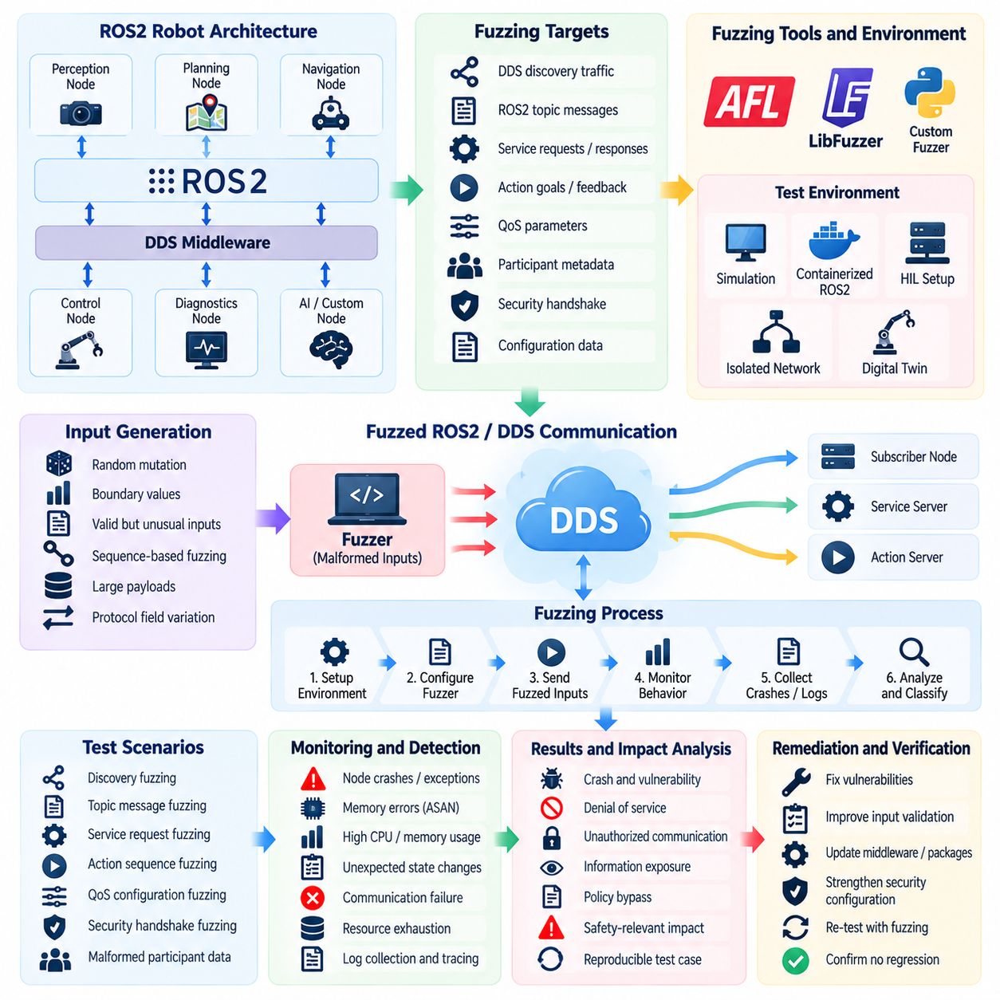
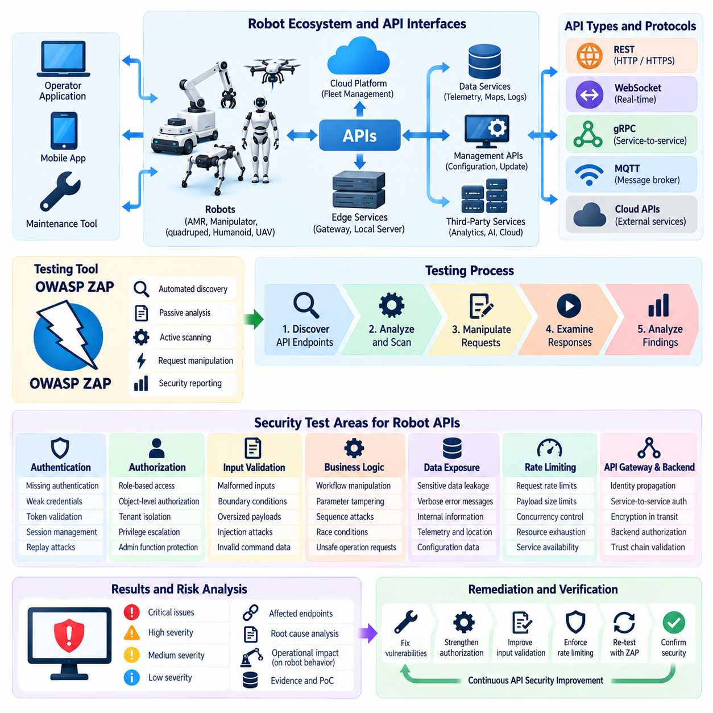
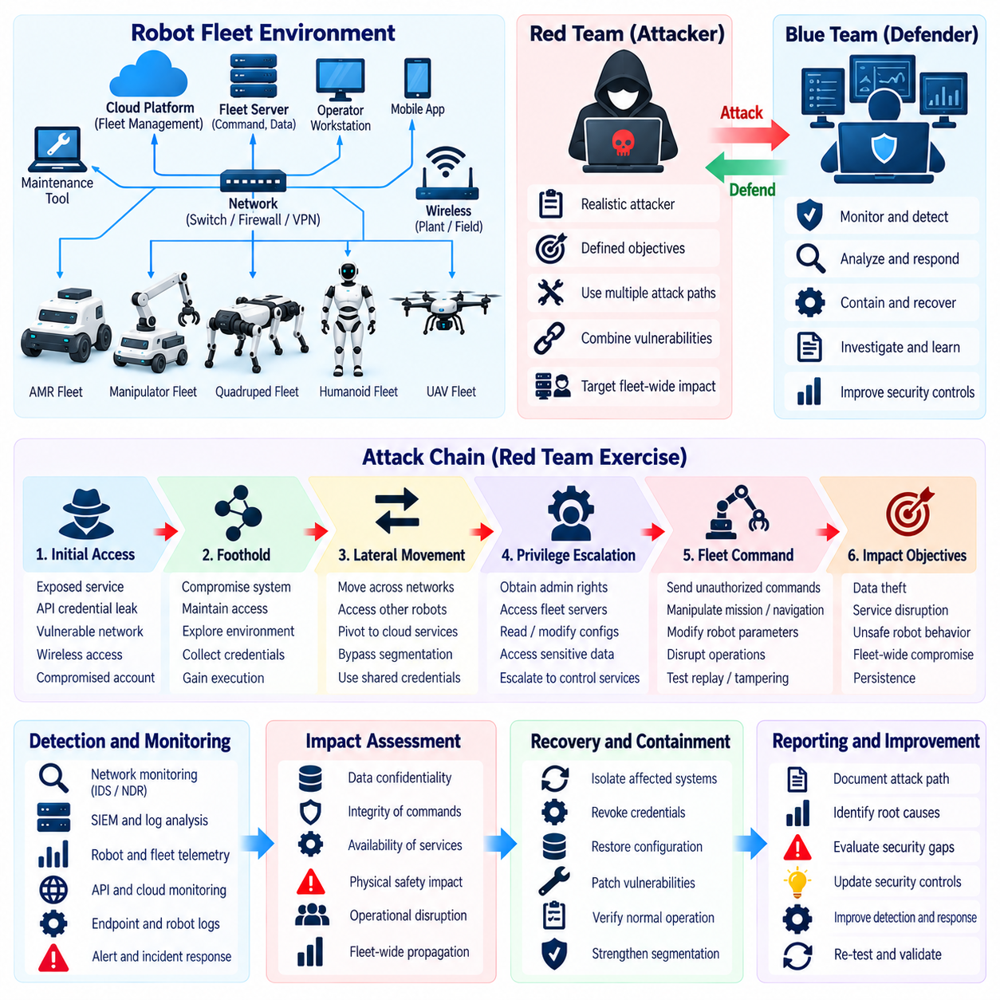
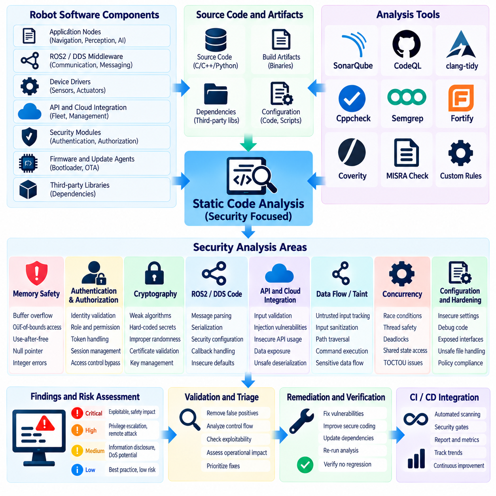
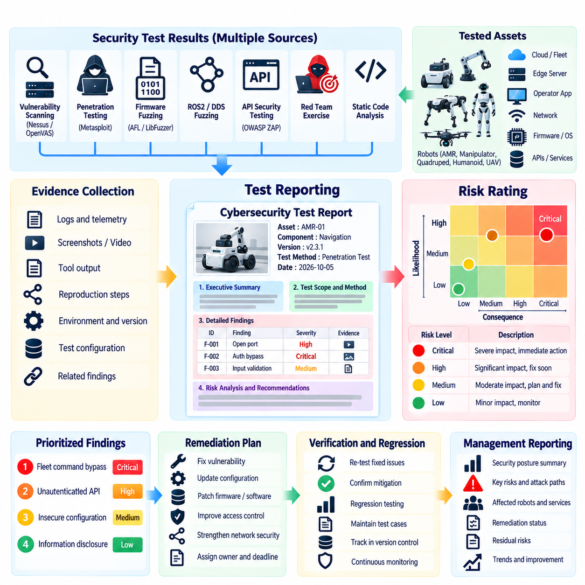
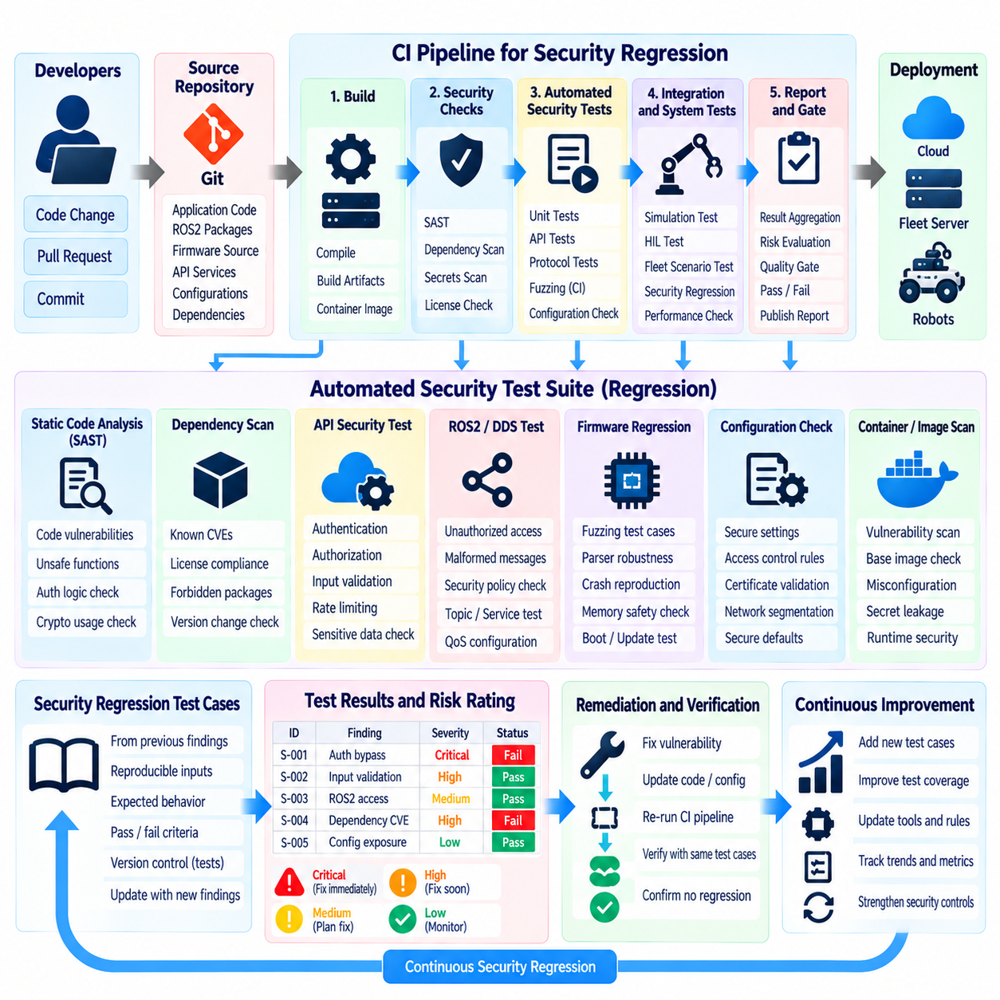

**Volume 24. Robot Cybersecurity**

# Chapter 08. Robot Cybersecurity Testing

## 08.01. Cybersecurity Test Strategy for Robot Systems

{width="7.268055555555556in" height="7.268055555555556in"}

A cybersecurity test strategy for robot systems establishes a structured process for determining whether security controls remain effective across software, hardware, communications, AI components, and operational interfaces. In the provided structure, cybersecurity testing follows earlier work on threat modeling, network security, ROS2 and DDS protection, Edge AI security, cloud and fleet security, and OTA and firmware security, making testing the verification layer for these protections. Volume_24_Robot_Cybersecurity

Unlike conventional IT systems, robots combine digital computation with physical actuation. A compromised application can therefore create consequences beyond information disclosure, including unauthorized motion, unsafe actuator commands, navigation disruption, manipulation of sensor information, or loss of fleet coordination. Security testing must consequently evaluate both cyber compromise and the physical behavior that could result when security boundaries fail.

The strategy should begin with explicit security objectives derived from system architecture, threat models, identified trust boundaries, operational scenarios, and expected attacker capabilities. Each objective should be translated into verifiable test conditions. Authentication, authorization, confidentiality, integrity, availability, secure boot, command authenticity, software provenance, and recovery behavior can then be evaluated against clearly defined acceptance criteria rather than informal security assumptions.

Test scope should represent the complete robot attack surface. This normally includes embedded controllers, operating systems, ROS2 nodes, DDS communication, Ethernet and wireless networks, cloud APIs, fleet-management interfaces, diagnostic ports, remote maintenance channels, AI inference pipelines, firmware, OTA infrastructure, credential stores, and external devices. The broader software tree also places robotics cybersecurity alongside middleware, APIs, cloud-edge systems, DevOps, AI, fleet intelligence, and testing disciplines, emphasizing its cross-system nature. 08_Robotics_Software_Tree

A practical strategy uses multiple complementary test levels. Component testing examines individual libraries, services, firmware modules, cryptographic functions, and authentication mechanisms. Integration testing verifies security assumptions across interfaces, while system-level testing evaluates the assembled robot. Fleet-level testing extends this approach to distributed command, identity, telemetry, cloud services, and interactions among multiple robots operating within shared infrastructure.

Security testing should combine static and dynamic techniques because neither approach provides sufficient coverage independently. Static analysis can reveal insecure functions, memory-safety defects, embedded credentials, unsafe dependencies, and configuration weaknesses before deployment. Dynamic analysis exposes runtime problems involving malformed inputs, protocol handling, authorization logic, resource exhaustion, and unexpected state transitions that become visible only when software is executing.

Vulnerability scanning provides broad detection of known weaknesses in hosts, services, packages, operating systems, and exposed network interfaces. Penetration testing then determines whether discovered weaknesses can be combined into realistic attack paths. The chapter structure explicitly extends these activities into network penetration testing, firmware fuzzing, ROS2/DDS protocol fuzzing, API testing, red-team exercises, static analysis, risk reporting, and automated regression testing. Volume_24_Robot_Cybersecurity

Fuzz testing is particularly valuable for robotic systems because they process large volumes of externally supplied and sensor-derived data. Protocol parsers, firmware interfaces, ROS2 messages, DDS traffic, APIs, configuration files, update packages, and device communications should be exercised with malformed, boundary, unexpected, and high-volume inputs. Failures must be assessed not only for crashes but also for unsafe robot states, degraded control behavior, or unintended privilege changes.

The test environment should provide isolation and observability while remaining representative of production architecture. Development laboratories, simulation environments, software-in-the-loop platforms, hardware-in-the-loop systems, dedicated robot testbeds, and controlled fleet environments can progressively increase realism. Safety controls such as physical exclusion zones, emergency stops, constrained actuator operation, network isolation, and recovery procedures are essential whenever offensive testing could influence physical motion.

Threat-based prioritization prevents the program from treating every vulnerability as equally important. Test cases should concentrate first on attack paths capable of affecting safety-critical control, privileged robot identities, fleet-wide commands, firmware trust, OTA updates, cloud administration, cryptographic keys, or AI decision pipelines. Exposure, exploitability, required privileges, propagation potential, detectability, and physical consequence should contribute to the prioritization decision.

Robot cybersecurity testing also requires explicit negative testing of defensive boundaries. A secure system should demonstrate predictable behavior when certificates are invalid, commands are unsigned, permissions are insufficient, firmware signatures fail, network connections disappear, messages are malformed, or authentication services become unavailable. The objective is not merely to reject malicious activity but to ensure that rejection itself cannot force the robot into an unsafe or uncontrolled operating condition.

Test evidence should be reproducible and traceable. Every finding should identify the affected asset, software or firmware version, configuration, test environment, prerequisites, attack sequence, observed behavior, security consequence, and remediation status. Linking findings to requirements and threat-model elements enables engineering teams to determine whether a vulnerability represents an isolated implementation defect or a deeper architectural weakness requiring redesign.

Risk evaluation should combine traditional cybersecurity severity with robotic consequence. A vulnerability that appears moderate from an information-security perspective may become critical when exploitation can influence braking, steering, flight control, manipulation, collision avoidance, or emergency-stop behavior. Conversely, vulnerabilities isolated from safety-relevant functions may receive lower operational priority while still requiring remediation according to organizational policy.

Testing should be integrated throughout the development lifecycle rather than performed only before release. Security requirements can drive design reviews, static analysis can execute during development, dependency and vulnerability scans can run during builds, and protocol or API tests can execute within integration pipelines. Hardware and fleet tests can then validate assumptions that cannot be reproduced completely in software-only environments.

Automated regression testing is necessary because robot software evolves continuously through application releases, AI updates, firmware revisions, configuration changes, and OTA deployment. Previously corrected vulnerabilities should become permanent regression cases whenever feasible. This approach converts security findings into reusable engineering assets and reduces the probability that later development unintentionally restores an earlier weakness.

Finally, the cybersecurity test strategy should operate as a continuous assurance process connecting threat modeling, implementation, verification, remediation, release, monitoring, and incident response. Test results should update risk assessments and future test priorities, while newly discovered threats should generate additional test cases. Through this feedback loop, cybersecurity testing becomes an enduring engineering capability that supports secure robot operation across individual platforms, connected fleets, and evolving Physical AI systems.

## 08.02. Vulnerability Scanning Nessus OpenVAS Robots [w/Code]

{width="7.268055555555556in" height="7.268055555555556in"}

Vulnerability scanning for robot systems establishes a systematic method for discovering known security weaknesses across the software, operating system, network services, embedded components, and exposed interfaces that support robotic operation. In the Chapter 08 structure, vulnerability scanning is positioned immediately after the overall cybersecurity test strategy and before network penetration testing, making it an important discovery and prioritization activity within the broader robot security verification process. Volume_24_Robot_Cybersecurity

Robot vulnerability scanning differs from conventional enterprise scanning because the target environment combines information technology, operational technology, embedded computing, real-time software, robotics middleware, and physical control functions. A scanner may identify an outdated package or exposed service, but the security significance depends on how that component connects to motion control, perception, navigation, fleet management, or safety functions. Results therefore require interpretation within the robot system architecture.

A practical scanning strategy should begin by defining the assets that are authorized for assessment. The inventory should cover robot computers, embedded Linux systems, industrial PCs, edge AI platforms, network equipment, wireless interfaces, development stations, fleet servers, cloud-connected endpoints, gateways, diagnostic interfaces, and relevant virtual machines or containers. Accurate asset identification prevents blind spots and establishes the foundation for repeatable vulnerability assessment across individual robots and larger fleets.

Nessus and OpenVAS can be used as complementary vulnerability assessment platforms for identifying known vulnerabilities, insecure configurations, exposed services, obsolete software versions, weak protocols, and missing security updates. The objective is not simply to generate a large list of findings, but to establish an evidence-based understanding of the robot\'s exposed security condition. Scanner output should therefore be correlated with asset ownership, software versions, operational roles, and network exposure.

Scanning profiles should be adapted to the operational characteristics of robotic systems. Aggressive discovery or intrusive checks can create unexpected resource consumption, service disruption, or timing effects on systems responsible for real-time control. Production robots should therefore normally begin with controlled, low-impact assessments, while deeper checks can be performed against laboratory replicas, development systems, digital twins, or dedicated cybersecurity testbeds where operational consequences can be safely contained.

Network discovery should identify reachable hosts, listening ports, active services, communication protocols, and externally accessible management interfaces. Particular attention should be given to SSH, HTTP or HTTPS, database services, middleware-related communication, remote diagnostics, industrial protocols, and vendor-specific interfaces. An apparently harmless service can become significant when it provides a path toward privileged robot functions or creates an unexpected connection between a less trusted network and a safety-relevant subsystem.

Authenticated scanning can provide substantially greater visibility than unauthenticated scanning because it allows the assessment platform to inspect installed packages, operating-system configurations, patch levels, local security settings, and other information that cannot always be inferred remotely. Where technically and operationally appropriate, authenticated assessments should be performed using dedicated least-privilege credentials and carefully controlled access mechanisms rather than permanent administrative credentials.

Special consideration is required for embedded and robotics software. Standard vulnerability databases may identify weaknesses in operating-system packages or common libraries, but they may not fully capture vendor-specific firmware, proprietary drivers, robotics middleware configurations, custom applications, or specialized hardware interfaces. Scanner results should therefore be combined with software bills of materials, firmware inventories, dependency records, configuration baselines, and supplier security information to improve coverage.

ROS2 and DDS environments require particular care because communication behavior can depend on middleware configuration, discovery mechanisms, security plugins, certificates, access-control policies, and network topology. A vulnerability scanner may identify a vulnerable underlying package or exposed service without understanding the semantic importance of robot topics, services, actions, or node identities. Security assessment should consequently connect infrastructure-level findings with the communication architecture and trust boundaries defined for the robot.

The scanning process should distinguish between vulnerability existence and vulnerability exploitability. A high-severity CVE on an isolated development component may present less immediate operational risk than a lower-severity weakness on an externally reachable fleet-management gateway. Factors such as network exposure, authentication requirements, privilege level, exploit availability, affected functionality, propagation potential, and physical consequences should be considered when determining remediation priority.

False positives and false negatives must also be actively managed. Automated scanners can report vulnerabilities that are not applicable because of backported patches, customized packages, compensating controls, or inaccurate version detection. Conversely, scanners can miss vulnerabilities hidden behind proprietary interfaces, unusual configurations, encrypted communication paths, unsupported firmware, or application-specific logic. Security engineers should therefore validate significant findings through configuration inspection, vendor documentation, targeted testing, and controlled manual verification.

Repeated scanning should be incorporated into the robot development and operational lifecycle. Baseline scans can be performed before release, after major software or firmware changes, following network architecture modifications, and during periodic security assessments. New findings should be compared with previous results so that teams can distinguish newly introduced vulnerabilities from persistent technical debt. This historical comparison also provides evidence that remediation activities are actually reducing exposure over time.

Scanning results should be transformed into actionable security records rather than retained as raw tool output. Each finding should identify the affected asset, detected component, vulnerability identifier when available, severity, evidence, exposure conditions, operational relevance, recommended remediation, responsible owner, and verification status. Findings affecting safety-critical or fleet-wide functions should receive additional analysis because their consequences can extend beyond confidentiality or data integrity into physical safety and operational continuity.

The results of vulnerability scanning should feed directly into subsequent penetration testing and security regression activities. High-priority findings can become targeted penetration-test hypotheses, while confirmed weaknesses should become regression cases that verify continued protection after remediation. This creates a continuous relationship between automated vulnerability discovery, manual security validation, remediation, and repeated verification rather than treating scanning as a one-time compliance exercise.

Ultimately, vulnerability scanning for robots should function as a continuous exposure-management capability that supports secure development, deployment, and operation. Nessus and OpenVAS can provide valuable automated visibility, but effective robot cybersecurity depends on combining scanner evidence with architecture knowledge, threat modeling, software and firmware inventories, operational constraints, and physical consequence analysis. This approach allows organizations to identify meaningful weaknesses early, prioritize them according to real robotic risk, and maintain a defensible security posture as robot platforms and fleets evolve.

## 08.03. Network Penetration Testing Metasploit [w/Code]

{width="7.268055555555556in" height="7.268055555555556in"}

Network penetration testing for robot systems is a controlled security assessment designed to determine whether weaknesses in robot network architecture can be exploited to gain unauthorized access, escalate privileges, intercept communications, disrupt services, or reach safety-relevant functions. Within Chapter 08, network penetration testing follows vulnerability scanning and precedes firmware fuzzing, establishing a progression from automated weakness discovery toward controlled validation of realistic attack paths. Volume_24_Robot_Cybersecurity

A robot network must be assessed as more than a collection of conventional IP endpoints. It may contain embedded controllers, edge computers, ROS2 nodes, DDS participants, industrial switches, wireless interfaces, gateways, fleet-management servers, cloud connections, engineering workstations, and maintenance devices. Penetration testing should therefore examine how trust relationships and communication paths connect these components, particularly where compromise of one system could provide access to motion control, perception, navigation, or fleet-level functions.

The testing process should begin by defining an authorized scope and controlled objective. Target assets, network segments, permitted techniques, test windows, safety restrictions, emergency contacts, and stop conditions should be established before active testing begins. Production robots require additional safeguards because aggressive network activity can affect timing-sensitive services or operational communications. Whenever possible, high-impact techniques should first be validated in an isolated laboratory, simulation environment, digital twin, or dedicated security testbed.

Reconnaissance establishes the actual network exposure of the robot environment. Testers identify reachable hosts, active ports, service banners, communication protocols, network routes, wireless interfaces, management services, and unexpected connections between security zones. Particular attention should be given to administrative interfaces, remote maintenance paths, diagnostic services, exposed middleware communication, and gateways connecting robot networks to enterprise or cloud infrastructure. The objective is to compare observed exposure with the intended architecture and identify undocumented attack paths.

Metasploit can support controlled validation by providing a framework for organizing reconnaissance, exploit verification, payload testing, and post-exploitation assessment within an authorized environment. Its role should not be reduced to launching automated exploits. For robot cybersecurity, each selected module should correspond to a documented vulnerability, test hypothesis, or security control that requires verification. Testing should remain bounded so that successful exploitation does not unintentionally create unsafe physical behavior or uncontrolled propagation.

Authentication and authorization boundaries should receive particular attention. Testing can evaluate whether weak credentials, improperly protected services, excessive privileges, session weaknesses, or inadequate access controls allow an attacker to move from a lower-trust network into privileged robot functions. The assessment should determine not only whether unauthorized access is technically possible but also whether the resulting privileges could influence sensitive services, configuration data, command interfaces, telemetry, or fleet-management operations.

Network segmentation should be validated from the attacker\'s perspective. A robot architecture may define separate zones for safety control, perception, AI data, administration, maintenance, and external connectivity, but configuration errors can create unintended communication paths. Penetration testing should therefore verify whether firewall rules, VLAN boundaries, access-control lists, gateways, and other segmentation mechanisms actually prevent unauthorized lateral movement between these zones.

ROS2 and DDS communication introduces additional considerations because robot applications may depend on distributed discovery, topic communication, services, actions, and middleware security policies. A network penetration assessment should determine whether exposed communication mechanisms permit unauthorized discovery, message injection, service interaction, or access to protected functions. Findings should be interpreted together with the security configuration of ROS2 and DDS rather than treating middleware traffic as ordinary network data.

Wireless and remote-access paths should also be included when they form part of the robot\'s operational environment. Wi-Fi, private cellular networks, VPN gateways, remote support connections, and maintenance channels can create alternative entry points that bypass assumptions made about the primary robot network. Testing should determine whether authentication, encryption, segmentation, and authorization remain effective when an attacker approaches through these secondary communication paths.

Post-exploitation analysis should be carefully constrained. When a penetration test successfully establishes access, the tester should collect only the minimum evidence required to demonstrate impact and should avoid unnecessary modification of files, credentials, configurations, or control parameters. The assessment should establish the achievable privilege level, accessible systems, potential lateral movement, and possible operational consequences without turning a controlled security exercise into an uncontrolled production incident.

Robot-specific impact assessment is essential when evaluating penetration-test results. A compromised network service may expose confidential telemetry, but another weakness may enable manipulation of navigation data, fleet commands, actuator-related interfaces, or safety-relevant services. Risk assessment should therefore consider confidentiality, integrity, availability, privilege escalation, propagation potential, detectability, recovery difficulty, and physical consequences rather than relying exclusively on conventional IT vulnerability severity.

Testing should also evaluate defensive monitoring and response capabilities. Security teams should determine whether unauthorized scanning, authentication attempts, exploitation activity, lateral movement, and abnormal service behavior generate meaningful alerts. Network intrusion detection, centralized logging, SIEM integration, endpoint monitoring, and operational telemetry should be correlated where possible. A penetration test therefore measures not only whether an attack can succeed, but also whether the organization can detect and contain it.

Every penetration-test finding should be documented with sufficient evidence to reproduce the result safely. The record should describe the affected asset, network location, vulnerability or weakness, initial access condition, tested technique, observed result, security impact, physical or operational consequence, and recommended remediation. Sensitive exploit information should be handled according to organizational security procedures. Confirmed weaknesses should also be converted into regression tests where practical so that later software, configuration, or network changes do not silently restore the vulnerability.

The results should feed back into vulnerability management, threat modeling, network architecture, and subsequent security testing. A confirmed attack path may reveal that an apparently isolated vulnerability becomes significantly more serious when combined with another weakness. Conversely, successful segmentation or access-control defenses can provide evidence that reduces the practical exploitability of an identified vulnerability. This feedback makes penetration testing an architectural validation activity rather than simply an exercise in finding exploitable defects.

Ultimately, network penetration testing with Metasploit or comparable security frameworks should provide controlled evidence about the resilience of robot communication environments against realistic attackers. The most valuable outcome is not the number of successful exploits but a clear understanding of how an attacker could enter, move, escalate privileges, affect robot services, and potentially influence physical operations. When performed under strict authorization and safety controls, penetration testing becomes a practical mechanism for validating network defenses across individual robots, connected fleets, and increasingly distributed Physical AI systems.

## 08.04. Firmware Fuzzing AFL LibFuzzer [w/Code]

{width="7.268055555555556in" height="7.268055555555556in"}

Firmware fuzzing for robot systems is a security testing technique that systematically provides malformed, unexpected, boundary-condition, and randomly generated inputs to firmware components in order to discover crashes, memory corruption, parser weaknesses, unsafe state transitions, and other defects that may be exploitable by an attacker. Within Chapter 08, firmware fuzzing follows network penetration testing and precedes ROS2/DDS protocol fuzzing, extending cybersecurity validation from network exposure toward lower-level software that directly interacts with embedded hardware and robot control functions. Volume_24_Robot_Cybersecurity

Robot firmware requires specialized fuzzing because it frequently operates close to hardware and may contain bootloaders, device drivers, communication handlers, sensor interfaces, actuator interfaces, configuration parsers, diagnostic services, and update mechanisms. A defect in these components can have consequences beyond a conventional application crash. Memory corruption or malformed-input handling may affect device availability, privilege boundaries, secure-update mechanisms, or safety-related functions, making firmware fuzzing an important layer of robot cybersecurity verification.

An effective fuzzing strategy should begin by identifying firmware components that accept externally influenced data. Suitable targets may include communication protocols, packet parsers, command handlers, configuration formats, diagnostic interfaces, firmware-update packages, file parsers, sensor-data handlers, and inter-device messages. The test scope should distinguish between code that can be reached remotely and code requiring physical or privileged access. This classification helps prioritize fuzzing targets according to realistic attack exposure and potential operational consequences.

AFL and LibFuzzer provide two important approaches for coverage-guided fuzzing. AFL is commonly associated with process-level fuzzing and mutation-based input generation, while LibFuzzer is designed to operate closely with instrumented code and a fuzzing target through an in-process interface. For robot firmware, either approach should be selected according to the available source code, compiler toolchain, execution environment, and ability to reproduce firmware behavior outside the physical robot.

Because many firmware images cannot execute directly on a conventional workstation, testing may require an emulated, instrumented, or extracted representation of the firmware. Where source code is available, security-sensitive parsers and handlers can be compiled into a dedicated fuzzing harness. Where source is unavailable, analysis may rely on firmware extraction, binary instrumentation, emulation, or hardware-assisted testing. The selected method should preserve the relevant parsing and state-transition behavior while keeping dangerous physical outputs isolated from the test environment.

A fuzzing harness is central to effective firmware testing because it defines how generated input reaches the target function. A useful harness should initialize the minimum required execution state, provide controlled input, execute the selected parsing or processing path, and terminate or reset cleanly after each test iteration. Poorly designed harnesses can produce large numbers of irrelevant failures or prevent the fuzzer from reaching meaningful code paths, reducing the practical value of the testing campaign.

Coverage guidance should be used to determine whether fuzzing is exploring new execution paths. Code coverage, branch coverage, function coverage, and corpus growth can provide evidence that the test campaign is reaching increasingly diverse firmware behavior. Coverage should not be interpreted as proof of security, because high coverage can still leave important semantic conditions untested. Nevertheless, coverage trends help identify unreachable regions, ineffective inputs, and targets that require improved harness design.

Firmware fuzzing should concentrate particularly on memory-safety and input-validation weaknesses. Buffer overflows, out-of-bounds reads and writes, integer-related errors, use-after-free conditions, null-pointer dereferences, uncontrolled recursion, excessive resource consumption, and improper length validation can become significant security issues when triggered through remotely accessible firmware interfaces. Sanitizers and crash-detection mechanisms can increase the ability to identify and classify such failures during instrumented testing.

Stateful firmware behavior requires additional attention because many embedded protocols cannot be tested effectively through isolated random inputs. A valid command may depend on authentication, initialization, session establishment, previous messages, device state, or specific sequencing. Stateful fuzzing can therefore mutate valid message sequences rather than treating every input as an independent byte stream. This approach is particularly valuable for firmware implementing communication protocols, diagnostics, configuration management, or update procedures.

The physical consequences of firmware failures must be controlled throughout the campaign. Firmware responsible for motors, brakes, steering, flight controls, manipulators, power management, or other safety-relevant functions should preferably be tested in an isolated environment before being exercised on operational hardware. Hardware-in-the-loop platforms, simulated peripherals, constrained actuator interfaces, and emergency-stop mechanisms can help ensure that a discovered fault remains a cybersecurity test result rather than becoming an uncontrolled physical event.

Every crash or anomalous behavior discovered through fuzzing should be minimized and reproduced before being classified as a security finding. The record should capture the firmware version, target component, input or seed that triggered the failure, execution context, observed crash or abnormal state, reproducibility, affected security boundary, and potential operational consequence. Duplicate crashes should be clustered where appropriate, while unique failure conditions should be preserved as separate test cases for remediation and regression verification.

Fuzzing results should feed directly into the broader robot cybersecurity lifecycle. Confirmed firmware weaknesses can lead to code correction, compiler or build-hardening changes, interface redesign, configuration restrictions, or firmware-update remediation. Once corrected, the triggering input should become a regression artifact so that future firmware releases are automatically tested against the same failure. This creates a persistent security test asset rather than allowing an individual fuzzing discovery to disappear after a single remediation cycle.

Ultimately, AFL, LibFuzzer, and related fuzzing techniques should be treated as continuous firmware assurance mechanisms rather than isolated vulnerability-hunting tools. Their greatest value comes from combining coverage-guided exploration, carefully constructed harnesses, realistic firmware interfaces, crash analysis, controlled hardware execution, and regression testing. Within the robot cybersecurity testing framework, firmware fuzzing complements vulnerability scanning and network penetration testing by examining weaknesses deeper inside the software stack and helping determine whether malformed inputs can cross from digital interfaces into security-relevant or physically consequential robot behavior.

## 08.05. ROS2 DDS Protocol Fuzzing [w/Code]

{width="7.268055555555556in" height="7.268055555555556in"}

ROS2 and DDS protocol fuzzing is a specialized cybersecurity testing method for discovering weaknesses in the communication mechanisms used by robot software. Within the Chapter 08 structure, it follows firmware fuzzing and precedes API security testing, extending the testing scope from low-level embedded software to the middleware layer that connects distributed robot components. The objective is to determine whether malformed, unexpected, or deliberately manipulated communication can cause crashes, unauthorized behavior, denial of service, information exposure, or violations of communication security policies. Volume_24_Robot_Cybersecurity

ROS2 systems depend on DDS middleware to exchange messages among distributed nodes, making the communication layer an important security boundary. A robot may use topics, services, and actions to connect perception, planning, control, navigation, diagnostics, and AI components. A weakness in message handling or discovery behavior can therefore propagate beyond a single process and affect multiple subsystems. Protocol fuzzing should examine whether DDS participants and ROS2 nodes continue to behave safely when communication does not follow expected formats, sequences, sizes, timing patterns, or authorization assumptions.

An effective fuzzing strategy should first identify the communication interfaces that can receive externally influenced data. Relevant targets may include DDS discovery traffic, serialized ROS2 messages, topic data, service requests, action requests, quality-of-service parameters, participant metadata, configuration data, and security-related exchanges. The test scope should distinguish trusted internal communication from interfaces reachable through wireless networks, maintenance connections, gateways, or other less-trusted segments. This allows testing effort to focus on communication paths that represent realistic attack surfaces.

The fuzzing environment should reproduce the relevant ROS2 and DDS architecture while preventing malformed traffic from affecting operational robots. A laboratory network, simulation environment, containerized ROS2 deployment, digital twin, or hardware-in-the-loop platform can provide controlled execution. The test environment should include representative nodes, DDS implementations, security configuration, namespaces, topic structures, and quality-of-service settings. Physical actuation should remain isolated until communication-level behavior has been evaluated and determined to be safe.

Protocol fuzzing should examine message structure as well as communication sequence. Simple mutation can modify field values, message lengths, encodings, identifiers, timestamps, arrays, strings, and nested structures. More advanced approaches can generate semantically unusual but syntactically valid messages or mutate sequences of interactions between publishers, subscribers, service clients, and servers. This is important because many middleware vulnerabilities depend on state, ordering, negotiation, or accumulated communication history rather than on one malformed packet.

DDS discovery deserves particular attention because discovery mechanisms allow participants to identify communication entities within a distributed environment. Fuzzing can examine malformed participant information, unexpected metadata, abnormal identifiers, excessive discovery traffic, and unusual discovery sequences. The objective is to determine whether middleware components reject invalid information safely and whether abnormal discovery activity can cause resource exhaustion, unexpected participant behavior, unauthorized communication, or degradation of legitimate robot services.

ROS2 message handling should also be tested across topics, services, and actions. A fuzzing campaign can vary message contents, boundary values, nested structures, serialization parameters, and request-response sequences while monitoring nodes for crashes, exceptions, memory corruption, excessive resource consumption, or unexpected state changes. Particular attention should be given to nodes that process externally influenced information and subsequently issue commands to navigation, manipulation, motion-control, or other safety-relevant components.

Quality-of-service behavior represents another useful testing dimension. ROS2 communication can depend on reliability, durability, history, deadline, liveliness, and related communication policies. Testing can introduce unusual or conflicting combinations of parameters and observe whether nodes handle them predictably. The purpose is not to treat every unusual configuration as a vulnerability, but to determine whether unexpected QoS conditions can cause resource exhaustion, communication failure, policy bypass, unstable node behavior, or denial of service.

Security-enabled ROS2 and DDS deployments require fuzzing that considers authentication, encryption, access-control policies, certificates, and cryptographic material. Test cases can examine malformed security metadata, invalid certificates, unauthorized identities, unexpected policy references, expired credentials, and improperly formed protected messages. The expected behavior should be deterministic rejection or controlled failure. A security mechanism that crashes, leaks sensitive information, falls back to an insecure state, or produces inconsistent authorization behavior under malformed input represents a significant weakness.

Resource-exhaustion testing should be carefully controlled because distributed middleware can amplify relatively small communication anomalies. Excessive message rates, unusually large payloads, repeated discovery events, large participant counts, or abnormal request sequences may consume CPU, memory, network bandwidth, or middleware resources. The test should establish thresholds and observe whether the system maintains essential functions, applies appropriate limits, and recovers after the abnormal traffic stops. Production-scale stress should only be performed when operational safety has been explicitly established.

Instrumentation and observability are essential for interpreting fuzzing results. Test environments should capture node logs, DDS middleware logs, process exits, exceptions, resource utilization, network traces, security audit events, and relevant robot telemetry. Code coverage or execution-path information can help determine whether generated inputs are reaching new processing paths. When a failure occurs, the triggering input should be minimized to the smallest reproducible case so that developers can understand the underlying condition and create an effective remediation.

Each discovered anomaly should be classified according to both technical and robotic impact. A middleware crash may affect availability, while unauthorized topic access may compromise confidentiality or integrity. A failure that permits manipulation of navigation commands or actuator-related messages can have substantially greater consequences because the cybersecurity weakness may cross into physical operation. Findings should therefore record the affected node or participant, communication interface, input condition, security boundary, observed behavior, reproducibility, potential propagation, and physical or operational consequence.

ROS2/DDS fuzzing results should become part of the broader security regression process. Confirmed defects should be corrected through software changes, configuration restrictions, middleware updates, access-control policies, resource limits, or architectural modifications as appropriate. The original triggering input and relevant communication sequence should then be preserved as regression cases. Automated execution of these cases after future ROS2, DDS, firmware, or application changes helps prevent previously discovered protocol weaknesses from returning.

Ultimately, ROS2 and DDS protocol fuzzing provides a bridge between conventional network security testing and application-level robot cybersecurity validation. Its purpose is not simply to generate malformed traffic or discover crashes, but to determine whether the middleware communication fabric remains secure, stable, and predictable when confronted with hostile or unexpected protocol behavior. When integrated with threat modeling, network penetration testing, firmware fuzzing, API testing, and automated security regression, ROS2/DDS fuzzing provides deeper assurance that distributed robot communication cannot easily become a pathway from a digital protocol weakness to compromised robot or fleet behavior.

## 08.06. API Security Testing OWASP ZAP [w/Code]

{width="7.268055555555556in" height="7.268055555555556in"}

API security testing for robot systems is a structured process for identifying weaknesses in the application programming interfaces that connect robots with cloud platforms, fleet-management systems, edge services, operator applications, maintenance tools, and other external components. Within Chapter 08, API security testing follows ROS2/DDS protocol fuzzing and precedes red-team exercises, extending cybersecurity validation from middleware communication into application-level interfaces that can expose commands, telemetry, configuration, identity, and operational data.

Robot APIs require particular attention because an API request can represent more than a conventional software transaction. A request may initiate a mission, modify navigation parameters, retrieve sensor information, update configuration, change robot permissions, or issue fleet-level commands. API security testing must therefore evaluate not only confidentiality and data integrity but also whether unauthorized or manipulated requests could produce unsafe physical behavior, disrupt operations, or propagate across multiple robots.

The testing strategy should begin by identifying all exposed API endpoints and their trust relationships. REST, HTTP, HTTPS, WebSocket, gRPC, MQTT-based interfaces, cloud APIs, edge APIs, fleet APIs, and vendor-specific management interfaces may all form part of the robot attack surface. The inventory should identify endpoint purpose, authentication requirements, authorization scope, input types, data sensitivity, command capability, and relationships with safety-relevant or privileged robot functions.

OWASP ZAP can provide a controlled framework for discovering and assessing web-facing API weaknesses. Automated crawling, passive analysis, active scanning, request manipulation, and security testing can help identify problems involving authentication, authorization, input validation, session management, insecure headers, information disclosure, and common web application weaknesses. For robotic systems, however, automated findings must be interpreted in the context of the API\'s operational function and its connection to physical robot behavior.

Authentication testing should determine whether API endpoints properly verify the identity of users, applications, services, and robots. Test cases can examine missing authentication, weak credentials, improperly handled tokens, expired credentials, replay conditions, session weaknesses, and inconsistent authentication requirements between related endpoints. Particular attention should be given to APIs that provide administrative functions, fleet commands, firmware operations, configuration changes, or access to sensitive telemetry.

Authorization testing is equally important because successful authentication does not guarantee appropriate access. A properly authenticated operator may still be unauthorized to control another robot, access another customer\'s data, modify safety-related configuration, or execute fleet-wide commands. Testing should examine role boundaries, object-level authorization, function-level authorization, tenant isolation, and privilege transitions to determine whether an API consistently enforces the intended access-control model.

Input validation should be evaluated against malformed, unexpected, oversized, boundary-condition, and semantically invalid values. Robot APIs may accept coordinates, trajectories, velocity limits, mission parameters, configuration values, identifiers, sensor references, or structured command objects. Testing should determine whether these inputs are validated before reaching downstream services and whether abnormal values can cause crashes, resource exhaustion, command manipulation, unsafe configuration, injection vulnerabilities, or unexpected state transitions.

API testing should also examine business logic rather than relying exclusively on generic web vulnerability detection. A sequence of individually valid requests may become dangerous when executed in an unexpected order or combination. For example, changing a robot\'s configuration, modifying permissions, and submitting a mission may each be legitimate operations, but their combination could create an unauthorized operational state. Stateful testing should therefore evaluate workflows, dependencies, race conditions, replay behavior, and assumptions between related API operations.

Sensitive data exposure must be assessed across responses, error messages, logs, metadata, and diagnostic interfaces. Robot APIs may return telemetry, location information, sensor status, mission history, credentials, configuration details, or internal system information. Testing should verify that responses contain only the information required by the requesting identity and that error handling does not reveal unnecessary implementation details, internal paths, service names, database information, or security-sensitive configuration.

Rate limiting and resource protection are especially important for APIs supporting robot fleets. Excessive requests can consume server resources, overload gateways, interfere with telemetry, or delay legitimate commands. Testing should evaluate request-rate limits, payload-size restrictions, concurrent-session controls, timeout behavior, queue management, and recovery after abnormal traffic. The objective is to determine whether the API can resist resource-exhaustion conditions while preserving essential robot and fleet operations.

API gateways and backend services should be evaluated as a complete trust chain. An apparently secure external API can still become vulnerable if authorization decisions are lost when requests move between gateways, cloud services, edge computers, and robot endpoints. Testing should verify identity propagation, certificate validation, token handling, service-to-service authorization, transport encryption, and consistent policy enforcement across each interface. Any transformation between API formats should also be examined for validation or authorization inconsistencies.

Testing should be performed in controlled environments whenever API operations can influence physical robots. Laboratory robots, simulation environments, digital twins, or dedicated test fleets can provide realistic API behavior without exposing production operations to uncontrolled commands. Destructive actions should use constrained targets and predefined safety boundaries. Test accounts, synthetic data, isolated credentials, and dedicated API endpoints should be preferred so that security testing cannot accidentally modify operational assets or real customer information.

Every API security finding should be documented with the affected endpoint, request method, authentication state, authorization context, input condition, observed response, reproducibility, security consequence, and affected robot or fleet function. High-risk findings should be evaluated according to their potential physical and operational impact rather than their web-application severity alone. Confirmed weaknesses should be converted into regression tests and incorporated into continuous security testing so that later API, cloud, edge, or robot-software changes do not silently reintroduce the same vulnerability.

Ultimately, API security testing with OWASP ZAP and complementary techniques should verify that robot APIs remain trustworthy at the boundary between users, applications, cloud services, and physical machines. The objective is not simply to detect common web vulnerabilities, but to establish that identity, authorization, input validation, business logic, data protection, rate control, and service-to-service trust remain consistent when APIs are exposed to hostile or unexpected behavior. Properly integrated with ROS2/DDS testing, penetration testing, red-team exercises, and automated regression, API security testing helps prevent application-layer weaknesses from becoming pathways to compromised robot or fleet operations.

## 08.07. Red Team Exercise for Robot Fleet [w/Code]

{width="7.268055555555556in" height="7.268055555555556in"}

A red-team exercise for a robot fleet is a controlled adversarial security assessment designed to evaluate how effectively a fleet can resist, detect, contain, and recover from coordinated cyber attacks. Within Chapter 08, the exercise follows API security testing and precedes static code analysis, positioning it as a higher-level validation activity that combines weaknesses across networks, APIs, middleware, firmware, cloud services, and robot endpoints. The objective is to evaluate realistic attack paths rather than isolated technical vulnerabilities. Volume_24_Robot_Cybersecurity

A robot fleet presents a broader attack surface than an individual robot because multiple platforms, management services, communication networks, operator interfaces, and cloud systems may be interconnected. A red-team exercise should therefore evaluate whether an attacker who compromises one entry point can move toward other robots or privileged fleet services. Particular attention should be given to trust relationships, shared credentials, fleet-management interfaces, remote maintenance paths, common software components, and centralized services that could become high-value targets.

The exercise should begin with clearly defined authorization, objectives, scope, rules of engagement, and safety constraints. The participating security team must establish which robots, networks, cloud services, APIs, accounts, and physical environments may be tested. Production systems require especially strict controls because an offensive action can affect real robot operations. Test windows, emergency contacts, prohibited actions, containment procedures, and explicit stop conditions should be agreed upon before adversarial activities begin.

A useful red-team scenario should represent a realistic attacker rather than simply execute a collection of security tools. The exercise can begin from a defined initial foothold such as a compromised operator workstation, exposed API credential, vulnerable network service, unauthorized wireless access path, or compromised maintenance account. The team then attempts to achieve predefined objectives while documenting how individual weaknesses can be combined into a meaningful attack chain.

Initial access should be evaluated against the same external and internal interfaces that would be relevant to a real fleet environment. Internet-facing services, VPN gateways, cloud APIs, wireless networks, maintenance interfaces, development systems, and operator applications can provide potential entry points. The objective is to determine whether existing preventive controls stop the attack at the boundary or whether an attacker can establish a foothold and proceed toward more privileged fleet infrastructure.

Once access is established, lateral movement becomes a major focus of the exercise. The red team should evaluate whether network segmentation, identity controls, firewall policies, access-control rules, and service authentication prevent movement between operator systems, robot networks, cloud services, and other fleet components. A successful path from one compromised endpoint to multiple robots may represent a substantially greater risk than the original vulnerability because the weakness can potentially be transformed into fleet-wide impact.

Privilege escalation should be assessed within the limits established by the rules of engagement. The exercise can examine whether compromised accounts, services, applications, or robots provide unnecessary privileges and whether those privileges allow access to administrative interfaces, credentials, configuration systems, command services, or sensitive telemetry. The purpose is to determine whether privilege boundaries operate as intended and whether compromise of a lower-trust component can reach a higher-trust fleet function.

Fleet command security is particularly important because centralized commands can influence many robots simultaneously. The red team should evaluate whether command authentication, authorization, signing, replay protection, identity validation, and policy enforcement prevent unauthorized fleet operations. Where physical execution would create unacceptable risk, the same command paths should be tested against simulated robots, digital twins, or constrained test platforms so that security controls can be validated without causing unsafe movement.

The exercise should also evaluate the possibility of persistence and repeated access. An attacker who loses an initial foothold may attempt to retain access through compromised credentials, altered configurations, unauthorized accounts, modified services, or other mechanisms. Testing should determine whether such persistence can survive normal operational changes and whether security monitoring can identify the resulting abnormal behavior. Persistence activities must remain strictly controlled and reversible.

Detection and response capabilities should be tested throughout the red-team campaign rather than only after the technical objectives have been reached. Security monitoring should be observed for evidence of reconnaissance, authentication abuse, privilege escalation, lateral movement, unusual API activity, abnormal robot communications, and suspicious fleet commands. SIEM systems, network monitoring, endpoint telemetry, robot logs, cloud security controls, and operational monitoring should be correlated where possible to determine whether defenders can recognize an attack chain.

The physical consequences of a successful cyber attack must remain central to the assessment. A red-team finding that permits access to telemetry may primarily affect confidentiality, while a weakness that permits manipulation of navigation, motion, actuator, or fleet commands may affect physical safety. The exercise should therefore classify attack paths according to their potential effects on robot availability, operational continuity, human safety, equipment, data integrity, and fleet-wide behavior rather than relying exclusively on conventional cybersecurity severity.

A red-team exercise should avoid unnecessary destructive activity. The goal is to demonstrate realistic security impact with the minimum operational risk necessary. Sensitive data should be collected only when required to prove the objective, credentials should not be unnecessarily exposed, and physical commands should be simulated or constrained whenever possible. Every action should remain attributable and reversible so that the exercise can be terminated without leaving uncontrolled changes in the environment.

Findings should describe the complete attack path rather than only individual vulnerabilities. A useful record identifies the initial access condition, exploited weakness, affected asset, privilege obtained, lateral movement path, security controls bypassed or successfully enforced, evidence collected, potential impact, and defensive opportunities. This approach helps engineering and security teams understand how apparently moderate weaknesses can combine into a high-impact fleet compromise.

The results should be converted into remediation and regression activities. Confirmed weaknesses may require changes to network architecture, identity management, API authorization, fleet-command security, monitoring, endpoint hardening, firmware, or operational procedures. Attack paths that were successfully prevented should also be documented because they provide evidence that defensive controls are functioning as intended. Repeating selected scenarios after remediation provides a practical method for measuring whether the fleet\'s resilience has actually improved.

Ultimately, a red-team exercise for a robot fleet evaluates cybersecurity as an integrated operational capability rather than as a collection of isolated technical controls. Its value comes from demonstrating how an adversary could enter the environment, establish trust, move between systems, obtain privileges, approach fleet-level functions, and potentially influence physical operations, while simultaneously measuring the organization\'s ability to detect and contain the attack. Within the Chapter 08 testing sequence, red teaming therefore provides an adversarial validation layer that connects vulnerability scanning, penetration testing, firmware and protocol fuzzing, API testing, code analysis, and automated security regression into a broader assessment of fleet resilience.

## 08.08. Static Code Analysis Security Focused [w/Code]

{width="7.268055555555556in" height="7.268055555555556in"}

Static code analysis for robot cybersecurity is a preventive security verification method that examines source code, build artifacts, dependencies, and configuration-related code without requiring the software to execute. Within Chapter 08, security-focused static analysis follows red-team exercises and precedes cybersecurity test reporting and risk rating, positioning it as a complementary method for identifying weaknesses that may not be exposed through runtime attacks. It provides an opportunity to detect security defects earlier in the development lifecycle and before they become exploitable conditions in deployed robot systems. Volume_24_Robot_Cybersecurity

Robot software requires broader static analysis than conventional application software because it connects high-level applications with middleware, operating systems, device drivers, real-time components, AI pipelines, hardware interfaces, and physical control functions. A security-focused analysis should therefore consider code that handles network messages, ROS2 and DDS communication, authentication, authorization, cryptographic operations, sensor data, actuator commands, configuration, diagnostics, firmware updates, and external APIs. The analysis should identify weaknesses that could cross software boundaries and eventually affect robot or fleet behavior.

The analysis should begin by establishing a representative source-code inventory and defining which components are security relevant. Application nodes, middleware adapters, device drivers, communication libraries, authentication modules, API handlers, firmware components, update agents, and safety-related control interfaces may require different analysis rules. Third-party libraries and dependencies should also be included because vulnerabilities introduced through external components can become part of the robot\'s effective attack surface even when the organization did not directly write the affected code.

Security-focused static analysis should examine common implementation weaknesses such as unsafe memory operations, buffer overflows, out-of-bounds access, integer errors, null-pointer handling, use-after-free conditions, race conditions, improper error handling, insecure temporary files, command injection, path traversal, and unsafe deserialization. The objective is not simply to count coding defects, but to determine whether a defect can violate confidentiality, integrity, availability, privilege boundaries, or safety-relevant behavior within the robot architecture.

Authentication and authorization logic deserves dedicated analysis because access decisions are often implemented through application-specific code that generic vulnerability scanners cannot fully understand. The analysis should examine whether security-sensitive functions consistently validate identity, roles, permissions, tokens, certificates, and session state. It should also identify paths where privileged operations can be reached without the expected authorization checks or where error handling, fallback logic, or alternate interfaces accidentally bypass established security policies.

Cryptographic implementation should be reviewed for insecure algorithms, weak key handling, hard-coded secrets, improper randomness, incorrect certificate validation, unsafe cryptographic defaults, and inappropriate reuse of keys or credentials. Static analysis can identify embedded secrets and suspicious cryptographic calls early, but the results should be interpreted together with the robot\'s key-management architecture. Correct cryptographic primitives can still be used insecurely when key storage, rotation, access control, or certificate lifecycle management is improperly implemented.

ROS2 and DDS-related code should receive analysis rules appropriate to distributed robot communication. Security-relevant code may include node initialization, topic and service handling, DDS configuration, security policy loading, certificate processing, access-control decisions, serialization, and callback functions. Static analysis should identify unsafe parsing, unchecked return values, insecure defaults, improper exception handling, and paths where protected communication could unexpectedly fall back to weaker behavior.

API and cloud-integration code should also be examined because robot applications frequently communicate with external services. Request handlers, authentication middleware, token processing, input validation, serialization, database interaction, and cloud-service adapters can contain weaknesses that become entry points into robot operations. Static analysis should trace security-sensitive data and control flows from external inputs toward privileged operations, helping determine whether untrusted information can reach command execution, configuration changes, or other high-impact functions without adequate validation.

Data-flow and taint analysis are particularly valuable for robotics software because untrusted data may travel through multiple layers before reaching a security-sensitive operation. Network packets, API parameters, ROS2 messages, sensor-derived values, configuration files, and cloud responses can all become sources of untrusted data. The analysis should identify whether such inputs are validated, sanitized, encoded, or constrained before reaching interpreters, file operations, database queries, command interfaces, memory-sensitive functions, or robot-control logic.

Concurrency analysis is important because robot software frequently operates through multiple threads, callbacks, executors, processes, and distributed components. Race conditions, unsafe shared-state access, deadlocks, improper locking, and time-of-check-to-time-of-use weaknesses can produce security and reliability problems that are difficult to reproduce dynamically. Where concurrent code influences navigation, motion, safety monitoring, or command processing, static findings should be evaluated according to their potential to create unsafe or inconsistent robot states.

Static analysis should also examine dependency and software supply-chain risks. External packages, libraries, middleware components, container images, and build tools can introduce vulnerabilities even when application code appears secure. Dependency versions should be tracked and compared against vulnerability information, while build configurations should be reviewed for insecure compiler options, unnecessary privileges, embedded credentials, debug interfaces, or development-only features accidentally enabled in production builds.

The quality of static-analysis results depends heavily on configuration and rule selection. Excessively broad rules can generate large volumes of low-value findings, while overly restrictive configurations can miss meaningful weaknesses. Security rules should therefore be aligned with the robot\'s architecture, programming languages, safety relevance, threat model, coding standards, and deployment environment. Findings should be triaged according to exploitability, exposure, affected functionality, privilege requirements, and potential physical consequence rather than treated as equally important warnings.

Static analysis should be integrated into the software development and CI/CD lifecycle. Developers can receive feedback during implementation, while automated analysis can run during pull requests, builds, release preparation, and periodic security reviews. High-confidence security rules should be configured as release gates when appropriate, while lower-confidence findings can be tracked for engineering review. This approach allows security defects to be detected before they become expensive system-level failures.

Every significant finding should be reproducible and traceable to a specific source location, component, software version, rule, and analysis configuration. The report should explain the vulnerable code path, security implication, affected interface, recommended remediation, and verification method. Developers should be able to determine whether a warning represents an actual vulnerability, a false positive, or a condition requiring additional architectural analysis. Confirmed defects should be converted into regression cases where practical.

Static code analysis should not replace dynamic testing, fuzzing, penetration testing, or red-team activities. Some security properties depend on runtime configuration, distributed state, deployment topology, external identity systems, or physical behavior that cannot be determined from source code alone. Instead, static analysis should provide an earlier and complementary layer of assurance, identifying potentially dangerous code paths that can then be validated through targeted dynamic testing and system-level security assessment.

Ultimately, security-focused static code analysis provides a scalable method for continuously examining the software foundations of robot systems. Its value comes from connecting source-code inspection with threat modeling, dependency management, ROS2/DDS security, API protection, firmware security, testing, and operational risk assessment. When integrated throughout development and combined with runtime security validation, static analysis helps identify vulnerabilities before deployment and reduces the likelihood that software-level defects will become exploitable pathways to compromised robot or fleet behavior.

## 08.09. Cybersecurity Test Reporting and Risk Rating

{width="7.268055555555556in" height="7.268055555555556in"}

Cybersecurity test reporting and risk rating for robot systems provides the formal process for converting security-test observations into structured evidence, prioritized findings, and actionable risk decisions. Within Chapter 08, this activity follows security-focused static code analysis and serves as the final consolidation stage of the cybersecurity testing sequence. Its purpose is to bring together results from vulnerability scanning, penetration testing, fuzzing, API testing, red-team exercises, and code analysis so that technical findings can be evaluated consistently against robot-system risk.

A cybersecurity test report should establish a clear relationship between the tested asset, security objective, test method, observed evidence, and resulting finding. Each finding should identify the affected robot, software component, network interface, API, firmware element, middleware component, or fleet service. The report should also record the relevant test conditions, software or firmware version, environment, date, tools used, reproducibility, and evidence required to support the conclusion. This structure allows engineering and security teams to trace findings back to their technical origin.

Risk rating should consider more than the technical severity assigned by an individual security tool. A vulnerability affecting an isolated development workstation may have limited operational significance, while a moderate weakness in a fleet-management gateway could provide a path toward many robots. Risk assessment should therefore consider exploitability, exposure, required privileges, affected assets, attack complexity, propagation potential, detectability, recovery difficulty, and the potential consequences for robot and fleet operations.

Robot cybersecurity requires explicit consideration of physical consequences. A finding that exposes telemetry may primarily affect confidentiality, whereas a weakness that permits unauthorized modification of navigation, motion, actuator, or fleet commands may affect integrity and physical safety. Risk rating should therefore consider whether exploitation could cause service interruption, unsafe robot behavior, equipment damage, loss of operational continuity, compromise of multiple robots, or other consequences that extend beyond conventional information-technology security.

Test evidence should be classified according to the strength of the demonstrated result. A scanner warning, manually reproduced vulnerability, successful controlled exploit, or confirmed attack path does not necessarily provide the same level of assurance. Reports should distinguish between suspected weaknesses, technically confirmed vulnerabilities, and demonstrated attack paths. False positives, environmental limitations, compensating controls, and conditions that prevented complete validation should also be documented so that risk decisions are based on transparent evidence.

Findings from different testing methods should be correlated rather than evaluated independently. A vulnerability identified through scanning may become substantially more important when penetration testing demonstrates practical exploitation. A firmware weakness may become more serious when fuzzing shows that malformed network input can reach the affected code. Similarly, an API authorization weakness may become a fleet-level concern when a red-team exercise demonstrates lateral movement from the compromised interface. Correlation reveals combined attack paths that individual test results may not expose.

Risk rating should account for both likelihood and consequence. Likelihood is influenced by factors such as network exposure, authentication requirements, exploit complexity, attacker access, availability of exploitation techniques, and the reliability of the attack path. Consequence should consider confidentiality, integrity, availability, safety, operational continuity, fleet propagation, recovery requirements, and physical impact. The resulting rating should communicate the practical importance of the finding rather than simply reproduce the highest severity reported by an automated tool.

Reports should provide remediation priorities that can be understood by both cybersecurity specialists and system engineers. A useful recommendation should identify the affected control or design weakness and describe the type of corrective action required, such as patching, configuration changes, access-control improvements, network segmentation, secure coding changes, credential protection, firmware updates, monitoring enhancements, or architectural modification. Remediation should be assigned to an accountable owner and accompanied by a target status or verification condition.

The reporting process should also preserve evidence for cybersecurity regression testing. Once a vulnerability has been remediated, the original test condition, input, exploit path, or security-control verification should be retained where practical. Repeating the relevant test provides evidence that the corrective action remains effective after software, firmware, network, API, or configuration changes. This creates continuity between the original cybersecurity assessment and future releases rather than treating each assessment as an isolated event.

Management-level reporting should summarize the security posture without losing the technical basis of the conclusions. Executive summaries can identify the number and significance of findings, major attack paths, affected fleet functions, unresolved high-risk conditions, remediation progress, and residual risks. Detailed technical sections should remain available for engineering and security teams that need to reproduce findings and implement corrective actions. This separation allows decision makers to understand overall risk while preserving sufficient evidence for technical remediation.

Residual risk should be explicitly recorded when a vulnerability cannot be completely eliminated or when remediation introduces operational constraints. Compensating controls, network isolation, monitoring, restricted privileges, maintenance procedures, or limited exposure may reduce practical risk without removing the underlying weakness. The report should clearly distinguish between remediation of the root cause and reduction of exposure through compensating controls, ensuring that accepted residual risk remains visible and subject to appropriate review.

Ultimately, cybersecurity test reporting and risk rating transforms diverse robot-security test results into a consistent basis for engineering decisions, remediation, and operational risk management. Its value comes from preserving traceable evidence, correlating findings across testing methods, evaluating both cyber and physical consequences, and establishing clear priorities for corrective action. When integrated with regression testing and continuous security assessment, the reporting process provides an auditable record of how robot and fleet cybersecurity risks are discovered, evaluated, reduced, and continuously reassessed.

## 08.10. Automated Security Regression Test in CI [w/Code]

{width="7.268055555555556in" height="7.268055555555556in"}

Automated security regression testing in CI provides a continuous mechanism for verifying that previously identified cybersecurity controls and vulnerability fixes remain effective as robot software evolves. Within Chapter 08, it follows cybersecurity test reporting and risk rating as the final testing activity, extending one-time security assessments into repeatable validation throughout the software lifecycle. The objective is to ensure that changes to applications, firmware, ROS2/DDS components, APIs, configurations, and dependencies do not silently reintroduce previously corrected weaknesses.

A robot cybersecurity regression strategy should begin by converting confirmed security findings into repeatable test cases. A vulnerability discovered through scanning, penetration testing, fuzzing, API assessment, red-team activity, or static analysis should produce an appropriate regression artifact whenever practical. The artifact should preserve the relevant input, security condition, expected behavior, and failure criteria. This creates a direct relationship between historical security findings and automated verification in subsequent development cycles.

CI-based security testing must cover the different software layers that contribute to robot behavior. Application code, ROS2 nodes, DDS configurations, firmware components, communication libraries, API services, authentication modules, access-control policies, container images, and third-party dependencies may all require regression coverage. Tests should be selected according to the security significance of each component so that a change to a privileged command interface receives stronger validation than an unrelated software modification.

The CI pipeline should perform security checks at appropriate stages rather than relying on a single final test. Lightweight static analysis and dependency checks can execute during pull requests, while unit-level security tests, API tests, protocol validation, and targeted fuzzing can run during build and integration stages. More expensive hardware-in-the-loop, simulated fleet, or system-level security tests can be scheduled for release candidates. This layered approach provides rapid developer feedback while preserving deeper validation for changes that require broader system context.

Security regression tests should define explicit pass and fail conditions. A corrected authorization vulnerability, for example, should verify that an unauthorized identity is rejected while an authorized identity continues to receive the expected functionality. A protocol regression case should confirm that malformed input is safely rejected without crashing the affected node or middleware component. Clear assertions make automated results easier to interpret and prevent a test from appearing successful merely because the target process remained running.

Robot-specific safety controls are essential when CI tests interact with simulated or physical hardware. Security tests that can issue commands to motors, manipulators, navigation systems, or other safety-relevant components should normally operate against simulation, digital-twin environments, hardware-in-the-loop platforms, or constrained test hardware. Production robots should not become uncontrolled targets for automated regression activity. Test environments should provide isolation, reset capability, bounded commands, synthetic data, and emergency-stop mechanisms where appropriate.

Automated API security regression can continuously verify authentication, authorization, input validation, rate limiting, session handling, and sensitive-data protection. Previously confirmed API weaknesses should become deterministic test cases that execute against representative services during CI. Tests should also verify negative conditions, such as rejection of expired credentials, unauthorized object access, malformed commands, excessive requests, and invalid parameter combinations. This prevents security controls from being weakened accidentally during normal application development.

ROS2 and DDS security regression should similarly preserve important communication-security properties. CI tests can verify that unauthorized nodes cannot access protected topics or services, invalid identities are rejected, security policies remain correctly applied, and malformed communication does not cause unexpected middleware behavior. Configuration files, certificates, access-control rules, namespaces, and quality-of-service settings should be treated as testable security artifacts because configuration changes can alter the effective security boundary even when application source code remains unchanged.

Firmware security regression should preserve important results from fuzzing and low-level testing. Triggering inputs that previously caused crashes, memory-safety failures, parser errors, or abnormal state transitions can become automated regression cases against subsequent firmware builds. Where complete firmware execution is impractical in conventional CI, selected components can be tested through instrumented builds, emulation, dedicated harnesses, or hardware-in-the-loop execution. The objective is to ensure that corrected low-level weaknesses do not return during later firmware development.

Dependency and supply-chain regression should be integrated into the same process. Every build should evaluate software dependencies, container components, middleware packages, and other externally sourced elements against approved versions and security policies. Security checks can identify newly introduced vulnerable versions, unexpected dependency changes, insecure build configurations, or prohibited packages. Maintaining this control is particularly important for robot platforms because a seemingly minor dependency update can alter communication behavior, privilege boundaries, or exposed services.

CI security testing should produce traceable evidence rather than only a pass or fail indicator. Each test result should identify the software revision, test environment, security test case, relevant component, execution status, and failure evidence. Failed tests should provide enough information for developers and security engineers to reproduce the condition. Historical results can then be compared across builds to identify recurring failures, newly introduced vulnerabilities, or gradual degradation of security controls.

Failure handling should be designed so that security defects cannot be silently ignored. High-confidence regression failures affecting authentication, authorization, firmware integrity, protected communications, or safety-relevant functions may be configured as release-blocking conditions. Lower-risk or environment-dependent findings can be routed for engineering review while remaining visible in the security tracking system. The exact release-gating policy should reflect the robot\'s risk classification, development maturity, operational environment, and established risk-acceptance process.

Automated regression testing should also support the evidence requirements established during cybersecurity test reporting and risk rating. A test that remains continuously successful provides evidence that a previously remediated vulnerability remains controlled. Conversely, a newly failing regression test can indicate that a software change has reopened an earlier attack path. Linking CI results to vulnerability records, remediation tickets, source revisions, and security requirements creates an auditable relationship between identified risk and ongoing engineering control.

The regression suite should evolve as the robot platform evolves. New vulnerabilities, penetration-test findings, fuzzing crashes, red-team attack paths, API weaknesses, and static-analysis discoveries should be evaluated for inclusion in the automated suite. Obsolete tests should be reviewed rather than simply removed, because a test that no longer applies may still provide useful historical information. Periodic review prevents the suite from becoming either unnecessarily large or disconnected from the current robot architecture.

Ultimately, automated security regression testing in CI transforms cybersecurity from a periodic assessment into a continuous engineering discipline. Its value comes from preserving verified security properties and repeatedly checking them as code, firmware, middleware, APIs, dependencies, and configurations change. Within the Chapter 08 testing sequence, it provides the final feedback loop between security discovery, risk reporting, remediation, and future development, helping ensure that improvements remain effective and that previously eliminated vulnerabilities do not quietly return to the robot or fleet platform. Volume_24_Robot_Cybersecurity(6)
