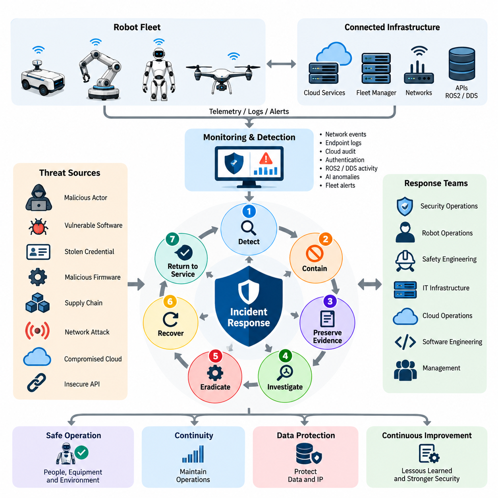
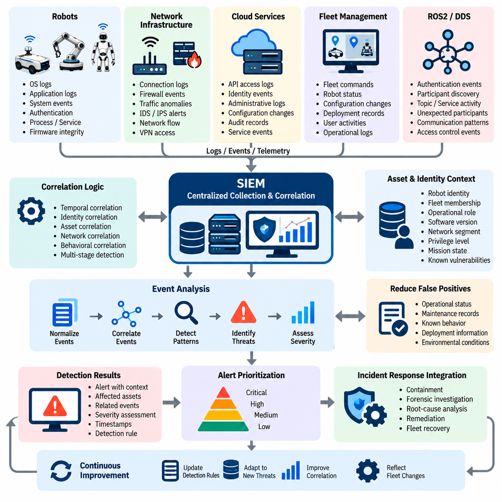
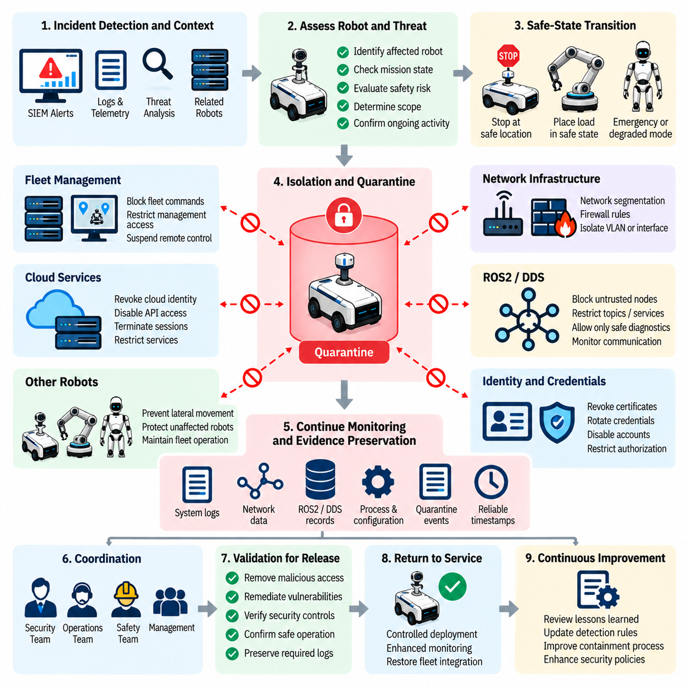
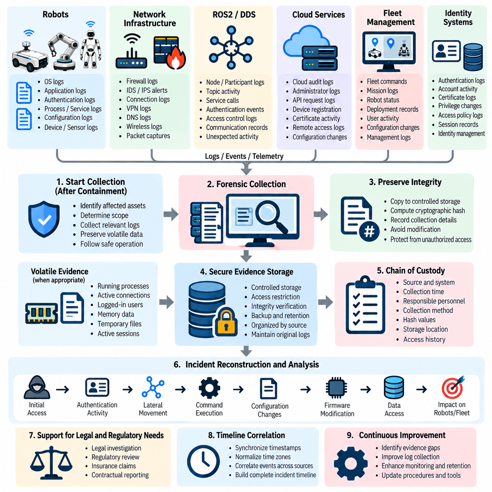
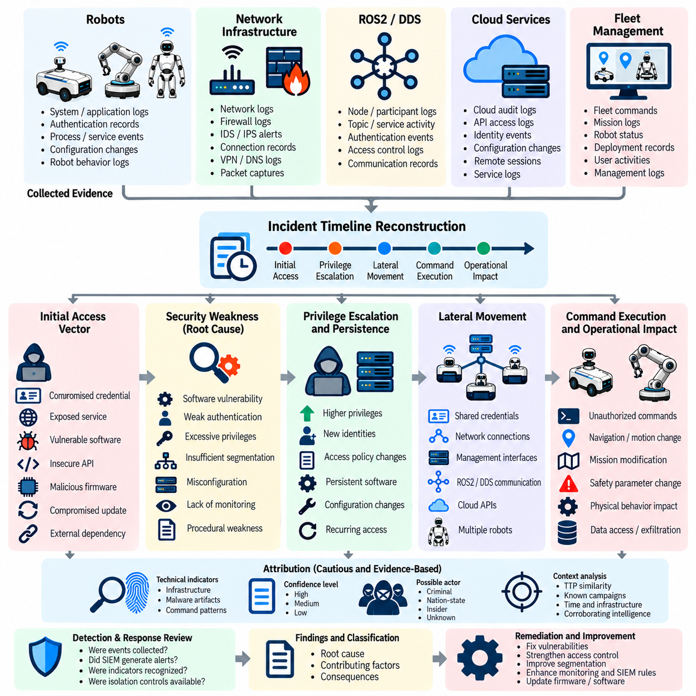
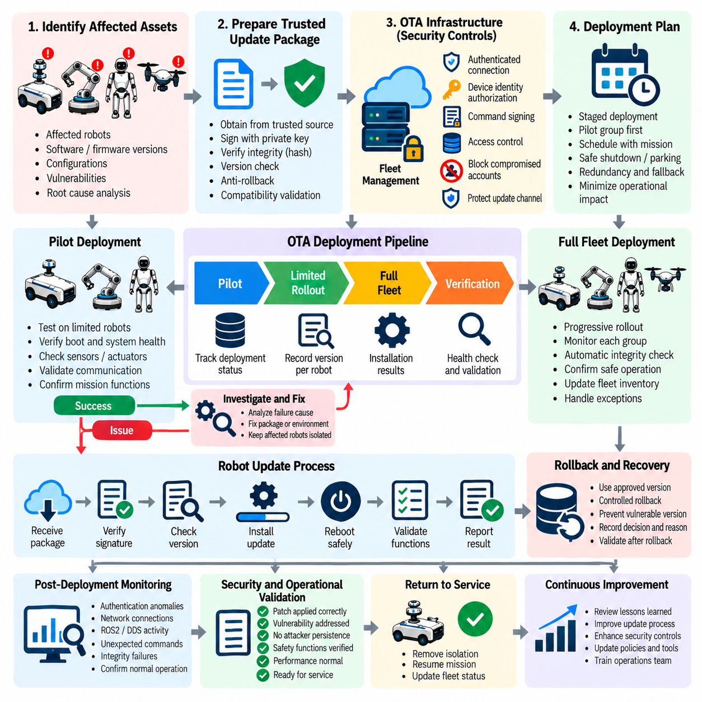
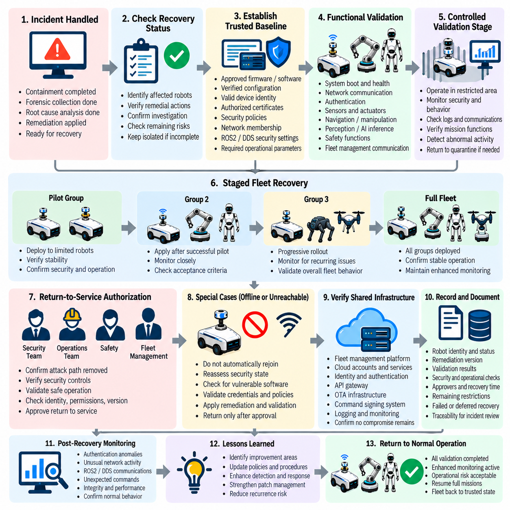
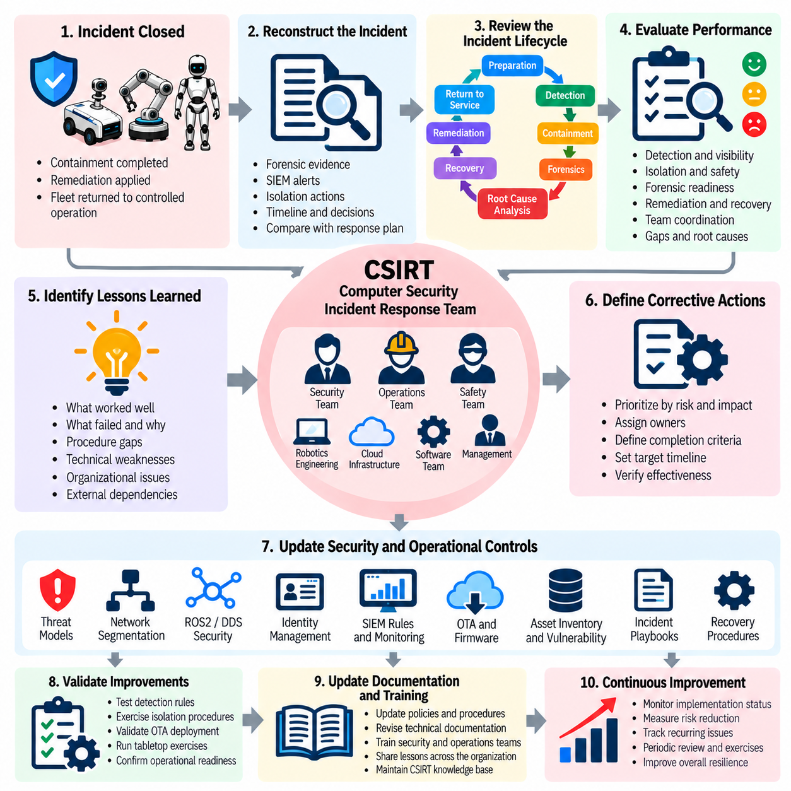
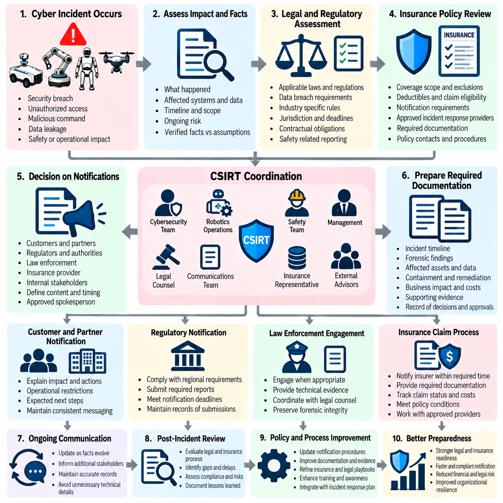
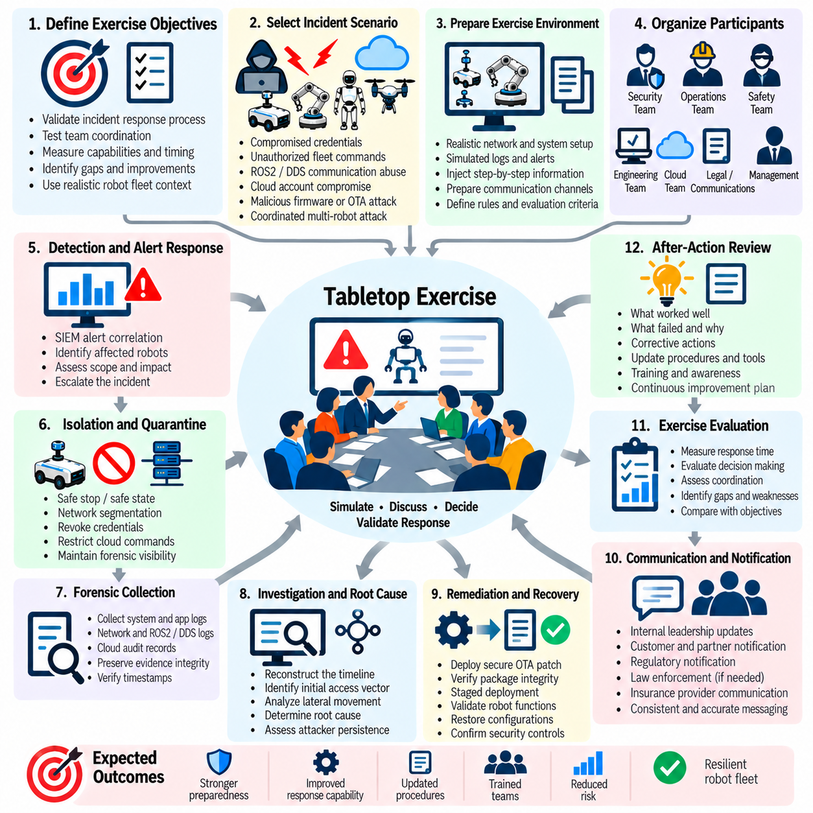

**Volume 24. Robot Cybersecurity**

# Chapter 09. Incident Response and Recovery

## 09.01. Cyber Incident Response Plan for Robot Fleets

{width="7.268055555555556in" height="7.268055555555556in"}

로봇 플릿(Robot Fleet)을 위한 사이버 사고 대응 계획(Cyber Incident Response Plan)은 분산 로봇 시스템(Distributed Robotic System)에 영향을 미치는 보안 사고(Security Incident)를 탐지하고, 격리하고, 조사하고, 제거하며, 복구하기 위해 필요한 조직적·기술적 절차를 수립한다. 일반적인 정보기술(IT) 사고와 달리 침해된 로봇(Compromised Robot)은 즉각적인 물리적 결과를 초래할 수 있으므로, 대응 과정에서는 사람과 장비의 안전, 운영 연속성(Operational Continuity), 데이터 및 디지털 인프라를 동시에 보호해야 한다.

플릿 환경(Fleet Environment)은 개별 로봇이 무선 네트워크(Wireless Network), 플릿 관리자(Fleet Manager), 클라우드 서비스(Cloud Service), 엣지 컴퓨터(Edge Computer), 응용 프로그래밍 인터페이스(API), ROS2 또는 데이터 분산 서비스(DDS) 미들웨어(Middleware), 중앙집중형 신원 시스템(Centralized Identity System)을 통해 연결되기 때문에 사고 대응 범위를 확대한다. 하나의 침해된 자격 증명(Credential)이나 통신 채널이 다수의 로봇을 노출할 수 있으므로, 사고를 분류하고 플릿 전체로의 확산 위험을 평가한 후 격리 조치를 선택해야 한다.

대응 준비(Preparation)는 보안 운영팀(Security Operations Team), 로봇 운영팀(Robot Operations Team), 안전 엔지니어링(Safety Engineering), 정보기술 인프라(IT Infrastructure), 클라우드 운영(Cloud Operations), 소프트웨어 엔지니어링(Software Engineering), 경영진 사이의 명확한 책임 체계를 수립하는 것에서 시작한다. 각 조직은 비상 상황에서 사전에 정의된 권한을 가져야 한다. 보안팀이 악성 활동(Malicious Activity)을 식별하면 로봇 운영자는 장비를 안전하게 정지하거나 지정 구역으로 복귀시키거나 추가적인 물리적 위험 없이 제한된 임무를 계속할 수 있는지를 판단한다.

사고 심각도(Incident Severity)는 사이버보안 영향(Cybersecurity Impact)과 물리적 운영 결과(Physical Operational Consequence)를 모두 반영해야 한다. 진단 인터페이스(Diagnostic Interface)에 대한 비인가 로그인(Unauthorized Login)은 제한적인 보안 이벤트일 수 있지만, 내비게이션 명령(Navigation Command), 안전 매개변수(Safety Parameter), 액추에이터 제어(Actuator Control), 펌웨어(Firmware), 플릿 배차 명령(Fleet Dispatch Instruction)의 조작은 즉각적인 상향 대응(Escalation)을 요구할 수 있다. 분류 기준에는 영향받은 로봇 수, 권한 수준, 지속성(Persistence), 데이터 노출, 안전 영향, 임무 중요도 및 측면 이동(Lateral Movement)의 증거가 포함되어야 한다.

탐지 메커니즘(Detection Mechanism)은 네트워크 텔레메트리(Network Telemetry), 엔드포인트 이벤트(Endpoint Event), 로봇 애플리케이션 로그(Application Log), 클라우드 감사 기록(Cloud Audit Record), 인증 이벤트(Authentication Event), ROS2 또는 DDS 활동, 인공지능 추론 이상(AI Inference Anomaly), 펌웨어 무결성(Firmware Integrity) 정보 및 플릿 관리 경보(Fleet Management Alert)를 결합해야 한다. 중앙집중형 상관분석(Central Correlation)을 활용하면 대응 담당자는 개별 장비 고장과 조직적인 공격(Coordinated Attack)을 구분할 수 있다.

의심스러운 활동이 확인되면 격리(Containment)는 단순히 영향을 받은 컴퓨터의 연결을 차단하는 것이 아니라 안전한 물리적 동작(Physical Behavior)을 우선해야 한다. 갑작스러운 네트워크 격리(Network Isolation)는 이동 로봇(Mobile Robot), 매니퓰레이터(Manipulator), 휴머노이드(Humanoid), 무인항공기(UAV)를 위험한 작동 상태에 남겨둘 수 있다. 따라서 사이버 격리는 제어된 정지(Controlled Stop), 임무 취소(Mission Cancellation), 안전 상태 전환(Safe-State Transition), 제한된 자율성(Restricted Autonomy), 지오펜싱(Geofencing), 또는 독립적으로 보호되는 안전 제어기(Safety Controller)로의 제어 전환과 연계되어야 한다.

플릿 격리(Fleet Containment)는 침해가 다른 로봇으로 확산되는 것을 방지해야 한다. 대응 담당자는 장치 자격 증명(Device Credential)을 폐기하고, 의심스러운 네트워크 세션(Network Session)을 차단하며, 영향을 받은 가상 근거리 통신망(VLAN)을 격리하고, 침해된 API를 비활성화하거나 플릿 명령을 중지할 수 있다. 또한 클라우드 신원(Cloud Identity)을 제한하거나 특정 로봇을 검역(Quarantine)할 수 있다. 가능한 경우 이러한 조치는 세분화하여 적용함으로써 조사 과정에서도 영향을 받지 않은 플릿 영역은 계속 운영할 수 있도록 해야 한다.

안전 조건이 허용하는 경우 파괴적인 복구 조치(Destructive Remediation)를 수행하기 전에 증거 보존(Evidence Preservation)을 시작해야 한다. 관련 증거에는 시스템 및 애플리케이션 로그, 네트워크 패킷 캡처(Network Capture), 인증 이력(Authentication History), ROS2 또는 DDS 기록, 펌웨어 측정 정보, 프로세스 정보(Process Information), 구성 스냅샷(Configuration Snapshot), 클라우드 감사 추적(Cloud Audit Trail), 명령 이력(Command History), 보안 경보가 포함된다. 시간 동기화(Time Synchronization)와 신뢰할 수 있는 타임스탬프(Timestamp)는 공격자가 플릿 구성요소 사이를 어떻게 이동했는지 재구성하고 비인가 행위의 발생 순서를 파악하는 데 필수적이다.

조사 단계(Investigation Phase)에서는 최초 접근 경로(Initial Access Vector), 악용된 취약점(Exploited Vulnerability), 침해된 신원(Compromised Identity), 영향을 받은 자산(Affected Asset), 공격자의 지속성(Persistence), 측면 이동을 재구성한다. 대응 담당자는 노출된 네트워크 서비스(Network Service), 탈취된 자격 증명(Stolen Credential), 취약한 소프트웨어(Vulnerable Software), 악성 펌웨어(Malicious Firmware), 안전하지 않은 API, 침해된 무선 업데이트(OTA) 인프라 또는 공급망 구성요소(Supply-Chain Component) 중 무엇이 사고의 원인이 되었는지 규명해야 한다.

위협 제거(Eradication)는 단순히 로봇 연결을 복원하는 것이 아니라 공격자의 접근 권한과 근본적인 취약점을 함께 제거해야 한다. 대응 조치에는 자격 증명 교체(Credential Rotation), 인증서 폐기(Certificate Revocation), 비인가 소프트웨어 제거, 구성 수정(Configuration Correction), 펌웨어 교체, 취약점 수정(Vulnerability Remediation), 안전한 무선 업데이트(Secure OTA Deployment)가 포함될 수 있다. 복원되는 모든 소프트웨어와 펌웨어는 신뢰할 수 있는 저장소(Trusted Repository)에서 확보하고, 운영 로봇에 배포하기 전에 무결성, 서명(Signature), 버전 및 호환성(Compatibility)을 검증해야 한다.

복구(Recovery)는 전체 플릿을 한 번에 서비스 상태로 복귀시키는 대신 통제된 단계로 진행해야 한다. 복구된 로봇은 먼저 격리된 검증 환경(Isolated Validation Environment)에 배치하여 부팅 무결성(Boot Integrity), 통신, 센서, 액추에이터, 안전 기능(Safety Function), 소프트웨어 버전, 자격 증명 및 임무 동작(Mission Behavior)을 검증할 수 있다. 이후 제한적인 운영 배치를 수행하고, 침해가 제거되었다는 충분한 증거가 확보될 때까지 강화된 모니터링(Enhanced Monitoring)을 유지한다.

플릿 규모의 복구(Fleet-Scale Restoration)에는 서비스 복귀(Return to Service)를 위한 명시적인 기준이 필요하다. 복구 과정에서 소프트웨어, 펌웨어, 네트워크 정책(Network Policy), 인증서, 인공지능 구성요소(AI Component), 제어 매개변수(Control Parameter)가 변경되어 로봇 동작에 영향을 줄 수 있으므로 보안 검증만으로는 충분하지 않다. 따라서 사이버보안 엔지니어(Cybersecurity Engineer)와 운영 또는 안전 담당자가 공동으로 서비스 복귀를 승인해야 한다.

통신 절차(Communication Procedure) 역시 사고 대응 계획의 핵심 구성요소이다. 내부 이해관계자(Internal Stakeholder)는 검증되지 않은 결론이 확산되지 않도록 하면서 영향을 받은 자산, 격리 결정, 운영 제한 및 복구 상태에 관한 정보를 적시에 제공받아야 한다. 외부 통신(External Communication)은 계약 의무, 데이터 노출, 안전 결과 및 관련 통지 요구사항(Notification Requirement)에 따라 고객, 공급업체, 서비스 제공자, 보험사, 규제기관 또는 법률기관을 포함할 수 있다.

플릿 사고(Fleet Incident)는 탐지 시간, 심각도 변경, 영향을 받은 자산, 증거 참조(Evidence Reference), 격리 조치, 승인 내역, 복구 패키지(Remediation Package), 검증 결과 및 복구 결정을 포함하는 공식 사고 기록(Incident Record)을 통해 추적 가능해야 한다. 이러한 기록은 포렌식 무결성(Forensic Integrity), 규제 증거(Regulatory Evidence), 보험 청구, 엔지니어링 분석 및 향후 보안 개선을 지원하며, 여러 기술 및 관리 조직이 장기간 대응에 참여할 때 공통 운영 상황(Common Operational Picture)을 제공한다.

사고 후 검토(Post-Incident Review)는 실제 운영 경험을 예방적 보안 통제(Preventive Security Control)로 전환한다. 조직은 어떤 보호조치가 실패했는지, 어떤 경보가 유용했는지, 대응 담당자에게 어떤 가시성(Visibility)이 부족했는지, 격리가 충분히 신속했는지, 복구 절차가 불필요한 가동 중단(Downtime)을 발생시켰는지를 분석해야 한다. 분석 결과는 위협 모델(Threat Model), 모니터링 규칙, 접근 정책, 소프트웨어 기준선(Software Baseline), OTA 통제, 교육 자료, 사고 대응 플레이북(Incident Playbook), 향후 사이버보안 시험에 반영되어야 한다.

사고 대응 계획 자체도 정적인 문서로 유지하는 것이 아니라 실제 훈련을 통해 검증해야 한다. 테이블탑 훈련(Tabletop Exercise)과 통제된 대응 훈련(Controlled Drill)을 통해 자격 증명 탈취, ROS2 침해, 악성 플릿 명령, 펌웨어 조작, 클라우드 계정 침입, 다수 로봇을 대상으로 한 협조 공격(Coordinated Attack)을 모의할 수 있다. 이러한 훈련은 실제 비상 상황이 발생하기 전에 불명확한 권한, 부족한 텔레메트리, 안전하지 않은 격리 가정, 통신 지연 및 복구 의존성을 발견하는 데 도움을 준다.

효과적인 로봇 플릿 사고 대응(Robot Fleet Incident Response)은 궁극적으로 사이버보안 회복탄력성(Cybersecurity Resilience), 물리적 안전(Physical Safety), 운영 회복탄력성(Operational Resilience)을 하나의 체계로 통합한다. 사고 탐지(Detection), 검역(Quarantine), 포렌식 증거 보존(Forensic Preservation), 근본 원인 분석(Root Cause Analysis), 안전한 OTA 복구(Secure OTA Remediation), 플릿 복구(Fleet Recovery), 교훈 도출(Lessons Learned), 통지 정책(Notification Policy), 대응 훈련(Response Exercise)은 서로 분리된 활동이 아니라 지속적으로 순환하는 사고 대응 수명주기(Incident Response Lifecycle)를 구성한다.

## 09.02. Incident Detection SIEM Alert Correlation [w/Code]

{width="7.268055555555556in" height="7.268055555555556in"}

로봇 플릿(Robot Fleet)의 보안 사고 탐지(Security Incident Detection)는 로봇, 네트워크, 클라우드 서비스, 플릿 관리 플랫폼(Fleet Management Platform), 로봇 미들웨어(Robotic Middleware) 전반에서 보안과 관련된 이벤트를 지속적으로 수집하고 상관분석(Correlation)하는 것을 필요로 한다. 보안 정보 및 이벤트 관리(Security Information and Event Management, SIEM) 플랫폼은 이러한 이벤트를 중앙에서 집계하고, 진행 중인 사이버 사고(Cyber Incident)를 나타낼 수 있는 패턴을 식별하는 기능을 제공한다. 분산된 플릿 환경에서는 효과적인 탐지를 위해 개별 경보(Alert)를 더 넓은 운영 및 보안 상황과 연결해야 한다.

로봇 플릿은 운영체제(Operating System), 애플리케이션(Application), 네트워크 인터페이스(Network Interface), 인증 서비스(Authentication Service), ROS2 또는 DDS 통신, 클라우드 플랫폼, 펌웨어 무결성 메커니즘(Firmware Integrity Mechanism), 플릿 관리 시스템에서 다양한 텔레메트리(Telemetry)를 생성한다. 개별 이벤트는 각각 별도로 보면 정상적인 것으로 보일 수 있지만, 여러 이벤트가 결합되면 조직적인 악성 활동(Coordinated Malicious Activity)을 나타낼 수 있다. 따라서 SIEM 기반 상관분석은 정상적인 로봇 동작, 개별적인 장애, 여러 구성요소에 영향을 미치는 다단계 공격(Multi-Stage Attack)을 구분하는 데 중요하다.

탐지는 신뢰할 수 있는 이벤트 소스(Event Source)를 구축하고 보안과 관련된 기록이 일관되게 수집되도록 하는 것에서 시작한다. 로봇 운영체제는 인증, 프로세스(Process), 서비스(Service), 시스템 이벤트를 제공할 수 있으며, 네트워크 인프라는 연결 시도, 방화벽 결정, 트래픽 이상(Traffic Anomaly), 침입 탐지 경보(Intrusion Detection Alert)를 제공할 수 있다. 클라우드 및 플릿 플랫폼은 API 접근, 신원(Identity), 명령(Command), 구성(Configuration), 관리 이벤트를 제공하여 개별 로봇을 넘어서는 가시성을 확보할 수 있도록 한다.

ROS2와 DDS 환경에서는 통신 활동이 로봇의 실제 동작과 밀접하게 연결되어 있으므로 특별한 주의가 필요하다. 인증 실패(Authentication Failure), 예상하지 못한 참여자(Participant), 비정상적인 토픽 활동(Topic Activity), 승인되지 않은 서비스 접근(Service Access), 비정상적인 통신 관계는 침해 지표(Indicator of Compromise)를 제공할 수 있다. 이러한 이벤트는 개별적인 경고로 처리하기보다는 네트워크 및 애플리케이션 텔레메트리와 함께 해석해야 하며, 이를 통해 정상적인 분산 로봇 통신과 의심스러운 행동을 구분할 수 있다.

SIEM 경보 상관분석(SIEM Alert Correlation)은 시간(Temporal), 신원(Identity), 자산(Asset), 네트워크(Network), 행동(Behavioral) 관계를 기준으로 여러 이벤트를 결합한다. 예를 들어 비정상적인 관리자 인증 이벤트 이후 구성 변경(Configuration Change)과 예상하지 못한 플릿 명령(Fleet Command)이 연속적으로 발생한다면, 개별 이벤트만 볼 때보다 훨씬 높은 위험을 나타낼 수 있다. 따라서 상관분석 규칙(Correlation Rule)은 여러 시스템에 걸쳐 관련된 관찰 결과를 연결하고 사고 조사를 위해 필요한 활동의 순서를 보존해야 한다.

자산 및 신원 정보(Asset and Identity Context)는 의미 있는 상관분석을 위해 필수적이다. 안전이 중요한 로봇(Safety-Critical Robot), 플릿 제어기(Fleet Controller), 클라우드 관리자 계정(Cloud Administrator Account), 펌웨어 서비스(Firmware Service)에 발생한 보안 이벤트는 개발 장치(Development Device)에 발생한 동일한 유형의 이벤트와 동일한 우선순위를 가질 필요가 없다. 상관분석은 경보의 중요도를 평가할 때 로봇 신원, 플릿 소속, 운영 역할, 소프트웨어 버전, 네트워크 세그먼트(Network Segment), 권한 수준(Privilege Level), 임무 상태(Mission State), 알려진 취약점(Known Vulnerability)을 고려해야 한다.

효과적인 탐지는 운영 장애(Operational Fault)와 사이버보안 사고(Cybersecurity Incident)를 구분할 수 있어야 한다. 로봇은 센서 고장(Sensor Failure), 통신 손실(Communication Loss), 소프트웨어 결함(Software Defect), 하드웨어 성능 저하(Hardware Degradation), 환경 조건 때문에 비정상적인 텔레메트리를 생성할 수 있다. 따라서 SIEM은 모든 이상 현상(Anomaly)을 악성 활동으로 판단해서는 안 된다. 운영 상태(Operational Status), 유지보수 기록(Maintenance Record), 배포 정보(Deployment Information), 알려진 시스템 동작과의 상관분석을 활용하면 오탐(False Positive)을 줄이면서도 조직적이거나 지속적인 공격을 민감하게 탐지할 수 있다.

경보 우선순위(Alert Prioritization)는 사이버보안 심각도(Cybersecurity Severity)와 물리적 결과(Physical Consequence)를 모두 반영해야 한다. 관리 인터페이스(Administrative Interface)의 인증 이상(Authentication Anomaly)은 조사가 필요할 수 있지만, 내비게이션(Navigation), 움직임(Motion), 안전 매개변수(Safety Parameter), 또는 조직적인 플릿 동작에 영향을 미치는 비인가 명령의 증거는 즉각적인 대응을 요구할 수 있다. 따라서 탐지 로직(Detection Logic)은 기술적 지표를 운영 영향(Operational Impact)과 연결하여 가장 중요한 사고가 신속하게 대응되도록 해야 한다.

신뢰할 수 있는 탐지 아키텍처(Detection Architecture)는 이후의 대응 활동을 위해 충분한 증거를 보존해야 한다. 경보에는 이벤트 타임스탬프(Event Timestamp), 소스 식별자(Source Identifier), 영향을 받은 자산, 신원, 관련 네트워크 정보, 탐지 규칙(Detection Rule), 심각도 평가(Severity Assessment), 다른 이벤트와의 관계를 보존해야 한다. 사고 대응 담당자는 인증, 네트워크 접근, 명령 실행(Command Execution), 구성 변경, 이후 로봇 동작의 순서를 재구성해야 할 수 있으므로 일관된 시간 동기화(Time Synchronization)가 특히 중요하다.

SIEM 탐지는 플릿 수준 분석(Fleet-Level Analysis)도 지원해야 한다. 여러 로봇에서 일정한 시간 범위 내에 유사한 인증 실패, 예상하지 못한 통신, 구성 변경 또는 비정상적인 명령 패턴이 나타나는 경우 시스템은 이를 서로 관련 없는 개별 경보로 생성하는 대신 그 관계를 식별해야 한다. 이러한 접근은 측면 이동(Lateral Movement), 자격 증명 침해(Credential Compromise), 조직적인 취약점 악용(Coordinated Exploitation), 플릿 전체로 악성 활동을 확산시키려는 시도를 발견하는 데 도움을 준다.

경보 상관분석(Alert Correlation)은 독립적인 모니터링 기능으로 동작하는 것이 아니라 전체 사고 대응 프로세스(Incident Response Process)와 통합되어야 한다. 확인된 경보는 격리(Containment), 포렌식 조사(Forensic Investigation), 근본 원인 분석(Root-Cause Analysis), 복구(Remediation), 플릿 복구(Fleet Recovery)에 필요한 충분한 상황 정보를 제공해야 한다. Chapter 09의 구조에서는 사고 탐지 및 SIEM 경보 상관분석이 로봇 격리, 포렌식 로그 수집, 근본 원인 분석, 안전한 OTA 복구, 플릿 복구에 앞서 배치되어 있으며, 이를 통해 탐지가 사고 대응 수명주기(Incident Response Lifecycle)의 운영 진입점이라는 관계를 형성한다.

지속적인 개선(Continuous Improvement)은 로봇 플릿, 소프트웨어 구성, 네트워크 아키텍처 및 공격 기법이 시간이 지나면서 변화하기 때문에 필수적이다. 탐지 규칙(Detection Rule)은 사고, 보안 시험(Security Testing), 운영 변경(Operational Change), 새로운 취약점이 확인된 이후 지속적으로 검토되어야 한다. 오탐과 미탐(Missed Detection)에서 얻은 교훈은 상관분석 로직, 텔레메트리 요구사항, 경보 심각도, 대응 절차에 반영되어야 하며, 이를 통해 SIEM 기능이 더욱 정확해지고 로봇 플릿의 실제 사이버보안 위험과 더욱 밀접하게 정렬될 수 있다.

## 09.03. Robot Isolation and Quarantine Procedure [w/Code]

{width="7.268055555555556in" height="7.268055555555556in"}

로봇 격리 및 검역 절차(Robot Isolation and Quarantine Procedure)는 침해된 로봇(Compromised Robot)이 다른 로봇, 플릿 인프라(Fleet Infrastructure), 또는 물리적 운영에 영향을 미치는 것을 방지하기 위해 필요한 운영 통제(Operational Control)를 제공한다. 로봇 플릿에서는 격리를 단순한 네트워크 연결 해제로 취급할 수 없다. 사고가 탐지되는 순간에도 로봇은 이동하거나, 물체를 조작하거나, 화물을 운송하거나, 자율 임무(Autonomous Mission)를 수행하고 있을 수 있기 때문이다. 따라서 이 절차는 사이버보안 격리(Cybersecurity Containment)와 제어되고 물리적으로 안전한 로봇 동작을 결합해야 한다.

격리 결정(Isolation Decision)은 보안 모니터링(Security Monitoring), SIEM 상관분석(SIEM Correlation), 로봇 텔레메트리(Robot Telemetry), 인증 기록(Authentication Record), 네트워크 이벤트(Network Event), 플릿 관리 시스템(Fleet Management System)으로부터 확보한 신뢰할 수 있는 사고 상황 정보에서 시작해야 한다. 대응 담당자는 어떤 로봇 또는 하위 시스템이 영향을 받았는지, 어떤 권한이 침해되었을 가능성이 있는지, 악성 활동(Malicious Activity)이 계속되고 있는지, 다른 플릿 구성원에게 관련 침해 지표(Indicator of Compromise)가 나타나는지를 판단해야 한다. 격리 범위는 전체 플릿을 자동으로 비활성화하기보다는 증거에 기반하여 결정해야 한다.

네트워크 격리(Network Isolation)를 실행하기 전에 로봇의 운영 상태(Operational State)를 평가해야 한다. 이동 로봇(Mobile Robot)은 안전한 위치에서 정지해야 할 수 있고, 매니퓰레이터(Manipulator)는 페이로드(Payload)를 통제된 상태로 내려놓아야 할 수 있으며, 자율주행 차량(Autonomous Vehicle)은 사전에 정의된 비상 모드(Emergency Mode) 또는 성능 저하 운용 모드(Degraded Operating Mode)로 전환해야 할 수 있다. 로봇이 현재 활성화된 안전 또는 보안 위협을 나타내기 때문에 즉각적인 격리가 필요한 경우, 대응 메커니즘은 추가적인 비인가 제어를 차단하면서 위험한 물리적 동작을 제한하는 안전 상태 전환(Safe-State Transition)을 우선해야 한다.

검역(Quarantine)은 일반적인 운영 격리보다 더 강력한 제한을 제공해야 한다. 검역된 로봇은 전원이 켜진 상태에서 로컬 관찰(Local Observation)이 가능할 수 있지만, 운영 플릿 서비스(Production Fleet Service)와의 통신, 다른 로봇에 대한 명령 발행, 일반적인 임무 지시 수신, 민감한 자원 접근은 차단될 수 있다. 네트워크 세분화(Network Segmentation), 방화벽 규칙(Firewall Rule), 신원 폐기(Identity Revocation), 접근 제어 정책(Access-Control Policy), 플릿 관리 제한(Fleet-Management Restriction)을 결합하여 포렌식 증거(Forensic Evidence)를 불필요하게 훼손하지 않으면서 통제된 검역 환경을 구축할 수 있다.

격리는 영향을 받지 않은 플릿의 운영을 유지하면서 사고를 통제할 수 있을 정도로 세분화되어야 한다. 아키텍처에 따라 대응 담당자는 개별 로봇, 로봇 서브넷(Robot Subnet), 통신 인터페이스(Communication Interface), 소프트웨어 서비스(Software Service), 클라우드 신원(Cloud Identity), 또는 플릿 관리 기능(Fleet-Management Function)을 격리할 수 있다. 측면 이동(Lateral Movement) 또는 조직적인 침해(Coordinated Compromise)의 증거가 나타나는 경우 격리 경계를 점진적으로 확대해야 한다. 반대로 더 작은 격리 경계만으로 위협을 충분히 통제할 수 있다면 광범위한 플릿 종료(Fleet Shutdown)는 피해야 한다.

신원 및 자격 증명 통제(Identity and Credential Control)는 검역의 중요한 부분이다. 로봇 인증서(Robot Certificate), API 자격 증명(API Credential), 관리자 계정(Administrator Account), 서비스 신원(Service Identity)이 침해된 것으로 의심되는 경우 단순히 하나의 장치 연결을 차단하는 것만으로는 다른 경로를 통한 지속적인 접근을 막지 못할 수 있다. 대응 담당자는 인증서를 폐기하고, 자격 증명을 교체하며, 활성 세션을 종료하고, 침해된 계정을 비활성화하거나 명령 권한(Command Authorization)을 제한해야 할 수 있다. 이러한 변경 사항은 이후 조사에서 어떤 신원과 접근 경로가 영향을 받았는지 정확하게 확인할 수 있도록 기록해야 한다.

ROS2와 DDS 통신은 통신 관계가 로봇 동작의 핵심이기 때문에 격리 과정에서 특별한 주의가 필요하다. 승인되지 않은 노드(Unauthorized Node), 예상하지 못한 참여자(Unexpected Participant), 비정상적인 토픽 활동(Abnormal Topic Activity), 의심스러운 서비스 상호작용(Suspicious Service Interaction)은 침해의 징후일 수 있다. 격리 정책(Containment Policy)은 신뢰할 수 없는 통신을 제한하면서 안전한 운영, 진단(Diagnostics), 통제된 복구(Controlled Recovery)에 필요한 최소한의 통신만 유지해야 한다. 격리 자체가 안전하지 않은 로봇 상태를 초래하지 않도록 보안 정책을 신중하게 적용해야 한다.

클라우드 및 플릿 관리 연결(Cloud and Fleet-Management Connection)도 검역 경계의 일부로 고려해야 한다. 침해된 로봇이 로컬 네트워크 격리 이후에도 클라우드 신원이나 플릿 관리 세션이 활성화되어 있다면 악성 명령을 계속 수신할 수 있다. 따라서 대응 담당자는 명령 채널(Command Channel), API 세션, 장치 인증서(Device Certificate), 관리 권한(Management Permission), 원격 접근 경로(Remote-Access Path)를 평가해야 한다. 필요한 경우 원격 제어 기능을 중지하면서도 승인된 조사 및 복구를 위한 제한된 관리 채널(Restricted Management Channel)은 유지할 수 있다.

검역 환경은 포렌식 조사(Forensic Investigation)를 위한 가시성을 보존해야 한다. 보안 담당자는 시스템 로그, 네트워크 텔레메트리, 프로세스 정보, 구성 상태(Configuration State), 펌웨어 측정 정보, ROS2 또는 DDS 기록 및 기타 증거에 접근해야 할 수 있지만, 동시에 영향을 받은 로봇이 운영 자산과 통신하는 것은 방지해야 한다. 따라서 격리 이후에도 모니터링을 계속하고 검역 이벤트와 이후의 활동을 신뢰할 수 있는 타임스탬프(Timestamp)를 사용하여 기록해야 한다. 목표는 사고를 이해하는 데 필요한 증거를 불필요하게 파괴하지 않으면서 악성 행동을 통제하는 것이다.

격리 과정에서는 사이버보안, 로봇 운영, 안전 담당자 간의 의사소통이 필수적이다. 사이버보안 담당자는 로봇이 침해되었다고 판단할 수 있지만, 운영자는 해당 로봇의 물리적 임무와 안전한 정지 조건을 이해하고 있다. 안전 담당자는 허용 가능한 성능 저하 상태(Degraded State) 또는 비상 절차(Emergency Procedure)를 정의할 수 있다. 격리 워크플로(Isolation Workflow)는 검역의 시작, 변경 및 해제를 담당할 명확한 권한을 설정해야 하며, 이를 통해 기술적 조치가 물리적 안전 요구사항과 충돌하지 않도록 해야 한다.

검역 해제(Release from Quarantine)는 단순한 시간 초과나 수동 재연결이 아니라 명시적인 검증(Validation)을 요구해야 한다. 로봇이 운영 환경으로 복귀하기 전에 대응 담당자는 악성 접근이 제거되었고, 침해된 자격 증명이 처리되었으며, 취약한 소프트웨어 또는 펌웨어가 수정되었고, 보안 통제가 정상적으로 작동하며, 관련 로그가 보존되었는지를 확인해야 한다. 소프트웨어와 펌웨어 복구는 신뢰할 수 있는 출처(Trusted Source)를 사용해야 하며, 로봇이 운영 서비스에 다시 연결되기 전에 적절한 무결성 및 진위성 검증(Authenticity Verification)을 수행해야 한다.

통제된 서비스 복귀 절차(Controlled Return-to-Service Process)는 일반적으로 제한된 검증 상태(Restricted Validation State)에서 시작해야 한다. 로봇은 기본 통신, 인증, 센서, 액추에이터, 소프트웨어 구성요소, 안전 기능, 임무 동작을 검증하는 동안 모니터링될 수 있다. 초기 운영 기간에는 강화된 모니터링(Enhanced Monitoring)을 계속 유지하여 이전에 발견되지 않았던 지속성 메커니즘(Persistence Mechanism)이나 반복적인 악성 활동을 신속하게 탐지해야 한다. 의심스러운 행동이 다시 나타나면 해당 로봇은 즉시 검역 상태로 복귀해야 한다.

격리 및 검역 절차는 테이블탑 시나리오(Tabletop Scenario)와 통제된 기술 훈련(Controlled Technical Drill)을 통해 정기적으로 실행해야 한다. 훈련에서는 침해된 자격 증명, 악성 플릿 명령, 승인되지 않은 ROS2 또는 DDS 통신, 펌웨어 침해, 클라우드 계정 침입, 여러 로봇에 영향을 미치는 조직적인 공격(Coordinated Attack)에 대한 대응을 평가할 수 있다. 훈련 결과는 격리 경계, 안전 상태 동작(Safe-State Behavior), 네트워크 정책, 신원 통제, 통신 절차, 서비스 복귀 기준(Return-to-Service Criteria)을 개선하는 데 활용해야 한다.

효과적인 로봇 격리 및 검역(Robot Isolation and Quarantine)은 궁극적으로 기존 IT 네트워크 조치가 아니라 조정된 사이버-물리적 격리(Cyber-Physical Containment) 프로세스이다. 이 절차는 비인가 접근을 통제하고, 측면 이동을 방지하며, 조사 증거를 보존하고, 안전한 물리적 동작을 유지하며, 복구를 향한 통제된 경로를 제공해야 한다. 이러한 역할은 Chapter 09의 구조에서 사고 탐지 단계(Incident Detection Stage)에 직접 이어지고 포렌식 수집(Forensic Collection), 근본 원인 분석(Root-Cause Analysis), 안전한 OTA 복구(Secure OTA Remediation), 플릿 복구(Fleet Recovery)에 앞서 위치하므로, 격리는 위협을 탐지한 이후 그 결과를 안전하게 통제하는 핵심 전환 단계(Critical Transition)라고 할 수 있다.

## 09.04. Forensic Log Collection and Preservation [w/Code]

{width="7.268055555555556in" height="7.268055555555556in"}

포렌식 로그 수집 및 보존(Forensic Log Collection and Preservation)은 로봇 또는 로봇 플릿에 영향을 미치는 사이버보안 사고(Cybersecurity Incident)에서 실제로 무엇이 발생했는지를 이해하는 데 필요한 증거 기반(Evidentiary Foundation)을 제공한다. 로봇 환경에서는 증거가 로봇 운영체제(Robot Operating System), 애플리케이션(Application), 네트워크 인프라(Network Infrastructure), ROS2 또는 DDS 미들웨어(Middleware), 클라우드 서비스(Cloud Service), 플릿 관리 플랫폼(Fleet Management Platform), 인증 시스템(Authentication System), 보안 모니터링 도구(Security Monitoring Tool) 등에 분산될 수 있다. 목적은 이러한 기록을 정확하게 보존하여 조사 담당자가 중요한 증거를 의도하지 않게 변경하거나 파괴하지 않고 사고를 재구성할 수 있도록 하는 것이다.

수집(Collection)은 사고가 식별되고 영향을 받은 로봇 또는 시스템이 안전하게 격리된 즉시 시작해야 한다. 대응 담당자는 먼저 관련 증거를 포함할 가능성이 있는 자산을 식별하고 통제된 수집 프로세스를 수립해야 한다. 로그는 영향을 받은 로봇, 관련 네트워크 장치, 클라우드 서비스, 플릿 관리 시스템, 신원 서비스(Identity Service), 보안 모니터링 인프라에서 수집해야 한다. 수집 범위는 최초에 식별된 장치에만 제한하기보다 사고 타임라인(Incident Timeline)과 의심되는 공격 경로(Attack Path)를 반영해야 한다.

로봇 운영체제 로그(Robot Operating-System Log)는 인증 시도(Authentication Attempt), 프로세스 실행(Process Execution), 서비스 활동(Service Activity), 권한 변경(Privilege Change), 시스템 구성(System Configuration), 장치 연결(Device Connection), 예상하지 못한 소프트웨어 동작에 관한 증거를 제공할 수 있다. 애플리케이션 로그(Application Log)는 비정상적인 명령, 임무 변경(Mission Change), 오류, API 활동, 비인가 상호작용(Unauthorized Interaction)을 나타낼 수 있다. 이러한 기록은 네트워크 텔레메트리(Network Telemetry) 및 플릿 관리 이벤트(Fleet-Management Event)와 상관분석할 때 특히 유용하며, 외부 접근 시도와 이후 로봇 동작 변화 사이의 관계를 확인할 수 있도록 한다.

네트워크 증거(Network Evidence) 역시 중요하다. 공격자는 기존의 통신 채널을 통해 로봇, 엣지 컴퓨터(Edge Computer), 관리 서버(Management Server), 클라우드 인프라 사이를 이동할 수 있기 때문이다. 방화벽 기록(Firewall Record), 침입 탐지 경보(Intrusion-Detection Alert), 연결 이력(Connection History), VPN 활동, DNS 정보, 무선 이벤트(Wireless Event), 관련 패킷 캡처(Packet Capture)는 비인가 통신과 측면 이동(Lateral Movement)을 식별하는 데 도움을 줄 수 있다. 수집 과정에서는 출발지와 목적지, 발생 시간, 프로토콜, 세션 특성, 네트워크 활동과 로봇 운영 사이의 관계를 확인할 수 있도록 충분한 상황 정보를 보존해야 한다.

ROS2와 DDS 환경에서는 통신 이벤트(Communication Event)가 로봇 기능과 직접적으로 연결될 수 있으므로 특별한 주의가 필요하다. 조사 담당자는 노드(Node), 참여자(Participant), 토픽(Topic), 서비스(Service), 인증 이벤트(Authentication Event), 접근 제어 결정(Access-Control Decision), 비정상적인 통신 관계에 관한 정보를 보존해야 할 수 있다. 예상하지 못한 참여자 또는 비인가된 토픽 및 서비스 활동은 침해(Compromise)에 관한 중요한 증거를 제공할 수 있다. 이러한 기록은 정상적인 분산 로봇 동작과 악성 통신을 구분할 수 있도록 시스템 및 네트워크 로그와 상관분석해야 한다.

로봇이 중앙집중형 서비스(Centralized Service)에 연결되어 있는 경우 클라우드 및 플릿 관리 증거(Cloud and Fleet-Management Evidence)를 수집해야 한다. 관련 기록에는 관리자 인증, API 요청, 장치 등록(Device Registration), 인증서 활동(Certificate Activity), 플릿 명령, 구성 변경, 원격 세션(Remote Session), 접근 정책 변경(Access-Policy Modification), 클라우드 감사 추적(Cloud Audit Trail)이 포함될 수 있다. 이러한 기록을 통해 사고가 클라우드 계정에서 시작되었는지, 침해된 신원이 여러 로봇을 제어하는 데 사용되었는지, 로컬 격리 이후에도 원격으로 명령이 전달되었는지를 확인할 수 있다.

증거 보존(Evidence Preservation)은 수집 과정 전체에서 무결성(Integrity)과 출처 정보(Provenance)를 유지해야 한다. 원본 로그는 조사 과정에서 임의로 수정, 덮어쓰기 또는 삭제해서는 안 된다. 수집된 기록은 통제된 저장소(Controlled Storage)에 복사하고 비인가 변경으로부터 보호해야 한다. 암호학적 해시(Cryptographic Hash) 또는 이에 상응하는 무결성 메커니즘(Integrity Mechanism)을 사용하여 수집 이후 증거가 변경되지 않았음을 입증할 수 있다. 또한 수집 과정에서는 증거를 언제 획득했는지, 어느 시스템에서 가져왔는지, 누가 수집했는지, 어떤 방법을 사용했는지를 기록해야 한다.

신뢰할 수 있는 타임스탬프(Reliable Timestamp)는 분산된 로봇 구성요소 전반에서 발생한 사고를 재구성하는 데 필수적이다. 로봇, 엣지 시스템, 네트워크 장치, 클라우드 플랫폼, 보안 도구의 시계가 서로 다른 경우 일관되지 않은 타임라인이 생성될 수 있다. 따라서 조사 담당자는 원본 타임스탬프 정보를 보존하는 동시에 시간대(Time Zone), 시계 오프셋(Clock Offset), 동기화 상태(Synchronization Status), 수집 시간을 기록해야 한다. 이후 정규화된 사고 타임라인(Normalized Incident Timeline)을 통해 인증 시도, 네트워크 연결, 명령 실행, 구성 변경, 비정상적인 로봇 동작을 발생 순서에 따라 연결할 수 있다.

포렌식 수집(Forensic Collection)은 기술적·운영적으로 적절한 경우 휘발성 정보(Volatile Information)도 보존해야 한다. 실행 중인 프로세스, 활성 네트워크 연결, 로그인된 신원, 메모리에 존재하는 활동, 임시 구성 상태, 활성 세션은 재부팅 또는 종료 후 사라질 수 있다. 그러나 휘발성 증거의 수집은 물리적 안전(Physical Safety)과 격리 요구사항(Containment Requirement)의 균형을 고려해야 한다. 위험한 동작을 수행 중인 로봇이 포렌식 목적으로 계속 작동하도록 유지해서는 안 되며, 즉각적인 안전 상태 전환(Safe-State Transition)이 필요한 경우 안전을 우선해야 한다.

법적 조사(Formal Investigation), 규제 검토(Regulatory Review), 보험 청구(Insurance Claim), 계약상 보고(Contractual Reporting)를 지원할 수 있는 증거에 대해서는 증거 보관 이력(Chain of Custody)을 유지해야 한다. 각각의 증거 항목은 출처, 수집 시간, 담당 인력, 저장 위치, 무결성 검증, 이후 처리 과정을 설명하는 추적 가능한 기록을 가져야 한다. 보존된 증거에 대한 접근은 제한되고 감사 가능해야 한다. 이를 통해 포렌식 결론(Forensic Conclusion)이 진위성과 처리 이력이 입증될 수 있는 증거에 의해 뒷받침되도록 할 수 있다.

보존된 증거는 전체 공격 수명주기(Attack Lifecycle)를 재구성할 수 있도록 지원해야 한다. 조사 담당자는 최초 접근(Initial Access), 인증(Authentication), 권한 상승(Privilege Escalation), 지속성(Persistence), 측면 이동, 명령 실행, 구성 변경, 데이터 접근(Data Access), 플릿 전체로의 확산 시도를 조사할 수 있어야 한다. 이러한 단계를 실제 로봇의 물리적 동작과 연결하는 것도 특히 중요하다. 사이버보안 이벤트가 직접적인 운영 결과를 초래할 수 있기 때문이다. 따라서 증거는 어떤 시스템이 침해되었는지뿐만 아니라 영향을 받은 로봇이 실제로 어떤 동작을 수행했는지도 확인할 수 있도록 해야 한다.

포렌식 보존은 복구 및 복원 과정에서도 계속되어야 한다. 이후의 조치가 최초 침해에 대한 증거를 파괴하거나 불명확하게 만들 수 있기 때문이다. 따라서 펌웨어 교체(Firmware Replacement), 자격 증명 교체(Credential Rotation), 소프트웨어 재설치(Software Reinstallation), 구성 복원(Configuration Restoration), 안전한 OTA 배포(Secure OTA Deployment)는 필요한 증거가 보존된 이후에 수행해야 한다. 단, 즉각적인 안전 또는 격리 요구사항 때문에 예외적으로 신속한 조치가 필요한 경우에는 그러한 요구사항을 우선할 수 있다. 보존된 기록은 이후 근본 원인 분석(Root-Cause Analysis)을 지원하고 복구 조치가 공격자의 접근을 성공적으로 제거했는지를 판단하는 데 활용할 수 있다.

포렌식 로그 수집(Forensic Log Collection)은 사고 탐지(Incident Detection), 로봇 격리(Robot Isolation), 조사(Investigation), 근본 원인 분석(Root-Cause Analysis), 복구 조치(Remediation), 복구(Recovery)를 연결하는 통제된 프로세스이다. Incident Response and Recovery 장의 구조에서는 포렌식 수집이 로봇 격리 및 검역(Robot Isolation and Quarantine) 이후에 배치되고, 공격 근본 원인 분석(Attack Root-Cause Analysis), 안전한 OTA 복구(Secure OTA Remediation), 플릿 복구(Fleet Recovery)에 앞서 위치한다. 이러한 순서는 증거 보존이 활성화된 사고를 통제하는 단계와 그 근본 원인을 이해하고 제거하며 복구하는 단계 사이를 연결하는 핵심적인 가교(Critical Bridge)라는 점을 보여준다.

## 09.05. Attack Root Cause Analysis and Attribution

{width="7.268055555555556in" height="7.268055555555556in"}

공격 근본 원인 분석 및 귀속(Attack Root-Cause Analysis and Attribution)은 사이버보안 사고(Cybersecurity Incident)가 로봇 환경에 어떤 경로로 침투했는지, 어떤 취약점(Weakness)이 침해를 가능하게 했는지, 공격자가 영향을 받은 시스템을 어떻게 이동했는지, 그리고 어떤 조건이 사고 발생을 가능하게 했는지를 규명한다. 로봇 플릿(Robot Fleet)에서는 침해된 신원(Compromised Identity), 소프트웨어, 통신 채널 또는 제어 인터페이스가 실제 로봇의 동작에 영향을 줄 수 있기 때문에 디지털 영향과 물리적 영향을 모두 고려해야 한다. 목적은 단순히 공격자를 식별하는 것이 아니라 방어 가능한 기술적 설명(Defensible Technical Explanation)을 구축하는 것이다.

근본 원인 분석(Root-Cause Analysis)은 격리(Isolation) 및 포렌식 조사(Forensic Investigation) 과정에서 충분한 증거가 수집되고 보존된 이후 시작한다. 조사 담당자는 인증 기록(Authentication Record), 시스템 및 애플리케이션 로그, 네트워크 텔레메트리(Network Telemetry), ROS2 또는 DDS 활동, 클라우드 감사 기록(Cloud Audit Record), 플릿 명령(Fleet Command), 구성 변경(Configuration Change), 펌웨어 정보(Firmware Information)를 사용하여 사고 타임라인(Incident Timeline)을 재구성해야 한다. 이 타임라인은 초기 의심 활동을 이후의 침해, 지속성(Persistence), 측면 이동(Lateral Movement), 명령 실행(Command Execution), 운영 영향(Operational Effect)과 연결하면서 확인된 사실과 조사 과정의 가정을 명확하게 구분해야 한다.

최초 접근 경로(Initial Access Vector)는 확보된 증거가 허용하는 범위에서 최대한 정확하게 식별해야 한다. 가능한 원인에는 침해된 자격 증명(Compromised Credential), 노출된 서비스(Exposed Service), 취약한 소프트웨어, 안전하지 않은 API, 승인되지 않은 원격 접근(Unauthorized Remote Access), 악성 펌웨어(Malicious Firmware), 침해된 업데이트 인프라(Update Infrastructure), 외부 의존성(External Dependency)의 취약점 등이 포함될 수 있다. 분석에서는 발견된 모든 취약점이 사고에 기여했다고 가정하기보다는 실제로 어떤 접근 경로가 사용되었는지를 규명해야 한다. 이러한 구분은 복구 조치(Remediation)가 실제 침해를 가능하게 한 메커니즘을 정확히 해결하는 데 중요하다.

조사 담당자는 최초 침해가 실제 운영상의 중요성을 갖게 된 보안 취약점(Security Weakness)도 식별해야 한다. 취약점은 장기간 존재했지만 실제로 악용되지 않았을 수 있으며, 불충분한 인증(Inadequate Authentication), 과도한 권한(Excessive Privilege), 취약한 네트워크 세분화(Weak Segmentation), 부족한 모니터링(Insufficient Monitoring)이 공격자의 접근 확장을 가능하게 했을 수도 있다. 따라서 근본 원인 분석은 단일 소프트웨어 결함에 책임을 집중하기보다는 기술적 취약점과 아키텍처 또는 절차상의 약점이 어떻게 상호작용했는지를 조사해야 한다.

권한 상승(Privilege Escalation)과 지속성(Persistence)은 공격의 서로 다른 단계로 분석해야 한다. 조사 담당자는 공격자가 더 높은 권한을 획득했는지, 새로운 신원을 생성했는지, 접근 정책(Access Policy)을 변경했는지, 지속적인 소프트웨어를 설치했는지, 구성을 수정했는지, 반복적인 원격 접근을 구축했는지를 확인해야 한다. 로봇 플릿에서는 지속성이 개별 로봇, 엣지 컴퓨터(Edge Computer), 플릿 관리 서버(Fleet-Management Server), 클라우드 계정, 업데이트 인프라에서 발생할 수 있다. 모든 지속성 메커니즘을 식별하는 것은 복구 조치가 완료되었다고 판단하기 위한 필수 조건이다.

측면 이동(Lateral Movement)은 하나의 침해된 로봇이나 신원이 다른 자산으로 이동하기 위한 경로를 제공할 수 있기 때문에 플릿 환경에서 특히 중요하다. 조사 담당자는 인증 관계(Authentication Relationship), 네트워크 연결, 공유 자격 증명(Shared Credential), 관리 인터페이스(Management Interface), ROS2 또는 DDS 통신, 클라우드 API, 플릿 제어 채널(Fleet-Control Channel)을 조사해야 한다. 여러 로봇에서 유사한 이상 현상이 나타나는 경우 이는 서로 독립적인 사고라기보다 조직적인 확산(Coordinated Propagation)을 의미할 수 있다. 분석에서는 실제로 어떤 시스템이 접근되었는지와 동일한 위협에 단순히 노출되었을 뿐인 시스템을 구분해야 한다.

명령 실행(Command Execution)과 운영 영향(Operational Impact)은 사이버 침입과 연결하여 분석해야 한다. 침해된 계정이나 시스템이 존재한다고 해서 공격자가 반드시 물리적 동작을 성공적으로 제어했다는 의미는 아니다. 조사 담당자는 비인가 명령이 전달되었는지, 내비게이션 또는 동작 매개변수(Navigation or Motion Parameter)가 변경되었는지, 임무가 수정되었는지, 안전 기능(Safety Function)이 영향을 받았는지, 로봇이 실제로 해당 명령을 실행했는지를 확인해야 한다. 이러한 구분은 확인된 물리적 결과와 보안 통제에 의해 차단된 시도된 행동을 분리하는 데 도움을 준다.

귀속(Attribution)은 추측이 아니라 증거를 기반으로 신중하게 수행해야 한다. 인프라 특성(Infrastructure Characteristic), 계정 행동(Account Behavior), 악성코드 흔적(Malware Artifact), 명령 패턴(Command Pattern), 시간적 특성(Timing), 알려진 기법의 재사용 등의 기술적 지표는 공격의 책임 주체에 대한 평가를 지원할 수 있다. 그러나 이러한 지표는 조작되거나 재사용될 수 있으며 의도적으로 오도될 수도 있다. 따라서 운영상의 핵심 목표는 공격을 정확하게 재구성하고 효과적으로 복구하는 데 두어야 하며, 귀속에 대한 신뢰도(Attribution Confidence)는 명시적으로 기록해야 한다.

근본 원인 분석은 기존의 탐지 및 격리 메커니즘이 사고를 더 일찍 차단했는지 또는 차단하지 못했는지도 조사해야 한다. 조사 담당자는 관련 이벤트가 수집되었는지, SIEM 상관분석(SIEM Correlation)이 유용한 경보를 생성했는지, 보안 담당자가 침해 지표를 인식했는지, 격리 통제가 제공되었으며 안전하게 실행할 수 있었는지를 검토해야 한다. 기술적으로 정교한 공격도 단일 취약점 때문이 아니라 모니터링, 대응 권한(Response Authority), 자산 가시성(Asset Visibility), 운영 절차(Operational Procedure)의 약점으로 인해 대규모 사고로 발전할 수 있다.

분석 결과는 근본 원인(Root Cause), 기여 요인(Contributing Factor), 결과(Consequence)를 명확하게 구분해야 한다. 근본 원인은 사고를 가능하게 한 본질적인 조건을 식별하고, 기여 요인은 사고의 발생 가능성이나 영향을 증가시킨 추가적인 약점을 설명하며, 결과는 침해 이후 실제로 발생한 사건을 설명한다. 이러한 구분은 조직이 증상을 원인으로 잘못 처리하는 것을 방지하고 아키텍처, 접근 제어(Access Control), 네트워크 세분화, 소프트웨어 보안, 모니터링, 펌웨어 보호(Firmware Protection), 사고 대응 절차에 대한 목표 지향적인 개선을 가능하게 한다.

근본 원인 분석의 결과는 복구 조치 및 복구(Recovery) 결정에 직접 연결되어야 한다. 침해된 자격 증명이 원인이었다면 신원 통제(Identity Control)와 자격 증명 수명주기 관리(Credential Lifecycle Management)를 수정해야 할 수 있다. 소프트웨어 취약점이 접근을 가능하게 했다면 보안 패치(Security Patching)와 취약점 관리(Vulnerability Management)를 통해 이를 해결해야 한다. 취약한 플릿 세분화가 확산을 가능하게 했다면 네트워크 아키텍처와 접근 제어 정책을 강화해야 한다. OTA 또는 펌웨어 메커니즘이 관련된 경우 영향을 받은 로봇이 서비스에 복귀하기 전에 신뢰할 수 있는 서명(Trusted Signing), 무결성 검증(Integrity Verification), 안전한 배포(Secure Deployment), 롤백 통제(Rollback Control)를 재평가해야 한다.

최종 분석에서는 각 주요 결론에 대한 신뢰 수준(Confidence Level)을 기록하고 남아 있는 불확실성(Uncertainty)을 식별해야 한다. 증거는 최초 접근, 영향을 받은 자산, 공격자의 행동, 지속성, 측면 이동, 운영 결과에 관한 주장을 뒷받침해야 한다. 증거가 충분하지 않은 경우 조사 담당자는 가정을 사실처럼 제시하지 말고 명시적으로 불확실성을 기록해야 한다. 이러한 원칙은 이후의 법적, 규제, 보험, 엔지니어링, 보안 검토를 강화하며 교훈 도출(Lessons Learned)과 향후 사고 대응 개선을 위한 신뢰할 수 있는 기반을 제공한다.

Incident Response and Recovery 장의 구조에서 공격 근본 원인 분석 및 귀속(Attack Root-Cause Analysis and Attribution)은 포렌식 로그 수집 및 보존(Forensic Log Collection and Preservation) 이후에 배치되고 안전한 OTA 복구(Secure OTA Remediation)와 플릿 복구(Fleet Recovery)에 앞서 위치한다. 이러한 순서는 영향을 받은 시스템을 영구적으로 변경하기 전에 침해의 메커니즘과 범위를 이해해야 한다는 운영상의 요구사항을 반영한다. 따라서 근본 원인 분석은 증거 보존과 시정 조치(Corrective Action) 사이를 연결하는 의사결정 가교(Decision Bridge) 역할을 하며, 단순히 로봇 플릿을 이전의 운영 상태로 복원하는 것이 아니라 근본적인 공격 경로를 해결하도록 복구가 이루어지게 한다.

## 09.06. Secure OTA Remediation and Patch Deployment [w/Code]

{width="7.268055555555556in" height="7.268055555555556in"}

안전한 OTA 복구 및 패치 배포(Secure OTA Remediation and Patch Deployment)는 사고의 근본 원인이 파악된 이후 영향을 받은 로봇의 취약점을 수정하고, 침해된 소프트웨어를 제거하며, 신뢰할 수 있는 소프트웨어 상태를 복원하기 위한 통제된 메커니즘을 제공한다. 로봇 플릿(Robot Fleet)에서는 잘못 배포된 업데이트가 통신, 내비게이션, 제어, 인식 또는 기타 임무 핵심 기능을 중단시킬 수 있기 때문에 복구 과정에서 사이버보안과 운영 안전(Operational Safety)을 모두 고려해야 한다. 따라서 이 과정에는 인증된 소프트웨어, 무결성 검증(Integrity Verification), 통제된 배포, 명시적인 복구 기준(Recovery Criteria)이 필요하다.

복구 프로세스(Remediation Process)는 정확히 어떤 로봇, 소프트웨어 구성요소, 펌웨어 버전, 구성(Configuration), 취약점이 영향을 받았는지를 식별하는 것에서 시작해야 한다. 근본 원인 분석(Root-Cause Analysis)을 통해 사고가 취약한 소프트웨어, 침해된 펌웨어, 비인가 구성 변경 또는 다른 취약점에서 비롯되었는지를 판단해야 한다. 이후 배포 범위는 검증된 증거에 기반하여 결정해야 하며, 무차별적인 플릿 전체 업데이트를 적용해서는 안 된다. 이러한 접근은 불필요한 운영 중단을 줄이는 동시에 확인된 모든 영향을 받은 자산에 필요한 복구 조치가 적용되도록 한다.

배포 전에 복구 패키지(Remediation Package)는 신뢰할 수 있는 출처(Trusted Source)에서 확보하고 진위성(Authenticity)과 무결성을 검증해야 한다. 펌웨어와 소프트웨어 패키지는 확립된 서명 체계(Signing Chain)와 적절한 암호학적 검증(Cryptographic Verification)을 사용하여 공격자가 복구 과정에서 악성 콘텐츠로 교체할 수 없도록 해야 한다. 버전 정보 또한 의도하지 않은 롤백(Rollback)을 방지하기 위해 검증해야 한다. 따라서 OTA 보안 아키텍처는 패키지 무결성, 서명, 신뢰할 수 있는 출처, 버전 제어(Version Control), 안티 롤백 메커니즘(Anti-Rollback Mechanism)을 상호 보완적인 통제로 연결해야 한다.

패치 배포(Patch Deployment)는 플릿의 모든 로봇에 즉시 적용하기보다 단계적으로 진행해야 한다. 통제된 파일럿 그룹(Controlled Pilot Group)에 먼저 복구 패키지를 배포하고 운영자는 부팅 동작(Boot Behavior), 시스템 상태, 통신, 센서, 액추에이터, 소프트웨어 서비스, 임무 기능을 검증해야 한다. 파일럿 배포가 성공하면 업데이트를 추가적인 플릿 세그먼트(Fleet Segment)로 확대할 수 있다. 예상하지 못한 동작이나 보안 이상이 나타나는 경우 배포를 중지하고 문제가 파악될 때까지 영향을 받은 로봇을 격리 상태로 유지해야 한다.

배포 프로세스는 로봇의 신원(Robot Identity)과 실제 설치된 정확한 소프트웨어 또는 펌웨어 버전 사이의 관계를 명확하게 유지해야 한다. 플릿 관리 시스템(Fleet Management System)은 어떤 패키지가 할당되었는지, 배포가 언제 시작되었는지, 인증 및 무결성 검증이 성공했는지, 설치가 성공적으로 완료되었는지, 로봇이 예상되는 운영 상태로 복귀했는지를 기록해야 한다. 이러한 기록은 사고 복구에 대한 증거를 제공하며, 여전히 취약한 로봇, 설치 중 실패한 로봇, 추가 복구가 필요한 로봇을 식별할 수 있도록 한다.

안전한 OTA 복구는 업데이트 채널(Update Channel) 자체도 보호해야 한다. 플릿 관리 인프라(Fleet-Management Infrastructure)와 로봇 사이의 통신에는 인증되고 보호된 연결을 사용해야 하며, 특정 로봇이 해당 패키지를 수신할 수 있는지는 장치 신원(Device Identity)과 권한 부여(Authorization)를 통해 결정해야 한다. 침해된 계정, 인증서 또는 관리 인터페이스가 비인가 배포를 시작하는 데 사용되어서는 안 된다. 따라서 강력한 명령 인증(Command Authentication)과 서명(Signing)이 중요하며, 공격자가 플릿 관리 접근 권한을 획득할 경우 복구 메커니즘 자체를 새로운 공격 경로로 전환하는 것을 방지해야 한다.

패치 배포는 로봇의 운영 상태와 임무 제약조건(Mission Constraint)을 고려해야 한다. 안전이 중요한 임무를 수행하는 로봇이 예기치 않게 재부팅되거나 필요한 제어 소프트웨어 없이 남겨져서는 안 된다. 배포 스케줄러(Deployment Scheduler)는 적절한 경우 임무 완료, 안전한 주차(Safe Parking), 통제된 종료(Controlled Shutdown), 이중화(Redundancy), 유지보수 기간(Maintenance Window)에 맞추어 업데이트를 조정해야 한다. 즉시 패치를 적용할 수 없는 로봇의 경우 안전한 배포 기회가 확보될 때까지 임시 격리(Temporary Containment)와 보완 통제(Compensating Control)가 필요할 수 있다.

복구 패키지는 로봇의 하드웨어, 운영체제, 미들웨어, 드라이버, 애플리케이션, AI 구성요소(AI Component), 구성과의 호환성을 검증해야 한다. 하나의 취약점을 수정하는 보안 패치가 다른 구성요소와의 호환성 문제를 발생시킨다면 새로운 운영 장애가 발생할 수 있다. 따라서 운영 환경에 배포하기 전에 관련 통합 시험(Integration Test)과 기능 검증(Functional Check)을 수행해야 한다. 패치가 안전과 관련된 동작을 변경하는 경우 로봇이 정상적인 자율 운용(Autonomous Operation)을 재개하기 전에 추가적인 검증을 수행해야 한다.

롤백 기능(Rollback Capability)은 제한된 방식으로 신중하게 관리해야 한다. 제한 없는 롤백은 원래의 취약점을 다시 생성할 수 있기 때문이다. 배포가 실패한 경우 임의의 소프트웨어를 선택하는 대신 승인되고 신뢰할 수 있는 버전을 사용하여 복구해야 한다. 안티 롤백 통제(Anti-Rollback Control)는 공식적으로 승인된 복구 절차가 요구하는 경우를 제외하고 알려진 비안전 버전의 설치를 방지해야 한다. 롤백 결정, 선택된 버전, 결정 사유, 검증 결과는 사고 복구 증거의 일부로 기록해야 한다.

배포 이후에는 복구된 로봇 전체에 대해 강화된 모니터링(Enhanced Monitoring)을 유지해야 한다. 보안팀은 반복되는 인증 이상, 예상하지 못한 네트워크 연결, 비정상적인 ROS2 또는 DDS 활동, 비정상적인 플릿 명령, 무결성 실패(Integrity Failure), 또는 원래의 공격 경로가 여전히 접근 가능한 상태라는 징후를 감시해야 한다. 동시에 운영 모니터링(Operational Monitoring)을 통해 로봇이 정상적으로 동작하는지도 확인해야 한다. 성공적인 설치만으로 완전한 복구가 이루어졌음을 입증할 수 없으며, 조직은 취약점이 해결되고 공격자가 관련 접근 권한이나 지속성 메커니즘(Persistence Mechanism)을 더 이상 보유하지 않는지를 확인해야 한다.

플릿 규모 배포(Fleet-Scale Deployment)에는 명확한 완료 기준(Completion Criteria)이 포함되어야 한다. 영향을 받은 모든 로봇이 확인되어야 하고, 패키지 설치 성공 여부가 확인되어야 하며, 설치에 실패했거나 연결할 수 없는 장치가 식별되어야 하고, 보안 검증이 완료되어야 하며, 운영 동작이 정의된 승인 요구사항(Acceptance Requirement)을 충족해야 한다. 이러한 조건을 충족하지 못하는 로봇은 자동으로 운영 환경에 복귀시키기보다 검역 상태 또는 통제된 복구 상태로 유지해야 한다. 이를 통해 불완전한 복구가 플릿의 지속적인 노출을 초래하는 숨겨진 원인이 되는 것을 방지할 수 있다.

안전한 OTA 복구 프로세스는 배포 과정 전체에서 증거를 보존해야 한다. 패키지 해시(Package Hash), 서명, 버전 식별자(Version Identifier), 배포 로그, 인증 기록, 설치 결과, 실패 기록, 롤백 이벤트, 검증 결과를 보존해야 한다. 이러한 기록을 통해 조사 담당자는 어떤 복구 조치가 수행되었는지를 입증할 수 있으며 추가 분석이 필요한 경우 추적성을 제공할 수 있다. 또한 사고 후 검토(Post-Incident Review)를 지원하고 근본 원인 분석에서 식별된 기술적 조건이 실제로 제거되었는지를 판단하는 데 도움을 준다.

Incident Response and Recovery 장의 구조에서 안전한 OTA 복구 및 패치 배포(Secure OTA Remediation and Patch Deployment)는 포렌식 증거 보존(Forensic Preservation)과 공격 근본 원인 분석(Attack Root-Cause Analysis) 이후에 배치되고 플릿 복구 및 서비스 복귀(Fleet Recovery and Return to Service)에 앞서 위치한다. 이러한 순서는 충분한 증거가 보존되고 근본적인 공격 메커니즘이 이해된 이후에만 소프트웨어를 변경해야 한다는 점에서 중요하다. 따라서 안전한 OTA 복구는 조사 단계에서 기술적 수정 단계로 이동하는 통제된 전환(Controlled Transition)의 역할을 하며, 복구된 로봇이 사고 이전의 상태를 단순히 복원하는 것이 아니라 신뢰할 수 있는 소프트웨어를 사용하여 운영 상태로 복귀하도록 보장한다.

## 09.07. Fleet Recovery and Return to Service Process

{width="7.268055555555556in" height="7.268055555555556in"}

플릿 복구 및 서비스 복귀(Fleet Recovery and Return to Service)는 사이버보안 사고(Cybersecurity Incident)가 격리되고, 조사되고, 복구 조치가 완료된 이후 로봇을 정상 운영 상태로 복원하기 위한 통제된 프로세스를 수립한다. 복구 과정에서는 영향을 받은 로봇이 원래의 공격 경로(Attack Path)에 더 이상 노출되지 않으며 소프트웨어, 구성(Configuration), 통신 및 보안 통제가 신뢰할 수 있는 상태인지 입증해야 한다. 로봇 플릿(Robot Fleet)에서는 서비스 복귀(Return to Service)가 복구된 시스템이 물리적 작업을 안전하고 안정적으로 수행할 수 있는지도 확인해야 한다.

복구(Recovery)는 사고 대응팀(Incident Response Team)이 필요한 격리(Containment), 포렌식 증거 보존(Forensic Preservation), 근본 원인 분석(Root-Cause Analysis), 복구 조치(Remediation)를 완료한 이후에만 시작해야 한다. 영향을 받은 각 로봇은 자격 증명(Credential), 소프트웨어, 펌웨어, 구성, 통신 경로가 수정되었는지를 나타내는 명확하게 문서화된 복구 상태(Recovery Status)를 가져야 한다. 조사가 아직 완료되지 않았거나 복구 조치를 검증할 수 없는 로봇은 자동으로 운영 환경에 복귀시키지 말고 격리 상태 또는 통제된 복구 상태로 유지해야 한다.

복구 프로세스는 먼저 각 로봇에 대한 신뢰할 수 있는 기준선(Trusted Baseline)을 확립해야 한다. 이 기준선에는 승인된 펌웨어 및 소프트웨어 버전, 검증된 구성, 유효한 장치 신원(Device Identity), 승인된 인증서, 보안 정책(Security Policy), 네트워크 소속, ROS2 또는 DDS 보안 설정, 필요한 운영 매개변수(Operational Parameter)가 포함될 수 있다. 무결성 및 진위성 검증(Integrity and Authenticity Check)을 통해 복구된 시스템이 승인된 상태와 일치하는지를 확인해야 한다. 설명되지 않는 차이가 발견되면 로봇이 운영 검증 단계로 진행하기 전에 조사해야 한다.

이후 기능 검증(Functional Validation)을 통해 보안 복구 이후에도 로봇이 의도된 임무를 수행할 수 있는지를 확인해야 한다. 관련 기능에는 시스템 부팅, 네트워크 통신, 인증, 센서 동작, 액추에이터 제어, 내비게이션, 매니퓰레이션(Manipulation), 인식(Perception), AI 추론(AI Inference), 안전 메커니즘(Safety Mechanism), 플릿 관리 통신(Fleet-Management Communication)이 포함될 수 있다. 검증의 깊이는 로봇의 운영 역할과 복구 과정에서 적용된 변경 사항을 반영해야 한다. 필수적인 운영 기능이 저하되었다면 보안 복구가 완료된 것으로 판단해서는 안 된다.

복구된 로봇은 일반적으로 전체 운영 환경에 배치되기 전에 제한된 검증 단계(Restricted Validation Stage)를 거쳐야 한다. 이 단계에서 로봇은 통제된 조건에서 작동하면서 사이버보안팀과 운영팀이 그 동작을 관찰할 수 있다. 인증 이벤트, 네트워크 연결, ROS2 또는 DDS 통신, 시스템 무결성, 플릿 명령, 애플리케이션 동작을 면밀하게 모니터링해야 한다. 예상하지 못한 동작이 발견되면 조사해야 하며, 필요한 경우 즉시 운영 권한을 확대하기보다 로봇을 다시 검역(Quarantine) 상태로 전환해야 한다.

플릿 복구는 영향을 받은 모든 로봇을 동시에 복원하기보다 통제된 그룹 단위로 진행해야 한다. 파일럿 그룹(Pilot Group)을 통해 복구 패키지, 구성, 네트워크 정책, 운영 절차가 실제 조건에서 정상적으로 작동하는지를 확인할 수 있다. 이후 그룹은 이전 그룹이 정의된 승인 기준(Acceptance Criteria)을 충족한 이후 복구할 수 있다. 이러한 단계적 접근은 발견하지 못한 복구 문제의 영향을 제한하고, 전체 플릿으로 확산되기 전에 반복되는 침해를 탐지할 기회를 제공한다.

서비스 복귀 승인은 담당 사이버보안 기능과 운영 또는 안전 기능 간의 합의를 요구해야 한다. 사이버보안 담당자는 관련 공격 경로, 비인가 접근, 지속성 메커니즘(Persistence Mechanism), 취약점이 해결되었는지를 확인해야 한다. 운영 및 안전 담당자는 로봇이 의도된 임무를 안전하게 수행할 수 있는지를 확인해야 한다. 필요한 경우 플릿 관리 기능에서도 장치가 올바른 신원, 권한, 소프트웨어 버전, 구성, 서비스 할당(Service Assignment)을 갖추었는지를 확인해야 한다.

오프라인 상태였거나 접근할 수 없었거나 주요 복구 과정에서 복구를 완료하지 못한 로봇에는 특별한 주의를 기울여야 한다. 이러한 로봇은 연결이 복구되었다는 이유만으로 자동으로 운영 플릿에 다시 참여해서는 안 된다. 여전히 취약한 소프트웨어, 만료된 자격 증명, 오래된 보안 정책, 또는 침해 증거를 포함하고 있을 수 있으므로 보안 상태를 다시 평가해야 한다. 이러한 장치는 정상적인 플릿 권한을 부여받기 전에 동일한 통제된 복구 및 검증 프로세스를 거쳐야 한다.

플릿 수준의 복구에서는 공유 인프라(Shared Infrastructure)가 신뢰할 수 있는 상태인지도 확인해야 한다. 개별 로봇을 복구하는 것만으로는 충분하지 않으며, 플릿 관리 플랫폼, 클라우드 계정, 신원 서비스(Identity Service), API 게이트웨이(API Gateway), OTA 인프라, 명령 서명 시스템(Command-Signing System)이 여전히 침해된 상태라면 복구가 완료된 것으로 볼 수 없다. 따라서 무제한적인 플릿 통신을 복원하기 전에 중앙집중형 서비스의 보안이 확보되었고 인증, 권한 부여, 로깅, 인증서, 명령 제어 메커니즘이 의도대로 작동하는지를 확인해야 한다.

복구 프로세스는 모든 서비스 복귀 결정(Return-to-Service Decision)에 대한 상세한 기록을 유지해야 한다. 이러한 기록에는 로봇 식별 정보, 복구 버전, 검증 결과, 보안 검사(Security Check), 운영 검사(Operational Check), 승인 책임자, 복구 시간, 남아 있는 제한사항이 포함되어야 한다. 검증 실패, 복구 연기(Deferred Recovery), 임시 보완 통제(Temporary Compensating Control), 이후의 수정 조치도 기록해야 한다. 이러한 증거는 사고 검토를 위한 추적성(Traceability)을 제공하며 서비스 복구가 단순한 운영상의 압박이 아니라 정의된 기준에 따라 이루어졌음을 입증한다.

로봇이 운영 환경에 복귀한 이후에도 강화된 모니터링(Enhanced Monitoring)을 계속 유지해야 한다. 복구 검증을 성공적으로 통과한 로봇이라도 초기 운영 기간에는 보다 면밀한 관찰이 필요하다. 지속성 메커니즘이나 2차 공격 경로(Secondary Attack Path)가 즉시 드러나지 않을 수 있기 때문이다. 보안팀은 인증 이상, 예상하지 못한 네트워크 활동, 비정상적인 명령, 무결성 실패, ROS2 또는 DDS 통신 변화, 원래 사고와 관련된 반복적인 침해 지표를 모니터링해야 한다. 운영팀은 동시에 임무 수행 성능과 안전 동작을 확인해야 한다.

따라서 복구 완료 여부는 단순히 연결이 복원되었는지가 아니라 증거에 기반하여 판단해야 한다. 영향을 받은 자산이 모두 확인되고, 복구 조치가 검증되며, 보안 통제가 정상적으로 작동하고, 운영 기능이 검증을 통과하며, 승인된 담당자가 서비스 복구를 승인한 경우에만 플릿이 복구된 것으로 판단해야 한다. 해결되지 않은 불확실성이 있다면 이를 명시적으로 기록하고, 해당 불확실성이 해소될 때까지 영향을 받은 로봇에 적절한 제한을 유지해야 한다.

서비스 복귀 프로세스는 사고 후 개선(Post-Incident Improvement) 주기에도 정보를 제공해야 한다. 복구 과정에서 발생한 어려움은 자산 인벤토리(Asset Inventory), 소프트웨어 기준선(Software Baseline), OTA 배포, 플릿 세분화(Fleet Segmentation), 자격 증명 관리, 모니터링, 검증 절차, 복구 권한(Recovery Authority)의 약점을 드러낼 수 있다. 이러한 발견 사항은 향후 사고 대응 계획, 보안 아키텍처, 시험 프로그램, 운영 절차에 반영하여 이후의 사고를 보다 효율적으로 격리하고 복구할 수 있도록 해야 한다.

Incident Response and Recovery 장의 구조에서 플릿 복구 및 서비스 복귀(Fleet Recovery and Return to Service)는 포렌식 증거 보존, 근본 원인 분석, 안전한 OTA 복구(Secure OTA Remediation) 이후에 배치되며 사고 후 교훈 도출(Post-Incident Lessons Learned), CSIRT 활동, 통지 정책(Notification Policy), 사고 대응 훈련(Incident-Response Exercise)에 앞서 위치한다. 이러한 위치는 복구가 기술적 복구 조치에서 정상적인 운영 서비스로 이동하는 통제된 전환(Controlled Transition)임을 보여준다. 목표는 단순히 로봇을 다시 연결하는 것이 아니라 플릿 전체가 검증된 보안 상태, 안전 상태, 정상적인 운영 상태로 복귀했음을 입증하는 것이다.

## 09.08. Post Incident Lessons Learned and CSIRT

{width="7.268055555555556in" height="7.268055555555556in"}

사고 후 교훈 도출 및 컴퓨터 보안 사고 대응팀(Computer Security Incident Response Team, CSIRT) 활동은 사이버보안 사고(Cybersecurity Incident)의 경험을 측정 가능한 개선으로 전환하기 위한 조직적 메커니즘을 제공한다. 로봇 플릿(Robot Fleet)에서는 기술적인 공격이 격리되었는지만 검토하는 것이 아니라 인력, 절차, 안전 통제(Safety Control), 플릿 운영, 복구 메커니즘이 의도한 대로 작동했는지도 함께 검토해야 한다. 목적은 향후 예방(Prevention), 탐지(Detection), 대응(Response), 복구(Recovery) 역량을 강화하는 것이다.

사고 후 검토(Post-Incident Review)는 영향을 받은 로봇과 지원 인프라가 적절하게 통제된 운영 상태로 복귀한 이후 시작해야 한다. 참여자는 보존된 포렌식 증거(Forensic Evidence), 대응 기록(Response Record), SIEM 경보, 격리 조치, 복구 조치 결과, 서비스 복귀 결정(Return-to-Service Decision)을 활용하여 사고를 재구성해야 한다. 검토 과정에서는 확인된 사실과 가정을 구분하고 실제 대응이 계획된 절차와 어떻게 달랐는지를 식별해야 한다. 이를 통해 무엇이 효과적으로 작동했는지, 무엇이 실패했는지, 그리고 그 원인이 무엇이었는지를 판단할 수 있는 신뢰할 수 있는 기반을 구축한다.

효과적인 사고 교훈 도출(Lessons-Learned) 프로세스는 최초 취약점에만 집중하지 않고 전체 사고 수명주기(Incident Lifecycle)를 검토해야 한다. 조직은 준비(Preparation), 탐지, 경보 상관분석(Alert Correlation), 격리(Containment), 검역(Quarantine), 포렌식 수집(Forensic Collection), 근본 원인 분석(Root-Cause Analysis), OTA 복구(OTA Remediation), 플릿 복구, 서비스 복귀를 검토해야 한다. 또한 사이버보안, 로봇공학, 운영, 안전, 클라우드, 경영진 사이의 의사소통도 검토해야 한다. 조직 간 경계에서 발생하는 약점은 개별 기술 통제가 효과적으로 작동하더라도 대응을 크게 지연시킬 수 있다.

검토 과정에서는 탐지 역량(Detection Capability)이 영향을 받은 환경에 충분한 가시성(Visibility)을 제공했는지를 평가해야 한다. 조사 담당자는 관련 로그를 확보할 수 있었는지, 타임스탬프(Timestamp)가 신뢰할 수 있는 재구성을 지원했는지, SIEM 상관분석이 실행 가능한 경보(Actionable Alert)를 생성했는지, 대응 담당자가 적시에 의사결정을 내리는 데 필요한 충분한 상황 정보를 제공받았는지를 판단해야 한다. 미탐(Missed Detection)과 과도한 오탐(False Positive)은 모두 검토해야 한다. 두 문제 모두 모니터링에 대한 신뢰를 저하시킬 수 있으며 여러 로봇 또는 플릿 서비스 전반에서 발생하는 조직적인 활동의 인식을 지연시킬 수 있기 때문이다.

격리 및 격리 조치(Isolation and Containment)의 성능도 사이버보안과 물리적 안전(Physical Safety)의 관점에서 모두 평가해야 한다. 조직은 대응 담당자가 위험한 상태를 생성하지 않고 영향을 받은 로봇을 안전하게 격리할 수 있었는지, 검역 경계(Quarantine Boundary)가 적절했는지, 영향을 받지 않은 플릿 운영을 계속할 수 있었는지를 판단해야 한다. 비상 정지(Emergency Stop), 네트워크 격리, 신원 폐기(Identity Revocation), 클라우드 명령 제한(Cloud Command Restriction) 과정에서 발생한 어려움은 엔지니어링 및 절차 개선 기회로 기록해야 한다.

포렌식 준비성(Forensic Readiness)도 검토하여 증거를 신속하고 신뢰성 있게 수집할 수 있었는지를 판단해야 한다. 조직은 필요한 로그가 존재했는지, 저장 용량이 충분했는지, 시간 동기화(Time Synchronization)가 신뢰할 수 있었는지, 증거 보관 이력(Chain of Custody) 절차가 실제로 적용 가능한지를 검토해야 한다. 부족한 증거는 조사 담당자가 전체 공격 경로를 파악하는 것을 방해할 수 있으며 이후의 법적, 규제, 보험, 엔지니어링 분석을 약화시킬 수 있다. 따라서 사고 후 교훈은 다음 사고가 발생하기 전에 증거 수집 및 보존 역량을 강화하는 방향으로 반영되어야 한다.

복구 조치 및 복구(Remediation and Recovery) 프로세스는 사전에 정의된 승인 기준(Acceptance Criteria)에 따라 평가해야 한다. 검토자는 안전한 OTA 배포가 의도대로 작동했는지, 영향을 받은 로봇이 올바른 소프트웨어 또는 펌웨어를 수신했는지, 배포 실패가 식별되었는지, 복구된 로봇이 보안 및 운영 검증을 통과했는지를 판단해야 한다. 복구 과정에서 발생한 예상하지 못한 동작은 그것이 최초 침해, 복구 조치 자체, 불완전한 구성 복원(Configuration Restoration), 또는 다른 근본적인 약점에서 발생했는지를 분석해야 한다.

CSIRT 조정(CSIRT Coordination)은 이러한 발견 사항을 책임 있는 조치로 전환하기 위한 조직적 구조를 제공한다. 컴퓨터 보안 사고 대응팀(Computer Security Incident Response Team)은 기술적 발견 사항을 통합하고, 영향을 받은 이해관계자를 조정하며, 사고 문서를 유지하고, 시정 조치(Corrective Action)를 추적하며, 사고의 보안 상태를 전달해야 한다. 로봇 플릿에서는 사이버보안 의사결정이 물리적 운영에 직접적인 영향을 줄 수 있기 때문에 효과적인 CSIRT 운영을 위해 로봇공학 엔지니어링, 플릿 운영, 안전 엔지니어링, 클라우드 인프라, 소프트웨어팀, 경영진과의 긴밀한 협력이 필요하다.

시정 조치는 단순히 권고사항 목록을 축적하기보다 위험과 운영 영향에 따라 우선순위를 정해야 한다. 중요한 발견 사항은 즉각적인 아키텍처 또는 보안 통제 변경을 요구할 수 있으며, 상대적으로 위험이 낮은 발견 사항은 계획된 엔지니어링 작업에 포함할 수 있다. 각 조치에는 책임 담당자, 정의된 완료 기준(Completion Criteria), 적절한 목표 일정(Target Timeframe), 그리고 시정 조치가 실제로 식별된 위험을 감소시키는지를 검증할 수 있는 방법이 있어야 한다.

사고에서 얻은 교훈은 로봇 사이버보안 수명주기(Robot Cybersecurity Lifecycle)에 다시 반영되어야 한다. 발견 사항에 따라 위협 모델(Threat Model), 네트워크 세분화(Network Segmentation), ROS2 및 DDS 보안 정책, 신원 관리(Identity Management), SIEM 상관분석 규칙, OTA 통제, 펌웨어 보호(Firmware Protection), 자산 인벤토리(Asset Inventory), 취약점 관리(Vulnerability Management), 사고 대응 플레이북(Incident Playbook), 복구 절차를 업데이트해야 할 수 있다. 변경 사항은 엔지니어링 표준과 운영 문서에 반영하여 개선 사항이 하나의 사고에서만 얻은 개별적인 지식으로 남지 않고 반복 가능한 조직 역량이 되도록 해야 한다.

조직은 또한 개선 사항을 검증하기 위해 추가적인 시험(Testing)이 필요한지를 판단해야 한다. 수정된 탐지 규칙은 통제된 보안 이벤트를 통해 시험할 수 있고, 수정된 격리 절차는 테이블탑 훈련(Tabletop Exercise)이나 기술 훈련(Technical Drill)을 통해 평가할 수 있다. 업데이트된 OTA 통제는 단계적 배포 시험(Staged Deployment Testing)을 통해 검증할 수 있으며, 플릿 복구 절차는 대표적인 장애 시나리오(Failure Scenario)를 사용하여 훈련할 수 있다. 이러한 검증은 사고에서 얻은 교훈이 단순히 문서를 수정하는 데 그치지 않고 실제로 작동하는 통제를 만들어냈는지를 확인한다.

중요한 시정 조치가 아직 완료되지 않은 경우에도 공식적인 사고가 종료된 이후 CSIRT 활동은 계속되어야 한다. CSIRT는 복구 조치의 진행 상황을 모니터링하고, 새롭게 식별된 침해 지표(Indicator)를 검토하며, 필요한 경우 추가 조사를 조정하고, 잔여 위험(Residual Risk)이 책임 있는 이해관계자에게 명확하게 전달되었는지를 확인해야 한다. 따라서 사고 종료(Incident Closure)는 단순히 모니터링 시스템에서 경보가 사라지는 것을 의미하는 것이 아니라, 적극적인 사고 대응에서 관리되는 개선 활동으로 전환되는 통제된 과정이어야 한다.

Incident Response and Recovery 장의 구조에서 사고 후 교훈 도출 및 CSIRT 활동(Post-Incident Lessons Learned and CSIRT Activities)은 플릿 복구 및 서비스 복귀 이후에 배치되며 사이버 보험 및 법적 통지 정책(Cyber Insurance and Legal Notification Policy)과 사고 대응 훈련(Incident-Response Drill)에 앞서 위치한다. 이러한 위치는 복구가 보안 수명주기의 끝이 아니라는 점을 강조한다. 사고는 조직의 지식, 책임 있는 시정 조치, 향상된 기술 통제, 검증된 대응 역량으로 전환되어야 하며, 이를 통해 로봇 플릿은 향후 사이버보안 사고에 더욱 높은 회복탄력성(Resilience)을 갖추게 된다.

## 09.09. Cyber Insurance and Legal Notification Policy

{width="7.268055555555556in" height="7.268055555555556in"}

사이버 보험 및 법적 통지 정책(Cyber Insurance and Legal Notification Policy)은 로봇 또는 로봇 플릿에 영향을 미치는 사이버보안 사고의 재정적, 계약적, 규제적, 법적 결과를 관리하기 위한 조직적 체계를 수립한다. 일반적인 IT 사고와 달리 로봇 침해(Robot Compromise)는 물리적 안전, 운영 중단, 고객 시설, 자율적 의사결정, 민감한 텔레메트리, 장비 손상 등을 수반할 수 있다. 따라서 이 정책은 사이버보안 대응을 보험 요건(Insurance Requirement), 법적 검토(Legal Review), 계약상 의무(Contractual Obligation), 규제상 의무(Regulatory Duty), 경영진 의사결정과 연결해야 한다.

보험 관련 사항(Insurance Consideration)은 대규모 사고가 발생한 이후에만 다루는 것이 아니라 사고 준비(Incident Preparation) 단계에 통합해야 한다. 조직은 적용 가능한 사이버 보험 보장 범위(Cyber Insurance Coverage), 면책 사항(Exclusion), 자기부담금(Deductible), 통지 요구사항(Notification Requirement), 승인된 사고 대응 제공업체(Approved Incident-Response Provider), 포렌식 요구사항(Forensic Requirement), 보험금 청구 자격에 영향을 미칠 수 있는 조건을 이해해야 한다. 관련 보험 문서와 연락처는 권한이 부여된 대응 담당자가 접근할 수 있도록 하여 비상 상황에서 필요한 보험 절차의 시작이 불필요하게 지연되지 않도록 해야 한다.

로봇 플릿은 사고 발생 후 신중한 법적 평가가 필요한 다양한 유형의 정보를 생성할 수 있다. 여기에는 고객 정보(Customer Information), 직원 정보(Employee Information), 운영 텔레메트리(Operational Telemetry), 위치 관련 데이터(Location-Related Data), 영상 또는 센서 기록(Video or Sensor Record), 인증 정보(Authentication Information), 독점 소프트웨어(Proprietary Software), AI 모델, 플릿 명령(Fleet Command), 보안 로그(Security Log) 등이 포함될 수 있다. 조직은 사고가 신고 대상 데이터 침해(Reportable Data Breach), 계약 위반(Contractual Violation), 지식재산권 문제(Intellectual-Property Concern), 안전 문제(Safety Issue) 또는 기타 법적으로 중요한 결과를 발생시켰는지를 외부 발표 전에 판단해야 한다.

통지 결정(Notification Decision)은 추측이 아니라 확인된 사실과 적용 가능한 의무를 기반으로 이루어져야 한다. 사고 대응 담당자는 무엇이 발생했는지, 어떤 시스템과 데이터가 영향을 받았는지, 언제 사고가 발견되었는지, 비인가 접근(Unauthorized Access)이 확인되었는지, 영향이 현재도 지속되고 있는지를 파악해야 한다. 법률 자문(Legal Counsel)은 관련 관할권(Jurisdiction), 계약 조건(Contractual Terms), 규제 요구사항(Regulatory Requirement), 통지 기한(Notification Deadline)을 평가해야 한다. 기술팀은 증거와 사실에 기반한 평가를 제공하되 독립적으로 법적 결론을 내려서는 안 된다.

사이버보안 사고가 계약된 서비스, 공유 인프라(Shared Infrastructure), 고객 데이터, 로봇 가용성(Robot Availability), 운영 안전에 영향을 미치는 경우 고객 및 파트너 통지(Customer and Partner Notification)가 필요할 수 있다. 통지 절차는 누가 외부 커뮤니케이션을 수행할 권한을 갖는지를 명확하게 정의하고, 전달되는 메시지가 검증된 사고 정보와 일치하도록 해야 한다. 커뮤니케이션에는 알려진 영향, 관련 보호 조치(Protective Action), 운영상의 제한사항, 예상되는 다음 단계가 포함되어야 하며, 보안 위험을 증가시킬 수 있는 불필요한 기술적 세부사항은 공개하지 않아야 한다.

규제기관 통지(Regulatory Notification)는 관할권, 산업, 데이터 유형, 사고 영향에 따라 요구사항이 달라질 수 있으므로 신중하게 조정해야 한다. 여러 지역에서 운영되는 로봇 플릿은 하나의 통지 규칙에 의존하기보다 여러 관할권에 대한 병행 법적 평가(Parallel Legal Assessment)가 필요할 수 있다. 조직은 통지 또는 미통지 결정을 뒷받침하는 기록을 유지해야 하며, 여기에는 사실적 근거, 법적 평가, 책임 승인자(Responsible Approver), 통지 시간, 수신자, 제공된 정보가 포함되어야 한다.

법 집행기관(Law Enforcement)과의 협력 역시 사전에 정의된 정책에 따라 관리해야 한다. 중대한 물리적 결과, 고의적인 사보타주(Deliberate Sabotage), 절도, 갈취(Extortion), 대규모 침해 또는 기타 범죄 행위가 의심되는 일부 사고는 관련 기관에 연락하는 것이 적절할 수 있다. 이러한 결정은 법률 자문 및 사고 책임자(Incident Leadership)와 조정해야 하며, 동시에 포렌식 증거를 보존하고 기술 조사 또는 복구 프로세스를 불필요하게 방해하지 않도록 해야 한다.

보험금 청구(Insurance Claim)에는 체계적인 증거와 문서화가 필요하다. 사고 타임라인(Incident Timeline), 포렌식 조사 결과, 영향을 받은 자산, 격리 조치, 복구 조치, 사업 중단 기록(Business Interruption Record), 복구 비용, 외부 서비스 비용 및 기타 관련 문서는 보험금 청구를 뒷받침할 수 있다. 조직은 원본 증거를 보존하고 의사결정과 지출 내역을 일관된 방식으로 기록해야 한다. 보험 관련 활동은 포렌식 무결성(Forensic Integrity)을 훼손하거나 기술팀이 긴급한 안전 및 격리 조치를 수행하는 것을 방해해서는 안 된다.

법률 및 보험 관련 커뮤니케이션은 통제된 정보 처리 절차(Controlled Information-Handling Procedure)를 따라야 한다. 사고 정보에는 민감한 보안 아키텍처, 취약점, 고객 정보, 독점 기술, 방어 역량(Defensive Capability)에 관한 세부사항이 포함될 수 있다. 따라서 접근은 역할과 필요성(Need-to-Know)에 따라 제한해야 한다. 통지 초안(Draft Notification), 법적 평가, 포렌식 보고서, 보험 관련 서신(Insurance Correspondence)은 승인된 채널을 통해 처리하고 적절한 보존 및 접근 통제를 적용해야 한다.

조직은 CSIRT, 사이버보안 책임자(Cybersecurity Leadership), 법률 자문, 보험 담당자(Insurance Representative), 커뮤니케이션 담당자, 경영진, 운영팀 사이의 명확한 책임을 수립해야 한다. CSIRT 담당자는 정확한 기술적 사실을 제공하고, 법률 전문가는 의무와 커뮤니케이션을 평가하며, 커뮤니케이션 담당자는 승인된 외부 메시지를 관리해야 한다. 경영진은 중요한 비즈니스 의사결정을 승인할 수 있지만 기술적 및 법적 결론은 문서화된 증거와 자격을 갖춘 분석에 기반해야 한다.

통지 정책은 최초 커뮤니케이션 이후 사실이 변경되는 상황도 다루어야 한다. 초기 정보는 불완전할 수 있으며, 이후의 포렌식 분석을 통해 추가적인 영향을 받은 시스템, 데이터 또는 운영상의 결과가 확인될 수 있다. 따라서 조직은 중요한 정보가 변경될 경우 고객, 규제기관, 보험사, 파트너 또는 관계 기관에 정보를 갱신하는 절차를 유지해야 한다. 정정 통지(Correction Notification)와 추가 통지(Supplemental Notification)는 검증된 사고 기록과 일관성을 유지해야 한다.

Incident Response and Recovery 장의 구조에서 사이버 보험 및 법적 통지 정책(Cyber Insurance and Legal Notification Policy)은 플릿 복구(Fleet Recovery), 서비스 복귀(Return to Service), 사고 후 교훈 도출 및 CSIRT 활동(Post-Incident Lessons Learned and CSIRT Activities) 이후에 배치되며 사고 대응 훈련(Incident-Response Drill)과 테이블탑 훈련(Tabletop Exercise)에 앞서 위치한다. 이러한 위치는 기술적 복구 이후에도 법적 및 재정적 의무가 계속된다는 점을 강조한다. 따라서 성숙한 로봇 사이버보안 프로그램은 기술적 증거, 운영 영향, 보험 요건, 계약상 의무, 규제 책임, 통제된 외부 커뮤니케이션을 하나의 책임 있는 사고 관리 프로세스(Accountable Incident-Management Process)로 연결해야 한다.

## 09.10. Incident Response Drill and Tabletop Exercise

{width="7.268055555555556in" height="7.268055555555556in"}

사고 대응 훈련 및 테이블탑 훈련(Incident Response Drill and Tabletop Exercise)은 로봇 플릿(Robot Fleet)이 현실적인 운영 조건에서 사이버보안 사고(Cybersecurity Incident)를 탐지하고, 격리하고, 조사하고, 복구 조치를 수행하며, 복구할 수 있는지를 검증하기 위한 통제된 방법을 제공한다. 로봇 시스템은 디지털 인프라와 물리적 동작을 결합하기 때문에 훈련에서는 기존 IT 대응 이상의 요소를 평가해야 한다. 사이버보안, 로봇공학, 운영, 안전, 클라우드, 경영진이 인력, 장비, 임무 연속성(Mission Continuity), 증거를 보호하면서 의사결정을 조정할 수 있는지를 확인해야 한다.

테이블탑 훈련(Tabletop Exercise)은 로봇 플릿의 아키텍처와 위협 모델(Threat Model)을 반영하는 명확하게 정의된 사고 시나리오(Incident Scenario)에서 시작해야 한다. 시나리오에는 침해된 자격 증명(Compromised Credential), 비인가 플릿 명령(Unauthorized Fleet Command), ROS2 또는 DDS 통신 악용, 클라우드 계정 침해(Cloud Account Compromise), 악성 펌웨어(Malicious Firmware), OTA 인프라 침해, 여러 로봇에 영향을 미치는 조직적인 공격(Coordinated Attack) 등이 포함될 수 있다. 훈련에서는 참가자에게 사고의 전체 내용을 처음부터 공개하기보다 점진적으로 정보를 제공하여 조직이 불확실한 상황에서 어떻게 의사결정을 내리는지를 평가해야 한다.

훈련을 시작하기 전에 명확한 목표(Objective)를 설정해야 한다. 이러한 목표에는 탐지 및 SIEM 경보 상관분석(SIEM Alert Correlation) 평가, 에스컬레이션 절차(Escalation Procedure) 검증, 로봇 격리 및 검역(Robot Isolation and Quarantine) 권한 확인, 포렌식 증거 보존(Forensic Evidence Preservation) 시험, 근본 원인 분석(Root-Cause Analysis) 평가, 안전한 OTA 복구 및 플릿 복구 검증 등이 포함될 수 있다. 목표는 측정 가능해야 하며, 참가자가 단순히 훈련에 참석했는지를 확인하는 것이 아니라 필요한 역량이 실제로 의도한 대로 작동했는지를 판단할 수 있어야 한다.

사고 지휘(Incident Command)와 조직의 책임(Organizational Responsibility)은 훈련 전체에서 검증해야 한다. 참가자는 누가 사고를 선언할 수 있는지, 누가 격리를 승인할 수 있는지, 누가 로봇의 물리적 운영을 통제하는지, 누가 서비스 복귀(Return to Service)를 승인하는지, 누가 법적 또는 외부 커뮤니케이션을 조정하는지를 이해해야 한다. 권한이 불명확하면 중요한 의사결정이 지연될 수 있으며, 특히 사이버보안 조치가 물리적 안전이나 운영 연속성에 영향을 미칠 수 있는 경우 더욱 그렇다. 따라서 훈련에서는 불명확한 역할, 승인 의존성(Approval Dependency), 커뮤니케이션 공백, 보안과 운영 우선순위 사이의 충돌을 드러내야 한다.

로봇 격리 및 검역은 사이버 격리(Cyber Containment)가 물리적 결과를 초래할 수 있기 때문에 특히 중점적으로 다루어야 한다. 훈련에서는 대응 담당자가 안전하지 않은 상태를 만들지 않고 영향을 받은 로봇을 안전하게 정지, 제한 또는 격리할 수 있는지를 평가해야 한다. 참가자는 네트워크 세분화(Network Segmentation), 자격 증명 폐기(Credential Revocation), 클라우드 명령 제한, ROS2 또는 DDS 접근 제어, 안전 상태 전환(Safe-State Transition)을 평가해야 한다. 목적은 격리 절차가 추가적인 침해를 방지하면서 적절한 안전성을 유지하고 필요한 포렌식 가시성(Forensic Visibility)을 보존하는지를 확인하는 것이다.

포렌식 준비성(Forensic Readiness) 역시 훈련에서 평가해야 한다. 참가자는 어떤 로그, 텔레메트리, 인증 기록, 네트워크 정보, ROS2 또는 DDS 기록, 클라우드 감사 추적(Cloud Audit Trail), 펌웨어 정보, 플릿 명령을 보존해야 하는지를 식별해야 한다. 훈련에서는 이러한 정보원이 실제로 이용 가능한지, 타임스탬프를 상관분석할 수 있는지, 무결성(Integrity)을 훼손하지 않고 증거를 수집할 수 있는지를 확인해야 한다. 누락된 증거, 불명확한 수집 권한, 부족한 저장 공간은 구체적인 개선 요구사항으로 기록해야 한다.

복구 조치 및 복구(Remediation and Recovery) 단계에서는 조직이 조사에서 통제된 기술적 수정 단계로 이동할 수 있는지를 시험해야 한다. 참가자는 언제 안전한 OTA 복구가 적절한지, 신뢰할 수 있는 패키지를 어떻게 검증하는지, 배포를 어떻게 단계적으로 진행하는지, 실패한 업데이트를 어떻게 처리하는지, 영향을 받은 로봇이 서비스에 복귀하기 전에 어떤 기준을 충족해야 하는지를 결정해야 한다. 또한 운영 접근을 복원하기 전에 침해된 자격 증명, 인증서, 소프트웨어, 펌웨어, 구성, 관리 인터페이스가 완전히 처리되었는지를 검증해야 한다.

커뮤니케이션 및 통지(Communication and Notification)는 별도의 행정 활동으로 취급하지 말고 훈련의 일부로 포함해야 한다. 참가자는 필요한 경우 내부 경영진, 고객, 파트너, 법률 자문, 보험사, 규제기관 및 기타 관련 기관과 커뮤니케이션하는 과정을 연습해야 한다. 훈련에서는 기술적 사실이 정확하게 전달되는지, 법적 결론이 적절한 자격을 갖춘 담당자에 의해 처리되는지, 변화하는 사고 정보가 모순된 진술을 만들지 않으면서 업데이트된 통지에 반영될 수 있는지를 평가해야 한다.

훈련 관찰자(Exercise Observer)는 훈련 과정 전체에서 의사결정, 대응 시간(Response Time), 정보 공백, 절차적 이탈(Procedural Deviation), 기술적 실패, 조정 문제를 기록해야 한다. 성과는 주관적인 인상이 아니라 사전에 정의된 목표와 승인 기준(Acceptance Criteria)에 따라 평가해야 한다. 특히 에스컬레이션 지연, 이용할 수 없는 텔레메트리, 효과적이지 않은 격리, 불명확한 의사결정 권한, 실패한 OTA 배포, 불완전한 증거 보존, 너무 이른 서비스 복귀 결정은 실제 사고에서 중대한 결과를 초래할 수 있으므로 특별히 주의해야 한다.

훈련 이후 조직은 구조화된 사후 조치 검토(After-Action Review)를 수행해야 한다. 참가자는 무엇이 잘 작동했는지, 무엇이 실패했는지, 어떤 가정이 잘못되었는지, 어떤 역량에 개선이 필요한지를 식별해야 한다. 발견 사항은 즉각적인 시정 조치(Immediate Corrective Action), 엔지니어링 개선(Engineering Improvement), 절차 변경(Procedural Change), 교육 요구사항(Training Requirement), 장기적인 아키텍처 개선(Long-Term Architectural Initiative)으로 구분해야 한다. 중요한 각 조치에는 책임 담당자, 완료 기준, 개선 사항이 실제로 구현되었는지를 검증하는 방법이 있어야 한다.

훈련은 정기적으로 반복하고 로봇 플릿의 변화에 따라 업데이트해야 한다. 로봇 모델, ROS2 또는 DDS 구성, 클라우드 인프라, 네트워크 아키텍처, AI 시스템, OTA 메커니즘, 플릿 관리 플랫폼, 운영 절차가 변경되면 이전 훈련에서 설정한 가정이 더 이상 유효하지 않을 수 있다. 따라서 시나리오는 여러 로봇에 영향을 미치는 사고, 안전 및 사이버보안 사고의 동시 발생, 클라우드 연결 상실, 침해된 신원, 불완전한 포렌식 증거 등을 포함하여 점진적으로 더 현실적이고 어려운 형태로 발전해야 한다. 반복적인 훈련은 조직의 대응 준비도를 높이고 개별 대응 담당자에 대한 의존도를 줄인다.

Incident Response and Recovery 장의 구조에서 사고 대응 훈련 및 테이블탑 훈련은 탐지에서 시작하여 격리, 포렌식 증거 보존, 근본 원인 분석, 안전한 OTA 복구, 플릿 복구, 사고 후 교훈 도출, CSIRT 조정, 법적 및 보험 관련 고려사항으로 이어지는 전체 과정을 마무리한다. 이 최종 단계는 전체 사고 대응 수명주기(Incident Response Lifecycle)를 하나의 운영 역량으로 검증한다. 목적은 단순히 작성된 계획을 연습하는 것이 아니라 실제 사이버보안 사고가 디지털 시스템과 물리적 운영 모두에 영향을 미칠 때 로봇 조직이 안전하고, 조정되며, 증거에 기반한 의사결정을 내릴 수 있음을 입증하는 것이다.
