**Volume 24. Robot Cybersecurity**

# Chapter 11. Compliance and Certification

## 11.01. IEC 62443 Industrial Automation Security Framework

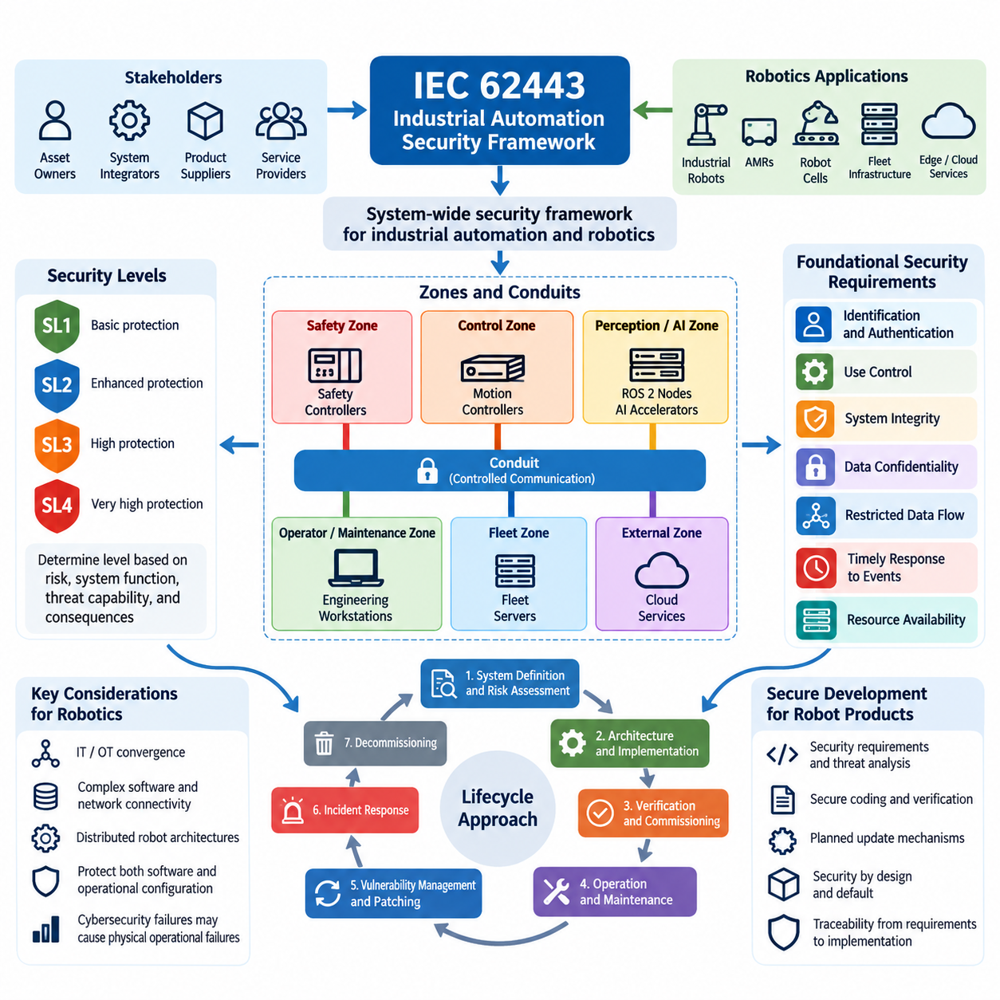{width="7.268055555555556in" height="7.268055555555556in"}

IEC 62443는 보안을 개별적인 기술 통제의 집합이 아니라 시스템 전체의 엔지니어링 책임으로 다룸으로써 산업 자동화 및 제어 시스템(Industrial Automation and Control Systems)을 위한 사이버보안 프레임워크(Cybersecurity Framework)를 제공한다. 이러한 접근 방식은 산업용 로봇(Industrial Robot), 자율이동로봇(Autonomous Mobile Robot), 로봇 셀(Robot Cell), 플릿 인프라(Fleet Infrastructure), 그리고 이를 지원하는 엣지 또는 클라우드 서비스(Edge or Cloud Service)가 운영기술(Operational Technology)과 복잡한 소프트웨어 및 네트워크 연결성을 결합하기 때문에 특히 중요하다.

IEC 62443 시리즈는 자산 소유자(Asset Owner), 시스템 통합업체(System Integrator), 제품 공급업체(Product Supplier), 서비스 제공업체(Service Provider)에 걸쳐 사이버보안 책임을 체계화한다. 보안이 강화된 하나의 구성요소가 자동으로 안전한 로봇 시스템을 만든다고 가정하는 대신, 제품이 어떻게 개발되고 통합되며 설정, 운영, 유지보수되고 최종적으로 폐기되는지를 고려한다. 로보틱스 조직에서 이러한 수명주기 관점(Lifecycle Perspective)은 엔지니어링 프로세스를 배포 및 운영 보안과 연결한다.

핵심적인 아키텍처 개념은 산업 시스템을 존(Zone)과 컨듀잇(Conduit)으로 구분하는 것이다. 존(Zone)은 유사한 보안 요구사항을 공유하는 자산을 그룹화하며, 컨듀잇(Conduit)은 존 사이에서 통제되는 통신 경로를 의미한다. 따라서 로봇 시스템에서는 안전 제어기(Safety Controller), 모션 제어기(Motion Controller), ROS 2 컴퓨팅 노드(Computing Node), AI 가속기(AI Accelerator), 엔지니어링 워크스테이션(Engineering Workstation), 플릿 서버(Fleet Server), 무선 인프라(Wireless Infrastructure), 외부 클라우드 서비스(External Cloud Service)를 기능과 위험 노출 수준에 따라 분리할 수 있다.

존 및 컨듀잇 모델링(Zone and Conduit Modeling)은 현대 로봇이 기존의 정보기술(Information Technology)과 운영기술(Operational Technology) 경계를 넘나들기 때문에 특히 유용하다. 인지 컴퓨터(Perception Computer)는 AI 프로세서(AI Processor)와 대용량 센서 데이터를 교환하는 동시에 모션 제어기(Motion Controller)는 결정론적 제어 트래픽(Deterministic Control Traffic)을 처리할 수 있다. 플릿 관리 시스템(Fleet Management System)은 수십 대 또는 수백 대의 로봇과 통신할 수 있으며, IEC 62443는 이러한 인터페이스를 암묵적으로 신뢰되는 연결이 아니라 명시적인 보안 경계(Security Boundary)로 정의하도록 유도한다.

IEC 62443는 서로 다른 유형의 위협에 대해 필요한 보호 수준을 체계적으로 표현하기 위한 보안 수준(Security Level) 개념도 도입한다. 따라서 모든 영역에 동일한 보안 통제를 적용하는 대신 위험(Risk), 시스템 기능(System Function), 위협 역량(Threat Capability), 잠재적 결과(Potential Consequence)를 기반으로 보안 요구사항을 결정해야 한다. 동일한 물리적 로봇 내부에 존재하더라도 안전 필수 모션 제어 존(Safety-Critical Motion-Control Zone)은 비필수 모니터링 인터페이스(Noncritical Monitoring Interface)보다 더 강력한 보호가 필요할 수 있다.

이 프레임워크는 기술적 요구사항을 여러 기본 보안 역량(Foundational Security Capability)을 중심으로 구성한다. 여기에는 식별 및 인증 제어(Identification and Authentication Control), 사용 제어(Use Control), 시스템 무결성(System Integrity), 데이터 기밀성(Data Confidentiality), 제한된 데이터 흐름(Restricted Data Flow), 이벤트 적시 대응(Timely Response to Events), 자원 가용성(Resource Availability)이 포함된다. 이러한 역량은 사이버보안 목표를 로봇 제어기, 운영체제, 미들웨어, 네트워크, 애플리케이션 및 지원 인프라에 대한 구체적인 요구사항으로 변환하는 체계적인 기반을 제공한다.

식별 및 인증(Identification and Authentication)은 분산 로봇 아키텍처(Distributed Robot Architecture)에서 특히 중요하다. 인간 운영자, 유지보수 엔지니어, 로봇, 제어기, 소프트웨어 서비스, 자동 배포 시스템은 각 역할에 적합한 검증 가능한 신원(Verifiable Identity)을 가져야 한다. 이후 인증 메커니즘(Authentication Mechanism)은 권한부여(Authorization) 결정을 지원하여 침해된 엔지니어링 워크스테이션, 로봇 노드 또는 외부 서비스가 전체 운영 환경에 대한 무제한 접근 권한을 자동으로 획득하지 못하도록 할 수 있다.

시스템 무결성(System Integrity)은 기존의 악성코드 보호(Malware Protection)보다 더 넓은 범위를 포함한다. 로봇 펌웨어(Robot Firmware), 부트 체인(Boot Chain), 구성 파일(Configuration File), 제어 애플리케이션(Control Application), AI 모델(AI Model), 미들웨어 정책(Middleware Policy), OTA 패키지(OTA Package)는 모두 실제 물리적 동작에 영향을 미칠 수 있다. 따라서 무결성 통제(Integrity Control)는 실행 소프트웨어뿐 아니라 운영 구성도 보호해야 하며, 보안 부팅(Secure Boot), 서명된 소프트웨어(Signed Software), 통제된 업데이트(Controlled Update), 보호된 자격증명(Protected Credential), 변경 모니터링(Change Monitoring), 검증된 구성 기준선(Verified Configuration Baseline)을 함께 적용할 수 있다.

제한된 데이터 흐름(Restricted Data Flow)은 불필요한 통신 경로를 제한함으로써 무결성 보호를 보완한다. 산업용 로봇 네트워크는 안전(Safety), 제어(Control), 인지(Perception), AI 처리(AI Processing), 플릿 협조(Fleet Coordination), 유지보수(Maintenance), 기업 시스템 연결(Enterprise Connectivity)에 따라 세분화할 수 있다. 방화벽(Firewall), 접근통제 규칙(Access-Control Rule), 인증된 미들웨어(Authenticated Middleware), VLAN, 게이트웨이(Gateway), 애플리케이션 수준 권한부여(Application-Level Authorization)는 지정된 컨듀잇을 통해 필요한 트래픽만 통과시키면서 이러한 경계를 강제할 수 있다.

가용성(Availability)은 사이버보안 장애가 물리적인 운영 장애로 전환될 수 있기 때문에 로보틱스에서 특별히 중요하다. 과도한 트래픽, 자원 고갈(Resource Exhaustion), 비정상 메시지(Malformed Message), 침해된 서비스(Compromised Service), 사용할 수 없는 인증 인프라는 내비게이션(Navigation), 조작(Manipulation), 플릿 협조(Fleet Coordination), 생산 운영을 방해할 수 있다. 따라서 보안 아키텍처(Security Architecture)는 결정론적 또는 안전 관련 운영을 저해하는 새로운 의존성을 만들지 않으면서 컴퓨팅, 통신 및 제어 자원을 보호해야 한다.

IEC 62443는 단순한 배포 체크리스트(Deployment Checklist)가 아니라 수명주기 프레임워크(Lifecycle Framework)로 이해해야 한다. 사이버보안 활동은 시스템 정의와 위험 평가(Risk Assessment)에서 시작하여 아키텍처 및 구현 단계로 이어지며, 검증(Verification), 시운전(Commissioning), 운영(Operation), 유지보수(Maintenance), 취약점 관리(Vulnerability Management), 패치(Patching), 사고 대응(Incident Response), 폐기(Retirement) 과정에서도 지속된다. 이는 배포 이후에도 소프트웨어, 펌웨어, AI 모델 및 플릿 서비스가 지속적으로 진화하는 로봇 플랫폼의 특성과 자연스럽게 부합한다.

제품 개발(Product Development)에서는 보안 개발 관행(Secure Development Practice)이 엔지니어링 프로세스 자체의 일부가 된다. 보안 요구사항은 아키텍처와 구현까지 추적 가능해야 하며, 위협 분석(Threat Analysis), 보안 코딩(Secure Coding), 취약점 처리(Vulnerability Handling), 검증(Verification), 업데이트 메커니즘(Update Mechanism)은 출시 직전에 추가되는 것이 아니라 사전에 계획되어야 한다. 로보틱스 소프트웨어 조직은 이러한 활동을 기존의 CI/CD, 펌웨어 개발, ROS 2 테스트, 시뮬레이션(Simulation), 하드웨어 인 더 루프 검증(Hardware-in-the-Loop Validation) 파이프라인과 통합할 수 있다.

구성요소 수준 보안(Component-Level Security)과 시스템 수준 보안(System-Level Security)은 명확하게 구분되어야 한다. 제어기, 게이트웨이, 운영체제 또는 로봇 컴퓨터가 강력한 보안 기능을 제공하더라도 통합 방식에 따라 악용 가능한 신뢰 관계(Trust Relationship)가 형성될 수 있다. 반대로 시스템 통합업체가 기본적인 보안 메커니즘이 부족한 제품의 문제를 완전히 보완하기도 어렵다. 따라서 IEC 62443는 보안 제품 개발(Secure Product Development)과 보안 시스템 통합(Secure System Integration) 사이의 상호보완적인 책임을 강조한다.

ROS 2 및 DDS 기반 로봇에서 이러한 관점은 유용한 컴플라이언스 구조(Compliance Structure)를 제공한다. 인증(Authentication), 접근통제 정책(Access-Control Policy), 암호화(Encryption), 인증서 관리(Certificate Management), 로깅(Logging), 취약점 개선(Vulnerability Remediation), 침투 테스트(Penetration Testing)를 보다 광범위한 산업 사이버보안 목표를 지원하는 구현 메커니즘으로 다룰 수 있다. 따라서 ROS 2 보안 컴플라이언스(Security Compliance)는 미들웨어 보안만의 독립적인 문제가 아니라 전체 로봇 사이버보안 프로그램의 일부로 관리될 수 있다.

동일한 원칙은 펌웨어(Firmware)와 OTA 인프라에도 적용된다. 서명된 펌웨어(Signed Firmware), 보안 부팅(Secure Boot), 패키지 무결성 검증(Package-Integrity Verification), 안티 롤백 메커니즘(Anti-Rollback Mechanism), 소프트웨어 자재명세서(SBOM, Software Bill of Materials) 관리, 하드웨어 기반 키 저장소(Hardware-Backed Key Storage), 공급망 통제(Supply-Chain Control)는 수명주기 보증(Lifecycle Assurance)을 종합적으로 지원한다. 따라서 OTA 보안은 IEC 62443 컴플라이언스 체크리스트(Compliance Checklist)와 연계하여 기술 구현과 감사 가능한 보안 요구사항 사이의 관계를 강화할 수 있다.

IEC 62443가 평가(Assessment) 또는 인증 준비(Certification Preparation)에 사용될 때 증거(Evidence)는 핵심적인 요소가 된다. 아키텍처 설명서, 자산 인벤토리(Asset Inventory), 존 및 컨듀잇 모델(Zone-and-Conduit Model), 위험 평가, 보안 요구사항, 구성 기준선(Configuration Baseline), 시험 결과(Test Result), 취약점 기록(Vulnerability Record), 패치 이력(Patch History), 사고 대응 절차(Incident Procedure), 개발 기록(Development Record)은 보안 통제가 실제로 존재하고 지속적으로 유지되고 있음을 입증할 수 있다. 이러한 증거는 감사 직전에 재구성하기보다 전체 엔지니어링 과정에서 지속적으로 생성되어야 한다.

효과적인 로보틱스 구현에서는 IEC 62443를 단순한 컴플라이언스 문서(Compliance Document)가 아니라 엔지니어링 프레임워크(Engineering Framework)로 전환해야 한다. 위험 분석(Risk Analysis)은 필요한 보호 수준을 결정하고, 아키텍처는 보안 경계를 설정하며, 제품 및 소프트웨어 프로세스는 보안 통제를 구현한다. 이후 테스트는 보안 통제의 효과를 검증하고 운영 모니터링(Operational Monitoring)은 배포 이후에도 보증 수준을 유지한다. 이에 따라 인증(Certification)은 일회성 기술 검사가 아니라 지속적으로 운영되는 사이버보안 프로세스의 증거가 된다.

보다 광범위한 로봇 사이버보안 체계에서 IEC 62443는 이후의 보안 수준 평가(Security Level Assessment), 자동차 사이버보안(Automotive Cybersecurity), NIST CSF 적용, 규제 요구사항(Regulatory Requirement), UAV 감항 사이버보안(Airworthiness Cybersecurity), 사이버보안 관리 시스템(Cybersecurity Management System), 침투 테스트(Penetration Testing), 공식 증거 패키지(Formal Evidence Package)로 확장되는 기반 역할을 한다. 이를 통해 로봇 사이버보안은 개별 보안 기술의 적용을 넘어 설계, 개발, 검증, 운영 및 인증을 연결하는 체계적인 컴플라이언스 및 인증(Compliance and Certification) 프로세스로 발전할 수 있다.

## 11.02. IEC 62443 SL Assessment for Robot Systems [w/Code]

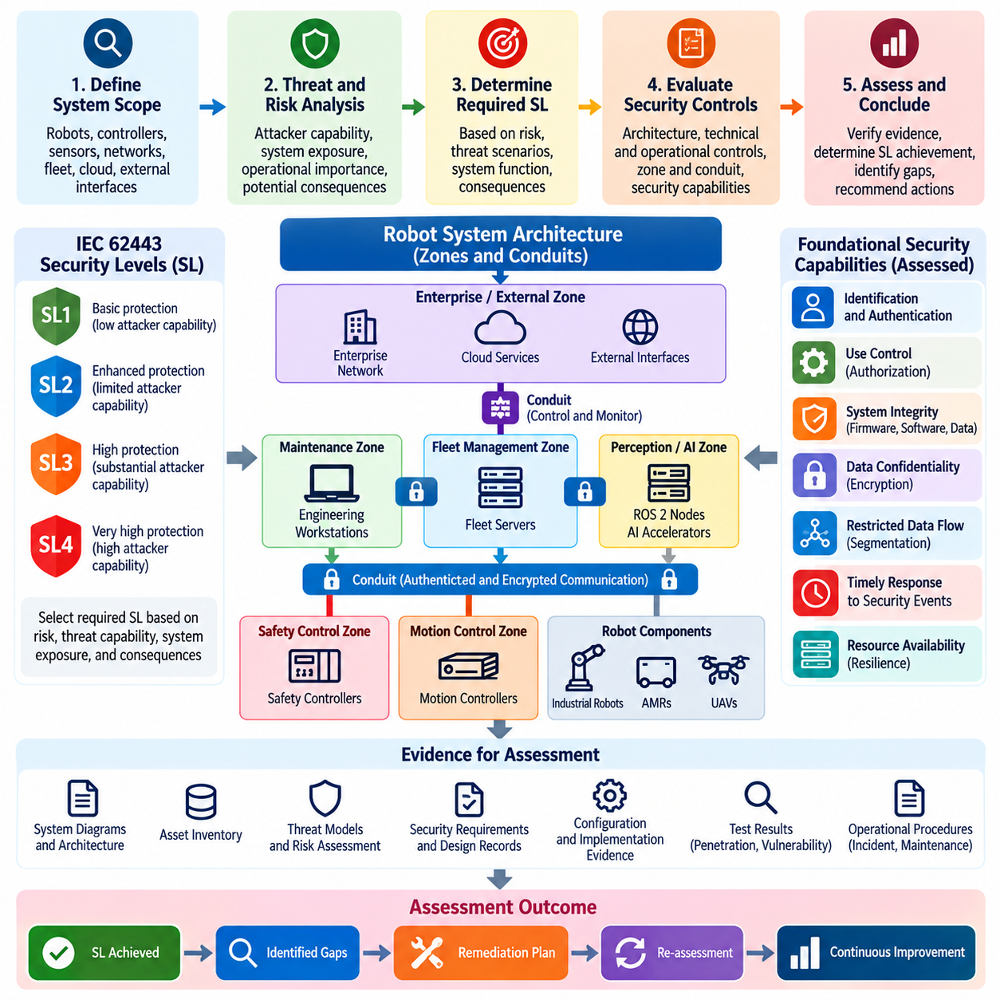{width="7.268055555555556in" height="7.268055555555556in"}

IEC 62443 보안 수준 평가(Security Level Assessment)는 로봇 시스템이 정의된 수준의 공격자 역량(Attacker Capability)에 대해 충분한 사이버보안 보호를 제공하는지를 판단하기 위한 체계적인 방법을 제공한다. 로봇 시스템에서는 단일 제어기나 컴퓨터를 독립적으로 평가하기보다 전체 운영 환경을 고려해야 한다. 따라서 평가는 시스템 아키텍처(System Architecture), 위협 가정(Threat Assumption), 보안 요구사항(Security Requirement), 구현된 통제(Implemented Control), 운영 절차(Operational Procedure)를 일관된 평가 프로세스로 연결한다.

보안 수준 평가는 평가 대상 시스템의 명확한 정의에서 시작한다. 평가 범위에는 로봇, 제어기, 센서, 엣지 컴퓨터, 네트워크, 게이트웨이, 엔지니어링 스테이션, 플릿 관리 인프라, 관련 외부 인터페이스가 포함되어야 한다. 신뢰 경계(Trust Boundary)를 넘어 정보나 명령을 교환하는 구성요소도 명시적으로 식별해야 한다. 이러한 시스템 정의는 중요한 의존성이 평가에서 제외되는 것을 방지하고, 사이버보안 요구사항과 증거가 평가될 기준 범위를 설정한다.

보안 수준(Security Level)의 개념은 잠재적인 공격자의 역량과 성공적인 침해가 발생했을 때의 결과와 연결되어야 한다. 통제된 산업 환경에서 운영되는 로봇은 공용 네트워크 또는 클라우드 서비스에 연결된 플릿과 서로 다른 보호 요구사항을 가질 수 있다. 따라서 평가에서는 보안 수준을 임의로 선택하기보다 위협 및 위험 분석(Threat and Risk Analysis)부터 시작해야 한다. 요구되는 보호 수준은 현실적인 공격 시나리오, 시스템 노출 정도, 운영상의 중요성, 잠재적인 물리적 또는 비즈니스 결과를 반영해야 한다.

로봇 시스템에서 존(Zone)과 컨듀잇(Conduit)은 평가를 위한 중요한 아키텍처 기반을 제공한다. 안전 제어 존(Safety-Control Zone), 모션 제어 존(Motion-Control Zone), 인지 및 AI 존(Perception and AI Zone), 플릿 관리 존(Fleet-Management Zone), 유지보수 존(Maintenance Zone), 기업 또는 클라우드 연결 영역(Enterprise or Cloud Connection)은 서로 다른 보안 요구사항을 가질 수 있다. 이러한 존 사이의 통신 경로는 통제되고 그 필요성이 정당화되어야 한다. 이후 평가에서는 인증(Authentication), 권한부여(Authorization), 암호화(Encryption), 세분화(Segmentation), 모니터링(Monitoring) 및 기타 통제가 각 보안 경계에 적절한 보호를 제공하는지를 판단할 수 있다.

평가는 식별 및 인증 제어(Identification and Authentication Control), 사용 제어(Use Control), 시스템 무결성(System Integrity), 데이터 기밀성(Data Confidentiality), 제한된 데이터 흐름(Restricted Data Flow), 보안 이벤트에 대한 적시 대응(Timely Response to Security Events), 자원 가용성(Resource Availability)과 같은 기본 보안 역량(Foundational Security Capability)도 검토한다. 이러한 역량을 서로 독립적인 체크리스트 항목으로 다루어서는 안 된다. 그 효과는 로봇 아키텍처 전반에 어떻게 구현되는지에 따라 달라진다. 예를 들어 강력한 인증(Authentication)이 구현되어 있더라도 인증된 사용자나 서비스에 과도한 권한 또는 안전 필수 기능에 대한 무제한 접근 권한이 부여된다면 보호 효과는 제한적일 수 있다.

식별 및 인증 평가(Identification and Authentication Assessment)는 인간과 기계의 신원(Identity)을 모두 포함해야 한다. 운영자, 유지보수 담당자, 로봇 노드, 제어기, 소프트웨어 서비스, 게이트웨이, 자동 배포 시스템은 각각 서로 다른 신원과 자격증명(Credential)을 필요로 할 수 있다. 평가자는 신원이 어떻게 발급되고, 보호되고, 검증되며, 폐기되고, 주기적으로 검토되는지를 확인해야 한다. 분산 로봇 환경에서는 인증이 침해된 노드가 다른 신뢰된 구성요소를 가장하거나 승인되지 않은 제어 권한을 획득하는 것을 방지해야 한다.

사용 제어(Use Control)는 인증된 신원이 할당된 권한에 적합한 작업만 수행할 수 있는지를 평가한다. 이는 소프트웨어 명령이 직접적인 물리적 결과를 발생시킬 수 있기 때문에 로봇에서 특히 중요하다. 관리 기능, 구성 변경, 펌웨어 업데이트, 모션 명령, 안전 기능, 플릿 수준 작업은 각각 위험 수준에 따라 보호되어야 한다. 역할 분리(Role Separation)와 최소 권한(Least Privilege)은 침해된 자격증명의 영향을 줄이고 승인되지 않은 운영 작업을 제한할 수 있다.

시스템 무결성 평가(System Integrity Assessment)는 펌웨어, 운영체제, 애플리케이션, 로봇 미들웨어, 구성 데이터, AI 모델, 업데이트 패키지까지 확장된다. 증거에는 보안 부팅 메커니즘(Secure-Boot Mechanism), 소프트웨어 서명(Software Signature), 무결성 검증(Integrity Verification), 통제된 구성 관리(Controlled Configuration Management), 취약점 개선 절차(Vulnerability Remediation Procedure), 보호된 업데이트 프로세스(Protected Update Process) 등이 포함될 수 있다. AI 기반 로봇에서는 모델 파일과 추론 설정(Inference Configuration)도 고려해야 한다. 승인되지 않은 변경은 기존 제어 소프트웨어를 교체하지 않고도 인지, 계획 또는 의사결정 기능을 변경할 수 있기 때문이다.

제한된 데이터 흐름(Restricted Data Flow)은 통신이 필요한 승인된 경로로 제한되는지를 검토한다. 로봇 네트워크는 장치가 동일한 시설 내부에 있다는 이유만으로 무제한적인 내부 연결에 의존해서는 안 된다. 방화벽(Firewall), 접근제어 목록(Access-Control List), VLAN, 게이트웨이(Gateway), 인증된 DDS 통신(Authenticated DDS Communication), API 권한부여(API Authorization), 네트워크 모니터링(Network Monitoring)은 다층적인 제한을 제공할 수 있다. 평가에서는 이러한 메커니즘이 정상 및 비정상 운영 조건에서 의도된 존 및 컨듀잇 아키텍처를 실제로 강제하는지를 확인해야 한다.

가용성(Availability)은 사이버보안 공격이 물리적 운영에 영향을 줄 수 있기 때문에 로봇 시스템에서 특별한 주의가 필요하다. 서비스 거부(DoS) 조건, 자원 고갈(Resource Exhaustion), 악성 트래픽(Malicious Traffic), 침해된 서비스(Compromised Service), 사용할 수 없는 인증 인프라는 내비게이션, 조작, 플릿 협조 또는 안전 관련 기능을 방해할 수 있다. 따라서 평가에서는 보안 메커니즘 자체가 허용할 수 없는 의존성이나 지연을 발생시키는지도 고려해야 한다. 보호 기능은 핵심 로봇 기능에 필요한 가용성과 결정성을 유지해야 한다.

IEC 62443 보안 수준 평가는 단순한 아키텍처상의 주장보다 객관적인 증거(Objective Evidence)를 기반으로 해야 한다. 관련 증거에는 시스템 다이어그램, 자산 인벤토리(Asset Inventory), 위협 모델(Threat Model), 보안 요구사항, 구성 기준선(Configuration Baseline), 접근제어 정책(Access-Control Policy), 인증서 기록(Certificate Record), 방화벽 규칙(Firewall Rule), 소프트웨어 무결성 기록(Software-Integrity Record), 취약점 보고서(Vulnerability Report), 침투 테스트 결과(Penetration-Test Result), 모니터링 기록(Monitoring Record), 사고 대응 절차(Incident Procedure), 유지보수 문서(Maintenance Documentation) 등이 포함될 수 있다. 증거는 통제가 존재한다는 사실뿐만 아니라 통제가 올바르게 구성되고 일관되게 유지되고 있음을 입증해야 한다.

평가에서는 의도된 보안 역량(Intended Security Capability)과 실제로 입증된 보안 성능(Demonstrated Security Performance)의 차이도 고려해야 한다. 예를 들어 로봇이 기술적으로 암호화 통신을 지원하더라도 실제 운영에서 암호화가 비활성화되어 있거나 자격증명이 부적절하게 관리될 수 있다. 마찬가지로 보안 업데이트 메커니즘이 존재하더라도 신뢰할 수 있는 키 관리(Key Management)나 롤백 방지(Rollback Protection)가 부족할 수 있다. 따라서 평가는 제품의 기능을 보안 수준의 증거로 받아들이기보다 구현, 구성, 운영 및 유지보수를 모두 검증해야 한다.

로봇 플릿에서 보안 수준 평가는 개별 로봇이 공유 인프라 및 다른 로봇과 상호작용하기 때문에 더욱 복잡해진다. 플릿 관리, 인증서 서비스, OTA 인프라, 클라우드 API 또는 중앙 집중식 인증 시스템의 취약점은 동시에 많은 로봇에 영향을 줄 수 있다. 따라서 평가는 공통 서비스와 신뢰 관계(Trust Relationship)를 잠재적인 집중 공격 지점(Concentration Point)으로 검토해야 한다. 플릿 수준 보안은 하나의 로봇이 침해되더라도 다른 로봇이나 중앙 인프라에 대한 무제한 접근 권한이 자동으로 제공되지 않는다는 것을 입증해야 한다.

평가는 궁극적으로 식별된 위험(Identified Risk), 요구되는 보안 수준(Required Security Level), 구현된 통제(Implemented Control), 검증 활동(Verification Activity), 잔여 격차(Remaining Gap) 사이의 추적성(Traceability)을 만들어야 한다. 충족되지 않은 요구사항은 그 원인, 위험 중요도, 적용 가능한 보완 통제(Compensating Measure), 계획된 개선 조치(Planned Remediation)를 함께 기록해야 한다. 이를 통해 시스템이 배포 준비가 되었는지 또는 추가적인 엔지니어링 작업이 필요한지를 판단할 수 있는 방어 가능한 근거를 마련할 수 있다. 또한 소프트웨어, 펌웨어, 네트워크 아키텍처 또는 운영 조건이 변경되었을 때 재평가를 보다 쉽게 수행할 수 있다.

로보틱스 조직에서 IEC 62443 보안 수준 평가는 일회성 인증 활동이 아니라 지속적인 엔지니어링 활동으로 취급되어야 한다. 위협, 소프트웨어 의존성, AI 모델, 네트워크 연결, 플릿 서비스, 운영 절차는 로봇 수명주기 전반에서 변화한다. 따라서 정기적인 재평가, 취약점 관리, 보안 테스트, 사고로부터의 학습, 통제된 변경 관리(Controlled Change Management)는 배포 이후에도 요구되는 보안 상태(Security Posture)를 유지하도록 지원하며, 지속적인 컴플라이언스 및 인증 활동에 필요한 증거를 제공한다.

## 11.03. ISO 21434 Automotive Cybersecurity for AMR [w/Code]

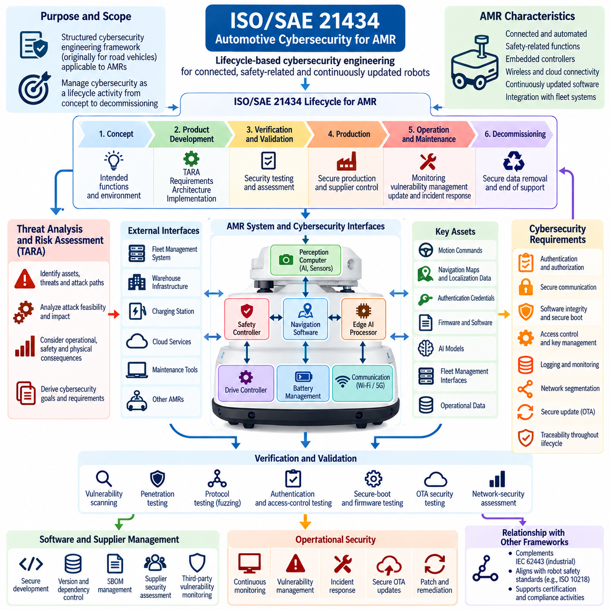{width="7.268055555555556in" height="7.268055555555556in"}

ISO/SAE 21434는 본래 도로 차량 시스템(Road-Vehicle System)을 위해 개발된 체계적인 사이버보안 엔지니어링 프레임워크(Cybersecurity Engineering Framework)를 제공하지만, 자동차에서 파생된 전자 아키텍처, 임베디드 제어기, 무선 연결성, 안전 관련 기능, 지속적으로 업데이트되는 소프트웨어를 포함하는 자율이동로봇(AMR, Autonomous Mobile Robot)에도 많은 수명주기 원칙을 의미 있게 적용할 수 있다. AMR에서는 이 프레임워크를 활용하여 개념 개발(Concept Development)부터 생산, 운영, 유지보수, 폐기에 이르는 전 과정에서 사이버보안 활동을 체계적으로 수립할 수 있다.

가장 중요한 적용 관점은 AMR을 단순한 이동 기계가 아니라 연결된 사이버-물리 제품(Cyber-Physical Product)으로 취급하는 것이다. AMR에는 구동 제어기(Drive Controller), 배터리 관리 시스템(Battery-Management System), 인지 컴퓨터(Perception Computer), 안전 제어기(Safety Controller), 내비게이션 소프트웨어(Navigation Software), 무선 인터페이스(Wireless Interface), 엣지 AI 프로세서(Edge AI Processor), 플릿 관리 클라이언트(Fleet-Management Client), OTA 업데이트 메커니즘(OTA Update Mechanism) 등이 포함될 수 있다. 따라서 사이버보안 분석은 하나의 구성요소가 침해되었을 때 내비게이션, 모션, 플릿 협조 또는 기타 물리적으로 중요한 기능으로 침해가 확산될 수 있는지를 고려해야 한다.

ISO/SAE 21434는 제품 수명주기(Product Lifecycle) 전반에서 사이버보안을 강조한다. 따라서 AMR 프로그램에서는 하드웨어와 소프트웨어 아키텍처가 이미 확정된 이후가 아니라 개념 개발 단계부터 사이버보안을 시작해야 한다. 초기 활동에서는 의도된 기능, 운영 환경, 외부 인터페이스, 자산, 잠재적인 공격 경로, 사이버보안 목표를 식별해야 한다. 이러한 활동은 이후의 아키텍처 결정을 위한 기반을 제공하며, 보안 요구사항이 기존 로봇 설계에 독립적인 추가 요소로 뒤늦게 적용되는 것을 방지하는 데 도움이 된다.

핵심적인 활동은 위협 분석 및 위험 평가(TARA, Threat Analysis and Risk Assessment)이다. AMR의 경우 TARA는 모션 명령, 내비게이션 지도, 위치추정 데이터, 인증 자격증명, 펌웨어, AI 모델, 플릿 관리 인터페이스, 운영 데이터를 중요한 자산으로 식별할 수 있다. 잠재적인 공격 경로에는 무선 네트워크, 유지보수 포트, 클라우드 API, 디버깅 인터페이스, 이동식 미디어, 침해된 소프트웨어 구성요소, 로봇 간 통신 등이 포함될 수 있다. 이러한 위험 분석은 공격 가능성과 잠재적 영향을 구체적인 사이버보안 요구사항과 연결해야 한다.

AMR 사이버보안 침해의 결과는 기존 정보 시스템의 침해와 상당히 다를 수 있다. 내비게이션 데이터가 승인되지 않은 방식으로 조작되면 경로 이탈이 발생할 수 있으며, 모션 명령이 조작되면 충돌이나 장비 손상 위험이 발생할 수 있다. 플릿 관리 자격증명이 침해되면 여러 대의 로봇에 동시에 영향을 줄 수 있다. 따라서 사이버보안 평가는 기밀성(Confidentiality)과 데이터 손실뿐만 아니라 무결성(Integrity), 가용성(Availability), 운영 중단, 안전 기능과의 상호작용, 잠재적인 물리적 결과까지 고려해야 한다.

TARA에서 도출된 사이버보안 목표(Cybersecurity Goal)는 AMR 아키텍처에 할당할 수 있는 기술적 요구사항(Technical Requirement)으로 변환되어야 한다. 이러한 요구사항은 인증(Authentication), 권한부여(Authorization), 보안 통신(Secure Communication), 소프트웨어 무결성(Software Integrity), 보안 부팅(Secure Boot), 보호된 진단(Protected Diagnostics), 접근제어(Access Control), 키 관리(Key Management), 로깅(Logging), 침입 탐지(Intrusion Detection), 업데이트 보안(Update Security), 네트워크 세분화(Network Segmentation) 등을 다룰 수 있다. 요구사항은 최초의 사이버보안 문제에서 시스템 아키텍처, 하드웨어 및 소프트웨어 구현, 검증(Verification), 최종 운영 증거까지 추적 가능해야 한다.

사이버보안 인터페이스(Cybersecurity Interface)의 개념은 다양한 외부 시스템과 상호작용하는 AMR에서 특히 중요하다. AMR은 플릿 관리 소프트웨어, 창고 인프라, 충전 스테이션, 무선 네트워크, 클라우드 서비스, 유지보수 도구, 다른 로봇과 통신할 수 있다. 각각의 인터페이스는 잠재적인 신뢰 경계(Trust Boundary)를 형성한다. 따라서 아키텍처에서는 어떤 개체를 신뢰하는지, 서로 어떻게 인증하는지, 어떤 명령이 허용되는지, 통신이 도청, 변경, 재생(Replay), 승인되지 않은 주입으로부터 어떻게 보호되는지를 정의해야 한다.

사이버보안은 구성요소 및 소프트웨어 수준에서도 고려되어야 한다. 임베디드 제어기, 운영체제, 미들웨어, 디바이스 드라이버, 통신 스택, AI 애플리케이션, 서드파티 라이브러리는 최종 AMR에 취약점을 유입시킬 수 있다. 따라서 소프트웨어 구성은 버전 관리(Version Management), 의존성 추적(Dependency Tracking), 취약점 모니터링(Vulnerability Monitoring), 보안 개발 관행(Secure Development Practice), 소프트웨어 자재명세서(SBOM, Software Bill of Materials) 프로세스를 통해 관리되어야 한다. 목표는 사이버보안 책임이 로봇 자체의 독점 소프트웨어를 넘어 전체 기술 공급망(Technology Supply Chain)으로 확장되도록 하는 것이다.

검증 및 확인(Verification and Validation)은 사이버보안 요구사항이 실제로 구현되고 효과적으로 작동하는지를 입증해야 한다. AMR 사이버보안 테스트에는 취약점 스캐닝(Vulnerability Scanning), 침투 테스트(Penetration Testing), 프로토콜 테스트(Protocol Testing), 퍼징(Fuzzing), 인증 테스트(Authentication Testing), 접근제어 검증(Access-Control Verification), 보안 부팅 검증(Secure-Boot Validation), 펌웨어 무결성 테스트(Firmware-Integrity Testing), OTA 보안 테스트(OTA Security Testing), 네트워크 보안 평가(Network-Security Assessment) 등이 포함될 수 있다. 테스트는 현실적인 운영 조건을 반영해야 한다. 실험실 환경에서 정상적으로 작동하는 보안 메커니즘이라도 로봇이 실제 운영 인프라 및 플릿 서비스에 연결되면 다르게 동작할 수 있기 때문이다.

AMR이 운영 단계에 진입한 이후에도 사이버보안 관리는 계속되어야 한다. 운영체제, 통신 라이브러리, 미들웨어, 임베디드 구성요소, 클라우드 서비스, 서드파티 패키지에서 제품 출시 이후에도 취약점이 발견될 수 있다. 따라서 사이버보안 모니터링 및 사고 대응 프로세스(Cybersecurity Monitoring and Incident-Response Process)는 새로운 위협을 식별하고, 관련성을 평가하며, 개선 조치의 우선순위를 결정하고, 검증된 패치를 배포해야 한다. OTA 메커니즘은 소프트웨어의 진본성과 무결성을 유지하는 동시에 승인되지 않은 다운그레이드 또는 신뢰할 수 없는 소프트웨어 설치를 방지해야 한다.

ISO/SAE 21434와 다른 로봇 사이버보안 프레임워크의 관계는 서로 대체하는 관계가 아니라 상호보완적인 관계로 다루어야 한다. IEC 62443은 산업 자동화 보안 관점을 제공할 수 있는 반면, ISO/SAE 21434는 체계적인 자동차 사이버보안 수명주기와 위험 관리 접근법을 제공한다. 산업 환경에 배치되는 AMR에서는 이러한 관점을 결합함으로써 제품 수준의 사이버보안 엔지니어링과 시스템 수준의 운영 보안을 모두 다룰 수 있다. 로보틱스 소프트웨어 구조에서도 ROS 2 보안(ROS 2 Security), 엣지 AI 보안(Edge AI Security), 클라우드 및 플릿 보안(Cloud and Fleet Security), OTA 보안, 테스트, 컴플라이언스를 서로 연결된 수명주기 영역으로 구성하고 있다.

인증 및 감사 준비(Certification and Audit Preparation)를 위해서는 AMR 개발 수명주기 전체에서 사이버보안 증거(Cybersecurity Evidence)를 지속적으로 생성해야 한다. 유용한 증거에는 TARA 결과, 사이버보안 목표, 요구사항 명세서(Requirements Specification), 아키텍처 결정(Architecture Decision), 인터페이스 정의(Interface Definition), 구현 기록(Implementation Record), 테스트 결과, 취약점 평가(Vulnerability Assessment), 소프트웨어 및 펌웨어 버전, SBOM 기록, 사고 대응 절차, 업데이트 이력(Update History) 등이 포함된다. 특히 추적성(Traceability)이 중요하다. 추적성은 식별된 사이버보안 위험이 요구사항으로 변환되었고, 이후 해당 요구사항이 실제로 구현되고 검증되었음을 입증하기 때문이다.

AMR 플릿 운영자에게는 이러한 수명주기 관점(Lifecycle Perspective)이 더욱 중요해진다. 배포된 플릿은 지속적으로 변화하는 사이버-물리 환경(Cyber-Physical Environment)을 구성하기 때문이다. 새로운 로봇, 소프트웨어 릴리스, 네트워크 구성, 클라우드 서비스, AI 모델, 운영 통합은 기존의 위협 환경을 변화시킬 수 있다. 따라서 사이버보안 프로세스는 통제된 변경(Controlled Change), 주기적인 위험 재평가(Periodic Risk Reassessment), 취약점 관리(Vulnerability Management), 사고 학습(Incident Learning), 안전한 폐기(Secure Retirement)를 지원해야 한다. 적절하게 적용된 ISO/SAE 21434 원칙은 AMR 개발자에게 위협 분석, 아키텍처, 구현, 검증, 배포 및 장기 운영 보증(Long-Term Operational Assurance)을 연결하는 체계적인 사이버보안 수명주기를 제공할 수 있다.

## 11.04. NIST CSF 2.0 Application to Robot Fleet [w/Code]

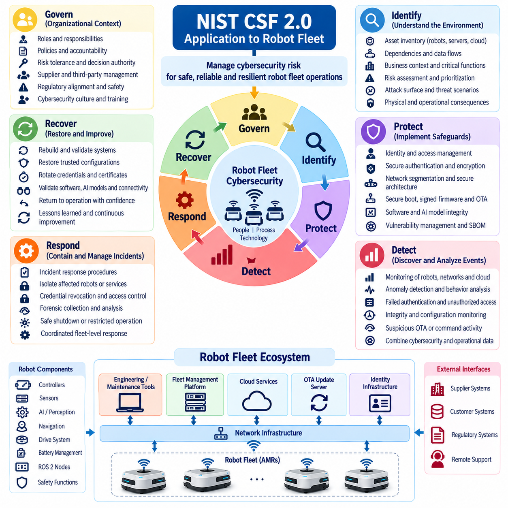{width="7.268055555555556in" height="7.268055555555556in"}

NIST 사이버보안 프레임워크 2.0(NIST Cybersecurity Framework 2.0)은 조직 전반에서 사이버보안 위험(Cybersecurity Risk)을 관리하기 위한 유연한 구조를 제공하며, 그 원칙은 로봇 플릿(Robot Fleet)에 효과적으로 적용할 수 있다. 자율 로봇 플릿에서 사이버보안은 개별 로봇의 보호에만 국한될 수 없다. 로봇은 공유 네트워크, 플릿 관리 플랫폼, 클라우드 서비스, 유지보수 시스템, 신원 인프라(Identity Infrastructure), 소프트웨어 업데이트 메커니즘에 의존하기 때문이다. 따라서 CSF 2.0은 기술적 통제를 거버넌스(Governance), 위험 관리(Risk Management), 운영 프로세스(Operational Process), 지속적 개선(Continuous Improvement)과 연결하는 유용한 조직적 프레임워크를 제공한다.

거버넌스(Govern) 기능은 사이버보안 의사결정이 이루어지는 조직적 맥락을 설정한다. 로봇 플릿에서는 사이버보안 책임, 위험 허용 수준(Risk Tolerance), 정책, 책임소재(Accountability), 공급업체 요구사항, 의사결정 권한을 정의해야 한다. 플릿 운영자는 로봇 신원 관리(Robot Identity), 네트워크 보안, 소프트웨어 업데이트, AI 모델 보호, 사고 대응(Incident Response), 서드파티 서비스에 대한 책임 주체를 명확히 해야 한다. 또한 거버넌스는 사이버보안 목표를 운영 안전(Operational Safety), 비즈니스 연속성(Business Continuity), 규제 의무(Regulatory Obligation), 침해된 로봇 동작의 물리적 결과와 연결해야 한다.

식별(Identify) 기능은 보호해야 할 자산, 의존성, 위험 및 비즈니스 맥락을 이해하는 데 중점을 둔다. 로봇 플릿에서는 로봇 제어기, 센서, 엣지 컴퓨터, 배터리, 내비게이션 시스템, ROS 2 노드, AI 모델, 플릿 서버, 클라우드 API, 무선 인프라, 충전 스테이션, 자격증명, 펌웨어, 지도, 텔레메트리, 운영 데이터 등이 포함된다. 자산 인벤토리(Asset Inventory)는 로봇과 공유 인프라 사이의 관계도 파악해야 한다. 중앙 집중식 서비스의 취약점 하나가 전체 플릿에 위험을 발생시킬 수 있기 때문이다.

식별(Identify) 기능은 위험 평가(Risk Assessment)와 우선순위 설정(Prioritization)도 지원해야 한다. 모든 로봇 구성요소가 동일한 사이버보안 중요성을 가지는 것은 아니며, 모든 취약점이 동일한 운영 결과를 발생시키는 것도 아니다. 예를 들어 플릿 관리 자격증명의 침해는 수백 대의 로봇에 영향을 줄 수 있는 반면, 특정 센서의 국지적인 취약점은 하나의 플랫폼에만 영향을 줄 수 있다. 따라서 위험 분석에서는 공격 가능성, 노출 수준, 운영 의존성, 물리적 결과, 복구 난이도, 잠재적인 플릿 영향 범위를 고려하여 사이버보안 우선순위를 설정해야 한다.

보호(Protect) 기능은 식별된 위험을 실제 보호조치(Safeguard)로 전환하여 사이버보안 사고의 발생 가능성이나 영향을 감소시킨다. 로봇 플릿에서 보호 메커니즘에는 강력한 신원 관리(Identity Management), 최소 권한(Least Privilege) 접근, 보안 인증(Secure Authentication), 암호화(Encryption), 네트워크 세분화(Network Segmentation), 보안 부팅(Secure Boot), 서명된 펌웨어(Signed Firmware), 보호된 AI 모델(Protected AI Model), 보안 구성(Secure Configuration), 자격증명 관리(Credential Management), 통제된 OTA 업데이트(Controlled OTA Update) 등이 포함될 수 있다. 이러한 보호조치는 하나의 보안 메커니즘에 의존하기보다 여러 계층으로 구현되어야 한다. 로봇은 물리적, 임베디드, 네트워크, 엣지, 클라우드 환경 전반에서 동작하기 때문이다.

보호는 소프트웨어와 AI 수명주기(AI Lifecycle)에도 확장되어야 한다. 로봇 애플리케이션, ROS 2 패키지, 미들웨어, 운영체제, 펌웨어, AI 모델, 구성 파일, 서드파티 의존성은 모두 물리적 동작에 영향을 줄 수 있다. 따라서 보안 개발 관행(Secure Development Practice), 취약점 관리(Vulnerability Management), SBOM 프로세스, 코드 리뷰(Code Review), 아티팩트 서명(Artifact Signing), 모델 무결성 검증(Model Integrity Verification), 통제된 배포(Controlled Deployment)를 통해 신뢰할 수 있는 소프트웨어 상태를 유지해야 한다. 로봇 사이버보안 구조에서는 이러한 요소들이 ROS 2 보안, 엣지 AI 보안, 클라우드 및 플릿 보안, OTA 및 펌웨어 보안과 연결되어 있다.

탐지(Detect) 기능은 사이버보안 이벤트를 발견하고 사고가 광범위한 피해를 발생시키기 전에 비정상적인 동작을 인식할 수 있는 역량을 구축한다. 플릿 환경에서는 개별 로봇 수준과 중앙 집중식 수준 모두에서 모니터링이 필요하다. 유용한 신호에는 반복적인 인증 실패, 예상하지 못한 네트워크 연결, 비정상적인 명령 패턴, 승인되지 않은 구성 변경, 비정상적인 자원 사용, 펌웨어 무결성 위반, 의심스러운 OTA 활동, 로봇과 플릿 관리 서비스 사이의 비정상적인 통신 등이 포함될 수 있다.

탐지는 로봇 시스템의 물리적 특성을 고려해야 한다. 사이버보안 이상 징후(Cybersecurity Anomaly)는 일반적인 네트워크 이벤트뿐만 아니라 예상하지 못한 로봇 동작으로도 나타날 수 있다. 비정상적인 모션 명령, 반복적인 내비게이션 실패, 비정상적인 작업 할당, 일관되지 않은 텔레메트리, 예상하지 못한 액추에이터 동작은 침해를 나타내는 추가적인 신호가 될 수 있다. 따라서 사이버보안 텔레메트리를 운영 및 플릿 데이터와 결합하면 탐지 성능을 향상시키고 정상적인 로봇 고장과 잠재적인 악의적 활동을 구별하는 데 도움이 될 수 있다.

대응(Respond) 기능은 탐지 이후 조직이 사이버보안 사고를 통제하고 관리하는 방법을 정의한다. 로봇 플릿에서는 전체 운영을 불필요하게 중단하지 않으면서 개별 로봇을 격리할 수 있는 대응 절차가 필요하다. 대응 메커니즘에는 네트워크 격리(Network Quarantine), 자격증명 폐기(Credential Revocation), 인증서 교체(Certificate Replacement), 명령 제한(Command Restriction), 플릿 수준 접근 차단(Fleet-Level Access Blocking), 보안 종료(Secure Shutdown), 포렌식 데이터 수집(Forensic Collection), 검증된 개선 패키지의 통제된 배포 등이 포함될 수 있다. 대응 결정은 안전, 운영 연속성, 로봇의 물리적 위치, 임무 상태, 다수 로봇의 동시 영향 가능성을 고려해야 한다.

복구(Recover) 기능은 사이버보안 사고 이후 신뢰할 수 있는 운영 상태를 복원하는 데 중점을 둔다. 복구는 단순히 침해된 로봇을 다시 서비스에 투입하는 것이 아니라 로봇, 소프트웨어, 자격증명, 구성, 통신 관계가 다시 신뢰할 수 있는 상태가 되었음을 확인해야 한다. 복구 과정에는 소프트웨어 재구축, 검증된 구성 복원, 자격증명 교체, 서명된 펌웨어 재설치, AI 모델 검증, 플릿 연결성 점검, 서비스 복귀 전에 수행하는 통제된 기능 테스트 등이 포함될 수 있다.

NIST CSF 2.0은 또한 조직이 현재의 사이버보안 상태와 목표로 하는 미래 상태를 표현할 수 있도록 프로파일(Profile)과 티어(Tier)의 활용을 지원한다. 로봇 플릿은 기존 역량을 나타내는 현재 프로파일(Current Profile)과 향후 배포에 필요한 보안 상태를 정의하는 목표 프로파일(Target Profile)을 설정할 수 있다. 이후의 격차 분석(Gap Analysis)을 통해 더 강력한 인증, 향상된 모니터링, 개선된 자산 가시성(Asset Visibility), 보다 성숙한 사고 대응, 강화된 공급망 통제(Supply-Chain Control)와 같은 개선 항목의 우선순위를 정할 수 있다.

대규모 플릿에서는 CSF 2.0을 개별 로봇 수준에만 적용하지 않고 여러 수준에서 적용해야 한다. 하나의 로봇은 자체적인 사이버보안 통제를 가질 수 있으며, 동시에 플릿 플랫폼, 클라우드 환경, 네트워크 인프라, 개발 파이프라인, 공급업체 생태계에도 서로 연결된 별도의 위험 관리가 필요하다. 중앙 집중식 서비스는 특히 중요하게 관리해야 한다. 신원 관리, 플릿 API, OTA 인프라 또는 명령 시스템이 침해될 경우 많은 로봇에 동시에 시스템적인 영향을 미칠 수 있기 때문이다.

따라서 NIST CSF 2.0은 전체 로봇 플릿 수명주기에서 거버넌스, 자산 이해, 보호, 탐지, 대응, 복구를 연결하는 조직화 프레임워크(Organizing Framework)로 활용하는 것이 가장 적절하다. 이 프레임워크가 상세한 기술 표준이나 로봇 특화 보안 메커니즘을 대체하는 것은 아니다. 대신 이를 조정하고 연결하기 위한 공통 구조를 제공한다. IEC 62443, ISO/SAE 21434, ROS 2 보안 관행, OTA 통제, AI 보안, 테스트, 사고 대응 프로세스와 결합하면 자율 로봇 플릿의 지속적인 사이버보안 관리를 위한 실질적인 기반을 제공할 수 있다.

## 11.05. EU Cyber Resilience Act CRA for Robots

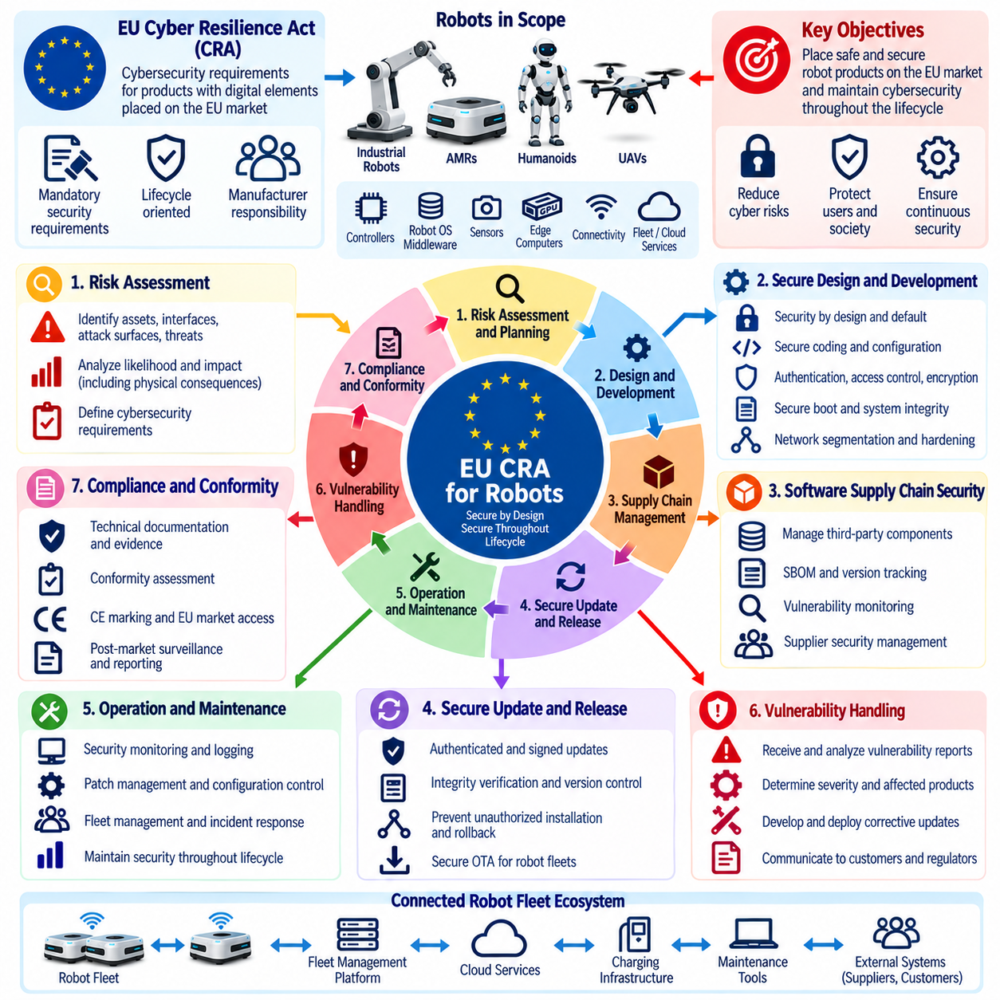{width="7.268055555555556in" height="7.268055555555556in"}

유럽연합 사이버 복원력 법(EU Cyber Resilience Act, CRA)은 EU 시장에 출시되는 디지털 요소를 포함한 제품(Products with Digital Elements)에 대한 사이버보안 요구사항을 규정하며, 현대 로봇 시스템에 매우 관련성이 높은 수명주기 중심의 규제 프레임워크(Regulatory Framework)를 구축한다. 로봇의 경우 이러한 범위에는 임베디드 제어기(Embedded Controller), 로봇 운영 소프트웨어(Robot Operating Software), 통신 인터페이스(Communication Interface), 엣지 컴퓨터(Edge Computer), 플릿 관리 구성요소(Fleet-Management Component), 제품의 사이버보안 노출 영역을 구성하는 연결 서비스(Connected Service) 등이 포함될 수 있다. 따라서 CRA는 사이버보안을 선택적인 엔지니어링 기능에서 제품 수준의 책임(Product-Level Responsibility)으로 전환한다.

로봇 제조업체에게 CRA가 특히 중요한 이유는 현대 로봇이 점점 더 연결되고, 소프트웨어 정의(Software-Defined) 방식으로 발전하며, 지속적으로 업데이트되기 때문이다. 산업용 로봇, 자율이동로봇(AMR, Autonomous Mobile Robot), 휴머노이드 플랫폼 또는 기타 자율기계는 하드웨어, 운영체제, 미들웨어, AI 소프트웨어, 무선 연결성, 클라우드 인터페이스, OTA 메커니즘을 결합할 수 있다. 이러한 요소 중 하나의 취약점도 물리적 운영에 영향을 줄 수 있다. 따라서 CRA 중심의 엔지니어링은 출시 전 테스트에만 집중하는 것이 아니라 전체 제품 수명주기(Product Lifecycle)에 걸쳐 사이버보안을 고려해야 한다.

기본적인 요구사항은 제품 개발 과정에서 사이버보안 위험(Cybersecurity Risk)을 식별하고 관리하는 것이다. 로봇 제조업체는 시스템 아키텍처를 최종 확정하기 전에 자산, 인터페이스, 공격 표면(Attack Surface), 취약점, 예측 가능한 위협, 잠재적 결과를 분석해야 한다. 이 과정에서는 일반적인 사이버보안 결과뿐만 아니라 로봇의 침해된 동작에서 발생할 수 있는 물리적 결과도 고려해야 한다. 내비게이션, 모션, 인지, 구성 또는 플릿 명령을 승인되지 않은 방식으로 조작하면 안전, 운영, 재무 또는 개인정보보호에 영향을 미칠 수 있으므로 이러한 요소를 사이버보안 위험 평가에 포함해야 한다.

보안은 적절한 기술적 및 조직적 조치(Technical and Organizational Measures)를 통해 설계 및 개발 프로세스에 통합되어야 한다. 로봇의 경우 이러한 조치에는 보안 인증(Secure Authentication), 접근제어(Access Control), 암호화(Encryption), 보안 부팅(Secure Boot), 소프트웨어 무결성 검증(Software Integrity Verification), 보호된 자격증명(Protected Credential), 네트워크 세분화(Network Segmentation), 취약점 관리(Vulnerability Management), 보안 로깅(Secure Logging), 강화된 인터페이스(Hardened Interface), 통제된 업데이트 메커니즘(Controlled Update Mechanism) 등이 포함될 수 있다. 적절한 조합은 제품 아키텍처와 위험 프로파일에 따라 달라진다. 보안 통제(Security Control)는 기능 개발이 완료된 이후 추가되는 것이 아니라 시스템 내부에 설계 단계부터 통합되어야 한다.

CRA는 또한 제품 수명주기 전반에 걸친 취약점 처리(Vulnerability Handling)를 강하게 강조한다. 로봇 제조업체는 취약점 정보를 수신하고, 영향을 받는 구성요소를 분석하며, 심각도를 판단하고, 시정 조치(Corrective Measure)를 개발하며, 보안 업데이트를 배포하기 위한 프로세스를 구축해야 한다. 이는 수년 동안 배포 상태로 유지되는 로봇에서 특히 중요하다. 제품이 처음 제공될 당시에는 안전했더라도 운영체제, 라이브러리, 미들웨어, 통신 프로토콜, 펌웨어 또는 서드파티 구성요소에서 새롭게 발견된 취약점으로 인해 이후 보안 위험에 노출될 수 있다.

따라서 소프트웨어 공급망 보안(Software Supply-Chain Security)은 CRA 중심의 로봇 엔지니어링에서 중요한 부분이다. 현대 로봇은 오픈소스 소프트웨어, 상용 미들웨어, 하드웨어 공급업체 패키지, 클라우드 서비스, AI 프레임워크, 외부 라이브러리에 의존하는 경우가 많다. 제조업체는 이러한 의존성에 대한 적절한 가시성을 유지하고 취약점이 최종 제품으로 어떻게 전파될 수 있는지를 이해해야 한다. 소프트웨어 자재명세서(SBOM, Software Bill of Materials), 버전 추적(Version Tracking), 취약점 모니터링(Vulnerability Monitoring), 의존성 평가(Dependency Assessment), 통제된 소프트웨어 릴리스 프로세스(Controlled Software Release Process)는 이러한 책임을 지원할 수 있다.

CRA 접근법은 또한 보안 업데이트 메커니즘(Secure Update Mechanism)에 대한 주의를 요구한다. 로봇 소프트웨어와 펌웨어 업데이트는 공격자가 악성 패키지(Malicious Package)를 대체하여 설치하지 못하도록 인증되고 무결성이 보호된 채널을 통해 전달되어야 한다. 업데이트 시스템은 패키지의 진본성(Authenticity)을 검증하고, 서명 키(Signing Key)를 보호하며, 승인되지 않은 설치를 방지하고, 신뢰할 수 있는 버전 관리를 유지해야 한다. 알려진 보안 취약점이 다시 도입되는 것을 방지하기 위해 안티 롤백 메커니즘(Anti-Rollback Mechanism)도 중요할 수 있다. 이러한 요구사항은 소프트웨어 업데이트가 물리적 동작을 직접 변경할 수 있는 자율 로봇에서 특히 중요하다.

연결된 로봇에서는 로봇, 현장 인프라, 플릿 관리 플랫폼, 클라우드 서비스 사이의 보안 경계(Security Boundary)를 명확하게 정의해야 한다. 인터페이스는 내부 네트워크를 본질적으로 신뢰할 수 있다고 가정하기보다 적절한 인증과 권한부여를 사용해야 한다. 플릿 API, 유지보수 인터페이스, 무선 연결, 충전 인프라, 원격 관리 서비스는 모두 공격 표면이 될 수 있다. 따라서 CRA 중심의 아키텍처는 불필요한 노출을 최소화하고 운영상 필요한 수준에 따라 통신과 권한을 제한해야 한다.

제조업체는 로봇의 운영 수명(Operational Life) 전체에 걸쳐 사이버보안을 고려해야 한다. 보안 모니터링(Security Monitoring), 취약점 대응(Vulnerability Response), 패치 관리(Patch Management), 사고 처리(Incident Handling), 통제된 구성 변경(Controlled Configuration Change)은 배포 이후에도 지속되어야 한다. 플릿 환경에서는 새롭게 발견된 취약점의 영향을 받는 로봇을 식별하고 통제되지 않은 운영 위험을 발생시키지 않으면서 적절한 개선 조치를 배포할 수 있어야 한다. 중앙 집중식 플릿 관리 기능은 대응 효율성을 높일 수 있지만, 이러한 기능 자체가 침해될 경우 동시에 많은 로봇에 영향을 줄 수 있으므로 보호되어야 한다.

적합성 평가(Conformity Assessment)와 기술 문서(Technical Documentation)는 규제 준수(Regulatory Compliance)의 중요한 요소이다. 제조업체는 사이버보안 위험이 어떻게 식별되었는지, 보안 요구사항이 어떻게 수립되었는지, 어떤 통제가 구현되었는지, 제품이 어떻게 테스트되었는지, 출시 이후 취약점이 어떻게 처리될 것인지를 입증할 수 있어야 한다. 엔지니어링 기록, 아키텍처 명세, 위험 평가, 소프트웨어 버전, SBOM 정보, 테스트 결과, 업데이트 절차, 취약점 관리 기록은 컴플라이언스를 뒷받침하는 증거의 일부가 될 수 있다.

CRA는 로보틱스에 사용되는 다른 사이버보안 프레임워크와 함께 고려해야 하며 독립적인 기술 표준으로 취급해서는 안 된다. IEC 62443은 산업 자동화 보안 개념을 제공할 수 있고, ISO/SAE 21434는 자동차에서 파생된 AMR 아키텍처에 체계적인 사이버보안 수명주기 관점을 제공할 수 있으며, NIST CSF 2.0은 사이버보안 위험 관리를 위한 조직적 프레임워크를 제공할 수 있다. 로봇 사이버보안 구조에서는 이러한 주제를 규정 준수 및 인증(Compliance and Certification) 장 내에서 UAV 사이버보안, 사이버보안 관리 시스템(Cybersecurity Management System), 침투 테스트(Penetration Testing), 증거 패키지(Evidence Package), 인증 계획(Certification Planning)과 함께 구성하고 있다.

AI 기반 로봇에서는 CRA 중심의 사이버보안이 모델, 학습 데이터, 추론 소프트웨어, 모델 레지스트리(Model Registry), AI 의존 의사결정 프로세스의 보안 영향도 고려해야 한다. AI 모델을 승인되지 않은 방식으로 변경하면 기존의 일반 애플리케이션 바이너리가 그대로 유지되더라도 인지 또는 의사결정 동작이 변경될 수 있다. 따라서 모델 서명(Model Signing), 보호된 모델 저장(Protected Model Storage), 통제된 배포, 무결성 검증, 접근제어, 모니터링을 전통적인 소프트웨어 보안 메커니즘과 함께 적용하여 신뢰할 수 있는 로봇 동작을 유지해야 한다.

실질적인 목표는 개념 단계부터 수명 종료(End of Life)까지 사이버보안을 로봇 제품 엔지니어링의 책임 있는 구성요소로 만드는 것이다. 위험 평가는 위협과 필요한 보호 수준을 설정하고, 보안 아키텍처는 통제를 할당하며, 개발 프로세스는 이를 구현하고, 테스트는 효과를 검증하며, 운영 프로세스는 배포 이후에도 보안을 유지한다. 따라서 EU 시장을 대상으로 하는 제조업체에게 사이버 복원력 법(Cyber Resilience Act)은 제품 설계, 취약점 관리, 소프트웨어 공급망 보안, 보안 업데이트, 기술적 증거, 장기적인 로봇 보안을 연결하는 체계적인 사이버보안 수명주기를 구축하도록 하는 중요한 규제 동력을 제공한다.

## 11.06. DO 326A Airworthiness Cybersecurity for UAV [w/Code]

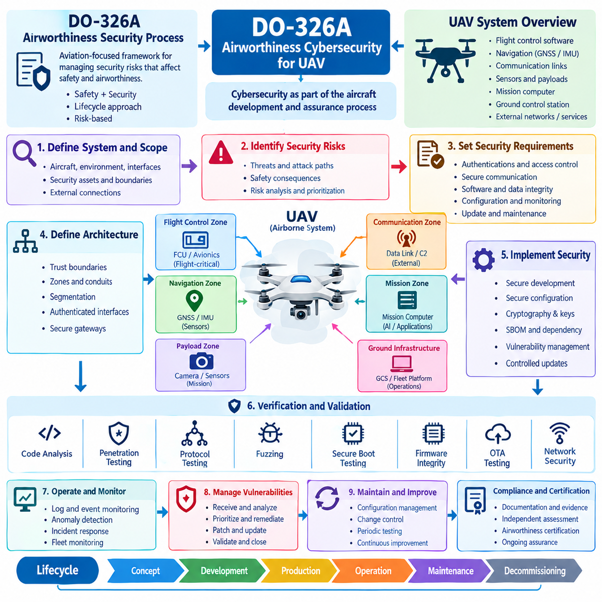{width="7.268055555555556in" height="7.268055555555556in"}

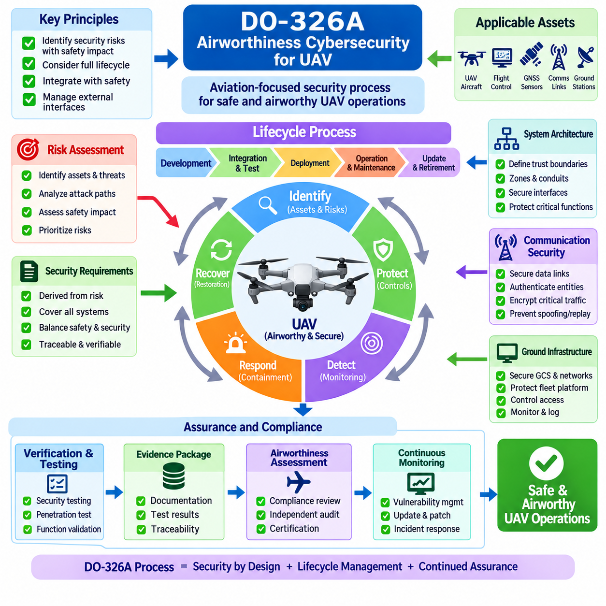{width="7.268055555555556in" height="7.268055555555556in"}

DO-326A 항공감항 보안 프로세스 명세(Airworthiness Security Process Specification)는 항공 시스템의 안전성과 감항성(Airworthiness)에 영향을 줄 수 있는 보안 위험(Security Risk)을 관리하기 위한 항공 분야 중심의 프레임워크를 제공한다. 무인항공기(UAV, Unmanned Aerial Vehicle)의 경우 현대 항공기가 비행제어 컴퓨터, 항법 시스템, 통신 링크, 센서, 소프트웨어, 데이터 네트워크 및 지상 인프라에 의존하기 때문에 이러한 원칙이 특히 중요하다. 따라서 사이버보안은 독립적인 정보기술 활동이 아니라 항공기 개발 및 보증 프로세스의 일부로 다루어져야 한다.

UAV 사이버보안 프로그램은 항공기 시스템, 운영 환경, 인터페이스 및 보안 관련 자산(Security-Relevant Asset)을 정의하는 것에서 시작해야 한다. 여기에는 비행제어 소프트웨어, 항법 데이터, GNSS 수신기, 관성 센서, 텔레메트리 링크, 명령 및 제어 인터페이스(Command-and-Control Interface), 미션 컴퓨터, 페이로드 시스템, 유지보수 포트, 지상통제국(Ground-Control Station), 통신 게이트웨이 등이 포함될 수 있다. 또한 외부 네트워크 및 서비스와의 연결도 고려해야 한다. 공격 경로가 항공기 외부에서 시작되어 궁극적으로 비행 관련 기능에 영향을 줄 수 있기 때문이다.

핵심 원칙 중 하나는 안전성에 영향을 줄 수 있는 보안 위험을 식별하는 것이다. 일반적인 사이버보안 분석은 기밀성(Confidentiality), 무결성(Integrity), 가용성(Availability)에 초점을 맞출 수 있지만, 항공 보안 엔지니어링에서는 악의적인 조작이 지속적인 안전 비행에 어떤 영향을 미칠 수 있는지도 고려해야 한다. 위조된 항법 정보, 승인되지 않은 비행 명령, 손상된 구성 데이터, 침해된 비행 소프트웨어, 핵심 통신 채널의 교란은 항공기 동작에 영향을 미치는 상황을 만들 수 있다. 따라서 UAV 보안 분석에서는 사이버보안 이벤트와 잠재적인 안전 영향 사이의 명확한 관계를 설정해야 한다.

보안 위험 평가는 UAV의 전체 운영 수명주기(Operational Lifecycle)를 고려해야 한다. 위협은 개발, 제조, 통합, 시험, 배포, 유지보수, 운영, 소프트웨어 업데이트 및 폐기 과정에서 발생할 수 있다. 인증 당시에는 안전했던 UAV라도 소프트웨어 변경, 통신 시스템 수정, 새로운 지상 인프라, 또는 서드파티 구성요소에서 새롭게 발견된 취약점으로 인해 이후 새로운 위험에 노출될 수 있다. 따라서 수명주기 보안 프로세스는 지속적인 평가, 통제된 변경, 취약점 관리 및 보안 보증(Security Assurance)을 위한 메커니즘을 제공해야 한다.

보안 요구사항(Security Requirement)은 식별된 위험에서 도출되어 적절한 항공기 시스템과 인터페이스에 할당되어야 한다. 요구사항은 인증(Authentication), 접근제어(Access Control), 통신 보호(Communication Protection), 소프트웨어 무결성(Software Integrity), 구성 관리(Configuration Management), 보안 모니터링(Security Monitoring), 유지보수 접근(Maintenance Access), 업데이트 메커니즘(Update Mechanism), 핵심 데이터 보호 등을 다룰 수 있다. UAV에서는 이러한 요구사항을 기존의 비행 안전 요구사항과 신중하게 조정해야 한다. 보안 메커니즘이 안전 필수 기능에 허용할 수 없는 지연, 자원 사용량, 고장 모드 또는 의존성을 발생시켜서는 안 되기 때문이다.

항공기 아키텍처는 비행 핵심 시스템(Flight-Critical System), 미션 시스템(Mission System), 페이로드(Payload), 통신 인터페이스 및 외부 인프라 사이에 명확한 신뢰 경계(Trust Boundary)를 설정해야 한다. UAV는 자율항법, 명령 및 제어 통신, 페이로드 처리, 텔레메트리, 원격 유지보수, 클라우드 기반 미션 서비스를 동시에 지원할 수 있다. 이러한 기능이 자동으로 서로를 무제한 신뢰해서는 안 된다. 세분화(Segmentation), 통제된 게이트웨이(Controlled Gateway), 인증된 인터페이스(Authenticated Interface), 적절하게 제한된 데이터 흐름(Data Flow)을 통해 침해된 하위 시스템이 안전 필수 항공기 기능으로 확산되는 것을 제한할 수 있다.

소프트웨어 보안(Software Security)은 현대 UAV가 복잡한 소프트웨어와 AI 기반 기능에 점점 더 의존하기 때문에 특히 중요하다. 비행제어 애플리케이션, 운영체제, 미들웨어, 항법 소프트웨어, 인지 알고리즘, 미션 애플리케이션 및 서드파티 라이브러리는 취약점을 유입시킬 수 있다. 따라서 보안 개발 관행(Secure Development Practice), 구성 통제(Configuration Control), 소프트웨어 무결성 검증(Software Integrity Verification), 의존성 관리(Dependency Management), 취약점 추적(Vulnerability Tracking), 통제된 릴리스 프로세스(Controlled Release Process)를 항공기 개발 수명주기에 통합해야 한다.

보안 소프트웨어 및 펌웨어 업데이트(Secure Software and Firmware Update)는 UAV가 원격 환경에서 운용되고 장기간 배치될 수 있기 때문에 특별한 주의가 필요하다. 업데이트 패키지는 설치 전에 인증되고 무결성이 보호되어야 하며, 서명 자격증명(Signing Credential)과 신뢰할 수 있는 검증 메커니즘(Trusted Verification Mechanism)은 보호되어야 한다. 업데이트 프로세스는 또한 신뢰할 수 있는 버전 관리와 적절한 복구 메커니즘(Recovery Mechanism)을 제공해야 한다. 안전 또는 보안 요구사항에 따라 필요한 경우 알려진 취약점이 존재하는 이전 소프트웨어 버전으로 승인되지 않은 다운그레이드(Unauthorized Downgrade)가 이루어지는 것을 방지해야 한다.

통신 보안(Communication Security)은 UAV 감항성에서 또 다른 중요한 문제이다. 명령 및 제어 링크, 텔레메트리 채널, 항법 관련 인터페이스, 유지보수 연결 및 데이터 링크는 도청(Interception), 조작(Manipulation), 재생 공격(Replay), 서비스 거부(Denial-of-Service), 승인되지 않은 명령 주입(Unauthorized Command Injection)에 노출될 수 있다. 보안 통제는 핵심 메시지의 진본성과 무결성을 보호하면서 비행 운영에 필요한 시간 특성과 가용성 특성을 유지해야 한다. 따라서 보안 아키텍처는 통신 및 비행제어 성능과 함께 평가되어야 한다.

지상 인프라(Ground Infrastructure) 역시 사이버보안 경계에 포함되어야 한다. UAV는 지상통제국, 운영자 워크스테이션, 미션 계획 시스템, 유지보수 장비, 네트워크 게이트웨이 또는 플릿 관리 플랫폼을 통해 공격에 노출될 수 있다. 지상 인프라가 침해되면 항공기 자체가 강력하게 보호되어 있더라도 공격자가 항공기 시스템으로 접근할 수 있는 경로가 만들어질 수 있다. 따라서 감항성 사이버보안(Airworthiness Cybersecurity)은 항공기만 독립적으로 평가하는 것이 아니라 전체 운영 생태계를 고려해야 한다.

검증 및 보증 활동(Verification and Assurance Activity)은 사이버보안 요구사항이 올바르게 구현되었고 식별된 위험이 적절하게 통제되었음을 보여주는 객관적인 증거(Objective Evidence)를 제공해야 한다. 관련 활동에는 아키텍처 검토(Architecture Review), 보안 분석(Security Analysis), 취약점 평가(Vulnerability Assessment), 침투 테스트(Penetration Testing), 인터페이스 테스트(Interface Testing), 통신 보안 테스트(Communication-Security Testing), 소프트웨어 무결성 검증, 구성 감사(Configuration Audit), 지상 및 공중 시스템에 대한 통제된 보안 테스트가 포함될 수 있다. 시험 증거는 해당 보안 요구사항 및 위험 평가와 추적 가능하게 연결되어야 한다.

보안 보증(Security Assurance)은 사이버보안과 기능 안전성(Functional Safety) 사이의 상호작용도 다루어야 한다. 공격을 차단했다는 이유만으로 보안 통제가 성공했다고 판단해서는 안 된다. 보안 통제 자체가 안전하지 않은 항공기 상태를 만들 수 있기 때문이다. 예를 들어 과도한 네트워크 필터링, 인증 실패, 연결 손실, 인증서 만료(Certificate Expiration), 보안으로 인한 시스템 격리(Security-Triggered System Isolation)는 비행 동작에 영향을 줄 수 있다. 따라서 UAV 사이버보안 엔지니어링에서는 성능 저하 모드(Degraded Mode), 페일세이프 동작(Fail-Safe Behavior), 복구 메커니즘, 보안 관련 고장에 대한 운영 절차를 분석해야 한다.

UAV 플릿에서는 범위가 단일 항공기에서 공유 서비스와 공통 의존성으로 확장된다. 플릿 관리 서버, 신원 시스템(Identity System), 인증기관(Certificate Authority), OTA 인프라, 미션 데이터베이스, 중앙 집중식 명령 서비스는 높은 가치의 공격 대상이 될 수 있다. 공통 인프라가 침해되면 여러 항공기에 동시에 영향을 줄 수 있다. 따라서 플릿 사이버보안에는 격리(Isolation), 자격증명 분리(Credential Separation), 통제된 명령 권한부여(Command Authorization), 모니터링, 사고 대응, 단일 침해의 확산을 제한하는 복구 메커니즘이 포함되어야 한다.

DO-326A 중심의 보안 엔지니어링은 궁극적으로 위협, 보안 목표, 요구사항, 아키텍처, 구현, 검증 및 운영 통제를 연결하는 추적 가능한 보증 증거(Assurance Evidence)를 구축해야 한다. 이러한 증거는 감항성 관련 의사결정(Airworthiness-Related Decision Making)을 지원하고 사이버보안 위험이 체계적으로 다루어졌음을 입증할 수 있는 구조화된 기반을 제공한다. UAV 프로그램의 목표는 단순히 사이버보안 통제를 추가하는 것이 아니라 보안을 항공기 개발 및 지속 감항성(Continued Airworthiness) 프로세스의 통합된 일부로 확립하는 것이다.

보다 광범위한 로봇 사이버보안 구조에서 DO-326A는 산업 및 일반 사이버보안 프레임워크를 보완하는 항공 분야 특화 관점을 제공한다. 컴플라이언스 및 인증 장(Compliance and Certification Chapter)에서는 UAV 감항성 사이버보안을 IEC 62443, ISO/SAE 21434, NIST CSF 2.0, 유럽연합 사이버 복원력 법(EU Cyber Resilience Act), 사이버보안 관리 시스템(Cybersecurity Management System), 침투 테스트(Penetration Testing), 증거 패키지(Evidence Package), 인증 계획(Certification Planning)과 함께 배치하고 있다. 이러한 구성은 UAV 사이버보안을 기술적 보안, 안전 보증, 운영 보안 및 인증 증거가 함께 개발되는 보다 광범위한 수명주기의 일부로 다룰 수 있도록 한다.

## 11.07. Cybersecurity Management System CSMS Build

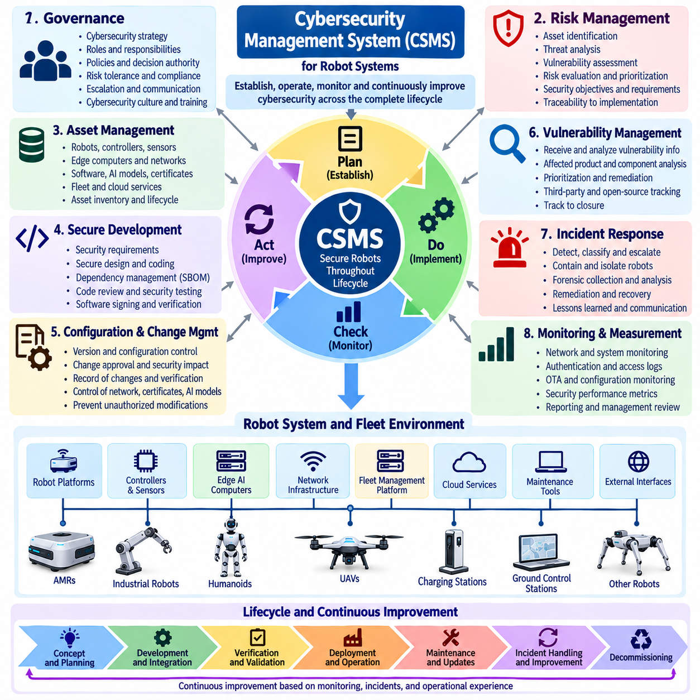{width="7.268055555555556in" height="7.268055555555556in"}

사이버보안 관리 시스템(CSMS, Cybersecurity Management System)은 로봇 시스템의 전체 수명주기(Complete Lifecycle)에 걸쳐 사이버보안을 수립하고, 운영하며, 모니터링하고, 지속적으로 개선하기 위한 조직적 프레임워크를 제공한다. 로보틱스에서 CSMS는 사이버보안 거버넌스(Governance)를 엔지니어링, 소프트웨어 개발, 플릿 운영, 유지보수, 사고 대응, 인증 활동과 연결해야 한다. 사이버보안을 독립적인 기술 기능으로 취급하는 대신 CSMS는 책임을 정의하고, 위험을 관리하며, 변경을 통제하고, 증거를 보존하고, 로봇의 운영 수명 동안 적절한 보안 상태(Security Posture)를 유지하기 위한 반복 가능한 프로세스를 수립한다.

CSMS의 기반은 조직 거버넌스(Organizational Governance)이다. 기술적 통제를 평가하기 전에 조직은 사이버보안 목표, 책임, 의사결정 권한, 위험 허용 수준(Risk Tolerance), 정책 및 에스컬레이션 절차(Escalation Procedure)를 정의해야 한다. 책임은 제품 엔지니어링, 임베디드 소프트웨어, AI 개발, 네트워크 운영, 클라우드 및 플릿 관리, 품질 보증, 유지보수, 사고 대응에 걸쳐 확장되어야 한다. 로봇 시스템에서는 사이버보안 장애가 물리적 결과, 운영 중단, 안전 영향 또는 플릿 전체의 영향을 발생시킬 수 있으므로 사이버보안 의사결정은 광범위한 엔지니어링 및 운영 관리의 일부로 다루어야 한다.

CSMS는 일관된 사이버보안 위험 관리(Cybersecurity Risk Management) 프로세스를 수립해야 한다. 위험 식별은 로봇, 소프트웨어, 하드웨어, 통신, 지원 인프라, 사용자, 공급업체 및 외부 서비스를 고려해야 한다. 위협 분석(Threat Analysis)은 중요 자산, 신뢰 경계(Trust Boundary), 공격 표면(Attack Surface), 취약점, 잠재적인 공격 경로 및 침해 결과를 식별해야 한다. 이후 위험에 대한 의사결정은 보안 목표와 요구사항으로 변환되어 적절한 시스템과 담당 팀에 할당되어야 한다. 이를 통해 비즈니스 또는 운영상의 문제와 기술적 사이버보안 구현 사이의 추적성(Traceability)을 확보할 수 있다.

자산 관리(Asset Management)는 효과적인 사이버보안을 위해 무엇을 보호해야 하는지 정확하게 파악해야 하므로 중요한 CSMS 역량이다. 로보틱스 조직은 로봇 플랫폼, 제어기, 센서, 엣지 컴퓨터, 펌웨어, 운영체제, ROS 2 노드, AI 모델, 네트워크 장치, 플릿 서비스, 클라우드 API, 자격증명, 인증서 및 서드파티 소프트웨어에 대한 정보를 유지해야 한다. 로봇이 추가, 업그레이드, 재배치, 용도 변경 또는 폐기될 때 자산 정보도 최신 상태로 유지되어야 한다. 대규모 플릿에서는 중앙 집중식 가시성(Centralized Visibility)이 특히 중요하다. 공유 인프라가 여러 로봇에 걸친 공통 장애 지점(Common Point of Failure)을 만들 수 있기 때문이다.

CSMS는 보안 개발 관행(Secure Development Practice)을 제품 엔지니어링 수명주기에 통합해야 한다. 보안 요구사항은 아키텍처와 설계 단계에서 수립되고, 통제된 개발 프로세스를 통해 구현되며, 출시 전에 검증되어야 한다. 코드 검토(Code Review), 의존성 관리(Dependency Management), 취약점 분석(Vulnerability Analysis), 보안 구성(Secure Configuration), 소프트웨어 서명(Software Signing), SBOM 관리, 보안 테스트(Security Testing)는 반복 가능한 엔지니어링 활동으로 정착되어야 한다. 로봇 사이버보안 구조에서는 소프트웨어 보안, ROS 2 보안, 엣지 AI 보안, 클라우드 및 플릿 보안, OTA 보안, 사이버보안 테스트를 서로 연결된 수명주기 영역으로 구성하고 있으며, 이는 이러한 활동을 보다 광범위한 관리 시스템에 통합하기 위한 실질적인 기반을 제공한다.

구성 및 변경 관리(Configuration and Change Management) 역시 중요하다. 배포 이후에도 로봇 시스템은 지속적으로 변화하기 때문이다. 소프트웨어 버전, 펌웨어, 네트워크 정책, 인증서, AI 모델, 지도, 보안 구성, 플릿 서비스는 정상적인 운영 과정에서 모두 변경될 수 있다. CSMS는 중요한 변경이 도입되기 전에 보안 영향 분석(Security-Impact Analysis)을 수행하도록 요구하고, 무엇이 변경되었는지, 왜 변경되었는지, 누가 승인했는지, 변경된 구성이 어떻게 검증되었는지를 보여주는 기록을 유지해야 한다. 이를 통해 통제되지 않은 변경이 배포된 로봇의 보안 상태를 인식하지 못한 채 약화시키는 것을 방지할 수 있다.

취약점 관리(Vulnerability Management)는 일회성 스캐닝 활동이 아니라 지속적인 프로세스로 운영되어야 한다. 조직은 취약점 정보를 수집하고, 어떤 제품과 구성요소가 영향을 받는지 판단하며, 악용 가능성과 운영상의 결과를 평가하고, 개선 조치의 우선순위를 정하고, 시정 조치(Corrective Action)가 완료될 때까지 추적해야 한다. 서드파티 소프트웨어와 오픈소스 의존성은 로봇이 이미 운영에 들어간 이후에도 취약점이 발생할 수 있기 때문에 특히 주의해야 한다. CSMS는 외부 취약점 정보를 내부 자산 인벤토리, 소프트웨어 버전, 위험 평가 및 개선 계획과 연결하는 메커니즘을 제공해야 한다.

사고 대응(Incident Response)은 CSMS와 직접 통합되어야 하며 별도의 비상 활동으로 취급해서는 안 된다. 조직은 사이버보안 이벤트가 어떻게 탐지되고, 분류되고, 에스컬레이션되며, 조사되고, 억제되고, 제거되며, 복구되는지를 정의해야 한다. 로봇 특화 절차에는 로봇을 네트워크에서 격리하고, 자격증명을 폐기하며, 인증서를 교체하고, 플릿 명령을 제한하고, 포렌식 증거(Forensic Evidence)를 보존하고, 신뢰할 수 있는 소프트웨어를 배포하거나, 로봇을 일시적으로 운영에서 제외하는 조치가 포함될 수 있다. 대응 절차는 물리적 위치, 임무 상태, 안전 조건, 플릿 의존성, 공통 서비스가 여러 로봇을 침해했을 가능성을 고려해야 한다.

성숙한 CSMS는 보안 모니터링(Security Monitoring)과 성과 측정(Performance Measurement)도 수립해야 한다. 모니터링은 시스템 위험 프로파일에 적합한 네트워크 이벤트, 인증 활동, 구성 변경, 소프트웨어 무결성, OTA 운영, 플릿 명령, 자원 이상 및 기타 지표를 포함해야 한다. 성과 지표는 취약점 개선 시간, 패치 적용 범위, 미해결 고위험 발견사항, 인증 실패, 사고 대응 성과, 보안 테스트 결과, 컴플라이언스 증거의 완전성 등을 평가할 수 있다. 지표는 단순히 모니터링이 존재한다는 사실을 입증하는 것이 아니라 의사결정을 지원해야 한다.

공급업체 및 공급망 관리(Supplier and Supply-Chain Management)도 포함되어야 한다. 로봇 제조업체와 운영자는 외부 하드웨어, 펌웨어, 소프트웨어, AI 프레임워크, 클라우드 서비스, 통신 구성요소 및 유지보수 제공업체에 의존하는 경우가 많기 때문이다. CSMS는 공급업체에 적절한 사이버보안 기대사항을 설정하고 보안 정보가 어떻게 교환되는지를 정의해야 한다. 공급업체 평가는 보안 개발 관행, 취약점 공개(Vulnerability Disclosure), 업데이트 지원, 구성요소 출처(Provenance), SBOM 제공 가능성, 인증 메커니즘, 수명 종료 정책(End-of-Life Policy) 등을 고려할 수 있다. 특히 하나의 공통 구성요소가 대규모 플릿에 배포되는 경우 공급망 보증(Supply-Chain Assurance)은 더욱 중요해진다.

교육 및 사이버보안 인식(Training and Cybersecurity Awareness)은 또 다른 핵심적인 CSMS 요소이다. 엔지니어, 운영자, 유지보수 담당자, 관리자 및 보안팀은 로봇 환경의 서로 다른 부분과 상호작용하므로 역할에 적합한 지식이 필요하다. 교육에서는 안전한 자격증명 처리, 유지보수 접근, 사고 보고, 피싱 및 사회공학(Social Engineering), 소프트웨어 업데이트 절차, 원격 접근, 구성 관리, 비정상적인 로봇 동작의 인식 등을 다루어야 한다. 기술팀은 추가적으로 ROS 2 및 DDS 보안, 임베디드 보안, AI 보안, 네트워크 방어, 보안 OTA 운영에 대한 전문 교육이 필요할 수 있다.

CSMS는 전체 수명주기 동안 감사 가능한 사이버보안 증거(Auditable Cybersecurity Evidence)를 유지해야 한다. 증거에는 정책, 위험 평가, 위협 모델, 보안 요구사항, 아키텍처 검토, 구성 기록, 테스트 보고서, 취약점 기록, 사고 보고서, 교육 기록, 공급업체 평가, 소프트웨어 버전, SBOM, 업데이트 이력, 시정 조치 기록 등이 포함될 수 있다. 증거는 감사 직전에 재구성하는 것이 아니라 정상적인 엔지니어링 및 운영 활동의 일부로 생성되어야 한다. 이러한 접근은 운영 규율과 제3자 평가 또는 인증에 대한 준비도를 동시에 향상시킨다.

지속적 개선(Continuous Improvement)은 효과적인 CSMS의 마지막 핵심 특성이다. 보안 요구사항과 통제는 사고, 취약점 공개, 침투 테스트, 운영 모니터링, 기술 변경, 공급업체 발견사항 및 교훈을 바탕으로 주기적으로 검토되어야 한다. 로봇 아키텍처, AI 기능, 연결성, 플릿 규모 또는 배포 환경에서 중요한 변화가 발생하면 적절한 재평가가 이루어져야 한다. 따라서 CSMS는 운영 경험이 위험 분석, 통제, 테스트, 대응 절차 및 조직 관행을 지속적으로 개선하는 피드백 시스템(Feedback System)으로 기능해야 한다.

보다 광범위한 컴플라이언스 및 인증 구조에서 CSMS는 개별 사이버보안 표준과 기술적 통제를 하나의 일관된 관리 프로세스로 연결한다. IEC 62443은 산업 보안 요구사항을 제공할 수 있고, ISO/SAE 21434는 적용 가능한 AMR 아키텍처에 대한 수명주기 중심 사이버보안 엔지니어링을 지원할 수 있으며, NIST CSF 2.0은 사이버보안 위험 관리 활동을 조직화할 수 있다. 또한 규제 또는 항공 프레임워크는 추가적인 의무사항을 제시할 수 있다. 로봇 사이버보안 구조에서는 CSMS 구축을 보안 수준 평가(Security-Level Assessment), 규제 준수, 침투 테스트, 증거 관리(Evidence Management), 인증 계획(Certification Planning)과 함께 배치하여 사이버보안을 통합된 조직 역량으로 관리해야 할 필요성을 반영하고 있다.

로보틱스 조직에서 CSMS의 실질적인 목표는 사이버보안 책임, 위험, 요구사항, 구현, 검증, 운영, 사고 대응 및 개선이 지속적으로 연결되는 반복 가능한 시스템을 구축하는 것이다. 성공적인 CSMS는 하나의 보안 제품이나 일회성 인증 활동에 의존하지 않는다. 대신 개념 및 개발 단계부터 배포, 플릿 운영, 유지보수, 소프트웨어 및 AI 업데이트, 사고 복구, 최종 폐기에 이르기까지 로봇을 따라가는 지속적인 관리 규율(Management Discipline)을 확립한다. 이러한 수명주기 규율은 사이버보안이 지속적으로 거버넌스되고, 측정되고, 개선되며, 객관적인 증거에 의해 뒷받침되고 있음을 입증할 수 있는 기반을 제공한다.

## 11.08. Penetration Test and Third Party Audit Process

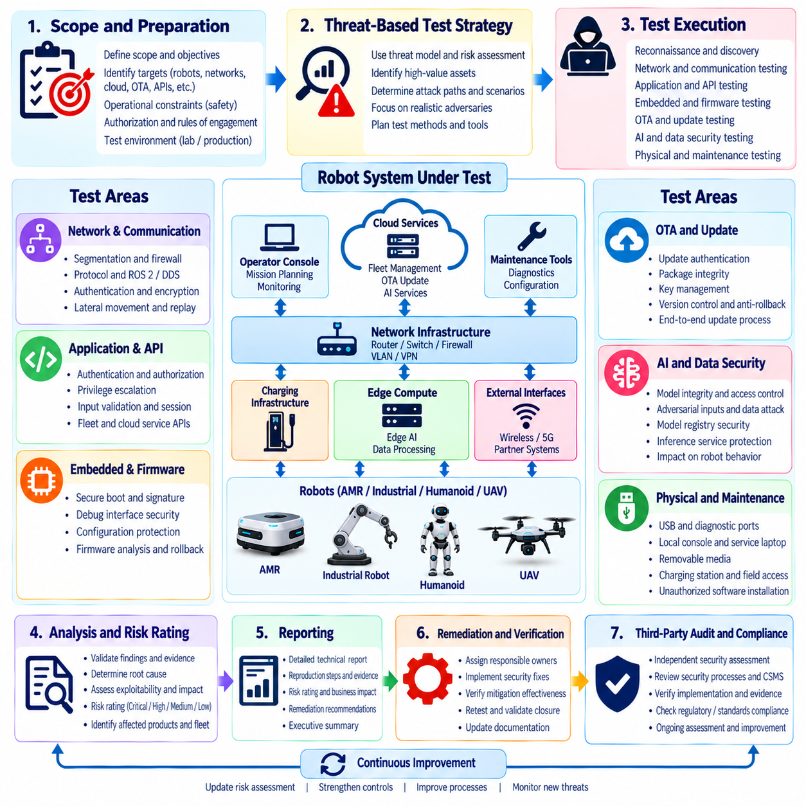{width="7.268055555555556in" height="7.268055555555556in"}

침투 테스트(Penetration Testing)와 제3자 감사(Third-Party Auditing)는 로봇 시스템의 사이버보안 통제가 단순히 문서화되어 있을 뿐만 아니라 실제로 구현되어 있으며 현실적인 조건에서 효과적으로 작동하는지를 독립적으로 보증한다. 로보틱스에서는 이러한 활동이 로봇 하드웨어, 임베디드 소프트웨어, ROS 2 및 DDS 통신, 네트워크, 엣지 컴퓨팅, 클라우드 및 플릿 서비스, OTA 인프라, AI 구성요소, 유지보수 인터페이스를 포함하는 전체 사이버-물리 환경(Cyber-Physical Environment)을 대상으로 해야 한다. 목표는 내부 개발 및 검증 활동으로 발견하지 못할 수 있는 취약점을 식별하는 것이다.

침투 테스트는 명확하게 정의된 범위, 승인, 목적, 운영 제약조건에서 시작해야 한다. 로봇 시스템에는 안전 필수 기능(Safety-Critical Function)이 포함될 수 있으므로 실제로 능동적인 테스트가 가능한 시스템과 시뮬레이션, 실험실 복제 환경 또는 통제된 테스트 환경이 필요한 시스템을 구분해야 한다. 테스트 범위에는 대상 로봇, 네트워크 세그먼트, API, 무선 인터페이스, 플릿 서비스, 업데이트 시스템, 외부 의존성을 식별하고, 안전하지 않은 물리적 동작을 발생시킬 수 있는 금지된 행위를 명확하게 정의해야 한다.

테스트 전략은 일반적인 취약점 스캐닝(Vulnerability Scanning)에만 의존하기보다 로봇의 위협 모델(Threat Model)과 위험 평가(Risk Assessment)를 기반으로 수립해야 한다. 중요 자산, 신뢰 경계(Trust Boundary), 노출된 인터페이스, 인증 메커니즘, 명령 채널, 업데이트 경로, 중앙 집중식 플릿 서비스에 적절한 수준의 관심을 집중해야 한다. 테스트 팀은 외부에서 접근 가능한 인터페이스에서 시작하여 내부 로봇 기능으로 이동할 수 있는 현실적인 공격 경로를 고려해야 한다. 이러한 접근은 다층 방어가 실제로 의미 있는 공격 진행을 차단하는지를 평가하는 데 도움이 된다.

정찰 및 공격 표면 탐색(Reconnaissance and Attack-Surface Discovery)은 보다 심층적인 테스트를 시작하기 전에 기술 환경을 파악하는 단계이다. 테스터는 활성 서비스, 통신 프로토콜, 노출된 포트, API, 무선 인터페이스, 인증 엔드포인트, 소프트웨어 버전, 로봇과 인프라 구성요소 사이의 관계를 식별해야 한다. 플릿에서는 여러 로봇에 영향을 줄 수 있는 공유 서비스도 식별해야 한다. 발견된 결과는 승인된 자산 인벤토리(Asset Inventory)와 연계하여 예상하지 못한 노출이나 알려지지 않은 자산을 무시하지 않고 조사할 수 있도록 해야 한다.

네트워크 및 통신 테스트(Network and Communication Testing)는 세분화(Segmentation), 방화벽(Firewall), 접근제어 정책(Access-Control Policy), VPN, 인증된 미들웨어(Authenticated Middleware), 암호화된 통신(Encrypted Communication)이 의도된 보안 경계를 실제로 적용하는지를 검토해야 한다. 테스트에서는 승인되지 않은 측면 이동(Lateral Movement), 프로토콜 조작(Protocol Manipulation), 취약한 인증, 재생 조건(Replay Condition), 비정상 메시지(Malformed Message), 운영 영역 사이의 부적절한 접근 등을 평가할 수 있다. ROS 2 및 DDS 환경에서는 노드 신원(Node Identity), 토픽 및 서비스 권한부여(Topic and Service Authorization), 인증서 처리(Certificate Handling), 통신 보호(Communication Protection)에 특별한 주의가 필요하다. 미들웨어 접근이 분산 로봇 동작에 직접적인 영향을 줄 수 있기 때문이다.

애플리케이션 및 API 테스트(Application and API Testing)는 로봇 애플리케이션, 플릿 관리 시스템, 클라우드 서비스, 유지보수 도구, 운영자 콘솔에서 사용하는 인터페이스를 검토해야 한다. 인증 및 권한부여 통제는 권한 상승(Privilege Escalation), 세션 취약점(Session Weakness), 안전하지 않은 직접 접근(Insecure Direct Access), 불충분한 입력 검증(Input Validation), 승인되지 않은 명령 실행(Unauthorized Command Execution)에 대해 테스트해야 한다. 플릿 API는 중앙 집중식 명령 또는 관리 서비스의 취약점이 단일 로봇뿐만 아니라 동시에 여러 로봇에 영향을 줄 수 있기 때문에 특별한 주의가 필요하다.

임베디드 및 펌웨어 테스트(Embedded and Firmware Testing)는 로봇 제어기와 엣지 컴퓨터에서 실행되는 소프트웨어의 무결성을 보호하는 메커니즘을 검토해야 한다. 주요 영역에는 보안 부팅(Secure Boot), 펌웨어 인증(Firmware Authentication), 디버그 인터페이스(Debug Interface), 구성 보호(Configuration Protection), 업데이트 검증(Update Verification), 키 저장(Key Storage), 롤백 통제(Rollback Control), 복구 메커니즘(Recovery Mechanism)이 포함된다. 적절한 경우 펌웨어 분석과 통제된 테스트를 통해 공격자가 소프트웨어를 교체, 수정, 다운그레이드하거나 기타 방식으로 조작하여 로봇 동작을 변경하거나 기존 보안 통제를 우회할 수 있는지를 확인할 수 있다.

OTA 보안은 단순한 패키지 검증 기능이 아니라 종단 간 프로세스(End-to-End Process)로 테스트해야 한다. 평가에서는 업데이트 인증(Update Authentication), 패키지 무결성(Package Integrity), 서명 키 보호(Signing-Key Protection), 업데이트 요청 권한부여(Authorization), 전송 보안(Transport Security), 버전 강제 적용(Version Enforcement), 롤백 방지(Rollback Prevention), 장애 복구(Failure Recovery), 감사 로깅(Audit Logging)을 검토해야 한다. 안전한 패키지 형식만으로는 충분하지 않다. 공격자가 업데이트 권한을 획득하거나 배포 메커니즘을 침해하거나 로봇에 승인되지 않은 버전을 설치하도록 강제할 수 있다면 전체 업데이트 체계가 여전히 위험하기 때문이다.

AI 기반 로봇은 보안 실패가 인지, 모델, 데이터 또는 의사결정 프로세스에서 발생할 수 있기 때문에 추가적인 테스트 요구사항을 갖는다. 테스트에서는 승인되지 않은 모델 교체, 안전하지 않은 모델 로딩(Model Loading), 모델 레지스트리 접근(Model-Registry Access), 적대적 입력(Adversarial Input), 데이터 무결성 취약점(Data-Integrity Weakness), AI 추론 서비스 주변의 불충분한 통제를 평가할 수 있다. 목표는 AI 테스트를 별도의 독립된 분야로 취급하는 것이 아니라 AI 구성요소의 침해가 설정된 보안 경계를 넘어 승인되지 않은 물리적 동작을 발생시킬 수 있는지를 판단하는 것이다.

물리적 및 유지보수 인터페이스(Physical and Maintenance Interface)도 승인된 범위에 포함되는 경우 테스트해야 한다. USB 포트, 진단 커넥터(Diagnostic Connector), 서비스 노트북, 로컬 콘솔, 이동식 미디어, 충전 인프라, 유지보수 네트워크는 네트워크 기반 보안 통제를 우회하는 대체 경로를 제공할 수 있다. 테스트에서는 물리적 접근이 과도한 권한을 제공하거나 승인되지 않은 소프트웨어 설치, 구성 변경, 자격증명 추출, 보안 메커니즘 비활성화를 가능하게 하는지를 확인해야 한다. 이러한 테스트는 동일한 인터페이스가 로봇의 실제 운영 기능에 직접 영향을 줄 수 있기 때문에 매우 신중하게 통제해야 한다.

제3자 감사는 내부 침투 테스트를 보완하는 독립적인 관점을 제공한다. 외부 평가자는 개발 조직의 기존 가정에 제약받지 않고 사이버보안 거버넌스, 위험 평가, 아키텍처 결정, 기술적 통제, 테스트 증거, 취약점 관리, 사고 대응 절차, 구성 관리, 수명주기 프로세스를 검토할 수 있다. 이러한 독립성은 인증 준비, 고객 보안 평가, 규제 의무, 높은 수준의 보증이 요구되는 산업 및 항공 분야 배포에서 특히 중요하다.

감사 프로세스는 문서화된 증거와 기술적 검증을 연결해야 한다. 정책과 절차는 실제 구현과 비교하여 검증해야 하며, 선택된 기술적 통제는 샘플링하거나 테스트하여 문서화된 요구사항이 실제 배포 시스템에 반영되어 있는지를 확인해야 한다. 증거에는 위협 모델, 보안 요구사항, 아키텍처 기록, 접근제어 정책, 구성 기준선(Configuration Baseline), 취약점 보고서, 침투 테스트 결과, 소프트웨어 버전, SBOM, OTA 기록, 사고 보고서, 시정 조치 이력(Corrective-Action History) 등이 포함될 수 있다. 감사에서는 명시된 역량과 실제로 입증된 실행 사이의 격차를 식별해야 한다.

발견사항(Findings)은 심각도, 악용 가능성, 영향을 받는 자산, 운영상 결과, 잠재적인 물리적 영향을 기준으로 분류해야 한다. 예를 들어 공용 네트워크에 노출된 플릿 API에 영향을 미치는 취약점은 실험실 인터페이스에 국한된 취약점과 다른 대응이 필요할 수 있다. 따라서 발견사항은 기술적 심각도만으로 평가하기보다 조직의 위험 관리 프로세스와 연결해야 한다. 중요한 각 발견사항에는 담당자, 개선 계획(Remediation Plan), 목표 완료일, 검증 방법, 문서화된 종료 결정이 지정되어야 한다.

개선 조치(Remediation)는 시정 조치가 실제로 식별된 위험을 제거하거나 충분히 감소시켰는지를 판단하기 위한 검증 테스트(Validation Testing)가 뒤따라야 한다. 단순히 패치를 적용하거나 구성을 변경했다고 해서 자동으로 발견사항이 종료되어서는 안 된다. 재테스트(Retest)를 통해 원래의 공격 경로가 차단되었는지 확인하고, 개선 조치가 새로운 취약점을 유입시키거나 필요한 기능을 저하시키거나 안전 필수 시스템과 예상하지 못한 상호작용을 발생시키지 않았는지를 확인해야 한다. 재테스트 증거는 원래의 발견사항 및 시정 조치와 계속 연결되어야 한다.

보다 광범위한 컴플라이언스 및 인증 프로세스에서 침투 테스트와 제3자 감사는 사이버보안 요구사항과 객관적인 보증(Objective Assurance)을 연결하는 중요한 역할을 한다. 로봇 사이버보안 구조에서는 이러한 활동을 IEC 62443, ISO/SAE 21434, NIST CSF 2.0, 유럽연합 사이버 복원력 법(EU Cyber Resilience Act), DO-326A, 사이버보안 관리 시스템(Cybersecurity Management System), 증거 패키지(Evidence Package), 인증 계획(Certification Planning)과 함께 배치하고 있다. 이러한 구성은 테스트가 독립적인 보안 활동에 그치는 것이 아니라 로봇 사이버보안 통제가 구현되고, 독립적으로 검토되며, 필요한 경우 수정되고, 감사 가능한 증거에 의해 뒷받침된다는 것을 입증하는 수명주기 프로세스의 일부임을 강조한다.

## 11.09. Cybersecurity Documentation and Evidence Package

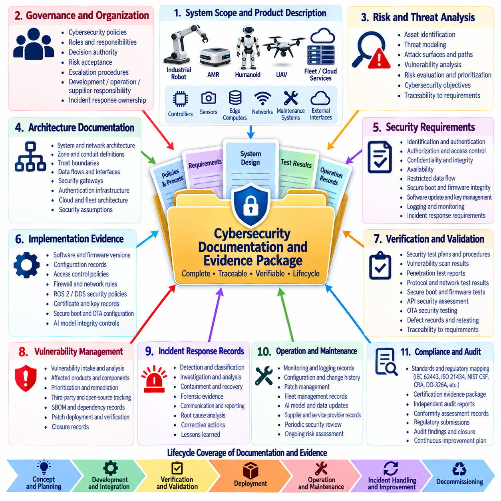{width="7.268055555555556in" height="7.268055555555556in"}

사이버보안 문서화 및 증거 패키지(Cybersecurity Documentation and Evidence Package)는 로봇 시스템의 사이버보안 요구사항이 식별되고, 구현되며, 검증되고, 유지되고, 전체 수명주기 동안 관리되고 있음을 입증하는 데 필요한 체계적인 기록을 제공한다. 로보틱스에서는 문서화가 소프트웨어 보안만이 아니라 전체 사이버-물리 시스템(Cyber-Physical System)을 대상으로 해야 한다. 이 패키지는 사이버보안 거버넌스(Governance), 위험 분석(Risk Analysis), 시스템 아키텍처, 보안 요구사항, 구현 기록, 테스트, 운영 모니터링, 취약점 관리, 사고 대응, 유지보수 및 인증 활동을 일관되고 추적 가능한 증거 체계로 연결해야 한다.

증거 패키지는 명확하게 정의된 시스템 범위와 제품 설명(Product Description)에서 시작해야 한다. 문서에는 로봇 플랫폼, 주요 하드웨어 및 소프트웨어 구성요소, 통신 인터페이스, 엣지 컴퓨터, 제어기, 센서, AI 구성요소, 네트워크 인프라, 플릿 서비스, 클라우드 연결, 유지보수 시스템, 외부 의존성 등 사이버보안 경계(Cybersecurity Boundary)에 포함되는 요소를 식별해야 한다. 플릿 배포에서는 공유 서비스와 공통 인프라도 문서화해야 한다. 하나의 침해된 서비스가 여러 로봇에 영향을 줄 수 있기 때문이다. 이러한 범위 정의는 어떤 사이버보안 증거를 수집하고 유지해야 하는지를 결정하는 기반을 제공한다.

사이버보안 거버넌스 문서는 조직 내에서 책임과 의사결정 권한이 어떻게 할당되는지를 설명해야 한다. 관련 기록에는 사이버보안 정책, 조직의 역할, 위험 수용 권한(Risk Acceptance Authority), 보안 목표, 에스컬레이션 절차, 개발 책임, 운영 책임, 공급업체 책임, 사고 대응 책임 등이 포함될 수 있다. 문서는 사이버보안이 독립적인 기술 활동이 아니라 조직 차원의 엔지니어링 책임으로 관리되고 있음을 입증해야 한다. 로봇 소프트웨어, AI 시스템, 네트워크, 클라우드 인프라, 플릿 운영 및 유지보수를 서로 다른 팀이 담당하는 경우 명확한 책임소재가 특히 중요하다.

위험 및 위협 문서(Risk and Threat Documentation)는 로봇 시스템에 구현된 보안 조치의 근거를 제공한다. 위협 모델(Threat Model)은 중요 자산, 신뢰 경계(Trust Boundary), 공격 표면(Attack Surface), 잠재적인 공격 경로, 위협 시나리오, 취약점 및 잠재적인 결과를 식별해야 한다. 위험 평가는 식별된 위험이 어떻게 평가되고 우선순위가 결정되었는지를 설명해야 한다. 적용 가능한 경우 패키지는 위협 분석, 사이버보안 목표, 보안 요구사항, 아키텍처 결정, 구현된 통제 및 검증 결과 사이의 관계를 보존해야 한다. 이러한 추적성(Traceability)을 통해 평가자는 특정 보안 통제가 왜 존재하며 최초의 사이버보안 문제를 해결하는지를 판단할 수 있다.

아키텍처 문서는 로봇 시스템과 주변 인프라 전반에서 보안이 어떻게 구축되는지를 설명해야 한다. 관련 기록에는 시스템 아키텍처 설명, 네트워크 아키텍처, 존 및 컨듀잇(Zone and Conduit) 정의, 신뢰 경계, 데이터 흐름, 통신 인터페이스, 보안 게이트웨이, 인증 인프라, 클라우드 연결, 플릿 관리 서비스 및 외부 인터페이스가 포함될 수 있다. 아키텍처 증거는 보안에 대한 가정을 명확하게 드러내고 민감한 기능이 어떻게 분리되거나 보호되는지를 입증해야 한다. 분산 로봇 시스템에서는 노드, 서비스, 로봇, 운영자 및 중앙 집중식 인프라 사이에서 신뢰가 어떻게 형성되는지도 문서화해야 한다.

보안 요구사항 문서(Security Requirements Documentation)는 시스템에 할당된 사이버보안 요구사항을 통제되고 추적 가능한 형태로 제공해야 한다. 요구사항에는 식별 및 인증(Identification and Authentication), 권한부여(Authorization), 기밀성(Confidentiality), 무결성(Integrity), 가용성(Availability), 제한된 데이터 흐름(Restricted Data Flow), 보안 부팅(Secure Boot), 펌웨어 무결성, 소프트웨어 업데이트, 로깅, 모니터링, 키 관리(Key Management), 취약점 처리, 사고 대응 등이 포함될 수 있다. 각 중요한 요구사항에는 구현 또는 검증과의 관계가 정의되어야 한다. 요구사항은 구성 관리(Configuration Control) 하에서 유지되어 변경 사항을 식별하고, 검토하고, 승인하며, 사이버보안 영향을 평가할 수 있어야 한다.

구현 증거(Implementation Evidence)는 문서화된 보안 요구사항이 실제 제품에 통합되었음을 입증해야 한다. 로봇 아키텍처에 따라 이러한 증거에는 소프트웨어 구성 기록, 펌웨어 버전, 암호화 구성, 인증서 기록, 접근제어 정책, 방화벽 규칙, ROS 2 및 DDS 보안 정책, 보안 부팅 설정, OTA 구성, AI 모델 무결성 통제, 클라우드 보안 설정 등이 포함될 수 있다. 스크린샷이나 구성 내보내기 파일(Configuration Export)은 실제 배포 상태에 대한 객관적인 증거를 제공하는 경우 유용할 수 있지만, 시스템 버전, 구성 상태 및 적용되는 요구사항을 식별할 수 있도록 충분한 맥락과 함께 유지되어야 한다.

검증 및 확인 증거(Verification and Validation Evidence)는 사이버보안 통제가 의도한 대로 작동한다는 것을 입증한다. 증거 패키지에는 보안 테스트 계획, 테스트 절차, 테스트 결과, 취약점 스캔, 침투 테스트 보고서, 프로토콜 테스트, 퍼징(Fuzzing) 결과, 보안 부팅 검증, 펌웨어 무결성 테스트, API 보안 평가, 네트워크 보안 테스트, OTA 보안 테스트 등이 포함될 수 있다. 각 결과에는 테스트된 구성과 관련 소프트웨어 또는 펌웨어 버전이 식별되어야 한다. 실패한 테스트를 단순히 증거 패키지에서 제거해서는 안 되며, 결함 기록, 시정 조치(Corrective Action), 재테스트 및 문서화된 종료 결정과 연결해야 한다.

취약점 관리 기록(Vulnerability-Management Record)은 초기 개발과 출시 이후에도 사이버보안이 지속적으로 유지되고 있음을 보여주는 증거를 제공한다. 문서는 취약점이 어떻게 접수되고, 분석되고, 우선순위가 정해지고, 담당자에게 할당되며, 개선되고, 검증되고, 종료되는지를 보여주어야 한다. 소프트웨어 의존성과 서드파티 구성요소는 적절한 버전 정보와 적용 가능한 경우 SBOM 기록을 통해 추적 가능해야 한다. 플릿 환경에서는 취약점 관리 기록이 영향을 받는 로봇 집단을 어떻게 식별하고 서로 다른 구성, 소프트웨어 버전 및 배포 환경에 걸쳐 개선 조치를 어떻게 일관되게 적용하는지도 보여주어야 한다.

변경 및 구성 관리 증거(Change and Configuration Management Evidence)는 로봇 시스템이 지속적으로 발전하기 때문에 필요하다. 소프트웨어, 펌웨어, AI 모델, 네트워크 정책, 인증서, 구성 매개변수, 지도, 플릿 서비스 및 보안 통제는 운영 수명 동안 변경될 수 있다. 기록에는 무엇이 변경되었는지, 왜 변경이 필요했는지, 누가 승인했는지, 어떤 시스템이 영향을 받았는지, 사이버보안 영향이 어떻게 평가되었는지를 보여주어야 한다. 보안과 관련된 변경에 추가적인 테스트나 위험 평가가 필요한 경우 그 결과 증거는 변경 기록과 연결되어야 한다. 이를 통해 배포된 시스템의 보안 상태(Security State)에 대한 이력 기록을 구축할 수 있다.

사고 대응 및 운영 증거(Incident-Response and Operational Evidence)는 조직이 배포 이후 사이버보안 이벤트를 관리할 수 있음을 입증한다. 관련 기록에는 사고 보고서, 탐지 경보, 조사 기록, 억제 조치(Containment Action), 포렌식 증거(Forensic Evidence), 자격증명 폐기 기록, 소프트웨어 개선 기록, 복구 테스트, 교훈(Lessons Learned) 등이 포함될 수 있다. 문서는 사고 처리가 확립된 절차와 연결되어 있으며 중요한 사고가 위협 모델, 보안 요구사항, 모니터링 규칙 또는 운영 통제의 변경으로 이어질 수 있음을 입증해야 한다. 이를 통해 운영 경험을 측정 가능한 사이버보안 개선으로 전환할 수 있다.

공급업체 및 공급망 증거(Supplier and Supply-Chain Evidence)는 외부에서 제공되는 구성요소와 서비스의 보안 특성을 문서화해야 한다. 로봇 시스템은 프로세서, 운영체제, 미들웨어, 통신 모듈, 클라우드 서비스, AI 프레임워크, 오픈소스 라이브러리, 펌웨어 및 유지보수 제공업체에 의존할 수 있다. 증거에는 공급업체 보안 평가, 계약상 요구사항, 취약점 공개 협의, 구성요소 버전, SBOM 정보, 업데이트 약속, 수명 종료 통지(End-of-Life Notification), 보안 권고(Security Advisory) 등이 포함될 수 있다. 목표는 공급업체의 취약점이 로봇 시스템에 어떤 영향을 미칠 수 있는지를 판단할 수 있도록 외부 의존성에 대한 충분한 가시성을 확보하는 것이다.

증거 패키지는 공식적인 문서 및 구성 관리(Document and Configuration Control) 하에서 관리되어야 한다. 각 중요한 산출물에는 식별 가능한 소유자, 버전, 승인 상태, 적용되는 시스템 또는 제품 릴리스, 적절한 보존 정보가 있어야 한다. 오래된 기록은 조용히 덮어쓰는 것이 아니라 현재의 증거와 구별할 수 있는 상태로 유지되어야 한다. 또한 보안 증거는 승인되지 않은 변경으로부터 보호되어야 한다. 감사, 인증 활동, 사고 조사 또는 배포된 로봇의 보안 상태에 관한 분쟁에서 증거 자체의 무결성이 중요해질 수 있기 때문이다.

제3자 평가 및 인증을 위해 증거 패키지는 독립적인 검토자가 사이버보안 목표에서 관련 요구사항, 아키텍처 결정, 구현 기록, 검증 결과 및 운영 증거까지 이동할 수 있도록 해야 한다. 이러한 추적성은 컴플라이언스가 서로 고립된 문서만으로는 효과적으로 입증될 수 없기 때문에 특히 중요하다. 대신 패키지는 전체 수명주기에 걸쳐 일관된 논리와 증거의 연결 관계를 보여주어야 한다. 컴플라이언스 및 인증 구조에서는 사이버보안 문서화와 증거를 보안 수준 평가(Security-Level Assessment), 규제 프레임워크, 침투 테스트, CSMS 구축 및 인증 계획과 함께 배치하고 있다.

최종적인 목표는 사이버보안 증거를 감사 직전에 수집하는 자료가 아니라 로봇 엔지니어링 및 운영의 정상적인 산출물로 만드는 것이다. 문서는 위험이 분석되고, 요구사항이 정의되며, 아키텍처가 개발되고, 소프트웨어와 펌웨어가 구현되고, 테스트가 수행되며, 취약점이 해결되고, 사고가 처리되고, 변경이 승인되는 과정에서 생성되어야 한다. 지속적으로 유지되는 증거 패키지는 로봇의 사이버보안 상태를 나타내는 살아 있는 기록(Living Representation)이 되며, 컴플라이언스 입증, 인증 의사결정 지원, 감사의 효율화, 전체 로봇 수명주기 동안 신뢰할 수 있는 운영을 유지하기 위한 기반을 제공한다.

## 11.10. Cybersecurity Certification Roadmap Hills Robotics

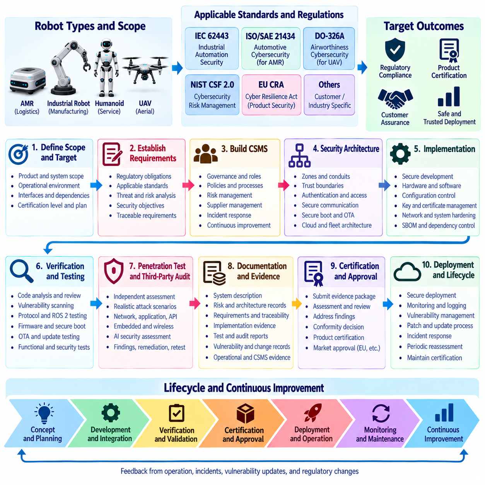{width="7.268055555555556in" height="7.268055555555556in"}

로보틱스 사이버보안 인증 로드맵(Cybersecurity Certification Roadmap)은 초기 보안 계획부터 공식 평가, 인증, 배포 및 지속적인 보증(Continued Assurance)에 이르는 통제된 경로를 수립해야 한다. 로봇의 종류에 따라 서로 다른 표준과 규제 요구사항이 적용될 수 있다는 점을 고려해야 한다. 산업용 로봇과 AMR은 IEC 62443, ISO/SAE 21434 원칙, NIST CSF 2.0 또는 유럽연합 사이버 복원력 법(EU Cyber Resilience Act)을 중심으로 할 수 있으며, UAV 프로그램은 DO-326A와 같은 항공 분야 보안 보증(Aviation-Oriented Security Assurance)을 추가로 요구할 수 있다. 따라서 인증 전략은 먼저 적용 가능한 규제 및 보증 프레임워크를 식별하는 것에서 시작해야 한다.

첫 번째 단계는 인증 범위(Certification Scope)와 목표 상태(Target State)를 정의하는 것이다. 조직은 평가에 포함될 로봇 제품, 소프트웨어 및 하드웨어 경계, 운영 환경, 배포 모델, 연결 서비스, 플릿 인프라, 공급업체 및 외부 인터페이스를 식별해야 한다. 또한 인증이 개별 로봇, 제품군(Product Family), 플릿 관리 플랫폼 또는 전체 사이버-물리 생태계(Cyber-Physical Ecosystem)에 적용되는지도 정의해야 한다. 이러한 정의는 중요한 의존성이 범위에서 제외되는 것을 방지하고 이후 평가 활동을 위한 안정적인 기반을 제공한다.

인증 로드맵은 이후 적용 가능한 사이버보안 목표와 요구사항을 수립해야 한다. 이러한 요구사항은 위협 분석, 위험 평가, 적용 가능한 표준, 고객 요구사항 및 규제 의무에서 도출되어야 한다. IEC 62443은 산업 보안 요구사항과 보안 수준(Security Level) 개념을 제공할 수 있고, ISO/SAE 21434는 적용 가능한 AMR 아키텍처에 수명주기 중심 사이버보안 엔지니어링 원칙을 제공할 수 있으며, NIST CSF 2.0은 조직의 위험 관리 활동을 체계화할 수 있다. EU 시장을 대상으로 하는 제품에는 사이버 복원력 법(Cyber Resilience Act)에 따른 추가적인 제품 수준 의무가 적용될 수 있으며, UAV 프로그램에는 감항성 중심 사이버보안 프로세스(Airworthiness-Oriented Cybersecurity Process)가 요구될 수 있다.

공식적인 사이버보안 관리 시스템(CSMS, Cybersecurity Management System)은 인증 준비를 위한 조직적 기반을 제공해야 한다. CSMS는 거버넌스(Governance), 책임, 위험 관리, 보안 개발, 취약점 관리, 구성 통제, 사고 대응, 공급업체 관리, 교육, 모니터링 및 지속적 개선을 정의해야 한다. 인증은 개별적인 기술적 통제에만 의존해서는 안 된다. 평가자는 사이버보안이 조직 전반에서 일관되게 관리되고 있음을 확인할 수 있는 증거를 필요로 하기 때문이다. 또한 CSMS는 최초 인증 평가 이후와 제품 수명주기 전반에서 보안을 유지하기 위한 메커니즘을 제공한다.

기술 아키텍처는 최종 구현이 완료되기 전에 설정된 사이버보안 목표에 따라 평가되어야 한다. 인증 프로그램은 신뢰 경계(Trust Boundary), 존 및 컨듀잇(Zone and Conduit), 인증 인프라(Authentication Infrastructure), 권한부여 모델(Authorization Model), 통신 보안, 보안 부팅(Secure Boot), 소프트웨어 무결성, OTA 메커니즘, 로깅, 모니터링, 플릿 관리 인터페이스, 클라우드 연결 및 외부 접근 경로를 검토해야 한다. 로보틱스에서는 사이버보안 통제가 안전 필수 기능(Safety-Critical Function) 및 물리적 결과를 수반하는 기능과 어떻게 상호작용하는지도 고려해야 하며, 보안 메커니즘이 허용할 수 없는 운영 또는 안전 동작을 발생시키지 않도록 해야 한다.

위협 분석(Threat Analysis)과 위험 평가(Risk Assessment)는 인증 범위와 보안 통제에 대한 기술적 근거를 제공해야 한다. 평가는 자산, 공격 표면, 위협 행위자(Threat Actor), 공격 경로, 취약점 및 잠재적인 결과를 식별해야 한다. 로봇 특유의 결과에는 승인되지 않은 움직임, 항법 조작, 플릿 협조 기능의 상실, 안전하지 않은 액추에이터 명령, AI 의사결정 침해, 서비스 거부(Denial of Service), 민감한 운영 데이터에 대한 승인되지 않은 접근 등이 포함될 수 있다. 이러한 위험 처리 결과는 보안 요구사항, 아키텍처 결정, 구현 조치 및 검증 활동과 추적 가능하게 연결되어야 한다.

구현 및 검증은 통제된 엔지니어링 프로세스에 따라 진행되어야 한다. 소프트웨어, 펌웨어, AI 모델, 구성, 암호화 키, 인증서, 네트워크 정책 및 보안 서비스는 적절한 구성 관리(Configuration Control) 하에서 유지되어야 한다. 검증 활동에는 코드 분석, 취약점 스캐닝, 프로토콜 테스트, ROS 2 및 DDS 보안 테스트, API 평가, 펌웨어 분석, 보안 부팅 검증, OTA 테스트, 침투 테스트 및 보안 회귀 테스트(Security Regression Testing)가 포함될 수 있다. 목표는 사이버보안 요구사항이 일관되게 구현되고 현실적인 운영 조건에서도 효과적으로 유지된다는 것을 입증하는 것이다.

독립적인 침투 테스트(Independent Penetration Testing)와 제3자 평가(Third-Party Assessment)는 인증 제출 또는 최종 적합성 결정(Conformity Decision) 전에 중요한 주요 단계가 되어야 한다. 외부 평가자는 독립적인 관점에서 시스템을 평가하고 문서화된 통제가 실제 구현과 일치하는지를 검토해야 한다. 테스트는 로봇 네트워크, 유지보수 인터페이스, 클라우드 및 플릿 서비스, API, 무선 통신, 업데이트 인프라 및 승인된 기타 공격 표면에서 현실적인 공격 경로를 대상으로 해야 한다. 발견사항은 위험 등급이 지정되고, 담당자가 배정되며, 개선 조치가 수행되고, 종료 전에 검증 테스트를 받아야 한다.

문서화와 증거는 프로그램 마지막에 한꺼번에 작성하는 것이 아니라 지속적으로 개발되어야 한다. 인증 증거 패키지(Certification Evidence Package)에는 시스템 범위, 사이버보안 정책, 위협 모델, 위험 평가, 보안 목표, 요구사항, 아키텍처 기록, 구성 기준선(Configuration Baseline), 구현 증거, 테스트 결과, 취약점 기록, SBOM 정보, 사고 절차, 공급업체 평가, 변경 이력 및 시정 조치 기록이 포함되어야 한다. 각각의 중요한 주장은 객관적인 증거(Objective Evidence)에 의해 뒷받침되어야 하며 적용 가능한 요구사항 또는 위험과 추적 가능한 상태를 유지해야 한다.

공식적인 갭 평가(Gap Assessment)는 현재의 사이버보안 상태를 목표 인증 상태와 비교해야 한다. 갭에는 누락된 요구사항, 불완전한 아키텍처 통제, 부족한 테스트 범위, 불충분한 증거, 해결되지 않은 취약점, 미성숙한 사고 대응 절차, 공급업체의 미비점 또는 부적절한 구성 관리 등이 포함될 수 있다. 로드맵은 사이버보안 위험, 인증 영향, 운영상 결과 및 개선 복잡성을 기준으로 갭의 우선순위를 설정해야 한다. 이를 통해 인증 준비가 단순한 문서 작성 활동으로 변질되는 것을 방지하고 실제 보증 수준에 중대한 영향을 미치는 영역에 자원을 집중할 수 있다.

인증 준비 상태(Certification Readiness)는 공식 외부 평가 전에 내부 검토를 통해 입증되어야 한다. 검토에서는 필요한 문서가 완성되었는지, 증거가 일관되는지, 보안 테스트가 성공적으로 완료되었는지, 중요한 발견사항이 종료되었거나 공식적으로 수용되었는지, CSMS가 의도된 대로 운영되고 있는지를 확인해야 한다. 추적성은 높은 수준의 사이버보안 목표에서 요구사항, 아키텍처, 구현, 검증 및 운영 증거까지 샘플링하여 확인해야 한다. 해결되지 않은 불일치는 조직이 외부 평가를 진행하기 전에 처리되어야 한다.

인증 또는 공식 적합성 평가(Conformity Assessment)가 완료된 이후에도 사이버보안 보증은 운영 수명주기 전체에 걸쳐 계속되어야 한다. 새로운 취약점, 소프트웨어 업데이트, AI 모델 변경, 새로운 네트워크 연결, 플릿 확장, 공급업체 변경 및 운영 환경의 변화는 최초 평가에서 이루어진 가정을 무효화할 수 있다. 따라서 조직은 취약점 모니터링, 통제된 변경 관리, 주기적인 보안 테스트, 사고 대응, 위험 재평가 및 증거 업데이트를 지속적으로 수행해야 한다. 인증은 사이버보안 엔지니어링의 종료점이 아니라 지속적인 보증을 위한 기준선(Baseline)으로 취급해야 한다.

플릿 기반 로보틱스의 경우 로드맵은 로봇 집단 전체에서 보안의 일관성을 유지하기 위한 메커니즘을 추가로 수립해야 한다. 보안 업데이트, 인증서 변경, 구성 변경 또는 새롭게 발견된 취약점은 수천 대의 배포된 로봇에 영향을 줄 수 있다. 따라서 플릿 관리는 자산 가시성(Asset Visibility), 버전 추적(Version Tracking), 자격증명 및 인증서 수명주기 관리, 통제된 명령 권한부여, 보안 OTA 배포, 모니터링 및 복구 기능을 제공해야 한다. 중앙 집중식 서비스가 침해되면 전체 플릿에 체계적인 영향을 줄 수 있으므로 인증 접근법은 공통 인프라 자체가 보호되고 있음을 입증해야 한다.

최종 인증 패키지는 거버넌스, 위험, 요구사항, 아키텍처, 구현, 테스트, 독립 평가 및 운영 보증 사이의 일관된 관계를 입증해야 한다. Chapter 11의 구조에서는 인증 로드맵을 IEC 62443 평가, ISO/SAE 21434, NIST CSF 2.0, 유럽연합 사이버 복원력 법(EU Cyber Resilience Act), DO-326A, CSMS 구축, 침투 테스트, 사이버보안 문서화 및 증거 이후에 배치하고 있다. 이는 인증 로드맵이 앞선 컴플라이언스 및 보증 프로세스를 실질적인 로보틱스 인증 경로로 통합하는 최종 활동임을 보여준다.

로보틱스 조직의 궁극적인 목표는 단순히 인증서를 획득하는 것이 아니라 제품이 발전하는 동안 신뢰할 수 있는 사이버보안을 유지할 수 있는 반복 가능한 수명주기를 구축하는 것이다. 성공적인 로드맵은 초기 규제 분석을 위협 평가, 보안 아키텍처, 구현, 테스트, 독립 검토, 증거 생성, 개선 조치, 인증 및 지속적인 모니터링과 연결한다. 이러한 접근을 통해 산업용 로봇, AMR, UAV 및 기타 자율 시스템은 새로운 기술, 새로운 위협, 확대되는 플릿 운영 및 변화하는 규제 요구사항에 대응하면서 방어 가능한 사이버보안 상태(Defensible Cybersecurity Posture)를 지속적으로 유지할 수 있다.
