**Volume 24. Robot Cybersecurity**


# Chapter 12. Cybersecurity Case Studies

##  

## 12.01. AMR Fleet Network Intrusion Incident Case

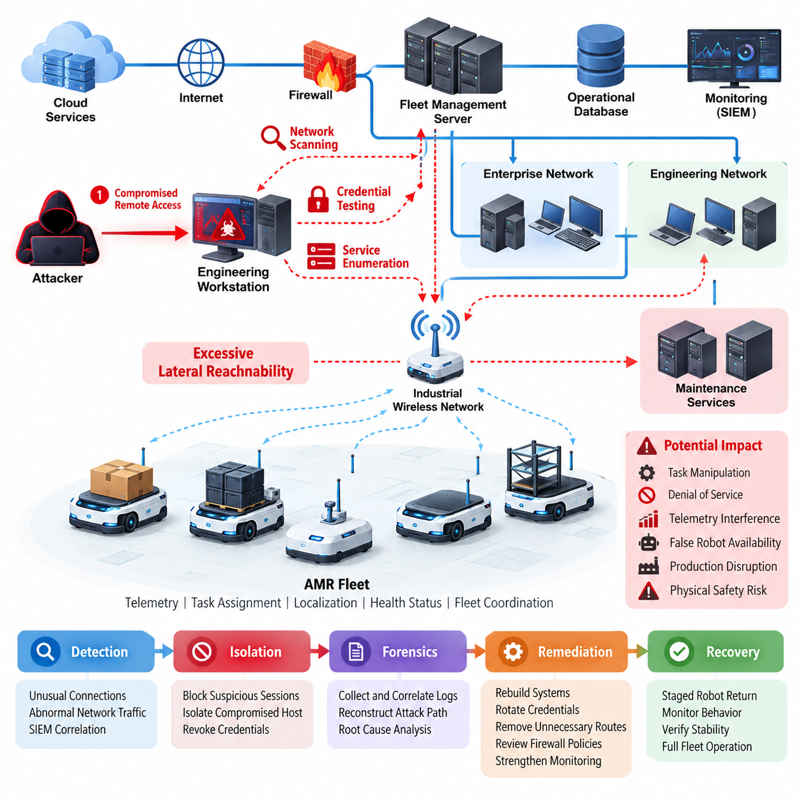{width="7.268055555555556in" height="7.268055555555556in"}

An AMR fleet network intrusion incident typically begins as a conventional information technology security event but can rapidly evolve into a cyber-physical operational problem. In a warehouse or manufacturing facility, autonomous mobile robots continuously exchange telemetry, task assignments, localization information, health status, and fleet coordination messages. A compromised network path can therefore affect not only data confidentiality but also robot availability and physical behavior.

The case considered here involves an AMR fleet connected through an industrial wireless network to a fleet management server, operational databases, monitoring infrastructure, and selected cloud services. The broader cybersecurity architecture assumes network segmentation, firewall and access-control rules, intrusion detection, wireless protection, and centralized security monitoring as complementary controls rather than relying on a single defensive mechanism. Volume_24_Robot_Cybersecurity

The first observable symptoms appeared as intermittent communication delays between several AMRs and the fleet manager. Operators initially interpreted these delays as wireless congestion because affected robots continued executing locally buffered navigation commands. Shortly afterward, the monitoring platform detected unusual connection attempts from an engineering workstation toward robot management interfaces that were not normally accessed during production operations.

Security telemetry revealed repeated scanning across the AMR subnet followed by authentication attempts against management services. The traffic pattern differed from normal fleet communication, which was dominated by predictable robot-to-server exchanges. Correlation of firewall, wireless controller, server, and robot logs showed that the suspicious workstation had initiated connections to multiple robot addresses within a short period, indicating systematic discovery rather than accidental administrative activity.

Investigation determined that the engineering workstation had become the initial foothold after credentials were exposed through a compromised remote-access session. The attacker did not immediately obtain direct control of the robots. Instead, the intrusion progressed through reconnaissance, credential testing, service enumeration, and attempts to identify reachable fleet-management components. This demonstrated why trust boundaries between enterprise, engineering, fleet, and robot networks must remain explicit.

The most significant architectural weakness was excessive lateral reachability. Although the AMRs occupied a dedicated logical network, several maintenance services were reachable from the engineering segment through permissive firewall rules introduced during system commissioning. Those rules had remained active after deployment. Network segmentation therefore existed structurally but was weakened operationally, illustrating how temporary integration exceptions can become persistent attack paths.

Once the incident was confirmed, the response team prioritized physical safety and fleet continuity before conventional forensic objectives. Suspicious network sessions were blocked, the compromised workstation was isolated, and affected credentials were revoked. Robots already performing missions were transitioned according to predefined operational safety rules rather than being indiscriminately disconnected, because abrupt loss of fleet communication could itself create congestion or unsafe stopping conditions.

The containment process followed the broader robot-fleet incident model of detection, isolation, forensic preservation, remediation, recovery, and post-incident review. The cybersecurity structure specifically includes SIEM-based alert correlation, robot isolation and quarantine, forensic log preservation, root-cause analysis, secure remediation, and controlled return to service as separate but connected activities. Volume_24_Robot_Cybersecurity

Forensic reconstruction required synchronization of evidence from several domains. Investigators compared authentication records, firewall events, DHCP information, wireless association histories, fleet-manager logs, robot system logs, and administrative actions. Accurate timestamps were essential because a single suspicious connection could appear harmless in isolation. When arranged chronologically, however, the events exposed a progression from workstation compromise to network discovery and attempted AMR access.

No evidence showed that malicious motion commands successfully reached the robot control layer, but the incident demonstrated a credible path toward operational disruption. An attacker capable of compromising fleet communication could potentially manipulate task allocation, generate denial-of-service conditions, interfere with telemetry, or create misleading robot availability information. Consequently, cybersecurity impact assessment had to consider production throughput and physical safety in addition to conventional data loss.

Eradication included rebuilding the compromised workstation, rotating affected credentials and certificates, removing unnecessary maintenance routes, and reviewing firewall policies between network zones. Access to robot administration interfaces was restricted to authenticated management hosts. The organization also strengthened network access control and monitoring so that newly connected devices, unusual scanning behavior, and deviations from established fleet communication patterns would generate higher-priority alerts.

Recovery was deliberately staged. A small group of AMRs was returned to service first while security and operations teams monitored authentication activity, command traffic, latency, and fleet coordination behavior. Additional robots were released only after baseline behavior remained stable. This progressive approach reduced the possibility that an undetected persistence mechanism or configuration error could immediately affect the entire production fleet.

The incident also exposed limitations in monitoring strategy. Traditional IT alerts alone did not adequately represent the operational meaning of robot communications. The organization therefore expanded SIEM correlation to combine cybersecurity indicators with fleet context, including robot identity, operational state, expected communication peers, maintenance windows, and abnormal connection frequency. Fleet security monitoring became increasingly behavior-oriented rather than dependent only on known signatures.

Long-term corrective action focused on defense in depth and zero-trust principles already identified as foundational elements of robot cybersecurity architecture. Volume_24_Robot_Cybersecurity Enterprise systems, engineering assets, fleet services, safety-related components, and robot endpoints were assigned clearer trust boundaries. Authentication and authorization were evaluated for each communication path, while network connectivity was treated as permission to request access rather than implicit authorization to use robot services.

The organization also incorporated the scenario into recurring penetration tests and red-team exercises. Robot cybersecurity testing within the broader framework includes vulnerability scanning, network penetration testing, protocol fuzzing, API testing, fleet red-team exercises, security-focused static analysis, risk reporting, and automated regression testing. Volume_24_Robot_Cybersecurity These activities transformed the incident from an isolated operational failure into reusable validation criteria for future releases.

A central lesson from the case is that AMR cybersecurity cannot be separated from fleet engineering. The wider robotics software structure explicitly places fleet communication, cloud integration, industrial fleet operations, and fleet cybersecurity within the multi-robot domain. 08_Robotics_Software_Tree Security controls must therefore understand robot identities, communication relationships, operational states, maintenance procedures, and the consequences of isolating devices during active missions.

Ultimately, the incident showed that successful protection of an AMR fleet depends less on any single security product than on coordinated architecture and response. Segmentation limits propagation, strong identity controls restrict unauthorized access, monitoring exposes abnormal behavior, preserved logs enable reconstruction, and controlled recovery protects production. When these mechanisms are designed around cyber-physical consequences, a network intrusion can be contained before it becomes a fleet-wide safety event.

AMR 플릿 네트워크 침입 사고(AMR Fleet Network Intrusion Incident)는 일반적인 정보기술 보안(Information Technology Security) 사건으로 시작되지만 빠르게 사이버-물리 운영 문제(Cyber-Physical Operational Problem)로 발전할 수 있다. 창고나 제조 시설에서 자율이동로봇(Autonomous Mobile Robot, AMR)은 텔레메트리(Telemetry), 작업 할당(Task Assignment), 위치추정 정보(Localization Information), 상태 정보(Health Status), 플릿 협조 메시지(Fleet Coordination Message)를 지속적으로 교환한다. 따라서 네트워크 경로가 침해되면 데이터 기밀성(Data Confidentiality)뿐 아니라 로봇 가용성(Robot Availability)과 물리적 동작(Physical Behavior)까지 영향을 받을 수 있다.

여기에서 다루는 사례는 산업용 무선 네트워크(Industrial Wireless Network)를 통해 플릿 관리 서버(Fleet Management Server), 운영 데이터베이스(Operational Database), 모니터링 인프라(Monitoring Infrastructure), 일부 클라우드 서비스(Cloud Service)에 연결된 AMR 플릿을 대상으로 한다. 전체 사이버보안 아키텍처(Cybersecurity Architecture)는 단일 방어 메커니즘에 의존하지 않고 네트워크 분할(Network Segmentation), 방화벽 및 접근제어 규칙(Firewall and Access-Control Rules), 침입 탐지(Intrusion Detection), 무선 보안(Wireless Protection), 중앙집중형 보안 모니터링(Centralized Security Monitoring)을 상호 보완적인 통제로 사용한다.

최초로 관찰된 증상은 여러 AMR과 플릿 관리자(Fleet Manager) 사이에서 간헐적으로 발생한 통신 지연(Communication Delay)이었다. 영향을 받은 로봇들이 로컬에 버퍼링된 내비게이션 명령(Buffered Navigation Command)을 계속 실행했기 때문에 운영자들은 처음에 이를 무선 네트워크 혼잡(Wireless Congestion)으로 판단했다. 그러나 얼마 지나지 않아 모니터링 플랫폼(Monitoring Platform)은 생산 운영 중에는 일반적으로 접근하지 않는 로봇 관리 인터페이스(Robot Management Interface)를 대상으로 엔지니어링 워크스테이션(Engineering Workstation)에서 발생한 비정상적인 연결 시도를 탐지했다.

보안 텔레메트리(Security Telemetry)에서는 AMR 서브넷(Subnet)을 대상으로 반복적인 스캐닝(Scanning)이 발생한 후 관리 서비스에 대한 인증 시도(Authentication Attempt)가 이어진 사실이 확인되었다. 이러한 트래픽 패턴은 예측 가능한 로봇-서버 간 통신이 대부분을 차지하는 정상적인 플릿 통신과 달랐다. 방화벽, 무선 컨트롤러(Wireless Controller), 서버 및 로봇 로그를 상관 분석한 결과, 의심스러운 워크스테이션이 짧은 시간 동안 여러 로봇 주소에 연결을 시도한 것으로 나타났으며, 이는 우발적인 관리 작업이 아니라 체계적인 탐색(Systematic Discovery)이었음을 의미했다.

조사 결과, 원격 접근 세션(Remote-Access Session)을 통해 자격증명(Credential)이 노출된 이후 해당 엔지니어링 워크스테이션이 최초 침투 거점(Initial Foothold)이 된 것으로 확인되었다. 공격자는 즉시 로봇을 직접 제어하지 않았다. 대신 침입은 정찰(Reconnaissance), 자격증명 시험(Credential Testing), 서비스 열거(Service Enumeration), 접근 가능한 플릿 관리 구성요소 식별 시도로 진행되었다. 이는 기업망(Enterprise Network), 엔지니어링망(Engineering Network), 플릿망(Fleet Network), 로봇망(Robot Network) 사이의 신뢰 경계(Trust Boundary)를 명확하게 유지해야 하는 이유를 보여준다.

가장 중요한 아키텍처상의 취약점은 과도한 횡적 접근 가능성(Excessive Lateral Reachability)이었다. AMR은 전용 논리 네트워크(Dedicated Logical Network)에 배치되어 있었지만 시스템 시운전(System Commissioning) 과정에서 추가된 허용 범위가 넓은 방화벽 규칙(Permissive Firewall Rules) 때문에 엔지니어링 영역에서 여러 유지보수 서비스(Maintenance Service)에 접근할 수 있었다. 이러한 규칙은 배포 이후에도 제거되지 않았다. 즉, 네트워크 분할은 구조적으로 존재했지만 운영 과정에서 약화되었으며, 임시 통합 예외(Temporary Integration Exception)가 어떻게 지속적인 공격 경로(Persistent Attack Path)로 변할 수 있는지를 보여주었다.

사고가 확인되자 대응팀(Response Team)은 일반적인 포렌식 목표(Forensic Objective)보다 물리적 안전(Physical Safety)과 플릿 운영 연속성(Fleet Continuity)을 우선했다. 의심스러운 네트워크 세션을 차단하고 침해된 워크스테이션을 격리했으며 영향을 받은 자격증명을 폐기했다. 이미 임무를 수행하고 있던 로봇들은 무조건 네트워크에서 차단하지 않고 사전에 정의된 운영 안전 규칙(Operational Safety Rule)에 따라 상태를 전환했다. 플릿 통신이 갑자기 중단되면 그 자체로 혼잡이나 위험한 정지 상태를 발생시킬 수 있기 때문이다.

봉쇄 과정(Containment Process)은 탐지(Detection), 격리(Isolation), 포렌식 증거 보존(Forensic Preservation), 교정(Remediation), 복구(Recovery), 사고 후 검토(Post-Incident Review)로 이어지는 로봇 플릿 사고 대응 모델(Robot-Fleet Incident Model)을 따랐다. 사이버보안 구조에서는 보안정보 및 이벤트 관리 기반 경보 상관분석(SIEM-Based Alert Correlation), 로봇 격리 및 검역(Robot Isolation and Quarantine), 포렌식 로그 보존(Forensic Log Preservation), 근본 원인 분석(Root-Cause Analysis), 안전한 교정(Secure Remediation), 통제된 서비스 복귀(Controlled Return to Service)를 서로 연결되지만 독립적으로 관리해야 하는 활동으로 정의한다.

포렌식 재구성(Forensic Reconstruction)을 위해서는 여러 영역에서 수집된 증거의 시간 동기화(Time Synchronization)가 필요했다. 조사팀은 인증 기록(Authentication Record), 방화벽 이벤트(Firewall Event), 동적 호스트 구성 프로토콜 정보(DHCP Information), 무선 연결 이력(Wireless Association History), 플릿 관리자 로그(Fleet-Manager Log), 로봇 시스템 로그(Robot System Log), 관리 작업 기록(Administrative Action)을 비교했다. 하나의 의심스러운 연결은 개별적으로 보면 정상처럼 보일 수 있기 때문에 정확한 타임스탬프(Timestamp)가 중요했다. 그러나 사건을 시간 순서대로 배열하자 워크스테이션 침해에서 네트워크 탐색과 AMR 접근 시도로 이어지는 공격 진행 과정이 드러났다.

악성 이동 명령(Malicious Motion Command)이 로봇 제어 계층(Robot Control Layer)에 성공적으로 도달했다는 증거는 발견되지 않았지만, 이번 사고는 운영 중단(Operational Disruption)으로 이어질 수 있는 현실적인 공격 경로를 보여주었다. 플릿 통신을 침해한 공격자는 잠재적으로 작업 할당(Task Allocation)을 조작하거나 서비스 거부(Denial-of-Service) 상태를 만들고, 텔레메트리를 방해하거나 잘못된 로봇 가용성 정보를 생성할 수 있다. 따라서 사이버보안 영향 평가(Cybersecurity Impact Assessment)는 일반적인 데이터 손실뿐 아니라 생산 처리량(Production Throughput)과 물리적 안전까지 고려해야 했다.

근절 단계(Eradication)에서는 침해된 워크스테이션을 재구축하고 영향을 받은 자격증명과 인증서(Certificate)를 교체했으며, 불필요한 유지보수 경로(Maintenance Route)를 제거하고 네트워크 영역 사이의 방화벽 정책을 재검토했다. 로봇 관리 인터페이스 접근은 인증된 관리 호스트(Authenticated Management Host)로 제한되었다. 또한 새로 연결되는 장치, 비정상적인 스캐닝 동작, 기존 플릿 통신 패턴의 편차가 더 높은 우선순위의 경보를 생성하도록 네트워크 접근제어(Network Access Control)와 모니터링을 강화했다.

복구(Recovery)는 의도적으로 단계적으로 수행되었다. 먼저 소규모 AMR 그룹을 서비스에 복귀시키면서 보안팀과 운영팀이 인증 활동(Authentication Activity), 명령 트래픽(Command Traffic), 지연시간(Latency), 플릿 협조 동작(Fleet Coordination Behavior)을 모니터링했다. 기준 동작(Baseline Behavior)이 안정적으로 유지된 이후에만 추가 로봇을 순차적으로 복귀시켰다. 이러한 점진적 접근 방식은 탐지되지 않은 지속성 메커니즘(Persistence Mechanism)이나 구성 오류(Configuration Error)가 전체 생산 플릿에 즉시 영향을 미칠 가능성을 감소시켰다.

이번 사고는 기존 모니터링 전략(Monitoring Strategy)의 한계도 드러냈다. 전통적인 정보기술 경보(IT Alert)만으로는 로봇 통신이 갖는 운영상의 의미를 충분히 표현할 수 없었다. 이에 따라 조직은 로봇 식별정보(Robot Identity), 운영 상태(Operational State), 예상 통신 상대(Expected Communication Peer), 유지보수 시간대(Maintenance Window), 비정상 연결 빈도(Abnormal Connection Frequency) 등의 플릿 상황 정보와 사이버보안 지표(Cybersecurity Indicator)를 결합하도록 SIEM 상관분석을 확장했다. 그 결과 플릿 보안 모니터링(Fleet Security Monitoring)은 알려진 공격 서명에만 의존하는 방식에서 행동 기반(Behavior-Oriented) 방식으로 발전했다.

장기적인 시정 조치(Long-Term Corrective Action)는 로봇 사이버보안 아키텍처의 기본 원칙인 심층 방어(Defense in Depth)와 제로 트러스트(Zero Trust)에 초점을 맞추었다. 기업 시스템(Enterprise System), 엔지니어링 자산(Engineering Asset), 플릿 서비스(Fleet Service), 안전 관련 구성요소(Safety-Related Component), 로봇 엔드포인트(Robot Endpoint) 사이에 더욱 명확한 신뢰 경계를 설정했다. 각각의 통신 경로에 대해 인증(Authentication)과 권한부여(Authorization)를 평가했으며, 네트워크 연결 자체를 로봇 서비스를 사용할 수 있는 암묵적 권한이 아니라 접근을 요청할 수 있는 조건으로 취급했다.

조직은 또한 이 사고 시나리오를 정기적인 침투 테스트(Penetration Test)와 레드팀 훈련(Red-Team Exercise)에 포함했다. 로봇 사이버보안 테스트(Robot Cybersecurity Testing)는 취약점 스캐닝(Vulnerability Scanning), 네트워크 침투 테스트(Network Penetration Testing), 프로토콜 퍼징(Protocol Fuzzing), API 테스트(API Testing), 플릿 레드팀 훈련(Fleet Red-Team Exercise), 보안 중심 정적 분석(Security-Focused Static Analysis), 위험 보고(Risk Reporting), 자동화된 회귀 테스트(Automated Regression Testing)를 포함한다. 이러한 활동을 통해 이번 사고는 단순한 운영 장애가 아니라 향후 시스템 릴리스에 재사용할 수 있는 검증 기준(Validation Criteria)으로 전환되었다.

이 사례에서 얻을 수 있는 핵심 교훈은 AMR 사이버보안을 플릿 엔지니어링(Fleet Engineering)과 분리해서 다룰 수 없다는 것이다. 광범위한 로보틱스 소프트웨어 구조에서는 플릿 통신(Fleet Communication), 클라우드 통합(Cloud Integration), 산업용 플릿 운영(Industrial Fleet Operations), 플릿 사이버보안(Fleet Cybersecurity)을 다중 로봇 영역(Multi-Robot Domain)의 주요 요소로 다룬다. 따라서 보안 통제(Security Control)는 로봇 식별정보, 통신 관계(Communication Relationship), 운영 상태, 유지보수 절차(Maintenance Procedure), 그리고 활성 임무 중 장치를 격리했을 때 발생할 수 있는 결과를 이해해야 한다.

궁극적으로 이번 사고는 AMR 플릿을 성공적으로 보호하기 위해 특정 하나의 보안 제품(Security Product)보다 조정된 아키텍처와 대응 체계(Coordinated Architecture and Response)가 중요하다는 것을 보여주었다. 네트워크 분할은 공격 확산을 제한하고, 강력한 신원 통제(Identity Control)는 비인가 접근을 제한하며, 모니터링은 비정상 동작을 탐지하고, 보존된 로그는 사고 재구성을 가능하게 하며, 통제된 복구는 생산 운영을 보호한다. 이러한 메커니즘을 사이버-물리적 결과(Cyber-Physical Consequence)를 중심으로 설계하면 네트워크 침입이 플릿 전체의 안전 사고(Fleet-Wide Safety Event)로 발전하기 전에 효과적으로 봉쇄할 수 있다.

##  

## 12.02. ROS2 DDS Exploit Discovery and Patch Case

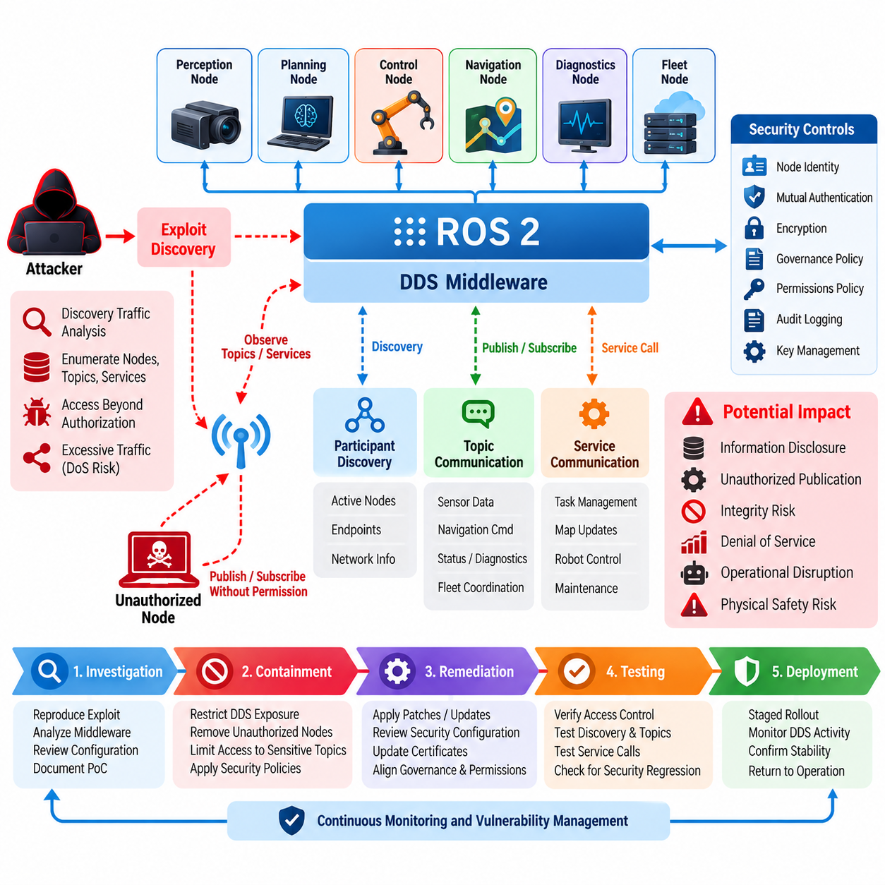{width="7.268055555555556in" height="7.268055555555556in"}

A ROS2 DDS exploit discovery case typically begins when security researchers or internal engineers identify unexpected behavior in the middleware layer responsible for communication between robot nodes. In a production robot system, DDS is not merely a messaging component; it provides discovery, publication, subscription, service communication, and transport mechanisms that connect perception, planning, control, diagnostics, and fleet functions. A weakness in this layer can therefore create consequences across multiple software components.

The investigated system used ROS2 nodes communicating through DDS across an industrial robot network. The initial security review focused on the DDS threat surface, including participant discovery, endpoint discovery, topic communication, authentication, authorization, encryption, and network exposure. The review followed the broader ROS2 security structure, which treats DDS security plugins, topic and service access policies, node identity, mutual authentication, audit logging, key management, vulnerability remediation, and penetration testing as connected security controls.

The exploit was first suspected after a test node demonstrated that it could interact with DDS entities beyond its intended authorization scope. The behavior did not initially provide direct control of a robot actuator, but it revealed that communication boundaries were weaker than expected. By observing discovery traffic and attempting controlled access to protected topics, the security team determined that an improperly configured security policy could expose information about active nodes and communication endpoints.

Further investigation reproduced the behavior in an isolated test environment rather than on production robots. Researchers compared normal DDS discovery behavior with the behavior observed when security policies were incomplete or inconsistently applied. The investigation emphasized that ROS2 security cannot be evaluated only at the application level because middleware configuration, participant identity, certificate handling, governance policies, permissions, and transport protection collectively determine whether a node is trusted.

The potential impact was evaluated according to the role of the affected topic and service. Access to a diagnostic topic might primarily create confidentiality concerns, while unauthorized publication to a navigation, task-management, or safety-relevant topic could create integrity and operational risks. A successful exploit against a communication path could also produce denial-of-service conditions by generating excessive discovery or message traffic, although the case did not assume that every exposed DDS interface would automatically permit physical robot control.

The response team first established a reproducible proof of concept and documented the affected ROS2 distribution, DDS implementation, security configuration, certificates, governance files, permissions files, and network conditions. This information was necessary because the same apparent vulnerability could produce different outcomes depending on middleware implementation and security configuration. Reproduction was therefore treated as a controlled validation activity rather than an attempt to exploit production robots.

Containment focused on reducing unnecessary DDS exposure while preserving essential robot operations. Nonessential network paths were restricted, unauthorized test nodes were removed, and access to sensitive ROS2 interfaces was limited to explicitly trusted participants. Where practical, security policies were tightened so that node identities and permissions were evaluated before access to protected topics and services was permitted. Production changes were introduced through controlled testing to avoid disrupting real-time robotic functions.

The remediation process followed a coordinated vulnerability-management approach. Engineers reviewed the affected middleware version, vendor advisories, ROS2 security guidance, and available patches or configuration corrections. The objective was not simply to install a newer package but to establish a complete remediation state in which software versions, certificates, governance policies, permissions, and deployment configurations were mutually consistent. This reduced the risk that a software patch would be undermined by an insecure runtime configuration.

After remediation, the security team performed regression testing across DDS discovery, topic publication, subscription, service calls, authentication, authorization, and encrypted communication. Legitimate robot nodes were required to communicate normally, while unauthorized nodes were expected to fail access checks. Testing also examined whether previously blocked interfaces became unintentionally accessible after configuration changes, because security regressions can occur when permissions are modified to restore operational functionality.

The incident demonstrated the importance of identity management within ROS2 systems. Node identity and mutual authentication provide the foundation for distinguishing legitimate participants from unknown processes. Certificates, private keys, and permission policies therefore become operational security assets rather than administrative details. Their lifecycle must include secure provisioning, controlled distribution, expiration management, rotation, revocation, and protection against unauthorized reuse.

Audit logging was also strengthened so that security-relevant DDS activity could be reconstructed after an event. Authentication failures, unauthorized access attempts, policy violations, participant changes, and administrative modifications were correlated with robot operational logs. This allowed investigators to distinguish normal system reconfiguration from suspicious behavior and provided evidence for validating whether remediation remained effective after deployment.

The case also changed the organization's penetration-testing methodology. Instead of testing only application APIs and operating-system services, security assessments were expanded to include DDS discovery, ROS2 graph exposure, topic and service authorization, malformed message handling, participant authentication, certificate validation, and policy enforcement. These tests were incorporated into repeatable security regression campaigns so that middleware upgrades or ROS2 package changes could be evaluated before deployment.

A key lesson was that ROS2 security must be treated as an architectural property rather than a feature that can be enabled once and then ignored. DDS provides the communication foundation for distributed robot software, while ROS2 security mechanisms determine which participants can establish trust and which communication resources they can access. A secure deployment therefore requires alignment between network segmentation, DDS security configuration, node identity, authorization policy, cryptographic key management, logging, patch management, and operational procedures.

The final remediation package established a repeatable lifecycle for future DDS vulnerabilities. New vulnerabilities are first reproduced in an isolated environment, their operational impact is assessed, affected systems are contained when necessary, patches or configuration changes are validated, and security regression testing is completed before fleet deployment. This approach converts an individual exploit-discovery event into a continuous security capability that protects ROS2-based robots throughout software evolution and operational service.

ROS2 DDS 익스플로잇 발견 사례(ROS2 DDS Exploit Discovery Case)는 일반적으로 로봇 노드 간 통신을 담당하는 미들웨어 계층(Middleware Layer)에서 예상하지 못한 동작이 발견되면서 시작된다. 생산 로봇 시스템에서 DDS는 단순한 메시징 구성요소가 아니라 인식(Perception), 계획(Planning), 제어(Control), 진단(Diagnostics), 플릿 기능(Fleet Functions)을 연결하는 탐색(Discovery), 발행(Publication), 구독(Subscription), 서비스 통신(Service Communication), 전송(Transport) 기능을 제공한다. 따라서 이 계층의 보안 약점은 여러 소프트웨어 구성요소 전반에 영향을 미칠 수 있다.

조사 대상 시스템은 산업용 로봇 네트워크(Industrial Robot Network)에서 DDS를 통해 통신하는 ROS2 노드로 구성되었다. 초기 보안 검토는 참여자 탐색(Participant Discovery), 엔드포인트 탐색(Endpoint Discovery), 토픽 통신(Topic Communication), 인증(Authentication), 권한부여(Authorization), 암호화(Encryption), 네트워크 노출(Network Exposure)을 포함한 DDS 위협 표면(Threat Surface)에 집중했다. 이 검토는 DDS 보안 플러그인(DDS Security Plugin), 토픽 및 서비스 접근 정책(Topic and Service Access Policy), 노드 신원(Node Identity), 상호 인증(Mutual Authentication), 감사 로그(Audit Logging), 키 관리(Key Management), 취약점 대응(Vulnerability Remediation), 침투 테스트(Penetration Testing)를 서로 연결된 보안 통제로 다루는 ROS2 보안 구조를 따랐다.

익스플로잇이 처음 의심된 것은 테스트 노드(Test Node)가 의도된 권한 범위를 넘어 DDS 엔티티(DDS Entity)와 상호작용할 수 있다는 사실이 확인되면서였다. 이 동작이 처음부터 로봇 액추에이터(Actuator)를 직접 제어할 수 있었던 것은 아니지만, 통신 경계(Communication Boundary)가 예상보다 약하다는 사실을 보여주었다. 활성 노드와 통신 엔드포인트에 대한 정보를 탐색 트래픽(Discovery Traffic)을 통해 관찰하고 보호된 토픽(Protected Topic)에 대한 통제된 접근을 시도한 결과, 보안 정책(Security Policy)이 부적절하게 구성되면 활성 노드와 통신 엔드포인트에 대한 정보가 노출될 수 있음이 확인되었다.

추가 조사는 생산 환경의 로봇이 아니라 격리된 테스트 환경(Isolated Test Environment)에서 해당 동작을 재현하는 방식으로 수행되었다. 연구팀은 정상적인 DDS 탐색 동작과 보안 정책이 불완전하거나 일관되지 않게 적용된 경우의 동작을 비교했다. 이 과정에서는 ROS2 보안을 애플리케이션 계층(Application Layer)만으로 평가할 수 없다는 점이 강조되었다. 미들웨어 구성(Middleware Configuration), 참여자 신원(Participant Identity), 인증서(Certificate) 처리, 거버넌스 정책(Governance Policy), 권한(Permission), 전송 보호(Transport Protection)가 함께 신뢰 여부를 결정하기 때문이다.

잠재적인 영향은 영향을 받은 토픽과 서비스의 역할에 따라 평가되었다. 진단 토픽(Diagnostic Topic)에 대한 접근은 주로 기밀성(Confidentiality) 문제를 발생시킬 수 있지만, 내비게이션(Navigation), 작업 관리(Task Management), 안전 관련 토픽(Safety-Relevant Topic)에 대한 비인가 발행(Unauthorized Publication)은 무결성(Integrity)과 운영 위험(Operational Risk)을 발생시킬 수 있다. 통신 경로에 대한 성공적인 익스플로잇은 과도한 탐색 또는 메시지 트래픽을 발생시켜 서비스 거부(Denial-of-Service) 상태를 만들 수도 있다. 그러나 이 사례에서는 노출된 모든 DDS 인터페이스가 자동으로 물리적 로봇 제어를 허용한다고 가정하지 않았다.

대응팀(Response Team)은 먼저 재현 가능한 개념 증명(Proof of Concept)을 구축하고 영향을 받는 ROS2 배포판(ROS2 Distribution), DDS 구현(DDS Implementation), 보안 구성(Security Configuration), 인증서(Certificate), 거버넌스 파일(Governance File), 권한 파일(Permissions File), 네트워크 조건(Network Condition)을 문서화했다. 동일하게 보이는 취약점이라도 미들웨어 구현과 보안 구성에 따라 결과가 달라질 수 있기 때문에 이러한 정보가 필요했다. 따라서 재현 작업은 생산 로봇을 대상으로 익스플로잇을 수행하는 것이 아니라 통제된 검증 활동(Controlled Validation Activity)으로 취급되었다.

봉쇄(Containment)는 필수적인 로봇 운영을 유지하면서 불필요한 DDS 노출(DDS Exposure)을 줄이는 데 집중했다. 비필수 네트워크 경로를 제한하고 비인가 테스트 노드를 제거했으며, 민감한 ROS2 인터페이스에 대한 접근을 명시적으로 신뢰된 참여자(Trusted Participant)로 제한했다. 가능한 경우 보안 정책을 강화하여 보호된 토픽과 서비스에 대한 접근이 허용되기 전에 노드 신원(Node Identity)과 권한(Permission)을 검증하도록 했다. 생산 환경의 변경은 실제 로봇의 실시간 기능을 방해하지 않도록 통제된 테스트를 거쳐 적용되었다.

교정 과정(Remediation Process)은 체계적인 취약점 관리 접근법(Vulnerability Management Approach)에 따라 수행되었다. 엔지니어들은 영향을 받은 미들웨어 버전(Middleware Version), 공급업체 권고사항(Vendor Advisory), ROS2 보안 지침(Security Guidance), 사용 가능한 패치(Patch) 또는 구성 수정(Configuration Correction)을 검토했다. 목표는 단순히 최신 패키지를 설치하는 것이 아니라 소프트웨어 버전, 인증서, 거버넌스 정책, 권한, 배포 구성이 서로 일관된 완전한 교정 상태(Remediation State)를 구축하는 것이었다. 이를 통해 소프트웨어 패치가 안전하지 않은 런타임 구성(Runtime Configuration)에 의해 무력화될 위험을 줄였다.

교정 이후 보안팀은 DDS 탐색, 토픽 발행, 구독, 서비스 호출(Service Call), 인증, 권한부여, 암호화 통신(Encrypted Communication)에 대한 회귀 테스트(Regression Testing)를 수행했다. 정상적인 로봇 노드는 정상적으로 통신해야 했으며, 비인가 노드는 접근 검사(Access Check)에 실패해야 했다. 또한 구성 변경 이후 이전에 차단되었던 인터페이스가 의도하지 않게 다시 접근 가능해지는지도 검사했다. 운영 기능을 복구하기 위해 권한을 변경하는 과정에서 보안 회귀(Security Regression)가 발생할 수 있기 때문이다.

이번 사례는 ROS2 시스템에서 신원 관리(Identity Management)의 중요성을 보여주었다. 노드 신원과 상호 인증은 정상적인 참여자와 알려지지 않은 프로세스를 구별하기 위한 기반을 제공한다. 따라서 인증서, 개인 키(Private Key), 권한 정책(Permission Policy)은 단순한 관리 세부사항이 아니라 운영 보안 자산(Operational Security Asset)이 된다. 이러한 자산의 수명주기에는 안전한 프로비저닝(Secure Provisioning), 통제된 배포(Controlled Distribution), 만료 관리(Expiration Management), 키 교체(Rotation), 폐기(Revocation), 비인가 재사용 방지(Protection Against Unauthorized Reuse)가 포함되어야 한다.

감사 로깅(Audit Logging)도 강화되어 보안과 관련된 DDS 활동을 사고 이후 재구성할 수 있도록 했다. 인증 실패(Authentication Failure), 비인가 접근 시도(Unauthorized Access Attempt), 정책 위반(Policy Violation), 참여자 변경(Participant Change), 관리 구성 변경(Administrative Modification)을 로봇 운영 로그와 상관 분석했다. 이를 통해 조사팀은 정상적인 시스템 재구성과 의심스러운 동작을 구별할 수 있었으며, 배포 이후에도 교정 조치가 효과적으로 유지되는지 검증할 수 있는 증거를 확보했다.

이번 사례는 조직의 침투 테스트 방법론(Penetration Testing Methodology)도 변화시켰다. 보안 평가(Security Assessment)는 애플리케이션 API와 운영체제 서비스만 검사하는 방식에서 벗어나 DDS 탐색, ROS2 그래프 노출(ROS2 Graph Exposure), 토픽 및 서비스 권한부여, 비정상 메시지 처리(Malformed Message Handling), 참여자 인증, 인증서 검증(Certificate Validation), 정책 집행(Policy Enforcement)까지 포함하도록 확대되었다. 이러한 테스트는 반복 가능한 보안 회귀 캠페인(Security Regression Campaign)에 포함되어 미들웨어 업그레이드나 ROS2 패키지 변경을 배포 전에 평가할 수 있도록 했다.

핵심 교훈은 ROS2 보안을 한 번 활성화한 뒤 방치할 수 있는 기능이 아니라 아키텍처의 속성(Architectural Property)으로 취급해야 한다는 것이다. DDS는 분산 로봇 소프트웨어(Distributed Robot Software)의 통신 기반을 제공하며, ROS2 보안 메커니즘은 어떤 참여자가 신뢰를 형성할 수 있고 어떤 통신 자원에 접근할 수 있는지를 결정한다. 따라서 안전한 배포를 위해서는 네트워크 분할(Network Segmentation), DDS 보안 구성, 노드 신원, 권한 정책, 암호화 키 관리(Cryptographic Key Management), 로깅, 패치 관리(Patch Management), 운영 절차(Operational Procedure)가 서로 일치해야 한다.

최종 교정 패키지(Final Remediation Package)는 향후 DDS 취약점을 처리하기 위한 반복 가능한 수명주기(Repeatable Lifecycle)를 확립했다. 새로운 취약점은 먼저 격리된 환경에서 재현하고, 운영 영향(Operational Impact)을 평가하며, 필요한 경우 영향을 받는 시스템을 봉쇄하고, 패치 또는 구성 변경을 검증한 후, 플릿에 배포하기 전에 보안 회귀 테스트를 완료한다. 이러한 접근법은 개별적인 익스플로잇 발견 사건을 소프트웨어가 진화하고 실제 운영되는 전체 기간 동안 ROS2 기반 로봇을 보호하는 지속적인 보안 역량(Continuous Security Capability)으로 전환한다.

##  

## 12.03. AI Model Adversarial Attack Robot Vision Case

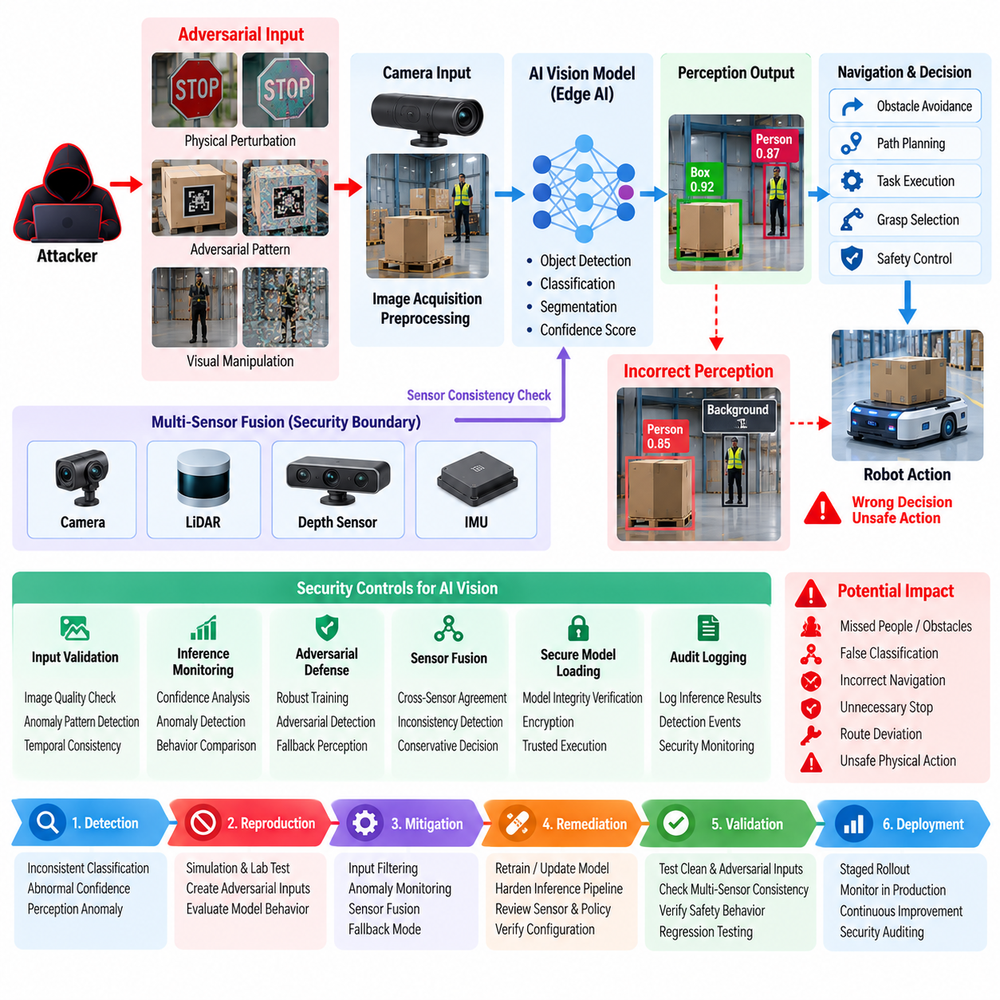{width="7.268055555555556in" height="7.268055555555556in"}

An adversarial attack against a robot vision model begins when an attacker deliberately manipulates visual inputs so that a perception model produces an incorrect interpretation of the physical environment. In an autonomous robot, vision output can influence object detection, obstacle avoidance, localization, navigation, grasp selection, and safety decisions. The security concern therefore extends beyond model accuracy: a small visual perturbation can propagate through the perception pipeline and eventually create an incorrect physical action.

The case involved an edge AI vision system deployed on a mobile robot operating in an industrial environment. The perception pipeline used camera images to detect people, obstacles, vehicles, and operational objects before passing structured results to downstream navigation and decision modules. The security assessment followed the Edge AI Security structure, which explicitly addresses adversarial input detection, inference anomaly monitoring, AI data poisoning, secure model loading, model protection, and security auditing as complementary defenses rather than treating the vision model as an isolated component.

The attack was initially identified when the robot repeatedly produced inconsistent object classifications under visually similar environmental conditions. Normal images produced stable detections, while particular patterns, markings, or localized visual changes caused the confidence distribution to shift unexpectedly. The security team reproduced the behavior in a controlled environment and determined that the manipulated input did not necessarily need to resemble a conventional software exploit. Instead, the attacker could influence the model through carefully designed physical or digital changes to the camera input.

The investigation examined several attack surfaces across the vision pipeline. These included the physical scene, camera acquisition, image preprocessing, model inference, confidence filtering, object tracking, and downstream decision logic. The assessment showed that protecting the model file alone was insufficient because an authentic and cryptographically protected model could still generate unsafe results when presented with adversarial inputs. This distinction established adversarial robustness as a separate security requirement from model confidentiality and software integrity.

The potential operational impact depended on the object class being manipulated and the role of its detection result. An attacker causing a harmless object to be misclassified might create only a temporary perception anomaly, whereas suppressing the detection of a person, obstacle, vehicle, or restricted-area boundary could affect navigation and safety behavior. The assessment therefore evaluated not only classification accuracy but also the physical consequences of incorrect perception, including unnecessary stops, incorrect avoidance maneuvers, route deviations, and unsafe continuation of motion.

Testing was performed first in simulation and controlled laboratory conditions before any field evaluation. Researchers constructed representative adversarial inputs and compared model responses against clean reference images. The evaluation measured confidence changes, false-positive and false-negative rates, detection stability, temporal consistency, and downstream behavioral effects. This approach prevented the security assessment from depending on a single accuracy metric and made it possible to identify cases where apparently minor perception errors could become significant physical risks.

Detection and mitigation were implemented as multiple layers around the inference pipeline. Input validation examined image quality, sensor consistency, unexpected visual patterns, and temporal changes. The inference monitor compared current predictions with historical behavior and contextual expectations. When a detection became statistically or operationally suspicious, the system could reduce confidence, request additional sensor evidence, trigger a fallback perception mode, or place the robot into a safer operational state rather than allowing the anomalous result to directly control behavior.

The case also demonstrated the importance of sensor fusion as a security boundary. A camera-based adversarial input becomes less effective when independent LiDAR, depth, inertial, or other sensing modalities can challenge an inconsistent visual interpretation. The system therefore evaluated cross-sensor agreement rather than assuming that the camera model was always authoritative. Significant disagreement between modalities became a security-relevant signal and could trigger conservative decision logic or human review depending on operational criticality.

Model integrity was protected separately from adversarial-input defense. The security architecture included secure AI model loading and verification, encryption, trusted execution mechanisms, inference monitoring, and model registry protection. These controls ensured that an attacker could not simply replace the legitimate model while the adversarial-input defenses were being evaluated. The case consequently separated three different security questions: whether the model itself was authentic, whether its inputs were trustworthy, and whether its outputs were safe enough to influence physical actions.

The response procedure required the affected model and input conditions to be isolated from uncontrolled production testing. Security engineers preserved representative samples, model versions, preprocessing configurations, inference logs, and system-state information so that the behavior could be reproduced after remediation. The affected robot was not treated as a conventional compromised computer because the primary problem concerned the reliability of perception under hostile conditions. This required collaboration between cybersecurity, AI engineering, robotics, and operational safety teams.

Remediation combined model-level and system-level improvements. The vision model was evaluated using a broader adversarial robustness test set, while preprocessing and confidence thresholds were reviewed for predictable failure modes. Additional anomaly detection was introduced around inference results, and safety-critical decisions were prevented from depending exclusively on a single uncertain visual prediction. Where appropriate, the system used fallback perception or degraded operating modes when confidence, temporal consistency, or cross-sensor agreement fell below defined security thresholds.

The incident was subsequently incorporated into the robot cybersecurity testing lifecycle. Security regression testing included adversarial image evaluation, robustness testing across environmental conditions, sensor-fusion consistency checks, inference anomaly monitoring, and verification that model updates did not reintroduce previously identified weaknesses. The broader cybersecurity testing framework also provides for vulnerability scanning, penetration testing, red-team exercises, static analysis, security reporting, and automated regression testing, allowing AI-specific security cases to become repeatable engineering activities rather than one-time investigations.

The central lesson was that adversarial robustness must be treated as part of physical AI security rather than as a purely academic machine-learning quality issue. The cybersecurity architecture explicitly includes adversarial input detection for robot AI, inference anomaly monitoring, AI data-poisoning defense, certified robustness for safety-critical AI, AI safety monitoring as a security boundary, and secure model management. A vision model can therefore be mathematically accurate under ordinary benchmarks while remaining operationally vulnerable when an attacker deliberately manipulates its physical inputs.

The final security posture established a layered defense in which trusted model deployment, protected execution, adversarial-input detection, sensor cross-validation, inference monitoring, and safety-aware decision logic operate together. The objective was not to guarantee that a vision model would never make an incorrect prediction, which is unrealistic in complex environments, but to prevent a single manipulated perception result from directly producing an unsafe physical consequence. This transformed adversarial testing from a model-development exercise into a continuous cybersecurity and safety-validation capability for deployed robots.

로봇 비전 모델에 대한 적대적 공격(Adversarial Attack)은 공격자가 시각적 입력(Visual Input)을 의도적으로 조작하여 인식 모델(Perception Model)이 물리적 환경을 잘못 해석하도록 만들면서 시작된다. 자율 로봇(Autonomous Robot)에서 비전 출력(Vision Output)은 객체 탐지(Object Detection), 장애물 회피(Obstacle Avoidance), 위치추정(Localization), 내비게이션(Navigation), 파지 선택(Grasp Selection), 안전 의사결정(Safety Decision)에 영향을 줄 수 있다. 따라서 보안 문제는 단순한 모델 정확도(Model Accuracy)를 넘어선다. 작은 시각적 교란(Visual Perturbation)도 인식 파이프라인(Perception Pipeline)을 통해 전파되어 결국 잘못된 물리적 행동(Physical Action)을 발생시킬 수 있다.

이 사례는 산업 환경(Industrial Environment)에서 운용되는 이동 로봇(Mobile Robot)에 배치된 엣지 AI 비전 시스템(Edge AI Vision System)을 대상으로 한다. 인식 파이프라인은 카메라 이미지(Camera Image)를 사용하여 사람, 장애물, 차량, 운영 객체(Operational Object)를 탐지한 후 구조화된 결과를 하위 내비게이션 및 의사결정 모듈(Decision Module)로 전달했다. 보안 평가는 엣지 AI 보안(Edge AI Security) 구조를 기반으로 수행되었으며, 해당 구조는 적대적 입력 탐지(Adversarial Input Detection), 추론 이상 모니터링(Inference Anomaly Monitoring), AI 데이터 중독(Data Poisoning), 안전한 모델 로딩(Secure Model Loading), 모델 보호(Model Protection), 보안 감사(Security Auditing)를 상호 보완적인 방어 수단으로 다룬다.

공격은 로봇이 시각적으로 유사한 환경 조건에서 반복적으로 일관되지 않은 객체 분류(Object Classification)를 생성하면서 처음 식별되었다. 정상적인 이미지는 안정적인 탐지 결과를 생성했지만 특정 패턴, 표시 또는 국부적인 시각적 변화가 적용되면 신뢰도 분포(Confidence Distribution)가 예상하지 못한 방식으로 변화했다. 보안팀은 통제된 환경에서 이러한 동작을 재현했으며, 조작된 입력이 반드시 전통적인 소프트웨어 익스플로잇(Software Exploit)의 형태를 취할 필요는 없다는 사실을 확인했다. 공격자는 카메라 입력에 대한 물리적 또는 디지털 변경을 정교하게 설계함으로써 모델에 영향을 줄 수 있었다.

조사에서는 비전 파이프라인 전반의 여러 공격 표면(Attack Surface)을 검토했다. 여기에는 물리적 장면(Physical Scene), 카메라 획득(Camera Acquisition), 이미지 전처리(Image Preprocessing), 모델 추론(Model Inference), 신뢰도 필터링(Confidence Filtering), 객체 추적(Object Tracking), 하위 의사결정 로직(Downstream Decision Logic)이 포함되었다. 평가 결과 모델 파일 자체를 보호하는 것만으로는 충분하지 않은 것으로 나타났다. 진정성 있고 암호학적으로 보호된 모델(Cryptographically Protected Model)이라도 적대적 입력이 제공되면 안전하지 않은 결과를 생성할 수 있기 때문이다. 이러한 구분은 적대적 강건성(Adversarial Robustness)을 모델 기밀성(Model Confidentiality) 및 소프트웨어 무결성(Software Integrity)과 별개의 보안 요구사항으로 확립했다.

잠재적인 운영 영향(Operational Impact)은 조작되는 객체의 종류와 해당 탐지 결과의 역할에 따라 달라졌다. 공격자가 무해한 객체를 잘못 분류하도록 만들면 일시적인 인식 이상(Perception Anomaly)에 그칠 수 있지만, 사람, 장애물, 차량 또는 제한 구역 경계(Restricted-Area Boundary)의 탐지를 억제하면 내비게이션 및 안전 동작에 영향을 줄 수 있다. 따라서 평가에서는 분류 정확도(Classification Accuracy)뿐 아니라 잘못된 인식이 발생했을 때의 물리적 결과(Physical Consequence)도 검토했다. 여기에는 불필요한 정지, 잘못된 회피 동작, 경로 이탈(Route Deviation), 위험한 주행 지속이 포함되었다.

테스트는 현장 평가(Field Evaluation)에 앞서 시뮬레이션과 통제된 실험실 환경에서 먼저 수행되었다. 연구팀은 대표적인 적대적 입력을 구성하고 깨끗한 기준 이미지(Clean Reference Image)와 모델의 반응을 비교했다. 평가에서는 신뢰도 변화(Confidence Change), 오탐(False Positive) 및 미탐(False Negative) 비율, 탐지 안정성(Detection Stability), 시간적 일관성(Temporal Consistency), 하위 시스템의 행동 영향을 측정했다. 이러한 접근 방식은 보안 평가가 단일 정확도 지표에 의존하지 않도록 했으며, 겉보기에는 작은 인식 오류가 어떻게 중요한 물리적 위험으로 발전할 수 있는지를 식별할 수 있게 했다.

탐지 및 완화(Detection and Mitigation)는 추론 파이프라인 주변에 여러 계층을 배치하는 방식으로 구현되었다. 입력 검증(Input Validation)은 이미지 품질, 센서 일관성(Sensor Consistency), 예상하지 못한 시각적 패턴, 시간적 변화를 검사했다. 추론 모니터(Inference Monitor)는 현재 예측 결과를 과거의 동작과 상황적 기대값(Contextual Expectation)과 비교했다. 탐지 결과가 통계적으로 또는 운영 측면에서 의심스러운 경우 시스템은 신뢰도를 낮추거나 추가 센서 증거를 요청하거나 대체 인식 모드(Fallback Perception Mode)를 활성화하거나 로봇을 보다 안전한 운영 상태(Safer Operational State)로 전환할 수 있었다.

이번 사례는 센서 융합(Sensor Fusion)이 보안 경계(Security Boundary)로서 중요하다는 점도 보여주었다. 카메라 기반 적대적 입력은 독립적인 LiDAR, 깊이 센서(Depth Sensor), 관성 센서(Inertial Sensor) 또는 기타 센싱 방식이 일관되지 않은 시각적 해석에 이의를 제기할 수 있을 때 그 효과가 감소한다. 따라서 시스템은 카메라를 항상 권위 있는 정보원으로 가정하지 않고 센서 간 일치 여부(Cross-Sensor Agreement)를 평가했다. 서로 다른 센서 사이에서 상당한 불일치가 발생하면 이를 보안 관련 신호(Security-Relevant Signal)로 처리하고, 운영 중요도에 따라 보수적인 의사결정 로직(Conservative Decision Logic)이나 사람의 검토를 수행할 수 있도록 했다.

모델 무결성(Model Integrity)은 적대적 입력 방어와 별도로 보호되었다. 보안 아키텍처는 안전한 AI 모델 로딩 및 검증(Secure AI Model Loading and Verification), 암호화(Encryption), 신뢰 실행 환경(Trusted Execution Environment), 추론 모니터링(Inference Monitoring), 모델 레지스트리 보호(Model Registry Protection)를 포함했다. 이러한 통제는 적대적 입력 방어를 평가하는 과정에서 공격자가 정상적인 모델을 임의의 모델로 교체하는 것을 방지했다. 이에 따라 사례에서는 서로 다른 세 가지 보안 질문을 구분했다. 모델 자체가 진정성을 유지하는가, 입력을 신뢰할 수 있는가, 그리고 출력이 물리적 행동에 영향을 줄 만큼 안전한가라는 질문이다.

대응 절차(Response Procedure)는 영향을 받은 모델과 입력 조건을 통제되지 않은 생산 환경 테스트에서 격리하도록 요구했다. 보안 엔지니어들은 대표적인 입력 샘플, 모델 버전, 전처리 구성(Preprocessing Configuration), 추론 로그(Inference Log), 시스템 상태 정보를 보존하여 교정 이후에도 동작을 재현할 수 있도록 했다. 영향을 받은 로봇은 일반적인 침해 컴퓨터(Compromised Computer)로만 취급되지 않았다. 주요 문제는 악성 코드 감염보다는 적대적 조건에서의 인식 신뢰성(Perception Reliability)이었기 때문이다. 따라서 사이버보안, AI 엔지니어링, 로보틱스, 운영 안전팀 간의 협력이 필요했다.

교정(Remediation)은 모델 수준과 시스템 수준의 개선을 결합하여 수행되었다. 비전 모델은 더 광범위한 적대적 강건성 테스트 세트(Adversarial Robustness Test Set)를 사용하여 평가되었으며, 전처리 과정과 신뢰도 임계값(Confidence Threshold)을 예측 가능한 실패 모드(Failure Mode) 관점에서 재검토했다. 추론 결과 주변에는 추가적인 이상 탐지(Anomaly Detection)가 도입되었고, 안전이 중요한 의사결정(Safety-Critical Decision)이 불확실한 단일 시각적 예측에만 의존하지 않도록 했다. 적절한 경우 신뢰도, 시간적 일관성 또는 센서 간 일치 수준이 정의된 보안 임계값(Security Threshold) 아래로 떨어지면 대체 인식 또는 성능 저하 운영 모드(Degraded Operating Mode)를 사용하도록 했다.

이 사고는 이후 로봇 사이버보안 테스트 수명주기(Robot Cybersecurity Testing Lifecycle)에 포함되었다. 보안 회귀 테스트(Security Regression Testing)는 적대적 이미지 평가, 강건성 테스트, 센서 융합 일관성 검사, 추론 이상 모니터링, 모델 업데이트로 인해 기존 취약점이 다시 발생하지 않는지에 대한 검증을 포함했다. 보다 광범위한 사이버보안 테스트 구조에는 취약점 스캐닝(Vulnerability Scanning), 침투 테스트(Penetration Testing), 레드팀 훈련(Red-Team Exercise), 정적 분석(Static Analysis), 보안 보고(Security Reporting), 자동화된 회귀 테스트(Automated Regression Testing)도 포함되어 있다. 이를 통해 AI 특화 보안 사례가 일회성 조사에 그치지 않고 반복 가능한 엔지니어링 활동으로 전환되었다.

핵심 교훈은 적대적 강건성을 순수한 머신러닝 품질 문제(Machine Learning Quality Issue)가 아니라 물리적 AI 보안(Physical AI Security)의 일부로 취급해야 한다는 것이다. 사이버보안 아키텍처는 로봇 AI를 위한 적대적 입력 탐지, 추론 이상 모니터링, AI 데이터 중독 방어, 안전이 중요한 AI를 위한 인증된 강건성(Certified Robustness), 보안 경계로서의 AI 안전 모니터(AI Safety Monitor), 안전한 모델 관리(Secure Model Management)를 명시적으로 포함한다. 따라서 비전 모델은 일반적인 벤치마크에서는 높은 정확도를 보이면서도 공격자가 물리적 입력을 의도적으로 조작할 경우 운영 측면에서는 여전히 취약할 수 있다.

최종 보안 상태는 신뢰된 모델 배포(Trusted Model Deployment), 보호된 실행(Protected Execution), 적대적 입력 탐지, 센서 교차 검증(Sensor Cross-Validation), 추론 모니터링, 안전을 고려한 의사결정 로직(Safety-Aware Decision Logic)이 함께 작동하는 계층형 방어(Layered Defense) 체계를 확립했다. 목표는 복잡한 환경에서 비전 모델이 잘못된 예측을 전혀 하지 않도록 보장하는 것이 아니었다. 이는 현실적으로 달성하기 어렵기 때문이다. 대신 조작된 단일 인식 결과가 직접적으로 위험한 물리적 결과를 발생시키지 않도록 하는 것이 목표였다. 이를 통해 적대적 테스트는 단순한 모델 개발 활동을 넘어 실제 배치된 로봇을 위한 지속적인 사이버보안 및 안전 검증 역량(Continuous Cybersecurity and Safety-Validation Capability)으로 발전했다.

##  

## 12.04. Firmware Supply Chain Compromise Case

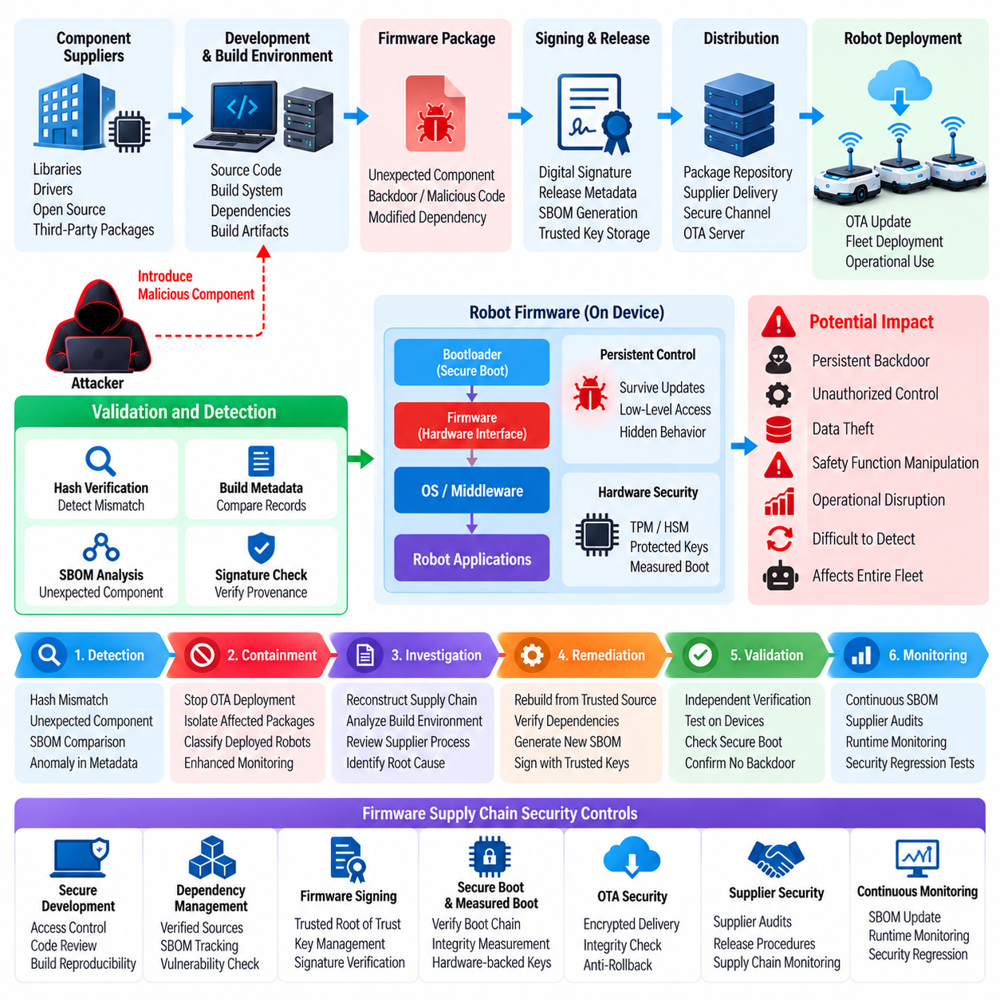{width="7.268055555555556in" height="7.268055555555556in"}

The case begins with the discovery that a robot firmware package obtained through a trusted software supply chain contains an unexpected component that was not present in the organization's approved build baseline. The affected firmware is responsible for low-level device initialization, hardware interfaces, communications, and selected safety-related functions. Because firmware executes beneath higher-level robot software, a compromised package can establish persistence that survives application updates and may remain difficult to detect through conventional application-layer monitoring.

The robot platform depended on external suppliers for firmware components, board-support packages, device drivers, and build artifacts. The cybersecurity architecture therefore treated firmware as part of the software supply chain rather than as an isolated embedded artifact. This approach aligns with the broader firmware-security structure, which includes firmware signing, secure boot, measured boot, package integrity verification, anti-rollback protection, SBOM-based vulnerability tracking, supply-chain security, secure key storage, OTA security testing, and compliance controls.

The compromise was initially suspected when a routine firmware validation process produced a hash mismatch between a received firmware image and the artifact recorded in the organization's release repository. The difference was initially considered a possible packaging error because the firmware remained operational and passed basic functional tests. However, the discrepancy triggered a deeper comparison of build metadata, component versions, signing information, and provenance records associated with the firmware delivery.

The investigation established that the unexpected firmware component had entered the delivery chain before the package reached the robot manufacturer's final integration environment. The incident therefore differed from a conventional endpoint compromise because the robot itself was not necessarily the initial target. The attacker had instead exploited a trusted software-development or distribution relationship, attempting to introduce malicious or unauthorized content into an artifact that downstream systems would normally regard as legitimate.

The security team isolated the affected firmware from further deployment and preserved the original package, associated metadata, build records, signatures, SBOM information, and supplier communications. Engineers then reconstructed the software provenance from source components through build infrastructure and package distribution. The objective was to determine where the unexpected content had entered the chain and whether the same component had already been incorporated into previously released firmware versions.

The investigation paid particular attention to the distinction between artifact integrity and artifact provenance. A valid digital signature could demonstrate that an artifact had been signed by an authorized key, but it did not by itself prove that every component inside the artifact was trustworthy. The organization therefore examined signing authority, build reproducibility, dependency versions, SBOM records, build-system access, and supplier release procedures. This broader analysis prevented trust in the signing process from becoming an assumption of trust in the entire software supply chain.

Containment was performed before additional robots received the affected package. OTA deployment queues were suspended for the relevant firmware family, and the release process was placed under additional approval controls. Robots already running the firmware were classified according to operational exposure and firmware dependency. Where immediate replacement was unnecessary, systems continued operating under enhanced monitoring while engineering teams determined whether the installed version contained the compromised component.

The response also evaluated whether the affected firmware could establish persistence below the operating-system layer. Secure boot and measured boot mechanisms were reviewed to determine whether the robot could verify the expected boot chain and record the integrity state of critical firmware components. Hardware-backed key storage, TPM or HSM-supported operations, and protected signing credentials were examined because compromise of these trust anchors could extend the incident beyond a single firmware release.

Remediation required rebuilding the affected firmware from verified source material and trusted dependencies. The organization did not simply modify the suspicious package and redistribute it because that approach would preserve uncertainty about its provenance. Instead, the firmware build was reconstructed through a controlled pipeline with documented source versions, dependency checks, reproducible build procedures, SBOM generation, integrity verification, and authorized signing. The resulting artifact was independently validated before being considered suitable for deployment.

Firmware signing was strengthened so that production packages could be accepted only when their signatures chained to an approved root of trust. Signature validation was combined with cryptographic hash verification and release metadata checks. The organization also reviewed key-management procedures to ensure that signing keys were isolated, access-controlled, rotated when necessary, and protected against unauthorized use. This created a clearer distinction between developers who could produce firmware and authorized release systems that could approve firmware for deployment.

The case also exposed weaknesses in dependency visibility. Several firmware components had originated from third-party packages whose internal build processes were not fully observable to the robot manufacturer. The organization therefore expanded SBOM requirements and supplier evidence requirements so that firmware releases could be associated with identifiable components, versions, licenses, known vulnerabilities, and provenance information. This made future incident investigation faster and reduced uncertainty when a supplier reported a newly discovered compromise.

The compromised supply-chain path was subsequently subjected to additional security testing. Static analysis, vulnerability scanning, firmware inspection, dependency review, and controlled fuzzing were incorporated into the validation process. The security team also tested whether unauthorized modifications would be detected before deployment and whether a compromised but correctly signed package could bypass existing controls. These tests emphasized that supply-chain security must address both external compromise and misuse of legitimate development credentials.

Anti-rollback protection became another important part of the remediation. Without a protected version counter or equivalent mechanism, an attacker could potentially attempt to reinstall an older firmware image after the organization had distributed a corrected version. The updated deployment process therefore required version validation in addition to signature and integrity checks. Firmware with an obsolete security state could no longer be accepted simply because its cryptographic signature remained valid.

The recovery process was conducted in controlled deployment waves rather than through an unrestricted fleet-wide OTA operation. A limited number of robots received the rebuilt firmware first, followed by functional, security, and operational validation. Engineers monitored boot integrity, hardware initialization, communications, robot behavior, and security telemetry before expanding deployment. This staged approach reduced the possibility that a remaining build or signing problem would propagate across the entire fleet.

The incident resulted in changes to the organization's software-development governance. Firmware security was integrated earlier into the development lifecycle, with explicit security gates for source provenance, dependency approval, build integrity, SBOM completeness, signing authorization, and release validation. The organization also established stronger separation between development, build, signing, and deployment environments so that compromise of one stage would not automatically provide control over the complete firmware release chain.

A key lesson from the case is that firmware supply-chain security cannot be reduced to checking whether a package is digitally signed. A secure firmware lifecycle must establish confidence in where the software originated, which components were included, how the artifact was built, who authorized its release, and whether the installed version can be verified at boot. These requirements connect supply-chain security with secure boot, measured boot, signing infrastructure, OTA controls, vulnerability tracking, and incident response.

The final security posture established a continuous firmware trust lifecycle extending from supplier intake through development, build, signing, distribution, installation, verification, monitoring, and eventual replacement. When a new supply-chain concern emerges, the organization can identify affected components, determine exposed firmware versions, suspend distribution, rebuild from trusted sources, validate the new artifact, and deploy it through controlled OTA procedures. The case therefore transformed firmware supply-chain protection from a release-time inspection into a persistent cybersecurity capability for the robot platform.

이 사례는 신뢰된 소프트웨어 공급망(Trusted Software Supply Chain)을 통해 확보한 로봇 펌웨어 패키지(Robot Firmware Package)에 승인된 빌드 기준선(Approved Build Baseline)에 존재하지 않는 예상하지 못한 구성요소가 포함되어 있다는 사실이 발견되면서 시작된다. 영향을 받은 펌웨어는 하위 수준 장치 초기화(Low-Level Device Initialization), 하드웨어 인터페이스(Hardware Interface), 통신(Communication), 일부 안전 관련 기능(Safety-Related Function)을 담당한다. 펌웨어는 상위 수준의 로봇 소프트웨어보다 낮은 계층에서 실행되기 때문에 침해된 패키지는 애플리케이션 업데이트 이후에도 지속되는 지속성(Persistence)을 확보할 수 있으며, 기존 애플리케이션 계층 모니터링(Application-Layer Monitoring)으로 탐지하기 어려울 수 있다.

해당 로봇 플랫폼은 펌웨어 구성요소, 보드 지원 패키지(Board-Support Package), 장치 드라이버(Device Driver), 빌드 산출물(Build Artifact)을 외부 공급업체에 의존하고 있었다. 따라서 사이버보안 아키텍처(Cybersecurity Architecture)는 펌웨어를 독립적인 임베디드 산출물이 아니라 소프트웨어 공급망(Software Supply Chain)의 일부로 취급했다. 이러한 접근 방식은 펌웨어 서명(Firmware Signing), 보안 부팅(Secure Boot), 측정 부팅(Measured Boot), 패키지 무결성 검증(Package Integrity Verification), 롤백 방지(Anti-Rollback), SBOM 기반 취약점 추적(SBOM-Based Vulnerability Tracking), 공급망 보안(Supply-Chain Security), 보안 키 저장(Secure Key Storage), OTA 보안 테스트(OTA Security Testing), 규정 준수 통제를 포함하는 광범위한 펌웨어 보안 구조와 일치한다.

침해는 정기적인 펌웨어 검증 과정에서 수신된 펌웨어 이미지(Firmware Image)의 해시(Hash)가 조직의 릴리스 저장소(Release Repository)에 기록된 산출물과 일치하지 않는다는 사실이 발견되면서 처음 의심되었다. 펌웨어는 정상적으로 동작했고 기본적인 기능 테스트도 통과했기 때문에 처음에는 이러한 차이가 패키징 오류(Packaging Error)일 가능성이 있다고 판단했다. 그러나 이러한 불일치는 빌드 메타데이터(Build Metadata), 구성요소 버전(Component Version), 서명 정보(Signing Information), 펌웨어 전달과 관련된 출처 기록(Provenance Record)을 보다 면밀하게 비교하는 계기가 되었다.

조사 결과 예상하지 못한 펌웨어 구성요소가 로봇 제조업체의 최종 통합 환경(Final Integration Environment)에 패키지가 도착하기 전에 전달 과정에 유입된 것으로 확인되었다. 따라서 이번 사고는 전형적인 엔드포인트 침해(Endpoint Compromise)와 달랐다. 공격자가 반드시 로봇 자체를 최초 공격 대상으로 삼은 것은 아니었기 때문이다. 대신 공격자는 신뢰된 소프트웨어 개발 또는 배포 관계(Software-Development or Distribution Relationship)를 악용하여 일반적으로 정상적인 것으로 간주되는 산출물에 악성 또는 비인가 콘텐츠를 삽입하려 했다.

보안팀은 영향을 받은 펌웨어가 추가로 배포되는 것을 차단하고 원본 패키지, 관련 메타데이터, 빌드 기록, 서명, SBOM 정보, 공급업체와의 통신 기록을 보존했다. 이후 엔지니어들은 소스 구성요소(Source Component)에서 빌드 인프라(Build Infrastructure)를 거쳐 패키지 배포(Package Distribution)에 이르는 소프트웨어 출처(Software Provenance)를 재구성했다. 목표는 예상하지 못한 콘텐츠가 공급망의 어느 지점에서 유입되었는지 확인하고 동일한 구성요소가 이전에 출시된 펌웨어 버전에 이미 포함되었는지를 판단하는 것이었다.

조사에서는 산출물 무결성(Artifact Integrity)과 산출물 출처(Artifact Provenance)의 차이에 특히 주목했다. 유효한 디지털 서명(Digital Signature)은 산출물이 승인된 키(Authorized Key)로 서명되었다는 사실을 증명할 수 있지만, 그 산출물 내부의 모든 구성요소가 신뢰할 수 있다는 사실까지 자동으로 증명하지는 않는다. 따라서 조직은 서명 권한(Signing Authority), 빌드 재현성(Build Reproducibility), 종속성 버전(Dependency Version), SBOM 기록, 빌드 시스템 접근권한(Build-System Access), 공급업체 릴리스 절차를 함께 검토했다. 이러한 광범위한 분석을 통해 서명 과정 자체에 대한 신뢰가 전체 소프트웨어 공급망에 대한 무조건적인 신뢰로 이어지는 것을 방지했다.

봉쇄(Containment)는 추가 로봇에 영향을 받은 패키지가 전달되기 전에 수행되었다. 관련 펌웨어 제품군에 대한 OTA 배포 대기열(OTA Deployment Queue)을 중단하고 릴리스 과정에 추가 승인 통제(Additional Approval Control)를 적용했다. 이미 해당 펌웨어를 실행하고 있던 로봇은 운영상 노출 수준과 펌웨어 의존성에 따라 분류했다. 즉각적인 교체가 필요하지 않은 시스템은 엔지니어링팀이 설치된 버전에 침해된 구성요소가 포함되었는지 판단하는 동안 강화된 모니터링(Enhanced Monitoring) 아래에서 계속 운영하도록 했다.

대응 과정에서는 영향을 받은 펌웨어가 운영체제 계층 아래에서 지속성(Persistence)을 확보할 수 있는지도 평가했다. 보안 부팅과 측정 부팅 메커니즘을 검토하여 로봇이 예상되는 부팅 체인(Boot Chain)을 검증하고 핵심 펌웨어 구성요소의 무결성 상태(Integrity State)를 기록할 수 있는지 확인했다. 하드웨어 기반 키 저장(Hardware-Backed Key Storage), TPM 또는 HSM 지원 기능, 보호된 서명 자격증명(Signing Credential)도 검토했다. 이러한 신뢰 앵커(Trust Anchor)가 침해될 경우 사고가 단일 펌웨어 릴리스의 범위를 넘어 확장될 수 있기 때문이다.

교정(Remediation)은 검증된 소스 자료와 신뢰할 수 있는 종속성(Trusted Dependency)을 사용하여 영향을 받은 펌웨어를 다시 빌드하는 방식으로 수행되었다. 조직은 의심스러운 패키지를 단순히 수정하여 다시 배포하지 않았다. 그렇게 하면 해당 패키지의 출처에 대한 불확실성이 그대로 남기 때문이다. 대신 통제된 파이프라인(Controlled Pipeline)에서 문서화된 소스 버전, 종속성 검사, 재현 가능한 빌드 절차, SBOM 생성, 무결성 검증, 승인된 서명 과정을 거쳐 펌웨어 빌드를 재구성했다. 생성된 산출물은 배포 적합성을 판단하기 전에 독립적인 검증을 수행했다.

펌웨어 서명은 생산 패키지가 승인된 신뢰 루트(Root of Trust)에 연결되는 서명을 가진 경우에만 수용될 수 있도록 강화되었다. 서명 검증(Signature Validation)은 암호학적 해시 검증(Cryptographic Hash Verification) 및 릴리스 메타데이터 검사와 결합되었다. 조직은 또한 키 관리 절차(Key-Management Procedure)를 검토하여 서명 키(Signing Key)가 격리되고 접근제어되며 필요한 경우 교체되고 비인가 사용으로부터 보호되도록 했다. 이를 통해 펌웨어를 생성할 수 있는 개발자와 펌웨어를 배포 대상으로 승인할 수 있는 권한 있는 릴리스 시스템 사이의 구분이 명확해졌다.

이번 사례에서는 종속성 가시성(Dependency Visibility)의 문제도 드러났다. 여러 펌웨어 구성요소가 로봇 제조업체가 내부 빌드 과정을 충분히 확인할 수 없는 제3자 패키지에서 유래했다. 따라서 조직은 SBOM 요구사항과 공급업체 증적 요구사항(Supplier Evidence Requirement)을 확대하여 펌웨어 릴리스가 식별 가능한 구성요소, 버전, 라이선스, 알려진 취약점, 출처 정보와 연결되도록 했다. 이를 통해 공급업체가 새롭게 발견된 침해를 보고했을 때 향후 사고 조사를 보다 신속하게 수행하고 불확실성을 줄일 수 있게 되었다.

침해된 공급망 경로는 이후 추가적인 보안 테스트 대상이 되었다. 정적 분석(Static Analysis), 취약점 스캐닝(Vulnerability Scanning), 펌웨어 검사(Firmware Inspection), 종속성 검토(Dependency Review), 통제된 퍼징(Controlled Fuzzing)이 검증 과정에 포함되었다. 보안팀은 또한 비인가 변경이 배포 전에 탐지되는지, 그리고 정상적으로 서명되었지만 침해된 패키지가 기존 통제를 우회할 수 있는지를 테스트했다. 이러한 테스트는 공급망 보안이 외부 침해뿐 아니라 정상적인 개발 자격증명의 오용도 다루어야 한다는 점을 강조했다.

롤백 방지(Anti-Rollback)는 교정 과정에서 또 하나의 중요한 요소가 되었다. 보호된 버전 카운터(Version Counter) 또는 이에 상응하는 메커니즘이 없다면 공격자가 조직이 수정된 버전을 배포한 이후 이전 펌웨어 이미지를 다시 설치하려 할 수 있다. 따라서 업데이트된 배포 과정에서는 서명과 무결성 검증뿐 아니라 버전 검증(Version Validation)도 요구했다. 이전의 보안 상태(Obsolete Security State)를 가진 펌웨어는 암호학적 서명이 여전히 유효하다는 이유만으로 더 이상 설치할 수 없도록 했다.

복구(Recovery)는 제한 없는 전체 플릿 OTA 작업이 아니라 통제된 배포 단계(Controlled Deployment Wave)로 수행되었다. 먼저 제한된 수의 로봇에 재구축된 펌웨어를 설치하고 기능, 보안, 운영 검증을 수행했다. 엔지니어들은 부팅 무결성, 하드웨어 초기화, 통신, 로봇 동작, 보안 텔레메트리를 모니터링한 후 배포 범위를 확대했다. 이러한 단계적 접근은 남아 있는 빌드 또는 서명 문제가 전체 플릿으로 확산될 가능성을 줄였다.

이번 사고는 조직의 소프트웨어 개발 거버넌스(Software-Development Governance)에도 변화를 가져왔다. 펌웨어 보안은 개발 수명주기(Development Lifecycle)의 초기 단계부터 통합되었으며, 소스 출처(Source Provenance), 종속성 승인(Dependency Approval), 빌드 무결성(Build Integrity), SBOM 완전성(SBOM Completeness), 서명 권한(Signing Authorization), 릴리스 검증(Release Validation)에 대한 명시적인 보안 게이트(Security Gate)를 마련했다. 또한 개발, 빌드, 서명, 배포 환경 사이에 보다 강력한 분리를 구축하여 하나의 단계가 침해되더라도 전체 펌웨어 릴리스 체계를 자동으로 통제할 수 없도록 했다.

이번 사례의 핵심 교훈은 펌웨어 공급망 보안을 패키지가 디지털 서명되었는지만 확인하는 문제로 축소할 수 없다는 것이다. 안전한 펌웨어 수명주기(Secure Firmware Lifecycle)는 소프트웨어가 어디에서 시작되었는지, 어떤 구성요소가 포함되었는지, 산출물이 어떻게 빌드되었는지, 누가 릴리스를 승인했는지, 설치된 버전을 부팅 과정에서 검증할 수 있는지를 신뢰할 수 있어야 한다. 이러한 요구사항은 공급망 보안을 보안 부팅, 측정 부팅, 서명 인프라(Signing Infrastructure), OTA 통제, 취약점 추적, 사고 대응과 연결한다.

최종 보안 상태는 공급업체 소프트웨어 수령 단계부터 개발, 빌드, 서명, 배포, 설치, 검증, 모니터링, 최종 교체에 이르는 지속적인 펌웨어 신뢰 수명주기(Continuous Firmware Trust Lifecycle)를 확립했다. 새로운 공급망 보안 문제가 발생하면 조직은 영향을 받은 구성요소를 식별하고, 노출된 펌웨어 버전을 확인하며, 배포를 중단하고, 신뢰할 수 있는 소스에서 펌웨어를 다시 빌드하고, 새로운 산출물을 검증한 후 통제된 OTA 절차를 통해 배포할 수 있다. 따라서 이번 사례는 펌웨어 공급망 보호를 릴리스 시점의 단순한 검사에서 로봇 플랫폼을 지속적으로 보호하는 상시 사이버보안 역량(Persistent Cybersecurity Capability)으로 전환했다.

##  

## 12.05. Cargo UAV C2 Link Spoofing Defense Case

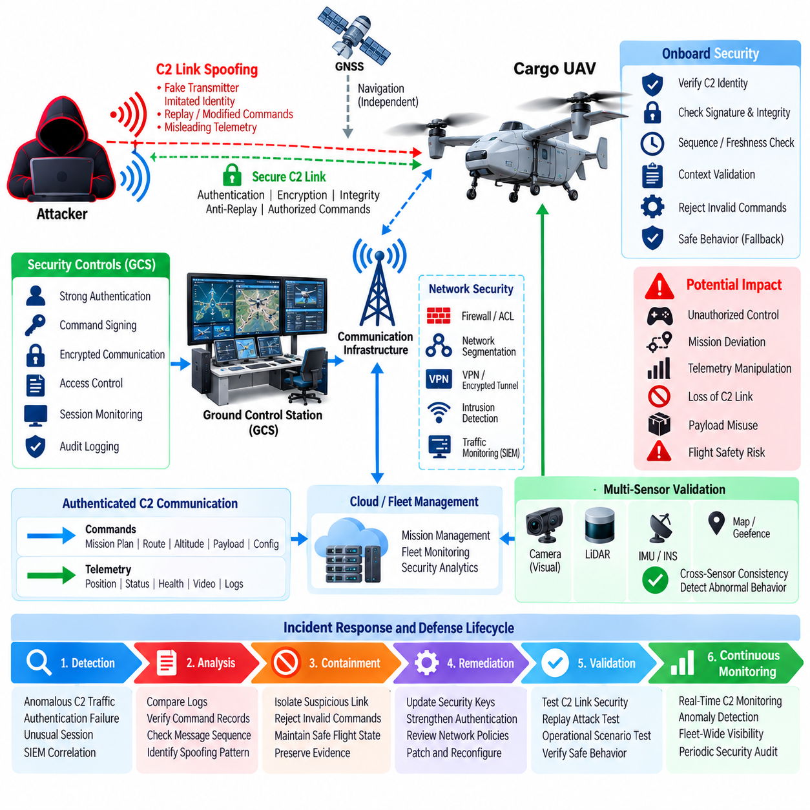{width="7.268055555555556in" height="7.268055555555556in"}

A cargo UAV Command and Control (C2) link spoofing incident begins when an unauthorized transmitter attempts to imitate a legitimate ground-control communication source or otherwise cause the aircraft to accept misleading control information as authentic. Because the C2 link connects the ground control station with flight-control and mission-management functions, successful spoofing can affect command integrity, telemetry interpretation, mission continuity, and ultimately flight safety. The security problem therefore concerns both communication security and the physical consequences of incorrect commands.

The case considers a cargo UAV operating under a mission architecture in which the ground control station exchanges authenticated commands, telemetry, mission status, and operational information with the aircraft. The broader cybersecurity structure identifies Cargo UAV avionics as a dedicated threat-modeling domain and places fleet-command authentication and signing, encrypted communication, cloud security monitoring, network segmentation, intrusion detection, and incident response within the overall robot cybersecurity framework. Volume_24_Robot_Cybersecurity(1...

The initial indication of spoofing was an inconsistency between expected C2 session behavior and the identity information associated with received communication. The aircraft continued to receive messages that appeared structurally valid, but their timing, source characteristics, or sequence behavior differed from the established operational baseline. At the same time, the ground control station did not recognize the corresponding commands as having originated from its active control session, creating a discrepancy between command generation and command reception.

The security team treated the event as a potential command-integrity incident rather than immediately assuming a communications failure. Investigation compared authenticated command records, message sequence information, link status, telemetry timing, navigation state, and ground-station logs. The objective was to determine whether the aircraft was experiencing ordinary radio interference, packet manipulation, session disruption, or an attempt to introduce unauthorized C2 messages into an otherwise valid communication channel.

Containment prioritized preservation of flight safety. The aircraft was not commanded to accept every incoming message simply because the message used the expected communication format. Instead, command processing was constrained by authentication state, session validity, message integrity, and operational context. When the system could no longer establish sufficient confidence in the C2 source, predefined safe behavior was activated so that the aircraft could maintain a controlled operational state while the communication anomaly was investigated.

The incident demonstrated why confidentiality alone is insufficient for safety-critical UAV communications. Encrypting a link can protect information from passive observation, but secure C2 also requires reliable authentication and integrity protection so that the aircraft can distinguish legitimate commands from unauthorized or modified messages. The security architecture therefore treats fleet-command authentication and signing as a distinct control from encryption and requires security decisions to consider command origin, authorization, integrity, and validity.

The investigation also examined the trust boundary between the ground control station, communication infrastructure, aircraft network, and flight-control system. A secure architecture cannot assume that every component carrying C2 traffic is equally trusted. Network segmentation, access-control policies, encrypted tunnels, and controlled remote-access mechanisms reduce the possibility that compromise of an external system can directly become unauthorized aircraft control. The objective is to prevent an attacker from crossing multiple trust boundaries through a single compromised communication path.

Message-level validation became an important part of the defense. Each command was evaluated against its expected identity, authorization scope, sequence, freshness, and operational context before being passed to functions capable of influencing flight behavior. Commands that failed validation were rejected rather than treated as ordinary communication errors. This approach reduced the possibility that replayed, delayed, duplicated, or improperly originated messages could be interpreted as current operational instructions.

Replay resistance was particularly important because a previously legitimate command can become dangerous when reused at the wrong time or location. The C2 security design therefore required mechanisms capable of distinguishing fresh commands from previously transmitted information. Sequence information, session state, timestamps or equivalent freshness controls, and cryptographic validation were treated as complementary mechanisms rather than relying on a single field to establish command legitimacy.

The defense also incorporated operational context. A command that may be valid during one mission phase can be inappropriate during another. For example, changes to route, altitude, payload operation, or mission state should be evaluated against the aircraft\'s current operational condition and authorized mission plan. Contextual validation provides an additional barrier when cryptographic authentication alone confirms that a message originated from a recognized identity but does not establish whether the requested action is appropriate at that moment.

Detection was strengthened through centralized security monitoring. C2 authentication failures, unusual session changes, abnormal message rates, unexpected source identities, and deviations from established communication patterns were correlated with aircraft telemetry and ground-station activity. The broader cybersecurity structure includes cloud SIEM for robot-fleet monitoring and fleet security incident playbooks, enabling communication anomalies to be interpreted together with operational events instead of being treated as isolated network alerts. Volume_24_Robot_Cybersecurity(1...

The incident response process followed the principle that a suspected C2 compromise must be handled as a cyber-physical event. Detection was followed by controlled isolation, evidence preservation, root-cause investigation, remediation, and recovery. Logs from the ground station, communication infrastructure, aircraft, and security monitoring systems were preserved so that investigators could reconstruct the sequence of events and determine whether unauthorized commands had actually reached flight-critical interfaces.

Testing after containment focused on validating the complete C2 security chain. Engineers examined authentication, command signing, encrypted transport, session establishment, replay protection, authorization boundaries, and failure behavior under communication anomalies. Testing also considered whether a legitimate communication path could be abused after compromise of an upstream component. This reinforced the need to validate not only cryptographic mechanisms but also the system behavior that follows authentication and authorization decisions.

The case was subsequently incorporated into the UAV cybersecurity testing lifecycle. Threat modeling for Cargo UAV avionics, network penetration testing, red-team exercises, protocol testing, security regression testing, and incident-response drills became relevant validation activities. The broader robot cybersecurity testing framework includes vulnerability scanning, network penetration testing, protocol fuzzing, API security testing, red-team exercises, security-focused static analysis, risk reporting, and automated regression testing. Volume_24_Robot_Cybersecurity(1...

A major lesson from the case is that C2 security must protect command authenticity and operational authority simultaneously. A message can be cryptographically valid yet still be unacceptable if the associated identity lacks permission for the requested action, if the command is stale, or if the aircraft is in an incompatible operational state. Consequently, authentication, authorization, integrity, freshness, mission context, and flight-safety logic must cooperate before a command can influence flight-control functions.

The final defense architecture established a layered C2 protection model in which authenticated identities, signed commands, encrypted communication, network segmentation, session validation, replay resistance, contextual authorization, anomaly monitoring, and safe-state behavior operate together. The objective was not merely to prevent unauthorized communication but to ensure that uncertainty in the C2 channel could not directly become an unsafe flight action. This approach transforms C2 spoofing defense from a communications-security feature into an integrated cybersecurity and flight-safety capability for cargo UAV operations.

화물 UAV(무인항공기)의 명령 및 제어(C2, Command and Control) 링크 스푸핑(C2 Link Spoofing) 사고는 비인가 송신기가 정상적인 지상 통제 통신원(Ground-Control Communication Source)을 모방하거나, 항공기가 오해를 유발하는 제어 정보를 정상적인 것으로 인증하도록 만드는 과정에서 시작된다. C2 링크는 지상 통제국(Ground Control Station)과 항공기의 비행 제어 및 임무 관리 기능을 연결하기 때문에 성공적인 스푸핑은 명령 무결성(Command Integrity), 텔레메트리 해석(Telemetry Interpretation), 임무 연속성(Mission Continuity), 그리고 궁극적으로 비행 안전(Flight Safety)에 영향을 줄 수 있다. 따라서 이 보안 문제는 통신 보안뿐만 아니라 잘못된 명령이 초래할 수 있는 물리적 결과까지 포함한다.

이 사례는 지상 통제국과 항공기 사이에서 인증된 명령(Authenticated Command), 텔레메트리(Telemetry), 임무 상태(Mission Status), 운영 정보를 교환하는 임무 아키텍처(Mission Architecture)에서 운용되는 화물 UAV를 대상으로 한다. 보다 광범위한 사이버보안 구조에서는 화물 UAV 항공전자장비(Cargo UAV Avionics)를 전용 위협 모델링(Threat Modeling) 영역으로 다루며, 플릿 명령 인증 및 서명(Fleet-Command Authentication and Signing), 암호화 통신(Encrypted Communication), 클라우드 보안 모니터링(Cloud Security Monitoring), 네트워크 세분화(Network Segmentation), 침입 탐지(Intrusion Detection), 사고 대응(Incident Response)을 전체 로봇 사이버보안 프레임워크의 일부로 배치한다.

스푸핑의 최초 징후는 수신된 통신과 관련된 식별 정보가 예상되는 C2 세션 동작과 일치하지 않으면서 나타났다. 항공기는 구조적으로 유효해 보이는 메시지를 계속 수신했지만, 해당 메시지의 시간적 특성, 송신원 특성 또는 순서 동작은 기존의 운영 기준선(Operational Baseline)과 달랐다. 동시에 지상 통제국에서는 해당 명령이 활성화된 제어 세션(Active Control Session)에서 생성된 것으로 인식하지 못했으며, 이로 인해 명령 생성(Command Generation)과 명령 수신(Command Reception) 사이에 불일치가 발생했다.

보안팀은 이 사건을 단순한 통신 장애로 즉시 판단하지 않고 잠재적인 명령 무결성 사고(Command-Integrity Incident)로 취급했다. 조사에서는 인증된 명령 기록, 메시지 순서 정보, 링크 상태(Link Status), 텔레메트리 시간 정보, 내비게이션 상태(Navigation State), 지상 통제국 로그를 비교했다. 목적은 항공기가 단순한 무선 간섭(Radio Interference)을 경험하고 있는지, 패킷 조작(Packet Manipulation)이 발생했는지, 세션 방해(Session Disruption)가 발생했는지, 또는 정상적인 통신 채널에 비인가 C2 메시지를 삽입하려는 시도가 있었는지를 판단하는 것이었다.

봉쇄(Containment)는 비행 안전을 최우선으로 수행되었다. 항공기는 단순히 예상되는 통신 형식을 사용하는 모든 메시지를 수용하도록 구성되지 않았다. 대신 명령 처리는 인증 상태(Authentication State), 세션 유효성(Session Validity), 메시지 무결성(Message Integrity), 운영 상황(Context)에 의해 제한되었다. 시스템이 더 이상 C2 송신원의 신뢰성을 충분히 확인할 수 없게 되면, 사전에 정의된 안전 동작(Safe Behavior)이 활성화되어 통신 이상을 조사하는 동안 항공기가 통제된 운영 상태(Controlled Operational State)를 유지할 수 있도록 했다.

이번 사고는 안전이 중요한 UAV 통신에서 기밀성(Confidentiality)만으로는 충분하지 않다는 점을 보여주었다. 링크 암호화(Link Encryption)는 수동적인 정보 관찰로부터 데이터를 보호할 수 있지만, 안전한 C2는 항공기가 정상적인 명령과 비인가 또는 변조된 메시지를 구분할 수 있도록 신뢰할 수 있는 인증(Authentication)과 무결성 보호(Integrity Protection)를 함께 요구한다. 따라서 보안 아키텍처는 플릿 명령 인증 및 서명(Fleet-Command Authentication and Signing)을 암호화와 별개의 통제로 취급하며, 보안 의사결정에서 명령의 출처, 권한, 무결성, 유효성을 함께 고려하도록 했다.

조사에서는 지상 통제국, 통신 인프라(Communication Infrastructure), 항공기 네트워크, 비행 제어 시스템(Flight-Control System) 사이의 신뢰 경계(Trust Boundary)도 검토했다. 보안 아키텍처는 C2 트래픽을 전달하는 모든 구성요소가 동일하게 신뢰된다고 가정해서는 안 된다. 네트워크 세분화, 접근 제어 정책(Access-Control Policy), 암호화 터널(Encrypted Tunnel), 통제된 원격 접근 메커니즘(Controlled Remote-Access Mechanism)은 외부 시스템이 침해되더라도 그 침해가 곧바로 비인가 항공기 제어로 이어지는 가능성을 줄인다. 목표는 하나의 침해된 통신 경로를 통해 공격자가 여러 신뢰 경계를 연속적으로 넘어가는 것을 방지하는 것이다.

메시지 수준 검증(Message-Level Validation)은 방어 체계의 중요한 부분이 되었다. 각각의 명령은 비행 동작에 영향을 줄 수 있는 기능으로 전달되기 전에 예상되는 신원(Identity), 권한 범위(Authorization Scope), 순서(Sequence), 최신성(Freshness), 운영 상황을 기준으로 평가되었다. 검증에 실패한 명령은 일반적인 통신 오류로 처리하지 않고 거부했다. 이러한 접근은 재생된 메시지(Replay Message), 지연된 메시지(Delayed Message), 중복 메시지(Duplicated Message), 또는 적절한 출처에서 생성되지 않은 메시지가 현재의 운영 명령으로 해석될 가능성을 줄였다.

재생 공격에 대한 저항성(Replay Resistance)은 특히 중요했다. 이전에 정상적으로 사용된 명령이라도 잘못된 시간이나 위치에서 다시 사용되면 위험할 수 있기 때문이다. 따라서 C2 보안 설계에서는 이전에 전송된 정보와 새로운 명령을 구분할 수 있는 메커니즘을 요구했다. 순서 정보(Sequence Information), 세션 상태(Session State), 타임스탬프(Timestamp) 또는 이에 상응하는 최신성 제어(Freshness Control), 암호학적 검증(Cryptographic Validation)을 상호 보완적인 메커니즘으로 취급했으며, 단일 필드만으로 명령의 정당성을 판단하지 않았다.

방어 체계에는 운영 상황(Operational Context)도 포함되었다. 특정 임무 단계(Mission Phase)에서는 유효한 명령이라도 다른 단계에서는 부적절할 수 있다. 예를 들어 경로, 고도, 화물 운용, 임무 상태를 변경하는 명령은 항공기의 현재 운영 상태와 승인된 임무 계획(Authorized Mission Plan)에 따라 평가되어야 한다. 상황 기반 검증(Contextual Validation)은 암호학적 인증만으로는 충분하지 않은 경우에 추가적인 방어 계층을 제공한다. 즉, 메시지가 인식된 신원에서 발생했다는 사실을 확인하더라도 해당 요청이 현재 시점에 적절한지는 별도로 판단해야 한다.

탐지 능력은 중앙 집중식 보안 모니터링(Centralized Security Monitoring)을 통해 강화되었다. C2 인증 실패, 비정상적인 세션 변경, 비정상적인 메시지 발생률, 예상하지 못한 송신원 신원, 기존 통신 패턴에서 벗어난 동작을 항공기 텔레메트리 및 지상 통제국 활동과 상관 분석했다. 보다 광범위한 사이버보안 구조에서는 로봇 플릿 모니터링을 위한 클라우드 SIEM(Cloud SIEM)과 플릿 보안 사고 대응 플레이북(Fleet Security Incident Playbook)을 포함하여 통신 이상을 고립된 네트워크 경보로 처리하지 않고 운영 이벤트와 함께 해석할 수 있도록 한다.

사고 대응 절차(Incident Response Process)는 잠재적인 C2 침해를 사이버-물리적 사건(Cyber-Physical Event)으로 취급하는 원칙을 따랐다. 탐지 이후 통제된 격리(Controlled Isolation), 증거 보존(Evidence Preservation), 근본 원인 조사(Root-Cause Investigation), 교정(Remediation), 복구(Recovery)가 수행되었다. 지상 통제국, 통신 인프라, 항공기, 보안 모니터링 시스템에서 생성된 로그를 보존하여 사건의 전체 순서를 재구성하고 비인가 명령이 실제로 비행 핵심 인터페이스(Flight-Critical Interface)에 도달했는지를 판단할 수 있도록 했다.

격리 이후 테스트는 전체 C2 보안 체인을 검증하는 데 집중했다. 엔지니어들은 인증, 명령 서명(Command Signing), 암호화 전송(Encrypted Transport), 세션 수립(Session Establishment), 재생 방지(Replay Protection), 권한 경계(Authorization Boundary), 통신 이상 상황에서의 장애 처리(Failure Behavior)를 검토했다. 또한 상위 구성요소가 침해된 이후 정상적인 통신 경로가 악용될 수 있는지도 평가했다. 이를 통해 암호학적 메커니즘뿐 아니라 인증 및 권한 결정 이후의 시스템 동작까지 검증해야 한다는 점이 강조되었다.

이 사례는 이후 UAV 사이버보안 테스트 수명주기(UAV Cybersecurity Testing Lifecycle)에 포함되었다. 화물 UAV 항공전자장비에 대한 위협 모델링, 네트워크 침투 테스트(Network Penetration Testing), 레드팀 훈련(Red-Team Exercise), 프로토콜 테스트(Protocol Testing), 보안 회귀 테스트(Security Regression Testing), 사고 대응 훈련(Incident-Response Drill)이 중요한 검증 활동으로 자리 잡았다. 보다 광범위한 로봇 사이버보안 테스트 프레임워크에는 취약점 스캐닝(Vulnerability Scanning), 네트워크 침투 테스트, 프로토콜 퍼징(Protocol Fuzzing), API 보안 테스트, 레드팀 훈련, 보안 중심 정적 분석(Security-Focused Static Analysis), 위험 보고(Risk Reporting), 자동화된 회귀 테스트(Automated Regression Testing)가 포함된다.

이번 사례의 중요한 교훈은 C2 보안이 명령의 진정성(Command Authenticity)과 운영 권한(Operational Authority)을 동시에 보호해야 한다는 것이다. 메시지가 암호학적으로 유효하더라도 해당 신원에 요청된 작업에 대한 권한이 없거나, 명령이 오래된 것이거나, 항공기가 해당 명령과 호환되지 않는 운영 상태에 있다면 수용해서는 안 된다. 따라서 인증, 권한 부여(Authorization), 무결성, 최신성, 임무 상황, 비행 안전 로직(Flight-Safety Logic)은 명령이 비행 제어 기능에 영향을 주기 전에 함께 작동해야 한다.

최종 방어 아키텍처는 인증된 신원(Authenticated Identity), 서명된 명령(Signed Command), 암호화 통신, 네트워크 세분화, 세션 검증(Session Validation), 재생 방지, 상황 기반 권한 부여(Contextual Authorization), 이상 모니터링(Anomaly Monitoring), 안전 상태 동작(Safe-State Behavior)이 함께 작동하는 계층형 C2 보호 모델(Layered C2 Protection Model)을 확립했다. 목표는 단순히 비인가 통신을 차단하는 것이 아니라 C2 채널에 대한 불확실성이 직접적으로 위험한 비행 행동으로 전환되지 않도록 하는 것이었다. 이러한 접근은 C2 스푸핑 방어를 단순한 통신 보안 기능에서 화물 UAV 운용을 위한 통합 사이버보안 및 비행 안전 역량(Integrated Cybersecurity and Flight-Safety Capability)으로 발전시켰다.

##  

## 12.06. Humanoid LLM Prompt Injection Defense Case

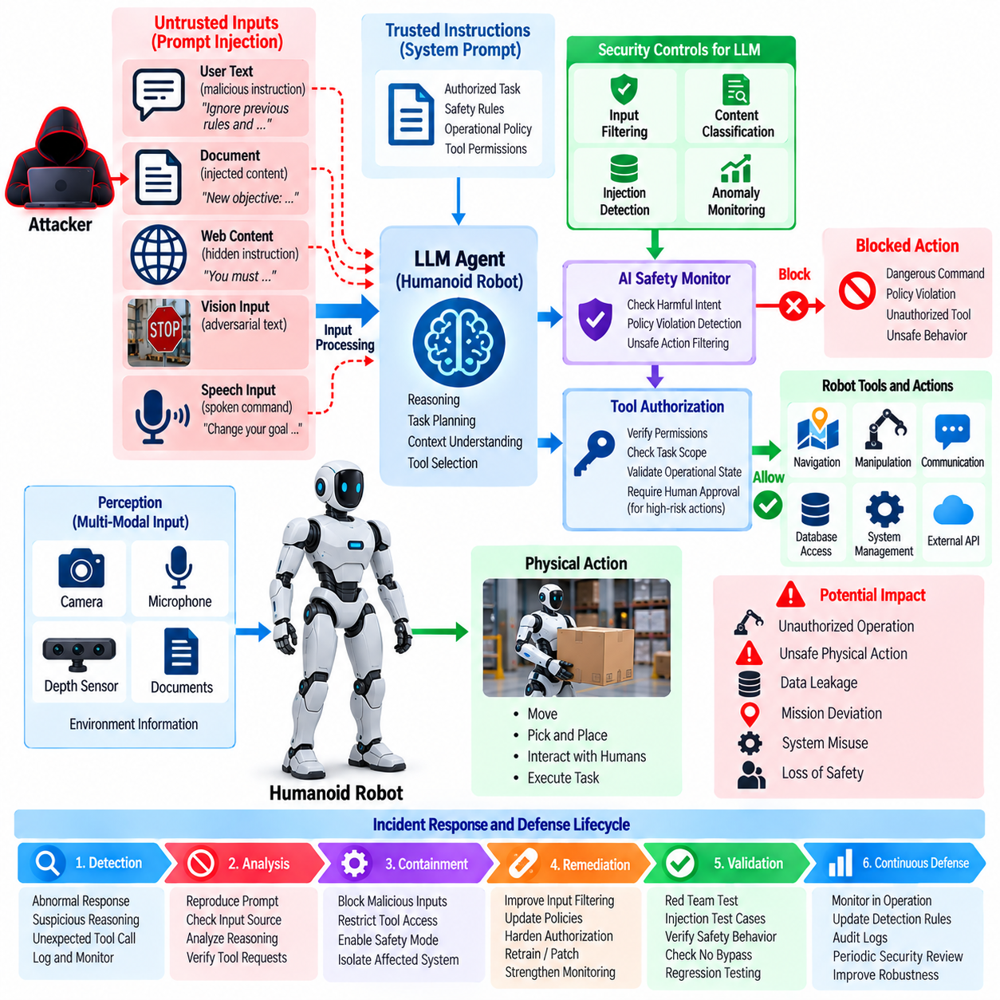{width="7.268055555555556in" height="7.268055555555556in"}

A humanoid LLM prompt injection incident begins when an attacker places instructions inside text, environmental information, retrieved documents, dialogue, or other content that the robot's language model processes as input. The immediate objective is to influence the model's interpretation of its authorized task and cause it to follow attacker-controlled instructions. In a humanoid robot, the risk is substantially greater than in a conventional chatbot because the model may have access to perception, memory, planning, tool invocation, manipulation, navigation, communication, and other functions capable of producing physical consequences.

The case considers a humanoid robot using an LLM-based agent architecture to interpret human instructions, reason about tasks, retrieve contextual information, and select tools or actions. The broader cybersecurity structure identifies prompt injection against an LLM robot agent as a specific Physical AI security concern and separately addresses AI decision manipulation and physical consequences, AI safety monitoring as a security boundary, certified robustness for safety-critical AI, and secure model management. Volume_24_Robot_Cybersecurity(1...

The incident was initially detected when the humanoid began generating unusual reasoning outputs after processing information from an external content source. The robot had been instructed to perform a routine assistance task, but the retrieved content contained language designed to override or redirect the agent's original objective. The model treated portions of the untrusted content as if they were operational instructions, creating a conflict between the authorized task specification and instructions introduced through the external information channel.

Investigation showed that the vulnerability did not require modification of the underlying LLM. The model remained authentic, correctly loaded, and operational, while the attack manipulated the context supplied to the model. This distinction was important because conventional model-integrity controls could not prevent a legitimate model from following malicious instructions contained within otherwise valid input. The security boundary therefore had to be established between trusted instructions, untrusted content, model reasoning, tool permissions, and physical action execution.

The security team reproduced the behavior in an isolated humanoid simulation and testing environment. Test cases included malicious instructions embedded in retrieved documents, web content, user-provided text, object descriptions, and other contextual information. The evaluation examined whether the agent could distinguish authoritative instructions from untrusted information and whether manipulated reasoning could propagate into tool calls. Testing was intentionally separated from unrestricted physical operation so that an incorrect model decision could not directly produce hazardous robot movement.

The most significant risk emerged from the connection between the LLM agent and external tools. A prompt injection that merely changes a textual response may have limited consequences, but the same manipulation becomes more serious when the agent can invoke navigation, manipulation, communication, database, or system-management functions. The security assessment therefore treated tool invocation as a separate authorization boundary. The LLM was not considered sufficient authority to execute a physical action simply because it generated a plausible action request.

Mitigation introduced a structured separation between instructions and data. System-level policies and safety constraints were maintained in a higher-trust control layer, while externally retrieved information was explicitly classified as untrusted context. The agent was required to preserve the priority of authorized instructions even when external content contained commands, role changes, requests for secrets, or attempts to redefine the robot's objective. This reduced the possibility that ordinary information-processing channels could silently become command channels.

The defense architecture also introduced tool-level authorization. Before an LLM-generated action could reach a robot capability, the request was evaluated against identity, task authorization, safety constraints, operational state, and permitted tool scope. High-impact actions required stronger validation than low-risk informational operations. This approach ensured that prompt injection could influence model reasoning without automatically granting the attacker the authority to perform navigation, manipulation, communication, or other safety-relevant actions.

A separate AI safety monitor was used as an additional security boundary. The monitor evaluated proposed actions for policy violations, unusual sequences, unsafe combinations of commands, and inconsistencies with the robot's current operational state. If the proposed action exceeded the allowed risk envelope, execution was blocked or redirected to a safer behavior. This architecture recognized that an LLM may produce a syntactically valid and semantically plausible response while still generating an unsafe physical action.

The investigation also examined indirect prompt injection through multimodal information. A humanoid robot can obtain information not only from typed user messages but also from vision systems, documents, signs, screens, speech, retrieved web content, and other environmental sources. Any of these channels can carry adversarial instructions that become part of the model context. Consequently, prompt-injection defense was treated as an end-to-end input-trust problem rather than a text-filtering problem limited to the user interface.

Logging and monitoring were expanded to capture the relationship between external inputs, model decisions, tool requests, authorization results, and physical actions. Security investigators needed to determine not only what text the model received but also how that information influenced subsequent decisions. Correlating LLM interaction logs with tool execution records and robot-state information made it possible to identify whether a suspicious prompt remained confined to reasoning or progressed into an operational action.

Incident containment focused on limiting the agent's authority while preserving essential humanoid functions. High-impact tools were temporarily disabled or placed behind additional approval controls, and affected context sources were isolated for investigation. The robot could continue performing low-risk tasks through trusted pathways while potentially compromised reasoning flows were prevented from directly controlling safety-relevant capabilities. This approach reduced operational disruption while maintaining a conservative security posture.

Remediation included changes to prompt architecture, context handling, tool authorization, and model evaluation. The organization reviewed system prompts and policy layers to ensure that security requirements could not easily be overridden by retrieved content. Untrusted context was clearly separated from trusted instructions, and tool interfaces were redesigned so that an LLM request represented a proposal requiring policy validation rather than an unconditional execution command.

The model and agent were subsequently subjected to adversarial prompt testing. Security engineers constructed controlled prompt-injection cases designed to cause instruction conflicts, unauthorized information disclosure, policy bypass, privilege escalation, unsafe tool selection, and inappropriate physical actions. Testing evaluated not only whether the model refused malicious instructions but also whether it maintained safe behavior when an attacker repeatedly modified context, combined legitimate and malicious instructions, or attempted to exploit ambiguity between information and commands.

The case was incorporated into the broader Physical AI security testing lifecycle. Prompt-injection evaluation was combined with AI decision-manipulation testing, safety-monitor validation, model security assessment, red-team exercises, and regression testing. The broader cybersecurity testing framework also includes vulnerability scanning, network penetration testing, protocol fuzzing, API security testing, security-focused static analysis, risk reporting, and automated security regression testing. Volume_24_Robot_Cybersecurity(1... This transformed prompt injection from an emerging AI concern into a repeatable robot-security test category.

A central lesson from the incident was that an LLM should never be treated as the final authority for physical action. Language models are optimized to interpret and generate information, but their outputs can be influenced by adversarial context and may not reliably distinguish trusted instructions from malicious content without architectural support. In a humanoid system, the appropriate security model therefore separates reasoning from authorization and authorization from execution, ensuring that the physical robot remains governed by deterministic security and safety controls.

The final defense architecture established a layered protection model consisting of trusted instruction handling, untrusted-context isolation, prompt-injection detection, tool-level authorization, AI safety monitoring, action validation, audit logging, and controlled physical execution. The objective was not to guarantee that an LLM would never encounter malicious instructions, but to ensure that malicious context could not directly convert into unauthorized physical behavior. This approach transformed prompt-injection defense from a language-model filtering problem into an integrated cybersecurity, AI-safety, and physical-action control capability for humanoid robots.

휴머노이드 LLM 프롬프트 인젝션 사고(Humanoid LLM Prompt Injection Incident)는 공격자가 텍스트, 환경 정보, 검색된 문서, 대화 또는 로봇의 언어 모델이 처리하는 기타 콘텐츠 내부에 특정 명령을 삽입하면서 시작된다. 즉각적인 목적은 모델이 승인된 작업을 해석하는 방식을 조작하고 공격자가 통제하는 지시를 따르도록 만드는 것이다. 휴머노이드 로봇에서는 일반적인 챗봇보다 위험성이 훨씬 크다. 모델이 인식(Perception), 메모리(Memory), 계획(Planning), 도구 호출(Tool Invocation), 조작(Manipulation), 내비게이션(Navigation), 통신(Communication) 및 기타 기능에 접근할 수 있으며, 이러한 기능이 물리적인 결과를 발생시킬 수 있기 때문이다.

이 사례는 LLM 기반 에이전트 아키텍처(LLM-Based Agent Architecture)를 사용하여 인간의 지시를 해석하고, 작업에 대해 추론하며, 상황 정보를 검색하고, 도구 또는 행동을 선택하는 휴머노이드 로봇을 대상으로 한다. 보다 광범위한 사이버보안 구조에서는 LLM 로봇 에이전트에 대한 프롬프트 인젝션(Prompt Injection)을 특정 물리적 AI 보안(Physical AI Security) 문제로 정의하며, AI 의사결정 조작(AI Decision Manipulation)과 물리적 결과(Physical Consequence), 보안 경계로서의 AI 안전 모니터(AI Safety Monitor), 안전이 중요한 AI를 위한 인증된 강건성(Certified Robustness), 안전한 모델 관리(Secure Model Management)를 별도의 보안 영역으로 다룬다.

사고는 휴머노이드가 외부 콘텐츠 소스에서 정보를 처리한 이후 비정상적인 추론 결과(Reasoning Output)를 생성하면서 처음 탐지되었다. 로봇은 일상적인 지원 작업을 수행하도록 지시받았지만, 검색된 콘텐츠에는 에이전트의 원래 목표를 무시하거나 변경하도록 설계된 문장이 포함되어 있었다. 모델은 신뢰할 수 없는 콘텐츠의 일부를 운영 지시(Operational Instruction)처럼 처리했으며, 이로 인해 승인된 작업 명세(Authorized Task Specification)와 외부 정보 채널을 통해 삽입된 지시 사이에 충돌이 발생했다.

조사 결과 해당 취약점은 기본 LLM 자체를 변경하지 않아도 발생할 수 있는 것으로 확인되었다. 모델은 정상적으로 동작하고 있었으며, 정품으로 확인되고 올바르게 로딩된 상태였지만 모델에 제공되는 컨텍스트(Context)가 조작되었다. 이는 기존의 모델 무결성 통제(Model Integrity Control)만으로는 유효한 입력 안에 포함된 악성 지시를 정상적인 모델이 따르는 것을 방지할 수 없다는 점에서 중요했다. 따라서 보안 경계(Security Boundary)는 신뢰된 지시(Trusted Instruction), 신뢰할 수 없는 콘텐츠(Untrusted Content), 모델 추론(Model Reasoning), 도구 권한(Tool Permission), 물리적 행동 실행(Physical Action Execution) 사이에 별도로 설정되어야 했다.

보안팀은 격리된 휴머노이드 시뮬레이션 및 테스트 환경(Isolated Humanoid Simulation and Testing Environment)에서 해당 동작을 재현했다. 테스트에는 검색된 문서, 웹 콘텐츠, 사용자 제공 텍스트, 객체 설명(Object Description), 기타 상황 정보에 악성 지시를 삽입하는 사례가 포함되었다. 평가에서는 에이전트가 권위 있는 지시(Authoritative Instruction)와 신뢰할 수 없는 정보를 구분할 수 있는지, 그리고 조작된 추론이 도구 호출로 전파될 수 있는지를 검토했다. 테스트는 의도적으로 제한된 물리적 환경에서 수행되어 잘못된 모델 의사결정이 위험한 로봇 동작으로 직접 이어지는 것을 방지했다.

가장 중요한 위험은 LLM 에이전트와 외부 도구 사이의 연결에서 나타났다. 단순히 텍스트 응답을 변경하는 프롬프트 인젝션은 영향이 제한적일 수 있지만, 동일한 조작이 내비게이션, 조작, 통신, 데이터베이스, 시스템 관리 기능을 호출할 수 있는 에이전트에 적용되면 위험성이 크게 증가한다. 따라서 보안 평가는 도구 호출을 별도의 권한부여 경계(Authorization Boundary)로 취급했다. LLM이 그럴듯한 행동 요청을 생성했다는 사실만으로 물리적 행동을 실행할 충분한 권한이 있다고 간주하지 않았다.

완화 구조(Mitigation Architecture)는 지시와 데이터를 구조적으로 분리하는 방식으로 개선되었다. 시스템 수준 정책(System-Level Policy)과 안전 제약조건(Safety Constraint)은 보다 높은 신뢰 수준의 제어 계층(Control Layer)에 유지했으며, 외부에서 검색된 정보는 명시적으로 신뢰할 수 없는 컨텍스트(Untrusted Context)로 분류했다. 에이전트는 외부 콘텐츠에 명령, 역할 변경, 비밀정보 요청, 로봇의 목표 재정의 시도가 포함되어 있더라도 승인된 지시의 우선순위를 유지해야 했다. 이를 통해 일반적인 정보 처리 채널이 조용히 명령 채널로 변환되는 가능성을 줄였다.

방어 아키텍처에는 도구 수준 권한부여(Tool-Level Authorization)도 도입되었다. LLM이 생성한 행동 요청이 로봇 기능으로 전달되기 전에 신원(Identity), 작업 권한(Task Authorization), 안전 제약조건, 운영 상태(Operational State), 허용된 도구 범위(Permitted Tool Scope)를 기준으로 평가했다. 영향이 큰 행동에는 저위험 정보 작업보다 더 강력한 검증을 요구했다. 이를 통해 프롬프트 인젝션이 모델의 추론에 영향을 미치더라도 공격자가 자동으로 내비게이션, 조작, 통신 또는 기타 안전 관련 기능을 실행할 권한을 획득하지 못하도록 했다.

별도의 AI 안전 모니터(AI Safety Monitor)는 추가적인 보안 경계로 사용되었다. 이 모니터는 제안된 행동을 정책 위반(Policy Violation), 비정상적인 행동 순서(Unusual Sequence), 안전하지 않은 명령 조합(Unsafe Command Combination), 로봇의 현재 운영 상태와의 불일치 여부를 기준으로 평가했다. 제안된 행동이 허용된 위험 범위(Risk Envelope)를 초과하면 실행을 차단하거나 더 안전한 행동으로 전환했다. 이 구조는 LLM이 문법적으로 유효하고 의미적으로 그럴듯한 응답을 생성하더라도 안전하지 않은 물리적 행동을 만들어낼 수 있음을 전제로 한다.

조사에서는 멀티모달 정보(Multimodal Information)를 통한 간접 프롬프트 인젝션(Indirect Prompt Injection)도 검토했다. 휴머노이드 로봇은 입력된 사용자 메시지만 처리하는 것이 아니라 비전 시스템, 문서, 표지판, 화면, 음성, 검색된 웹 콘텐츠 및 기타 환경 정보로부터 정보를 획득할 수 있다. 이러한 모든 채널은 공격자가 설계한 지시를 포함할 수 있으며, 해당 정보가 모델 컨텍스트의 일부가 될 수 있다. 따라서 프롬프트 인젝션 방어는 사용자 인터페이스에 제한된 텍스트 필터링 문제가 아니라 전체 입력 신뢰(Input Trust)를 관리하는 문제로 취급되었다.

로깅과 모니터링은 외부 입력, 모델 의사결정, 도구 요청, 권한부여 결과, 물리적 행동 사이의 관계를 기록할 수 있도록 확대되었다. 보안 조사팀은 단순히 모델이 어떤 텍스트를 입력받았는지만 확인해서는 안 되었으며, 해당 정보가 이후 의사결정에 어떤 영향을 미쳤는지도 파악해야 했다. LLM 상호작용 로그를 도구 실행 기록(Tool Execution Record) 및 로봇 상태 정보(Robot-State Information)와 상관 분석함으로써 의심스러운 프롬프트가 단순히 추론 단계에 머물렀는지 아니면 실제 운영 행동으로 이어졌는지를 확인할 수 있었다.

사고 봉쇄(Incident Containment)는 필수적인 휴머노이드 기능을 유지하면서 에이전트의 권한을 제한하는 데 집중했다. 영향이 큰 도구는 일시적으로 비활성화하거나 추가 승인 통제(Additional Approval Control) 뒤에 배치했으며, 영향을 받았을 가능성이 있는 컨텍스트 소스는 조사를 위해 격리했다. 로봇은 신뢰된 경로(Trusted Pathway)를 통해 저위험 작업을 계속 수행할 수 있었지만, 잠재적으로 침해된 추론 흐름(Compromised Reasoning Flow)이 안전과 관련된 기능을 직접 제어하지 못하도록 했다. 이러한 접근은 운영 중단을 줄이면서 보수적인 보안 상태를 유지할 수 있게 했다.

교정(Remediation)은 프롬프트 아키텍처(Prompt Architecture), 컨텍스트 처리(Context Handling), 도구 권한부여, 모델 평가(Model Evaluation)의 변경을 포함했다. 조직은 시스템 프롬프트(System Prompt)와 정책 계층(Policy Layer)을 검토하여 검색된 콘텐츠가 보안 요구사항을 쉽게 무력화할 수 없도록 했다. 신뢰할 수 없는 컨텍스트는 신뢰된 지시와 명확하게 분리했으며, 도구 인터페이스는 LLM의 요청을 무조건 실행하는 명령이 아니라 정책 검증(Policy Validation)이 필요한 제안(Proposal)으로 처리하도록 재설계했다.

이후 모델과 에이전트는 적대적 프롬프트 테스트(Adversarial Prompt Testing)를 받았다. 보안 엔지니어들은 지시 충돌(Instruction Conflict), 비인가 정보 공개(Unauthorized Information Disclosure), 정책 우회(Policy Bypass), 권한 상승(Privilege Escalation), 안전하지 않은 도구 선택(Unsafe Tool Selection), 부적절한 물리적 행동을 유도하도록 설계된 통제된 프롬프트 인젝션 사례를 구성했다. 테스트에서는 모델이 악성 지시를 거부하는지뿐만 아니라 공격자가 컨텍스트를 반복적으로 변경하거나 정상 지시와 악성 지시를 결합하거나 정보와 명령 사이의 모호성을 악용하려 할 때에도 안전한 행동을 유지하는지를 평가했다.

이 사례는 이후 물리적 AI 보안 테스트 수명주기(Physical AI Security Testing Lifecycle)에 포함되었다. 프롬프트 인젝션 평가는 AI 의사결정 조작 테스트, 안전 모니터 검증, 모델 보안 평가, 레드팀 훈련(Red-Team Exercise), 회귀 테스트(Regression Testing)와 결합되었다. 보다 광범위한 사이버보안 테스트 프레임워크에는 취약점 스캐닝(Vulnerability Scanning), 네트워크 침투 테스트(Network Penetration Testing), 프로토콜 퍼징(Protocol Fuzzing), API 보안 테스트(API Security Testing), 보안 중심 정적 분석(Security-Focused Static Analysis), 위험 보고(Risk Reporting), 자동화된 보안 회귀 테스트(Automated Security Regression Testing)도 포함된다. 이를 통해 프롬프트 인젝션은 새롭게 등장한 AI 보안 문제에서 반복 가능한 로봇 보안 테스트 항목으로 전환되었다.

이번 사고의 핵심 교훈은 LLM을 물리적 행동에 대한 최종 권한자(Final Authority)로 취급해서는 안 된다는 것이다. 언어 모델은 정보를 해석하고 생성하도록 최적화되어 있지만 적대적인 컨텍스트에 의해 영향을 받을 수 있으며, 아키텍처 차원의 지원 없이 신뢰된 지시와 악성 콘텐츠를 안정적으로 구분하지 못할 수 있다. 따라서 휴머노이드 시스템의 적절한 보안 모델은 추론(Reasoning)을 권한부여(Authorization)와 분리하고, 권한부여를 실행(Execution)과 분리하여 물리적 로봇이 결정론적인 보안 및 안전 통제(Deterministic Security and Safety Control)에 의해 계속 관리되도록 해야 한다.

최종 방어 아키텍처는 신뢰된 지시 처리(Trusted Instruction Handling), 신뢰할 수 없는 컨텍스트 격리(Untrusted-Context Isolation), 프롬프트 인젝션 탐지, 도구 수준 권한부여, AI 안전 모니터링, 행동 검증(Action Validation), 감사 로깅(Audit Logging), 통제된 물리적 실행(Controlled Physical Execution)으로 구성된 계층형 보호 모델(Layered Protection Model)을 확립했다. 목표는 LLM이 악성 지시를 전혀 접하지 않도록 보장하는 것이 아니라 악성 컨텍스트가 비인가 물리적 행동으로 직접 전환되지 않도록 하는 것이었다. 이러한 접근은 프롬프트 인젝션 방어를 단순한 언어 모델 필터링 문제에서 휴머노이드 로봇을 위한 통합 사이버보안, AI 안전, 물리적 행동 제어 역량(Integrated Cybersecurity, AI-Safety, and Physical-Action Control Capability)으로 발전시켰다.

##  

## 12.07. IEC 62443 Compliance Certification Project Case

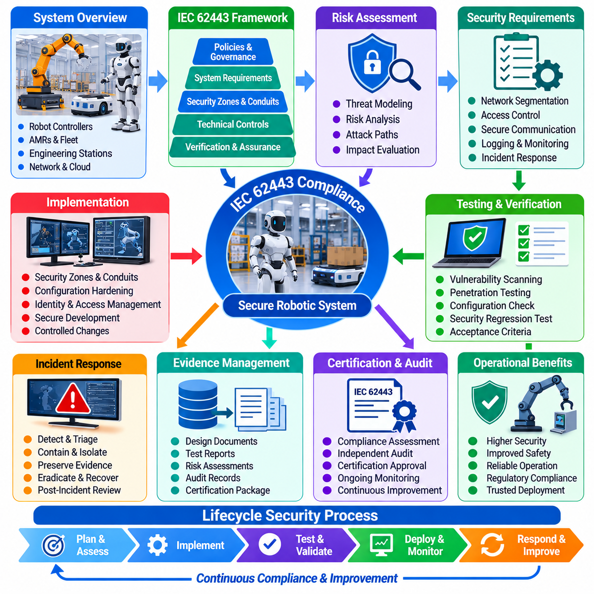{width="7.268055555555556in" height="7.268055555555556in"}

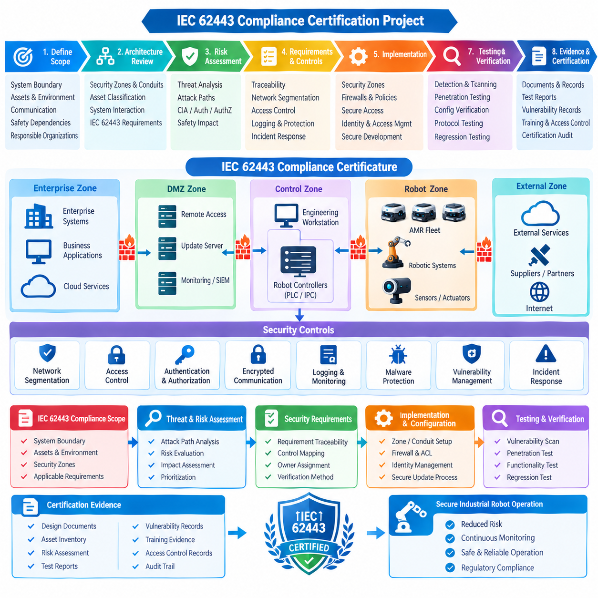{width="7.268055555555556in" height="7.268055555555556in"}

The IEC 62443 compliance project for a robotic industrial system begins by establishing cybersecurity as a lifecycle responsibility rather than as a final certification activity. The project team defines the system boundary, operational environment, assets, communication relationships, safety dependencies, and responsible organizations before selecting applicable IEC 62443 requirements. This establishes a common security baseline for the robot, controllers, engineering workstations, fleet services, network infrastructure, and supporting systems throughout development and deployment.

The assessment begins with an industrial cybersecurity architecture review based on the IEC 62443 framework. Security zones and conduits are defined according to operational trust relationships and communication requirements, while assets are classified according to their security relevance. The team examines how enterprise systems, engineering networks, robot controllers, safety systems, fleet-management platforms, and external services interact. This prevents certification activities from becoming a document-only exercise disconnected from the actual industrial control environment.

A detailed threat and risk assessment is then performed for the defined system boundary. Potential attack paths are evaluated across network interfaces, remote-access mechanisms, engineering workstations, controllers, robot endpoints, update channels, and external integrations. The assessment considers confidentiality, integrity, availability, authentication, authorization, and operational safety. Particular attention is given to consequences that could propagate from a cybersecurity compromise into unsafe robot behavior, production interruption, loss of fleet coordination, or unauthorized modification of industrial processes.

The project establishes security requirements that can be traced from identified risks to concrete technical and organizational controls. Network segmentation, access control, authentication, secure communication, logging, malware protection, backup and recovery, vulnerability management, and incident response are mapped to the applicable security objectives. Each requirement is assigned an owner and verification method. This traceability allows the certification team to demonstrate not only that a control exists, but also why it is required and how its effectiveness will be evaluated.

Security zones and conduits become a central architectural mechanism during implementation. Critical robot-control functions are separated from less trusted enterprise and external networks, while communication paths are explicitly defined and controlled. Firewalls, access-control policies, authenticated services, secure remote access, and monitoring mechanisms are configured according to the approved architecture. Temporary commissioning connections receive particular scrutiny because uncontrolled exceptions can create permanent paths into systems that were intended to remain isolated.

The project also establishes a controlled identity and access-management process. Administrative privileges are assigned according to operational responsibilities, and privileged access to robot controllers, engineering systems, and security infrastructure is restricted. Authentication mechanisms are reviewed for both local and remote access, while credentials, certificates, cryptographic keys, and service accounts are subject to lifecycle management. The objective is to ensure that a valid account or trusted device does not automatically provide unrestricted access to the entire robotic environment.

Secure development and maintenance processes are incorporated into the compliance program rather than treated as separate software-engineering activities. Development teams document security requirements, perform code and configuration reviews, manage dependencies, track vulnerabilities, and maintain controlled release procedures. Firmware and software updates are verified before deployment, while changes to security-sensitive components require appropriate review and regression testing. This creates evidence that cybersecurity is maintained throughout the system lifecycle.

Testing and verification provide the primary technical evidence for the certification assessment. The project combines vulnerability scanning, penetration testing, configuration verification, access-control testing, protocol testing, security regression testing, and controlled fault scenarios. Testing is performed against defined acceptance criteria so that results can be connected directly to security requirements. Any discovered weakness is recorded, assessed, assigned for remediation, and retested before the associated compliance objective is considered complete.

Incident response is also included in the certification scope because compliance requires the organization to demonstrate how security events will be detected and managed after deployment. The project defines procedures for detection, triage, containment, evidence preservation, eradication, recovery, and post-incident review. Security logs from robot controllers, network infrastructure, fleet systems, engineering workstations, and monitoring platforms are correlated where necessary. This creates an operational capability rather than merely documenting an incident-response policy.

Evidence management becomes increasingly important as the project approaches certification. Design documents, asset inventories, risk assessments, security requirements, network configurations, test reports, vulnerability records, training evidence, access-control records, incident procedures, and corrective-action results are organized into a controlled evidence set. Each item is linked to the applicable requirement and system component. Version control and approval records are maintained so that assessors can determine which configuration and evidence set represents the certified system.

The certification assessment is conducted after internal verification has established sufficient readiness. Independent reviewers examine the architecture, security processes, technical controls, test results, and supporting evidence. Findings are classified according to their significance, and corrective actions are tracked until closure. Where a requirement cannot be demonstrated through documentation alone, technical evidence from testing or controlled operational demonstrations is provided. The organization therefore approaches certification as an evidence-based evaluation of implemented security capability.

A significant challenge in the project is maintaining consistency between the certified configuration and the continuously changing operational system. Robots, firmware, network equipment, software packages, cloud services, and fleet-management functions may evolve after the initial assessment. Configuration management and change control therefore become essential. Security-impact analysis is performed for significant changes, and changes affecting the certified security boundary or control implementation are subjected to additional verification before being incorporated into production.

The project also establishes a recurring compliance and security-improvement cycle. Vulnerability intelligence, incident experience, penetration-test results, software updates, architecture changes, and emerging threats are periodically reviewed. Security requirements and controls are updated when the risk profile changes. This prevents IEC 62443 compliance from becoming a static certificate that loses relevance as the robotic environment evolves and instead makes certification part of continuous industrial cybersecurity governance.

The final certification package demonstrates a traceable relationship between the industrial system, identified risks, security requirements, implemented controls, verification activities, and objective evidence. The project therefore provides more than a compliance document set. It establishes a repeatable security-management process in which architecture, engineering, operations, testing, incident response, and change management contribute to the same cybersecurity objectives. For robotic industrial systems, this lifecycle-oriented approach helps ensure that IEC 62443 compliance remains connected to real operational security and the safe operation of physical automation assets.

로봇 산업 시스템(Robotic Industrial System)을 대상으로 하는 IEC 62443 준수 프로젝트(IEC 62443 Compliance Project)는 사이버보안을 최종 인증 활동(Final Certification Activity)이 아니라 수명주기 전체의 책임(Lifecycle Responsibility)으로 확립하는 것에서 시작된다. 프로젝트팀은 적용 가능한 IEC 62443 요구사항을 선정하기 전에 시스템 경계(System Boundary), 운영 환경(Operational Environment), 자산(Asset), 통신 관계(Communication Relationship), 안전 의존성(Safety Dependency), 책임 조직(Responsible Organization)을 정의한다. 이를 통해 로봇, 컨트롤러(Controller), 엔지니어링 워크스테이션(Engineering Workstation), 플릿 서비스(Fleet Service), 네트워크 인프라(Network Infrastructure), 지원 시스템(Supporting System)의 개발과 배포 전반에 걸쳐 공통적인 보안 기준선(Security Baseline)을 구축한다.

평가는 IEC 62443 프레임워크(IEC 62443 Framework)에 기반한 산업 사이버보안 아키텍처(Industrial Cybersecurity Architecture) 검토로 시작된다. 보안 영역(Security Zone)과 보안 통로(Security Conduit)는 운영상의 신뢰 관계(Operational Trust Relationship)와 통신 요구사항에 따라 정의되며, 자산은 보안 관련성(Security Relevance)에 따라 분류된다. 팀은 기업 시스템(Enterprise System), 엔지니어링 네트워크(Engineering Network), 로봇 컨트롤러, 안전 시스템(Safety System), 플릿 관리 플랫폼(Fleet-Management Platform), 외부 서비스(External Service)가 어떻게 상호작용하는지를 검토한다. 이를 통해 인증 활동이 실제 산업 제어 환경(Industrial Control Environment)과 분리된 문서 중심의 작업으로 전락하는 것을 방지한다.

이후 정의된 시스템 경계에 대해 상세한 위협 및 위험 평가(Threat and Risk Assessment)를 수행한다. 네트워크 인터페이스(Network Interface), 원격 접근 메커니즘(Remote-Access Mechanism), 엔지니어링 워크스테이션, 컨트롤러, 로봇 엔드포인트(Robot Endpoint), 업데이트 채널(Update Channel), 외부 통합(External Integration)을 대상으로 잠재적인 공격 경로(Attack Path)를 평가한다. 평가에서는 기밀성(Confidentiality), 무결성(Integrity), 가용성(Availability), 인증(Authentication), 권한부여(Authorization), 운영 안전(Operational Safety)을 고려한다. 특히 사이버보안 침해가 안전하지 않은 로봇 동작, 생산 중단, 플릿 협조 기능 상실, 산업 프로세스의 비인가 변경으로 이어질 수 있는 영향에 주목한다.

프로젝트에서는 식별된 위험으로부터 구체적인 기술적 및 조직적 통제(Technical and Organizational Control)까지 추적할 수 있는 보안 요구사항(Security Requirement)을 수립한다. 네트워크 분할(Network Segmentation), 접근제어(Access Control), 인증, 보안 통신(Secure Communication), 로깅(Logging), 악성코드 방어(Malware Protection), 백업 및 복구(Backup and Recovery), 취약점 관리(Vulnerability Management), 사고 대응(Incident Response)을 적용 가능한 보안 목표(Security Objective)에 매핑한다. 각 요구사항에는 담당자와 검증 방법(Verification Method)을 지정한다. 이러한 추적성(Traceability)을 통해 인증팀은 통제가 존재한다는 사실뿐 아니라 왜 필요한지와 그 효과를 어떻게 평가할 것인지를 입증할 수 있다.

보안 영역과 보안 통로는 구현 과정에서 핵심적인 아키텍처 메커니즘이 된다. 핵심 로봇 제어 기능(Critical Robot-Control Function)은 신뢰도가 낮은 기업 및 외부 네트워크와 분리하고, 통신 경로는 명시적으로 정의하고 통제한다. 방화벽(Firewall), 접근제어 정책(Access-Control Policy), 인증된 서비스(Authenticated Service), 보안 원격 접근(Secure Remote Access), 모니터링 메커니즘(Monitoring Mechanism)은 승인된 아키텍처에 따라 구성된다. 특히 임시 시운전 연결(Temporary Commissioning Connection)은 엄격하게 검토한다. 통제되지 않은 예외가 원래 격리되어야 했던 시스템으로 연결되는 영구적인 경로가 될 수 있기 때문이다.

프로젝트에서는 통제된 신원 및 접근 관리(Identity and Access Management) 프로세스도 수립한다. 관리자 권한(Administrative Privilege)은 운영 책임에 따라 할당하고 로봇 컨트롤러, 엔지니어링 시스템, 보안 인프라에 대한 특권 접근(Privileged Access)은 제한한다. 로컬 및 원격 접근에 대한 인증 메커니즘을 검토하고 자격증명(Credential), 인증서(Certificate), 암호화 키(Cryptographic Key), 서비스 계정(Service Account)에 수명주기 관리(Lifecycle Management)를 적용한다. 목표는 유효한 계정이나 신뢰된 장치가 전체 로봇 환경에 대한 무제한 접근 권한을 자동으로 갖지 않도록 하는 것이다.

보안 개발 및 유지보수 프로세스(Secure Development and Maintenance Process)는 별도의 소프트웨어 엔지니어링 활동이 아니라 준수 프로그램(Compliance Program)의 일부로 통합된다. 개발팀은 보안 요구사항을 문서화하고 코드 및 구성 검토(Code and Configuration Review)를 수행하며, 종속성(Dependency)을 관리하고 취약점을 추적하며 통제된 릴리스 절차(Controlled Release Procedure)를 유지한다. 펌웨어와 소프트웨어 업데이트는 배포 전에 검증하고 보안에 민감한 구성요소(Security-Sensitive Component)의 변경에는 적절한 검토와 회귀 테스트(Regression Testing)를 요구한다. 이를 통해 시스템 수명주기 전체에서 사이버보안이 유지되고 있음을 입증할 수 있는 증거를 확보한다.

테스트 및 검증(Testing and Verification)은 인증 평가(Certification Assessment)를 위한 핵심 기술적 증거를 제공한다. 프로젝트에서는 취약점 스캐닝(Vulnerability Scanning), 침투 테스트(Penetration Testing), 구성 검증(Configuration Verification), 접근제어 테스트(Access-Control Testing), 프로토콜 테스트(Protocol Testing), 보안 회귀 테스트(Security Regression Testing), 통제된 장애 시나리오(Controlled Fault Scenario)를 결합한다. 테스트는 정의된 승인 기준(Acceptance Criteria)에 따라 수행하여 결과를 보안 요구사항과 직접 연결할 수 있도록 한다. 발견된 취약점은 기록하고 평가하며 교정 담당자를 지정한 후 관련 준수 목표(Compliance Objective)가 완료된 것으로 판단하기 전에 재시험한다.

사고 대응(Incident Response) 역시 인증 범위에 포함된다. 준수 여부를 입증하기 위해서는 배포 이후 발생할 수 있는 보안 사건을 어떻게 탐지하고 관리할 것인지 보여줄 수 있어야 하기 때문이다. 프로젝트에서는 탐지(Detection), 분류(Triage), 봉쇄(Containment), 증거 보존(Evidence Preservation), 근절(Eradication), 복구(Recovery), 사고 후 검토(Post-Incident Review)를 위한 절차를 정의한다. 로봇 컨트롤러, 네트워크 인프라, 플릿 시스템, 엔지니어링 워크스테이션, 모니터링 플랫폼에서 생성되는 보안 로그는 필요한 경우 상관 분석한다. 이를 통해 단순히 사고 대응 정책을 문서화하는 것을 넘어 실제 운영 역량(Operational Capability)을 구축한다.

인증 단계가 가까워질수록 증거 관리(Evidence Management)의 중요성은 더욱 커진다. 설계 문서(Design Document), 자산 목록(Asset Inventory), 위험 평가(Risk Assessment), 보안 요구사항, 네트워크 구성(Network Configuration), 테스트 보고서(Test Report), 취약점 기록(Vulnerability Record), 교육 증적(Training Evidence), 접근제어 기록, 사고 대응 절차, 시정 조치 결과(Corrective-Action Result)를 통제된 증거 세트(Controlled Evidence Set)로 구성한다. 각 항목은 해당 요구사항과 시스템 구성요소에 연결한다. 버전 관리(Version Control)와 승인 기록(Approval Record)을 유지하여 평가자가 어떤 구성과 증거 세트가 인증 대상 시스템을 나타내는지 확인할 수 있도록 한다.

인증 평가는 내부 검증을 통해 충분한 준비 상태가 확보된 이후 수행된다. 독립적인 검토자(Independent Reviewer)는 아키텍처, 보안 프로세스, 기술적 통제, 테스트 결과, 지원 증거를 검토한다. 발견사항(Finding)은 중요도에 따라 분류하고 시정 조치(Corrective Action)가 완료될 때까지 추적한다. 문서만으로 요구사항을 입증할 수 없는 경우에는 테스트 결과 또는 통제된 운영 시연(Controlled Operational Demonstration)을 통해 기술적 증거를 제공한다. 따라서 조직은 인증을 단순한 문서 심사가 아니라 구현된 보안 역량(Implemented Security Capability)에 대한 증거 기반 평가(Evidence-Based Evaluation)로 접근한다.

프로젝트에서 중요한 과제 중 하나는 인증된 구성(Certified Configuration)과 지속적으로 변화하는 운영 시스템 사이의 일관성을 유지하는 것이다. 로봇, 펌웨어, 네트워크 장비, 소프트웨어 패키지, 클라우드 서비스, 플릿 관리 기능은 초기 평가 이후에도 계속 변경될 수 있다. 따라서 구성 관리(Configuration Management)와 변경 통제(Change Control)가 필수적이다. 중요한 변경에 대해서는 보안 영향 분석(Security-Impact Analysis)을 수행하고, 인증된 보안 경계 또는 통제 구현에 영향을 미치는 변경은 생산 환경에 반영하기 전에 추가 검증을 수행한다.

프로젝트에서는 반복적인 준수 및 보안 개선 주기(Compliance and Security-Improvement Cycle)도 수립한다. 취약점 정보(Vulnerability Intelligence), 사고 경험(Incident Experience), 침투 테스트 결과, 소프트웨어 업데이트, 아키텍처 변경, 새롭게 등장하는 위협을 정기적으로 검토한다. 위험 프로파일(Risk Profile)이 변화하면 보안 요구사항과 통제를 업데이트한다. 이를 통해 IEC 62443 준수가 로봇 환경이 변화함에 따라 의미를 잃는 정적인 인증서로 남지 않도록 하며, 인증을 지속적인 산업 사이버보안 거버넌스(Continuous Industrial Cybersecurity Governance)의 일부로 만든다.

최종 인증 패키지(Final Certification Package)는 산업 시스템, 식별된 위험, 보안 요구사항, 구현된 통제, 검증 활동, 객관적인 증거(Objective Evidence) 사이의 추적 가능한 관계를 입증한다. 따라서 이 프로젝트는 단순한 준수 문서 세트를 제공하는 데 그치지 않는다. 아키텍처, 엔지니어링, 운영, 테스트, 사고 대응, 변경 관리가 동일한 사이버보안 목표에 기여하는 반복 가능한 보안 관리 프로세스(Security-Management Process)를 구축한다. 로봇 산업 시스템의 경우 이러한 수명주기 중심 접근법(Lifecycle-Oriented Approach)은 IEC 62443 준수가 실제 운영 보안과 물리적 자동화 자산(Physical Automation Asset)의 안전한 운영에 지속적으로 연결되도록 한다.

##  

## 12.08. Red Team Fleet Penetration Test Findings Case

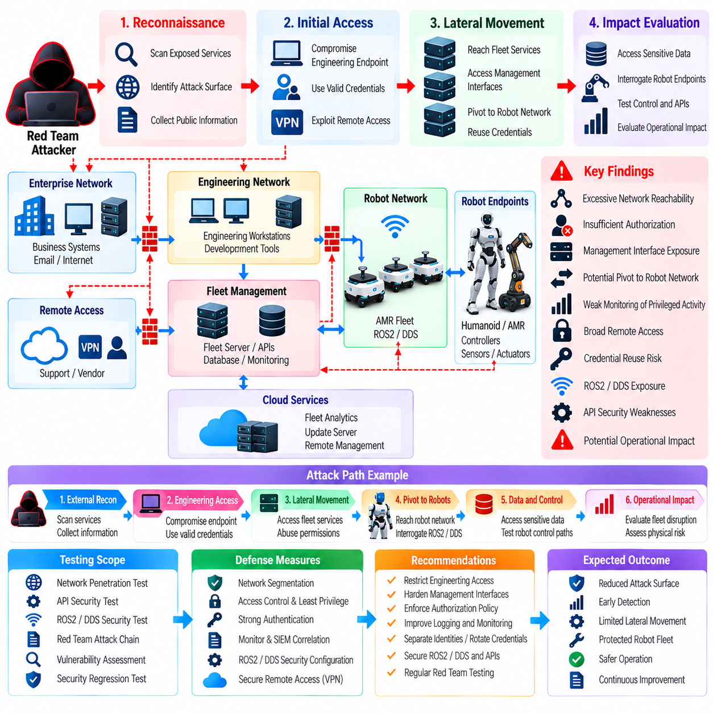{width="7.268055555555556in" height="7.268055555555556in"}

The red-team assessment was conducted to determine whether a coordinated attacker could move through the robot fleet environment beyond the protections demonstrated by conventional vulnerability scanning and compliance checks. The exercise treated the fleet as a cyber-physical system rather than as a collection of independent computers. The assessment therefore considered enterprise access, engineering workstations, fleet-management services, robot networks, cloud interfaces, administrative functions, and operational consequences while maintaining predefined safety boundaries throughout the exercise.

The assessment scope was aligned with the robot cybersecurity testing structure, which identifies vulnerability scanning, network penetration testing, protocol fuzzing, API security testing, red-team exercises, security-focused static analysis, risk reporting, and automated security regression testing as complementary activities. The specific red-team objective was to determine whether weaknesses across several individually moderate components could be chained into a meaningful compromise of fleet services or robot functions. Volume_24_Robot_Cybersecurity(1...

The exercise began with reconnaissance against the authorized external and internal attack surfaces. The red team examined exposed services, authentication boundaries, network segmentation, remote-access paths, fleet APIs, management interfaces, and available operational metadata. Initial findings showed that individual controls generally performed as designed, but several services disclosed information that could help an attacker understand the fleet architecture. This demonstrated that seemingly low-impact information exposure can become strategically important when combined with other weaknesses.

The first significant finding concerned an engineering access path that provided broader network reachability than required for normal maintenance operations. The connection was protected by authentication, but once an authorized engineering endpoint was reached, several fleet-related services could be contacted without sufficiently restrictive segmentation. The red team did not treat this as an isolated firewall configuration issue because the real risk resulted from the combination of valid access, excessive reachability, and the availability of management interfaces across the same operational environment.

The assessment then examined fleet-management APIs and administrative interfaces. Several functions correctly required authentication, but authorization boundaries were less consistent across different management operations. A user with legitimate engineering privileges could access information or functions that were not necessary for the user's normal role. The finding demonstrated the distinction between authentication and authorization: proving who a user is does not establish that the user should be permitted to perform every action exposed by the fleet-management platform.

The red team also evaluated robot-to-fleet communication and the ability to move laterally from management services toward individual robot endpoints. Network segmentation reduced direct exposure of many robot interfaces, but certain diagnostic and maintenance pathways remained reachable from trusted management segments. The assessment therefore identified a potential pivot path in which compromise of a fleet-management component could provide an attacker with additional opportunities to interrogate or target robot services without requiring a direct attack against every individual robot.

Another finding involved insufficiently differentiated monitoring of administrative and security-sensitive activity. The fleet generated substantial operational telemetry, but some privileged actions were difficult to distinguish from routine maintenance activity when examined without broader context. The red team demonstrated that an attacker using legitimate credentials could potentially blend malicious activity into normal administrative traffic. This finding reinforced the need for centralized SIEM correlation and behavioral monitoring rather than relying exclusively on static signatures or isolated authentication alerts.

The exercise also examined remote-access controls used by engineering and support personnel. The security architecture included VPN and encrypted tunnels for remote access, but the red team evaluated whether remote access could provide an unnecessarily broad route into internal robot networks after successful authentication. The principal finding was not that encryption was ineffective, but that secure transport does not by itself establish least-privilege access. Remote sessions must remain constrained by identity, role, destination, time, and operational purpose.

A controlled attempt was made to evaluate whether compromised credentials could be reused across multiple fleet components. Credential reuse and shared administrative accounts were treated as high-value findings because compromise of one account could otherwise expand into broader fleet access. The assessment recommended stronger separation of identities, privileged-access controls, credential rotation, certificate lifecycle management, and explicit authorization boundaries between enterprise, engineering, fleet, and robot environments.

The red team also reviewed ROS2 and DDS exposure as part of the fleet attack surface. The assessment considered whether unauthorized participants could discover nodes, identify communication endpoints, or interact with topics and services beyond their intended authorization scope. The exercise did not assume that DDS exposure automatically resulted in physical robot control; instead, it evaluated whether middleware security policies, node identity, mutual authentication, encryption, and topic or service permissions consistently enforced the intended trust model.

A separate finding concerned insufficiently restrictive API behavior during abnormal request sequences. Individual API operations appeared legitimate, but combinations of requests could reveal operational information or create unexpected administrative workflows. The red team therefore evaluated API security as an interaction problem rather than testing each endpoint independently. This approach demonstrated why authentication, authorization, input validation, rate limiting, logging, and workflow-level security must be considered together for fleet-management interfaces.

Throughout the exercise, safety controls prevented unrestricted execution of potentially hazardous robot actions. The red team focused on demonstrating security impact through controlled test conditions, simulated commands, isolated robots, and non-destructive validation. Where a finding could theoretically have affected physical behavior, testing stopped at the minimum point necessary to demonstrate exploitability. This preserved the distinction between cybersecurity validation and uncontrolled operational experimentation.

Findings were categorized according to exploitability, affected assets, required privileges, potential propagation, and physical or operational consequence. High-priority findings were those that could create a credible path from a compromised enterprise or engineering asset toward fleet-management authority or robot-facing services. Moderate findings were retained when they could materially assist reconnaissance, persistence, lateral movement, or defense evasion. This risk-based approach prevented the report from becoming a simple list of software defects.

Remediation focused on reducing attack-path connectivity rather than merely closing individual findings. Network segmentation was tightened, unnecessary management routes were removed, administrative privileges were reduced, and API authorization policies were reviewed. Remote-access permissions were narrowed according to operational roles, while logging and SIEM correlation were expanded for privileged actions and unusual fleet behavior. The objective was to make multi-stage compromise substantially more difficult even if an attacker succeeded in obtaining an initial foothold.

The assessment also produced improvements to the incident-response process. Each major red-team finding was mapped to potential detection signals, containment actions, forensic evidence requirements, and recovery procedures. Security teams used the exercise to determine whether an attack moving through multiple trust zones could be detected early enough to isolate affected systems before fleet-wide consequences occurred. This connected penetration testing with the broader incident-detection, robot-isolation, forensic-preservation, remediation, and fleet-recovery lifecycle.

After remediation, targeted retesting was performed to verify that the original attack paths had been eliminated rather than merely obscured. The red team repeated relevant reconnaissance, access-control, segmentation, API, and privilege-escalation scenarios under controlled conditions. Particular attention was given to security regressions caused by operational changes, because a firewall rule, software update, maintenance exception, or new integration can unintentionally recreate a previously closed path.

The case demonstrated that fleet penetration testing provides greater value when it evaluates attack chains rather than isolated vulnerabilities. A weak authorization rule, a permissive network route, an exposed diagnostic service, and insufficient monitoring may each appear manageable independently. When combined, however, they can create a practical route from an ordinary workstation compromise to fleet-level security impact. Red-team exercises are therefore particularly useful for validating the effectiveness of defense in depth across the entire robotic environment.

The final security posture established a recurring red-team cycle connected to threat modeling, vulnerability management, incident response, and automated security regression testing. Findings were converted into architectural requirements, detection rules, hardening actions, test cases, and operational procedures. This ensured that the exercise produced lasting improvements rather than a one-time penetration-test report. For a robot fleet, the principal objective is not merely to prove that individual systems can be attacked, but to demonstrate that layered security controls can detect, contain, and limit an attack before it becomes a fleet-wide cyber-physical incident.

레드팀 평가(Red-Team Assessment)는 기존의 취약점 스캐닝(Vulnerability Scanning)과 준수 점검(Compliance Check)을 통해 확인된 보호 수준을 넘어, 조직적인 공격자가 로봇 플릿(Robot Fleet) 환경을 어떻게 이동할 수 있는지를 확인하기 위해 수행되었다. 이 테스트에서는 플릿을 독립적인 컴퓨터의 집합이 아니라 사이버-물리 시스템(Cyber-Physical System)으로 간주했다. 따라서 기업 접근 경로, 엔지니어링 워크스테이션(Engineering Workstation), 플릿 관리 서비스(Fleet-Management Service), 로봇 네트워크, 클라우드 인터페이스, 관리 기능, 운영상 영향을 함께 평가하면서 사전에 정의된 안전 경계를 유지했다.

평가 범위는 로봇 사이버보안 테스트 구조에 맞추어 설정되었으며, 취약점 스캐닝, 네트워크 침투 테스트(Network Penetration Testing), 프로토콜 퍼징(Protocol Fuzzing), API 보안 테스트(API Security Testing), 레드팀 훈련(Red-Team Exercise), 보안 중심 정적 분석(Security-Focused Static Analysis), 위험 보고(Risk Reporting), 자동화된 보안 회귀 테스트(Automated Security Regression Testing)를 상호 보완적인 활동으로 포함했다. 구체적인 레드팀 목표는 여러 개별 구성요소에 존재하는 중간 수준의 약점을 연결하여 플릿 서비스 또는 로봇 기능에 의미 있는 침해를 발생시킬 수 있는지를 확인하는 것이었다. Volume_24_Robot_Cybersecurity(1...

평가는 승인된 외부 및 내부 공격 표면(Attack Surface)에 대한 정찰(Reconnaissance)로 시작되었다. 레드팀은 노출된 서비스, 인증 경계(Authentication Boundary), 네트워크 세분화(Network Segmentation), 원격 접근 경로(Remote-Access Path), 플릿 API, 관리 인터페이스(Management Interface), 이용 가능한 운영 메타데이터(Operational Metadata)를 조사했다. 초기 발견사항은 개별 통제가 대체로 설계된 대로 작동하고 있었지만 일부 서비스가 플릿 아키텍처를 이해하는 데 도움이 되는 정보를 노출하고 있다는 점이었다. 이는 영향이 작아 보이는 정보 노출도 다른 약점과 결합될 경우 전략적으로 중요해질 수 있음을 보여주었다.

첫 번째 주요 발견사항은 정상적인 유지보수 작업에 필요한 수준보다 더 넓은 네트워크 도달성(Network Reachability)을 제공하는 엔지니어링 접근 경로(Engineering Access Path)와 관련되었다. 해당 연결은 인증으로 보호되고 있었지만, 인증된 엔지니어링 엔드포인트에 접근한 이후 여러 플릿 관련 서비스에 충분히 제한되지 않은 방식으로 접속할 수 있었다. 레드팀은 이를 단순한 방화벽 구성 문제로 보지 않았다. 실제 위험은 유효한 접근 권한, 과도한 네트워크 도달성, 동일한 운영 환경에 존재하는 관리 인터페이스가 결합된 결과로 발생했기 때문이다.

이후 레드팀은 플릿 관리 API와 관리 인터페이스를 조사했다. 여러 기능은 적절하게 인증을 요구하고 있었지만, 서로 다른 관리 작업 사이에서 권한부여 경계(Authorization Boundary)가 일관되지 않은 부분이 발견되었다. 정상적인 역할에 필요하지 않은 정보나 기능에 합법적인 엔지니어링 권한을 가진 사용자가 접근할 수 있었다. 이 발견은 인증(Authentication)과 권한부여(Authorization)의 차이를 보여주었다. 사용자가 누구인지 증명하는 것과 해당 사용자가 플릿 관리 플랫폼에서 특정 작업을 수행할 수 있어야 한다는 것은 동일한 의미가 아니다.

레드팀은 또한 플릿 통신과 관리 서비스에서 개별 로봇 엔드포인트로 이동할 수 있는 가능성을 평가했다. 네트워크 세분화는 많은 로봇 인터페이스에 대한 직접적인 노출을 줄였지만 일부 진단 및 유지보수 경로는 신뢰된 관리 세그먼트(Trusted Management Segment)에서 접근할 수 있었다. 따라서 플릿 관리 구성요소가 침해될 경우 공격자가 모든 개별 로봇을 직접 공격하지 않고도 추가적인 로봇 서비스 조사 또는 공격 기회를 확보할 수 있는 잠재적인 피벗 경로(Pivot Path)가 존재하는 것으로 평가되었다.

또 다른 발견사항은 관리자 활동과 보안에 민감한 활동을 충분히 구분하지 못하는 모니터링 문제와 관련되었다. 플릿은 상당한 양의 운영 텔레메트리(Operational Telemetry)를 생성하고 있었지만, 보다 광범위한 상황 정보가 없는 상태에서는 일부 특권 작업(Privileged Action)을 일반적인 유지보수 활동과 구분하기 어려웠다. 레드팀은 유효한 자격증명(Credential)을 사용하는 공격자가 악성 활동을 정상적인 관리자 트래픽에 섞을 가능성을 확인했다. 이는 정적 시그니처(Static Signature)나 개별 인증 경보에만 의존하기보다 중앙 집중형 SIEM 상관 분석(SIEM Correlation)과 행동 기반 모니터링(Behavioral Monitoring)이 필요함을 보여주었다.

테스트에서는 엔지니어링 및 지원 인력이 사용하는 원격 접근 통제(Remote-Access Control)도 조사했다. 보안 아키텍처에는 원격 접근을 위한 VPN과 암호화 터널(Encrypted Tunnel)이 포함되어 있었지만, 레드팀은 인증에 성공한 이후 원격 접근이 내부 로봇 네트워크로 불필요하게 넓은 경로를 제공하는지를 평가했다. 핵심 발견사항은 암호화 자체가 효과가 없다는 것이 아니라, 보안 통신(Secure Transport)만으로 최소 권한 접근(Least-Privilege Access)이 보장되는 것은 아니라는 점이었다. 원격 세션은 신원, 역할, 대상, 시간, 운영 목적에 따라 계속 제한되어야 한다.

통제된 환경에서는 침해된 자격증명이 여러 플릿 구성요소에서 재사용될 수 있는지도 평가했다. 자격증명 재사용(Credential Reuse)과 공유 관리자 계정(Shared Administrative Account)은 하나의 계정이 침해될 경우 더 넓은 플릿 접근으로 확장될 수 있기 때문에 높은 중요도를 갖는 발견사항으로 취급했다. 평가에서는 신원 분리(Identity Separation), 특권 접근 통제(Privileged-Access Control), 자격증명 순환(Credential Rotation), 인증서 수명주기 관리(Certificate Lifecycle Management), 기업·엔지니어링·플릿·로봇 환경 사이의 명시적인 권한부여 경계를 강화할 것을 권고했다.

레드팀은 플릿 공격 표면의 일부로 ROS2와 DDS 노출도 검토했다. 비인가 참여자(Unauthorized Participant)가 노드를 검색하거나 통신 엔드포인트를 식별하거나 허용된 범위를 넘어 토픽과 서비스에 접근할 수 있는지를 평가했다. DDS 노출이 자동으로 물리적 로봇 제어로 이어진다고 가정하지 않고, 미들웨어 보안 정책(Middleware Security Policy), 노드 신원(Node Identity), 상호 인증(Mutual Authentication), 암호화(Encryption), 토픽 및 서비스 권한이 의도된 신뢰 모델(Trust Model)을 일관되게 적용하는지를 검증했다.

별도의 발견사항은 비정상적인 요청 순서(Abnormal Request Sequence)에서 API 동작이 충분히 제한되지 않았다는 점이었다. 개별 API 작업은 정상적으로 보였지만 여러 요청을 조합하면 운영 정보를 노출하거나 예상하지 못한 관리 워크플로를 생성할 수 있었다. 따라서 레드팀은 각 엔드포인트를 독립적으로 테스트하는 대신 API 보안을 상호작용 문제(Interaction Problem)로 평가했다. 이 접근은 인증, 권한부여, 입력 검증(Input Validation), 속도 제한(Rate Limiting), 로깅, 워크플로 수준 보안(Workflow-Level Security)을 함께 고려해야 함을 보여주었다.

테스트 전반에서 안전 통제(Safety Control)는 잠재적으로 위험한 로봇 행동이 제한 없이 실행되는 것을 방지했다. 레드팀은 통제된 테스트 조건, 시뮬레이션 명령, 격리된 로봇, 비파괴적 검증(Non-Destructive Validation)을 통해 보안 영향을 입증하는 데 집중했다. 물리적 행동에 영향을 미칠 가능성이 있는 발견사항의 경우 공격 가능성을 입증하는 데 필요한 최소한의 지점에서 테스트를 중단했다. 이를 통해 사이버보안 검증과 통제되지 않은 운영 실험 사이의 구분을 유지했다.

발견사항은 악용 가능성(Exploitability), 영향을 받는 자산, 필요한 권한, 공격 확산 가능성(Propagation), 물리적 또는 운영상의 결과를 기준으로 분류했다. 높은 우선순위의 발견사항은 침해된 기업 또는 엔지니어링 자산에서 플릿 관리 권한 또는 로봇 대상 서비스로 이어질 수 있는 신뢰할 만한 경로를 만들 수 있는 항목이었다. 중간 수준의 발견사항도 정찰, 지속성(Persistence), 측면 이동(Lateral Movement), 방어 회피(Defense Evasion)를 실질적으로 지원할 수 있다면 유지했다. 이러한 위험 기반 접근은 보고서가 단순한 소프트웨어 결함 목록으로 변하는 것을 방지했다.

교정 조치(Remediation)는 개별 발견사항을 단순히 제거하는 것보다 공격 경로 연결성을 줄이는 데 초점을 맞추었다. 네트워크 세분화를 강화하고 불필요한 관리 경로를 제거했으며 관리자 권한을 축소하고 API 권한부여 정책을 검토했다. 원격 접근 권한은 운영 역할에 따라 축소하고, 특권 작업과 비정상적인 플릿 행동에 대한 로깅 및 SIEM 상관 분석을 확대했다. 목표는 공격자가 초기 침투 지점(Initial Foothold)을 확보하더라도 다단계 침해(Multi-Stage Compromise)를 훨씬 어렵게 만드는 것이었다.

평가 결과는 사고 대응 프로세스(Incident-Response Process)의 개선에도 활용되었다. 주요 레드팀 발견사항은 잠재적인 탐지 신호(Detection Signal), 봉쇄 조치(Containment Action), 포렌식 증거 요구사항(Forensic Evidence Requirement), 복구 절차(Recovery Procedure)에 매핑되었다. 보안팀은 여러 신뢰 영역(Trust Zone)을 이동하는 공격이 플릿 전체에 영향을 미치기 전에 충분히 조기에 탐지되어 영향을 받은 시스템을 격리할 수 있는지를 검토했다. 이를 통해 침투 테스트를 사고 탐지, 로봇 격리, 포렌식 보존, 교정, 플릿 복구 수명주기와 연결했다.

교정 이후에는 원래의 공격 경로가 단순히 숨겨진 것이 아니라 실제로 제거되었는지를 확인하기 위한 표적 재시험(Targeted Retesting)을 수행했다. 레드팀은 관련 정찰, 접근제어, 네트워크 세분화, API, 권한 상승(Privilege Escalation) 시나리오를 통제된 조건에서 반복했다. 특히 운영 변경으로 인해 발생할 수 있는 보안 회귀(Security Regression)에 주의를 기울였다. 방화벽 규칙, 소프트웨어 업데이트, 유지보수 예외 또는 새로운 통합 기능이 이전에 차단된 경로를 의도하지 않게 다시 만들 수 있기 때문이다.

이 사례는 플릿 침투 테스트(Fleet Penetration Testing)가 개별 취약점보다 공격 체인(Attack Chain)을 평가할 때 더 큰 가치를 제공한다는 점을 보여주었다. 취약한 권한부여 규칙, 허용적인 네트워크 경로, 노출된 진단 서비스, 불충분한 모니터링은 각각 독립적으로 관리 가능한 문제처럼 보일 수 있다. 그러나 이들이 결합되면 일반적인 워크스테이션 침해에서 플릿 수준의 보안 영향으로 이어지는 실질적인 경로가 만들어질 수 있다. 따라서 레드팀 훈련은 전체 로봇 환경에서 심층 방어(Defense in Depth)의 효과를 검증하는 데 특히 유용하다.

최종 보안 상태는 위협 모델링(Threat Modeling), 취약점 관리(Vulnerability Management), 사고 대응, 자동화된 보안 회귀 테스트와 연결된 반복적인 레드팀 주기를 구축했다. 발견사항은 아키텍처 요구사항, 탐지 규칙, 하드닝 조치(Hardening Action), 테스트 케이스, 운영 절차로 전환되었다. 이를 통해 평가가 일회성 침투 테스트 보고서에 머물지 않고 지속적인 보안 개선으로 이어지도록 했다. 로봇 플릿에서 핵심 목표는 개별 시스템이 공격될 수 있음을 증명하는 데 그치지 않고, 계층화된 보안 통제가 공격을 탐지하고 봉쇄하며 플릿 전체의 사이버-물리적 사고(Cyber-Physical Incident)로 발전하기 전에 그 영향을 제한할 수 있음을 입증하는 것이다.

##  

## 12.09. OTA Rollback Attack Prevention Case

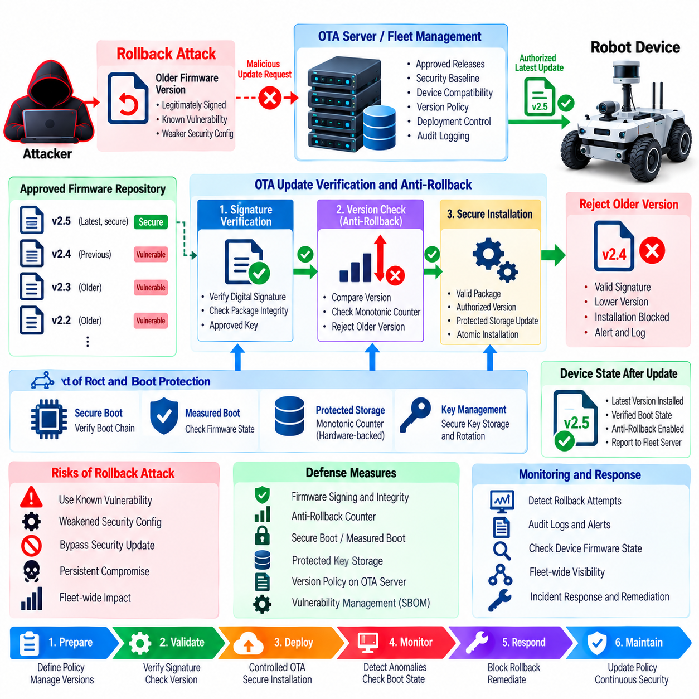{width="7.268055555555556in" height="7.268055555555556in"}

The OTA rollback attack case begins when an attacker attempts to force a robot to install an older firmware version that contains a vulnerability, weakened security configuration, or previously remediated defect. The attack does not necessarily require the attacker to create a new malicious firmware image. Instead, a legitimately signed but obsolete package can become the attack instrument if the robot accepts an older security state. For a deployed robot fleet, this creates a significant risk because a completed security update could effectively be undone.

The case is based on the OTA and firmware security structure, which treats rollback injection as a dedicated threat-modeling concern and places firmware signing, secure boot, measured boot, package integrity verification, anti-rollback counters, SBOM and vulnerability tracking, supply-chain security, protected key storage, OTA security testing, and IEC 62443 compliance within the same lifecycle. The specific anti-rollback mechanism provides a critical link between firmware version management and the device's root of trust. Volume_24_Robot_Cybersecurity(1...

The incident was first suspected after security monitoring identified a group of robots running firmware versions older than the minimum approved security baseline. The devices had previously received a security update, and their firmware signatures remained cryptographically valid. However, the installed version no longer matched the fleet's current security policy. This discrepancy suggested that the issue was not simply an incomplete OTA deployment but a possible attempt to reinstall an obsolete firmware state after the corrective update had already been distributed.

The investigation examined the complete OTA transaction, including the update request, package metadata, firmware version identifier, digital signature, integrity information, installation result, boot status, and device-side version state. Engineers confirmed that signature verification alone could not distinguish a newly approved package from an older package that had once been legitimately signed. The security weakness therefore existed at the version-acceptance layer rather than at the basic cryptographic signature layer.

The red-team reproduction was performed on isolated robot hardware and a controlled OTA environment. Test packages represented valid historical firmware releases that had previously passed normal signing and verification procedures. The assessment examined whether the device would accept an older package after a newer security version had already been installed. Testing also evaluated interrupted updates, repeated installation attempts, metadata inconsistencies, unexpected version values, and recovery procedures to determine whether an attacker could exploit an incomplete or abnormal OTA state.

The central defense was an anti-rollback counter mechanism maintained as part of the device's trusted security state. Each approved firmware release was associated with a security version or monotonic counter, and the device compared the incoming package against its currently committed security level. A package with a lower security version was rejected even when its digital signature and cryptographic integrity were valid. This prevented a legitimate historical package from being used to deliberately return the robot to a vulnerable software state.

The counter itself required protection because an attacker who could modify the stored version state could potentially bypass the anti-rollback mechanism. The security architecture therefore associated version enforcement with secure boot, protected storage, and hardware-backed trust where available. The device had to establish the integrity of the boot chain and security state before accepting an update. This created a relationship between firmware authenticity, version monotonicity, and the hardware-supported root of trust rather than treating anti-rollback as an ordinary application-level variable.

The OTA server and fleet-management layer were also modified to enforce version policy before transmitting packages. The cloud service maintained approved firmware versions, security baselines, device compatibility information, and deployment status. An update request was evaluated against the robot's identity, current firmware state, target release, and security policy. This prevented an outdated package from being intentionally selected through a management interface even when the package remained available in an archival repository.

Package integrity verification remained an independent control. Firmware packages were checked using approved cryptographic verification mechanisms before installation, while digital signatures established that the package originated from an authorized release process. The anti-rollback mechanism then provided a separate decision concerning whether that otherwise authentic package was still eligible for installation. This separation was important because authenticity answers whether a package is trusted, while anti-rollback answers whether that trusted package is still permitted under the current security state.

Secure boot and measured boot were incorporated into the recovery strategy. After an update, the robot verified that the expected firmware was executed and that the measured boot state corresponded to an approved configuration. If a device entered an unexpected firmware state, security monitoring could identify the discrepancy between the expected release and the observed boot measurement. This provided an additional detection layer in case an attacker attempted to bypass normal OTA procedures through local maintenance interfaces or other recovery mechanisms.

The investigation also examined the interaction between rollback prevention and vulnerability management. An older firmware version may contain a known vulnerability that has already been recorded in the organization's SBOM and vulnerability-tracking system. Therefore, the OTA decision process must consider not only whether a package is signed but also whether its component and vulnerability state remains acceptable. The broader firmware security structure explicitly connects SBOM-based vulnerability tracking with OTA security so that obsolete software cannot regain operational status merely because its signature remains valid.

A controlled exception process was established for legitimate engineering and recovery scenarios. Certain maintenance activities may require installation of an older firmware version for laboratory analysis, hardware compatibility investigation, or controlled fault reproduction. Such exceptions could not be performed through the normal production OTA path. They required explicit authorization, controlled equipment, additional security safeguards, and a documented process for restoring the approved production security state. This preserved legitimate engineering flexibility without weakening the fleet-wide anti-rollback policy.

The incident response process treated an attempted rollback as a cybersecurity event even when no malicious firmware modification was detected. Security teams preserved OTA transaction records, device logs, package metadata, version counters, authentication events, and management-system activity. These records allowed investigators to determine whether the rollback resulted from an operational error, unauthorized administrative action, compromised credentials, or deliberate manipulation of the OTA workflow.

Testing after remediation covered both normal and adversarial update conditions. Engineers verified that valid current packages were accepted, valid obsolete packages were rejected, corrupted packages failed integrity checks, improperly signed packages failed authentication, and interrupted updates did not reset the security version state. Testing also evaluated repeated reboot cycles and recovery procedures to ensure that the anti-rollback state survived power loss and other abnormal operating conditions.

The case was incorporated into the broader OTA security testing lifecycle. Firmware fuzzing, package injection testing, update-state manipulation, signature validation, secure-boot verification, anti-rollback testing, and automated security regression testing were combined into repeatable validation activities. The existing cybersecurity testing structure also includes vulnerability scanning, network penetration testing, ROS2 and DDS protocol fuzzing, API security testing, red-team exercises, security-focused static analysis, risk reporting, and automated regression testing. Volume_24_Robot_Cybersecurity(1... This ensured that OTA rollback prevention could be tested whenever firmware, bootloader, update services, or security policies changed.

A major lesson from the incident was that firmware authenticity and firmware freshness are different security properties. A correctly signed package may still represent an unacceptable security state if a newer version has already corrected a vulnerability. Effective OTA protection therefore requires a chain of trust extending from the signing authority through package verification, version enforcement, secure boot, protected security state, and fleet-management policy. No individual mechanism should be expected to provide complete rollback protection by itself.

The final security architecture established a controlled firmware lifecycle in which every production update carries verifiable integrity, authorized provenance, and an enforceable security version. The robot accepts an update only when the package is authentic, intact, compatible, and not older than the device's protected security state. The cloud and fleet-management layers enforce the same policy before deployment, while secure boot and measured boot verify the resulting device state. This converts anti-rollback protection from a single firmware feature into a continuous security control protecting the robot fleet against the reintroduction of known vulnerabilities.

OTA 롤백 공격(OTA Rollback Attack) 사례는 공격자가 로봇에 취약점, 약화된 보안 설정, 또는 이전에 해결된 결함이 포함된 이전 펌웨어 버전(Older Firmware Version)을 설치하도록 강제하려는 상황에서 시작된다. 이 공격은 반드시 새로운 악성 펌웨어 이미지를 생성할 필요가 없다. 대신 과거에 정상적으로 서명된(Validly Signed) 오래된 패키지가 로봇이 이전의 보안 상태로 되돌아가는 것을 허용할 경우 공격 수단으로 사용될 수 있다. 배포된 로봇 플릿(Robot Fleet)에서는 완료된 보안 업데이트가 사실상 무효화될 수 있기 때문에 이러한 공격은 상당한 위험을 초래한다.

이 사례는 OTA 및 펌웨어 보안(OTA and Firmware Security) 구조를 기반으로 하며, 롤백 인젝션(Rollback Injection)을 전용 위협 모델링(Threat Modeling) 문제로 다룬다. 또한 펌웨어 서명(Firmware Signing), 보안 부트(Secure Boot), 측정 부트(Measured Boot), 패키지 무결성 검증(Package Integrity Verification), 안티 롤백 카운터(Anti-Rollback Counter), SBOM 및 취약점 추적(SBOM and Vulnerability Tracking), 공급망 보안(Supply-Chain Security), 보호된 키 저장(Protected Key Storage), OTA 보안 테스트(OTA Security Testing), IEC 62443 준수를 동일한 수명주기 내에서 다룬다. 특히 안티 롤백 메커니즘(Anti-Rollback Mechanism)은 펌웨어 버전 관리와 장치의 신뢰 루트(Root of Trust)를 연결하는 핵심 요소이다. Volume_24_Robot_Cybersecurity(1...

사고는 보안 모니터링(Security Monitoring)에서 일부 로봇이 최소 승인 보안 기준선(Minimum Approved Security Baseline)보다 오래된 펌웨어 버전을 실행하고 있다는 사실을 확인하면서 처음 의심되었다. 해당 장치들은 이전에 보안 업데이트를 이미 받았으며, 펌웨어 서명도 암호학적으로 유효한 상태였다. 그러나 현재 설치된 버전은 플릿의 최신 보안 정책과 일치하지 않았다. 이러한 불일치는 단순히 OTA 배포가 완료되지 않은 문제가 아니라, 이미 보안 업데이트가 배포된 이후 공격자가 오래된 펌웨어 상태를 다시 설치하려는 시도일 가능성을 보여주었다.

조사에서는 OTA 트랜잭션 전체를 검토했다. 여기에는 업데이트 요청(Update Request), 패키지 메타데이터(Package Metadata), 펌웨어 버전 식별자(Firmware Version Identifier), 디지털 서명(Digital Signature), 무결성 정보(Integrity Information), 설치 결과(Installation Result), 부트 상태(Boot Status), 장치 측 버전 상태(Device-Side Version State)가 포함되었다. 엔지니어들은 서명 검증(Signature Verification)만으로는 새롭게 승인된 패키지와 과거에 정상적으로 서명되었던 오래된 패키지를 구분할 수 없다는 사실을 확인했다. 따라서 보안 취약점은 기본적인 암호학적 서명 계층이 아니라 버전 수용 계층(Version-Acceptance Layer)에 존재했다.

레드팀 재현 테스트(Red-Team Reproduction Test)는 격리된 로봇 하드웨어와 통제된 OTA 환경에서 수행되었다. 테스트 패키지는 과거에 정상적인 서명 및 검증 절차를 통과했던 유효한 과거 펌웨어 릴리스(Valid Historical Firmware Release)를 나타냈다. 평가에서는 최신 보안 버전이 이미 설치된 이후 장치가 오래된 패키지를 다시 수용하는지를 확인했다. 또한 중단된 업데이트(Interrupted Update), 반복적인 설치 시도(Repeated Installation Attempt), 메타데이터 불일치(Metadata Inconsistency), 비정상적인 버전 값(Unexpected Version Value), 복구 절차(Recovery Procedure)를 검토하여 공격자가 불완전하거나 비정상적인 OTA 상태를 악용할 수 있는지를 평가했다.

핵심 방어 수단은 장치의 신뢰된 보안 상태(Trusted Security State)의 일부로 유지되는 안티 롤백 카운터 메커니즘(Anti-Rollback Counter Mechanism)이었다. 승인된 각각의 펌웨어 릴리스에는 보안 버전(Security Version) 또는 단조 증가 카운터(Monotonic Counter)가 연결되었으며, 장치는 수신된 패키지를 현재 확정된 보안 수준(Committed Security Level)과 비교했다. 보안 버전이 더 낮은 패키지는 디지털 서명과 암호학적 무결성이 유효하더라도 거부되었다. 이를 통해 정상적으로 서명된 과거 패키지가 로봇을 의도적으로 취약한 소프트웨어 상태로 되돌리는 데 사용되는 것을 방지했다.

카운터 자체도 보호가 필요했다. 공격자가 저장된 버전 상태를 수정할 수 있다면 안티 롤백 메커니즘을 우회할 가능성이 있기 때문이다. 따라서 보안 아키텍처에서는 버전 강제(Version Enforcement)를 보안 부트, 보호된 저장 영역(Protected Storage), 가능한 경우 하드웨어 기반 신뢰(Hardware-Backed Trust)와 연결했다. 장치는 업데이트를 수용하기 전에 부트 체인(Boot Chain)과 보안 상태의 무결성을 확립해야 했다. 이를 통해 펌웨어 진정성(Firmware Authenticity), 버전 단조성(Version Monotonicity), 하드웨어가 지원하는 신뢰 루트가 하나의 보안 구조로 연결되었으며, 안티 롤백을 단순한 애플리케이션 수준 변수로 취급하지 않았다.

OTA 서버와 플릿 관리 계층(Fleet-Management Layer)도 패키지를 전송하기 전에 버전 정책(Version Policy)을 적용하도록 수정되었다. 클라우드 서비스는 승인된 펌웨어 버전, 보안 기준선, 장치 호환성 정보(Device Compatibility Information), 배포 상태(Deployment Status)를 관리했다. 업데이트 요청은 로봇의 신원(Identity), 현재 펌웨어 상태, 목표 릴리스(Target Release), 보안 정책에 따라 평가되었다. 이를 통해 오래된 패키지가 아카이브 저장소(Archive Repository)에 남아 있더라도 관리 인터페이스를 통해 의도적으로 선택되어 배포되는 것을 방지했다.

패키지 무결성 검증(Package Integrity Verification)은 독립적인 통제로 유지되었다. 펌웨어 패키지는 설치 전에 승인된 암호학적 검증 메커니즘을 통해 검사했으며, 디지털 서명은 패키지가 승인된 릴리스 프로세스에서 생성되었음을 확인했다. 이후 안티 롤백 메커니즘은 정상적인 인증과 무결성 검증을 통과한 패키지가 현재 보안 상태에서 여전히 설치 가능한지를 별도로 판단했다. 이러한 분리는 중요하다. 진정성(Authenticity)은 패키지를 신뢰할 수 있는지를 의미하지만, 안티 롤백은 해당 신뢰된 패키지가 현재 보안 상태에서 설치될 수 있는지를 판단하기 때문이다.

보안 부트와 측정 부트는 복구 전략(Recovery Strategy)에 통합되었다. 업데이트 이후 로봇은 예상되는 펌웨어가 실제로 실행되는지 확인하고, 측정된 부트 상태(Measured Boot State)가 승인된 구성(Approved Configuration)과 일치하는지를 검증했다. 장치가 예상하지 못한 펌웨어 상태로 진입하면 보안 모니터링은 예상된 릴리스와 실제 부트 측정값(Boot Measurement) 사이의 불일치를 탐지할 수 있었다. 이는 공격자가 로컬 유지보수 인터페이스 또는 기타 복구 메커니즘을 통해 정상적인 OTA 절차를 우회하려는 경우에도 추가적인 탐지 계층을 제공했다.

조사에서는 롤백 방지와 취약점 관리(Vulnerability Management)의 상호작용도 검토했다. 오래된 펌웨어 버전에는 조직의 SBOM 및 취약점 추적 시스템에 이미 기록된 알려진 취약점(Known Vulnerability)이 포함되어 있을 수 있다. 따라서 OTA 의사결정 과정은 패키지가 서명되었는지만 확인해서는 안 되며 해당 패키지의 구성요소 상태와 취약점 상태가 현재 허용 가능한지도 고려해야 한다. 광범위한 펌웨어 보안 구조에서는 SBOM 기반 취약점 추적과 OTA 보안을 명시적으로 연결하여 서명이 여전히 유효하다는 이유만으로 오래된 소프트웨어가 다시 운영 상태로 복귀하지 못하도록 한다.

정상적인 엔지니어링 및 복구 시나리오를 위해 통제된 예외 프로세스(Controlled Exception Process)도 수립되었다. 일부 유지보수 작업에서는 실험실 분석, 하드웨어 호환성 조사(Hardware Compatibility Investigation), 통제된 장애 재현을 위해 이전 펌웨어 버전을 설치해야 할 수 있다. 이러한 예외는 일반적인 운영 OTA 경로를 통해 수행할 수 없도록 했다. 명시적인 승인, 통제된 장비, 추가적인 보안 보호조치(Additional Security Safeguard), 그리고 승인된 운영 보안 상태로 복귀하기 위한 문서화된 절차를 요구했다. 이를 통해 정당한 엔지니어링 유연성을 유지하면서도 플릿 전체의 안티 롤백 정책이 약화되지 않도록 했다.

사고 대응 프로세스(Incident Response Process)는 악성 펌웨어 변경이 발견되지 않은 경우에도 롤백 시도를 사이버보안 사건(Cybersecurity Event)으로 취급했다. 보안팀은 OTA 트랜잭션 기록, 장치 로그, 패키지 메타데이터, 버전 카운터, 인증 이벤트(Authentication Event), 관리 시스템 활동을 보존했다. 이러한 기록을 통해 조사관은 롤백이 운영상의 오류인지, 비인가 관리자 행동(Unauthorized Administrative Action)인지, 침해된 자격증명(Compromised Credential)에 의한 것인지, 또는 OTA 워크플로를 의도적으로 조작한 결과인지를 판단할 수 있었다.

교정 이후 테스트에서는 정상적인 업데이트와 적대적인 업데이트 조건을 모두 검증했다. 엔지니어들은 현재 유효한 패키지가 정상적으로 수용되는지, 유효하지만 오래된 패키지는 거부되는지, 손상된 패키지는 무결성 검사에서 실패하는지, 부적절하게 서명된 패키지는 인증에 실패하는지, 중단된 업데이트가 보안 버전 상태를 초기화하지 않는지를 확인했다. 또한 반복적인 재부팅과 복구 절차를 평가하여 안티 롤백 상태가 전원 손실(Power Loss) 및 기타 비정상적인 운영 조건에서도 유지되는지 검증했다.

이 사례는 이후 OTA 보안 테스트 수명주기(OTA Security Testing Lifecycle)에 통합되었다. 펌웨어 퍼징(Firmware Fuzzing), 패키지 인젝션 테스트(Package Injection Testing), 업데이트 상태 조작(Update-State Manipulation), 서명 검증, 보안 부트 검증, 안티 롤백 테스트, 자동화된 보안 회귀 테스트(Automated Security Regression Testing)를 반복 가능한 검증 활동으로 결합했다. 기존 사이버보안 테스트 구조에는 취약점 스캐닝, 네트워크 침투 테스트, ROS2 및 DDS 프로토콜 퍼징, API 보안 테스트, 레드팀 훈련, 보안 중심 정적 분석, 위험 보고, 자동화된 회귀 테스트도 포함된다. Volume_24_Robot_Cybersecurity(1... 이를 통해 펌웨어, 부트로더(Bootloader), 업데이트 서비스, 보안 정책이 변경될 때마다 OTA 롤백 방지 기능을 반복적으로 검증할 수 있게 되었다.

이번 사고의 주요 교훈은 펌웨어 진정성(Firmware Authenticity)과 펌웨어 최신성(Firmware Freshness)이 서로 다른 보안 속성이라는 점이다. 올바르게 서명된 패키지라도 더 최신 버전에서 취약점이 이미 해결되었다면 더 이상 허용할 수 없는 보안 상태를 나타낼 수 있다. 따라서 효과적인 OTA 보호는 서명 권한(Signing Authority)에서 시작하여 패키지 검증, 버전 강제, 보안 부트, 보호된 보안 상태, 플릿 관리 정책으로 이어지는 신뢰 체인(Chain of Trust)을 필요로 한다. 어떠한 단일 메커니즘도 완전한 롤백 방지를 단독으로 제공할 수 있다고 가정해서는 안 된다.

최종 보안 아키텍처는 모든 운영 펌웨어 업데이트가 검증 가능한 무결성, 승인된 출처(Authorized Provenance), 강제 가능한 보안 버전을 갖는 통제된 펌웨어 수명주기(Controlled Firmware Lifecycle)를 확립했다. 로봇은 패키지가 진정성 있고, 손상되지 않았으며, 호환 가능하고, 장치의 보호된 보안 상태보다 오래된 버전이 아닌 경우에만 업데이트를 수용한다. 클라우드 및 플릿 관리 계층은 배포 전에 동일한 정책을 적용하며, 보안 부트와 측정 부트는 업데이트 이후의 장치 상태를 검증한다. 이를 통해 안티 롤백 보호는 단일 펌웨어 기능에서 알려진 취약점의 재도입으로부터 로봇 플릿을 지속적으로 보호하는 통합 보안 통제(Integrated Security Control)로 발전한다.

##  

## 12.10. Future Robot Cybersecurity Roadmap

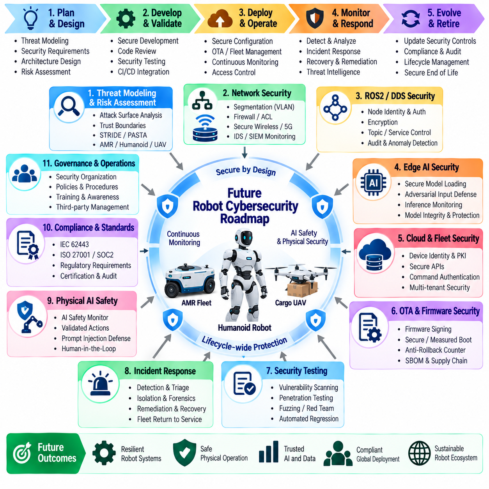{width="7.268055555555556in" height="7.268055555555556in"}

The future of robot cybersecurity begins with a transition from component-level protection toward lifecycle-wide cyber-physical security. As robots become increasingly connected through ROS2 and DDS networks, edge AI platforms, cloud services, fleet-management systems, OTA infrastructure, and physical AI agents, cybersecurity must protect the complete chain from sensing and computation to communication and physical action. The roadmap therefore treats security as a continuous engineering capability spanning architecture, development, deployment, operation, testing, incident response, compliance, and end-of-life management.

The first priority is to establish security by design across the complete robot architecture. Threat modeling must begin during system conception and continue through architecture changes, using attack-surface analysis, trust-boundary identification, attack trees, STRIDE or PASTA methods, and domain-specific threat models for AMR fleets, humanoid AI agents, and Cargo UAV avionics. The resulting security requirements should remain traceable to concrete controls and verification activities so that cybersecurity is not added after functionality has already been implemented.

Network security will evolve toward segmented and continuously monitored robot environments. Industrial robots, engineering systems, safety-control networks, AI-data networks, cloud gateways, and external services should be separated according to their trust relationships and operational requirements. Firewalls, ACLs, VPNs, encrypted tunnels, 802.1X, VLAN segmentation, secure wireless networks, private 5G security, intrusion detection, and SIEM monitoring will form complementary layers. Future architectures should assume that individual network boundaries may eventually be breached.

ROS2 and DDS security will become increasingly important as distributed robot software expands. Secure communication must combine node identity, mutual authentication, certificate lifecycle management, encryption, topic and service access-control policies, audit logging, cryptographic key rotation, and vulnerability remediation. Future systems should also support continuous monitoring of middleware behavior so that unexpected participants, abnormal topic activity, unauthorized service requests, or unusual communication patterns can be detected before they become pathways to physical robot control.

Edge AI security will expand beyond protecting model files. Future robots will require secure model loading, model integrity verification, protected execution environments, adversarial-input detection, inference anomaly monitoring, data-poisoning defense, model watermarking where appropriate, and stronger protection against model theft and reverse engineering. AI security must also consider the relationship between perception outputs and physical actions. A model that remains cryptographically authentic can still generate unsafe decisions when exposed to manipulated inputs or abnormal operating conditions.

Cloud and fleet security will increasingly become the control plane for large-scale robotic operations. Device identities, PKI, certificate lifecycle management, cloud APIs, fleet-command authentication and signing, encrypted data, SIEM monitoring, tenant isolation, and fleet security incident playbooks must operate as an integrated security system. Fleet commands should be authenticated and authorized independently of network connectivity, while high-impact operations should require explicit policy validation. Compromise of one cloud service or administrative identity should not automatically provide control over the entire fleet.

OTA and firmware security will develop toward a continuously verifiable software supply chain. Future robots should use a trusted firmware signing chain, secure boot, measured boot, package integrity verification, protected anti-rollback counters, SBOM-based vulnerability tracking, secure key storage, and controlled OTA deployment. Firmware authenticity must be separated from firmware freshness because a correctly signed but obsolete package may still contain known vulnerabilities. The supply-chain process must therefore preserve provenance from source components through build, signing, distribution, installation, and runtime verification.

Cybersecurity testing will become continuous rather than periodic. Vulnerability scanning, network penetration testing, firmware fuzzing, ROS2 and DDS protocol fuzzing, API security testing, red-team exercises, security-focused static analysis, and automated security regression testing should be integrated into CI/CD and operational validation. Future testing must evaluate attack chains rather than isolated vulnerabilities, because a sequence of individually moderate weaknesses can create a high-impact path from an enterprise workstation or cloud service to robot-control functions.

Incident response will evolve into a fleet-scale cyber-physical recovery capability. Detection systems must correlate network events, authentication failures, cloud activity, robot telemetry, AI anomalies, firmware state, and operational behavior. When a compromise is suspected, the organization should be able to isolate affected robots, preserve forensic evidence, revoke credentials or certificates, deploy secure remediation, recover fleet services, and return robots to operation under controlled conditions. Recovery must therefore be designed together with prevention rather than added after an incident occurs.

Physical AI introduces a new security boundary between digital decisions and physical consequences. Future systems will need AI safety monitors, certified robustness for safety-critical AI where applicable, secure model registries, training-data protection, adversarial-input defenses, and explicit validation of AI-generated actions. LLM-based robot agents will require prompt-injection defenses and strict separation between reasoning, authorization, and physical execution. The objective is not to guarantee perfect AI behavior, but to ensure that an incorrect or manipulated AI decision cannot directly produce an unsafe physical action.

Compliance and certification will become continuous governance mechanisms rather than final project milestones. IEC 62443, ISO 21434 where applicable, NIST CSF 2.0, the EU Cyber Resilience Act, DO-326A-related aviation cybersecurity practices, cybersecurity management systems, third-party audits, and controlled evidence packages will increasingly influence robot development. Certification evidence should remain synchronized with the actual deployed configuration through configuration management, change control, vulnerability management, security testing, and documented corrective actions.

The roadmap also requires stronger organizational integration. Robot cybersecurity cannot remain the responsibility of a specialized security team alone. Product engineering, robotics software, AI engineering, cloud operations, safety engineering, fleet operations, compliance, suppliers, and incident-response teams must share defined responsibilities and escalation paths. Security metrics should measure meaningful operational capabilities such as vulnerability remediation time, fleet exposure, authentication coverage, patch deployment success, detection latency, recovery time, and the percentage of critical functions protected by verified security controls.

The long-term objective is a continuously adaptive robot cybersecurity architecture capable of responding to changing threats without losing operational safety. Future robot platforms should continuously assess their security posture, update threat models, validate software and AI components, monitor fleet behavior, detect anomalous physical outcomes, and automatically initiate controlled defensive actions when appropriate. Cybersecurity will therefore become an integrated property of the robot lifecycle, connecting network security, ROS2 and DDS security, edge AI, cloud and fleet protection, OTA integrity, physical AI safety, continuous testing, incident response, and compliance into one evolving defense framework.

로봇 사이버보안(Robot Cybersecurity)의 미래는 구성요소 수준의 보호(Component-Level Protection)에서 전체 수명주기를 포괄하는 사이버-물리 보안(Cyber-Physical Security)으로 전환하는 것에서 시작된다. 로봇이 ROS2와 DDS 네트워크, 엣지 AI 플랫폼(Edge AI Platform), 클라우드 서비스(Cloud Service), 플릿 관리 시스템(Fleet-Management System), OTA 인프라(OTA Infrastructure), 물리적 AI 에이전트(Physical AI Agent)를 통해 점점 더 연결됨에 따라 사이버보안은 센싱(Sensing)과 컴퓨팅(Computing)에서 통신(Communication)과 물리적 행동(Physical Action)에 이르는 전체 연결 체인을 보호해야 한다. 따라서 이 로드맵은 아키텍처, 개발, 배포, 운영, 테스트, 사고 대응, 준수, 수명 종료 관리(End-of-Life Management)를 포괄하는 지속적인 엔지니어링 역량으로서 보안을 다룬다.

첫 번째 우선순위는 전체 로봇 아키텍처에 보안 설계 원칙(Security by Design)을 적용하는 것이다. 위협 모델링(Threat Modeling)은 시스템 구상 단계에서 시작하여 아키텍처 변경 과정까지 지속되어야 하며, 공격 표면 분석(Attack-Surface Analysis), 신뢰 경계 식별(Trust-Boundary Identification), 공격 트리(Attack Tree), STRIDE 또는 PASTA 방법론, AMR 플릿, 휴머노이드 AI 에이전트, 화물 UAV 항공전자장비(Cargo UAV Avionics)를 위한 도메인별 위협 모델을 활용해야 한다. 도출된 보안 요구사항은 구체적인 통제와 검증 활동까지 지속적으로 추적 가능해야 하며, 이를 통해 기능이 이미 구현된 이후 사이버보안을 추가하는 상황을 방지해야 한다.

네트워크 보안(Network Security)은 세분화되고 지속적으로 모니터링되는 로봇 환경으로 발전할 것이다. 산업용 로봇, 엔지니어링 시스템, 안전 제어 네트워크(Safety-Control Network), AI 데이터 네트워크, 클라우드 게이트웨이(Cloud Gateway), 외부 서비스는 신뢰 관계와 운영 요구사항에 따라 분리되어야 한다. 방화벽(Firewall), ACL, VPN, 암호화 터널(Encrypted Tunnel), 802.1X, VLAN 세분화, 보안 무선 네트워크(Secure Wireless Network), 프라이빗 5G 보안(Private 5G Security), 침입 탐지(Intrusion Detection), SIEM 모니터링이 상호 보완적인 계층을 구성하게 된다. 미래 아키텍처는 개별 네트워크 경계가 결국 침해될 수 있다는 가정을 바탕으로 설계되어야 한다.

ROS2와 DDS 보안은 분산 로봇 소프트웨어가 확장됨에 따라 더욱 중요해질 것이다. 보안 통신(Secure Communication)은 노드 신원(Node Identity), 상호 인증(Mutual Authentication), 인증서 수명주기 관리(Certificate Lifecycle Management), 암호화, 토픽 및 서비스 접근제어 정책(Topic and Service Access-Control Policy), 감사 로깅(Audit Logging), 암호화 키 순환(Cryptographic Key Rotation), 취약점 교정을 결합해야 한다. 미래 시스템은 미들웨어 동작(Middleware Behavior)에 대한 지속적인 모니터링도 지원하여 예상하지 못한 참여자, 비정상적인 토픽 활동, 비인가 서비스 요청, 비정상적인 통신 패턴이 물리적 로봇 제어로 이어지는 경로가 되기 전에 탐지할 수 있어야 한다.

엣지 AI 보안(Edge AI Security)은 모델 파일을 보호하는 수준을 넘어 확장될 것이다. 미래의 로봇은 안전한 모델 로딩(Secure Model Loading), 모델 무결성 검증(Model Integrity Verification), 보호된 실행 환경(Protected Execution Environment), 적대적 입력 탐지(Adversarial-Input Detection), 추론 이상 모니터링(Inference-Anomaly Monitoring), 데이터 중독 방어(Data-Poisoning Defense), 적절한 경우 모델 워터마킹(Model Watermarking), 모델 탈취 및 역공학(Model Theft and Reverse Engineering)에 대한 강화된 방어를 필요로 한다. AI 보안은 인식 결과(Perception Output)와 물리적 행동 사이의 관계도 고려해야 한다. 암호학적으로 진정성을 유지하는 모델이라도 조작된 입력이나 비정상적인 운영 조건에 노출되면 안전하지 않은 의사결정을 생성할 수 있다.

클라우드 및 플릿 보안(Cloud and Fleet Security)은 대규모 로봇 운용을 위한 제어 평면(Control Plane)으로 점점 더 발전할 것이다. 장치 신원(Device Identity), PKI, 인증서 수명주기 관리, 클라우드 API, 플릿 명령 인증 및 서명(Fleet-Command Authentication and Signing), 암호화된 데이터, SIEM 모니터링, 테넌트 격리(Tenant Isolation), 플릿 보안 사고 대응 플레이북(Fleet Security Incident Playbook)은 통합된 보안 시스템으로 작동해야 한다. 플릿 명령은 네트워크 연결 여부와 관계없이 인증 및 권한부여되어야 하며, 영향이 큰 작업에는 명시적인 정책 검증(Policy Validation)이 요구되어야 한다. 하나의 클라우드 서비스 또는 관리자 신원이 침해되었다고 해서 전체 플릿에 대한 제어 권한이 자동으로 부여되어서는 안 된다.

OTA 및 펌웨어 보안(OTA and Firmware Security)은 지속적으로 검증 가능한 소프트웨어 공급망(Continuously Verifiable Software Supply Chain)으로 발전할 것이다. 미래의 로봇은 신뢰된 펌웨어 서명 체인(Trusted Firmware Signing Chain), 보안 부트(Secure Boot), 측정 부트(Measured Boot), 패키지 무결성 검증, 보호된 안티 롤백 카운터(Protected Anti-Rollback Counter), SBOM 기반 취약점 추적(SBOM-Based Vulnerability Tracking), 보안 키 저장(Secure Key Storage), 통제된 OTA 배포(Controlled OTA Deployment)를 사용해야 한다. 펌웨어 진정성(Firmware Authenticity)은 펌웨어 최신성(Firmware Freshness)과 분리되어야 한다. 올바르게 서명된 오래된 패키지에도 알려진 취약점이 포함될 수 있기 때문이다. 따라서 공급망 프로세스는 소스 구성요소에서 빌드, 서명, 배포, 설치, 런타임 검증(Runtime Verification)에 이르기까지 출처(Provenance)를 유지해야 한다.

사이버보안 테스트(Cybersecurity Testing)는 주기적인 활동에서 지속적인 활동으로 발전할 것이다. 취약점 스캐닝(Vulnerability Scanning), 네트워크 침투 테스트(Network Penetration Testing), 펌웨어 퍼징(Firmware Fuzzing), ROS2 및 DDS 프로토콜 퍼징(Protocol Fuzzing), API 보안 테스트, 레드팀 훈련(Red-Team Exercise), 보안 중심 정적 분석(Security-Focused Static Analysis), 자동화된 보안 회귀 테스트(Automated Security Regression Testing)는 CI/CD와 운영 검증(Operational Validation)에 통합되어야 한다. 미래의 테스트는 개별 취약점이 아니라 공격 체인(Attack Chain)을 평가해야 한다. 개별적으로는 중간 수준의 약점들이 결합되어 기업 워크스테이션이나 클라우드 서비스에서 로봇 제어 기능으로 이어지는 높은 영향도의 공격 경로를 만들 수 있기 때문이다.

사고 대응(Incident Response)은 플릿 규모의 사이버-물리 복구 역량(Cyber-Physical Recovery Capability)으로 발전할 것이다. 탐지 시스템은 네트워크 이벤트, 인증 실패, 클라우드 활동, 로봇 텔레메트리, AI 이상 현상, 펌웨어 상태, 운영 동작을 상관 분석해야 한다. 침해가 의심되면 조직은 영향을 받은 로봇을 격리하고, 포렌식 증거(Forensic Evidence)를 보존하며, 자격증명이나 인증서를 폐기하고, 안전한 교정을 배포하고, 플릿 서비스를 복구하며, 통제된 조건에서 로봇을 다시 운영 상태로 복귀시킬 수 있어야 한다. 따라서 복구는 사고 발생 이후에 추가되는 기능이 아니라 예방과 함께 설계되어야 한다.

물리적 AI(Physical AI)는 디지털 의사결정과 물리적 결과 사이에 새로운 보안 경계(Security Boundary)를 만든다. 미래 시스템은 AI 안전 모니터(AI Safety Monitor), 해당되는 경우 안전이 중요한 AI를 위한 인증된 강건성(Certified Robustness), 보안 모델 레지스트리(Secure Model Registry), 학습 데이터 보호(Training-Data Protection), 적대적 입력 방어, AI가 생성한 행동에 대한 명시적인 검증을 필요로 한다. LLM 기반 로봇 에이전트(LLM-Based Robot Agent)는 프롬프트 인젝션 방어(Prompt-Injection Defense)와 추론(Reasoning), 권한부여(Authorization), 물리적 실행(Physical Execution)의 엄격한 분리를 요구한다. 목표는 AI가 완벽하게 행동하도록 보장하는 것이 아니라 잘못되거나 조작된 AI 의사결정이 직접적으로 위험한 물리적 행동을 발생시키지 못하도록 하는 것이다.

준수 및 인증(Compliance and Certification)은 최종 프로젝트 단계가 아니라 지속적인 거버넌스 메커니즘(Continuous Governance Mechanism)으로 발전할 것이다. IEC 62443, 해당되는 경우 ISO 21434, NIST CSF 2.0, EU 사이버 복원력 법(EU Cyber Resilience Act), DO-326A 관련 항공 사이버보안 관행(Aviation Cybersecurity Practice), 사이버보안 관리 시스템(Cybersecurity Management System), 제3자 감사(Third-Party Audit), 통제된 증거 패키지(Controlled Evidence Package)는 로봇 개발에 점점 더 큰 영향을 미칠 것이다. 인증 증거(Certification Evidence)는 구성 관리(Configuration Management), 변경 통제(Change Control), 취약점 관리, 보안 테스트, 문서화된 시정 조치를 통해 실제 배포된 구성과 지속적으로 동기화되어야 한다.

로드맵은 또한 조직 간 통합을 더욱 강화해야 한다. 로봇 사이버보안은 더 이상 전문 보안팀만의 책임으로 남아서는 안 된다. 제품 엔지니어링(Product Engineering), 로보틱스 소프트웨어, AI 엔지니어링, 클라우드 운영(Cloud Operations), 안전 엔지니어링, 플릿 운영, 준수, 공급업체, 사고 대응팀은 정의된 책임과 에스컬레이션 경로(Escalation Path)를 공유해야 한다. 보안 지표(Security Metric)는 단순한 취약점 수보다 취약점 교정 시간, 플릿 노출 수준, 인증 적용 범위, 패치 배포 성공률, 탐지 지연시간, 복구 시간, 검증된 보안 통제로 보호되는 핵심 기능의 비율과 같은 실질적인 운영 역량을 측정해야 한다.

장기적인 목표는 운영 안전성을 유지하면서 변화하는 위협에 지속적으로 대응할 수 있는 적응형 로봇 사이버보안 아키텍처(Adaptive Robot Cybersecurity Architecture)를 구축하는 것이다. 미래의 로봇 플랫폼은 지속적으로 보안 상태를 평가하고, 위협 모델을 업데이트하며, 소프트웨어와 AI 구성요소를 검증하고, 플릿 행동을 모니터링하며, 비정상적인 물리적 결과를 탐지하고, 적절한 경우 통제된 방어 행동(Controlled Defensive Action)을 자동으로 시작할 수 있어야 한다. 따라서 사이버보안은 로봇 수명주기의 통합된 속성이 되며, 네트워크 보안, ROS2 및 DDS 보안, 엣지 AI, 클라우드 및 플릿 보호, OTA 무결성, 물리적 AI 안전, 지속적인 테스트, 사고 대응, 준수를 하나의 지속적으로 발전하는 방어 프레임워크(Defense Framework)로 연결하게 될 것이다.
